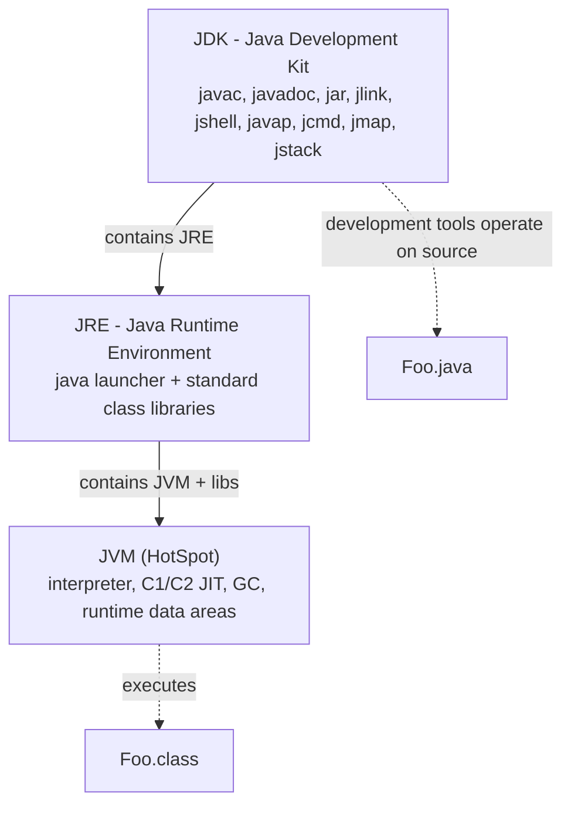
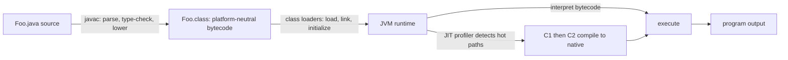
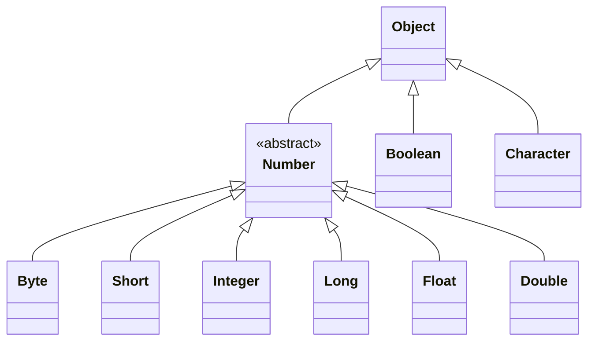
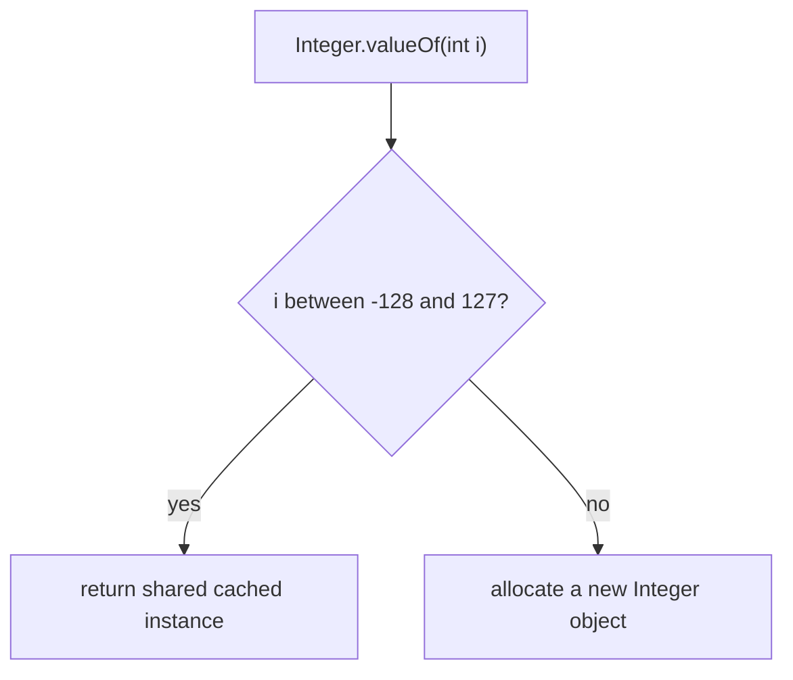
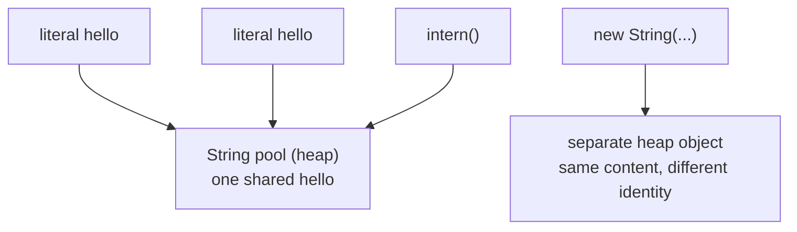
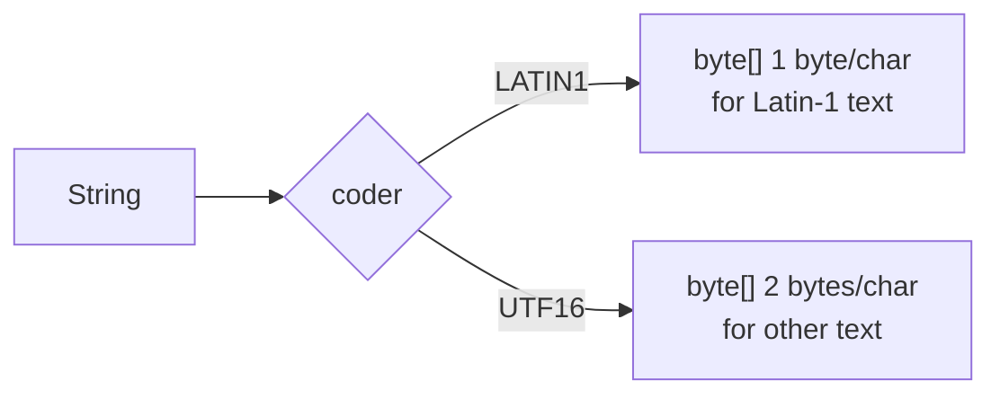
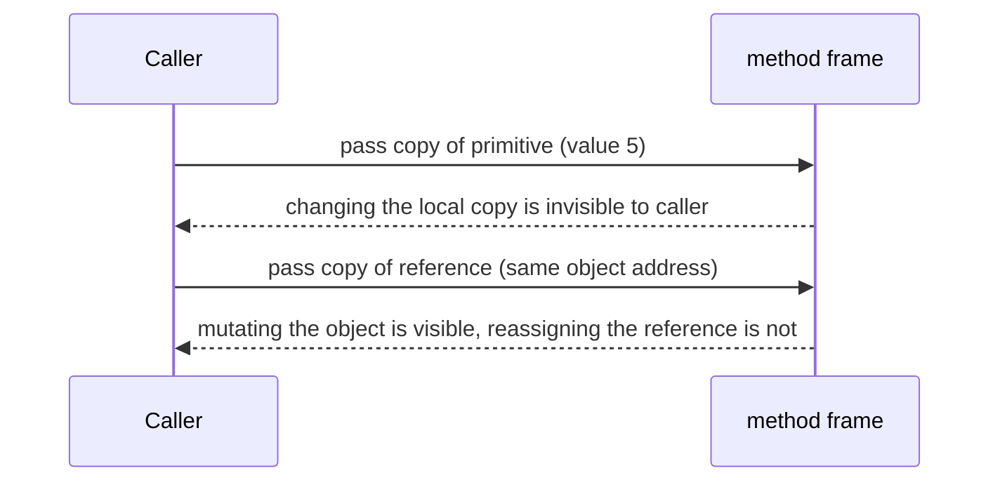
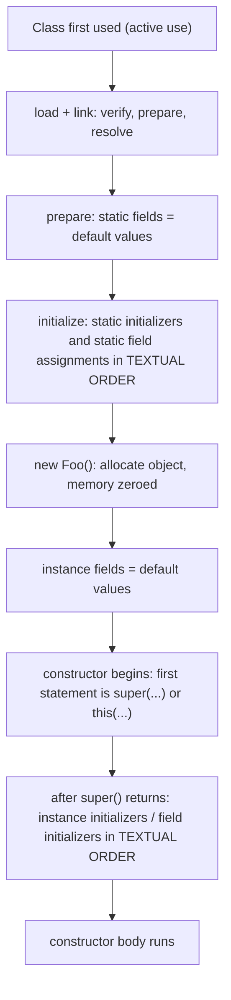
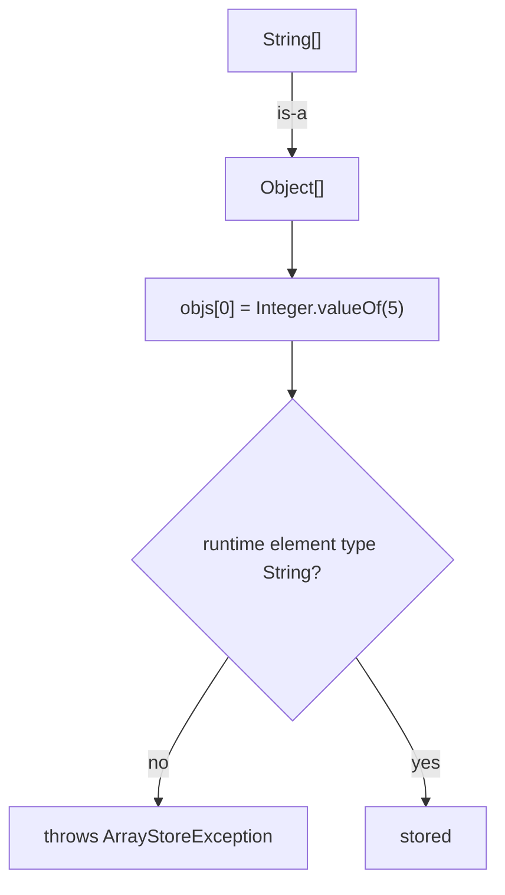
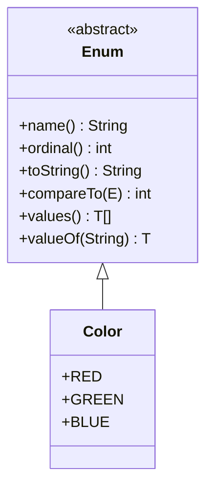

# Java Fundamentals

This module builds the mental model every other Java topic rests on. If you cannot reason precisely
about what a value *is* (a primitive bit pattern versus a reference), when the compiler inserts a
conversion, where an object lives, and what the JVM does with your source file, you cannot debug or
reason about real systems. Interviewers use fundamentals as a lie detector: a candidate who knows
Spring but not two's complement, autoboxing identity, or pass-by-value semantics will invent
confident nonsense the moment a question gets concrete.

The through-line is a single idea: **Java separates the language from the machine.** `javac` compiles
source into a portable intermediate representation (bytecode); a virtual machine maps that
representation onto real hardware at runtime. Everything downstream — memory layout, JIT compilation,
garbage collection, thread semantics — is a consequence of that separation.

> Rule of thumb: values on the left of `=` are *places*; expressions on the right are *evaluations*.
> Most Java surprises are a confusion between the two.

Related reading: [OOP Concepts](02-OOP-Concepts.md), [JVM Architecture](03-JVM-Architecture.md),
[Java Memory Areas](04-Java-Memory.md), [Class Loading](05-Class-Loading.md),
[Exception Handling](06-Exception-Handling.md), [Generics](07-Generics.md).

---

## 1. The Java Platform: JDK, JRE, JVM

### 1.1 What each layer is

| Layer | Full name | Contents | Used by |
|-------|-----------|----------|---------|
| **JVM** | Java Virtual Machine | Specification + a concrete implementation (HotSpot, OpenJ9, GraalVM). Bytecode interpreter, JIT compilers (C1/C2), garbage collectors, runtime data areas, class loading subsystem. | Runs `.class` files |

| **JRE** | Java Runtime Environment | JVM + the standard class libraries (`java.base`, etc.) needed to *run* applications. Historically a separate downloadable bundle. | End users running apps |
| **JDK** | Java Development Kit | JRE + development tools: `javac`, `javadoc`, `jar`, `jlink`, `jshell`, `javap`, `jcmd`, `jmap`, `jstack`, `jconsole`. | Developers |

Since **JDK 9** the JRE is no longer shipped as a separate bundle by Oracle: you download a JDK and
use `jlink` to create a tailored runtime image if you want a JRE-like artifact. Type `java --version`
and you are invoking the JDK's launcher against the JDK's own runtime.



> The JVM is a **specification**. HotSpot is one implementation. GraalVM's native image and
> OpenJ9 are others. Bytecode portability is guaranteed by the spec, not by any one VM.

### 1.2 The compile → load → execute pipeline



1. **Compile.** `javac` parses, type-checks, and *desugars* high-level constructs (autoboxing,
   enhanced for, string concatenation, lambdas, try-with-resources, switch expressions) into lower
   bytecode. Output: a `.class` file beginning with the magic `0xCAFEBABE`.
2. **Load.** A `ClassLoader` finds the bytes, defines the class, verifies it, prepares default values,
   resolves symbolic references, and runs static initializers. See [Class Loading](05-Class-Loading.md).
3. **Execute.** The bytecode interpreter executes; HotSpot profiles the bytecode and JIT-compiles hot
   methods (C1 first for speed, C2 for peak throughput). Deoptimization can undo this. See
   [JVM Architecture](03-JVM-Architecture.md) and [JVM Performance](../08-Advanced/38-JVM-Performance.md).

The class-file format version tracks the language level. Verify it yourself:

```bash
$ javac Box.java
$ javap -v Box | grep -E "major|minor"
  minor version: 0
  major version: 65          # 65 = Java 21 (52 = Java 8, 55 = Java 11, 61 = Java 17)
```

### 1.3 The toolchain

| Tool | Purpose | Typical invocation |
|------|---------|--------------------|
| `javac` | Compile source → bytecode | `javac -d out src/**/*.java` |
| `java` | Launch an app (also single-file source launch) | `java -cp out Foo`, `java Foo.java` |
| `jshell` | Interactive REPL (Java 9+) | `jshell` |
| `javadoc` | Generate HTML API docs from doc comments | `javadoc -d docs -sourcepath src pkg` |
| `jlink` | Assemble a custom runtime image from modules | `jlink --add-modules java.base --output img` |
| `jar` | Package classes into an archive | `jar --create --file app.jar --main-class Foo -C out .` |
| `javap` | Disassemble class files | `javap -c -p Box` |

**Single-file source launch** (Java 11+) compiles and runs in memory — no `.class` file is left behind:

```bash
$ cat Hello.java
public class Hello { public static void main(String[] a){ System.out.println("hi"); } }
$ java Hello.java
hi
```

**`jshell`** is invaluable for exploring semantics before trusting your memory:

```text
jshell> 0.1 + 0.2
$1 ==> 0.30000000000000004
jshell> Integer.valueOf(127) == Integer.valueOf(127)
$2 ==> true
jshell> Integer.valueOf(128) == Integer.valueOf(128)
$3 ==> false
```

> `jshell` runs on the JDK's own JVM. It is a *rapid experiment* tool, not a compilation guarantee —
> the REPL wraps snippets in synthetic classes, so some access rules differ from a normal `javac` build.

**`jlink`** bundles only the modules you need (see [Java Modules](../07-Modern-Java/31-Modules.md)):

```bash
$ jlink --module-path $JAVA_HOME/jmods --add-modules java.base --output minimal-jre
$ minimal-jre/bin/java --version
```

---

## 2. Primitives

### 2.1 The eight primitive types

| Type | Size (bits) | Range | Default | Wrapper | Literal example |
|------|------------|-------|---------|---------|-----------------|
| `byte` | 8 | `-128` … `127` | `0` | `Byte` | `(byte) 100` |
| `short` | 16 | `-32,768` … `32,767` | `0` | `Short` | `(short) 1000` |
| `int` | 32 | `-2^31` … `2^31 - 1` | `0` | `Integer` | `42` |
| `long` | 64 | `-2^63` … `2^63 - 1` | `0L` | `Long` | `42L` |
| `float` | 32 | IEEE-754 binary32 (~7 sig. digits) | `0.0f` | `Float` | `1.5f` |
| `double` | 64 | IEEE-754 binary64 (~15–16 sig. digits) | `0.0d` | `Double` | `1.5` |
| `char` | 16 | `0` … `65,535` (unsigned UTF-16 code unit) | `'\u0000'` | `Character` | `'A'` |
| `boolean` | not specified | `true` / `false` | `false` | `Boolean` | `true` |

> Java has **no unsigned integer primitives** (except `char`, which is an unsigned 16-bit code unit).
> Java 8 added unsigned *helper methods* — `Integer.divideUnsigned`, `toUnsignedLong`,
> `compareUnsigned`, `parseUnsignedInt` — but the type still has a sign bit.

`boolean` has no fixed size in the spec. HotSpot stores a `boolean` field in one byte, but
`boolean[]` is a byte array and the JVM uses `int` on the operand stack. Sorting by size is a
common interview trap: `boolean` is *not* 1 bit in the language model.

### 2.2 Two's complement and signedness

Integers use **two's complement**: the most significant bit has weight `-2^(n-1)`, all other bits
`+2^k`. Negation flips all bits and adds one. Consequences:

- There is one representation of zero; no "negative zero" for integers.
- The representable range is asymmetric: `MIN_VALUE` has no positive counterpart.
- Overflow wraps silently (modulo `2^n`).

```java
int max = Integer.MAX_VALUE;   //  2147483647
max + 1;                       // -2147483648  (wraps, no exception)
Math.abs(Integer.MIN_VALUE);   // -2147483648  (still negative — no positive counterpart!)
Integer.MIN_VALUE == -Integer.MIN_VALUE;  // true
```

```bash
$ jshell
jshell> Integer.toBinaryString(-1)
$1 ==> "11111111111111111111111111111111"
jshell> Integer.toHexString(-1)
$2 ==> "ffffffff"
jshell> Byte.MIN_VALUE + " " + Byte.MAX_VALUE
$3 ==> "-128 127"
jshell> (int) Character.MAX_VALUE
$4 ==> 65535
```

### 2.3 `char` is a UTF-16 code unit, not a code point

A `char` is 16 bits. Unicode code points above `U+FFFF` (emoji, many CJK extensions) require a
**surrogate pair** of two `char` values. Java 8 char literals such as `'\uD83D'` are legal but
meaningless alone.

```java
String rocket = "\uD83D\uDE80";     // U+1F680 ROCKET, two code units
System.out.println(rocket.length());          // 2  (UTF-16 code units)
System.out.println(rocket.codePointCount(0, rocket.length())); // 1 (code points)

char c = 'A';
System.out.println(c + 1);          // 66   — char promoted to int
System.out.println((char) (c + 1)); // B
char d = 'A' + 1;                   // B, compile-time constant narrowing is allowed
System.out.println(d);              // B
```

> `String.length()` counts UTF-16 **code units**, `String.codePointCount` counts Unicode **code
> points**. `str.charAt(i)` may return half a character. Iterate with `codePoints()` when correctness
> matters.

### 2.4 Default values

| Context | Default |
|---------|---------|
| Instance / static field | Type default (`0`, `0.0`, `false`, `'\u0000'`, `null`) |
| Array element | Type default |
| Local variable | **No default** — must be assigned before use (compile error) |
| Method parameter | No default — always supplied by caller |

```java
class Defaults {
    int i;            // 0
    Integer boxed;    // null
    char c;           // '\u0000'
    boolean flag;     // false
    void f() {
        int local;
        // System.out.println(local); // compile error: variable local might not have been initialized
    }
}
```

> "Local variables are not initialized" is a *compiler* rule (definite-assignment analysis), not a
> runtime one. Fields get their defaults because the JVM zeroes the memory during preparation/allocation.

---

## 3. Wrappers, Autoboxing, and the Cache

### 3.1 The wrapper hierarchy



All wrappers are `final` (except the abstract `Number`) and immutable. They implement `Comparable`
and `Serializable`; the `Number` subclasses expose `byteValue()`, `shortValue()`, `intValue()`,
`longValue()`, `floatValue()`, `doubleValue()` — the **narrowing** conversions.

### 3.2 Autoboxing and unboxing internals

Autoboxing is a compiler feature, not a JVM one. `javac` rewrites `Integer x = 5;` to
`Integer x = Integer.valueOf(5);` and `int y = x;` to `int y = x.intValue();`.

Confirm with `javap`:

```java
public class Box {
    public static void main(String[] args) {
        Integer x = 5;          // autobox
        int y = x;              // unbox
        String s = "a" + y + "b"; // indy string concat
        System.out.println(s);
    }
}
```

```text
$ javac Box.java && javap -c Box
  public static void main(java.lang.String[]);
       0: iconst_5
       1: invokestatic  Integer.valueOf:(I)Ljava/lang/Integer;   // boxing
       4: astore_1
       5: aload_1
       6: invokevirtual Integer.intValue:()I                      // unboxing
       9: istore_2
      10: iload_2
      11: invokedynamic makeConcatWithConstants:(I)Ljava/lang/String;  // Java 9+ concat
```

### 3.3 The wrapper cache

`Integer.valueOf(int)` **caches** instances for `-128..127` by default. The JDK also caches
`Byte` (all 256 values), `Short` and `Long` (`-128..127` by default; `Long`'s upper bound is also
tunable), `Character` (`0..127`), and the two `Boolean` constants.

```java
public final class Integer {
    public static Integer valueOf(int i) {
        if (i >= IntegerCache.low && i <= IntegerCache.high)
            return IntegerCache.cache[i + (-IntegerCache.low)];
        return new Integer(i);
    }
}
```



The high end is tunable: `-XX:AutoBoxCacheMax=<n>`, and `-Djava.lang.Integer.IntegerCache.high=<n>`.

```java
Integer a = 127, b = 127;   // a == b  -> true  (same cached instance)
Integer c = 128, d = 128;   // c == d  -> false (two distinct objects)
```

```bash
$ java -XX:AutoBoxCacheMax=1000 CacheProbe   # now 128 == 128 -> true
```

### 3.4 Identity traps

- **Never compare wrappers with `==` unless one side is a primitive** (which forces unboxing of the
  other). Use `equals` or `Objects.equals`.
- **Unboxing `null` throws `NullPointerException`** — silently, at the unboxing site, not where the
  null was created.
- **Ternary / conditional expressions** can unbox unexpectedly.

```java
Integer n = null;
// boolean bad = (n == 5);   // NPE: n is unboxed to compare with int 5
boolean ok = Objects.equals(n, 5);   // false, no NPE

// The classic: mixed conditional unboxes
Integer i = null;
int r = true ? i : 0;        // NPE — the ternary's type is int, so i is unboxed
```

| Comparison | Result | Why |
|------------|--------|-----|
| `Integer.valueOf(100) == Integer.valueOf(100)` | `true` | Both from cache |
| `Integer.valueOf(1000) == Integer.valueOf(1000)` | `false` | Two separate objects |
| `Integer.valueOf(1000).equals(Integer.valueOf(1000))` | `true` | Value equality |
| `Long l = 128L; long p = 128L; l == p` | `true` | One side primitive → unboxing |
| `Integer i = 1000; i < 2000` | `true` | Relational operators always unbox |
| `new Integer(100) == new Integer(100)` | `false` | Constructor bypasses cache (deprecated since 9) |

> `new Integer(...)`, `new Long(...)`, etc. are **deprecated for removal** since Java 9. Always use
> `valueOf` / autoboxing.

**Performance:** boxing allocates. In tight loops, accumulating into `Long`/`Integer` instead of
`long`/`int` allocates millions of objects and inflates GC pressure. Prefer primitives for hot paths.
Prefer `OptionalInt`/`IntStream`/`ToIntFunction` over boxed equivalents. See
[JVM Performance](../08-Advanced/38-JVM-Performance.md).

---

## 4. Numeric Promotion, Casting, Overflow, Floating Point

### 4.1 Binary numeric promotion rules

When an arithmetic or bitwise operator has two operands, the JVM needs one common type. The rules, in
order:

1. If either operand is `double`, both become `double`.
2. Else if either is `float`, both become `float`.
3. Else if either is `long`, both become `long`.
4. Otherwise both become `int` (this is why `byte + byte` is `int`).

`char` participates as an unsigned 16-bit value promoted to `int`.

```java
byte b1 = 1, b2 = 2;
// byte sum = b1 + b2;   // compile error: int cannot be converted to byte
int sum = b1 + b2;       // 3

System.out.println('a' + 1);        // 98   (int)
System.out.println(1 + 2.5f);       // 3.5  (float)
System.out.println(1 + 2L);         // 3    (long)
System.out.println('a' + "" + 1);   // a1   (string concatenation wins)
System.out.println("" + 'a' + 1);   // a1
System.out.println(1 + 2 + "x");    // 3x   (left-to-right: int add, then concat)
System.out.println("x" + 1 + 2);    // x12  (left-to-right: string, then concat)
```

### 4.2 Widening vs narrowing

**Widening** (smaller → larger: `byte → short → int → long → float → double`, plus `char → int`)
is implicit and safe (except `long → float` / `long → double` / `int → float` lose precision for
large values). **Narrowing** requires an explicit cast and can silently truncate.

```java
int big = 130;
byte narrow = (byte) big;      // -126  (130 - 256)
System.out.println(narrow);    // -126

long huge = 1L << 40;
float lossy = huge;            // compiles, value may round
System.out.println((long) lossy);  // 1099511627776 (this one happens to be exact)

double pi = 3.14159;
int truncated = (int) pi;      // 3, truncation toward zero
System.out.println(truncated);
```

Compound-assignment operators insert an implicit narrowing cast:

```java
byte b = 10;
b += 5;        // b = (byte)(b + 5), compiles
// b = b + 5;  // compile error without the cast
```

### 4.3 Overflow and exact arithmetic

Integer overflow wraps silently. When overflow must be an error, use the `Exact` family
(Java 8+): `Math.addExact`, `subtractExact`, `multiplyExact`, `negateExact`, `incrementExact`,
`decrementExact`, `toIntExact(long)`.

```java
System.out.println(Integer.MAX_VALUE + 1);          // -2147483648
try {
    Math.addExact(Integer.MAX_VALUE, 1);
} catch (ArithmeticException e) {
    System.out.println(e.getMessage());             // integer overflow
}
```

| Operation | Result / behavior |
|-----------|-------------------|
| `Integer.MAX_VALUE + 1` | `-2147483648` (wraps) |
| `Long.MAX_VALUE + 1` | `-9223372036854775808` (wraps) |
| `Math.addExact(Integer.MAX_VALUE, 1)` | throws `ArithmeticException: integer overflow` |
| `1 / 0` | throws `ArithmeticException: / by zero` |
| `1.0 / 0.0` | `Infinity` |
| `-1.0 / 0.0` | `-Infinity` |
| `0.0 / 0.0` | `NaN` |
| `7 / -3` | `-2` (truncation toward zero) |
| `-7 % 3` | `-1` (sign follows dividend) |

> Division and remainder by zero throw only for **integers**. Floating-point division by zero yields
> `Infinity`/`NaN` and does not throw. See [Exception Handling](06-Exception-Handling.md).

### 4.4 Floating point: IEEE-754

Java's `float`/`double` are IEEE-754 binary32/binary64. Most decimal fractions are not exactly
representable, so equality is a trap.

```java
System.out.println(0.1 + 0.2);          // 0.30000000000000004
System.out.println(0.1 + 0.2 == 0.3);   // false
System.out.println(1.0f / 3.0f);        // 0.33333334
System.out.println(1.0 / 3.0);          // 0.3333333333333333
System.out.println(Double.NaN == Double.NaN); // false  (NaN != everything, even itself)
System.out.println(Double.compare(Double.NaN, Double.NaN)); // 0
```

Compare floating point with a tolerance or `Double.compare`. For money and exact decimal semantics,
use `BigDecimal` (see [Date & Time / numeric notes] and the `BigDecimal` section below).

```java
boolean close = Math.abs((0.1 + 0.2) - 0.3) < 1e-9;   // true with tolerance
```

| Feature | `double` | `BigDecimal` |
|---------|----------|--------------|
| Exact decimal | No | Yes |
| Space | 8 bytes | Object + `BigInteger` + scale |
| Speed | Hardware-fast | Much slower |
| Equality | `==` broken for computed values | `compareTo` correct; `equals` includes scale |
| Best for | Scientific / fast math | Money, rates, exact decimals |

`BigDecimal` gotchas:

```java
BigDecimal a = new BigDecimal("0.1");          // always construct from String, not double
BigDecimal b = new BigDecimal("0.2");
System.out.println(a.add(b));                   // 0.3
System.out.println(new BigDecimal(0.1));        // 0.1000000000000000055511151231257827...
System.out.println(BigDecimal.valueOf(0.1));    // 0.1 (uses Double.toString, safer than the ctor)

new BigDecimal("2.0").equals(new BigDecimal("2.00"));      // false (scale differs)
new BigDecimal("2.0").compareTo(new BigDecimal("2.00"));   // 0

try {
    a.divide(new BigDecimal("3"));             // ArithmeticException: non-terminating
} catch (ArithmeticException e) { /* handle */ }
a.divide(new BigDecimal("3"), 4, RoundingMode.HALF_UP);    // 0.0333
```

> Always pass a `String` to the `BigDecimal` constructor, and always specify a scale + `RoundingMode`
> when dividing. Prefer `BigDecimal.valueOf(double)` when you must start from a `double`.

### 4.5 `strictfp` history

Before **Java 17**, floating-point expressions could use extended precision on some platforms,
making results platform-dependent. `strictfp` forced exact IEEE-754 semantics. **JEP 306** made all
floating-point expressions strict starting with **Java 17**, so `strictfp` is now a no-op and javac
warns `as of release 17, all floating-point expressions are evaluated strictly and 'strictfp' is not
required`. Remove it from modern code.

---

## 5. Literals

### 5.1 Integer literals

| Form | Example | Notes |
|------|---------|-------|
| Decimal | `42`, `1_000_000` | Underscores (Java 7+) are ignored, for readability |
| Long | `42L`, `42l` | Prefer uppercase `L` (lowercase looks like `1`) |
| Hex | `0x1F`, `0xFF_FF` | Base 16, prefix `0x` |
| Octal | `017` | Base 8, leading `0` — a common bug source |
| Binary | `0b1010`, `0b1111_0000` | Base 2, prefix `0b` (Java 7+) |

```java
int dec = 1_000_000;
long l = 0xFFFF_FFFFL;
int bin = 0b1010_1010;      // 170
int oct = 017;              // 15 — octal, NOT 17
// int bad = 09;            // compile error: 9 is not a valid octal digit
System.out.println(bin + " " + oct);   // 170 15
```

> **Classic bug:** a leading zero makes an integer literal octal. `int x = 015;` is 13, not 15.

### 5.2 Character escapes

| Escape | Meaning |
|--------|---------|
| `\n` `\r` `\t` `\b` `\f` | newline, carriage return, tab, backspace, form feed |
| `\\` `\'` `\"` | backslash, single quote, double quote |
| `\0` … `\377` | octal escape |
| `\uXXXX` | Unicode escape (processed *before* lexing — see trap) |

> **Trap:** `\uXXXX` is translated in a pre-lexing phase, so `\u000A` is a real line terminator and
> breaks the line *before* the parser sees it. `// comment \u000A int x = 1;` actually terminates the
> comment and injects code. Avoid `\u` escapes in surprising places.

```java
char tab = '\t';
char unicode = '\u0041';        // 'A'
System.out.println(unicode + "" + tab + "end");
```

### 5.3 String escapes / text blocks

String literals support the same escapes. A **text block** (`"""`, Java 15+, standard in 17+) gives
multi-line strings with incidental indentation stripped. See
[Text Blocks](../07-Modern-Java/36-Text-Blocks.md).

```java
String s = "line1\nline2\t\"quoted\"";
String block = """
        line1
        line2
        """;
System.out.println(block);
```

---

## 6. Equality, Strings, and Immutability

### 6.1 `==` vs `equals`

`==` compares **values**: for primitives, the bit pattern; for references, the identity
(address-equality) of the pointed-to object. `equals` is a method whose contract (reflexive,
symmetric, transitive, consistent, non-null) defines logical equality. The default `Object.equals`
is reference identity.

> For value types, `==` is what you want. For objects, `==` asks "same object?" and `equals` asks
> "same value?". The `equals`/`hashCode` contract is covered in [OOP Concepts](02-OOP-Concepts.md).

### 6.2 String immutability

`String` is `final`, and its internal byte/char array is never mutated after construction. Every
"modifying" method (`substring`, `toUpperCase`, `trim`, `replace`, `concat`, `+`) returns a new
`String`. Benefits: safe sharing (including the string pool and caching of `hashCode`), thread
safety, and secure use as a key / for class loading / passwords (though `char[]` is still preferred
for secrets so it can be wiped).

```java
String s = "abc";
String t = s.toUpperCase();
System.out.println(s + " " + t);   // abc ABC  (s unchanged)
```

### 6.3 The string pool and `intern()`

String literals are stored in a **string pool** inside the heap (the *string table*, reachable from
the class metadata). Repeats of the same literal share one instance. `new String("x")` always
allocates a fresh object outside the pool; `.intern()` returns the pooled instance (adding it if
absent).



```java
String s1 = "hello";
String s2 = "hello";
String s3 = new String("hello");
String s4 = s3.intern();

System.out.println(s1 == s2);                        // true  — same literal
System.out.println(s1 == s3);                        // false — different object
System.out.println(s1 == s4);                        // true  — interned
System.out.println("he" + "llo" == s1);              // true  — compile-time constant folding

String a = "ja", b = "va";
String runtime = a + b;                              // runtime concat, not a constant
System.out.println(runtime == "java");               // false
System.out.println(runtime.intern() == "java");      // true  — intern() pools it
```

**Constant folding:** concatenations of `final`/literal `String`s are folded by `javac`, so
`"he" + "llo"` *is* the literal `"hello"`. But `a + b` where `a`/`b` are non-`final` variables is
computed at runtime and lands off the pool.

```java
final String X = "ja";
final String Y = "va";
System.out.println((X + Y) == "java");   // true — compile-time constants fold
```

> **String deduplication:** the JVM can optionally dedupe *runtime* `String` contents
> (`-XX:+UseStringDeduplication`, G1) to save memory, but that does not put them in the pool and
> does not change identity semantics. See [Garbage Collection](../08-Advanced/39-Garbage-Collection.md).

`intern()` in a hot loop is dangerous: the string table is a fixed-size hashtable (default ~60013
buckets in HotSpot, tunable with `-XX:StringTableSize`) and over-interning causes contention and
latency. Prefer application-level caches for repeated keys.

### 6.4 Compact strings (Java 9+)

Since Java 9, `String` stores bytes plus a `byte coder` flag (`LATIN1` or `UTF16`) instead of a
`char[]`. Latin-1-only strings use 1 byte/char; otherwise UTF-16 at 2 bytes/char. This cuts heap for
typical ASCII-heavy workloads with no API change. `substring` was also changed to copy (pre-Java 7
it shared the backing array, leaking large arrays).



### 6.5 String vs StringBuilder vs StringBuffer

| | `String` | `StringBuilder` | `StringBuffer` |
|---|----------|-----------------|----------------|
| Mutability | Immutable | Mutable | Mutable |
| Thread safety | Immutable → safe | Not synchronized | Synchronized |
| Performance | Good reads, bad repeated concat | Fastest for building | Slower than builder (locking) |
| Use | Fixed text, keys | Local, single-thread building | Rare: shared, thread-safe building |

```java
String bad = "";
for (int i = 0; i < 5; i++) bad += i;        // O(n^2): allocates each iteration

StringBuilder good = new StringBuilder();
for (int i = 0; i < 5; i++) good.append(i);  // O(n) amortized
System.out.println(good);                    // 01234
```

> In a *single expression* the compiler already uses `invokedynamic makeConcatWithConstants`
> (Java 9+, replacing `StringBuilder` desugaring from Java 5–8) plus a `-XX:StringConcat` strategy
> (default `inline`). Explicit `StringBuilder` is for loops and conditionals. Pre-size with
> `new StringBuilder(capacity)` when the final length is known.

---

## 7. Pass-by-Value Semantics

Java is **always pass-by-value**. The value passed is either a primitive bit pattern or a
*reference* (an address copy). A method receives its own copy of the variable; it can never reassign
the caller's variable. It *can* mutate the object the copied reference points to.



```java
static void tryChange(int x) { x = 99; }
static void changeArray(int[] a) { a[0] = 99; }
static void reassignArray(int[] a) { a = new int[]{7, 8, 9}; }
static void append(StringBuilder sb) { sb.append("!"); }
static void reassign(StringBuilder sb) { sb = new StringBuilder("new"); }
static void concat(String s) { s = s + "!"; }

public static void main(String[] args) {
    int i = 1;        tryChange(i);   // i == 1
    int[] arr = {1,2,3}; changeArray(arr);      // arr[0] == 99
    int[] arr2 = {1,2,3}; reassignArray(arr2);  // arr2[0] == 1
    StringBuilder sb = new StringBuilder("hi"); append(sb);   // "hi!"
    StringBuilder sb2 = new StringBuilder("hi"); reassign(sb2); // "hi"
    String s = "hi";  concat(s);      // "hi"
}
```

> "Objects are passed by reference" is **wrong**. References are passed by value. The distinction is
> exactly why `reassignArray` and `reassign` have no effect while `changeArray` and `append` do.

**Varargs** are just syntactic sugar for an array parameter:

```java
static int sum(int... xs) {         // compiles to sum(int[] xs)
    int s = 0; for (int x : xs) s += x; return s;
}
sum(1, 2, 3);                       // compiler builds new int[]{1,2,3}
sum(new int[]{1, 2, 3});            // same call
sum();                              // empty array, not null
```

> `xs` is never `null` unless the caller explicitly passes `(int[]) null`. Overloading with both
> `f(int...)` and `f(int, int)` is legal but confusing; avoid it. A `null` literal argument to a
> varargs parameter triggers a warning because it is ambiguous.

---

## 8. Initialization Order, `static`, `final`/`finally`/`finalize`

### 8.1 Class and instance initialization order



The key ordering rules:

1. Static fields and static initializer blocks run **once**, in textual order, on first active use.
2. Instance field initializers and instance initializer blocks run in textual order, **after the
   superclass constructor returns** and **before the constructor body**.
3. `super()`/`this()` is always the first constructor statement (implicit if omitted).

```java
public class F3 {
    static { System.out.println("static block"); }
    static int staticCounter = initStatic();
    int instanceCounter = initInstance();
    { System.out.println("instance block"); }
    int instance2;
    F3() {
        System.out.println("constructor, instance2=" + instance2);
        instance2 = 99;
    }
    static int initStatic() { System.out.println("static field init"); return 1; }
    int initInstance() { System.out.println("instance field init"); return 2; }
    public static void main(String[] args) {
        System.out.println("main start");
        new F3();
        System.out.println("---second---");
        new F3();
    }
}
```

Exact output (verified on Java 21):

```text
static block
static field init
main start
instance field init
instance block
constructor, instance2=0
---second---
instance field init
instance block
constructor, instance2=0
```

Note the static block prints **before** the static field initializer because it appears earlier in
the source. Instance initializers run on every construction; statics only once.

> **Constructor + overridable method trap:** calling an overridable method from a constructor runs
> before the subclass's fields are initialized, so it sees defaults. See
> [OOP Concepts](02-OOP-Concepts.md).

### 8.2 `static` members

`static` fields/methods belong to the class, not an instance; they are initialized once. Static
methods cannot use `this`/`super` and cannot access instance members directly. Static methods are
**hidden**, not overridden (`p.who()` calls the compile-time type's method). See
[OOP Concepts](02-OOP-Concepts.md). Initialization of a class happens at "first active use":
`new`, static field access (non-constant), static method call, reflection
(`Class.forName` with `initialize=true`), or subclass initialization. Compile-time constants
(`static final` primitives/Strings) are inlined and do **not** trigger initialization.

```java
class ConstInline {
    static final int C = 42;                 // compile-time constant, inlined into callers
    static final String S = "x";
    static int notConstant = 1;              // access triggers class init
}
```

### 8.3 `final`, `finally`, `finalize`

| Keyword | Applies to | Meaning |
|---------|-----------|---------|
| `final` | variable / field / parameter | assign once |
| `final` | method | cannot be overridden |
| `final` | class | cannot be extended |
| `finally` | `try` block | runs after `try`/`catch`, even on exception/`return` |
| `finalize` | `Object` method | deprecated, unreliable cleanup hook; **never** rely on it |

```java
// finally can swallow an exception if it returns/throws
static int swallow() {
    try { throw new RuntimeException("boom"); }
    finally { return 42; }          // suppresses the exception!
}

// finally sees the value already computed but cannot change the returned primitive copy
static int capture() {
    int x = 1;
    try { return x; }               // returns 1
    finally { x = 2; }              // no effect on return value
}

// but it CAN change the state of a returned reference's target
static StringBuilder captureRef() {
    StringBuilder sb = new StringBuilder("a");
    try { return sb; }
    finally { sb.append("b"); }     // returned builder is "ab"
}
```

`finalize()` is deprecated for removal since Java 18 (`@Deprecated(forRemoval=true)`) because it is
unpredictable, adds a second GC pass, and can resurrect objects. Use `try-with-resources` +
`AutoCloseable`, `Cleaner`, or `PhantomReference` instead. See
[Exception Handling](06-Exception-Handling.md) and [GC](../08-Advanced/39-Garbage-Collection.md).

---

## 9. Arrays

### 9.1 Basics, jagged arrays, bounds

Arrays are **objects** (they extend `Object`, implement `Cloneable`/`Serializable`, have a `length`
field). Java has no true multidimensional arrays — only arrays of arrays, so they can be **jagged**
(each row a different length). Bounds are checked on every access; violations throw
`ArrayIndexOutOfBoundsException`.

```java
int[] a = new int[3];                 // [0,0,0]
int[] b = {1, 2, 3};
int[][] matrix = new int[2][3];       // 2 rows x 3 cols (each row separately allocated)
int[][] jagged = new int[2][];
jagged[0] = new int[]{1, 2, 3};
jagged[1] = new int[]{4};
System.out.println(a.length);                   // 3
System.out.println(matrix[0].length);           // 3
System.out.println(Arrays.deepToString(jagged)); // [[1, 2, 3], [4]]
// a[5] -> ArrayIndexOutOfBoundsException: Index 5 out of bounds for length 3
```

Array creation zero-fills: `0`, `0.0`, `false`, `'\u0000'`, `null`. `clone()` is a shallow copy.

```java
int[] src = {1, 2, 3};
int[] copy = src.clone();
copy[0] = 9;
System.out.println(src[0]);   // 1  (independent)
```

### 9.2 Array covariance and `ArrayStoreException`

Arrays are **covariant**: `String[]` is an `Object[]`. That means the *compiler* allows storing an
`Object` into an `Object[]` that is really a `String[]`; the *runtime* checks and throws
`ArrayStoreException`. This is the price of covariance (Java 1.0 design, before generics).



```java
Object[] objs = new String[3];
objs[0] = "ok";
objs[1] = Integer.valueOf(5);   // ArrayStoreException at runtime
```

> Arrays are covariant and checked at runtime; generics are invariant and checked at compile time.
> See [Generics](07-Generics.md). An array creation of a generic type (`new T[n]`) is illegal.

### 9.3 `java.util.Arrays` utilities

```java
import java.util.Arrays;

int[] x = {5, 1, 9};
Arrays.sort(x);                       // [1, 5, 9]
System.out.println(Arrays.toString(x));           // [1, 5, 9]
System.out.println(Arrays.binarySearch(x, 5));    // 1  (must be sorted!)
System.out.println(Arrays.equals(new int[]{1}, new int[]{1})); // true
int[] filled = new int[3];
Arrays.fill(filled, 7);               // [7, 7, 7]
int[][] deep = {{1, 2}, {3, 4}};
System.out.println(Arrays.deepToString(deep));    // [[1, 2], [3, 4]]
Arrays.deepEquals(deep, new int[][]{{1, 2}, {3, 4}}); // true
int[] range = Arrays.copyOfRange(x, 0, 2);        // [1, 5]
```

> `Arrays.equals` on `Object[]` uses `equals` element-wise but does not recurse; use
> `Arrays.deepEquals` for nested arrays. `Arrays.asList(...)` returns a **fixed-size** list backed by
> the array (structural changes throw `UnsupportedOperationException`). See
> [Collections Part 1](../02-Collections/08-Collections-Part-1.md).

**Memory layout:** a 1-D array is a contiguous block. A 2-D array is an array of references to row
arrays, so rows are not guaranteed contiguous (cache-unfriendly). For performance-sensitive numeric
code, prefer a flat `int[]` indexed as `row * cols + col`, which also avoids per-row object headers.
See [Java Memory Areas](04-Java-Memory.md).

---

## 10. Operators

### 10.1 Bitwise and shift

| Operator | Meaning |
|----------|---------|
| `&` | bitwise AND (also non-short-circuit boolean AND) |
| `\|` | bitwise OR (also non-short-circuit boolean OR) |
| `^` | bitwise XOR |
| `~` | bitwise complement |
| `<<` | left shift (fills with zeros) |
| `>>` | arithmetic right shift (sign-extends) |
| `>>>` | logical right shift (fills with zeros) |

Shift distance is taken modulo 32 for `int` and modulo 64 for `long` — a notorious footgun.

```java
System.out.println(1 << 31);    // -2147483648
System.out.println(-1 >> 1);    // -1          (sign-extended)
System.out.println(-1 >>> 1);   // 2147483647  (zero-filled)
System.out.println(1 << 32);    // 1           (32 % 32 == 0)
System.out.println(1 << 33);    // 2           (33 % 32 == 1)
System.out.println(1L << 64);   // 1           (64 % 64 == 0)
System.out.println(0xFFFFFFFF); // -1
```

On `boolean`, `&`, `|`, `^` are logical (not bitwise) but **not** short-circuit — both operands are
always evaluated.

### 10.2 Short-circuit vs eager

`&&` and `||` short-circuit; `&` and `|` do not. This is a correctness tool, not a micro-optimization.

```java
int[] arr = new int[1];
boolean safe = arr == null && arr[0] == 0;   // false, no NPE
boolean boom = arr == null & arr[0] == 0;    // evaluates right side → no NPE here (arr not null)
boolean npe  = true | (null.length() > 0);   // NPE (right side evaluated)
```

> `false && anything` is `false` without evaluating `anything`. `true || anything` is `true`
> likewise. Use this to guard null/dereference patterns and to avoid expensive calls.

### 10.3 Ternary and compound assignment

The conditional operator `cond ? a : b` has a single resulting type determined by numeric promotion
(beware unboxing NPEs). Compound assignments `+=`, `-=`, `*=`, `/=`, `%=`, `&=`, `|=`, `^=`, `<<=`,
`>>=`, `>>>=` perform an implicit narrowing cast:

```java
byte b = 10;
b += 5;        // (byte)(b + 5) == 15
// b = b + 5;  // error

Integer i = null;
// int r = true ? i : 0;   // NPE: promoted to int, i unboxed
```

Operator precedence (high → low, abridged):
postfix `x++ x--` → unary `++x --x +x -x ~ !` → multiplicative → additive → shift → relational →
equality → `&` → `^` → `|` → `&&` → `||` → ternary → assignment.

---

## 11. Control Flow and `var`

### 11.1 Control flow overview

`if/else`, `switch` (statement, and expression in Java 14+), `for`, enhanced `for`, `while`,
`do-while`, labeled `break`/`continue`. There is **no `goto`** (labels + break/continue cover the
common case), and no truthy values — conditions must be `boolean`.

```java
outer:
for (int i = 0; i < 3; i++) {
    for (int j = 0; j < 3; j++) {
        if (j == 1) continue outer;
        if (i == 2) break outer;
        System.out.println(i + "," + j);
    }
}
// 0,0  1,0

int k = 2;
switch (k) {              // classic switch falls through without break
    case 1: System.out.println("one");
    case 2: System.out.println("two");     // prints "two"
    case 3: System.out.println("three");   // prints "three"
    default: System.out.println("default"); // prints "default"
}
```

Modern switch expressions (arrow syntax, `yield`, exhaustiveness) are covered in
[Switch Expressions](../07-Modern-Java/35-Switch-Expressions.md). Enhanced `for` over a `null` array
throws `NullPointerException` immediately.

### 11.2 `var` — local variable type inference (Java 10+)

`var` is not a type; it asks the compiler to infer the type of a local variable from the
initializer. It is **still statically typed** — no dynamic behavior.

Where `var` is allowed:

- local variable declarations with an initializer
- enhanced `for` loop variables
- indices in classic `for`
- try-with-resources resources
- lambda **parameters** (Java 11), incl. annotations: `(var x, var y) -> ...`

Where it is not allowed:

- fields, method parameters, return types
- without an initializer (`var x;`)
- initialized to `null` (`var x = null;`)
- array initializer shorthand (`var a = {1,2,3};`)
- compound declarations (`var a = 1, b = 2;` is illegal)
- catch parameters (use the explicit type)

```java
var list = new java.util.ArrayList<String>();   // ArrayList<String>
for (var s : list) { }                           // String
try (var sc = new java.util.Scanner("42")) { }   // Scanner
var anon = new Object() { int x = 5; };          // anonymous class type (not expressible otherwise)
System.out.println(anon.x);                      // 5
// var n = null;         // error: cannot infer type
// var a = {1, 2, 3};    // error: array initializer needs a type
```

> Best practice: use `var` where the type is obvious from the right-hand side (`var users = new
> ArrayList<User>();`), avoid it where the type carries meaning that is not evident (`var result =
> service.process();`). Because lambda parameters with `var` allow annotations, use that form only
> when needed (`(@Nonnull var x) -> ...`).

---

## 12. Packages, Imports, and `main`

### 12.1 Packages and imports

A package maps to a directory and provides a namespace and access boundary. `import` only saves
typing — it does not affect runtime. Imports are compile-time; unused imports are warnings, not
errors.

```java
package com.acme.app;                 // first non-comment statement

import java.util.List;                // single-type import
import java.util.*;                   // on-demand (wildcard) import — NOT recursive into subpackages
import static java.lang.Math.PI;      // static import: brings a static member into scope
import static java.util.Arrays.asList;

public class Demo {
    public static void main(String[] args) {
        List<String> xs = asList("a", "b");
        System.out.println(PI);
    }
}
```

Rules and gotchas:

- `java.lang.*` is implicitly imported.
- `import java.util.*` does not import `java.util.concurrent.*`.
- Two wildcard imports that expose the same simple name cause an ambiguity error only at the use site.
- A same-package class needs no import.
- `import static` imports a static member, not a type.

### 12.2 `main(String[])` signature

The launcher looks for `public static void main(String[] args)`. Valid variations:

- `String[] args`, `String args[]`, `String... args` (all equivalent).
- The array parameter may be any reference-compatible? No — it must be `String[]` (or varargs).
- `public` and `static` are required by the launcher (the JVM can *find* a non-public main on the
  classpath in some launcher configurations, but the canonical, portable signature is public static).

```java
public class F10 {
    public static void main(String... args) {   // valid; args.length == 0 when none passed
        System.out.println("args len=" + args.length);
    }
}
```

If you pass arguments after the class name, they arrive as `args`. A missing `main` yields
`Error: Main method not found in class Foo`.

### 12.3 `System.exit`

`System.exit(int status)` terminates the JVM immediately, running shutdown hooks, with the given exit
code; `0` means success, non-zero failure. It does **not** return, so code after it is unreachable.
`Runtime.getRuntime().halt(int)` kills without shutdown hooks. Prefer returning from `main` (exit 0)
or letting exceptions propagate for services; reserve `System.exit` for CLI tools and fatal startup
failures.

```java
public static void main(String[] args) {
    if (args.length == 0) {
        System.err.println("usage: app <file>");
        System.exit(2);          // non-zero exit code
    }
    // ...
}
```

---

## 13. Enums

### 13.1 Basics

An `enum` type is a `final` class extending `java.lang.Enum<E>`; each constant is a `public static
final` instance, created at class initialization. Enums are type-safe, `Comparable` by declaration
order, and `Serializable` with a special guarantee that deserialization returns the same singleton
instance (see [Serialization](../06-Reflection/29-Serialization.md)).



### 13.2 Constructors, fields, methods, constant bodies

Enum constructors are implicitly `private`; constants are declared before any fields/methods.
Constants can override methods with per-constant class bodies (anonymous subclasses).

```java
public enum Op {
    ADD("+") { int apply(int a, int b) { return a + b; } },
    SUB("-") { int apply(int a, int b) { return a - b; } };

    private final String symbol;
    Op(String symbol) { this.symbol = symbol; }   // implicitly private
    String symbol() { return symbol; }
    abstract int apply(int a, int b);
}
```

```java
System.out.println(Op.ADD.apply(2, 3));       // 5
System.out.println(Op.ADD.symbol());          // +
System.out.println(Op.valueOf("SUB").apply(9, 4));  // 5
System.out.println(Arrays.toString(Op.values()));   // [ADD, SUB]
System.out.println(Op.ADD.ordinal());         // 0
System.out.println(Op.ADD.name());            // ADD
```

`values()` returns a fresh array each call (allocation — cache it if used in a hot loop).
`valueOf(String)` throws `IllegalArgumentException` if the name is unknown; it matches `name()`,
not `toString()`.

### 13.3 Enum singleton

A single-constant enum is the most robust singleton (serialization- and reflection-safe, lazy on
class init, thread-safe by the JVM):

```java
public enum Singleton {
    INSTANCE;
    int count() { return 1; }
}
Singleton.INSTANCE == Singleton.INSTANCE;   // true
```

### 13.4 `EnumSet` and `EnumMap` (pointer)

`EnumSet` and `EnumMap` are specialized, array/bit-vector-backed collections keyed by ordinal — far
faster and smaller than `HashSet`/`HashMap` for enum keys. `EnumSet.of(...)`, `EnumSet.allOf(...)`,
`EnumSet.noneOf(...)`. See [Collections Part 1](../02-Collections/08-Collections-Part-1.md) and
[Collections Part 2](../02-Collections/09-Collections-Part-2.md).

```java
EnumSet<Op> set = EnumSet.of(Op.ADD);
EnumMap<Op, String> map = new EnumMap<>(Op.class);
map.put(Op.SUB, "minus");
System.out.println(set + " " + map);   // [ADD] {SUB=minus}
```

Switch expressions over enums are exhaustive-checked by the compiler (no `default` needed when all
constants are covered); see [Switch Expressions](../07-Modern-Java/35-Switch-Expressions.md).

---

# Interview Questions

## Beginner

**Q1. What is the difference between the JDK, the JRE, and the JVM?**
The **JVM** is the runtime that executes bytecode; it is a specification with implementations such
as HotSpot, OpenJ9, and GraalVM. The **JRE** is a runtime bundle: a JVM plus the standard class
libraries required to run applications (no compiler). The **JDK** is a development kit: a JRE plus
development tools (`javac`, `javadoc`, `jar`, `jlink`, `jshell`, `javap`, `jcmd`, ...). Since Java 9
Oracle no longer ships a standalone JRE; you create one with `jlink` if needed. Practically: install
a JDK, which contains everything.

**Q2. Is Java pass-by-value or pass-by-reference?**
Always **pass-by-value**. For primitives, the value is the bit pattern; for objects, the value is a
copy of the reference (address). A method can mutate the object a reference points to, but cannot
reassign the caller's variable. `void f(StringBuilder sb){ sb = new StringBuilder(); }` has no
observable effect on the caller's reference.

**Q3. What are the eight primitive types and their sizes?**
`byte` (8), `short` (16), `int` (32), `long` (64), `float` (32), `double` (64), `char` (16, unsigned
UTF-16 code unit), `boolean` (size unspecified; logically 1 bit, HotSpot stores 1 byte per field).
Everything else is a reference type.

**Q4. What is autoboxing and unboxing?**
Autoboxing is the compiler converting a primitive to its wrapper (`Integer.valueOf`); unboxing is the
reverse (`intValue`). It is a compile-time desugaring, visible in bytecode. It can surprise you:
`Integer a = 1000, b = 1000; a == b` is `false`, and unboxing a `null` wrapper throws
`NullPointerException`.

**Q5. Why is `0.1 + 0.2 != 0.3`?**
Because `float`/`double` are IEEE-754 binary fractions and 0.1/0.2 are not exactly representable; the
sum is `0.30000000000000004`. Compare with a tolerance (`Math.abs(diff) < eps`) or use
`BigDecimal` for exact decimal arithmetic.

**Q6. What is the difference between `==` and `equals`?**
`==` compares values: primitive bit patterns or reference identity. `equals` is a method defining
logical equality (default is identity). For strings and wrappers, use `equals` (or
`Objects.equals`); for primitives, use `==`.

**Q7. What is a `String` and why immutable?**
An immutable UTF-16 (compactly stored) sequence. Immutability enables safe sharing in the string
pool, thread safety, cached `hashCode`, and safe use as map keys. Every "modifying" method returns a
new `String`.

**Q8. What does `static` mean?**
A `static` member belongs to the class rather than an instance. Static fields are initialized once
and shared; static methods cannot use `this`/`super`. Static methods are hidden (resolved by
compile-time type), not overridden.

**Q9. What is a `final` variable?**
A variable that can be assigned once. For a reference, `final` means the reference cannot be
reassigned, but the referenced object is still mutable (unless itself immutable).

**Q10. What is `char` in Java?**
A 16-bit unsigned integer holding a UTF-16 code unit, range `'\u0000'`–`'\uFFFF'`. It is a primitive
but not a `Number`; arithmetic promotes it to `int`. Characters outside the BMP need a surrogate
pair (two `char`s).

**Q11. What is the `main` method signature?**
`public static void main(String[] args)`. `String... args` and `String args[]` are equivalent. The
launcher requires it to be `public static void` with a single `String[]` parameter.

**Q12. What are varargs?**
`void f(int... xs)` is sugar for `void f(int[] xs)`. The compiler packs arguments into an array;
`xs` is never null unless explicitly passed null.

## Intermediate

**Q1. Explain the wrapper cache. Which types are cached and over what range?**
`Integer.valueOf` returns cached instances for `-128..127` (upper bound tunable via
`-XX:AutoBoxCacheMax` / `-Djava.lang.Integer.IntegerCache.high`). `Byte` caches all 256 values;
`Short` and `Long` cache `-128..127`; `Character` caches `0..127`; `Boolean` caches both constants.
`new Integer(...)` bypasses the cache and is deprecated for removal. Thus
`Integer.valueOf(127) == Integer.valueOf(127)` is true but the same with 128 is false.

**Q2. What are the numeric promotion rules?**
For binary numeric operators: if either operand is `double` it becomes `double`; else if `float`;
else if `long`; else both become `int`. So `byte + byte` is `int` and `char + int` is `int`. Constant
expressions of `int` are additionally narrowed when assigned to `byte`/`short`/`char` if they fit.

**Q3. How do shifts behave with out-of-range distances?**
The distance is masked: `int` shifts use only the low 5 bits (mod 32), `long` shifts the low 6 bits
(mod 64). So `1 << 32 == 1` and `1L << 64 == 1L`. `>>>` always fills with zeros; `>>` sign-extends.

**Q4. What is the string pool and what does `intern()` do?**
The pool (string table) holds one canonical instance per distinct literal. Literals and compile-time
constant folds use it. `new String("x")` allocates outside the pool; `.intern()` returns the pooled
instance, adding it if absent. Interning in hot loops causes table contention; prefer app caches.

**Q5. What is compact strings?**
Since Java 9, `String` stores a `byte[]` plus a coder flag: LATIN1 (1 byte/char) or UTF16 (2
bytes/char). ASCII-heavy applications use about half the memory for string data, transparently.

**Q6. Explain the initialization order of a class and its instances.**
Static initializers in textual order on first active use; then per construction: zero-fill fields,
run the superclass constructor chain, run instance initializers/field initializers in textual order,
then the constructor body. Static blocks run once; instance initializers run every construction.

**Q7. What is the difference between `final`, `finally`, and `finalize`?**
`final` is a modifier (assign-once / no-override / no-extend). `finally` is a `try` clause that
always runs. `finalize` is a deprecated `Object` method invoked by the GC before reclaiming an
object; it is unreliable and deprecated for removal since Java 18.

**Q8. Why is array covariance dangerous?**
`String[]` is an `Object[]`, so the compiler permits `objs[i] = someObject;`; the runtime then throws
`ArrayStoreException` if the element is not a `String`. Generics avoid this by being invariant and
compile-time-checked.

**Q9. What does `var` do and where can it be used?**
Local variable type inference (Java 10+): the compiler infers the static type from the initializer.
Allowed for local variables, `for`/enhanced-`for` variables, try-with-resources, and lambda
parameters; not for fields, method parameters, return types, without initializer, or with `null`.

**Q10. Compare `String`, `StringBuilder`, and `StringBuffer`.**
`String` immutable; `StringBuilder` mutable, not synchronized, fastest for building;
`StringBuffer` mutable, synchronized, rarely needed. Use `StringBuilder` for loops and heavy
concatenation, generally pre-sized.

**Q11. What does `import static` do?**
Imports a static member (field or method) into scope so it can be used without a class qualifier,
e.g. `import static java.lang.Math.PI;` then `PI`. It does not import types and does not recurse.

**Q12. Why use `Math.addExact`?**
Integer arithmetic wraps silently. `Math.addExact`/`subtractExact`/`multiplyExact` throw
`ArithmeticException` on overflow, turning a silent corruption into a detectable error. Use them in
sensitive arithmetic (accounting, indexing, IDs).

## Advanced

**Q1. At the bytecode level, what does autoboxing compile to, and why does it matter?**
It compiles to `Integer.valueOf(int)` for boxing and `Integer.intValue()` for unboxing (see `javap
-c`). It matters because it inserts allocation and can throw `NullPointerException`, and because
`==` between wrappers compares identity unless a primitive forces unboxing.

**Q2. How does string concatenation compile in Java 9+ versus Java 8?**
Java 8 desugared `a + b` into `new StringBuilder().append(a).append(b).toString()`. Java 9+
(JEP 280) uses `invokedynamic makeConcatWithConstants`, which lets the runtime choose a strategy
(default `-XX:StringConcat=inline` uses a pre-sized `StringConcatFactory` recipe; `bc` uses
StringBuilder). It allows constant-folding parts and avoids intermediate builders.

**Q3. Why can calling an overridable method from a constructor be dangerous?**
The subclass override runs during the superclass constructor *before* the subclass's fields are
initialized, so it observes default values (`0`/`null`). This is a classic source of null-dereference
bugs. Make such methods `final`/`private`, or don't call them from constructors.

**Q4. What is `strictfp` and does it still matter?**
Before Java 17, `strictfp` forced exact IEEE-754 evaluation, preventing extended-precision
platform variance. JEP 306 (Java 17) made all FP expressions strict, so `strictfp` is a no-op and
javac warns `as of release 17, all floating-point expressions are evaluated strictly and 'strictfp'
is not required`.

**Q5. Explain the difference between `Integer` equality under `-XX:AutoBoxCacheMax`.**
The Integer cache high value is configurable; raising it via `-XX:AutoBoxCacheMax=1000` makes
`Integer.valueOf(300) == Integer.valueOf(300)` true. This is a JVM tuning flag, not language
semantics, and must never be relied on for correctness.

**Q6. What happens when you compare `Long` and `long`, or use `<` between wrappers?**
If one operand is a primitive, the wrapper is unboxed and the comparison is by value. Relational
operators (`<`, `>`, `<=`, `>=`) always unbox both operands; if a wrapper is null, this throws
`NullPointerException`. Only `==`/`!=` can compare wrapper identities.

**Q7. Why does `BigDecimal.equals` disagree with `compareTo`?**
`equals` compares value *and scale* (`2.0` != `2.00`), while `compareTo` compares numeric value
only. For map keys and equality use `compareTo == 0` semantics deliberately; be consistent between
`equals` and `hashCode` if you wrap `BigDecimal`.

**Q8. How is a `boolean` stored in memory?**
The language does not specify. On HotSpot, a `boolean` field occupies one byte, `boolean[]` is a
byte array, and a `boolean` on the operand stack is an `int`. Do not assume 1 bit or a fixed layout.

**Q9. What is string deduplication and how does it differ from interning?**
`-XX:+UseStringDeduplication` (G1) detects equal `byte[]` contents of *runtime* strings and makes
them share one array, reducing heap. It does not change identity or put strings in the pool, unlike
`intern()`. You cannot observe dedup from Java code.

**Q10. Why is `Math.abs(Integer.MIN_VALUE)` negative?**
`int` range is asymmetric (`-2147483648` to `2147483647`); `-MIN_VALUE` overflows back to
`MIN_VALUE`. Use `long` or `Math.absExact` (Java 15+, throws on `MIN_VALUE`) when this matters.

## Expert

**Q1. Walk through what happens from `new Foo()` to the constructor body running.**
1. Constant pool resolves `Foo`. 2. `new` triggers class loading/linking/initialization if not done:
`prepare` sets static fields to defaults, then static initializers run in order. 3. `new` allocates
a zeroed object on the heap with a header (mark word + klass pointer). 4. The `<init>` constructor
runs; first instruction invokes `super.<init>()` (or `this(...)`). 5. After the super constructor
returns, instance field initializers and instance initializer blocks execute in textual order. 6.
The constructor body executes.

**Q2. Why does the JVM need a string table and how is it sized?**
The string table is a fixed-size hashtable in native/C-heap metadata (not the Java heap) mapping
string contents to interned `String` references; default size ~60013 buckets, tunable with
`-XX:StringTableSize`. It gives O(1) `intern()` and literal resolution. Over-interning causes long
bucket chains, CPU contention, and latency; GC may clear weakly-referenced interned strings.

**Q3. What is the difference between array covariance and generic invariance at the type-system
level?**
Array covariance (`String[] <: Object[]`) is **unsound** without runtime checks, which is why
`ArrayStoreException` exists (a *runtime* check inserted by the JVM on `aastore`). Generics are
invariant (`List<String>` is not `List<Object>`), enforced at compile time via erasure; there is no
runtime check. Use site variance in generics (`? extends`/`? super`) to regain flexibility safely.
See [Generics](07-Generics.md).

**Q4. How are local variables and fields laid out, and why does it affect performance?**
Fields are laid out by the JVM with the object header and reference fields arranged to reduce
padding; primitives are inlined in the object; references are 64-bit (compressed to 32-bit with
`-XX:+UseCompressedOops` on heaps < 32 GB). Local primitives live in the stack frame; local
references are pointers. Accessing an array of values is cache-friendly if contiguous; an array of
objects is not (pointer chasing). See [Java Memory Areas](04-Java-Memory.md).

**Q5. Why is `finalize()` deprecated for removal and what replaces it?**
It is unpredictable, may never run, can resurrect objects (forcing extra GC passes), and executes on
a finalizer thread that can be blocked or starved. Replace with `AutoCloseable` +
try-with-resources, `java.lang.ref.Cleaner`, or `PhantomReference` + `ReferenceQueue`.

**Q6. Under what conditions does a class NOT get initialized when referenced?**
Referencing a `static final` compile-time constant (primitive or `String`) does not trigger
initialization because the value is inlined. Also, declaring an array of the class, or accessing a
`Class` literal (`Foo.class`) or `Class.forName(name, false, loader)`, does not initialize. See
[Class Loading](05-Class-Loading.md).

**Q7. Explain stack vs heap for `int x = 5; Integer y = 5;`.**
`x` is a 32-bit value stored in the stack frame (or in an object if it is a field). `y` is a
reference (typically 32-bit compressed oops) stored in the stack frame, pointing to an `Integer`
object on the heap whose header + `value` field live contiguously; for small values it points to the
shared cached instance.

**Q8. How does `invokedynamic makeConcatWithConstants` improve on `StringBuilder` concatenation?**
It defers the concat strategy to the runtime, allowing the JIT to pre-size the buffer, constant-fold
literal fragments into the recipe, and avoid allocating an intermediate `StringBuilder` per
expression. On the first execution a bootstrap method (`StringConcatFactory`) links a
`MethodHandle`-based recipe; subsequent calls are direct.

## Scenario Based

**Q1. A counter using `Long` grows without bound and the service GC pauses rise over time. Diagnose.**
Boxing. `Long counter; counter = counter + 1;` allocates a new `Long` each increment (outside the
cache), churning young-gen and driving GC. Fix: use `long`, or `AtomicLong`/`LongAdder` for
concurrency, which operate on primitives. Verify with a profiler showing `java.lang.Long`
allocation sites.

**Q2. A method receives an object, mutates it, and the caller sees changes; a teammate says "Java is
pass-by-reference". How do you explain?**
The reference is passed by value. The method has a copy pointing to the same object, so mutation of
the object is visible; if the method reassigned its parameter to a new object, the caller would
still see the original. Demonstrate with a `StringBuilder` append (visible) versus reassignment (not).

**Q3. Money calculations show off-by-a-cent errors in production. What do you do?**
`double`/`float` cannot represent decimals exactly. Refactor monetary arithmetic to `BigDecimal`
constructed from `String`, with explicit scale and `RoundingMode` on division, and use `compareTo`
for equality. Also audit DB column types (use `DECIMAL`/`NUMERIC`, map to `BigDecimal`).

**Q4. You need a fast, immutable map keyed by enum values used millions of times. Which collection?**
`EnumMap` (array-backed, indexed by ordinal) — much faster and smaller than `HashMap`. For sets,
`EnumSet` (bit-vector). Both require a single enum key type and are not thread-safe; wrap if shared.

**Q5. A hot loop concatenates strings and causes latency spikes. How do you fix it?**
Replace `s += ...` with a single pre-sized `StringBuilder`, or use a `StringJoiner`. In expressions,
Java 9+ `invokedynamic` already pre-sizes, but repeated `+=` across iterations reallocates O(n^2).
Confirm allocation hotspots with async-profiler before and after.

**Q6. A `Integer` field is null and an `== 0` check throws NPE in the logs. Why?**
`==` with an `int` operand unboxes the wrapper; a null wrapper throws at that point. Use
`Objects.equals(field, 0)` or `field != null && field == 0`, or use a primitive field with a default.

**Q7. Two identical-looking `String`s from different sources are unequal with `==`. Explain and fix.**
One came from a literal/pool, the other from runtime concatenation or `new String`/input parsing, so
they are distinct objects. Compare with `equals`, or `intern()` if you truly need identity (rare).
For map keys this is irrelevant because `HashMap` uses `equals`/`hashCode`.

**Q8. A config value is stored as `long` but consumed as `int`, silently truncating. How to prevent?**
Narrowing with a cast truncates high bits. Use `Math.toIntExact(long)` (throws on overflow) instead of
`(int)`, validate at boundaries (config parsing), and keep the type consistent end to end.

## Output Prediction

**Q1.**
```java
Integer a = 127, b = 127, c = 128, d = 128;
System.out.println((a == b) + " " + (c == d));
```
Output: `true false`. Reason: `127` is inside the Integer cache, so `a` and `b` share one instance;
`128` is outside, so `c` and `d` are distinct heap objects and `==` compares identity.

**Q2.**
```java
System.out.println(0.1 + 0.2);
System.out.println(0.1 + 0.2 == 0.3);
```
Output:
```text
0.30000000000000004
false
```
Reason: binary floating point cannot represent 0.1/0.2 exactly; the sum differs from the literal
`0.3` in the last bits, so `==` is false.

**Q3.**
```java
System.out.println(1 << 32);
System.out.println(1 << 33);
System.out.println(-1 >>> 1);
```
Output:
```text
1
2
2147483647
```
Reason: shift distance is masked mod 32, so `<< 32` is `<< 0` (1) and `<< 33` is `<< 1` (2);
`>>>` is a logical shift filling with zeros.

**Q4.**
```java
byte b = 10;
b += 5;
// b = b + 5;   // uncomment?
System.out.println(b);
```
Output: `15`. Reason: `b += 5` inserts an implicit `(byte)` cast. The commented line would be a
compile error because `b + 5` is `int`.

**Q5.**
```java
int x = 1;
x = x++ + ++x;
System.out.println(x);
```
Output: `4`. Reason: evaluation uses a left-to-right operand stack. `x++` yields 1 and increments
`x` to 2; `++x` increments `x` to 3 and yields 3; `1 + 3 = 4` is assigned, overwriting the
post-increment. (The post-increment side effect is lost.)

**Q6.**
```java
String s1 = "hello";
String s2 = new String("hello");
String s3 = s2.intern();
String s4 = "he" + "llo";
System.out.println(s1 == s2);
System.out.println(s1 == s3);
System.out.println(s1 == s4);
```
Output:
```text
false
true
true
```
Reason: `s2` is a fresh heap object; `s3` is pooled; `"he" + "llo"` is a compile-time constant folded
to the literal `"hello"`.

**Q7.**
```java
Object[] objs = new String[2];
objs[0] = "ok";
try { objs[1] = Integer.valueOf(1); }
catch (ArrayStoreException e) { System.out.println("ASE"); }
```
Output: `ASE`. Reason: array covariance makes the compiler accept `Object` into an `Object[]`, but
the runtime element type is `String`, so `aastore` throws `ArrayStoreException`.

**Q8.**
```java
Integer i = null;
try {
    int r = true ? i : 0;
    System.out.println(r);
} catch (NullPointerException e) {
    System.out.println("NPE");
}
```
Output: `NPE`. Reason: the conditional expression's type is `int` (numeric promotion), so `i` is
unboxed via `intValue()`, dereferencing null.

**Q9.**
```java
System.out.println('a' + 'b');
System.out.println("" + 'a' + 'b');
```
Output:
```text
195
ab
```
Reason: `'a' + 'b'` promotes both `char`s to `int` (`97 + 98 = 195`). `"" + 'a' + 'b'` is
left-associative string concatenation, so it produces `"ab"`.

**Q10.**
```java
System.out.println(7 / -3);
System.out.println(-7 % 3);
System.out.println(1.0 / 0.0);
```
Output:
```text
-2
-1
Infinity
```
Reason: integer division truncates toward zero; remainder takes the dividend's sign; floating-point
division by zero yields `Infinity` (no exception).

**Q11.**
```java
class Init {
    static int a = 1;
    int b = 2;
    static { a = 3; }
    Init() { System.out.println(a + "," + b); b = 9; }
    public static void main(String[] args) {
        new Init();
        System.out.println(a);
    }
}
```
Output:
```text
3,2
3
```
Reason: statics run first in textual order (`a=1`, then the block sets `a=3`) before `main`; `b`
defaults to 0 then the field initializer sets it to 2 before the constructor prints. The constructor
sets `b=9` after printing, so `a` prints `3`.

**Q12.**
```java
StringBuilder sb = new StringBuilder("hi");
mutate(sb);
System.out.println(sb);
static void mutate(StringBuilder s) { s.append("!"); s = new StringBuilder("x"); }
```
Output: `hi!`. Reason: `append` mutates the shared object; reassigning the local parameter does not
affect the caller.

## Internal Working

**Q1. Show the bytecode for boxing, unboxing, and string concat.**
```java
Integer x = 5; int y = x; String s = "a" + y + "b";
```
compiles to:
```text
iconst_5
invokestatic  Integer.valueOf:(I)Ljava/lang/Integer;
astore_1
aload_1
invokevirtual Integer.intValue:()I
istore_2
iload_2
invokedynamic makeConcatWithConstants:(I)Ljava/lang/String;
```
Boxing/unboxing are explicit static/virtual calls; concatenation is `invokedynamic` (Java 9+).

**Q2. How does the class file record the language level?**
The class file has a `major_version`; Java 21 is `65`, 17 is `61`, 11 is `55`, 8 is `52`. The
launcher refuses to load class files newer than its own version with
`UnsupportedClassVersionError`. `javac --release N` compiles against the N API and emits that
version, guaranteeing compatibility.

**Q3. What does `prepare` versus `initialize` do during class loading?**
`prepare` allocates static fields and sets them to default values (`0`, `null`). `initialize` runs
the `<clinit>` method, which executes static initializers and static field assignments in textual
order. Compile-time constants are assigned in `prepare` via the ConstantValue attribute and skip
`<clinit>`.

**Q4. How does `Integer.valueOf` decide to allocate?**
It compares the argument to `IntegerCache.low` (`-128`) and `IntegerCache.high` (127 by default,
overridable by `-XX:AutoBoxCacheMax`/system property). Inside the range it indexes the static cache
array; outside, it allocates `new Integer(i)`.

**Q5. How is `String.substring` implemented in Java 9+, and how did it change?**
Java 7+ copies into a new array (pre-Java 7 shared the backing array, leaking the parent). Java 9+
copies the appropriate bytes for the coder (LATIN1/UTF16). This makes substrings O(n) in the copied
length but prevents retention of large backing arrays.

**Q6. What happens at the hardware level for integer overflow?**
Two's-complement addition is modular `2^32`/`2^64`; the CPU sets an overflow flag but the JVM
ignores it. `Math.addExact` adds an explicit overflow check (sign-based) and throws. No exception is
generated by ordinary `+`.

**Q7. How does the compiler handle a `final` reference type for lenient narrowing in constant
expressions?**
Constant expressions of type `int` (including `final`/literal combinations) may be assigned to
`byte`/`short`/`char` when the value fits, checked at compile time. Non-constant expressions require
an explicit cast. `final String` constants can be concatenated at compile time, enabling pool
interning.

**Q8. Why does `Arrays.asList` return a fixed-size list?**
It wraps the original array with a `List` view (`Arrays$ArrayList`) whose `set` writes through to the
array but whose `add`/`remove` throw `UnsupportedOperationException`, because the backing array
cannot grow. For a mutable copy use `new ArrayList<>(Arrays.asList(...))` or `List.of(...)` for an
immutable list.

## Tricky Questions

**Q1. `Integer i = 128; Integer j = 128; i == j`?**
`false` (outside the cache). With `i = 127; j = 127` it would be `true`. Use `equals`.

**Q2. `int x = 012;` — what is `x`?**
`10`. A leading zero is an octal literal, so `012` is `1*8 + 2 = 10`, not 12. `09` would not
compile.

**Q3. `System.out.println(3 + 4 + "5");` and `System.out.println("3" + 4 + 5);`?**
`75` and `345`. Operators are left-associative; the first adds numbers then concatenates the
string, the second concatenates immediately and turns the rest into text.

**Q4. `byte b = (byte) 128;` — value?**
`-128`. 128 overflows the signed 8-bit range and wraps to the minimum.

**Q5. Can you call a non-static method from a static context?**
No, unless you have an instance. Static methods have no implicit `this`. Compile error: "non-static
method cannot be referenced from a static context".

**Q6. Does `finally` always run?**
Almost. It runs after `try`/`catch` including on `return`, `break`, `continue`, and exceptions —
unless the JVM terminates (`System.exit`, `Runtime.halt`), the machine crashes, or an infinite loop
prevents it. A `return`/`throw` in `finally` overrides the original control flow (and swallows
exceptions).

**Q7. `Double.NaN == Double.NaN`?**
`false`. NaN is unequal to everything, including itself. Use `Double.isNaN(x)` or
`Double.compare(a, b) == 0`.

**Q8. `char c = 'A'; System.out.println(c + c);`?**
`130`. Two `chars` are promoted to `int` before addition (`65 + 65`). To concatenate characters, use
`"" + c + c`.

**Q9. `System.out.println(new int[]{1,2,3});`?**
Something like `[I@1b6d3586`. Arrays inherit `Object.toString`, which prints type + identity hash;
use `Arrays.toString`/`Arrays.deepToString`.

**Q10. `int[] a = (int[]) new long[3];`?**
Throws `ClassCastException` at runtime. Array casts check the actual runtime component type; there
is no conversion between array types.

**Q11. `Integer a = null; Integer b = null; System.out.println(a == b);`?**
`true`, and no NPE. `==` between two reference-typed operands is a reference comparison; no unboxing
occurs. If one side were `int`, it would unbox and throw.

**Q12. `"1".equals(1)` vs `Integer.valueOf(1).equals("1")`?**
Both `false`, no exception — `equals` on a `String` or `Integer` with an incompatible type returns
`false` because the implementations check `instanceof` first. (`Integer.equals` checks
`obj instanceof Integer` before dereferencing.)
