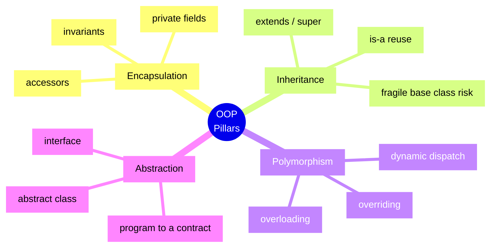
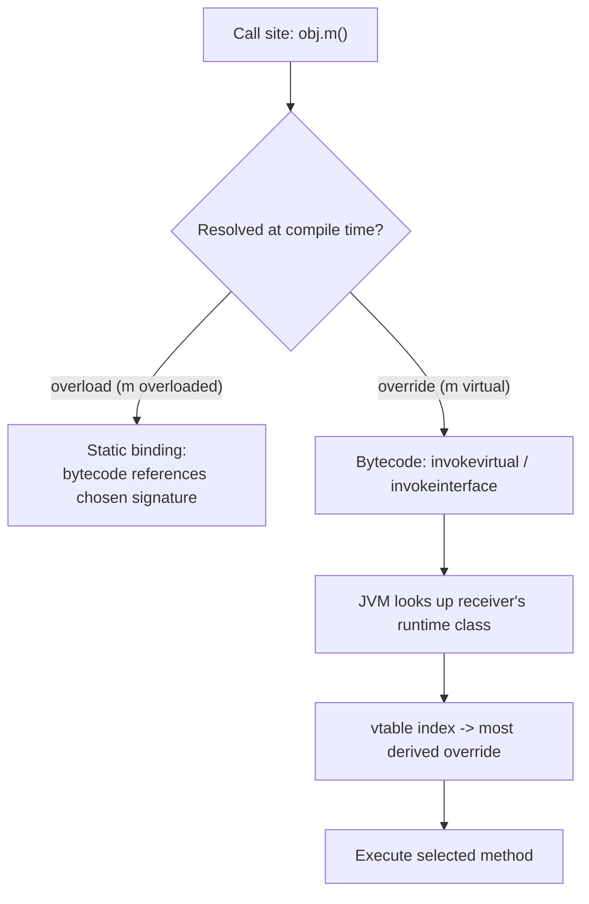
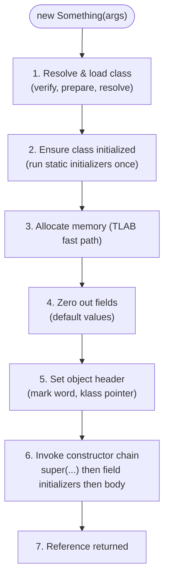
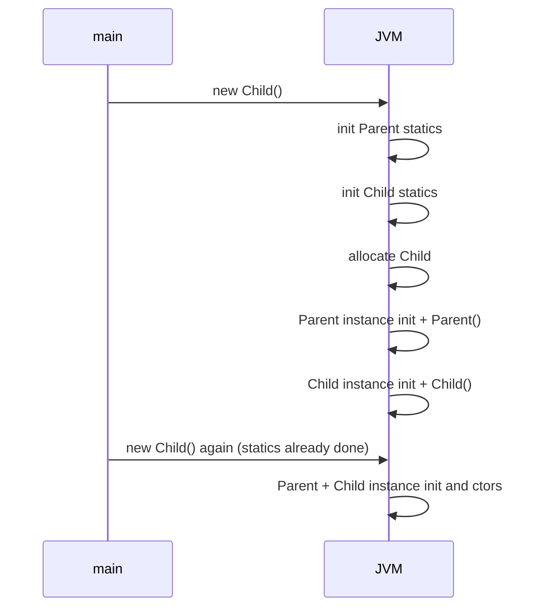
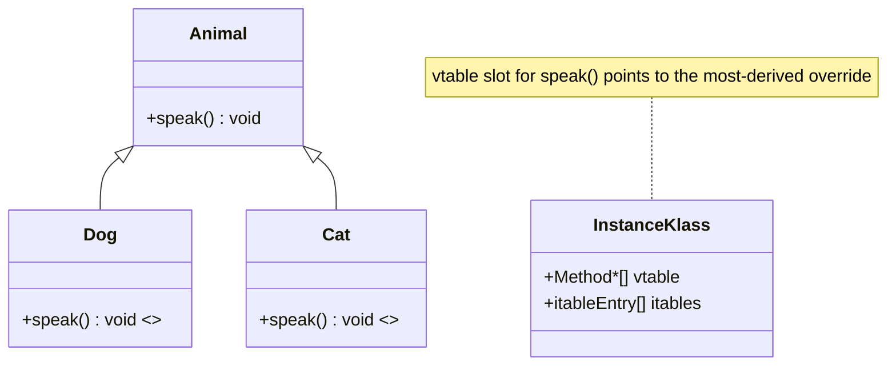
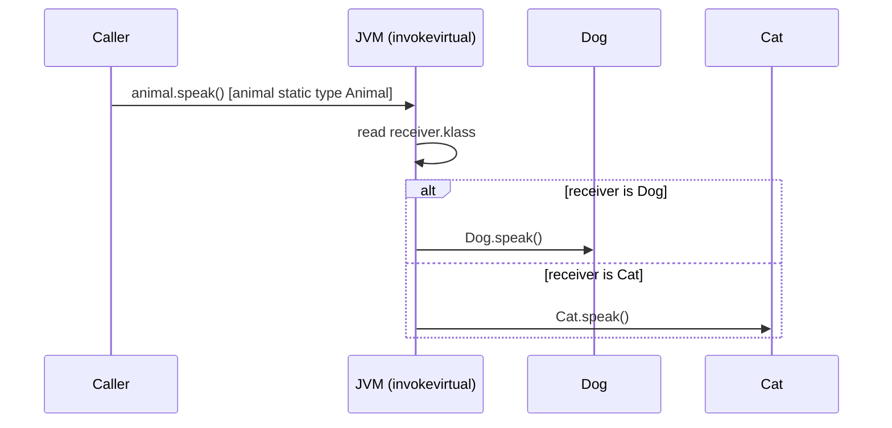
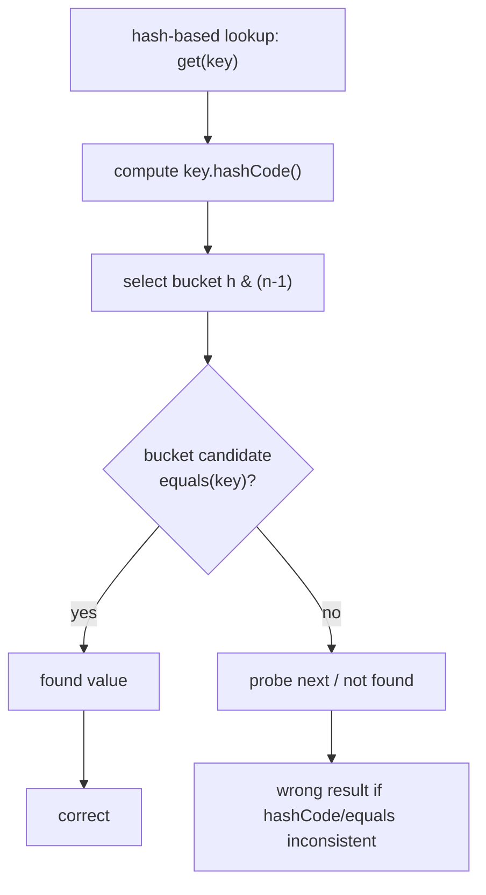
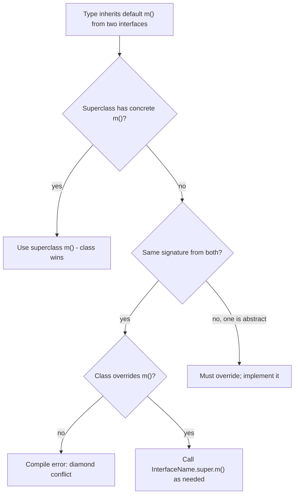
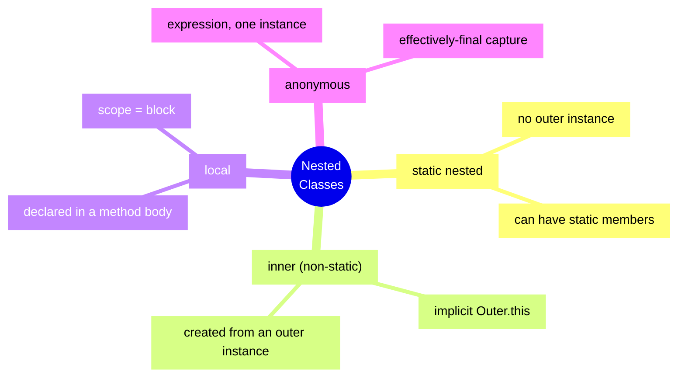
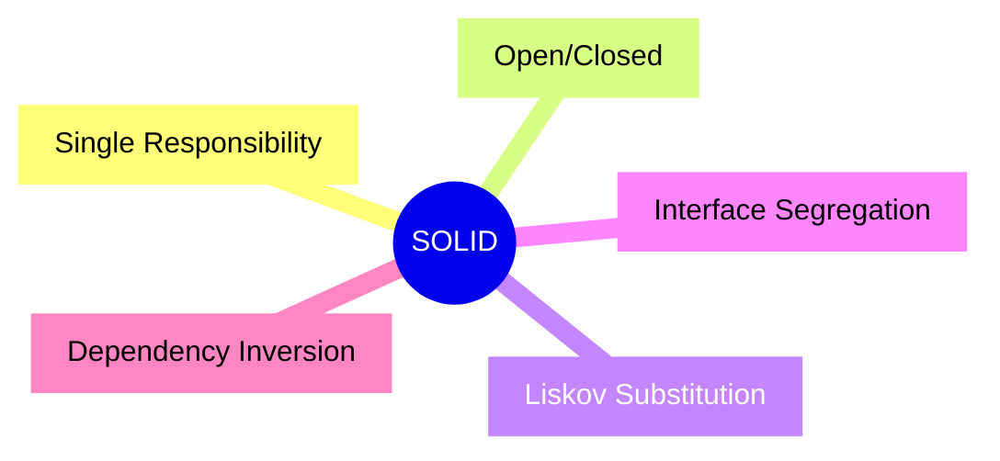

# OOP Concepts

Object-Oriented Programming is not "using classes"; it is a way of decomposing a system around
**stable boundaries** (encapsulated state) and **replaceable behaviour** (polymorphic messages). The
four pillars are not four independent features — they are four *forces* that pull against each other:

- **Encapsulation** hides *how* state is represented, so it can change without breaking callers.
- **Abstraction** hides *what* is irrelevant, exposing a minimal contract.
- **Inheritance** reuses and specializes state/behaviour along an `is-a` axis.
- **Polymorphism** lets one reference type drive many concrete implementations at runtime.

In Java, every one of these is a concrete, inspectable mechanism: `private` + accessors, `extends`,
`abstract`/`interface`, and the JVM's virtual dispatch through vtables/itables. Interviews do not ask
"what is encapsulation" to hear a definition — they ask it to see whether you understand *dispatch,
invariants, subtyping contracts, and the object model underneath*. This module builds that model from
the bytecode up.

> **Mental model:** A class is a *template* and a *type*. An object is an *instance with identity,
> state, and behaviour*. The type (what the compiler knows) and the class (what the JVM loads and
> dispatches on) are related but distinct — almost every subtle OOP bug lives in that gap.



---

## 1. The Four Pillars Precisely

### 1.1 Encapsulation

**Definition:** bundling state and the operations that maintain its invariants, while restricting
direct external access to that state. In Java the mechanism is **access control** plus **controlled
mutation**.

- `private` fields: only the declaring top-level class (and its nested classes) can touch them.
- `public`/`protected`/package-private accessors and mutators enforce invariants on the way in/out.
- The unit of `private` visibility is the **top-level class body**, not the runtime object: another
  instance of the *same* class can read a private field (used in `equals`).

Encapsulation is about guarding *invariants*, not about getters/setters. A class full of
`getX`/`setX` for every field is not encapsulated — it is a struct with extra ceremony. Real
encapsulation keeps invariants that a naked field cannot (e.g. "balance never negative", "start <=
end", "list is unmodifiable after publish").

```java
public final class Range {
    private final int start;
    private final int end;

    public Range(int start, int end) {
        if (start > end) throw new IllegalArgumentException("start > end");
        this.start = start;
        this.end = end;
    }
    public int start() { return start; }   // no setters: invariant preserved forever
    public int end()   { return end; }
    public boolean contains(int v) { return v >= start && v <= end; }
}
```

### 1.2 Inheritance

**Definition:** a mechanism to derive a new type (`subclass`/`derived`) from an existing one
(`superclass`/`base`), inheriting its accessible members and optionally specializing behaviour.
Java uses `extends` and permits exactly **one** superclass (single inheritance of implementation);
a class may implement many interfaces.

The `is-a` test matters: a `Dog` **is an** `Animal`; a `Stack` is **not** a `List` (even if it reuses
list storage). See [Composition vs Inheritance](#8-composition-vs-inheritance-favor-composition)
and the Liskov substitution principle.

### 1.3 Polymorphism

**Definition:** the ability of a single interface/reference to denote values of different types and
behave according to their **runtime** type. Two forms:

| Form | Name | Chosen by | Java mechanism |
|------|------|-----------|----------------|
| Compile-time | Static / ad-hoc | Compiler, on argument types | **Method overloading** |
| Runtime | Dynamic / subtype | JVM, on receiver's class | **Method overriding** + virtual dispatch |



### 1.4 Abstraction

**Definition:** exposing *what* an operation means while hiding *how* it is implemented. In Java:
`abstract` classes and `interface`s. Abstraction is a **specification** boundary; it lets callers
depend on a contract instead of a concrete type. Where encapsulation hides *data*, abstraction hides
*implementation behind an operation*.

### Pillar-to-mechanism table

| Pillar | Question it answers | Java mechanism | Primary risk if done badly |
|--------|--------------------|----------------|-----------------------------|
| Encapsulation | How do I protect invariants? | `private` + accessors, immutability | Leaky mutable state, broken invariants |
| Inheritance | How do I reuse/specialize? | `extends`, `super`, `protected` | Fragile base class, deep hierarchies |
| Polymorphism | How do I vary behaviour? | overloading, overriding, dispatch | Wrong overload, LSP violations |
| Abstraction | How do I hide implementation? | `abstract`, `interface`, `default` | Fat interfaces, leaky abstractions |

---

## 2. Classes, Objects, and Object Creation

A **class** is a compile-time type and a runtime `Class<T>` object (an `InstanceKlass` inside the JVM
once loaded — see [Class Loading](../01-Fundamentals/05-Class-Loading.md)). An **object** is a heap
allocation with:

- a **header** (mark word + klass pointer; 8/12/16 bytes depending on compressed oops and locking),
- **instance fields** laid out by the JVM (may be reordered/padded for alignment),
- no methods (methods live in the shared `InstanceKlass`; only the vtable pointer conceptually
  connects them).

### 2.1 The steps of `new Something(args)`



Order inside step 6 for a given constructor invocation is critical:

1. `super(...)` (explicit, or implicit no-arg) — the object gets a fully initialized **super** state
   first.
2. **Instance initializer blocks** and **field initializers**, in source order.
3. The **rest of the constructor body**.

Static initialization, in contrast, runs **once per class**, on first *active* use, before any
instance can exist.

### 2.2 `new` bytecode

`new` is not one instruction; it is `new` + `dup` + `invokespecial <init>`.

```bash
javac Sample.java
javap -c Sample
```

```text
public static java.lang.Object make();
  Code:
     0: new           #7    // class Sample
     3: dup
     4: invokespecial #9    // Method "<init>":()V
     7: areturn
```

- `new` allocates and leaves an *uninitialized* reference on the stack.
- `dup` is needed because `invokespecial` consumes the reference as the receiver; the duplicate
  survives to be returned/used.
- `invokespecial <init>` runs the constructor (not virtual dispatch — constructors are never
  overridden through dispatch, they are chosen statically and chained up).

See [Bytecode & the Class File Format](../08-Advanced/44-Bytecode.md) for the full instruction set.

### 2.3 Constructors

A constructor is **not a method**: it has no return type, is never inherited, is invoked via
`invokespecial`, and cannot be `static`/`final`/`abstract`/`synchronized`.

| Kind | When present | Notes |
|------|--------------|-------|
| **Default constructor** | Compiler inserts one *only if you declare no constructor at all* | Same access as the class; calls `super()` |
| **No-arg constructor** | You write `Foo(){}` | Prevents the compiler-provided default; needed if you declared other ctors |
| **Parameterized** | You write it | Once any ctor is declared, the default is gone |
| **Copy constructor** | Idiom: `Foo(Foo other)` | Not language feature; preferred over `clone` |
| **Private constructor** | Utility/singleton/builder | Blocks instantiation; used by `Collections.emptyList()` etc. |

```java
public class Money {
    private final long cents;
    private final String currency;

    public Money(long cents, String currency) { this.cents = cents; this.currency = currency; }
    public Money(Money other) { this(other.cents, other.currency); }   // copy constructor
    private Money() { this(0, "USD"); }                               // private: internal only
}
```

#### `this(...)` vs `super(...)`

- `this(args)` calls another constructor **in the same class** (constructor chaining).
- `super(args)` calls a **superclass** constructor.
- Either can appear **only as the first statement** of a constructor, and **at most one of them**.
- If neither is written, the compiler inserts **`super()`** (the no-arg super constructor). If the
  superclass has no accessible no-arg constructor, compilation fails.

```java
class Base { Base(int x) {} }
class Sub extends Base {
    Sub() { super(1); }          // required: Base has no no-arg constructor
    Sub(int x) { this(); }       // chains to Sub()
}
```

#### Initialization order example (verified)

```java
class Parent {
    static  { System.out.println("Parent static init"); }
    { System.out.println("Parent instance init"); }
    Parent() { System.out.println("Parent ctor"); }
}
class Child extends Parent {
    static  { System.out.println("Child static init"); }
    { System.out.println("Child instance init"); }
    Child() { System.out.println("Child ctor"); }
}
public class T4 {
    public static void main(String[] a) {
        System.out.println("-- first new --");
        new Child();
        System.out.println("-- second new --");
        new Child();
    }
}
```

Output:

```text
-- first new --
Parent static init
Child static init
Parent instance init
Parent ctor
Child instance init
Child ctor
-- second new --
Parent instance init
Parent ctor
Child instance init
Child ctor
```



> **Rule:** static init happens **once per class, before first instance**; instance init runs on
> **every** object, super-before-sub. This single ordering rule underpins almost every
> "what does this print" interview puzzle.

#### Trap: calling an overridable method from a constructor

```java
abstract class Base {
    Base() { System.out.println("base ctor: " + describe()); }
    abstract String describe();
}
class Impl extends Base {
    String name = "impl";        // not yet initialized when Base() runs
    Impl() { super(); }
    String describe() { return name; }
}
// new Impl();  ->  "base ctor: null"
```

`Base()` runs **before** `Impl`'s field initializer, so `name` is still `null`. `describe()` is
dynamically dispatched to the subclass (dynamic dispatch is active even during construction). This is
why **constructors must never call overridable methods**.

### 2.4 Instance vs static initializer

- **Instance initializer** `{ ... }` — copied by the compiler into **every constructor**, right after
  the `super(...)` call and before constructor-body code. Used to share setup across all constructors.
- **Static initializer** `static { ... }` — runs once during class initialization, in source order with
  static field initializers. A thrown exception becomes `ExceptionInInitializerError`. Because the
  initializers run in **textual order**, a static field read by an initializer declared *above* it
  still sees its default value: `static int a = 1; static int b = f(); static int c = 3;` with
  `static int f(){ return c; }` prints `1 0 3`.

---

## 3. Polymorphism, Part 1: Overloading (Compile-Time)

**Overloading** = same method name, different parameter lists, in the same class (or inherited).
The compiler picks the target **statically** using the *static types* of the arguments.

### 3.1 The three-phase overload resolution algorithm (JLS 15.12.2)

The compiler tries, in order, and commits to the first phase that finds any applicable method:

1. **Phase 1 — strict invocation:** no boxing/unboxing, no varargs. Widening primitive conversion
   allowed (e.g. `int`→`long`).
2. **Phase 2 — loose invocation:** allows boxing/unboxing too.
3. **Phase 3 — variable-arity:** allows varargs.

If more than one method matches within a phase, the **most specific** one wins. If none is most
specific, it is a compile error (ambiguous).

```java
public class T3 {
    static void m(Integer i) { System.out.println("Integer"); }
    static void m(long l)    { System.out.println("long"); }
    public static void main(String[] a) {
        m(1);    // int -> long is widening (phase 1); int -> Integer is boxing (phase 2)
        m(1L);
    }
}
```

Output:

```text
long
long
```

`m(1)` picks `m(long)`: widening beats boxing because phase 1 runs before phase 2.

### 3.2 The `null` argument selection trap

`null` is assignable to any reference type. The most **specific** reference type wins.

```java
public class T2 {
    static void m(Object o) { System.out.println("Object"); }
    static void m(String s) { System.out.println("String"); }
    public static void main(String[] a) {
        m("hello");       // String
        Object o = "hello";
        m(o);             // Object (static type is Object)
        m(null);          // String (most specific)
    }
}
```

Output:

```text
String
Object
String
```

Add `static void m(Integer i)` and `m(null)` becomes **ambiguous** (`String` and `Integer` are
unrelated) — compile error.

### 3.3 Overloading pitfalls

| Pitfall | Problem | Fix |
|---------|---------|-----|
| Autoboxing preference | `m(int)` vs `m(Integer)` — widening beats boxing, but boxing beats varargs | Prefer explicit argument types |
| Varargs vs fixed arity | `m(int...)` vs `m(int,int)` — fixed arity wins in phase 1/2 | Avoid overloads differing only in arity + varargs |
| `null` ambiguity | Two unrelated reference overloads → compile error | Cast: `m((String) null)` |
| Boxing + widening combos | `Long` → `Object` vs `long` can surprise | Avoid near-identical overloads |
| Overload by generic erasure | `m(List<String>)` vs `m(List<Integer>)` → same erasure, compile error | Rename; see [Generics](../01-Fundamentals/07-Generics.md) |

With both `m(int...)` and `m(Integer,Integer)` present, `m(1, 2)` picks the fixed-arity boxed overload
(phase 2 beats phase 3) and prints `boxed`.

### 3.4 Overloading vs overriding (comparison)

| Axis | Overloading | Overriding |
|------|-------------|------------|
| Binding time | Compile time (static) | Runtime (dynamic) |
| Location | Same class or inherited | Subclass replaces superclass method |
| Signature | Same name, **different** parameter list | Same name **and** parameter list |
| Return type | Can differ freely | Same or **covariant** |
| Modifiers | Independent | Access cannot narrow; `static`/`final`/`private` not overridable |
| Exceptions | Independent | May throw fewer/narrower checked exceptions |
| Polymorphic? | No (selected by static arg types) | Yes (selected by receiver runtime type) |
| Calls | Chosen at call site | Dispatched through vtable/itable |
| `@Override` | Not applicable | Strongly recommended |

---

## 4. Polymorphism, Part 2: Overriding and Dynamic Dispatch

**Overriding** = a subclass provides a method with the *same signature* (name + parameter types,
ignoring generics erasure) as a superclass method. At the call site, the JVM selects the method based
on the **runtime class** of the receiver.

### 4.1 How the JVM selects a method: vtables and itables (HotSpot view)

When a class is loaded and linked, HotSpot builds, inside its `InstanceKlass`:

- a **vtable** — an embedded array of `Method*` pointers, one slot per virtual method (including
  inherited ones). A subclass **inherits the parent's vtable layout** and *replaces* slots for
  overridden methods with pointers to the new implementation.
- one or more **itables** — per implemented interface, an array mapping the interface's method slots
  to the concrete `Method*`. This is needed because a class can implement many interfaces but only
  extends one class.



- `invokevirtual` (class methods) dispatches through the **receiver's klass vtable**: the call site
  holds a `vtable_index`; the JVM reads `receiver.klass.vtable[index]`.
- `invokeinterface` uses the **itable** (and a per-call-site inline cache / `itable` stubs) because
  interface methods do not share a fixed vtable index across unrelated implementors.
- `invokespecial` (private, constructors, `super.m()`) and `invokestatic` do **not** use virtual
  dispatch.
- The JIT performs **devirtualization**: when only one implementation is observed (monomorphic call
  site), it emits a direct call guarded by a class check, and may **inline** it. This is why
  "polymorphism is slow" is usually false in hot code.



With `Animal x = new Dog(); x.speak();` the JVM prints `Dog` (see [Output Prediction](#output-prediction)),
while `new Animal().speak()` prints `Animal`.

### 4.2 Overriding rules (exact)

1. **Signature match** required (name + parameter types). Generics are erased, so
   `void m(List<String>)` overrides `void m(List)`.
2. **Access may widen, never narrow.** Allowed order: `public` > `protected` > package-private >
   `private`. You cannot reduce visibility.
3. **Covariant return types** allowed (Java 5+): return a subtype. The compiler inserts a **bridge
   method** with the superclass return type that calls the covariant version.
4. **`throws` may shrink**: an override may declare the same, fewer, or narrower checked exceptions —
   never broader/new checked exceptions. Unchecked exceptions are unrestricted.
5. **`final`, `static`, `private` methods cannot be overridden.** `static` methods are *hidden*
   (see below); `private` methods are not inherited at all.
6. **`final` classes** cannot be extended. **Records** and **enums** are implicitly final (enums with
   constant bodies are effectively final).
7. **Fields are not overridden** — a subclass field with the same name **hides** the superclass field;
   resolution is by the reference's static type.

```java
class A { A copy() { return new A(); } }
class B extends A { @Override B copy() { return new B(); } }   // covariant return

A a = new B();
System.out.println(a.copy().getClass().getSimpleName()); // B
```

### 4.3 Hiding vs overriding

| | Overriding | Hiding |
|---|------------|--------|
| Applies to | Instance methods | `static` methods, and **fields** (instance or static) |
| Dispatched | Dynamically by runtime type | Statically by reference's declared type |
| Call reads | Most derived implementation | Superclass version if reference type is superclass |
| `@Override` | Valid | Not valid on static methods |

```java
class Base {
    static String who() { return "Base static"; }
    String inst()       { return "Base inst"; }
}
class Derived extends Base {
    static String who() { return "Derived static"; }   // HIDES, not overrides
    @Override String inst() { return "Derived inst"; } // overrides
}
Base b = new Derived();
System.out.println(b.who());   // Base static  (static binding on Base)
System.out.println(b.inst());  // Derived inst (dynamic dispatch)
```

Output:

```text
Base static
Derived inst
```

Field hiding is a classic trap:

```java
class Holder { String name = "Holder"; }
class Sub extends Holder { String name = "Sub"; }
Holder h = new Sub();
System.out.println(h.name);            // Holder
System.out.println(((Sub) h).name);    // Sub
```

### 4.4 `@Override`

An annotation that makes the compiler verify the method truly overrides a supertype method. Omitting
it lets the classic bug through: a typo'd signature silently becomes an *overload*, not an override.

```java
class Wrong { @Override public String tostring() { return "x"; } } // compile error, good!
```

---

## 5. The `Object` Class

Every class implicitly extends `java.lang.Object` (unless it extends something else). Its methods are
the ones every type must reason about.

| Method | Purpose | Default behaviour | Override? |
|--------|---------|-------------------|-----------|
| `equals(Object)` | Logical equality | Reference identity (`==`) | Yes, with `hashCode` |
| `hashCode()` | Hash bucket | Identity hash (JVM-supplied) | Yes, with `equals` |
| `toString()` | Readable text | `getClass().getName() + "@" + hex(hashCode())` | Yes |
| `getClass()` | Exact runtime class | `native`, `final` | Cannot |
| `clone()` | Copy | `protected native`, shallow; throws unless `Cloneable` | Rarely; prefer copy ctor |
| `finalize()` | Pre-GC cleanup | No-op | **Never** — deprecated for removal |
| `notify`/`notifyAll`/`wait` | Monitor coordination | `final` | Cannot |
| `registerNatives` etc. | Internals | — | — |

### 5.1 The `equals`/`hashCode` contract (JLS/Javadoc)

`equals` must be an **equivalence relation**:

- **Reflexive:** `x.equals(x)` is `true`.
- **Symmetric:** `x.equals(y) == y.equals(x)`.
- **Transitive:** if `x.equals(y)` and `y.equals(z)` then `x.equals(z)`.
- **Consistent:** repeated calls return the same result while the objects are unmodified.
- **`x.equals(null)` is `false`** (never throws; do a `null`/`instanceof` check first).

`hashCode`:

- If `x.equals(y)`, then `x.hashCode() == y.hashCode()` (required).
- If `!x.equals(y)`, hash codes *may* collide (allowed) but should differ (performance).
- Must be **consistent during the object's lifetime** — critical if used as a hash-collection key.

> **Invariant:** `equals` and `hashCode` are a matched pair. Override one, override the other. Equal
> objects with different hash codes vanish inside `HashMap`/`HashSet` — see
> [HashMap Internals](../02-Collections/10-HashMap-Internals.md).



### 5.2 Common `equals` bugs

1. **Overriding `equals` without `hashCode`.** Two "equal" keys hash differently → `HashSet.contains`
   returns false even though a matching element exists.
2. **Wrong parameter type:** `equals(MyType o)` instead of `equals(Object o)` → this is an *overload*,
   not an override; `Object.equals` handles the real calls. Always add `@Override`.
3. **Violating symmetry with `instanceof`.** If `Bad.equals` accepts subclasses via `instanceof Bad`
   but `Evil.equals` only accepts `Evil`, then `bad.equals(evil) == true` while
   `evil.equals(bad) == false` — asymmetric. Using `getClass() != o.getClass()` restores symmetry but
   rejects subclass instances (breaks substitutability). Pick one deliberately; prefer `getClass()`
   for final value types with a fixed representation.
4. **Mutable fields in `hashCode`, then mutating the key** — the object "teleports" out of its
   bucket. (Here `Key.hashCode()` returns its mutable field `v`.) Verified:

   ```java
   Set<Key> s = new HashSet<>();
   Key k = new Key(1);
   s.add(k);
   System.out.println(s.contains(new Key(1))); // true
   k.v = 2;                                     // mutate after insertion
   System.out.println(s.contains(new Key(2)));  // false
   System.out.println(s.size());                // 1  (still referenced, now unreachable by value)
   ```

   Output: `true`, `false`, `1`. Never use mutable objects as map/set keys.
5. **Not checking `this == o` first** — minor performance, and needed for reflexivity with `NaN`-style
   edge cases in some designs.

### 5.3 Correct implementation

```java
import java.util.Objects;

public final class P {
    private final int x, y;
    public P(int x, int y) { this.x = x; this.y = y; }

    @Override public boolean equals(Object o) {
        if (this == o) return true;
        if (o == null || getClass() != o.getClass()) return false;
        P p = (P) o;
        return x == p.x && y == p.y;
    }
    @Override public int hashCode() { return Objects.hash(x, y); }
    @Override public String toString() { return "P[" + x + "," + y + "]"; }
}
```

`Objects.equals(a, b)` is a null-safe `a == null ? b == null : a.equals(b)`; `Objects.hash(...)` is a
varargs convenience (`31 * result + ...` style, boxing each argument). On hot paths hand-write the
hash — `int r = Integer.hashCode(x); r = 31 * r + Integer.hashCode(y);` — to avoid the varargs array
allocation.

### 5.4 Records: automatic equality

A `record` gets compiler-generated `equals`, `hashCode`, and `toString` over its components — value
semantics for free. Implementation uses an `invokedynamic` bootstrap (`ObjectMethods.bootstrap`)
rather than hand-written bytecode. Records are final and cannot add instance fields, so their equality
is fixed and safe. Pointers: [Records](../07-Modern-Java/32-Records.md).

```java
record Pt(int x, int y) {}
new Pt(1, 2).equals(new Pt(1, 2));               // true
new Pt(1, 2).hashCode() == new Pt(1, 2).hashCode(); // true
```

### 5.5 `toString`, `getClass`, `clone`, `finalize`

- **`toString`**: default is `ClassName@hexIdentityHashCode`; override for debuggability. Records,
  enums, and collections already provide useful forms.
- **`getClass()`** is `final native`: returns the exact runtime `Class<?>`; `null` receiver → NPE.
  `getClass() == Foo.class` is an exact-type test; `instanceof` allows subtypes. See
  [Section 13](#13-instanceof-getclass-and-pattern-matching-pointer).
- **`clone()`**: `protected native`, creates a **shallow** copy (field-by-field) via `Object.clone`,
  which also copies the header. Legal only if the class implements the marker `Cloneable`, otherwise
  `CloneNotSupportedException`. Subclass must override to make it `public` and cast. Prefer **copy
  constructors** or static factories.
- **`finalize()`**: deprecated for removal (deprecated since Java 9; deprecated-for-removal in Java
  18+). Never rely on it; use `try`-with-resources, `Cleaner`, or `PhantomReference`. See
  [Garbage Collection](../08-Advanced/39-Garbage-Collection.md).

A verified demo: cloning an object holding an `int[]` yields a **different object** (`c != o` is
`true`) that shares the **same array** (`c.data == o.data` is `true`); mutating `c.data[0] = 99` then
changes `o.data[0]` to `99`, proving `clone` is shallow.

---

## 6. Abstract Classes vs Interfaces

### 6.1 Abstract classes

- Declared `abstract`; may mix abstract and concrete methods; **cannot be instantiated**.
- **Can have constructors** (called via `super(...)`), instance fields (mutable state),
  `protected`/`private` members, `static` members.
- Support **single inheritance** of implementation.

### 6.2 Interfaces

- A pure contract: all methods are implicitly `public` (abstract) unless `default`/`static`/`private`.
- All fields are implicitly `public static final` (constants) — interfaces have **no instance state**.
- **A class may implement many interfaces**; an interface may extend many interfaces.
- Since **Java 8**: `default` and `static` methods. Since **Java 9**: `private` and
  `private static` methods (helpers for `default` methods).

### 6.3 Comparison table

| Feature | Abstract class | Interface |
|---------|----------------|-----------|
| Instantiate | No | No |
| Multiple inheritance of *type* | No (one class) | Yes (many interfaces) |
| Multiple inheritance of *state* | No | No (no instance fields) |
| Instance fields | Yes | No (only `public static final` constants) |
| Constructors | Yes | No |
| Method bodies | Yes (abstract + concrete) | `default`/`static`/`private` + abstract |
| Member visibility | Any | `public` (or `private` for helpers, Java 9+) |
| `final` methods | Yes | No (default methods can be overridden unless... no) |
| When to use | Shared state/partial implementation; template method | Capability/role contract; multiple inheritance |
| Evolution | Adding abstract method breaks subclasses | `default` method added compatibly (Java 8+) |

> **Rule of thumb:** *interface* for "can-do / role" contracts and multiple inheritance of type;
> *abstract class* for shared state and partial implementation ("is-a" skeleton).

### 6.4 Java 8/9 interface methods

```java
interface Greeter {
    default String hello(String n) { return decorate("Hello " + n); }  // Java 8
    private String decorate(String s) { return "[" + s + "]"; }         // Java 9 helper
    static Greeter of() { return new Greeter() {}; }                    // Java 8 factory
}
// new — Greeter.of().hello("World")  ->  [Hello World]
```

`default` methods enable **interface evolution**: adding one does not break existing implementors.
But overuse creates the "diamond of default methods" and hides design problems.

### 6.5 Diamond / conflict resolution rules

When a type inherits multiple `default` implementations of the same signature:

1. **Class methods win** over interface `default`s (a superclass concrete method always beats an
   interface default).
2. Otherwise, if two unrelated interfaces provide defaults with the same signature, it is a
   **compile error** unless the class **overrides** the method.
3. To call a specific one, use `InterfaceName.super.method(...)` — legal only in the overriding class.



A class `C implements A, B` where both supply `default hello()` must override and can delegate with
`A.super.hello() + B.super.hello()` (verified result: `"AB"`).

### 6.6 Marker interfaces

Interfaces with no methods: `Cloneable`, `Serializable`, `RandomAccess`. They signal a *capability*
to libraries that check them (`instanceof Cloneable`, serialization framework, `Collections` binary
search). They are a tagging mechanism the type system cannot express otherwise (no annotation
`instanceof`). See [Serialization](../06-Reflection/29-Serialization.md).

---

## 7. Nested Classes

A class declared inside another type. Four kinds, with very different capture semantics.



| Kind | Has outer `this`? | Can declare `static` members? | Instantiated as | Use for |
|------|-------------------|-------------------------------|-----------------|---------|
| `static` nested | No | Yes (incl. static methods/fields) | `new Outer.Nested()` | Helper types not needing outer state |
| Inner (non-static) | Yes (implicit `Outer.this`) | No (except `static final` constants) | `outer.new Inner()` | Adapters over outer state (e.g. `Iterator`) |
| Local | Only if in instance context | No | Inside the method | Short-lived helper in one method |
| Anonymous | Yes (if in instance context) | No | `new Iface(){...}` | Single-use implementations |

Instantiation differs by kind: `new Outer.Nested()` (static), `o.new Inner()` (inner), and inline for
local/anonymous.

The compiler desugars an inner class into a static nested class whose constructor takes an
**synthetic `this$0`** reference to the outer object; `Outer.outer` fields accesses go through it.
Nested classes also get **synthetic accessor** methods (`access$000`) when they touch outer private
members (pre-`nestmates`); since Java 11, **nestmates** allow direct private access without synthetic
bridges (see [Bytecode](../08-Advanced/44-Bytecode.md)).

### Capture rules (local/anonymous classes and lambdas)

- Can capture **local variables only if they are `final` or effectively final** (assigned once).
- Capture is **by value** (a copy of the reference) — not a live link to the variable. This is why
  reassignment is disallowed: a captured copy would diverge.
- Can always capture `this` of the enclosing instance; that reference is kept alive (potential
  **memory leak** when an anonymous class outlives its intent, e.g. stored in a static field).

```java
import java.util.function.Supplier;
public class T10 {
    static Supplier<String> make(String s) {   // parameter is effectively final
        int local = 10;                        // effectively final
        return () -> s + local;                // captured by value
    }
    public static void main(String[] a) {
        System.out.println(make("x=").get());  // x=10
    }
}
```

---

## 8. Composition vs Inheritance (Favor Composition)

Inheritance creates a **compile-time, white-box** coupling: a subclass depends on the *implementation
details* of its superclass. This is the **fragile base class problem**: a change to the base can
silently break subclasses (e.g. `HashSet` internally calls an overridable method, so a subclass that
overrides it breaks `size()` bookkeeping). Composition exposes only the *interface* of the collaborator.

| Aspect | Inheritance (`extends`) | Composition (`has-a`) |
|--------|--------------------------|-----------------------|
| Relationship | is-a | has-a / uses-a |
| Coupling | Tight, white-box | Loose, black-box |
| Reuse | Inherit all members | Delegate explicitly |
| Runtime change | Fixed at compile time | Can swap delegate |
| Fragility | High (fragile base class) | Low |
| Multiple reuse | Single superclass only | Many delegates |
| Testability | Harder (mock base) | Easier (inject delegate) |

```java
// WRONG: Set "inheritance" that breaks size()
class CountingSet<E> extends HashSet<E> {
    int addCount;
    @Override public boolean add(E e) { addCount++; return super.add(e); }
    @Override public boolean addAll(Collection<? extends E> c) {
        addCount += c.size(); return super.addAll(c);  // HashSet.addAll calls add() -> double count
    }
}
// RIGHT: composition + forwarding
class CountingSet2<E> extends AbstractSet<E> {
    private final Set<E> inner = new HashSet<>();
    int addCount;
    @Override public boolean add(E e) { addCount++; return inner.add(e); }
    @Override public boolean addAll(Collection<? extends E> c) { addCount += c.size(); return inner.addAll(c); }
    @Override public Iterator<E> iterator() { return inner.iterator(); }
    @Override public int size() { return inner.size(); }
}
```

### Liskov Substitution Principle (LSP)

> Objects of a subclass must be usable wherever the superclass is expected **without altering the
> correctness** of the program.

Subtypes may **weaken preconditions** and **strengthen postconditions**, never the reverse. The
archetype violation is `Square extends Rectangle` (setting width on a square changes height, breaking
`Rectangle`'s contract). Prefer a common `Shape` abstraction with independent operations.

---

## 9. `static`, `final`, and Immutability

### 9.1 `static` vs instance

| | Instance member | `static` member |
|---|-----------------|-----------------|
| Belongs to | Each object | The class (one shared copy) |
| Access | `obj.field`, `obj.method()` | `Class.field`, `Class.method()` |
| `this` available | Yes | No |
| Polymorphic | Methods override | Methods **hide** (static binding) |
| Memory | In the object | In the `Class`/`InstanceKlass` metadata |
| Thread-safety | Per-instance lock | Shared mutable state = contention/bugs |

### 9.2 `final`

- **`final` field:** assigned exactly once (declaration, initializer, or every constructor). Gives
  visibility guarantees under the Java Memory Model: a correctly constructed object's `final` fields
  are visible to all threads (see [Java Memory Model](../04-Multithreading/23-Java-Memory-Model.md)).
- **`final` method:** cannot be overridden (enables devirtualization/inlining).
- **`final` class:** cannot be extended (`String`, `Integer`, records, enums).
- **`final` local/parameter:** cannot be reassigned; needed (or effectively final) for capture.

### 9.3 Immutability

A class is immutable if its observable state never changes after construction. Recipe:

1. Make the class **`final`** (or use a private constructor + static factories).
2. Make all fields **`private final`**.
3. **Defensive-copy** mutable inputs in the constructor and mutable outputs in accessors.
4. **Never leak `this`** during construction (a partially built object must not escape).
5. Provide no mutators. For collections, wrap with `List.copyOf`/`Collections.unmodifiableList`.

```java
final class Immutable {
    private final int[] data;
    Immutable(int[] d) { this.data = d.clone(); }   // copy in
    int[] data() { return data.clone(); }            // copy out
}
int[] src = {1, 2};
Immutable im = new Immutable(src);
src[0] = 99;                 // does not affect im
int[] out = im.data();
out[0] = 42;                 // does not affect im
System.out.println(im.data()[0]);   // 1
```

Benefits: inherently thread-safe, freely shareable, valid map keys, safe to cache. Costs: allocation
per change; use builders or persistent structures when updates are frequent.

### 9.4 Safe publication

Even a `final`-field object is only safely publishable if the **reference** is safely published
(via `volatile`, `final`, a lock, `AtomicReference`, or a concurrent collection). `final` fields
themselves are guaranteed frozen *if* the object reference is not leaked during construction. Never
start a thread from a constructor passing `this`.

### 9.5 `clone` vs copy constructor

Prefer a **copy constructor or static factory** over `clone()`: `clone` is a native shallow copy that
needs `Cloneable`, an override, a cast, careful `super.clone()` chaining, and manual deep copying,
while a copy constructor is type-safe, explicit, and handles `final` fields cleanly.

---

## 10. Enums

An `enum` is a special class: it **implicitly extends `java.lang.Enum<E>`**, cannot extend anything
else, and can implement interfaces. Constants are implicitly `public static final` instances.

```java
enum Op {
    PLUS("+")  { int apply(int a, int b) { return a + b; } },
    TIMES("*") { int apply(int a, int b) { return a * b; } };
    private final String sym;
    Op(String sym) { this.sym = sym; }
    abstract int apply(int a, int b);          // each constant must implement
    @Override public String toString() { return sym; }
}
Op.PLUS.apply(2, 3);   // 5
Op.TIMES.apply(2, 3);  // 6
Op.valueOf("PLUS");    // Op.PLUS
Op.values();           // [+, *]  (toString used)
```

- **With bodies:** each constant with a body becomes an **anonymous subclass** of the enum type; the
  enum class is no longer `final` in the class file, but it is still effectively final.
- **Abstract methods** require every constant to provide an implementation (exhaustiveness checked at
  compile time).
- **`values()`** returns a fresh array (defensive copy) each call; **`valueOf(String)`** matches
  `name()` exactly, throws `IllegalArgumentException`.
- **Enum singleton** is the safest singleton: **serialization-safe** (JVM uses `Enum`'s
  `readResolve`/`valueOf`), **reflection-safe** (`Constructor.newInstance` throws for enums), and
  **thread-safe** (initialization happens during class init).

```java
enum Singleton {
    INSTANCE;
    private int count;
    int inc() { return ++count; }
}
Singleton s1 = Singleton.INSTANCE, s2 = Singleton.INSTANCE;
s1.inc(); s2.inc();
s1 == s2;      // true
s2.count;      // 2  (shared state)
```

Also: `EnumMap`/`EnumSet` are array-backed and much faster than hash/`Tree` variants; `switch` on an
enum compiles to a lookup on ordinal via a synthetic `$SwitchMap`.

> **Pitfall:** enums with hoisted-free state (e.g. a counter incremented in the constructor) break
> when enum constants are reordered; `ordinal()` is tied to declaration order, so **never persist
> `ordinal`** — persist `name()`.

---

## 11. `sealed` / `permits` (Overview)

Java 17 finalized **sealed classes**: a type may declare which subtypes are allowed. This gives
*closed* hierarchies that pattern-matching `switch` can check for exhaustiveness.

```java
public sealed interface Shape permits Circle, Square, Triangle {}
final class Circle implements Shape {}
final class Square implements Shape {}
non-sealed class Triangle implements Shape {}   // reopens extension
```

Permitted subtypes must be `final`, `sealed` (with further `permits`), or `non-sealed`. Sealed types
enable the compiler/dispatcher to know the complete set of implementations. Full internals are in
[Sealed Classes](../07-Modern-Java/33-Sealed-Classes.md); this module only needs the overview above.

---

## 12. SOLID Principles (with Java)



1. **Single Responsibility (SRP):** a class has one reason to change. `Invoice` should not also
   persist itself and render HTML; split into `Invoice`, `InvoiceRepository`, `InvoiceRenderer`.
2. **Open/Closed (OCP):** open for extension, closed for modification. Replace `if (type == ...)`
   chains with polymorphism — add a new `interface Discount { Money apply(Money m); }` implementor
   instead of editing existing code.
3. **Liskov Substitution (LSP):** see [Section 8](#8-composition-vs-inheritance-favor-composition).
4. **Interface Segregation (ISP):** clients should not depend on methods they do not use. Prefer
   `Readable`/`Writable` over a fat `ReadWrite`. Avoid forcing `UnsupportedOperationException`
   stubs.
5. **Dependency Inversion (DIP):** depend on abstractions, not concretions. High-level `OrderService`
   depends on an `Inventory` interface; `DatabaseInventory` is injected (Spring DI). See
   [Design Patterns](../08-Advanced/37-Design-Patterns.md).

---

## 13. `instanceof`, `getClass()`, and Pattern Matching (Pointer)

- **`instanceof`**: runtime, null-safe (`null instanceof X == false`), true for subtypes. Compile-time
  error if the cast can never succeed (e.g. a `final` unrelated type).
- **`getClass()`**: exact runtime class; NPE on `null`; use `==` to compare to a class literal.

| Test | Null-safe | Matches subtypes | Compile-time restriction |
|------|-----------|------------------|---------------------------|
| `x instanceof Foo` | Yes | Yes | Error if impossible |
| `x.getClass() == Foo.class` | No (NPE) | No (exact) | No |

**Pattern matching (Java 16+):** `if (o instanceof Point p)` binds `p` after the check; **record
patterns** and **switch patterns** (Java 21) go further. Combined with `sealed` types (Section 11),
a `switch` over a `Shape` hierarchy can be checked for exhaustiveness without a `default`. Full
treatment in [Pattern Matching](../07-Modern-Java/34-Pattern-Matching.md).

---

## 14. Performance Notes

- **Method dispatch:** monomorphic/bimorphic call sites are devirtualized and inlined by the JIT;
  megamorphic sites (>2 receivers) fall back to vtable/itable lookup and are not inlined — keep hot
  hierarchies narrow, and mark classes/methods `final` to ease devirtualization.
- **Object size / allocation:** prefer primitives and `final` immutable value types (`record`) to cut
  allocation and pointer-chasing; every object carries a header.
- **`hashCode` quality:** cheap, well-distributed codes reduce collisions and `equals` calls.
- **Escape analysis:** the JIT can scalar-replace short-lived, non-escaping objects; leaking `this`
  or capturing references defeats it. Autoboxing allocates; the `Integer` cache covers `-128..127`.

---

# Interview Questions

## Beginner

**Q1. What are the four pillars of OOP, and which Java feature realizes each?**
Encapsulation = `private` state + accessors/invariants. Inheritance = `extends` (single superclass)
reusing and specializing state/behaviour. Polymorphism = overloading (compile-time) and overriding
(runtime dispatch). Abstraction = `abstract` classes and `interface`s exposing a contract and hiding
implementation. The pillars are forces, not features: encapsulation protects invariants, abstraction
hides the "how", inheritance reuses along an is-a axis, polymorphism lets a reference drive many
implementations.

**Q2. Difference between a class and an object?**
A class is a compile-time type and a runtime `Class`/`InstanceKlass` template declaring fields,
methods, and invariants. An object is a heap instance with identity, state (field values), and access
to behaviour (methods shared in the class metadata). `new` allocates the object; the class is loaded
once (see [Class Loading](../01-Fundamentals/05-Class-Loading.md)).

**Q3. What is a constructor? Is it inherited? Can it be `static`?**
A constructor initializes a new object; it has no return type and is invoked via `invokespecial`. It
is **not inherited** (each class declares/chains its own), and cannot be `static`/`final`/`abstract`.
If you declare no constructor, the compiler inserts a default no-arg constructor that calls `super()`.

**Q4. What are `this()` and `super()`?**
`this(args)` chains to another constructor in the same class; `super(args)` invokes a superclass
constructor. Each may appear **only as the first statement** and **at most one** may be used. If
neither is written, the compiler inserts `super()`.

**Q5. What is method overloading? Give an example.**
Same name, different parameter lists, resolved at compile time from static argument types.

```java
int add(int a, int b) { return a + b; }
double add(double a, double b) { return a + b; }
```

**Q6. What is method overriding?**
A subclass redefines a superclass instance method with the same signature; the JVM selects it at
runtime by the receiver's actual class. Rules: cannot narrow access, return type must be same or
covariant, cannot broaden checked exceptions, and `static`/`final`/`private` methods cannot be
overridden.

**Q7. What does `@Override` do?**
It asks the compiler to verify the method really overrides a supertype method; a signature typo then
fails to compile instead of silently creating an overload.

**Q8. Difference between an abstract class and an interface?**
An abstract class can hold instance state and constructors and provides partial implementation; a
class extends only one. An interface is a contract with no instance state; a class implements many.
Since Java 8 interfaces have `default`/`static` methods; since Java 9, `private` helpers.

**Q9. What is the `Object` class?**
The root of every class. Its key methods: `equals`, `hashCode`, `toString`, `getClass`, `clone`,
`finalize` (deprecated), plus `wait`/`notify`. Every type inherits them.

## Intermediate

**Q1. Explain the `equals`/`hashCode` contract and what breaks if you violate it.**
`equals` must be reflexive, symmetric, transitive, consistent, and return `false` for `null`. Equal
objects must have equal `hashCode`s; hash codes must be stable while the object is a collection key.
Override `equals` without `hashCode` and `HashMap`/`HashSet` lookups fail: the key lands in a
different bucket. Consistency matters because mutation after insertion invalidates the bucket.

**Q2. Why is `String` a good `HashMap` key but a mutable object is not?**
`String` is immutable and caches its hash, so its `hashCode` never changes and `equals` is value
based. A mutable key can change its hash after insertion, making it unreachable in its bucket (the
"teleporting key" bug we reproduced: `contains` goes from `true` to `false`, `size` stays 1).

**Q3. Walk through the phases a method call resolves in for overloads.**
Compiler tries strict invocation (no boxing/varargs, widening allowed), then loose invocation
(boxing/unboxing allowed), then variable-arity. First phase with an applicable method wins; within a
phase the most specific method is chosen. Hence `m(1)` picks `m(long)` over `m(Integer)` (widening,
phase 1) and `m(1,2)` picks `m(Integer,Integer)` over `m(int...)` (phase 2 beats phase 3).

**Q4. Static method "overriding" — what actually happens?**
It is **hiding**, not overriding. The call is bound at compile time by the reference's declared type,
so `Base b = new Derived(); b.who()` calls `Base.who()` even though `Derived.who()` exists. `@Override`
on a static method is a compile error.

**Q5. Explain the initialization order when a subclass is instantiated.**
Static initializers of superclass then subclass (once, at class init), then on each `new`: superclass
instance initializers and constructor body (via `super(...)`), then subclass instance initializers
and constructor body. Fields default to `0`/`null` and are assigned in textual order after `super`.

**Q6. What are covariant return types and bridge methods?**
A subclass may narrow the return type of an overridden method. The compiler emits a synthetic
**bridge method** with the superclass's return type that casts and delegates, preserving binary
compatibility. Seen in generics, e.g. `clone()` returning a subtype.

**Q7. Why can't `final`, `static`, or `private` methods be overridden?**
`final`: explicitly forbidden to preserve behaviour/invariant and allow inlining. `static`: belongs
to the class, resolved statically (hiding instead). `private`: not visible/inherited, so there is
nothing to override; a subclass method with the same name is simply a new method.

**Q8. When would you choose an interface over an abstract class despite needing shared code?**
When types are unrelated and you need multiple inheritance of type, or evolution compatibility. Put
shared code in `default` methods (Java 8+) or a shared helper; keep state out. Use an abstract class
only when genuinely shared instance state/mutable invariants exist.

**Q9. What is the fragile base class problem?**
A subclass depends on the base's implementation details. If the base adds a method or internally calls
an overridable method, the subclass can break silently (e.g. a `HashSet` subclass overriding `add`
sees double-counting because `addAll` calls `add` internally). Composition avoids the coupling.

## Advanced

**Q1. How does the JVM select an overridden method at runtime?**
HotSpot embeds a **vtable** in each `InstanceKlass`: one slot per virtual method, inherited from the
superclass and overwritten with the most-derived override. `invokevirtual` carries a `vtable_index`;
dispatch is `receiver.klass.vtable[index]`. Interfaces use **itables** (one per interface) because a
class can implement many interfaces with no shared index. JIT inline caches and devirtualization turn
monomorphic sites into direct/inlined calls.

**Q2. Why does `invokeinterface` need a separate mechanism?**
Interface methods have no single shared vtable position across implementors, and a class can
implement multiple interfaces. The itable maps interface method slots to concrete `Method*`. Call
sites use inline caches (`CompiledICHolder`) to avoid scanning itables on every call.

**Q3. Explain `invokestatic`, `invokespecial`, `invokevirtual`, `invokeinterface`, `invokedynamic`.**
`invokestatic`: static methods, no receiver. `invokespecial`: constructors, private methods, and
`super.m()` — statically chosen, bypasses dispatch. `invokevirtual`: class instance methods, vtable
dispatch. `invokeinterface`: interface methods, itable dispatch. `invokedynamic`: bootstrapped call
site used by lambdas, string concatenation, and record equality.

**Q4. How does `Objects.hash` work, and when would you avoid it?**
`Objects.hash(Object...)` boxes arguments into an array and folds them with the `31*r + h` idiom. It
allocates a varargs array (and boxes primitives), so on hot paths hand-write `hashCode` with
`Integer.hashCode`, `Long.hashCode`, etc. `Objects.equals` is the null-safe companion.

**Q5. Discuss the symmetry/transitivity problem when mixing `getClass()` and `instanceof` in `equals`.**
`getClass() != o.getClass()` gives symmetry but rejects subclass instances entirely (breaks LSP for
value types). `instanceof` allows subclasses but can break symmetry when the subclass adds fields and
overrides `equals` (`bad.equals(evil)` can be `true` while `evil.equals(bad)` is `false`). Pick one
rule deliberately; for a final value type prefer `getClass()`.

**Q6. What does `record` generate for `equals`/`hashCode`/`toString`, and how?**
The compiler invokes `java.lang.runtime.ObjectMethods.bootstrap` via `invokedynamic`; at first
execution the bootstrap returns method handles that compare each component with `Objects.equals`
(using `==` for primitives) and fold hashes similarly. Records are final and cannot add instance
fields, so equality is fixed and value-based.

**Q7. How is the enum singleton reflection- and serialization-safe?**
`Constructor.newInstance` throws `IllegalArgumentException` for enum classes, blocking reflective
instantiation; serialization preserves identity via `Enum`'s `readResolve`/`valueOf` mechanism, so
deserializing yields the same constant. Class initialization guarantees single, thread-safe creation.

**Q8. Why must constructors not call overridable methods?**
Dynamic dispatch is active during construction, but subclass fields are not yet initialized when the
superclass constructor runs. The override may therefore observe default (`0`/`null`) state, as in
`Base()` calling `describe()` and printing `null` before `Impl.name` is set.

**Q9. Explain the `Cloneable` marker and why `clone` is discouraged.**
`Object.clone()` is a `protected native` shallow copy that copies the header and fields, but only if
the class implements the empty `Cloneable` marker; otherwise it throws
`CloneNotSupportedException`. It requires overriding, casting, careful `super.clone()` chaining, and
manual deep-copying. Copy constructors or static factories are clearer and handle `final` fields.

**Q10. What are nestmates (Java 11) and how do they change nested-class compilation?**
Before nestmates, a nested class accessing an outer private member compiled to synthetic
package-private accessor methods (`access$000`). Java 11 introduces a `NestHost`/`NestMembers`
attribute so all nested classes of one top-level class form a **nest** and can access each other's
privates directly, removing the synthetic bridges.

## Expert

**Q1. Precisely state the Java Memory Model guarantee for `final` fields and safe publication.**
A thread reading a reference to an object sees correctly initialized `final` fields (including
reachable objects) even if the reference was published without synchronization, *provided the object
was not leaked during construction*. Non-final fields have no such guarantee. Correctness therefore
requires both `final` fields and a safe publication mechanism (`final` reference, `volatile`, lock,
`AtomicReference`, concurrent collection).

**Q2. How does escape analysis interact with `this` leakage and immutable design?**
Escape analysis can scalar-replace a non-escaping allocation, eliminating it. Leaking `this` (storing
it in a field, registering a listener, starting a thread in the constructor) makes the object escape,
defeats scalar replacement, and can expose a partially constructed instance. `final` fields plus no
leakage maximizes JIT freedom and safe publication.

**Q3. Why can megamorphic call sites hurt performance, and how do you mitigate it?**
The JIT inlines monomorphic/bimorphic sites after a class check; with many receivers the inline cache
becomes megamorphic, disabling inlining and forcing vtable/itable dispatch. Mitigate with `final`
classes/methods, narrowing hierarchies, using `sealed` types (known finite set), or splitting call
sites. Interface default methods can also create megamorphic sites.

**Q4. How do `sealed` types influence exhaustiveness and dispatch?**
Sealed types give the compiler a closed set of permitted subtypes, so a `switch` with pattern labels
can be checked for exhaustiveness without a `default`. The closed hierarchy also lets the JIT reason
about a bounded set of receiver types.

**Q5. Contrast vtable layout with interface (itable) resolution under multiple inheritance.**
Vtable layout is single-inheritance: a subclass copies the parent vtable and overwrites overridden
slots (covariant overrides add bridge methods that also occupy slots). Itables are per-interface and
built at link time by matching each interface method to the implementing class method, accounting for
`default` methods and abstract redeclarations. This asymmetry is why `invokevirtual` is cheaper than
`invokeinterface` at first execution.

**Q6. How is `InterfaceName.super.m()` compiled, and why does it not violate single inheritance?**
It compiles to `invokespecial` with a symbolic reference to the interface's method, selecting that
`default` implementation directly and bypassing vtable dispatch. It inherits **behaviour**, not
state, so the single-superclass rule (one chain of instance fields/constructors) is untouched.

## Scenario Based

**Q1. Your `HashSet` "contains" returns false for an element you just added. How do you debug it?**
Create the key, `add` it, then `contains` an equal-but-distinct key. If it fails only after the
original was **mutated**, the `hashCode` depends on mutable fields (or `equals` was overridden without
`hashCode`). Fix by making keys immutable, or by only mutating before insertion and removing/re-adding
after mutation.

**Q2. A `List.contains` on 100k elements is slow. What changed?**
`ArrayList.contains` is O(n). If it is called inside a loop and elements are unique, switch to
`HashSet` for O(1) membership. Verify `equals`/`hashCode` are consistent; if elements are mutable,
membership breaks. For sorted data, use `Collections.binarySearch` with a comparator.

**Q3. You inherit `class Stack extends ArrayList`, and users now call `stack.add(0, x)`. What is wrong?**
`Stack` (the legacy JDK one) extends `Vector` and inherits list operations that violate stack
semantics (random insert/remove). The design should be composition: an `ArrayDeque` field exposing
only `push/pop/peek`. This is the classic "inheritance for reuse" mistake and an LSP violation.

**Q4. A constructor registers `this` as a listener before final fields are set; users see nulls. What
happened?**
Leaking `this` during construction; the callback runs before construction completes, and final-field
visibility guarantees do not apply to a leaked `this`. Fix: register after construction (static
factory or an `init()`/`start()` method), or use a builder that constructs then registers.

**Q5. Enum with an abstract method — how do you add a new operation without touching every constant?**
If constants already implement the abstract method, adding a **new** abstract method forces all
constants to implement it (compile error otherwise) — that is the exhaustiveness benefit. To add a
non-breaking operation, add a `default`-style concrete method or an interface with a default method
implemented by the enum. Design the enum's abstract members carefully up front.

## Output Prediction

**Q1. What is printed?**

```java
class Animal { void speak() { System.out.println("Animal"); } }
class Dog extends Animal { @Override void speak() { System.out.println("Dog"); } }
Animal x = new Dog();
x.speak();
```

Output:

```text
Dog
```

Reason: `x`'s static type is `Animal`, but `speak` is virtual; `invokevirtual` dispatches on the
receiver's runtime class (`Dog`), selecting the override.

**Q2. What is printed?**

```java
static void m(Object o) { System.out.println("Object"); }
static void m(String s) { System.out.println("String"); }
Object o = "hello";
m("hello");
m(o);
m(null);
```

Output:

```text
String
Object
String
```

Reason: overloads are chosen by **static** argument type. `"hello"` is `String` → `m(String)`. `o` is
declared `Object` → `m(Object)`. `null` is applicable to both; `String` is more specific → `m(String)`.

**Q3. What is printed?**

```java
static void m(Integer i) { System.out.println("Integer"); }
static void m(long l) { System.out.println("long"); }
m(1);
```

Output:

```text
long
```

Reason: `int`→`long` is a widening conversion, applicable in **phase 1**; `int`→`Integer` is boxing,
only applicable in **phase 2**. Phase 1 is tried first and succeeds, so `m(long)` wins.

**Q4. What is printed?**

```java
class Base { static String who() { return "Base static"; } String inst() { return "Base inst"; } }
class Derived extends Base {
    static String who() { return "Derived static"; }
    @Override String inst() { return "Derived inst"; }
}
Base b = new Derived();
System.out.println(b.who());
System.out.println(b.inst());
```

Output:

```text
Base static
Derived inst
```

Reason: static methods are hidden and bound by the reference type (`Base`) → `Base static`. Instance
methods are overridden and dispatched on the runtime type (`Derived`) → `Derived inst`.

**Q5. What is printed?**

```java
class Parent { static { System.out.println("PS"); } { System.out.println("PI"); } Parent() { System.out.println("PC"); } }
class Child extends Parent { static { System.out.println("CS"); } { System.out.println("CI"); } Child() { System.out.println("CC"); } }
new Child();
```

Output:

```text
PS
CS
PI
PC
CI
CC
```

Reason: static init of `Parent` then `Child` (once); then per-instance super-before-sub, with
instance initializers before each constructor body: `PI`, `PC`, `CI`, `CC`.

**Q6. What is printed?**

```java
class Point { int x, y; Point(int x, int y) { this.x = x; this.y = y; } }
Point a = new Point(1, 2);
Point b = new Point(1, 2);
System.out.println(a.equals(b));
System.out.println(a == b);
```

Output:

```text
false
false
```

Reason: `Point` does not override `equals`, so it uses `Object.equals`, which is reference identity.
Both `equals` and `==` are false.

## Internal Working

**Q1. What exactly happens at the bytecode level for `new Foo()`?**
`new` allocates an uninitialized `Foo` on the heap, `dup` duplicates the reference, and
`invokespecial Foo.<init>()V` runs the constructor chain (which itself calls `super.<init>()`). The
constructor's first statement is the inserted/explicit `super(...)`; instance initializers are copied
after it.

**Q2. How does the JVM store methods so that dispatch is O(1)?**
Each `InstanceKlass` embeds a **vtable**: a contiguous array of `Method*`, inherited and overwritten.
`invokevirtual` has a resolved vtable index, so a virtual call is an array load plus an indirect jump.
Interface calls use per-interface itables with inline caches because there is no shared index.

**Q3. When does a class get initialized, and what triggers it?**
On first **active use**: creating an instance, accessing a static field (non-constant) or static
method, or initializing a subclass (which initializes the superclass first). Constant `static final`
primitives/`String`s are inlined at compile time and do not trigger init. Accessing via reflection,
`Class.forName`, also triggers it. See [Class Loading](../01-Fundamentals/05-Class-Loading.md).

**Q4. What is the `invokedynamic` bootstrap used by records?**
`java.lang.runtime.ObjectMethods.bootstrap(MethodHandles.Lookup, String, TypeDescriptor, Class,
String, MethodHandle...)` links `equals`, `hashCode`, and `toString` for records. On first call it
builds method handles that combine each component (using `Objects.equals`/`Arrays...` semantics) and
returns the combined method handle, which is then cached at the call site.

## Tricky Questions

**Q1. Does `m(null)` prefer `m(String)` or `m(Object)` — and what if `Integer` is also present?**
`String` is more specific than `Object`, so `m(String)` wins. Adding a `m(Integer)` overload makes
`m(null)` **ambiguous** (String and Integer are unrelated) → compile error. Fix with `m((String)null)`.

**Q2. Can you override a `private` method by declaring the same signature in a subclass?**
No. Private methods are not inherited or visible, so there is nothing to override; the subclass
method is a brand-new method. Calling `super.priv()` is impossible, and dispatch through a supertype
reference to the private method is not possible because it is not virtual.

**Q3. Can a `static` method be annotated `@Override`?**
No — static methods are **hidden**, not overridden; `@Override` on a static method is a compile
error.

**Q4. Is `equals` on arrays overridden?**
No. Arrays use reference equality from `Object`; `a.equals(b)` is `a == b`. Use
`Arrays.equals(a, b)` or `Arrays.deepEquals` for nested arrays, and `Objects.deepEquals` for
mixed.

**Q5. If a class implements `Cloneable` but does not override `clone`, is cloning possible?**
`Object.clone()` still works (it is `protected`), but callers outside the package cannot access it;
the class must override it as `public` (and usually cast) to expose cloning. Overriding to widen
visibility is standard.

**Q6. Can an interface have a `private` method, and why?**
Yes, since Java 9. Private interface methods are helpers for `default`/`static` methods so shared
logic is not exposed to implementors. They cannot be `abstract` and cannot be inherited by
implementing classes.

**Q7. What happens if you mutate a `HashMap` key after insertion?**
The key's `hashCode` may change, so it no longer maps to its original bucket. Lookups with an equal
key fail (`containsKey` false) and iteration/`remove` cannot find it reliably, even though the entry
remains (size unchanged). Always use immutable keys.

**Q8. Does Java have multiple inheritance?**
Not of implementation: a class extends exactly one superclass. It has multiple inheritance of
**type** (many interfaces) and, since Java 8, multiple inheritance of `default` **behaviour**, with
explicit diamond resolution via `InterfaceName.super.m()`.

**Q9. Can a constructor be `synchronized`?**
Not as a modifier (compile error), but you can `synchronized(this)` inside it — though locking before
construction completes is dangerous (`this` leaking). Use static factories and publish safely instead.

**Q10. Why can adding an interface `default` method break an existing class?**
If an existing class already has a method with the same signature as the newly added default, the
class implementation wins (no break) — but if two interfaces add conflicting defaults, the class must
override them, causing a compile error. Adding a default can also shadow expected behaviour if the
new default is inherited unexpectedly by implementors lacking their own method.

**Q11. Why is `finalize` deprecated and what replaces it?**
`finalize` is unpredictable (GC timing), can resurrect objects, and blocks GC threads; it is
deprecated-for-removal. Replacements: try-with-resources for deterministic cleanup and
`java.lang.ref.Cleaner` for post-GC cleanup of native resources.
