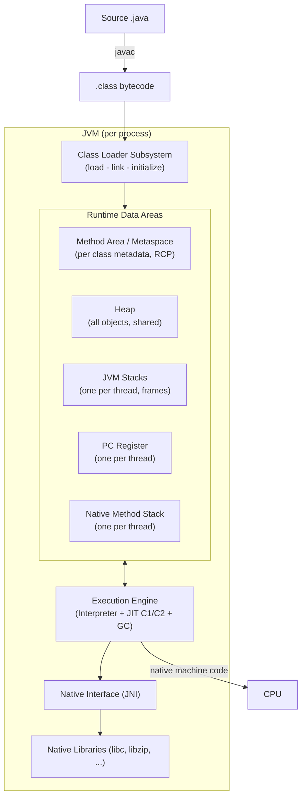
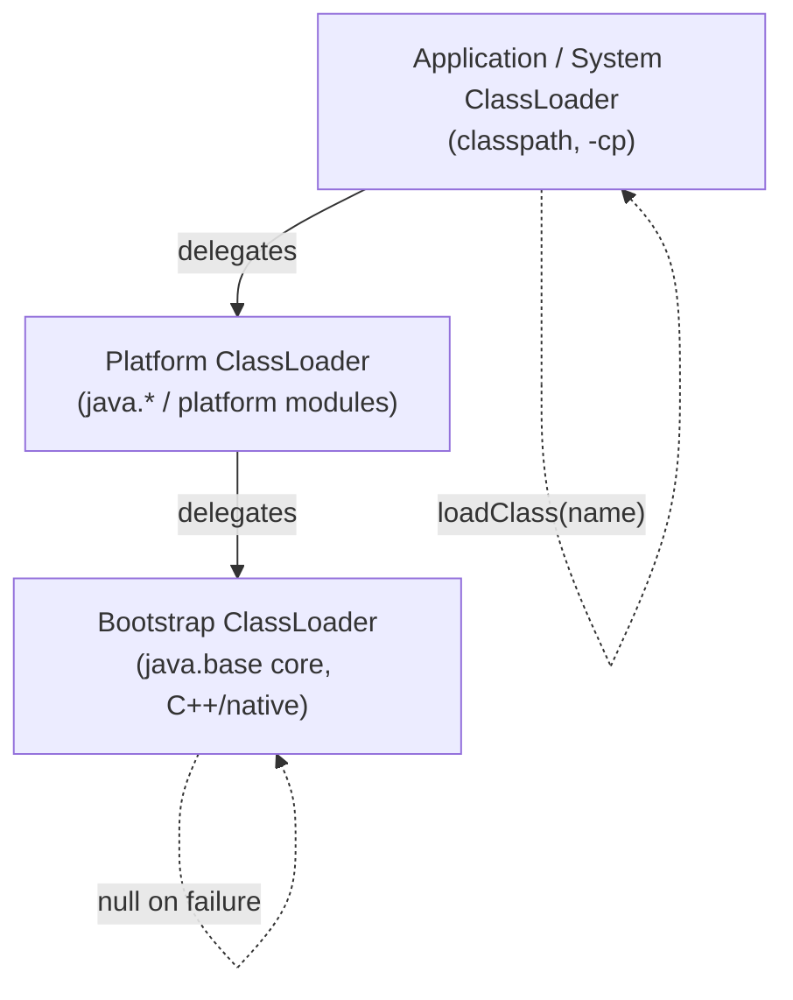
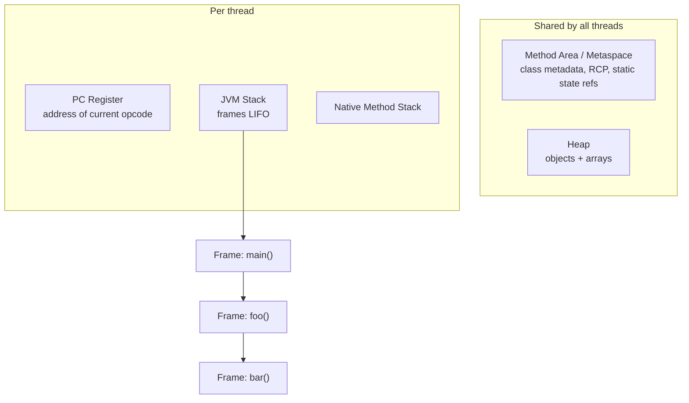
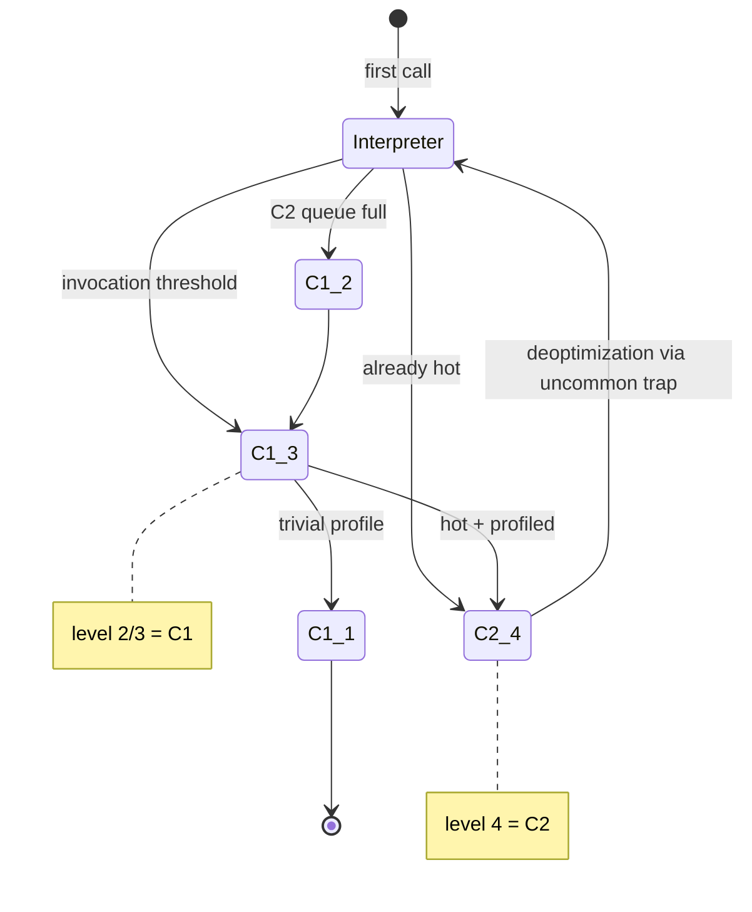
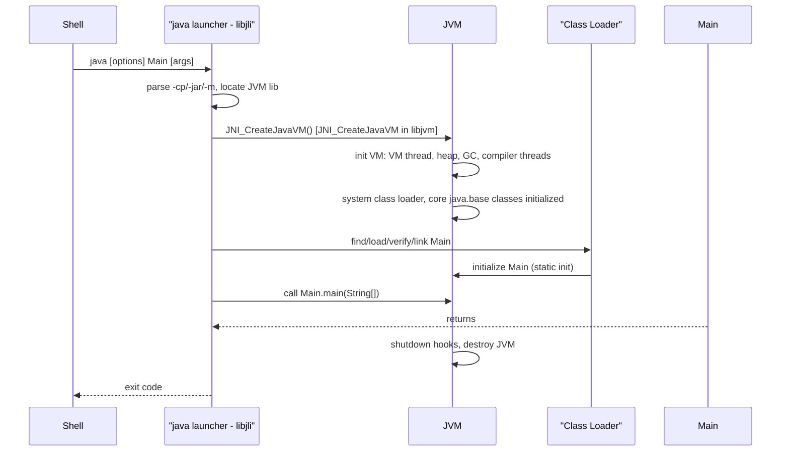

# JVM Architecture

The JVM is the abstraction that makes Java "write once, run anywhere": source compiles to
platform-neutral **bytecode**, and a per-platform **virtual machine** turns that bytecode into
native machine instructions at runtime. This module builds the mental model of the machine itself —
its subsystems, the data it owns, and the machinery that decides *when* and *how* code becomes
native. Everything about performance, latency spikes, memory behaviour, and "why is my app slow
after 30 seconds?" ultimately reduces to the components below.

> Think of the JVM as three cooperating parts: a **loading** part (find and verify classes), a
> **storage** part (runtime data areas that hold classes and objects), and an **execution** part
> (interpret and JIT-compile). A fourth glue part — native interface and libraries — lets it leave
> the Java world.

Two terms that interviewers use precisely:

- **JVM Specification** (JVMS, *Java Virtual Machine Specification*): a document that defines an
  *abstract* machine — the class file format, the bytecode instruction set, the runtime data areas,
  the verification rules. It says nothing about how to implement it.
- **JVM (implementation)**: a concrete product — HotSpot (Oracle/OpenJDK), Eclipse OpenJ9 (IBM),
  GraalVM, Azul Zing, Android ART. Each may use completely different data structures, compilers,
  and GC algorithms while still running the same bytecode.

---

## 1. What a JVM Is: Specification vs Implementation

The JVMS defines the *contract*; the implementation is free to realize it any way it wants. This is
why the same `.class` file runs on a phone (ART), a mainframe (OpenJ9), and a laptop (HotSpot) with
no recompilation.

### 1.1 Major JVM implementations

| JVM | Owner | Compiler strategy | GC / notable traits |
|-----|-------|-------------------|---------------------|
| **HotSpot** | Oracle / OpenJDK | C1 (client) + C2 (server), tiered | G1 (default), ZGC, Shenandoah, Parallel, Serial; the reference implementation you use with `java` |
| **Eclipse OpenJ9** | IBM / Eclipse | JIT (formerly Testarossa), AOT | Class sharing, low footprint/startup, `-Xgcpolicy` |
| **GraalVM** | Oracle Labs | Graal JIT (Java-written) or **Native Image** (AOT to a native binary) | Can run as a HotSpot replacement; Native Image has no JVM at runtime |
| **Azul Zing / Platform Prime** | Azul | Falcon JIT (LLVM-based) | C4 pauseless GC, huge heaps |
| **Android ART** | Google | AOT + JIT, dex bytecode | Not a JVMS JVM: **Dalvik bytecode**, not Java bytecode |

The **HotSpot** name comes from its JIT's *hot spot detection*: it profiles running code and compiles
only the hot paths (see §5).

### 1.2 JVM languages

The JVM is a *polyglot* target. Any language that emits valid class files runs on it:

| Language | Emits | Notes |
|----------|-------|-------|
| Java | javac → bytecode | Baseline |
| Kotlin | kotlinc → bytecode | Interop with Java; **`@JvmStatic`**, no checked exceptions |
| Scala | scalac → bytecode | Functional + OO, own runtime library |
| Groovy | groovyc → bytecode | Dynamic, optional `invokedynamic` |
| Clojure | bytecode | Lisp dialect, mostly dynamic |
| JRuby / Jython | bytecode | Ruby / Python on the JVM |

All of these rely on the same execution engine, the same GC, and the same class-file rules. Hence
"JVM tuning" is language-independent.

### 1.3 Version note

Baseline here is **Java 21 (LTS)**. Key structural differences to call out:

- **Java 8**: PermGen replaced by **Metaspace** (native memory); invokedynamic-based lambdas;
  tiered compilation default.
- **Java 9**: class loader hierarchy became **bootstrap / platform / application** (the *extension*
  loader was removed); `-client` fully gone; JVM modularized.
- **Java 11**: ZGC (experimental), Epsilon GC, JFR open-sourced.
- **Java 15**: **biased locking disabled and deprecated** (JEP 374); ZGC and Shenandoah promoted to
  production (JEP 377/379).
- **Java 16**: strong encapsulation of JDK internals by default (JEP 396); records finalized.
- **Java 17**: sealed classes finalized; strong encapsulation of JDK internals by default (JEP 403).
- **Java 21**: **virtual (Project Loom) threads** and structured concurrency preview; generational
  ZGC (JEP 439); biased locking option removed entirely.

---

## 2. High-Level Architecture

Every JVM, abstractly, has the same four boxes. The diagram below is the canonical one to draw in
an interview.



The **class loader** reads `.class` files, verifies them, and materializes them into the **runtime
data areas**. The **execution engine** consumes bytecode from the method area, interprets and
JIT-compiles it, and delegates garbage collection. The **native interface** bridges to C/C++
libraries. The class loader is covered in depth in [Class Loading](05-Class-Loading.md); the memory
areas in [Java Memory Areas & Memory Management](04-Java-Memory.md). This module focuses on *how the
engine executes* and *how the parts fit*.

---

## 3. Class Loader Subsystem (Overview)

The class loader subsystem performs three phases: **loading → linking (verify, prepare, resolve) →
initialization**. Detail lives in [Class Loading](05-Class-Loading.md); here we cover what the JVM
architecture needs.

### 3.1 The three built-in loaders (Java 9+)



- **Bootstrap loader** — native (written in C++ in HotSpot), loads the core of `java.base`. Its
  `getClassLoader()` returns `null`.
- **Platform loader** (`jdk.internal.loader.ClassLoaders$PlatformClassLoader`) — loads
  platform/DOM-visible modules.
- **Application/System loader** — loads the classpath; `ClassLoader.getSystemClassLoader()`.

**Parent delegation**: a loader first asks its parent; only if the parent cannot find the class does
the child attempt to load it. This prevents a user from shadowing `java.lang.String`.

```java
public class LoaderDemo {
    public static void main(String[] args) {
        ClassLoader app = LoaderDemo.class.getClassLoader();
        ClassLoader platform = app.getParent();
        ClassLoader boot = platform.getParent();
        System.out.println(app);       // jdk.internal.loader.ClassLoaders$AppClassLoader@...
        System.out.println(platform);  // jdk.internal.loader.ClassLoaders$PlatformClassLoader@...
        System.out.println(boot);      // null
        System.out.println(String.class.getClassLoader()); // null
    }
}
```

Output (identities vary, names do not):

```text
jdk.internal.loader.ClassLoaders$AppClassLoader@...
jdk.internal.loader.ClassLoaders$PlatformClassLoader@...
null
null
```

### 3.2 The runtime constant pool

Every class file carries a **constant pool**: a table of literals and symbolic references
(`CONSTANT_Class`, `CONSTANT_Methodref`, `CONSTANT_String`, `CONSTANT_Utf8`, ...). After loading,
the JVM materializes a **runtime constant pool** for each class/interface in the method area
(HotSpot: `ConstantPool` / `ConstantPoolCache`).

Key behaviours:

- Entries start **symbolic** (`java/lang/System.out`) and are **resolved lazily** on first use
  (JVMS resolution is deferred). A `getstatic` triggers resolution to a direct pointer the first
  time and caches it.
- String literals live here; `ldc "jvm"` pushes the interned reference.
- Numeric constants (`int`, `long`, `float`, `double`) and class/method descriptors are stored as
  UTF-8 and typed entries.

Inspect it with `javap -v`:

```bash
javac CP.java && javap -v CP.class
```

```text
Constant pool:
   #1 = Methodref   #2.#3   // java/lang/Object."<init>":()V
   #7 = Fieldref    #8.#9   // java/lang/System.out:Ljava/io/PrintStream;
  #15 = String      #16     // JVM
  #16 = Utf8        JVM
```

> The constant pool is *per class*, not one global pool. The "string pool" is a JVM-wide hashed
> structure inside the heap for interned strings; the constant pool merely *refers* to it.

### 3.3 Class-file invariant

The first four bytes of every class file are the magic `0xCAFEBABE`, followed by `minor_version`
and `major_version`. Java 21 emits **major 65**:

```bash
javap -v Hello.class | head
```

```text
public class Hello
  minor version: 0
  major version: 65
```

The full class-file structure is in
[Bytecode & the Class File Format](../08-Advanced/44-Bytecode.md).

---

## 4. Runtime Data Areas (Overview)

The JVMS defines six logical areas. Two are **shared by all threads**; three are **per-thread**; one
(the runtime constant pool) lives inside the method area.



### 4.1 Method area / Metaspace

- **JVMS**: a shared logical region storing per-class structures — the runtime constant pool, field
  and method metadata, method bytecode, and the code for constructors.
- **HotSpot**: implemented as **Metaspace** since Java 8, allocated in **native memory** (not the
  heap). It grows on demand; `-XX:MaxMetaspaceSize` bounds it.
- Pre-Java 8 it was **PermGen**, a fixed-size heap region, a common source of `OutOfMemoryError:
  PermGen space`.
- Static variables: in modern HotSpot, `static` fields live in the `java.lang.Class` mirror object
  on the **heap**; the method area holds the metadata and constant pool.

### 4.2 Heap

- Shared; holds **all objects and arrays**; subject to GC.
- Subdivided generationally (young: Eden + two Survivor spaces; old) — see
  [Garbage Collection](../08-Advanced/39-Garbage-Collection.md).
- Sizing flags: `-Xms` (initial), `-Xmx` (max). Out of room → `OutOfMemoryError: Java heap space`.
- Thread-shared but each thread may get a **TLAB** (Thread-Local Allocation Buffer) to avoid
  synchronization on the fast allocation path.

### 4.3 JVM stack and frames

Each thread has a private JVM stack, sized by `-Xss` (default 1 MB on 64-bit Linux). It holds
**frames**, pushed on method invocation and popped on return. A frame has four parts:

| Frame part | Contents |
|------------|----------|
| Local variables | Parameters + locals, indexed by slot (long/double take 2 slots) |
| Operand stack | Working values for bytecode (LIFO) |
| Frame data | Return address, exception dispatch, reference to the constant pool |
| (per-frame) | Dynamic linking info for the current method |

Each frame references the runtime constant pool of its class for dynamic linking. Exceeding stack depth throws `StackOverflowError`; failure to allocate a stack throws
`OutOfMemoryError`. In Java 21, **virtual threads** have growable, heap-allocated stacks, so millions
of them are feasible — see [Virtual Threads](../04-Multithreading/22-Virtual-Threads.md).

### 4.4 PC register

One per thread; holds the address of the **currently executing bytecode instruction**. It is
"undefined" while executing a native method (there is no bytecode address to track). Its existence
is what makes the JVM a *stack machine* with independent thread progress.

### 4.5 Native method stack

One per thread; used for **native (JNI) methods**. In HotSpot, the Java and native stacks are often
the same physical structure, but the JVMS treats them as distinct areas.
See [JNI (Java Native Interface)](../08-Advanced/41-JNI-Native-Interface.md).

> Boundary: the *internals* of these areas (TLABs, card tables, object headers, OOM analysis) belong
> to [Java Memory Areas & Memory Management](04-Java-Memory.md) and
> [Garbage Collection](../08-Advanced/39-Garbage-Collection.md).

---

## 5. Execution Engine

The execution engine is where bytecode becomes CPU instructions. It has three cooperating
mechanisms: the **interpreter**, the **JIT compilers (C1/C2)**, and the **GC** (which drives memory
reclamation; covered elsewhere). The pipeline is: bytecode loaded into the method area is either
interpreted directly or routed through the JIT compiler (C1 for fast, lightly optimised code; C2 for
slow-to-produce, peak-optimised code), with compiled methods stored in the **code cache** and
executed natively. This section covers interpretation and JIT in depth.

### 5.1 The bytecode interpreter

The interpreter is a loop: fetch the next opcode at the PC, dispatch, execute. HotSpot's is a
**template interpreter**: each opcode has a small hand-written assembly *template*; the loop is
generated, not one giant `switch`. Performance is roughly 5–20x slower than compiled code, but
startup is instant and no compile time is paid up front.

This interpreter-first design is why the JVM kills the "cold start" problem: code runs immediately,
and the JIT warms up the parts that matter.

### 5.2 JIT compilation: why and when

HotSpot **profiles** execution. Each method (and each loop back-edge) has counters. When a method
becomes **hot**, it is queued on a compiler thread and compiled to native code; subsequent calls
jump directly into native code, bypassing the interpreter.

Counter kinds (HotSpot):

- **Invocation counter** — increments per call; when it crosses `Tier3InvocationThreshold` etc.,
  compilation is triggered.
- **Back-edge counter** — increments per loop iteration; when it crosses a back-edge threshold,
  **OSR** compilation of the *running loop* is triggered.

The default thresholds (with tiered compilation) are approximately:

```text
Tier3InvocationThreshold   ~200
Tier3BackEdgeThreshold     ~60000
Tier4InvocationThreshold   ~5000
Tier4BackEdgeThreshold     ~40000
```

(Exact values are ergonomic and vary; confirm with `-XX:+PrintFlagsFinal | grep Tier`.)

### 5.3 C1 vs C2

| Aspect | C1 (client) | C2 (server) |
|--------|-------------|-------------|
| Optimisation level | Quick, local | Aggressive, global |
| Compile speed | Fast | Slow (10–100x) |
| Code quality | Good | Peak |
| Profiling | Instrumented | Uses profiles from C1/level-3 |
| Typical use | Startup, warm-up, stop-the-world safety | Steady-state throughput |
| Flags | `-XX:TieredStopAtLevel=1` forces C1-only | Level 4 is C2 |

Before Java 8 there were separate `-client`/`-server` VMs. On modern 64-bit HotSpot only the server
VM exists; `-server` is accepted as a no-op, and `-client` is ignored (removed in Java 9).

### 5.4 Tiered compilation (levels 0–4)

Tiered compilation (default since Java 8) blends interpreter, C1, and C2 so that startup is fast
*and* steady-state is fast.

| Level | Engine | Profiling | Purpose |
|-------|--------|-----------|---------|
| **0** | Interpreter | Light (invocation/back-edge counters) | Immediate execution |
| **1** | C1 | None | Trivial methods; peak-ish with no profile cost |
| **2** | C1 | Limited (method/loop counters only) | Cheap profile for C2 decisions |
| **3** | C1 | Full (branch/type profiles, receivers) | Main warm-up tier; feeds C2 |
| **4** | C2 | Uses profiles | Maximum optimisation |

Common transitions:

- **0 → 3 → 4**: the normal hot path (interpret, then C1 with full profiling, then C2).
- **0 → 2 → 3 → 4**: used when C2 is backlogged; level 2 gathers just enough data.
- **0 → 4**: a method already hot enough that C1 would be wasted.
- **0 → 3 → 1**: trivial methods (e.g. getters) go to C1 without profiling, avoiding a bad profile.
- **3 → 1**: a method whose profile is "trivial" (never has type diversity) is de-profiled to
  level 1.



Force the cap with `-XX:TieredStopAtLevel=1` (C1 only, great for short-lived tools) and disable C2
entirely. Verify the tier in `-XX:+PrintCompilation` output.

### 5.5 Profiling

At level 3, C1 inserts instrumentation that records:

- **Type profile** per call site: which concrete classes actually arrive (enables
  monomorphic/bimorphic inlining and devirtualization).
- **Branch profile**: which branches are taken.
- **Null-check / exception** frequency.
- **Receiver** types.

C2 consumes these profiles. If a profile later becomes *invalid* (a new type arrives that the
compiled code did not speculate on), C2's assumptions break and the JVM **deoptimizes**.

### 5.6 Method inlining

Inlining is the single most impactful JIT optimisation: replacing a call with the callee's body
removes call overhead and unlocks constant folding, dead-code elimination, and escape analysis.
HotSpot inlines aggressively along the *hot* path. Small methods (roughly ≤ 35 bytes for C1,
`FreqInlineSize` ≈ 325 for C2 hot calls) inline freely; larger hot methods may still inline.

Virtual calls are inlinable when the type profile is **monomorphic** (one receiver type) or
**bimorphic** (two); thus *megamorphic* call sites (many receiver types) defeat inlining and are a
classic performance cliff.

Verify with:

```bash
java -XX:+UnlockDiagnosticVMOptions -XX:+PrintInlining MyApp
```

```text
@ 13   Warmup::add (4 bytes)   inline
@ 29   java/io/PrintStream::println (not loaded)   not inlineable
```

### 5.7 Escape analysis and scalar replacement

C2 performs **escape analysis** (`-XX:+DoEscapeAnalysis`): if an object never escapes the method (or
thread), it can be:

- **Eliminated** entirely (never allocated) via `-XX:+EliminateAllocations`.
- **Scalar-replaced**: its fields become local variables/registers.
- Its `synchronized` locks elided if the monitor never escapes.

```java
static int dist2() {
    Point p = new Point(3, 4);   // may never be allocated
    return p.x * p.x + p.y * p.y;
}
```

For a truly non-escaping `Point`, C2 folds this to a constant. This is why short-lived "temporary"
objects are often free — but only after JIT warm-up, and *only* if the profile proves non-escape.

### 5.8 Intrinsic methods

An **intrinsic** replaces a method body with a hand-tuned machine sequence or a dedicated CPU
instruction. HotSpot marks candidates with `@IntrinsicCandidate`. Examples:

- `System.arraycopy` → `rep movs` / vectorized moves.
- `Math.sqrt`/`sin`/`cos` → hardware `sqrtsd` etc.
- `Integer.bitCount` / `numberOfLeadingZeros` → `popcnt` / `lzcnt`.
- `String.indexOf`, `StringLatin1.*` → vectorized (SIMD) scanning.
- `Unsafe`/`VarHandle` memory ops, `Object.hashCode`, AES/SHA crypto.

Intrinsics can explain "impossible" performance (e.g. `Math.sqrt` in a loop is essentially free).
Inspect with `-XX:+PrintIntrinsics` (diagnostic).

### 5.9 Loop optimisations and unrolling

C2 applies loop unrolling, loop-invariant code motion, range-check elimination, and counted-loop
optimisation. Unrolling reduces loop overhead and enables SIMD scheduling. Guarded by
`-XX:LoopUnrollLimit`. Counted loops get **safepoint polls** inserted (see §6) unless
`-XX:-UseCountedLoopSafepoints` — a common cause of long time-to-safepoint in tight loops.

### 5.10 On-Stack Replacement (OSR)

A long-running *loop inside a method* may become hot before the whole method is. If the method is
already on the stack executing in the interpreter, you cannot simply recompile-then-recall. **OSR**
compiles a version of the method specialised for the current loop's state and swaps execution
mid-flight ("on the stack"). OSR compiles are marked with `%` in `-XX:+PrintCompilation`.

OSR is why a single `main` with one huge loop gets fast without returning, and why benchmarks that
"warm up" inside `main` still reach C2.

### 5.11 Deoptimization and uncommon traps

C2 makes **speculative assumptions** based on profiles. When an assumption is violated at runtime
(an unexpected class, a null, an improbable branch chosen), the compiled frame is rolled back to the
interpreter at the corresponding **uncommon trap** bytecode (`vmr`/`um`). The method is marked
**made not entrant** and re-profiled. This is hot, but each trap is rare by construction — if traps
are frequent, the speculation was wrong and throughput suffers (the "deoptimisation storm").

Related `PrintCompilation` markers:

- `made not entrant` — replaced or deoptimized.
- `made zombie` — no longer referenced; reclaimed.
- `unloaded` / `dependencies` — class unloading invalidated code.

### 5.12 Code cache

Compiled native methods live in the **code cache**, a separate memory region (default ~240 MB on
64-bit HotSpot; see `-XX:+PrintCodeCache`). It has three heaps:

```text
CodeHeap 'profiled nmethods'  : C1 compiled methods
CodeHeap 'non-profiled nmethods': C2 compiled methods
CodeHeap 'non-nmethods'       : stubs, adapters, buffers
```

If the code cache fills, the JIT **stops compiling** (`Compilation: stopped_count`) and the app
falls back to the interpreter — a catastrophic throughput cliff. Tune with
`-XX:ReservedCodeCacheSize`, monitor `-XX:+PrintCodeCache`, and enable sweeping
(`-XX:+UseCodeCacheFlushing`, default). Verify:

```bash
java -XX:+PrintCodeCache Warmup
```

```text
CodeCache: size=245760Kb, used=1164Kb, max_used=1176Kb, free=244594Kb
total_blobs=310, nmethods=9, adapters=208, full_count=0
Compilation: enabled, stopped_count=0, restarted_count=0
```

---

## 6. Safepoints, Stop-the-World, and Biased Locking

### 6.1 Safepoints

A **safepoint** is a point at which a thread's state is fully known: the JVM can inspect/relocate
its stack, update GC roots, deoptimize, etc. The JVM's VM thread requests all threads to stop; each
thread polls a page (the **polling page**) at safepoint polls inserted at method returns, loop
back-edges, and allocations.

- **TTSP** (Time To Safe Point): how long from request to all threads parked. Long TTSP usually
  means a thread stuck in a counted loop without polls or in a native/JNI call.
- Safepoints cause **stop-the-world (STW)** pauses. GC pauses are safepoint-driven.
- Since **JEP 312 (Java 10)**, thread-local handshakes allow *some* operations (e.g. some
  deoptimizations, biased-lock revocation) on a single thread without stopping the world.

Diagnostics:

```bash
-Xlog:safepoint
-XX:+PrintGCApplicationStoppedTime
```

### 6.2 Biased locking (removed)

**Biased locking** was an optimisation for uncontended `synchronized`: the first thread to lock a
monitor became its "owner" (bias) and subsequent unlocks by the same thread cost almost nothing.

It was deprecated and **disabled by default in JDK 15** (JEP 374) and the `-XX:+UseBiasedLocking`
option has since been **removed**. Confirmed on Java 21:

```bash
java -XX:+UseBiasedLocking Hello
```

```text
Unrecognized VM option 'UseBiasedLocking'
Error: Could not create the Java Virtual Machine.
```

Why removed:

- The revoke path was complex and required a safepoint to disable biasing globally when a class
  saw contention — hurting worst-case latency.
- Modern alternatives make it unnecessary: **thin locks / lightweight locking**, fast CAS-based
  monitor enter, and `@Contended` to avoid false sharing.
- Many lock-heavy workloads moved to `java.util.concurrent` classes that don't rely on monitorenter
  bias.
- Same-thread reentrancy is still cheap via **fast locking**; uncontended CAS is now very fast.

See [Synchronization](../04-Multithreading/17-Synchronization.md) for monitor internals.

---

## 7. Bytecode Basics

### 7.1 What `javac` emits

`javac` translates Java to a **stack machine** instruction set. Locals are loaded onto the operand
stack, operations consume/produce stack values, results are stored back. There is no register
allocation at this stage.

```java
public class Bytec {
    public static void main(String[] args) {
        int x = 10;
        int y = 20;
        int z = x + y;
        System.out.println(z);
    }
}
```

```bash
javac Bytec.java && javap -c Bytec.class
```

```text
public static void main(java.lang.String[]);
  Code:
     0: bipush        10
     2: istore_1
     3: bipush        20
     5: istore_2
     6: iload_1
     7: iload_2
     8: iadd
     9: istore_3
    10: getstatic     #7   // Field java/lang/System.out:Ljava/io/PrintStream;
    13: iload_3
    14: invokevirtual #13  // Method java/io/PrintStream.println:(I)V
    17: return
```

Key opcode families: `load`/`store` (locals), `const`/`bipush`/`ldc` (constants), arithmetic
(`iadd`, `dmul`), `invoke*` (`invokevirtual`, `invokestatic`, `invokespecial`, `invokeinterface`,
`invokedynamic`), object ops (`new`, `getfield`, `putfield`, `anewarray`), control (`if*`, `goto`,
`tableswitch`), and `return*`.

- `invokedynamic` is how lambda/metafactory and string concatenation work since Java 9.
- `invokevirtual` is virtual dispatch; its target is resolved through the receiver's vtable.
- `invokespecial` calls constructors, `super`, and private methods (non-dispatch).

The complete class-file format and instruction set are in
[Bytecode & the Class File Format](../08-Advanced/44-Bytecode.md).

### 7.2 Verification

Before execution, the **verifier** (phase 2 of linking) performs **bytecode verification** to
guarantee memory safety without trusting the compiler: checking that stack types match opcodes, that
access is legal, that jumps land on instruction boundaries, and that there are no stack
underflows/overflows. This is why a hand-crafted malformed class is rejected at load time
(`VerifyError`) rather than corrupting memory. Since Java 7, stack-map frames (`StackMapTable`)
let the verifier check data-flow in one pass.

### 7.3 Inspecting compilation

```bash
java -XX:+PrintCompilation MyApp
```

Columns:

```text
   35    7 %     3       Warmup::main @ 4 (33 bytes)
   ^     ^ ^     ^       ^            ^
   |     | |     |       method       bytecode size
   |     | |     tier (0-4)
   |     | OSR compile (%)
   |     compile task id
   timestamp (ms)
```

Markers seen in the method-name area: `n` native, `s` synchronized, `!` has exception handlers,
`b` blocking, and the suffixes `made not entrant` / `made zombie`.

Enable inlining/escape diagnostics:

```bash
java -XX:+UnlockDiagnosticVMOptions -XX:+PrintInlining MyApp
java -XX:+UnlockDiagnosticVMOptions -XX:+PrintEscapeAnalysis MyApp
```

> Diagnostic flags (`PrintInlining`, `PrintEscapeAnalysis`, `PrintIntrinsics`) require
> `-XX:+UnlockDiagnosticVMOptions`; many are only available on debug/fastdebug builds or are C2-only.

---

## 8. Native Interface and JVM Tooling

### 8.1 JNI

The **Java Native Interface** lets Java call native code and native code call back into Java. The
JVM loads native libraries via `System.loadLibrary`, and native methods link through the
`JNIEnv`/`JavaVM` function tables. Consuming JNI is common (JDK itself uses it for sockets, files,
crypto). Writing it is out of scope here — see
[JNI (Java Native Interface)](../08-Advanced/41-JNI-Native-Interface.md).

### 8.2 Tooling

| Tool | Purpose | Example |
|------|---------|---------|
| `jps` | List running JVMs | `jps -lv` |
| `jstat` | GC/class/compiler counters | `jstat -gc <pid> 1s` |
| `jcmd` | One-stop diagnostic command | `jcmd <pid> GC.heap_info` |
| `jmap` | Heap histo/dump | `jmap -histo:live <pid>` |
| `jstack` | Thread dump (safepoint) | `jstack <pid>` |
| `jinfo` | Read/set flags at runtime | `jinfo -flags <pid>` |
| `javap` | Disassemble class files | `javap -c -p -v Foo` |
| `jfr` | Start/consume Flight Recorder | `jfr start --duration=60s` |
| `jconsole` | JMX GUI | attach to pid |
| **JMC** | JDK Mission Control (JFR GUI) | load `.jfr` |
| `-Xlog` | Unified JVM logging | `-Xlog:gc*,safepoint:file=x.log` |

`jcmd <pid> VM.flags` is a fast way to see effective flags; `jcmd <pid> Compiler.codecache` shows
code-cache state. Note `jps`, `jstat`, `jcmd`, `jmap`, `jstack`, `jinfo` attach to a running JVM via
the **Attach API** and may trigger a safepoint.

---

## 9. Common JVM Flags

| Flag | Meaning | Notes |
|------|---------|-------|
| `-Xmx` / `-XX:MaxHeapSize` | Max heap | e.g. `-Xmx2g`; ergonomic default = 1/4 of RAM |
| `-Xms` / `-XX:InitialHeapSize` | Initial heap | Set equal to `-Xmx` to avoid resizing |
| `-Xss` | Thread stack size | e.g. `-Xss512k`; too low → `StackOverflowError` |
| `-XX:MaxMetaspaceSize` | Cap metaspace | Unbounded by default; class-loader leaks OOM |
| `-XX:+UseG1GC` | Use G1 | Default on 64-bit server since Java 9 |
| `-XX:+UseZGC` | Use ZGC | Low-pause, huge heaps (generational in 21) |
| `-XX:+UseParallelGC` | Parallel collectors | Throughput-oriented |
| `-XX:+HeapDumpOnOutOfMemoryError` | Dump on OOM | Pair with `-XX:HeapDumpPath=/dir` |
| `-XX:StartFlightRecording` | Start JFR at boot | e.g. `duration=60s,filename=app.jfr` |
| `-server` | Select server VM | No-op on modern 64-bit; kept for compatibility |
| `-XX:TieredStopAtLevel=N` | Cap tier (0–4) | `1` = C1-only, fast startup/short jobs |
| `-XX:ReservedCodeCacheSize` | Code cache size | Default ~240 MB |
| `-XX:+PrintCompilation` | Log JIT activity | Debug/tuning |
| `-XX:+PrintFlagsFinal` | Dump all flags | `... | grep Foo` |
| `-Xlog:gc*` | Unified GC logging | Replaces `-XX:+PrintGCDetails` |

Examples:

```bash
# Production-ish server with JFR and OOM dumps
java -Xms2g -Xmx2g -XX:MaxMetaspaceSize=256m \
     -XX:+UseG1GC -XX:+HeapDumpOnOutOfMemoryError -XX:HeapDumpPath=/var/dumps \
     -XX:StartFlightRecording=duration=120s,filename=app.jfr \
     -jar app.jar

# Fast-start CLI tool: don't wait for C2
java -XX:TieredStopAtLevel=1 -Xss512k -cp out Main
```

`-XX:+PrintFlagsFinal -version` is authoritative for defaults on *your* JDK:

```bash
java -XX:+PrintFlagsFinal -version | grep -E "MaxHeapSize|Tiered|UseG1GC"
```

```text
   size_t MaxHeapSize                              = 4016046080                                {product} {ergonomic}
     bool TieredCompilation                        = true                                   {pd product} {default}
     intx TieredStopAtLevel                        = 4                                         {product} {default}
     bool UseG1GC                                  = true                                      {product} {ergonomic}
```

---

## 10. JVM Startup and the `java` Launcher

The `java` launcher is a small native executable (`libjli`) whose job is to build and initialize a
JVM, then invoke `main`. Its flow (JDK 9+) is roughly:



Bootstrap phases:

1. **Launcher setup**: resolve `-cp`/`-classpath`, `-jar`, `--module`, `-D` system properties;
   locate `libjvm` for the platform.
2. **`JNI_CreateJavaVM`**: create the VM from the native side. Initializes the VM thread, GC,
   compiler threads, and the three class loaders.
3. **Initialize `java.base`**: `java.lang.Object`, `Class`, `String`, `Thread`, `System` are
   initialized enough to run.
4. **Load main class** via the application loader; **link** and **initialize** it.
5. **Invoke `main`**; on return, run shutdown hooks and destroy the VM.

You can watch it:

```bash
java -Xlog:class+load=info Hello | head
```

```text
[0.018s][info][class,load] java.lang.Object source: shared objects file
[0.018s][info][class,load] java.io.Serializable source: shared objects file
...
[0.021s][info][class,load] Hello source: file:/tmp/jmod-check/
```

---

## 11. Comparison Tables

### 11.1 Interpreter vs C1 vs C2

| Axis | Interpreter | C1 | C2 |
|------|-------------|----|----|
| Compile cost | None | Low | High |
| Start latency | Immediate | Low | Paid only on hot code |
| Profiling | Counters only | Full (level 3) | Consumes profiles |
| Optimisations | None | Local, inlining of small methods | Global: inlining, escape analysis, loops, intrinsics |
| When used | Level 0, cold code | Levels 1–3, warm-up | Level 4, steady state |
| Failure mode | Slow | Adequate | Speculation → deopt |

### 11.2 HotSpot vs OpenJ9 vs GraalVM (brief)

| Axis | HotSpot | Eclipse OpenJ9 | GraalVM |
|------|---------|----------------|---------|
| JIT | C1 + C2 (C++) | Testarossa/JIT (C++) | Graal (Java) or HotSpot C2 |
| Default GC | G1 | Gencon/Balanced | G1 (or ZGC) |
| Startup / footprint | Moderate | Excellent (shared classes) | Native Image: ~ms, tiny RSS |
| Peak throughput | Excellent | Good | Excellent (Graal JIT) |
| AOT / native | CDS, AppCDS | SharedClassCache | Native Image (closed-world) |
| Notables | Default OpenJDK | Low memory, fast startup | Polyglot, native binaries |

Deep dives: [JVM Performance & Tuning](../08-Advanced/38-JVM-Performance.md),
[Garbage Collection](../08-Advanced/39-Garbage-Collection.md),
[GraalVM](../08-Advanced/45-GraalVM.md).

---

## 12. Best Practices

- **Match `-Xms` and `-Xmx`** in long-running servers to avoid heap resizing pauses.
- **Set `-XX:MaxMetaspaceSize`** so a class-loader leak fails fast instead of eating native memory.
- **Leave `-Xss` at default** unless deep recursion or many threads demand otherwise; lower it for
  many-thread workloads, raise it for deep recursion.
- **Always enable `-XX:+HeapDumpOnOutOfMemoryError`** and a `HeapDumpPath` in production.
- **Use JFR** (`-XX:StartFlightRecording` or continuous) rather than ad-hoc sampling; overhead is
  low and it captures JIT, GC, safepoints, and allocation.
- **Avoid megamorphic call sites** in hot paths; they defeat inlining.
- **Do not fight the JIT**: write simple, monomorphic, allocation-light hot code and let C2 optimize.
- **Warm up benchmarks** and prefer JMH; single `main` loops mislead because of OSR and dead-code
  elimination.
- **For short-lived tools/games**, `-XX:TieredStopAtLevel=1` cuts startup; for servers, keep tiered.
- **Monitor code cache** in large apps; a full cache silently disables JIT.

## 13. Common Mistakes

- *Assuming `-server` changes anything.* On modern 64-bit HotSpot it is a no-op; there is no client
  VM.
- *Confusing Metaspace with heap.* Metaspace is native memory; `-Xmx` does not bound it.
- *Blaming GC for all latency.* Long pauses are often **TTSP** (safepoint reachability) or code-cache
  exhaustion, not GC collection time.
- *Micro-benchmarking without warm-up.* Before level 4, results reflect C1/interpreter.
- *Believing `synchronized` is always slow.* Post biased-locking removal, uncontended monitorenter is
  a fast CAS; contention is the real cost.
- *Treating a `made not entrant` line as an error.* It is normal deopt/replacement churn.

---

# Interview Questions

## Beginner

**Q:** What is the JVM, and what is the difference between the JVM, JRE, and JDK?
**A:** The **JVM** is the abstract machine specified by the JVMS that executes Java bytecode; a
concrete implementation (e.g. HotSpot) runs on a host OS. The **JRE** (Java Runtime Environment) is a
JVM plus the core libraries (`java.base`, etc.) needed to *run* applications. The **JDK** (Java
Development Kit) is the JRE plus development tools (`javac`, `jar`, `javadoc`, `jdb`, `jcmd`, ...)
needed to *build* applications. So JDK ⊃ JRE ⊃ JVM. Since Java 9 the JDK is modular, and `jlink` lets
you build a custom runtime.

**Q:** Is the JVM a specification or a program?
**A:** Both senses are used. The *JVM Specification* is an abstract document defining class files,
bytecode, and runtime data areas. A *JVM* is a concrete implementation of that spec — HotSpot,
OpenJ9, GraalVM, Azul Zing, etc. The spec never mandates data structures or compilers, which is why
implementations differ wildly while running identical bytecode.

**Q:** Name the four high-level subsystems of a JVM.
**A:** (1) **Class Loader Subsystem** — find, verify, link, initialize classes; (2) **Runtime Data
Areas** — method area/metaspace, heap, JVM stacks, PC registers, native method stacks; (3)
**Execution Engine** — bytecode interpreter, JIT compilers (C1/C2), GC; (4) **Native Interface and
Native Libraries** — JNI bridging to platform code.

**Q:** What is bytecode and why is it "portable"?
**A:** Bytecode is the instruction set of the abstract JVM (stored in `.class` files with magic
`0xCAFEBABE`). It is platform-neutral: it names types abstractly (`int`, `Object`), has no CPU
registers, and operates on a virtual operand stack. Any conforming JVM on any OS/CPU can interpret or
JIT-compile it, so the same artifact runs everywhere.

**Q:** Which JVM languages exist besides Java?
**A:** Kotlin, Scala, Groovy, Clojure, JRuby, Jython, and others — all compile to JVM bytecode and
share the execution engine, GC, and tooling. GraalVM additionally supports polyglot interop.

**Q:** What does `javac Hello.java` produce, and how do you inspect it?
**A:** A `Hello.class` file containing JVM bytecode plus a constant pool and metadata. Inspect it with
`javap -c Hello.class` (disassembly) or `javap -v` (full class file with constant pool and major
version).

**Q:** What is the runtime constant pool?
**A:** A per-class runtime structure (in the method area) materialized from the class file's constant
pool. It holds literals and symbolic references to classes/fields/methods, resolved lazily to direct
references on first use. String literals and numeric constants live here; the JVM-wide interned
string table is separate (in the heap).

**Q:** What is the default GC and JIT setting on a modern 64-bit JVM?
**A:** G1 GC (`-XX:+UseG1GC`) is the default since Java 9, and **tiered compilation** (interpreter +
C1 + C2) is on by default since Java 8 (`-XX:+TieredCompilation=true`, `-XX:TieredStopAtLevel=4`).
There is no client VM on 64-bit; `-server` is a no-op.

## Intermediate

**Q:** Explain tiered compilation and the five levels.
**A:** Levels 0–4: **0** interpreter; **1** C1 with no profiling (trivial methods); **2** C1 with
limited counters; **3** C1 with full profiling; **4** C2. Code starts interpreted, gets profiled
(usually at level 3), then C2-compiles at level 4. Level 2 exists to feed C2 when its queue is
backlogged; level 1 catches trivially simple methods to avoid wasting C2. Cap it with
`-XX:TieredStopAtLevel=1` for C1-only (fast startup). Benefits: fast startup *and* fast steady state.

**Q:** What is the difference between C1 and C2?
**A:** C1 (client compiler) compiles quickly with local, cheaper optimisations; it also inserts
profiling instrumentation. C2 (server compiler) compiles slowly but applies aggressive global
optimisations (deep inlining, escape analysis, loop transformations, intrinsics) using the profiles
C1 collected. C1 favours startup/latency, C2 favours peak throughput.

**Q:** What is On-Stack Replacement?
**A:** OSR compiles a version of a method specialised for a currently-executing loop and swaps the
running interpreted (or less-optimised) frame for the compiled one mid-execution — "on the stack."
It matters because a method that runs one huge loop (like `main`) never returns, so it could never be
re-entered via a normal compiled entry point. OSR compilations show as `%` in
`-XX:+PrintCompilation`.

**Q:** What is deoptimization, and what is an uncommon trap?
**A:** C2 speculatively compiles assuming the profile holds (one receiver type, a branch rarely
taken, etc.). An **uncommon trap** is a bytecode location where C2 inserted a check for that
assumption. If the assumption fails, the JVM **deoptimizes**: it reconstructs the interpreter state
for the compiled frame, resumes interpreting, and marks the compiled method *made not entrant*. This
preserves correctness when profiles are wrong.

**Q:** What is method inlining and why does it matter?
**A:** Inlining replaces a call with the callee's body. It eliminates call overhead and, more
importantly, enables further optimisations across the boundary (constant propagation, dead-code
elimination, escape analysis). It is the highest-leverage JIT optimisation. Monomorphic/bimorphic
call sites inline well; megamorphic sites do not.

**Q:** What is escape analysis / scalar replacement?
**A:** C2 determines whether an object can escape its method or thread. If it cannot, the allocation
may be eliminated (`-XX:+EliminateAllocations`) and its fields promoted to registers/stack (scalar
replacement); locks on non-escaping objects can also be elided. Enabled by default
(`-XX:+DoEscapeAnalysis`). It only kicks in after warm-up and when the profile proves non-escape.

**Q:** What is the code cache and what happens when it fills?
**A:** The code cache is where JIT-compiled native methods are stored (three heaps: profiled C1,
non-profiled C2, and non-method stubs). Default ~240 MB. If it fills, the JIT stops compiling, the
app falls back to the interpreter, and throughput collapses. Mitigate with code-cache flushing,
larger `-XX:ReservedCodeCacheSize`, or less generated code.

**Q:** What are safepoints and stop-the-world pauses?
**A:** Safepoints are points where a thread's state is fully described and the JVM may safely
manipulate it. The VM thread requests all threads to park at a poll (on method return, loop back-edge,
allocation). The wait for all threads to reach a safepoint is **TTSP**; the time stopped inside is the
STW pause (e.g. GC). Not every STW is GC — deopt, dump, and revocation also STW.

**Q:** Why was biased locking removed?
**A:** JEP 374 (Java 15) deprecated/disabled it and the option was later removed. Its revoke path was
complex and needed a safepoint to globally disable biasing on contention, hurting worst-case latency.
Modern lightweight/thin locking plus fast uncontended CAS make the benefit marginal. In Java 21
`-XX:+UseBiasedLocking` is an unrecognized option.

**Q:** How do you see what the JIT is doing?
**A:** `-XX:+PrintCompilation` shows compile events with tier and OSR markers;
`-XX:+UnlockDiagnosticVMOptions -XX:+PrintInlining` shows inlining decisions; `-XX:+PrintIntrinsics`
shows intrinsics; `-XX:+PrintCodeCache` shows cache usage. `jcmd <pid> Compiler.*` queries a running
JVM.

## Advanced

**Q:** Walk through the class loader delegation model and why it exists.
**A:** Since Java 9: Bootstrap (native, `java.base`) → Platform → Application (`getSystemClassLoader`).
Each loader delegates to its parent first (`loadClass` calls `parent.loadClass`), loading itself only
if the parent fails. This ensures core classes cannot be shadowed by user classes (security and
consistency), gives deterministic resolution, and allows custom loaders for isolation/hot-reload.
`ClassLoader.getSystemClassLoader()` returns the app loader; `getParent()` of platform is `null`
(the bootstrap loader).

**Q:** What exactly is stored in the method area/metaspace?
**A:** Per-class runtime structures: the runtime constant pool, field and method metadata, method
bytecode, constructor code, and references for static state. In HotSpot since Java 8 it is Metaspace,
allocated in **native memory** and growable; `-XX:MaxMetaspaceSize` caps it. Pre-8 it was PermGen in
the heap. Static *fields* themselves reside in the `java.lang.Class` mirror on the heap.

**Q:** Describe the frame layout of a JVM stack frame.
**A:** Four parts: the **local variable table** (indexed slots; long/double occupy two slots; slot 0 is
`this` for instance methods), the **operand stack** (LIFO, used by bytecode), **frame data** (return
address, exception handler table, dynamic link to the constant pool), and per-method **dynamic linking**
info. Frames are pushed on invoke and popped on return; stack depth is bounded by `-Xss`.

**Q:** How does the JVM know when to JIT-compile a method or a loop?
**A:** Via counters. An **invocation counter** tracks calls; a **back-edge counter** tracks loop
iterations. Crossing thresholds (tiered defaults: level-3 invocation ~200, level-3 back-edge
~60000, level-4 invocation ~5000) queues compilation. Back-edge crossing triggers **OSR**. Counters
decay over time so a method that was hot then went cold can be re-interpreted.

**Q:** Explain the transition graph 0→3→4 versus 0→2→3→4 versus 0→3→1.
**A:** Normal hot methods go interpreter (0) → C1 full-profiling (3) → C2 (4). If the C2 queue is
congested, the JVM inserts a cheap C1 profile at level **2** first (0→2→3→4) so C2 still gets data.
Trivially simple methods whose profile shows no type diversity go to C1 **without** profiling
(0→3→1) to avoid wasting C2. A level-3-to-1 demotion also happens when a method is deemed trivial.

**Q:** What are intrinsic methods? Give examples.
**A:** Methods the JIT replaces wholesale with a hand-written machine sequence or a dedicated CPU
instruction. HotSpot marks candidates `@IntrinsicCandidate`. Examples: `Math.sqrt` (hardware
`sqrtsd`), `Integer.bitCount` (`popcnt`), `System.arraycopy` (fast memory move), `String.indexOf`
(SIMD scanning), `Unsafe`/`VarHandle` memory operations, AES/SHA crypto. They can make operations
look "impossibly" cheap.

**Q:** What causes long time-to-safepoint (TTSP), and how do you fix it?
**A:** Threads not reaching a poll: long-running counted loops without safepoint polls, a thread stuck
in a long JNI/native call, or huge allocation-heavy code between polls. Diagnosis: `-Xlog:safepoint`,
`-XX:+PrintGCApplicationStoppedTime`, JFR. Fixes: ensure JNI calls are short, keep
`-XX:+UseCountedLoopSafepoints` enabled (default), avoid monolithic native calls, and use
thread-local handshakes where available.

**Q:** Why is the JVM stack called a stack machine, and how does that differ from a register machine?
**A:** Bytecode instructions operate on an implicit **operand stack**: operands are pushed and results
popped, with no named registers. `iload_1; iload_2; iadd; istore_3` mirrors `z = x + y`. A register
machine names registers in the instruction. Stack machines are simpler to verify and generate for, but
need more instructions; the JIT later converts stack form to registers via SSA/register allocation.

**Q:** What is the difference between `invokevirtual`, `invokespecial`, `invokestatic`,
`invokeinterface`, and `invokedynamic`?
**A:** `invokevirtual` does virtual dispatch through the receiver's vtable; `invokespecial` calls
constructors, `super` methods, and private methods without dispatch; `invokestatic` calls static
methods; `invokeinterface` dispatches via itable on an interface type; `invokedynamic` defers
call-target resolution to a bootstrap method and is used by lambdas, string concatenation (since
Java 9), and other dynamic constructs.

**Q:** What is the purpose of `StackMapTable` in verification?
**A:** Since Java 7, the compiler emits stack-map frames that describe the types on the operand stack
and in locals at branch targets. This lets the verifier validate bytecode by **type-checking** each
basic block once, instead of doing expensive data-flow analysis, and enables efficient verification of
methods that were split across versions (split verifier from Java 6). Missing/invalid maps →
`VerifyError`.

## Expert

**Q:** How does the JVM handle deoptimization at the machine level?
**A:** C2 stores **metadata** alongside compiled code: the mapping between compiled code offsets and
bytecode indices (deopt info), and the state of locals/stack needed to rebuild interpreter frames.
An uncommon trap or an invalidation (class loading invalidating a dependency) causes the VM to
unwind the compiled frames using this metadata, materialise interpreter frames, and resume. The
nmethod is marked *made not entrant* and eventually *made zombie*. Dependencies are tracked so class
unloading or method redefinition can invalidate code precisely.

**Q:** How does tiered compilation interact with profile pollution and recompilation?
**A:** Profiles are keyed by method (and bytecode location). If one execution context pollutes a
profile (e.g. a shared method called with a new type), C2's speculations can fail, triggering
deopts. The JVM may then re-profile (level 3) and recompile (level 4), or settle at level 1 if the
profile is unstable. Over time, `-XX:+PrintCompilation` shows repeated compile/deopt cycles — the
"deopt/recompile loop." Mitigations: reduce polymorphism, split generic hot methods.

**Q:** Explain the difference between a safepoint and a handshake (Java 10+).
**A:** A safepoint stops **all** application threads (except those in VM ops) for a global operation
like a young GC. A **thread-local handshake** (JEP 312) lets the VM perform certain operations on a
*single* thread at its next safepoint poll without stopping the world — e.g. some
deoptimizations and `Thread.stop`-style operations, biased-lock revocation historically. This reduces
global pause frequency and TTSP impact.

**Q:** Why can `System.arraycopy` outperform a hand-written copy loop even after JIT warm-up?
**A:** It is an intrinsic (`@IntrinsicCandidate`) lowered to an optimal memory move, often using
vector/`rep movs` instructions plus special handling for overlap and alignment, whereas a Java loop
must overcome per-element bounds checks and may not auto-vectorise perfectly. Similarly
`Arrays.copyOf`, `String.equals`, and crypto primitives are intrinsified.

**Q:** Why does a benchmark that measures cold execution give wrong results, and how is OSR involved?
**A:** Cold execution runs in the interpreter; and even when hot, a single-shot `main` loop relies on
OSR, which compiles a loop-specialised body but lacks whole-method context, and dead-code elimination
may remove the computation entirely if the result is unused. JMH mitigates by warm-up iterations,
forked JVMs, blackhole consumption, and dead-code prevention.

**Q:** How does the JVM decide to inline a method and what limits it?
**A:** Heuristics balance call-site hotness (`-XX:InlineFrequencyRatio`), method size
(`FreqInlineSize` ~325 for C2 hot calls, `MaxInlineSize` ~35 for cold), depth
(`MaxInlineLevel`), and inline count per method. It won't inline megamorphic call sites deeply;
deep recursion is limited (`MaxRecursiveInlineLevel`). Too much inlining bloats the code cache and
can hurt instruction-cache locality.

**Q:** What is the "polling page" and how does a thread stop at a safepoint?
**A:** The JVM maps a memory page that, when read, faults (page-protected) when a safepoint is
requested. Safepoint polls are compiled as loads from this page at method returns, back-edges, and
allocation sites. Normally the load is a cheap no-op (page unprotected); during a safepoint request
the page is protected, so the next poll faults into the VM, which parks the thread until the
operation completes. This is why safepoint cost is near-zero when idle.

**Q:** Why did Metaspace replace PermGen and what are the consequences?
**A:** PermGen was a fixed heap region; too small → `OutOfMemoryError: PermGen space`, and resizing
was awkward. Metaspace (Java 8) moved class metadata to **native memory** and grows on demand, so
"PermGen" errors vanished. Consequences: native memory usage can grow large (bounded only by
`-XX:MaxMetaspaceSize`), class-loader leaks now manifest as native OOM, and heap-size tuning no longer
covers class metadata.

**Q:** Where does the JIT store the receiver-type assumptions and how are they invalidated?
**A:** C2 records **dependencies** (e.g. "no class other than `Foo` implements this interface") in a
dependency table attached to the nmethod. When a class is loaded or unloaded that invalidates a
dependency, the VM walks the table and invalidates the affected nmethods (marking them not entrant),
falling back to less-optimised or interpreted code. This is why class loading can trigger
deoptimization waves in long-running apps.

**Q:** Why is `-XX:TieredStopAtLevel=1` a good or bad idea?
**A:** Good for short-lived processes (CLI tools, `javac`-like tasks, containers that run seconds):
C1-only compilation is fast and startup latency dominates. Bad for long-running servers: you cap at
C1 and never get C2's peak optimisations, so steady-state throughput is far worse. The choice is a
startup-vs-throughput trade-off.

## Scenario Based

**Scenario:** A service has excellent throughput for 30 seconds, then latency spikes and throughput
drops, with `made not entrant` flooding `-XX:+PrintCompilation`.
**Reasoning:** Early throughput is C1 (levels 1–3). Around 30 s, C2's speculative compilations start
hitting **uncommon traps** as new receiver types appear, causing **deoptimization storms** and
recompilation. The `made not entrant` flood is the signature. Diagnose with
`-XX:+PrintCompilation`, `-XX:+UnlockDiagnosticVMOptions -XX:+PrintInlining` (look for
megamorphic sites), and JFR. Fix: reduce polymorphism at hot call sites (monomorphic/bimorphic),
avoid class loading after warm-up (OSGi-style dynamic loading), and consider
`-XX:TieredStopAtLevel=1` only if peak throughput is not needed. Optionally tune
`-XX:TypeProfileWidth`.

**Scenario:** A batch job with big one-shot loops finishes slowly even though the code is simple.
**Reasoning:** Likely interpreter/C1 and OSR. A single `main` loop triggers **OSR**, which produces a
loop-specialised compile but only after thresholds are crossed; before that everything is interpreted.
Also, if the loop's result is unused, the JIT may eliminate the work. Confirm with
`-XX:+PrintCompilation` (`%` lines). Fix: ensure the loop is genuinely hot, run enough iterations to
amortize warm-up, or for short jobs accept `-XX:TieredStopAtLevel=1` and focus on algorithmic
improvements. For correctness of measurements, use JMH.

**Scenario:** After deploying a plugin framework that loads/unloads classes, RSS grows and eventually
the process dies with a native memory error while heap is fine.
**Reasoning:** Class metadata lives in **Metaspace** (native memory). Unloaded class loaders'
classes should be reclaimed, but a leak (retained references to the loader, e.g. via ThreadLocal,
static caches, or JDBC drivers) prevents it. Heap dumps show few objects but metaspace grows. Fix:
find the retaining references with a heap dump/heap-histo, cap with `-XX:MaxMetaspaceSize` to fail
fast, and ensure loaders are unreachable. Use `jcmd <pid> VM.metaspace`.

**Scenario:** A trading app needs sub-millisecond p99 pauses with a 32 GB heap. Which JVM
configuration?
**Reasoning:** G1's pause target (`-XX:MaxGCPauseMillis`) may not reliably hit sub-ms at 32 GB. Choose
**ZGC** (`-XX:+UseZGC`) for concurrent, low-pause collection (generational in Java 21). Keep
compilation tiered for throughput, but monitor TTSP and safepoints (`-Xlog:safepoint`) since even
concurrent GC needs short STW phases. Pin heap with `-Xms=-Xmx`, enable JFR continuously, and watch
code-cache usage. This is a latency-first trade-off.

**Scenario:** A short-lived CLI in a container takes 800 ms to start; much of it is JIT warm-up.
**Reasoning:** For processes that exit quickly, C2 compilation and profiling are wasted. Use
`-XX:TieredStopAtLevel=1` (C1-only), `-Xshare:on` with an AppCDS archive
(`-XX:ArchiveClassesAtExit`/`-XX:SharedArchiveFile`), and possibly a smaller heap. If startup is
paramount and the world is closed, consider GraalVM **Native Image**. Measure with
`-Xlog:class+load` and `-XX:+PrintCompilation`.

**Scenario:** An application's thread dump shows many threads parked waiting while GC logs show short
pauses, yet latency is high.
**Reasoning:** The problem is likely **TTSP**, not GC duration: one or more threads are slow to reach
a safepoint (long counted loop without polls, or a long JNI call). Use `-XX:+PrintGCApplicationStoppedTime`
and `-Xlog:safepoint` to see "application time" vs "stopped time," and JFR's safepoint events. Fix the
offending JNI call or ensure counted-loop safepoints are enabled.

## Output Prediction

**Q:** What does this print, and why?

```java
public class InitOrder {
    static { System.out.print("A "); }
    static int x = initX();
    static { System.out.print("B "); }
    static int initX() { System.out.print("X=" + 5 + " "); return 5; }
    public static void main(String[] args) {
        System.out.println("main x=" + x);
    }
}
```

**A:** Output:

```text
A X=5 B main x=5
```

Line by line: The class is initialized on first active use (`main`). Initialization runs static
initializers and static field assignments **in textual order**: the first `static {}` prints `A `;
then `x = initX()` invokes `initX`, which prints `X=5 ` and returns `5`; the second `static {}` prints
`B `; then `main` prints `main x=5`. Demonstrated on Java 21.

**Q:** What is the output?

```java
public class Intern {
    public static void main(String[] args) {
        String a = "jvm";
        String b = "j" + "vm";
        String c = new String("jvm");
        String d = ("j" + "vm").intern();
        System.out.println((a == b) + " " + (a == c) + " " + (a == d) + " " + (a == c.intern()));
    }
}
```

**A:** Output:

```text
true false true true
```

Reason: `a == b` is `true` because `"j" + "vm"` is a **compile-time constant** folded to the literal
`"jvm"`, and both literals come from the class constant pool (same interned object). `a == c` is
`false` because `new String("jvm")` creates a distinct heap object even though its contents equal the
interned literal. `a == d` is `true` because `.intern()` returns the pool instance. `a == c.intern()`
is `true` for the same reason. Verified on Java 21.

**Q:** What does this print?

```java
public class Box {
    public static void main(String[] args) {
        Integer a = 127, b = 127, c = 128, d = 128;
        System.out.println((a == b) + " " + (c == d));
    }
}
```

**A:** Output:

```text
true false
```

Reason: `Integer.valueOf` caches values in `[-128, 127]` (`IntegerCache`). Autoboxing `127` twice
returns the same cached object, so `a == b` is `true`. `128` is outside the cache, so `c` and `d` are
distinct objects and `c == d` is `false` (use `.equals` for values). Verified on Java 21.

## Internal Working

**Q:** Trace what happens from `java Main` to the first line of `main`.
**A:** The `java` launcher (`libjli`) parses options, locates `libjvm`, and calls `JNI_CreateJavaVM`.
The VM initializes: the VM thread, heap and GC, compiler threads, and the three class loaders. It
initializes `java.base` core classes. The application loader then locates, loads, links (verify,
prepare, resolve), and initializes `Main`, running its static initializers. Finally the launcher
invokes `Main.main(String[])` through JNI. On return, shutdown hooks run and the VM is destroyed.

**Q:** How does the interpreter transition execution to JIT-compiled code?
**A:** Each method has entry points and a counter. When the invocation/back-edge counter crosses a
threshold, the method is queued for compilation on a compiler thread. On completion, the nmethod is
installed and the method's entry point is patched to jump into native code; existing interpreted
frames continue in the interpreter while *new* calls enter compiled code. Back-edge thresholds
trigger OSR to replace a running loop. `-XX:+PrintCompilation` shows the events.

**Q:** What is in the constant pool and when are entries resolved?
**A:** Literals (`CONSTANT_String`, `CONSTANT_Integer`, `CONSTANT_Long`, ...) and symbolic references
(`CONSTANT_Class`, `CONSTANT_Fieldref`, `CONSTANT_Methodref`, `CONSTANT_InterfaceMethodref`,
`CONSTANT_NameAndType`, `CONSTANT_MethodHandle`, `CONSTANT_Dynamic`, `CONSTANT_Utf8`). The JVMS allows
**lazy resolution**: a symbolic entry becomes a direct reference on first use (e.g. first `getstatic`
resolves the field), after which it is cached. Resolution can throw `NoSuchFieldError`,
`NoClassDefFoundError`, etc.

**Q:** What happens internally when `synchronized` is used in Java 21 (no biased locking)?
**A:** `monitorenter`/`monitorexit` (or a `synchronized` method flag) acquire the object's monitor. The
fast path is a CAS-based **lightweight lock** recording the owning thread in the object header's
mark word; reentrant acquisition by the owner is cheap. Under contention, the monitor **inflates** to
an `ObjectMonitor` and waiters block. Biased locking (which optimized the uncontended owner pattern
with no CAS at all) is gone; the fast path plus `@Contended` for false sharing cover the common
cases.

**Q:** How does escape analysis eliminate an allocation?
**A:** C2 builds a connection graph of references from the allocation. If the object's reference never
"escapes" the compiled method/thread (not stored to a heap field, not passed to an un-inlined
method, not returned), its allocation is removed and its fields are scalar-replaced into
registers/locals (`-XX:+EliminateAllocations`, `-XX:+DoEscapeAnalysis`). This is profile- and
context-dependent, so it happens only after the method is compiled (level 4) with a proven
non-escaping profile.

## Tricky Questions

**Q:** Does `-server` select a different compiler on Java 21?
**A:** No. On 64-bit HotSpot since Java 9 there is only the server VM (C1+C2 tiered). `-server` is
accepted for compatibility but is a no-op; `-client` is ignored/removed. The compiler is chosen by
tiered compilation, not the flag.

**Q:** Is the JVM stack part of the heap? Can a `StackOverflowError` be fixed by increasing `-Xmx`?
**A:** No. Stacks are separate per-thread memory areas sized by `-Xss`, not the heap. Increasing
`-Xmx` does nothing for `StackOverflowError`; you must increase `-Xss` (or fix the unbounded
recursion). Conversely, `OutOfMemoryError: Java heap space` is not fixed by `-Xss`.

**Q:** If `-XX:+PrintCompilation` shows a method compiled, is the running invocation using it?
**A:** Not necessarily. A method can be compiled while the currently executing frame still runs in
the interpreter (the compile applies to *subsequent* entries), and OSR only replaces a specific hot
loop. Also, the compiler may have marked the older version `made not entrant`, so timing/benchmarks
must account for which version is live. Use `-XX:+PrintCompilation` timestamps and JMH.

**Q:** Can `C2` make code *slower* than the interpreter?
**A:** Yes, transiently: aggressive inlining bloats the code cache and hurts instruction-cache
locality; wrong speculations cause deopt/recompile churn; and long compiles can occupy compiler
threads. Steady-state C2 is normally much faster, but pathological polymorphism or code-cache
pressure can make naive assumptions fail.

**Q:** Does `Metaspace` count against `-Xmx`?
**A:** No. Metaspace is native memory, separate from the Java heap that `-Xmx` bounds. Only
`-XX:MaxMetaspaceSize` limits it. This is why mistaken heap tuning can still hit native OOM from class
metadata.

**Q:** Do string literals and `new String("...")` share storage?
**A:** A literal lives in the constant pool and is interned (string table in the heap). `new
String("...")` always creates a fresh heap object, even if an equal interned literal exists, so `==`
is false until `.intern()` is called. The compiler folds constant expressions (`"j" + "vm"`) to a
literal, so they *do* share.

**Q:** Why can a tight loop delay a GC pause (long TTSP) even though GC itself is fast?
**A:** If the counted loop lacks safepoint polls (e.g. polls optimized away or
`-XX:-UseCountedLoopSafepoints`), the running thread won't check the polling page, so a safepoint
request can't complete until the loop ends. GC is fast, but the JVM can't start it. This is a classic
"GC pause starts late" symptom diagnosed via TTSP logs.

**Q:** Is `invokedynamic` slower than `invokevirtual`?
**A:** Not after warm-up. The first call links a `CallSite` via the bootstrap method; subsequent calls
go through a linked method handle that the JIT inlines like a normal virtual call. For lambdas it can
be *faster* than a synthetic class because of better inlining. The cost is at bootstrap/link time,
not steady state.

**Q:** If a method is inlined, does it still appear in a stack trace?
**A:** No — inlined frames are absent from stack traces, but the JIT preserves enough metadata
(line-number and local information) to reconstruct logical frames for exceptions when needed
(`-XX:-OmitStackTraceInFastThrow` controls the optimized fast-throw path). Deep inlining can shorten
stack traces, which occasionally surprises debugging.
