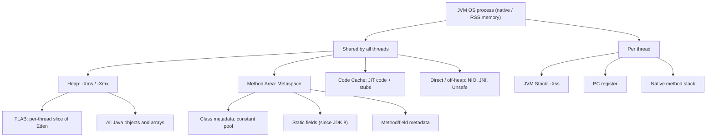
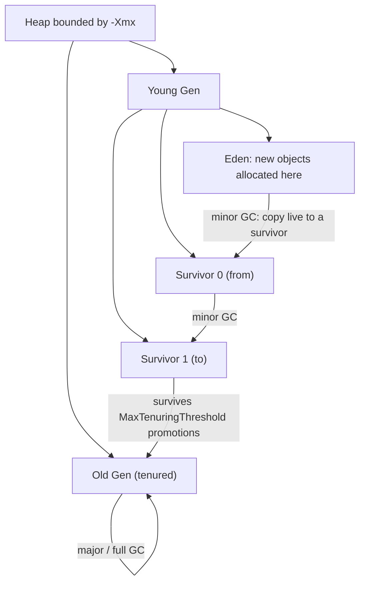
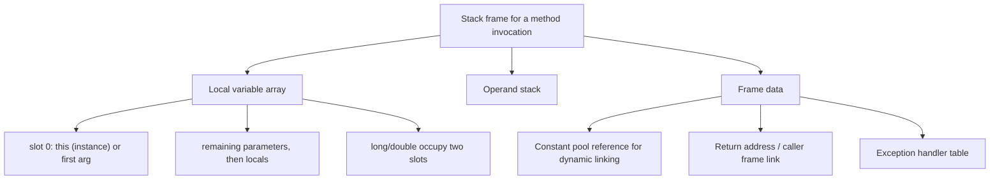
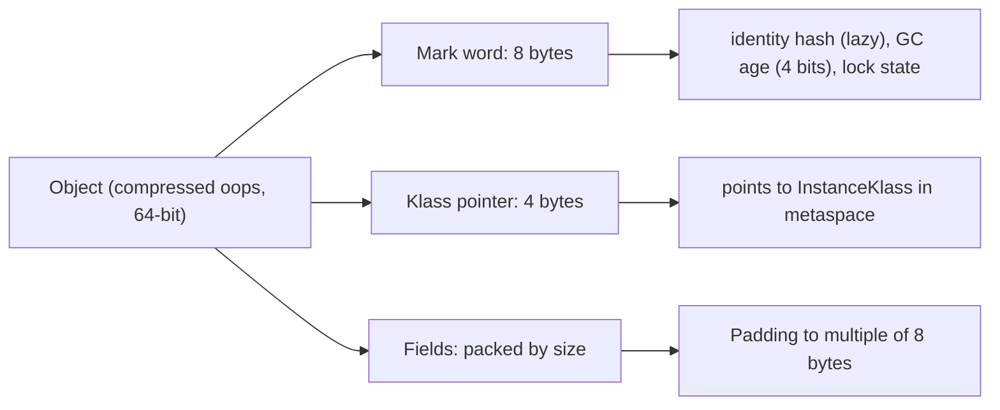
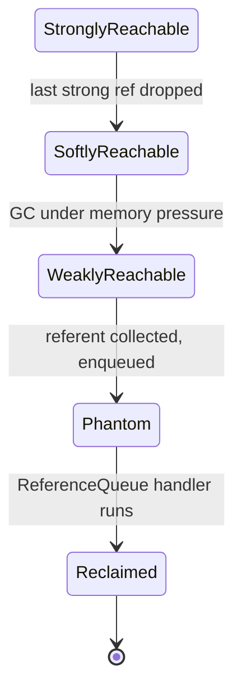

# Java Memory Areas & Memory Management

This module is about **where bytes live and why they move**. Every Java performance problem,
every `OutOfMemoryError`, every "our pod gets OOM-killed after a few hours" incident traces back
to one of a handful of memory areas and one of a handful of ownership rules. Interviewers use this
topic to separate people who memorised "stack vs heap" from people who can reason about a heap
dump at 2 a.m.

The mental model to carry through this module:

> The JVM is **one OS process**. Inside it there is **one shared heap**, **one shared metaspace /
> method area**, **one shared code cache**, and **one stack per thread**. The heap is where
> objects live; everything else is where the *machinery to run objects* lives. Most "Java memory"
> confusion is really confusion about **which area a given thing is in**, and **who owns the
> reference that keeps it alive**.

This module covers the HotSpot implementation on 64-bit Linux (OpenJDK 21), with explicit notes
for Java 8/11/17/21. Garbage-collection *algorithms* are covered in
[Garbage Collection](../08-Advanced/39-Garbage-Collection.md); memory **areas, layout, allocation,
references and failure modes** are covered here. The Java Memory Model (happens-before,
visibility) is a different topic: [Java Memory Model](../04-Multithreading/23-Java-Memory-Model.md).

---

## 1. The Runtime Data Areas

The JVM specification defines a small number of run-time data areas. HotSpot implements them with
some very specific choices.



| Area | Scope | Holds | Created when | Error on exhaustion |
|---|---|---|---|---|
| **Heap** | shared | all objects, all arrays, instance fields, the *contents* of `static` reference fields (the referenced object) | JVM start | `OutOfMemoryError: Java heap space` |
| **Method area / Metaspace** | shared | class metadata, run-time constant pool, method bytecode, field/method descriptors, `static` **variables** themselves (primitive values and references), annotations | on class load | `OutOfMemoryError: Metaspace` |
| **JVM stack** | per thread | stack frames (locals, operand stack, frame data) | on thread start | `StackOverflowError`, or `OutOfMemoryError: unable to create native thread` |
| **PC register** | per thread | address of the currently executing bytecode instruction | on thread start | n/a |
| **Native method stack** | per thread | frames for native (`native`) methods | on thread start | `StackOverflowError` (native) |
| **Code cache** | shared | compiled native methods (`nmethods`), runtime stubs, adapters | as JIT compiles | "CodeCache is full", then interpreter-only fallback |
| **Direct / off-heap** | shared (manual) | `ByteBuffer.allocateDirect` memory, FFM segments, JNI, `Unsafe.allocateMemory` | on demand | `OutOfMemoryError: Direct buffer memory` or a native error |

> This module is the memory detail behind [JVM Architecture](03-JVM-Architecture.md). The method
> area is populated by the class-loading subsystem — see [Class Loading](05-Class-Loading.md).

> Rule of thumb: **`-Xmx` bounds only the heap and (by default) direct buffers.** Thread stacks,
> metaspace, code cache and JNI memory are *outside* `-Xmx` and can push RSS past it.

### 1.1 What changed over versions

| Version | Change that matters here |
|---|---|
| Java 7 | `String` objects moved from the PermGen-backed pool to the **heap** as part of "PermGen elimination" phase 1 |
| **Java 8** | **PermGen removed**; method area implemented as **Metaspace** in native memory (JEP 122). `static` fields moved from PermGen to the heap-adjacent class metadata |
| Java 9 | Compressed class pointers + **compressed class space** become standard; segmented code cache on by default |
| Java 11 | `Epsilon` (no-op) GC available; ZGC/generational story starts |
| Java 15 | **Biased locking disabled** by default (JEP 374) — lock state transitions simplified |
| Java 17 | Strong encapsulation; `-XX:+UseParallelGC` etc. remain |
| Java 21 | **Virtual threads** (JEP 444): their stacks are heap-backed and grow on demand, not a fixed native `-Xss`; FFM API (`Arena`, `MemorySegment`) is **preview** (finalised in 22) |

---

## 2. The Heap In Depth

The heap is the single largest memory area and the one every object you create (that doesn't get
scalar-replaced) lands in.

### 2.1 Generational layout

Most collectors split the heap into a **young generation** (Eden + two survivor spaces) and an
**old generation** (tenured). New objects are born in Eden; survivors are copied between S0 and S1
and eventually promoted to old.



Sizing rules for the classic (non-region) collectors such as Parallel:

- `-XX:NewRatio=N` sets `young : old = 1 : N`. So `NewRatio=2` means young is one third of the heap.
- `-XX:SurvivorRatio=R` sets `eden : each survivor = R : 1`. `R=8` (default) means each survivor is
  `1/10` of young and Eden is `8/10`.
- `-XX:MaxTenuringThreshold=15` (default) caps how many minor GCs a surviving object ages before
  promotion. `-XX:InitialTenuringThreshold=7` is the adaptive starting point.

Verified with Parallel GC on `-Xmx1g -Xms1g -XX:NewRatio=2 -XX:SurvivorRatio=8`:

```text
 PSYoungGen      total 314368K, used 33546K
  eden space 279552K, 12% used
  from space 34816K, 0% used
  to   space 34816K, 0% used
 ParOldGen       total 699392K, used 1073K
```

`eden/survivor = 279552/34816 ~= 8.03`, and `young:old ~= 314368:699392 ~= 1:2.22` — the ratios
hold (the absolute numbers differ from `1/3` because committed space lags the reserved maximum).

> **G1 and ZGC ignore `NewRatio` for physical layout.** They use fixed-size **regions** (G1:
> `-XX:G1HeapRegionSize`, 1 MB–32 MB power of two; ZGC: region/slab based) and decide the young
> set dynamically from pause goals. Setting `NewRatio` with G1 has no meaningful effect on sizing.

### 2.2 Allocation: TLABs and bump-the-pointer

Allocating on the heap must be extremely fast and thread-safe. HotSpot avoids a global lock with
**thread-local allocation buffers (TLABs)**: each thread gets a private slice of Eden and allocates
by simply **bumping a pointer** inside it.

A TLAB behaves like a private free-list pointer: it has an **allocated region** below a moving
`top`, and **free space** above it. Allocation advances `top` by the object size with no lock and
no CAS; only a TLAB refill touches shared Eden state.

- `-XX:+UseTLAB` is **on by default**. `-XX:TLABSize=0` means auto-sized; `-XX:+ResizeTLAB`
  (default) adaptively resizes per thread. `-XX:MinTLABSize=2048` (bytes).
- When a thread's TLAB is exhausted it requests a **new TLAB** from Eden with a single atomic
  reservation (`CAS` on the eden top, or the `_top`/`_end` pair of `ContiguousSpace`). Objects too
  big for any TLAB (`MinTLABSize`-relative waste heuristic, `-XX:TLABWasteTargetPercent=1`) are
  allocated **directly in Eden under a lock**.
- `-XX:+ZeroTLAB` (default false) clears the whole TLAB when handed out. Most modern collectors do
  not need it because the GC cleans Eden on recycle; leaving it off saves memory bandwidth.
- The pointer-bump path is roughly: allocate in TLAB → if it does not fit, try a new TLAB → if
  that fails, take the slow path (`SharedRuntime::slow_allocate`), possibly triggering GC.

Allocation cost is therefore a handful of instructions in the common case, which is exactly why
"Java allocates a lot and that's fine" is true for short-lived objects.

### 2.3 Large, humongous and region-based objects

- **G1 humongous objects**: an object is *humongous* when it is **>= 50% of a region**
  (`G1HeapRegionSize / 2`). Humongous objects are allocated in *contiguous* regions, are *not*
  moved by normal young collections (they live in old), and can cause "humongous allocation"
  pauses and fragmentation. Raising `-XX:G1HeapRegionSize` can turn many small-humongous objects
  into normal ones; an under-sized region produces many single-object regions.
- **ZGC / Shenandoah** use their own region/slab layouts and handle large objects in dedicated
  regions too. Epsilon (`-XX:+UnlockExperimentalVMOptions -XX:+UseEpsilonGC`) has no regions at
  all and simply never collects.
- In **all** collectors, a single array larger than the remaining heap raises
  `OutOfMemoryError: Requested array size exceeds VM limit` *before* GC, when the request exceeds
  `Integer.MAX_VALUE - overhead` or cannot possibly fit.

### 2.4 Card table and remembered sets (the concept)

A minor GC scans the young generation, but objects in young space can be referenced from **old**
space. Scanning all of old space every minor GC would be fatal, so collectors track *where* such
cross-generation pointers are.

- **Card table**: the heap is divided into **cards** (typically 512 bytes). A one-byte-per-card
  table records "this card may contain an old→young pointer." When a reference field is written,
  a **write barrier** dirties the card (`card_table[addr >> 9] = dirty`). Minor GC then scans only
  the dirty cards, not all of old.
- **Remembered sets (RS)**: G1 generalises the idea. Each region has an RS listing which *other*
  regions point into it, so a collection can find all incoming references without scanning the
  whole heap. RS maintenance (`G1RemSet*` flags, refinement threads) is a real cost and a source
  of "concurrent refinement" pauses.
- **Write barriers** are the runtime machinery behind both. They are why storing into an `Object[]`
  is not free, and why field writes can defeat some JIT optimisations. This is a classic advanced
  interview point: *you cannot explain minor GC cost without remembered sets.*

---

## 3. The JVM Stack

Every thread gets exactly one JVM stack (a *platform* thread gets a fixed native stack; a *virtual*
thread gets a growable heap-backed stack — see [Virtual Threads](../04-Multithreading/22-Virtual-Threads.md)).
The stack holds **frames**, one per method invocation.

### 3.1 Frame structure



- **Local variable array**: indexed slots; `long`/`double` take **two** slots; `this` is slot 0 for
  instance methods. Sized by `max_locals` in the class file.
- **Operand stack**: a LIFO workspace for bytecode. `iload`/`iload_1` push, `iadd` pops two and
  pushes one, etc. This is why JVM bytecode is stack-based. Disassemble with `javap -c`.
- **Frame data**: pointer to the caller's frame, the method's constant pool, and the exception
  handler table (`jsr`/`finally`, `try`-`catch` ranges).
- **Dynamic linking**: the constant pool reference resolved lazily on first execution.

### 3.2 Stack sizes and StackOverflowError

- `-Xss<size>` sets the stack size **per platform thread** (e.g. `-Xss512k`, `-Xss2m`). Equivalent
  to `-XX:ThreadStackSize` in KB; default `ThreadStackSize=1024` (1 MB) on 64-bit Linux.
- The VM reserves roughly `StackShadowPages` (20 pages by default) beyond the Java stack for
  interpreter/JIT/native use.
- `StackOverflowError` is thrown when a thread's stack cannot grow further — almost always
  **unbounded recursion**. It is *not* an `OutOfMemoryError`; it is a normal, catchable `Error`.

Verified recursion depth for a minimal frame (results vary by JIT state and machine):

```java
public class Recursion {
    static int depth = 0;
    static void recurse() { depth++; recurse(); }
    public static void main(String[] args) {
        try { recurse(); } catch (StackOverflowError e) {
            System.out.println("Depth reached: " + depth);
        }
    }
}
```

```text
default (-Xss1m):  Depth reached: 21770
-Xss256k:          Depth reached: 2715
-Xss2m:            Depth reached: 60585
```

> The absolute depth is **not a spec guarantee** — it depends on stack size, frame width, JIT
> inlining, and warm-up. Never code to an exact depth; size `-Xss` from measured worst-case depth
> with a safety margin.

### 3.3 Deep vs wide stacks

Frame width matters as much as depth. A method with many live locals consumes more stack per
frame, so it reaches `StackOverflowError` at a shallower depth:

```java
static int d2 = 0;
static void wide() {
    long a=1,b=2,c=3,d=4,e=5,f=6,g=7,h=8,i=9,j=10,k=11,l=12;
    d2++; wide();
    if (a+b+c+d+e+f+g+h+i+j+k+l == 0) System.out.print("");
}
```

```text
shallow depth=25436
wide    depth=8828
```

Note the `if` at the end keeps the locals **live across the recursive call**, which is what forces
them into the frame. A "deep" stack (more frames) is usually recursive algorithms; a "wide" stack
(fewer, fatter frames) is often large methods with many locals or un-inlined lambdas.

> **HotSpot does not do tail-call optimisation.** A tail-recursive method still consumes one frame
> per call. Rewrite deep recursion as a loop or an explicit `ArrayDeque` when depth is unbounded.

---

## 4. Method Area and Metaspace

The method area holds *class-level* data. Before Java 8 it was **PermGen**, a fixed-size part of
the heap. Since Java 8 it is **Metaspace**, allocated from native memory.

### 4.1 What lives in Metaspace

| Lives in Metaspace | Lives in the Heap |
|---|---|
| class metadata (`InstanceKlass`, vtable/itable) | the objects those classes instantiate |
| run-time constant pool (per class) | `String` objects referenced by the pool |
| method bytecode, field/method descriptors, annotations | `Class<?>` **object** (the `java.lang.Class` instance is on the heap) |
| **static primitive fields** and **static reference fields** themselves | the object *pointed to* by a static reference field |
| JIT metadata about methods (not the code, which is in the code cache) | — |

> **Classic trap.** Since Java 8 `static` variables live with the class metadata in Metaspace, but
> a `static List<Foo>` field holds a *reference* in Metaspace to a `List` **object on the heap**.
> Leaking a static collection grows the heap, not metaspace. Leaking *classes* (via class loaders)
> grows metaspace.

### 4.2 Why PermGen was removed

PermGen was a fixed-size heap region (`-XX:MaxPermSize`). Two problems:

1. Sizing it was guesswork; too small meant `OutOfMemoryError: PermGen space` under dynamic class
   generation (proxies, bytecode libraries, app servers redeploying).
2. It forced the *class metadata* allocator and the *object* allocator into one space, preventing
   independent resizing and clean unloading semantics.

Metaspace moved metadata to native memory, where it can **grow on demand** and be reclaimed per
**class loader** when the loader becomes unreachable. `-XX:MaxPermSize` was removed; it is silently
ignored (JDK 7 already warned).

### 4.3 Compressed class space

On 64-bit HotSpot with `-XX:+UseCompressedClassPointers` (default when compressed oops are on),
each object's klass pointer is 4 bytes instead of 8. Those compressed class pointers must map into
a single reserved region: the **compressed class space**, bounded by
`-XX:CompressedClassSpaceSize` (default **1 GB**). This is why `jcmd VM.metaspace` reports
`class space` separately, and why a metaspace OOM can appear as "class space" exhaustion.

### 4.4 Flags and failure mode

| Flag | Default | Meaning |
|---|---|---|
| `-XX:MaxMetaspaceSize` | unlimited (effectively `Long.MAX_VALUE`) | hard cap on metaspace (class metadata + class space) |
| `-XX:MetaspaceSize` | ~21 MB | initial *high-water mark* that triggers the first metaspace GC; not a cap |
| `-XX:MinMetaspaceFreeRatio` | 40 | grow threshold after GC |
| `-XX:MaxMetaspaceFreeRatio` | 70 | shrink threshold after GC |
| `-XX:CompressedClassSpaceSize` | 1 GB | reserved size of compressed class space |

Unbounded metaspace is dangerous in containers: a class-loader leak can grow native memory until
the **OS OOM-killer** kills the JVM. Set `-XX:MaxMetaspaceSize` to a sane cap.

**Metaspace OOM repro.** Defining the same class bytes in a fresh `ClassLoader` repeatedly (keeping
the loaders alive) grows metaspace without bound:

```java
static class Loader extends ClassLoader {
    private final byte[] bytes;
    Loader(byte[] bytes) { this.bytes = bytes; }
    Class<?> define() { return defineClass("Payload", bytes, 0, bytes.length); }
}
// keep adding new Loader + Class into a List until OutOfMemoryError: Metaspace
```

With `-XX:MaxMetaspaceSize=48m`, this run produced:

```text
caught metaspace OOM after 8095
```

(The count varies with loader/class complexity. On this machine the loader-loop happened to also
exhaust metaspace via lazily-generated `invokedynamic` string-concat classes — a nice reminder that
*the JDK itself* consumes metaspace lazily.)

### 4.5 Inspecting metaspace

```bash
jcmd <pid> VM.metaspace
```

```text
Total Usage - 27 loaders, 713 classes (657 shared):
  Non-Class:   45 chunks,   4.05 MB capacity,  437.00 KB ( 11%) committed,  410.03 KB ( 10%) used
      Class:   27 chunks,  283.00 KB capacity,   91.00 KB ( 32%) committed,   33.52 KB ( 12%) used
       Both:   72 chunks,    4.33 MB capacity,  528.00 KB ( 12%) committed,  443.55 KB ( 10%) used
Virtual space:
  Non-class space:       64.00 MB reserved,  448.00 KB committed
      Class space:        1.00 GB reserved,  128.00 KB committed
```

Two independent limits show up here: **non-class space** (mostly unlimited until
`MaxMetaspaceSize`) and **class space** (capped by `CompressedClassSpaceSize`).

### 4.6 The run-time constant pool

Each loaded class has a **run-time constant pool** — the runtime form of the `constant_pool` table
in the class file. It holds literal constants, class/method/field references and `String` literals
(for which the JVM interns a `String` on the heap on first use). Inspect it with `javap -v`:

```java
public class Cp {
    static final int CONST = 42;
    static String s = "hello";
    public static void main(String[] args) { System.out.println(CONST + s.length()); }
}
```

```text
Constant pool:
   #7 = Fieldref   #8.#9   // java/lang/System.out:Ljava/io/PrintStream;
  #15 = Fieldref   #13.#16 // Cp.s:Ljava/lang/String;
  #31 = String     #32     // hello
  #36 = Integer    42
```

The `ConstantValue` attribute on `CONST` lets the compiler inline it, so `42` may not even be
touched at runtime. This is method-area content even though a `String` literal resolves to a heap
object on first use. The direct link between class-file constant pool and this area is covered in
[Bytecode](../08-Advanced/44-Bytecode.md).

---

## 5. Code Cache and JIT Metadata

The **code cache** is native memory where the JIT (`C1`/`C2`) stores compiled `nmethods`, runtime
**stubs** (call stubs, exception handlers) and **adapters** (interpreter↔compiled transitions).

- Segmented code cache (default: `-XX:+SegmentedCodeCache`) splits it into `non-nmethod`,
  `profiled nmethods` and `non-profiled nmethods` heaps. Verified ergonomic defaults on 64-bit
  Linux: `ReservedCodeCacheSize=251658240` (~240 MB), `NonProfiledCodeHeapSize=122909434`,
  `ProfiledCodeHeapSize=122909434`, `NonNMethodCodeHeapSize=5839372`.
- `-XX:+PrintCodeCache` prints usage at shutdown:

```text
CodeHeap 'non-profiled nmethods': size=120028Kb used=35Kb
CodeHeap 'profiled nmethods':     size=120028Kb used=57Kb
CodeHeap 'non-nmethods':          size=5704Kb   used=1225Kb
CodeCache: size=245760Kb, used=1317Kb, free=244442Kb
 total_blobs=442, nmethods=81, adapters=267
```

- When the cache fills, HotSpot logs `CodeCache: full` and (with `-XX:+UseCodeCacheFlushing`,
  default) flushes old methods; if it cannot, it **stops compiling** and falls back to the
  interpreter — a severe, often-missed performance cliff. Fix: raise
  `-XX:ReservedCodeCacheSize` (e.g. to 512 MB for large monoliths), and reduce generated code
  (fewer lambdas/`invokedynamic` explosion). See [JVM Performance](../08-Advanced/38-JVM-Performance.md).

---

## 6. Direct, Off-Heap and Native Memory

Anything allocated outside the Java heap is invisible to `-Xmx` and to garbage-collection pressure.

### 6.1 Direct `ByteBuffer`

```java
ByteBuffer buf = ByteBuffer.allocateDirect(1024 * 1024);
// Direct buffer capacity=1048576 isDirect=true
```

`allocateDirect` calls `DirectByteBuffer`'s native allocator (`Unsafe.allocateMemory`), tracked
against `-XX:MaxDirectMemorySize`. **Default `MaxDirectMemorySize` equals the max heap size**
(`-Xmx`). Verified: with `-Xmx256m -XX:MaxDirectMemorySize=64m`, allocating 10 MB buffers:

```text
caught after buffers=6
message=Cannot reserve 10485760 bytes of direct buffer memory (allocated: 62914560, limit: 67108864)
```

The backing native memory is freed not by the GC directly but by a **`Cleaner`** registered on the
`DirectByteBuffer`: when the buffer object becomes unreachable, its `Cleaner` runs
`Unsafe.freeMemory`. This is why "just stop referencing direct buffers" is *eventually* enough —
but the delay between unreachable and cleaned can be large under low GC pressure, which is a common
off-heap leak symptom. `sun.misc.Unsafe.invokeCleaner` (see [Unsafe](../08-Advanced/42-Unsafe.md))
forces it for tests.

### 6.2 Foreign Function & Memory API (preview in 21)

Java 21's FFM API (`java.lang.foreign`) gives explicit, `AutoCloseable` off-heap memory:

```java
// compile with: javac --enable-preview --release 21
try (Arena arena = Arena.ofConfined()) {
    MemorySegment seg = arena.allocate(1024);
    seg.set(ValueLayout.JAVA_INT, 0, 1234567);
    int v = seg.get(ValueLayout.JAVA_INT, 0);        // 1234567
    ByteBuffer bb = seg.asByteBuffer();              // direct=true capacity=1024
}
// arena closed -> native memory released deterministically
```

This is the modern replacement for both `ByteBuffer` juggling and `Unsafe`. It is **preview** in 21,
**final** in 22. Link: [sun.misc.Unsafe](../08-Advanced/42-Unsafe.md), [NIO & the Files API](../05-IO/25-NIO-Files-API.md).

### 6.3 The `Cleaner` API

`java.lang.ref.Cleaner` (Java 9+) is the supported mechanism for deterministic-ish cleanup of
native resources when an object becomes unreachable — replacing `finalize`:

```java
Cleaner cleaner = Cleaner.create();
Cleaner.Cleanable handle = cleaner.register(new Object(), () -> System.out.println("Cleaning A"));
handle.clean();          // Cleaning A  (also runs automatically when the object is collected)
```

Use `Cleaner` for **off-heap/native resources only**, and always provide an explicit `close()` as
the primary path; `Cleaner` is the safety net.

### 6.4 Native Memory Tracking

```bash
java -XX:NativeMemoryTracking=summary -Xmx256m Hold
jcmd <pid> VM.native_memory summary
```

```text
Total: reserved=1723451KB, committed=334047KB
-          Java Heap (reserved=262144KB, committed=247808KB)
-              Class (reserved=1048677KB, committed=229KB)   (classes #713)
-             Thread (reserved=18485KB,  committed=845KB)    (threads #18)
                                (stack: reserved=18432KB, committed=792KB)
-               Code (reserved=247756KB, committed=7616KB)
-                 GC (reserved=59389KB,  committed=59109KB)
-           Compiler, Internal, Symbol, Native Memory Tracking ...
```

NMT is the fastest way to answer "why is RSS 1.5 GB when `-Xmx` is 512 MB?" — look for large
`GC`, `Thread`, `Code`, `Class` or `Other` entries. `-XX:NativeMemoryTracking=detail` adds per-call
sites at extra cost; use `jcmd VM.native_memory baseline` then `summary.diff`.

---

## 7. Object Layout

Understanding layout is how you reason about memory footprint and cache behaviour.

### 7.1 Anatomy



- **Mark word (8 bytes)**: identity hash code (computed lazily on first `hashCode()`), GC age (4
  bits), lock/monitor state. Biased-locking bits are gone in JDK 21 (biased locking removed).
- **Klass pointer**: 4 bytes with compressed class pointers, else 8.
- **Array header** adds a 4-byte **length** field, then elements.
- **Field packing**: HotSpot assigns fields **largest-alignment-first** (longs/doubles, then ints/
  floats, then shorts/chars, then bytes/booleans, then references) to minimise padding; the whole
  object is then padded to a multiple of the **object alignment** (8 bytes by default,
  `-XX:ObjectAlignmentInBytes`).

### 7.2 Compressed oops

With `-XX:+UseCompressedOops` (default for heaps below ~32 GB), object references are stored as
**32-bit offsets** from a zero (or narrow) base, so `ref = address >> 3` and `address = base + (ref
<< 3)`. This halves reference size and improves cache density. `-XX:+UseCompressedClassPointers`
does the same for klass pointers, using the compressed class space. Both flags are controlled
together (`lp64_product`), and a JVM prints `UseCompressedOops` ergonomically `true` for typical
heaps.

### 7.3 Measuring with JOL (Java Object Layout)

JOL is the standard third-party tool (`org.openjdk.jol:jol-core`); it is not a JDK API. JDK-only
alternatives are a `java.lang.instrument` agent using `Instrumentation.getObjectSize`, or
`sun.misc.Unsafe.objectFieldOffset` to read individual field offsets (see
[Unsafe](../08-Advanced/42-Unsafe.md)). Verified JOL output on OpenJDK 21 with compressed oops:

| Class | Definition | Instance size |
|---|---|---|
| `Empty` | no fields | 16 B (12 B header + 4 B padding) |
| `TwoInts` | `int a; int b;` | 24 B (12 header + 8 + 4 pad) |
| `IntLong` | `int a; long b;` | 24 B (reordered: `long` first at offset 16) |
| `LongInt` | `long a; int b;` | 24 B (same layout as `IntLong`) |
| `RefAndInt` | `Object o; int a;` | 24 B |
| `int[10]` | — | 56 B (16 header + 40 elements) |
| `Integer` | `int value` | 16 B |
| `String` | (JDK 9+ compact strings) | 24 B + backing `byte[]` |

JOL output for `IntLong` and `LongInt` is identical — proof of field reordering:

```text
IntLong object internals:
  0   8   (object header: mark)
  8   4   (object header: class)
 12   4   int  IntLong.a
 16   8   long IntLong.b
Instance size: 24 bytes
```

Disabling compressed oops (`-XX:-UseCompressedOops`) pushes the klass pointer and references to 8
bytes: the same `String` grows from 24 B to 32 B and `String.value` moves to offset 24.

> **Sizing intuition:** a typical object costs **12 bytes of header** (compressed) plus fields,
> rounded up to 8. A one-`int` wrapper is 16 B; a two-`long` object is 24 B. Arrays add a 4-byte
> length plus element storage, so `new int[1_000_000]` is `16 + 4_000_000 = 4,000,016` B ~= 3.8 MB.
> This is why "a `long` map of 10 million rows" costs far more than the raw data.

### 7.4 Layout edge cases

- **Empty class still occupies 16 bytes** — the header, plus padding to alignment.
- A class with a single `long` occupies 24 B, not 16: the `long` cannot start at offset 12 (not
  8-aligned), so it is placed at offset 16 and the header prematurely sized.
- **`long` and `double` are not atomic without `volatile`** on 32-bit VMs; on 64-bit they are, but
  JMM visibility rules still apply (see [Java Memory Model](../04-Multithreading/23-Java-Memory-Model.md)).
- **Arrays of references**: `[Ljava.lang.Object;` with compressed oops stores 4-byte refs plus a
  4-byte length; without compressed oops, 8-byte refs.

---

## 8. Escape Analysis, Scalar Replacement, Lock Elision

The JIT can prove an object **never escapes** a method (its reference cannot reach a heap field,
another thread, or a return value). If so, C2 may:

- **Scalar-replace** it: split the object into its scalar fields held in registers/stack — removing
  the allocation entirely.
- **Stack-allocate** it (rare in HotSpot; Graal can do it explicitly).
- **Elide locks** on it: `-XX:+EliminateLocks`, `-XX:+EliminateNestedLocks` remove `synchronized`
  on provably non-escaping objects.
- **Eliminate allocations** (`-XX:+EliminateAllocations`, default true).

Flags: `-XX:+DoEscapeAnalysis` (default true, C2).

Verified demonstration — a 1-billion-iteration loop allocating a non-escaping `P`:

```text
with    -XX:+DoEscapeAnalysis: time(ms)=337
without -XX:-DoEscapeAnalysis: time(ms)=2181
```

The allocation disappears, so the with-EA path does roughly arithmetic only. Caveats that
interviewers probe:

- Escape analysis is **per compilation unit**; an inlined callee's object can be eliminated, so
  `-XX:-Inline` or huge methods disable it.
- Storing the object into a field, returning it, throwing it, or passing it to a non-inlined
  method makes it escape.
- Partial escape analysis in **Graal** is more aggressive (it can eliminate on some paths); see
  [GraalVM](../08-Advanced/45-GraalVM.md).
- EA is not a substitute for good data structures: if objects genuinely escape, they are allocated.

---

## 9. Reference Types and Reachability

Java has four reference strengths. They drive caches, leak detection and finalization.

| Type | Class | Cleared when | Typical use | `get()` after clear |
|---|---|---|---|---|
| **Strong** | (ordinary ref) | never (while reachable) | everything | n/a |
| **Soft** | `SoftReference` | at the GC's discretion, *as memory pressure rises* | memory-sensitive caches | `null` once cleared |
| **Weak** | `WeakReference` | on the next GC after the referent is only weakly reachable | canonicalisation, `WeakHashMap` keys | `null` |
| **Phantom** | `PhantomReference` | after finalization; enqueued to a `ReferenceQueue` | post-mortem cleanup, `Cleaner` | always `null` |



Verified behavior (referents created inside helper methods so the local does not keep them alive):

```java
ReferenceQueue<Object> q = new ReferenceQueue<>();
WeakReference<Object> w = weak();     // referent created inside weak()
SoftReference<Object> s = soft();
PhantomReference<Object> p = phantom(q);
System.gc(); Thread.sleep(200);
// before gc: weak=true soft=true phantom=false
// after gc:  weak=false soft=true phantom=false
// phantom enqueued=true
```

Notes interviewers love:

- **Soft references are cleared at the GC's discretion**, not on a schedule. A "soft cache" can be
  cleared unexpectedly under pressure, and — worse — can *retain* large object graphs for a long
  time (soft references survive until memory pressure, so they delay collection). Prefer
  size-bounded caches (Caffeine/Guava) with explicit eviction.
- **Phantom references never return the referent** (`get()` is permanently `null`); the point is
  the `ReferenceQueue` notification, which `Cleaner` builds on.
- A reference is only cleared if the referent is **not** reachable by a strong path. If anything
  strong holds it (a `static` collection, a live thread, an unclosed stream), it is **not** a leak
  fix.

### 9.1 `WeakHashMap` and caches

```java
Map<Key, String> weak = new WeakHashMap<>();
Key k = new Key("x");
weak.put(k, "value");
k = null;
System.gc(); Thread.sleep(200);
// weak size after gc=0
```

The map's keys are weak: once no strong reference to `k` exists, the entry is removed (on the next
GC + map operation). This makes `WeakHashMap` correct for *identity* metadata, but **not** a general
cache — entries can evaporate at any GC, and the map is not thread-safe. For caches with a
lifetime policy use [Concurrent Collections](../02-Collections/11-Concurrent-Collections.md) or a
library cache.

### 9.2 `finalize` vs `Cleaner`

`Object.finalize()` is deprecated for removal (deprecated in 9, deprecated-for-removal in 18) and
**disabled by default in 18+** (`--finalization=disabled`). It is slow (a finalizer thread and a
queue in the GC), unpredictable, resurrects objects, and can be bypassed. Use `Cleaner` (or
`AutoCloseable`/try-with-resources) instead. `System.runFinalization()` is also deprecated.

> **Best practice:** implement `AutoCloseable`, use try-with-resources, and register a `Cleaner`
> as a backstop. Never rely on finalization for correctness.

---

## 10. Allocation Failure: The `OutOfMemoryError` Family

An `OutOfMemoryError` names the **area** that could not satisfy the request; the message is the
fastest diagnostic signal you get.

| Message | Area | Typical cause | First fix |
|---|---|---|---|
| `Java heap space` | heap | live set genuinely > `-Xmx`; leak | heap dump + MAT; fix retention; only then raise `-Xmx` |
| `Metaspace` | metaspace | class-loader leak, dynamic proxy/bytecode generation | `jcmd VM.metaspace`, `-XX:MaxMetaspaceSize`, fix loader lifecycle |
| `Direct buffer memory` | off-heap | direct buffers not released fast enough; Netty NIO | `-XX:MaxDirectMemorySize`, pool and release buffers, use `Cleaner`/arena |
| `unable to create native thread` | native stacks | too many threads, `ulimit -u`/`-Xss` too large, container pids limit | reduce threads/`-Xss`, raise limits; use virtual threads |
| `GC overhead limit exceeded` | heap | >98% time in GC, <2% reclaimed | find the retention/leak; increase heap only tentatively |
| `Requested array size exceeds VM limit` | heap | single array > `Integer.MAX_VALUE-overhead` | don't allocate billion-element arrays; use chunks |

**Verified heap OOM (catchable):** allocating one array larger than the heap succeeds in being
caught, because the heap is not actually full:

```java
try { byte[] big = new byte[100 * 1024 * 1024]; }
catch (OutOfMemoryError e) { System.err.println("Caught OOM: " + e.getMessage()); }
```

```text
with -Xmx64m: Caught OOM: Java heap space
              still running
```

**Uncatchable-in-practice heap OOM (a critical trap):** if you exhaust the heap by *filling* it,
the handler itself may not be able to allocate. Running the loop-fill version with `-Xmx64m`, even
a preallocated message and `System.err.println` can throw `OutOfMemoryError` **inside the catch
block**, so you see the raw stack trace instead of a graceful message:

```java
try { while (true) list.add(new byte[1024 * 1024]); }
catch (OutOfMemoryError e) { System.err.println("caught heap OOM"); }   // may itself OOM
```

```text
Exception in thread "main" java.lang.OutOfMemoryError: Java heap space
	at OomHeap5.main(OomHeap5.java:9)
```

Lesson: **do not do real work in an `OutOfMemoryError` handler.** Preallocate resources you need,
or let the process die and restart.

**Useful flags for production:**

| Flag | Effect |
|---|---|
| `-XX:+HeapDumpOnOutOfMemoryError` | write a heap dump on first OOM |
| `-XX:HeapDumpPath=/path/dumps` | where to write it (dir or template) |
| `-XX:+ExitOnOutOfMemoryError` | `exit(3)` immediately after OOM (avoid a wedged process) |
| `-XX:+CrashOnOutOfMemoryError` | hard-crash + fatal error log |
| `-XX:+OnOutOfMemoryError="..."` | run a command (e.g. a notifier) |

---

## 11. Memory Leaks vs High Retention

In a tracing-GC world there is no "freed memory" bug — only **unintended reachability**. "Leak"
means objects that are still reachable but will never be used again, so the GC cannot reclaim them.

### 11.1 Common leak patterns

| Pattern | Why it leaks | Fix |
|---|---|---|
| **Static/unbounded collections** | `static Map` grows forever; entries never removed | bound the cache, TTL/evict, use `WeakHashMap` only for identity metadata |
| **Listeners / callbacks** | subject holds listener list; listener removed never unregisters | `removeListener` in `close()`; use weak listeners |
| **`ThreadLocal` in pooled threads** | entry lives in `Thread.threadLocals` for the thread's life; value strongly held even after the key is weakly collected | always `try/finally { tl.remove(); }` |
| **Unclosed resources** | `InputStream`, `Connection`, `HttpClient` body | try-with-resources; `Cleaner` backstop |
| **Class-loader leaks** | a loaded class (or its statics, or a `ThreadLocal`) holds the loader alive; app-server redeploy keeps every class | scan with `jmap -clstats`/MAT; break the loader→class→loader cycle |
| **`intern()`/metadata growth** | unbounded `String.intern()` or dynamic class generation | avoid mass interning; cache-generated classes |
| **Direct buffers** | native memory freed only via `Cleaner` when unreachable | pool/release explicitly; `-XX:MaxDirectMemorySize` |
| **Caches without eviction** | "cache" == leak with a friendly name | size/weight/TTL bounds |

The `ThreadLocal` case surprises people because the ownership is split: a pooled `Thread` owns a
`ThreadLocalMap` whose entries hold the `ThreadLocal` as a **weak key** but the value as a
**strong** reference. Even after the `ThreadLocal` object is collected and the key is cleared, the
**Entry keeps the value alive** because the map strongly references it. The value survives until the
thread dies or a later `remove()`/`set()` cleans the stale entry — and in a pool, threads never die.

```java
// WRONG: pooled thread retains the value indefinitely
pool.submit(() -> { TL.set(new byte[8 * 1024 * 1024]); use(TL.get()); });

// RIGHT: every set is paired with remove in a finally
pool.submit(() -> {
    try { TL.set(new byte[8 * 1024 * 1024]); use(TL.get()); }
    finally { TL.remove(); }
});
```

### 11.2 Detecting leaks

| Tool | Command / usage | What it shows |
|---|---|---|
| `jmap` histogram | `jmap -histo:live <pid>` | live object counts by class (after a GC) |
| `jcmd` histogram | `jcmd <pid> GC.class_histogram` | same, via attach |
| Heap dump | `jcmd <pid> GC.heap_dump /tmp/d.hprof` or `jmap -dump:live,format=b,file=/tmp/d.hprof <pid>` | full snapshot for MAT |
| Eclipse MAT / VisualVM | open the `.hprof` | dominator tree, "leak suspects", GC roots paths |
| `jmap -clstats` | loader stats | class-loader leak candidates |
| JFR | `-XX:StartFlightRecording` | `ObjectAllocationSample`, `OldObjectSample` for leak roots |
| `jcmd VM.metaspace` | metaspace breakdown | metadata/class-space growth |

Verified histogram excerpt (a program holding 100k strings):

```text
 num     #instances         #bytes  class name (module)
   1:          8159         356832  [B (java.base@21.0.12.1)
   2:          8078         193872  java.lang.String (java.base@21.0.12.1)
   3:          1544         190872  java.lang.Class (java.base@21.0.12.1)
```

> Workflow: take a baseline dump after warm-up, take a second dump hours later, then compare
> **dominator trees** — the class whose retained size grew is your leak. Counts alone mislead;
> retained size is what matters.

---

## 12. Key Flags Reference

| Flag | Default | Area | Purpose |
|---|---|---|---|
| `-Xms<size>` | 1/64 of RAM (initial heap) | heap | initial heap; set `== -Xmx` in containers to avoid resizing |
| `-Xmx<size>` | 1/4 of RAM | heap | max heap (logical, not RSS) |
| `-Xss<size>` | ~1 MB | stack | per-platform-thread stack size |
| `-XX:NewRatio=N` | 2 | heap | young:old ratio (non-region collectors) |
| `-XX:SurvivorRatio=R` | 8 | heap | eden:survivor ratio |
| `-XX:MaxTenuringThreshold=N` | 15 | heap | minor GCs before promotion |
| `-XX:MetaspaceSize=<size>` | ~21 MB | metaspace | first-GC high-water mark (not a cap) |
| `-XX:MaxMetaspaceSize=<size>` | unlimited | metaspace | hard cap; **set this in production** |
| `-XX:CompressedClassSpaceSize=<size>` | 1 GB | metaspace | reserved compressed class space |
| `-XX:MaxDirectMemorySize=<size>` | = `-Xmx` | off-heap | cap on direct buffers |
| `-XX:ReservedCodeCacheSize=<size>` | ~240 MB | code cache | cap on JIT code |
| `-XX:+AlwaysPreTouch` | false | native | fault in the whole heap at startup |
| `-XX:NativeMemoryTracking=summary` | off | native | enable NMT |
| `-XX:+HeapDumpOnOutOfMemoryError` | false | diagnostics | dump on OOM |

### `-XX:+AlwaysPreTouch`

By default the JVM **reserves** `-Xms`/`-Xmx` but only faults in pages as they are touched, so RSS
starts small and grows. `AlwaysPreTouch` faults in every page at startup, trading startup time and
immediate RSS for **stable latency** (no page-fault jitter mid-traffic). Verified on
`-Xmx512m -Xms512m`:

```text
without AlwaysPreTouch: rss(MB)=301   (after touching 256 MB)
with    AlwaysPreTouch: rss(MB)=571
```

---

## 13. Putting It Together

- **One process, several areas.** `-Xmx` bounds the heap; metaspace, stacks, code cache and
  direct memory are *additional*. Container memory limits must account for all of them.
- **Allocation is cheap; retention is expensive.** Objects are born via pointer-bump in TLABs.
  The cost is what you *keep alive*, not what you allocate.
- **Reachability is ownership.** A "leak" is a strong reference you forgot, usually a `static`
  field, a listener list, a `ThreadLocal` in a pool, or an unclosed resource.
- **Class metadata lives in metaspace; class instances live on the heap.** Confusing the two is
  the single most common mistake in this topic.
- **Escape analysis makes some allocation free; never depend on it.** Write clear code, then
  measure with JOL/dumps/NMT.

---

# Interview Questions

## Beginner

**Q:** What are the main memory areas of the JVM?

**A:** The JVM has shared areas — **heap**, **method area (Metaspace since Java 8)**, **code cache**,
and direct/off-heap memory — and per-thread areas — the **JVM stack**, **PC register**, and
**native method stack**. The heap holds objects; the method area holds class metadata, the run-time
constant pool, and static variables; each thread's stack holds call frames (locals, operand stack,
frame data). `-Xmx` bounds only the heap.

**Q:** Difference between stack and heap?

**A:** The stack is per-thread, LIFO, holds **frames** with local variables and the operand stack,
and is freed deterministically when a method returns. The heap is shared, holds **objects and
arrays**, is managed by the GC, and object lifetime is not tied to any call. Primitives and
references in local variables live on the stack (or in registers); the objects they point to live
on the heap. Stack overflow gives `StackOverflowError`; heap exhaustion gives
`OutOfMemoryError: Java heap space`.

**Q:** Where are `static` variables stored?

**A:** The **variable itself** (a primitive value or a reference) is part of the class metadata in
**Metaspace**, since Java 8 (it was in PermGen before). But the **object** a `static` reference
points to is on the **heap**. So `static byte[] buffer = new byte[10_000_000]` puts a 10 MB array
on the heap and 8 bytes (or 4 compressed) in metaspace.

**Q:** What causes `StackOverflowError` and how do you fix it?

**A:** Unbounded/too-deep recursion, or a recursive call whose base case is never reached, exceeding
the thread's stack (`-Xss`). Fix by converting to iteration, adding memoisation, using an explicit
stack (`ArrayDeque`), or — only as a last resort — increasing `-Xss`. Note HotSpot does **not**
do tail-call optimisation, so tail recursion is not exempt.

**Q:** What is the difference between `OutOfMemoryError` and `StackOverflowError`?

**A:** `StackOverflowError` means one thread's stack ran out of room (too many frames); it is
per-thread and catchable. `OutOfMemoryError` means a memory **area** could not satisfy an
allocation (heap, metaspace, direct, native thread); the message names the area, and it is a
subclass of `Error`, so catching it usually does not help because the process is compromised.

**Q:** What does `-Xmx` control? Does it limit all memory used by the JVM?

**A:** `-Xmx` bounds only the **Java heap**. Metaspace, thread stacks, the code cache, direct
`ByteBuffer` memory, JNI allocations and GC bookkeeping are **outside** `-Xmx`. Total RSS can far
exceed `-Xmx`; use `-XX:NativeMemoryTracking` to see the breakdown.

**Q:** Explain the young and old generations.

**A:** The heap is split into a **young** generation (Eden plus two survivor spaces) and an **old**
generation. New objects are allocated in Eden; a minor GC copies survivors between the two survivor
spaces and eventually promotes long-lived ones (age ≥ `MaxTenuringThreshold`) to old. Old is
collected by major/full GCs. This split exploits the **weak generational hypothesis**: most objects
die young, so scanning a small young space frequently is cheap.

**Q:** What is a TLAB?

**A:** A **Thread-Local Allocation Buffer** is a private chunk of Eden reserved for one thread, so
that allocation becomes a lock-free pointer bump instead of a shared, synchronised operation.
`-XX:+UseTLAB` is on by default, and `-XX:+ResizeTLAB` adapts the size per thread.

## Intermediate

**Q:** Why was PermGen removed in Java 8, and what replaced it?

**A:** PermGen (`-XX:MaxPermSize`) was a fixed-size heap region holding class metadata. It was hard
to size (too small caused `OutOfMemoryError: PermGen space` when loading/generating many classes)
and forced metadata and objects into one heap. Java 8 replaced it with **Metaspace** (JEP 122),
which lives in **native memory**, grows on demand, and reclaims memory per **class loader** when
the loader becomes unreachable. `-XX:MaxPermSize` was removed. Consequences: `static` fields moved
to metaspace metadata, `String` objects (already on the heap since 7) are freed normally, and
runaway class generation can now exhaust native memory (and get the JVM OOM-killed) unless you set
`-XX:MaxMetaspaceSize`.

**Q:** How does the JVM know which old-generation objects point to young objects without scanning all of old?

**A:** Via a **card table** (or G1 **remembered sets**) maintained by **write barriers**. The heap
is divided into cards (~512 bytes); whenever a reference field is written, the barrier marks the
corresponding card dirty. Minor GC scans only dirty cards to find old→young pointers. G1 refines
this into per-region remembered sets maintained by concurrent refinement threads.

**Q:** Compare strong, soft, weak, and phantom references.

**A:** Strong refs are never cleared while reachable. `SoftReference` is cleared only under memory
pressure (used for memory-sensitive caches, but with unpredictable eviction). `WeakReference` is
cleared on the next GC after the referent becomes weakly reachable (used for canonical maps and
`WeakHashMap` keys; `get()` becomes null). `PhantomReference.get()` is always null; it is enqueued
to a `ReferenceQueue` after finalization, enabling cleanup — this is how `Cleaner` works.

**Q:** What is the difference between `finalize()` and `Cleaner`?

**A:** `finalize()` runs on a dedicated finalizer thread after the object is found unreachable; it
is unpredictable, can resurrect objects, slows collection, and was **deprecated for removal (18)
and disabled by default in JDK 18+**. `Cleaner` (Java 9+) registers a cleanup action with a
`Cleaner` object; when the referent becomes phantom-reachable, the action runs on the cleaner's
thread. `Cleaner` is the supported replacement, but explicit `close()`/try-with-resources is still
the primary mechanism.

**Q:** How do you estimate the size of a Java object?

**A:** Add a **12-byte header** (8 mark word + 4 compressed klass pointer; 16 without compressed
oops), add fields with **8-byte alignment** and internal padding (e.g. a single `long` needs an
8-aligned slot, wasting the 4 bytes after the klass pointer), then round the total up to a multiple
of **8**. Arrays add a 4-byte length. `new int[1_000_000]` = 16 + 4,000,000 = 4,000,016 bytes.
Use **JOL** (`ClassLayout.parseInstance(o).toPrintable()`) to measure exactly.

**Q:** What is compressed oops and when is it disabled?

**A:** Compressed oops stores 32-bit references instead of 64-bit by encoding them as scaled
offsets from a base (`address = base + (ref << shift)`, shift 0–3). Enabled by default for heaps
below roughly **32 GB** (the addressable range with 8-byte scaling). Above that, or with
`-XX:-UseCompressedOops`, references revert to 8 bytes and objects get bigger. It is ignored on
32-bit JVMs, where references are already 32-bit.

**Q:** How do you diagnose a metaspace OOM?

**A:** Run `jcmd <pid> VM.metaspace` to see loader count, class count, and non-class vs class space
usage. A class-loader leak (growing loader/class count) is the usual cause: the same classes get
redefined in new loaders (app-server redeploys, hot-swap, bytecode generation) and old loaders stay
alive via a stray static, thread, or `ThreadLocal`. Fix by breaking the reference that pins the
loader, and set `-XX:MaxMetaspaceSize` as a guard rail.

**Q:** Why can RSS exceed `-Xmx` by a lot?

**A:** Because `-Xmx` only caps the heap. Add thread stacks (`ThreadStackSize` × thread count),
metaspace, the code cache, GC data structures (G1 card/remembered-set tables, ZGC), direct buffers,
JNI/native libraries, and allocator overhead. NMT (`-XX:NativeMemoryTracking=summary`, then
`jcmd VM.native_memory summary`) attributes the native footprint to categories so you can find the
culprit.

**Q:** What is the difference between minor, major, and full GC in terms of memory areas?

**A:** A **minor** GC collects young (Eden + survivors) and promotes survivors to old. A **major**
GC (a.k.a. full in most collectors) collects the whole heap including old. Mixed collections (G1)
collect young plus a set of old regions. This module focuses on the areas; the algorithms and
pause trade-offs are in [Garbage Collection](../08-Advanced/39-Garbage-Collection.md).

## Advanced

**Q:** Walk through the exact steps of a `new` allocation in HotSpot.

**A:** (1) The bytecode `new` resolves the class and checks it is initialised (triggering
`<clinit>` if needed). (2) The runtime computes the instance size from the klass. (3) **TLAB fast
path**: bump the thread-local top pointer; if it fits, return it. (4) **TLAB refill**: if not,
discard waste (bounded by `TLABWasteTargetPercent`) and atomically reserve a new TLAB from Eden
(CAS on eden top); retry. (5) **Slow path**: too-large objects or TLAB disabled take a lock and
allocate directly in Eden; this may trigger a GC. (6) The object header is written (mark word +
klass pointer); with `-XX:+ZeroTLAB` (default off) the body is pre-zeroed, otherwise the
constructor's `putfield`s initialise used fields and the GC guarantees zeroed memory on
reuse. (7) Escape analysis may have removed the allocation entirely at JIT time.

**Q:** Why does a `long` field sometimes add more than 8 bytes to an object?

**A:** Because of alignment. Consider `class C { int a; long b; }` on a compressed-oops 64-bit VM:
the header is 12 bytes, `a` goes at offset 12, but `b` must be 8-byte aligned, so it goes at offset
16 (4 bytes of internal padding), ending at 24 — exactly 8 bytes for `b` plus 4 wasted. JOL shows
`Instance size: 24 bytes` for both `{int;long}` and `{long;int}` because HotSpot reorders fields
largest-first. Field order in source does not determine memory layout.

**Q:** How does `-XX:+AlwaysPreTouch` change runtime behaviour, and when would you use it?

**A:** By default `-Xmx` memory is reserved but not committed; pages are faulted in lazily as
touched, so RSS grows over time. `AlwaysPreTouch` walks and writes every page at startup, so the
whole heap is resident immediately. Trade-off: longer startup and higher idle RSS, but **no
page-fault jitter** during request processing (better tail latency) and predictable RSS for
containers. Verified RSS difference at `-Xmx512m`: ~301 MB versus ~571 MB after touching 256 MB.
Use it for latency-sensitive services with provisioned memory; skip it for CLI tools or
memory-constrained hosts.

**Q:** Explain escape analysis and its limits in detail.

**A:** Escape analysis computes, per allocation site, whether the object can be observed outside its
creating method/thread. If it does not escape, C2 may scalar-replace it (eliminate the allocation),
allocate on the stack (Graal), and elide its locks (`EliminateLocks`). Limits: it is per compilation
unit, so an inlined callee's objects are more likely eliminable while a non-inlined call makes them
escape; storing the object in a field/array, returning it, throwing it, or capturing it in a lambda
makes it escape; large methods are not compiled/analysed as aggressively. Verified: a non-escaping
allocation loop ran ~337 ms with `+DoEscapeAnalysis` versus ~2181 ms without — the allocation
vanished. Do not rely on it for correctness or as a substitute for good data structures; verify
with `-XX:+PrintEliminateAllocations` (diagnostic build) or allocation profiling.

**Q:** What is the compressed class space and why is it separate from general metaspace?

**A:** When `-XX:+UseCompressedClassPointers` is on (tied to compressed oops), each object's klass
pointer is 4 bytes. To decode a 32-bit klass pointer the VM needs a single base address, so all
`InstanceKlass` metadata must reside in one reserved contiguous region — the **compressed class
space**, default 1 GB (`-XX:CompressedClassSpaceSize`). Non-class metadata (constant pools, method
metadata, annotations) lives in the general metaspace, which is effectively unbounded unless
`-XX:MaxMetaspaceSize` is set. `jcmd VM.metaspace` reports `Non-Class`, `Class`, and `Both`
separately. A JIT-heavy app can hit the 1 GB class-space cap even with `MaxMetaspaceSize` unset.

**Q:** How do write barriers and remembered sets affect application throughput?

**A:** Every reference-field store executes a small write barrier (a few instructions) that dirties
a card or updates a remembered set. This is invisible in microbenchmarks but measurable at scale:
it adds work to hot stores, can inhibit some JIT reorderings, and in G1 costs **concurrent
refinement** CPU and occasional refinement pauses. Large heaps with many cross-region references
raise remembered-set memory and maintenance cost. This is a reason to prefer data structures with
fewer pointer writes in hot paths and to keep object graphs compact (so fewer regions are
cross-referenced).

**Q:** Under what circumstances does `ByteBuffer.allocateDirect` leak, and how do you prevent it?

**A:** The backing native memory is freed by a `Cleaner` when the `DirectByteBuffer` object is
garbage-collected. If the buffer object stays reachable (referenced from a field, a queue, a cache)
or if low heap pressure means the GC rarely runs, native memory accumulates while heap looks
healthy — the classic Netty "direct memory leak". Prevent by: bounding direct memory with
`-XX:MaxDirectMemorySize`, pooling and explicitly releasing buffers (Netty `ReferenceCountUtil`,
`ByteBuf.release()`), using `Cleaner`/`Arena` for deterministic release, and monitoring with NMT or
`BufferPoolMXBean`. A heap dump will *not* show direct buffer bytes (only the small Java objects).

**Q:** Explain how `ThreadLocal` can leak in a thread pool and how the JDK mitigates it.

**A:** Each `Thread` has a `ThreadLocalMap` whose entries use the `ThreadLocal` as a **weak key**
but the value as a **strong** reference. When the `ThreadLocal` object becomes unreachable, the key
is cleared on the next GC, but the value remains strongly reachable from the map until the entry is
cleaned. Cleanup happens only opportunistically during `get`/`set`/`remove` on the same thread, and
in a **pool the thread never dies**, so a value can be retained indefinitely. Mitigation:
`ThreadLocalMap` uses weak keys and clears stale entries when it rehashes; the real fix is to always
`try/finally { threadLocal.remove(); }`. `InheritableThreadLocal` adds another trap: in a pool, it
copies the parent's values at thread creation, so child threads can capture the creating thread's
state.

## Expert

**Q:** You see the JVM steadily consume native memory until the OS OOM-kills it, but heap and metaspace look flat. How do you find the cause?

**A:** Enable `-XX:NativeMemoryTracking=summary`, take a `jcmd VM.native_memory baseline`, wait,
then `jcmd VM.native_memory summary.diff`. Look for the growing category: `Thread` implies thread
(specifically stack) leaks — often unbounded thread/executor creation; `Code` implies JIT explosion;
`Class` implies class-loader leaks; `Other`/`Internal`/`malloc` implies direct buffers, JNI, or a
native library. Then correlate with `jcmd VM.metaspace`, `jmap -clstats`, and `BufferPoolMXBean`.
Because metaspace and direct memory are native and uncapped by `-Xmx`, they are the usual
suspects. Cap them with `-XX:MaxMetaspaceSize` and `-XX:MaxDirectMemorySize` to make leaks fail
fast and safely.

**Q:** How would you size `-Xmx`, `-Xss`, metaspace and thread stacks for a container with a 2 GB limit?

**A:** Leave headroom for non-heap memory. A reasonable starting point: `-Xmx` ~ 50–60% of the
limit (say 1.1 GB), `-XX:MaxMetaspaceSize=256m`, `-XX:MaxDirectMemorySize=128m`,
`-XX:ReservedCodeCacheSize=128m`, and account for thread stacks:
`threads × ThreadStackSize`. With 200 platform threads and `-Xss=512k` that is ~100 MB, plus ~50 MB
of GC/JVM overhead — leaving safety margin under 2 GB. Set `-Xms=-Xmx` to avoid heap resizing and
consider `-XX:+AlwaysPreTouch` only if startup RSS is acceptable. Replace platform threads with
**virtual threads** where possible; their stacks are heap-backed and grow on demand, collapsing the
per-thread native cost. Always validate with NMT and real load, not arithmetic alone.

**Q:** Why is `finalize()` disabled by default, and what are the concrete hazards?

**A:** Finalization is unpredictable and costly: it requires a per-object registration, a finalizer
thread and queue, and objects become reachable again during finalization (resurrection), delaying
reclamation and inflating memory. A slow or blocked finalizer thread causes unbounded retention
(`OutOfMemoryError` even though objects are "garbage"). It can also run arbitrary user code at
unpredictable times, throw exceptions that are ignored, and reintroduce partially-initialised
objects. Java 9 deprecated it, Java 18 deprecated it for removal and disabled finalization by
default (`--finalization=disabled`). Use `Cleaner`, `AutoCloseable`, or explicit resource
management.

**Q:** Compare how G1, ZGC/Shenandoah, and Parallel organise and track memory, focusing on the areas (not the algorithms).

**A:** Parallel uses contiguous, fixed generations sized by `NewRatio`/`SurvivorRatio` with
thread-local PLABs during evacuation. **G1** divides the heap into ~2048 fixed regions, each
dynamically labelled Eden/Survivor/Old/Humongous; cross-region pointers are tracked by **remembered
sets**, humongous objects occupy multiple regions, and young/old sizing is heuristic
(`MaxGCPauseMillis`). **ZGC/Shenandoah** also use regions/slabs but are designed for very low
pauses; ZGC uses coloured pointers (mark bits in the reference itself, requiring
multi-mapping/`-XX:+UseCompressedOops`-style encoding) and load barriers, while Shenandoah uses a
forwarding pointer and Brooks-style indirection. Practical area implications: G1's RS memory and
humongous fragmentation, ZGC's additional virtual mappings, and the loss of compressed oops under
some configurations. Details of the collectors belong to
[Garbage Collection](../08-Advanced/39-Garbage-Collection.md).

**Q:** Can an object be allocated on the stack in HotSpot? Explain precisely.

**A:** Standard HotSpot C2 does not do true stack allocation of objects; it does **scalar
replacement** (splitting a non-escaping object into its fields in registers/stack slots) and
**allocation elimination**. True stack allocation exists in Graal and some research VMs, and is
sometimes emulated by keeping the object in a register-based frame. The observable effect is the
same: no heap allocation and no GC pressure for the scalar-replaced object. Practical condition:
the object must not escape the compiled method/thread; passing it to a non-inlined call, storing it
into a field/array, or returning it defeats it.

**Q:** What is the difference between the run-time constant pool and the string pool?

**A:** The **run-time constant pool** is per-class method-area data derived from the class file's
`constant_pool`; it holds symbolic references and literals resolved lazily (via `ldc`). The **string
pool** (string intern table) is a JVM-wide hash table on the **heap** holding canonical `String`
instances; `ldc` of a `String` constant and `String.intern()` both consult it. Since Java 7 the
string pool itself was moved from PermGen to the heap, which is why interning strings does not
exhaust metaspace but *does* retain heap memory. Mass `intern()` is a common accidental leak.

**Q:** How does the mark word work, and why does calling `hashCode()` change an object's state?

**A:** The 8-byte mark word encodes, depending on the lock state, the object's identity hash code,
GC age (4 bits), and synchronization state (unlocked/thin-lock/inflated monitor). The identity hash
is computed **lazily** on the first `hashCode()`/`System.identityHashCode()` call and, in HotSpot,
is often installed into the mark word; this can force a lock to inflate and interacts with biased
locking (now removed). Because the identity hash is a hash and not an address, `hashCode()` is
stable across a single execution but not guaranteed to equal the address, and objects that must be
hashed pay a small, one-time cost.

## Scenario Based

**Q:** A Spring Boot service runs fine for 6 hours then slows to a crawl and is restarted. Heap
usage saw-tooths but never returns to baseline. What is happening and what do you do?

**A:** This is the classic **slow leak / high retention** signature: each request leaves a little
more strongly-reachable garbage (often a static cache, a listener that is never removed, or a
`ThreadLocal` in the request-processing pool). Under fixed `-Xmx`, the live set grows, GC runs
more often and reclaims less (progressively longer full GCs), so throughput collapses until
restart. Steps: reproduce with the same load; take two heap dumps hours apart
(`jcmd GC.heap_dump`) and compare **dominator trees** in MAT/Eclipse; look at the top retained
classes and the GC-root path to the growing object. Common culprits: unbounded
`ConcurrentHashMap` caches, `ThreadLocal` values in pooled threads, `static` listener lists in
event buses, and unclosed `Closeable`s. Fix the retention and add observability (JFR
`OldObjectSample`, heap-usage alerts). Only after confirming a genuine working set should you raise
`-Xmx`.

**Q:** Your container has a 1 GB memory limit and `-Xmx512m`, but it is OOM-killed. Metaspace is
flat, heap is flat. What next?

**A:** Since `-Xmx` bounds only the heap, the extra memory is native. The most likely areas:
**thread stacks** (hundreds of threads × `-Xss`), **direct buffers** (surfaced by Netty/NIO),
**code cache** (JIT-heavy services), **GC structures** (large heaps / G1), and **JNI/native
libraries**. Diagnose with NMT (`-XX:NativeMemoryTracking=summary`, `jcmd VM.native_memory
summary`) and `BufferPoolMXBean`, and check thread count. Fixes: cap and monitor direct memory
(`-XX:MaxDirectMemorySize`), bound thread pools or move to virtual threads (heap-backed stacks),
cap metaspace and code cache, and account for all areas when sizing the container. Add
`-XX:+ExitOnOutOfMemoryError` so the JVM restarts cleanly rather than being killed ambiguously.

**Q:** A hot endpoint allocates a small result object per call and the profiler shows high
allocation rate, yet throughput is fine. Should you optimise it?

**A:** Probably not: short-lived objects are allocated via TLAB pointer bumps and collected cheaply;
allocation itself is rarely the bottleneck. Confirm with GC logs — if young collections are short
and the objects die young, the cost is throughput-efficient. Optimise only if you see real
symptoms: high promotion rate (objects surviving unexpectedly), old-gen growth, or GC pauses.
If the objects provably do not escape, escape analysis may already have eliminated them. If you do
change anything, prefer reducing retained state or reusing via a bounded pool over micro-optimising
allocation.

**Q:** After deploying an app that generates classes at runtime (a template engine, a proxy
library), the process is OOM-killed and metaspace keeps climbing. How do you proceed?

**A:** `jcmd <pid> VM.metaspace` will show a growing loader and class count. The likely cause is a
class-loader leak: each dynamic class is defined in a new loader (or an old loader is never
released) and something pins those loaders alive — a `static` reference, a live thread, an
`ExecutorService`, a `ThreadLocal`, or a cached `Class`/`Method`/`Lambda`. Confirm with
`jmap -clstats` (loader counts grow) and MAT's "class loader" views. Remediate by scoping and
releasing the loader (close the context, clear statics, shut down executors, remove `ThreadLocal`s),
caching generated classes rather than regenerating them, and precompiling where possible. Add
`-XX:MaxMetaspaceSize` and `-XX:+HeapDumpOnOutOfMemoryError` (with `HeapDumpPath`) as guard rails
and evidence collectors.

**Q:** An interviewer says: "We call `System.gc()` after each batch and memory is still climbing."
What is your response?

**A:** `System.gc()` only *suggests* a collection and cannot collect objects that are still
strongly reachable; if memory climbs, the objects are reachable (a leak), not merely uncollected.
Also, `System.gc()` is a code smell: with `-XX:+DisableExplicitGC` it is ignored, and with the
default G1 it triggers a full GC, hurting latency. Replace it with proper retention fixes and let
the GC decide when to run. Use heap dumps and dominator analysis to find the real ownership.

## Output Prediction

**Q:** What does this print, and why?

```java
import java.lang.ref.*;
public class RefDemo {
    static WeakReference<Object> weak() { Object o = new Object(); return new WeakReference<>(o); }
    public static void main(String[] args) throws Exception {
        WeakReference<Object> w = weak();
        System.out.println("before: " + (w.get() != null));
        System.gc();
        Thread.sleep(200);
        System.out.println("after: " + (w.get() != null));
    }
}
```

**A:** Output:

```text
before: true
after: false
```

Line-by-line: `weak()` creates an `Object` in a local and returns a `WeakReference` to it; the local
goes out of scope when the method returns, so only a weak reference points to the object. The first
print happens before any GC, so `get()` returns the live object (`true`). `System.gc()` triggers a
collection; because the object is only weakly reachable, it is cleared on the next GC (JDK clears
weak references as part of GC), so `get()` returns `null` (`false`). The `Thread.sleep` merely
allows the reference processing/GC to complete. Hardcoding this output in a real test would be
flaky under a debugger or with `-XX:+DisableExplicitGC`, but with a normal GC it is deterministic.

**Q:** What does this print?

```java
import java.util.*;
public class WeakMapDemo {
    static class Key { final String id; Key(String id){this.id=id;} }
    public static void main(String[] args) throws Exception {
        Map<Key,String> weak = new WeakHashMap<>();
        Key k = new Key("x");
        weak.put(k, "value");
        System.out.println("has=" + weak.containsKey(k));
        k = null;
        System.gc();
        Thread.sleep(200);
        System.out.println("size=" + weak.size());
    }
}
```

**A:** Output:

```text
has=true
size=0
```

The key is only weakly referenced by the map, and no strong reference remains after `k = null`, so
the GC clears the entry (the map removes cleared-referent entries on access). Hence `size=0`. If
we had kept a strong reference to `k` (or if the value strongly referenced the key, causing a
back-reference cycle), the entry would survive and `size` would be 1.

**Q:** Predict the sizes.

```java
class Empty {}
class OneInt { int a; }
class OneLong { long a; }
class TwoLongs { long a; long b; }
```

**A:** With compressed oops and 8-byte alignment: `Empty` = **16** bytes (12-byte header + 4
padding); `OneInt` = **16** bytes (12 header + 4 field); `OneLong` = **24** bytes (12 header + 4
padding + 8 field); `TwoLongs` = **24** bytes (12 header + 4 padding + 16). JOL confirms these
exact values. The key insight: the klass pointer occupies bytes 8–11, so an 8-byte field cannot
start at offset 12 — it starts at 16, wasting 4 bytes. This is why many small objects cost 16 or 24
bytes even when their "data" is tiny.

**Q:** What is the output, and does the order of `byte`/`long` fields matter?

```java
class A { int i; long l; }
class B { long l; int i; }
```

**A:** Both print the same layout: the header (12 bytes), `int` at offset 12, 4 bytes of padding,
`long` at offset 16, total **24 bytes**. HotSpot reorders fields by alignment (largest first), so
source order is irrelevant to layout. JOL shows identical internals for `IntLong` and `LongInt`.

**Q:** What does this print and why might it be surprising?

```java
public class OomHeap3 {
    public static void main(String[] args) {
        try { byte[] big = new byte[100 * 1024 * 1024]; System.out.println("allocated"); }
        catch (OutOfMemoryError e) { System.err.println("Caught OOM: " + e.getMessage()); }
        System.out.println("still running");
    }
}
```

Run with `-Xmx64m`.

**A:** Output (stderr then stdout):

```text
Caught OOM: Java heap space
still running
```

A single 100 MB array cannot fit in a 64 MB heap, so the allocation throws `OutOfMemoryError: Java
heap space`. Crucially, the heap itself was **not** filled (the request simply exceeded
`Integer`-sized room), so the catch handler has room to allocate its message and the program
continues, printing `still running`. Contrast this with a loop that *fills* the heap: there the
handler itself may OOM, and `still running` never prints.

## Internal Working

**Q:** Describe the byte-level layout of a typical 64-bit HotSpot object with compressed oops.

**A:** Bytes 0–7: **mark word** (identity hash when computed, GC age in 4 bits, lock state). Bytes
8–11: **compressed klass pointer** (points to the `InstanceKlass` in metaspace). Bytes 12+: fields,
laid out largest-alignment-first (longs/doubles, ints/floats, shorts/chars, bytes/booleans,
references), with padding inserted before 8-byte fields that cannot align otherwise. The total is
padded to a multiple of 8 (`ObjectAlignmentInBytes`). Arrays insert a 4-byte length at offset 12
and elements from offset 16. Without compressed oops the klass pointer and references are 8 bytes
and totals differ (e.g. a `String` grows from 24 to 32 bytes).

**Q:** How does the interpreter allocate an object versus compiled code?

**A:** The interpreter's `new` opcode calls into the runtime (`InterpreterRuntime::_new`), which
performs the TLAB fast path / slow path described earlier. Compiled code inlines the fast path:
C2 inlines the TLAB bump, checks the new top against the TLAB end, and calls a runtime stub only on
failure. With escape analysis, compiled code may perform no allocation at all. This is why
allocation cost differs between interpreted/cold code and warm JIT code.

**Q:** What happens internally when a thread's TLAB is exhausted?

**A:** The failing thread's `_top` has insufficient space for the object size plus the waste
allowance (`TLABWasteTargetPercent`). The runtime updates TLAB statistics, computes a new size
(`ResizeTLAB`), and attempts to reserve a new TLAB from Eden with an **atomic** operation
(`CAS`/`cmpxchg` on Eden's top). If Eden lacks room, a minor GC is triggered; if still no room,
the object may be promoted/expanded or an `OutOfMemoryError` is thrown. The leftover space in the
old TLAB becomes **TLAB waste**, tracked by `TLABWasteIncrement`.

**Q:** How does the JVM handle a `String` literal in bytecode at runtime?

**A:** The compiler stores an entry in the class's constant pool (`CONSTANT_String` → `CONSTANT_Utf8`).
At runtime, `ldc` resolves it lazily: the JVM looks up/creates the canonical `String` in the
JVM-wide **string pool** (on the heap since Java 7) and caches the resolved reference in the
run-time constant pool (`ConstantPoolCache`). Subsequent `ldc`s are fast. This is why two literals
with the same text are `==`.

**Q:** What exactly does `jcmd <pid> GC.heap_dump` do, and what is in the dump?

**A:** It triggers a heap dump (a live-object snapshot) to the named file, using the HotSpot
Serviceability Agent or an in-process dump depending on configuration. The `.hprof` file contains
all reachable objects, their class metadata (names, field layout), references between them, and GC
root information, enabling tools like MAT to build dominator trees and compute retained sizes.
Direct/native memory is **not** included — only the Java objects and their references.

**Q:** How does `Cleaner` actually get invoked for a direct `ByteBuffer`?

**A:** `DirectByteBuffer`'s constructor registers a `Deallocator` (a `Runnable`) with a static
`Cleaner`. When, during GC, the buffer object is found to be phantom-reachable, the GC enqueues
its `PhantomReference` onto the cleaner's `ReferenceQueue`. The cleaner's daemon thread drains the
queue and runs the associated action (`Unsafe.freeMemory`). Thus the native memory is freed
asynchronously, one GC cycle after the buffer object becomes unreachable — the root cause of
"delayed" direct-memory leaks.

## Tricky Questions

**Q:** True or false: increasing `-Xss` increases the maximum recursion depth.

**A:** True, but with caveats. A larger `-Xss` gives more room, so depth increases (verified:
~2715 frames at `-Xss256k`, ~21770 at the ~1 MB default, ~60585 at `-Xss2m` for a trivial frame).
But more native stack per thread means fewer threads fit in the same memory and a higher risk of
`unable to create native thread`; and JIT inlining/frame widths change the depth non-linearly, so
never hardcode an expected depth.

**Q:** Can `OutOfMemoryError` be caught and the program continue?

**A:** Sometimes. Catching an allocation-rejection OOM (request larger than the limit, while the
heap still has free space) lets you continue, as the verified `byte[100MB]` example shows. But if
the heap is genuinely filled, the catch handler itself may throw a second OOM and the program dies;
OOM is a subclass of `Error` and signals a compromised process. Prefer logging a preallocated
message and exiting/restarting over trying to continue.

**Q:** Does `System.gc()` guarantee that a `WeakReference` will be cleared?

**A:** Not necessarily. `System.gc()` is a *suggestion* and may be ignored (`-XX:+DisableExplicitGC`).
Even when a GC runs, a weak reference is cleared only if the referent is no longer strongly
reachable — if any strong path (including a JIT-retained local, a static field, or a live thread)
holds it, it survives. Code that depends on the exact timing of weak-reference clearing is
inherently racy; use `ReferenceQueue` and explicit lifecycle management instead.

**Q:** If `static` fields are in metaspace, does a `static ArrayList` of a million rows use
metaspace?

**A:** No. The **field** (a reference) is in the class metadata in metaspace; the `ArrayList` object
and its million elements are on the **heap**. A leak of a static collection grows the heap, not
metaspace. Metaspace grows when *classes* accumulate (new loaders/metadata), not when objects do.

**Q:** Why can two objects of the same class have different sizes?

**A:** They cannot on a single run/VM configuration — instance size is fixed per class by the
layout algorithm. What *can* differ is the **total retained memory** depending on what they
reference (e.g. two `ArrayList`s with the same class but different backing-array capacities), and
across runs `-XX:+/-UseCompressedOops` and `ObjectAlignmentInBytes` change per-class sizes. Also,
array instances of the same class (`int[]`) differ by length because the length is data, not
layout.

**Q:** Is `hashCode()` the memory address of an object?

**A:** No. In HotSpot the default `Object.hashCode()` returns a lazily-computed identity hash
(often derived from a thread-local random/Marsaglia xorshift value), and the chosen value is
recorded in the mark word. It is not the address, it is stable for the object's lifetime, and it
exists independently of whether the object is in Eden, promoted, or moved by a copying GC.

**Q:** You set `-Xmx4g` but `Runtime.maxMemory()` returns slightly less than 4 GB. Why?

**A:** The heap must be divided into aligned generations/regions, and the collector reserves some
structural space; `maxMemory()` reports the usable heap after alignment and any survivor
carve-out, so it can be a few MB (or more) below the requested maximum. Also, in a container the
JVM may cap the effective max heap below your request if the container limit is smaller
(`MaxRAMPercentage`), or if `-Xmx` exceeds available memory.

**Q:** Can an object be both a GC root and garbage?

**A:** Not simultaneously in a tracing sense — a GC root is by definition reachable. But a root
(e.g. a `ThreadLocalMap` value, a JNI global reference, a running thread) can reference an object
that will never be used again, making that object *effectively* garbage that is still reachable.
That gap between "reachable" and "useful" is precisely where memory leaks live; GC cannot
distinguish them, only you can.

**Q:** A direct `ByteBuffer` is unreachable but its native memory has not been freed. Why, and how
do you force it?

**A:** The native memory is released by the `Cleaner`'s action only when the phantom reference is
processed, which requires a GC cycle. In a low-allocation or idle process, the GC may not run for a
long time, so the memory lingers. Force it in tests via
`sun.misc.Unsafe.invokeCleaner(ByteBuffer)` (reflection/`--add-opens`) or, on a modern JDK, via the
`java.lang.foreign` API. In production, never rely on this timing — bound and pool direct memory.

**Q:** Does setting `-Xms` equal to `-Xmx` reduce memory usage?

**A:** It does not reduce usage; it makes the heap **fixed**, eliminating resizing (and the small
cost/latency of growing it). Immediate RSS may be higher or lower than a growing heap depending on
touching (`AlwaysPreTouch`). The main reasons to set `-Xms=-Xmx` are predictable latency and
container accounting; the pair does not lower the steady-state footprint.

**Q:** Why might `jmap -histo` show a class with a huge instance count that is not a leak?

**A:** Histograms count live objects (with `:live`) but not **retained size** or ownership. Common
"false positives": interned/shared `String`s, JIT/GC internal structures, per-class caches, and
`String`/boxed values held by the framework. Always confirm with a heap dump's dominator tree to
see what *retains* the objects and whether the count grows across snapshots. Large counts alone are
not evidence of a leak.
