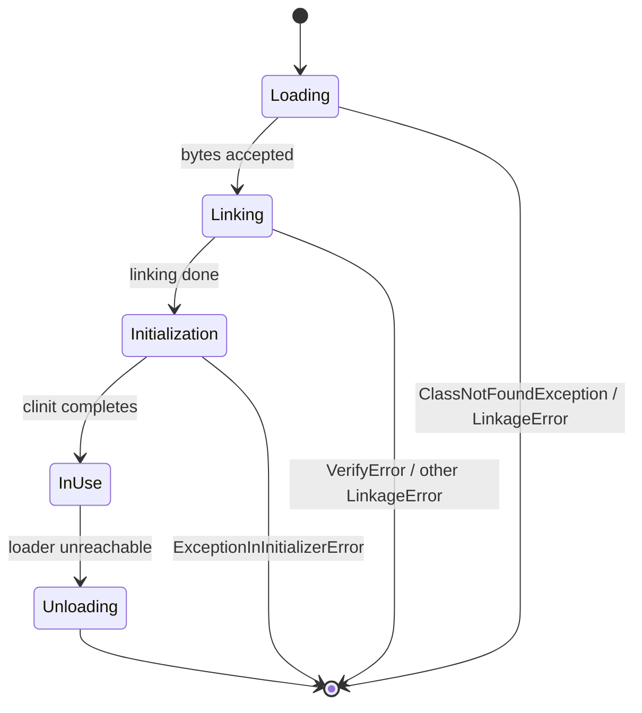
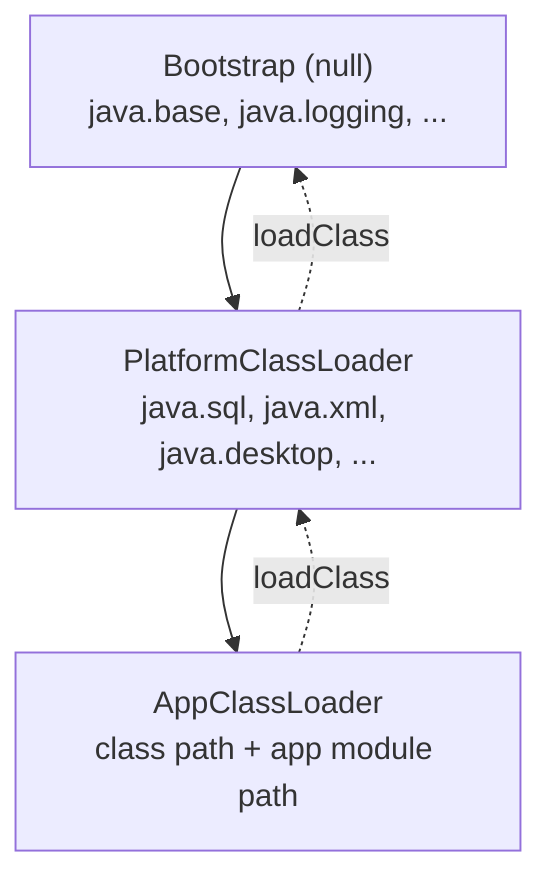
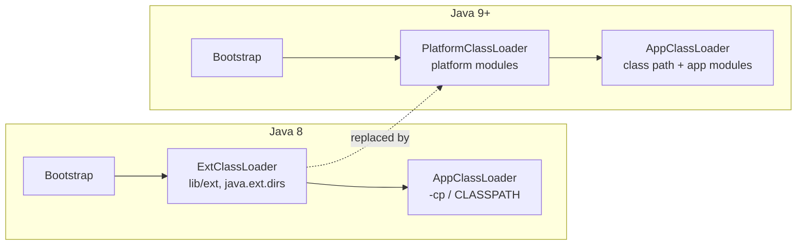
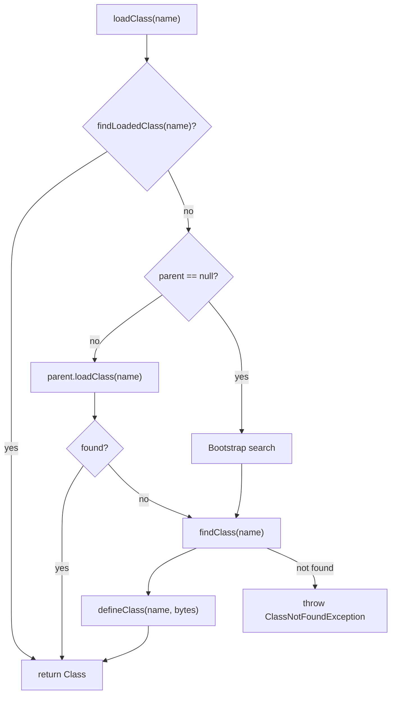
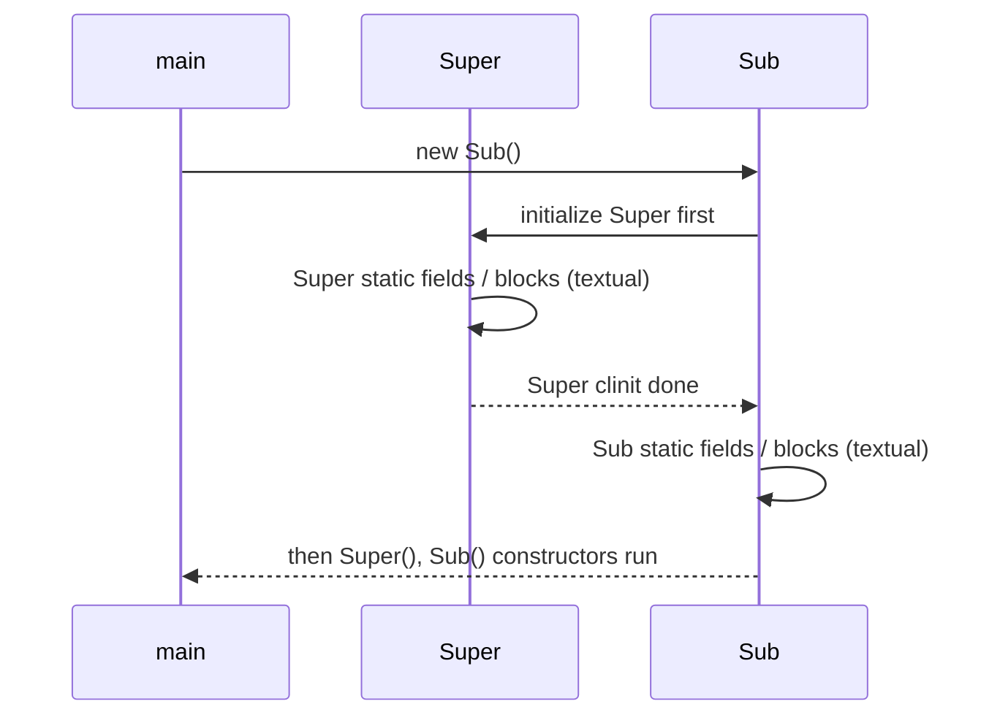
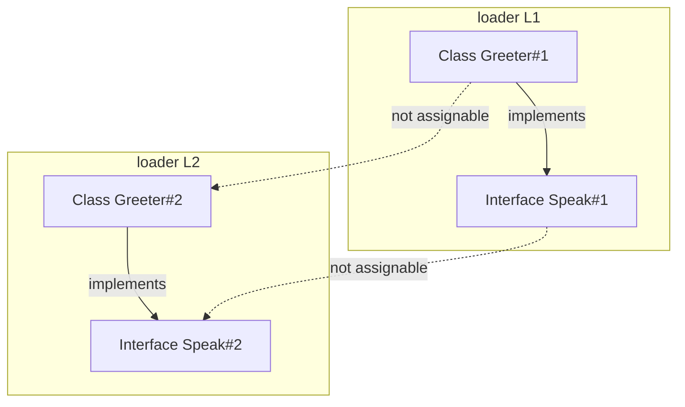
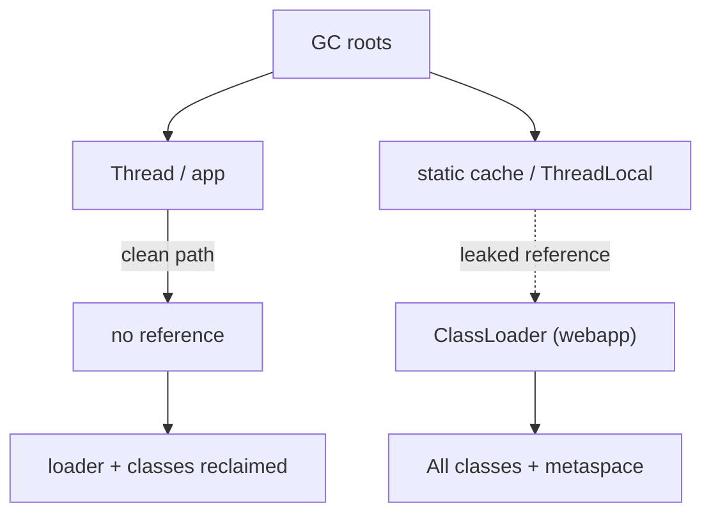
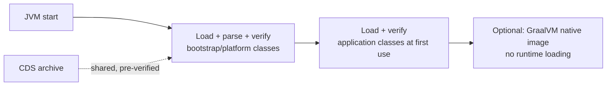

# Class Loading

Class loading is the process by which the JVM turns bytes on disk (or in a JAR, a module, a network
socket, or generated in memory) into a live, executable `java.lang.Class` object. It is the bridge
between the static world of `.class` files and the dynamic runtime. Everything an application does —
`new`, static access, reflection, dependency injection, service discovery, frameworks, plugins — runs
on top of it.

The mental model to hold in your head:

> A **class loader** is a namespace and a policy. It decides *where the bytes come from* and *who is
> allowed to see whom*. The JVM guarantees that the same binary name loaded by two different loaders
> produces two **distinct** `Class` objects that are not assignable to each other.

Two axes matter throughout:

1. **Lifecycle** — loading → linking → initialization → use → unloading. Initialization is lazy and
   happens *at most once per loader+name*.
2. **Delegation** — which loader answers a request, and whether it consults its parent first.

This module covers both in depth, plus the four "hard" areas interviewers love: initialization order,
parent delegation, custom loaders and class identity, and unloading/leaks. Execution engine, JIT,
runtime memory areas, and the JPMS module system proper are covered in
[JVM Architecture](03-JVM-Architecture.md), [Java Memory](04-Java-Memory-Areas.md), and
[Modules](../07-Modern-Java/31-Modules.md); here we only cross-reference them.

---

## 1. The Class Lifecycle

A class is not "loaded" in one step. The spec (JLS §12.2, JVMS §5) defines an ordered pipeline. The
JVM links lazily, so a class can sit "loaded but unlinked" and "linked but uninitialized" for a long
time.



| Phase | Trigger | What the JVM does | Failure type |
|---|---|---|---|
| **Loading** | First active use / explicit request | Find the `.class` bytes, parse them, create a `Class` in the method area/metaspace; create the array class for the component type | `ClassNotFoundException`, `NoClassDefFoundError` |
| **Verification** | After loading, before use | Check the bytecode is structurally and type safe | `VerifyError` (a `LinkageError`) |
| **Preparation** | After verification | Allocate static fields, set them to JVM default values (`0`, `false`, `null`); set `ConstantValue` fields to their compile-time constant | `OutOfMemoryError` (Metaspace) |
| **Resolution** | Lazy, on first symbolic reference | Replace symbolic references (constant-pool entries) with direct references | `NoSuchFieldError`, `NoSuchMethodError`, `IllegalAccessError`, `NoClassDefFoundError` |
| **Initialization** | Active use (JLS §12.4.1) | Run `<clinit>`: assign static field initializers and execute static blocks, in textual order | `ExceptionInInitializerError` |
| **Use** | Any access | Normal execution | — |
| **Unloading** | GC collects the defining loader | Remove the class from metaspace, reclaim memory | — |

### 1.1 Loading

The loader performs three things:

1. **Locate** the byte stream for the binary name (e.g. `com.acme.Foo` → `com/acme/Foo.class`).
2. **Read and parse** the class file: magic `0xCAFEBABE`, constant pool, fields, methods, attributes.
3. **Create** the runtime representation (`java.lang.Class` + internal `InstanceKlass`) and, for
   arrays, a synthesized array class whose component type is the element class.

Loading also creates the class's **array class** eagerly only for arrays of primitives and as needed;
the JVM lazily creates array classes on demand. Crucially, loading does **not** run constructors,
static initializers, or even resolve every referenced class.

The default implementation is `ClassLoader.loadClass(String, boolean)` → `findLoadedClass` →
`loadClass` on parent → `findClass`. `findClass` is where subclasses read bytes; `defineClass` is
where the JVM turns bytes into a `Class`.

### 1.2 Linking

Linking has three sub-phases: **verification**, **preparation**, **resolution**.

**Verification** does *not* re-run the Java compiler's type checker; it is a much stronger, bytecode
level analysis performed by HotSpot's verifier (`ClassVerifier`). It checks, among other things:

- Each instruction operates on the right operand types on the operand stack and in locals
  (type-state / data-flow analysis of every branch target).
- Jump targets are within bounds and instructions are well-formed.
- Methods respect `final` (no overriding final methods), `private`, and package-access rules.
- Field and method references have plausible signatures.
- `Object` is not extended by a non-`Object` superclass, etc.

A `VerifyError` means bytes were tampered with, produced by a different/buggy compiler, or generated
badly by a bytecode framework. This is a security boundary: the verifier is why the JVM can run
untrusted bytecode without a full interpreter-level type check on every instruction.

**Preparation** allocates storage for `static` fields and sets them to JVM defaults:

```java
static int x = 42;      // during preparation: x == 0
static final int C = 7; // if the compiler emitted a ConstantValue attribute: x == 7 already
```

`static final` fields whose initializer is a **compile-time constant expression** are also assigned
during preparation (they carry a `ConstantValue` attribute). Everything else is assigned later in
`<clinit>`.

**Resolution** converts symbolic references in the constant pool (e.g. `Methodref CONSTANT_...`) to
direct references. Per JLS §12.3.3 the JVM may resolve eagerly or lazily; HotSpot resolves lazily on
first use. A failed resolution throws a `LinkageError` subclass: `NoSuchMethodError`,
`NoSuchFieldError`, `IllegalAccessError`, or `NoClassDefFoundError`.

```java
// Lib.java v1: public static String greet()
// Client.java compiled against v1, calls Lib.greet()
// Lib.java is later recompiled to remove greet()
```

```text
Exception in thread "main" java.lang.NoSuchMethodError: 'java.lang.String Lib.greet()'
        at Client.main(Client.java:1)
```

This is a **resolution** failure, not a compiler error: the client compiled fine and only fails when
that symbolic reference is resolved at runtime.

### 1.3 Initialization

Initialization runs the compiler-generated `<clinit>` method once per class. `<clinit>` contains, in
**textual order**, all static field initializers and static blocks, and always begins by triggering
superclass initialization (except for `java.lang.Object` and for interfaces, see below). Details are
in [§4](#4-initialization-in-depth).

### 1.4 Use and Unloading

"Use" is any active use triggering initialization. Unloading happens only when the **defining class
loader** becomes unreachable to the GC; then all classes it defined become eligible for collection.
Unloading is covered in [§7](#7-class-unloading-metaspace-and-leaks).

> Rule of thumb: classes are not "freed" individually. The unit of unloading is the class loader.

---

## 2. Class Loaders

Every `Class` holds a pointer to its **defining loader** (`Class.getClassLoader()`), and the loader
holds references to the classes it defined. The set of all classes launched from the same starting
class is the **runtime package**: two classes are in the same runtime package if and only if they
have the same package name **and** the same defining loader. This is why package-private access can
be broken across loaders.

### 2.1 The Three Loaders (JDK 9+)

Since JDK 9, an application has three built-in loaders in a fixed hierarchy:

| Loader | JDK 9+ class | Returned by | Parent | Loads | `getClassLoader()` of its classes |
|---|---|---|---|---|---|
| **Bootstrap** (a.k.a. primordial / null) | implemented in native code (no Java object) | `X.class.getClassLoader()` returns `null` for its classes; there is no getter | — (top) | Core modules: `java.base`, `java.logging`, `java.prefs`, plus anything on `-Xbootclasspath/a` | `null` |
| **Platform** | `jdk.internal.loader.ClassLoaders$PlatformClassLoader` | `ClassLoader.getPlatformClassLoader()` | Bootstrap | Platform modules that were historically `lib/ext`: `java.sql`, `java.xml`, `java.desktop`, ... | platform loader |
| **Application / System** | `jdk.internal.loader.ClassLoaders$AppClassLoader` | `ClassLoader.getSystemClassLoader()` | Platform | Class path (`-cp`/`CLASSPATH`), the application module path, and the unnamed module of the app | app loader |

Verified on JDK 21:

```java
public class CLHierarchy {
    public static void main(String[] args) {
        ClassLoader app = ClassLoader.getSystemClassLoader();
        System.out.println("app            = " + app);
        System.out.println("platform       = " + app.getParent());
        System.out.println("bootstrap      = " + app.getParent().getParent());
        System.out.println("platform(via)  = " + ClassLoader.getPlatformClassLoader());
        System.out.println("String loader  = " + String.class.getClassLoader());
        System.out.println("CLHierarchy    = " + CLHierarchy.class.getClassLoader());
        System.out.println("java.sql.Driver= " + java.sql.Driver.class.getClassLoader());
    }
}
```

```text
app            = jdk.internal.loader.ClassLoaders$AppClassLoader@639fee48
platform       = jdk.internal.loader.ClassLoaders$PlatformClassLoader@677327b6
bootstrap      = null
platform(via)  = jdk.internal.loader.ClassLoaders$PlatformClassLoader@677327b6
String loader  = null
CLHierarchy    = jdk.internal.loader.ClassLoaders$AppClassLoader@639fee48
java.sql.Driver= jdk.internal.loader.ClassLoaders$PlatformClassLoader@677327b6
```

Two facts fall straight out of this output: `String` is defined by the **bootstrap** loader (hence
`null`), and `java.sql.Driver` is defined by the **platform** loader, not the app loader.



### 2.2 Pre-JDK 9: the Extension Loader

Before JDK 9 (Java 8 and earlier) the middle loader was the **Extension** class loader,
`sun.misc.Launcher$ExtClassLoader`. It loaded JARs from `${java.home}/lib/ext` and any directories
listed in the `java.ext.dirs` system property (e.g. `${java.home}/jre/lib/ext`). It sat between the
bootstrap loader and the application loader, and its Java object was reachable via
`ClassLoader.getSystemClassLoader().getParent()`.

In JDK 9 the extension mechanism was **removed** and replaced by the **platform class loader**:

- `lib/ext` and `java.ext.dirs` are gone. Existing jars there are not picked up; `java.ext.dirs` is
  reported as unsupported by `--release 9+` and ignored at runtime.
- The sun.*-internal class is now `jdk.internal.loader.ClassLoaders$PlatformClassLoader`, exposed
  through the standard API `ClassLoader.getPlatformClassLoader()`.
- Desktop and other "ext" APIs are now ordinary modules loaded by the platform loader.
- Migration: turn extension jars into automatic/explicit modules on the module path, or keep them on
  the class path.



### 2.3 Parent Delegation Model

The default algorithm in `ClassLoader.loadClass(String, boolean)` is **parent-first**:

1. Check `findLoadedClass(name)` — if already defined by *this* loader, return it.
2. If not found, delegate to `parent.loadClass(name)`.
3. If the parent fails (`ClassNotFoundException`), call `findClass(name)` — this is where the loader
   fetches and `defineClass`es the bytes.



**Why parent-first?** It guarantees **consistency and safety**:

- Core classes such as `java.lang.String` are always the ones the JVM itself knows about; a rogue
  app class cannot shadow them. If loading were child-first, an attacker could put a fake
  `java.lang.String` earlier in the path.
- Only one copy of a class exists per loader hierarchy for classes visible to a parent, so shared
  contracts (interfaces, `Object`, etc.) are identical across the whole app. This is what makes
  `(Object) anything` and interface casts work.

**The single most important consequence:** if loader A delegates to a parent and the parent has the
class, the parent's class wins — the child's own copy is *never* used. This is why "putting a newer
version of a library on the class path" can silently lose to one already visible to a parent loader.

### 2.4 Breaking the Delegation Model

Parent-first is a *default*, not a law. You override it deliberately:

| Scenario | Mechanism | Why the model must be broken |
|---|---|---|
| **Servlet containers (Tomcat, Jetty)** | Per-webapp `WebappClassLoader` that tries `WEB-INF/classes` and `WEB-INF/lib` **before** the parent | Two webapps must be able to ship *different versions* of the same library and be isolated. Parent-first would leak the container's copy into both apps. |
| **OSGi / JPMS plugins** | Fully custom loaders with explicit import/export wiring | Module A imports `foo` from module B; the graph is not a tree but a DAG, so a single parent chain cannot express it. |
| **Application servers / EARs** | `EARClassLoader` → `EJBClassLoader` etc. with controlled visibility | Shared libs in `EAR/lib` must be visible to all modules; conflicting libs must be isolated. |
| **JDBC / SPI discovery** | `ServiceLoader` + **thread context class loader** | The API lives in a *bootstrap* module but the implementation is on the *application* class path — a lower loader must ask a higher one. |
| **Hot reload / dev tools (JRebel-like)** | Throwaway child loaders re-reading freshly compiled classes | Detect a change and load a new version without restarting. |
| **Android / LeakCanary, bytecode agents** | Custom loaders / `Instrumentation` | Transform and redefine classes. |

**How to break it — child-first loader.** Override `loadClass` to try your own `findClass` before the
parent:

```java
import java.net.*;
import java.nio.file.*;

public class Delegation {
    static class ChildFirst extends ClassLoader {
        private final URLClassLoader delegate;
        ChildFirst(URL[] urls, ClassLoader parent) {
            super(parent);
            this.delegate = new URLClassLoader(urls, null); // boot-parented copy for isolation
        }
        @Override
        protected Class<?> loadClass(String name, boolean resolve) throws ClassNotFoundException {
            synchronized (getClassLoadingLock(name)) {
                Class<?> c = findLoadedClass(name);
                if (c == null) {
                    if (name.startsWith("Dup")) {                 // child-first only for our package
                        try { c = delegate.loadClass(name); } catch (ClassNotFoundException ignored) {}
                    }
                    if (c == null) return super.loadClass(name, resolve); // else parent-first
                    if (resolve) resolveClass(c);
                }
                return c;
            }
        }
        void closeIt() { try { delegate.close(); } catch (Exception ignored) {} }
    }

    public static void main(String[] args) throws Exception {
        Path childDir = Path.of("/tmp/jmod-check/dup/childout");
        URL[] urls = { childDir.toUri().toURL() };

        URLClassLoader parentFirst = new URLClassLoader(urls);
        System.out.println("parent-first Dup.who() = "
                + parentFirst.loadClass("Dup").getMethod("who").invoke(null));

        ChildFirst childFirst = new ChildFirst(urls, Delegation.class.getClassLoader());
        System.out.println("child-first  Dup.who() = "
                + childFirst.loadClass("Dup").getMethod("who").invoke(null));
        parentFirst.close();
        childFirst.closeIt();
    }
}
```

With a `Dup` class present on the app class path (`who() -> "app"`) and a different one in
`childout` (`who() -> "child"`):

```text
parent-first Dup.who() = app
child-first  Dup.who() = child
```

> **Best practice:** never break delegation globally. Scope child-first loading to the packages you
> own (as above), and keep `java.*` parent-first so core types are never shadowed.

### 2.5 The Thread Context Class Loader (TCCL)

`Thread.currentThread().getContextClassLoader()` returns a per-thread loader used by libraries that
must load classes they cannot see directly. It defaults to the **system class loader** for threads
created by the JVM, and is inherited from the creating thread when you `new Thread(...)`.

Why it exists: consider JDBC. `java.sql.DriverManager` is in a platform/bootstrap-visible module, but
driver implementations live on the application class path. `DriverManager` cannot name them, so
`ServiceLoader.load(Driver.class)` walks the **TCCL** (plus the caller's loader) to discover them.

Verified default:

```java
ClassLoader ctx = Thread.currentThread().getContextClassLoader();
System.out.println("context CL = " + ctx);
System.out.println("same as system = " + (ctx == ClassLoader.getSystemClassLoader()));
```

```text
context CL = jdk.internal.loader.ClassLoaders$AppClassLoader@639fee48
same as system = true
```

> Frameworks that spawn their own pools must propagate or set the TCCL. A common container bug is a
> pooled worker thread silently retaining a stale webapp loader, pinning the whole webapp in memory.

### 2.6 Class Path vs Module Path

| Aspect | Class path (`-cp`) | Module path (`--module-path`) |
|---|---|---|
| Visibility | Everything visible to everyone; no encapsulation | Only exported packages are visible |
| Loader | App loader, unnamed module | App loader (or platform/boot depending on module) |
| Ordering | First match wins across entries | Module system resolves the graph deterministically |
| Duplicates | Duplicate packages across jars are legal but fragile | Split packages are rejected |
| Launcher | `java -cp ... Main` | `java --module-path ... --module m/Main` |

Refer to [Modules](../07-Modern-Java/31-Modules.md) for JPMS mechanics; from a loading standpoint the
key point is that on the module path the **application class loader loads application modules**, and
the boot layer makes resolution explicit rather than "first on the path wins".

---

## 3. `Class.forName` vs `ClassLoader.loadClass`

These are the two entry points interviewers ask about, and the difference is **initialization**.

| Call | Uses which loader | Links? | Initializes? | Typical use |
|---|---|---|---|---|
| `Class.forName(String)` | **Caller's** class loader | lazily | **Yes** | Legacy: load a driver/class by name and run its static init |
| `Class.forName(String, false, loader)` | The supplied loader | lazily | **No** | Load without side effects; inspect members first |
| `Class.forName(String, true, loader)` | The supplied loader | lazily | **Yes** | Explicit init with a chosen loader |
| `loader.loadClass(String)` (public) | That loader (parent-first) | lazily | **No** | Framework loading, then decide when to init |
| `loader.loadClass(String, resolve)` (protected) | That loader | optional | **No** | Subclasses; `resolve=true` eagerly links |

Verified:

```java
public class ForNameVsLoad {
    static class Target {
        static { System.out.println("Target <clinit> ran"); }
        static final int CONST = 42;
        static int nonConst = 7;
        static void ping() { System.out.println("ping"); }
    }
    public static void main(String[] args) throws Exception {
        ClassLoader cl = ForNameVsLoad.class.getClassLoader();
        System.out.println("--- loadClass ---");
        System.out.println("loaded, no init: " + cl.loadClass("ForNameVsLoad$Target"));
        System.out.println("--- forName(initialize=false) ---");
        System.out.println("loaded, no init: " + Class.forName("ForNameVsLoad$Target", false, cl));
        System.out.println("--- forName(name) ---");
        System.out.println("initialized: " + Class.forName("ForNameVsLoad$Target"));
    }
}
```

```text
--- loadClass ---
loaded, no init: class ForNameVsLoad$Target
--- forName(initialize=false) ---
loaded, no init: class ForNameVsLoad$Target
--- forName(name) ---
Target <clinit> ran
initialized: class ForNameVsLoad$Target
```

Note the one-argument `forName` uses the **caller's** defining loader. The three-argument form
`forName(name, initialize, loader)` lets you choose both the loader and whether initialization runs,
which matters for plugin architectures. The behavior of `java.sql.DriverManager`/`ServiceLoader` is
exactly about avoiding surprising initialization.

> `Class.forName` throws `ClassNotFoundException` (a checked exception). `ClassLoader.loadClass`
> also throws `ClassNotFoundException`. But *implicit* loading triggered by the JVM (a symbolic
> reference, a superclass, a field type) throws the unchecked `NoClassDefFoundError`.

---

## 4. Initialization in Depth

Initialization is the phase with the most subtle rules and the most interview mileage. It is governed
by JLS §12.4.1/§12.4.2.

### 4.1 What Triggers Initialization (JLS 12.4.1)

A class or interface `T` is initialized on the first occurrence of any of the following **active
uses**:

1. `T` is a class and an instance of `T` is created (`new T(...)`).
2. `T` is a class and a `static` method declared by `T` is invoked.
3. `T` is an interface and a `static` method declared by `T` is invoked (Java 8+).
4. A `static` field declared by `T` is **assigned**.
5. A **non-constant** `static` field declared by `T` is **read**.
6. `T` is a top-level class or interface and an `assert` statement lexically within `T` executes.
7. `Class.forName("T")`, or `Class.forName("T", true, loader)`, is called.
8. `T` is a class and the JVM initializes `T` as part of initializing a subclass (superclass rule).

Additional rules: initializing a class does **not** initialize the interfaces it implements, but
initializing an **interface** first initializes its superinterfaces (`Object` is not a superinterface).

### 4.2 What Does NOT Trigger Initialization

- Declaring a reference, parameter, or return type of `T`.
- Creating an **array** of `T` (`new T[10]`) — this initializes the *array* class, not `T`.
- Reading a `static final` field that is a **compile-time constant** (already inlined; see §4.5).
- Using `T.class` (class literal) — only loads/resolves.
- `Class.forName(name, false, loader)` / `loadClass` — no init.
- Loading a class does not initialize its fields' types ("lazy" initialization).
- An interface is *not* initialized merely because a subclass is initialized; a superclass is.

Verified:

```java
public class Triggers {
    static class T {
        static { System.out.println("T <clinit>"); }
        static final int C = 1;
        static int f = 5;
        static void m() {}
        interface I { int CONST = 10; int VALUE = (int) System.nanoTime(); }
    }
    public static void main(String[] args) {
        System.out.println("1. class literal: " + T.class.getName());
        System.out.println("2. const field: " + T.C);
        T[] arr = new T[0];
        System.out.println("3. array length " + arr.length);
        System.out.println("4. interface constant: " + T.I.CONST);
        System.out.println("5. interface non-constant: " + (T.I.VALUE != 0));
        System.out.println("6. static method call");
        T.m();
        System.out.println("7. static field read: " + T.f);
    }
}
```

```text
1. class literal: Triggers$T
2. const field: 1
3. array length 0
4. interface constant: 10
5. interface non-constant: true
6. static method call
T <clinit>
7. static field read: 5
```

`T.<clinit>` runs only at step 6. The class literal, the constant, the array, and the interface
constant produced no initialization. Step 5 initialized the **interface `T.I`** (not `T`), and step 6
initialized `T`.

### 4.3 Order of Initialization

When `T` is initialized:

1. If `T` is a class and its superclass `S` has not been initialized, initialize `S` first (recursion
   up to `Object`). **Superclass `<clinit>` completes before subclass `<clinit>` starts.**
2. Execute `T`'s `<clinit>`: all static field initializers and static blocks in **textual order**.
3. For interfaces, `T` is initialized only when a non-constant field or method of `T` is used, and
   the interfaces it extends are initialized first, but the implementing class's initialization does
   **not** initialize the interfaces.



Verified order (constructor runs *after* both `<clinit>`s; note the second `new Sub()` runs no
`<clinit>` at all — initialization happens once):

```java
public class InitOrder {
    static class Super {
        static int a = log("Super.a field");
        static { log("Super static block"); }
        Super() { log("Super constructor"); }
        static int log(String s) { System.out.println(s); return 1; }
    }
    static class Sub extends Super {
        static int b = log("Sub.b field");
        static { log("Sub static block"); }
        Sub() { log("Sub constructor"); }
        static int log(String s) { System.out.println(s); return 2; }
    }
    public static void main(String[] args) {
        System.out.println("before new");
        new Sub();
        System.out.println("after new");
        new Sub();
    }
}
```

```text
before new
Super.a field
Super static block
Sub.b field
Sub static block
Super constructor
Sub constructor
after new
Super constructor
Sub constructor
```

> The constructors are **instance** initialization, not class initialization. `<clinit>` (class) runs
> before any instance is created; `<init>` (constructor) runs per instance, after the superclass
> constructor.

### 4.4 Thread Safety of `<clinit>` and Deadlock

The JVM initializes a class under that class's **initialization lock** (the `Class` object's monitor).
Consequences:

- If thread A is running `<clinit>` and thread B reaches an active use of the same class, B **blocks**
  until A finishes. This is the JLS initialization-on-demand-holder idiom's foundation.
- If thread A, inside `<clinit>`, touches class `X`, and thread B is inside `X.<clinit>` and touches
  `T`, the two can **deadlock**. This is a real, spec-blessed hazard known as class-initialization
  deadlock.

Verified deadlock (declared via a latch so both `<clinit>`s run concurrently):

```java
import java.util.concurrent.CountDownLatch;

public class ClinitDeadlock {
    static final CountDownLatch L = new CountDownLatch(2);
    static class A {
        static {
            System.out.println("A <clinit> begin by " + Thread.currentThread().getName());
            L.countDown(); await();
            System.out.println("A calling B.bar()");
            B.bar();
            System.out.println("A <clinit> end");
        }
        static void foo() {}
    }
    static class B {
        static {
            System.out.println("B <clinit> begin by " + Thread.currentThread().getName());
            L.countDown(); await();
            System.out.println("B calling A.foo()");
            A.foo();
            System.out.println("B <clinit> end");
        }
        static void bar() {}
    }
    static void await() {
        try { L.await(); } catch (InterruptedException ignored) {}
    }
    public static void main(String[] args) throws Exception {
        Thread t1 = new Thread(() -> A.foo(), "t1");
        Thread t2 = new Thread(() -> B.bar(), "t2");
        t1.start(); t2.start();
        t1.join(1500); t2.join(1500);
        if (t1.isAlive() && t2.isAlive()) {
            System.out.println("DEADLOCK: both threads blocked in <clinit>");
            System.exit(0);
        }
        System.out.println("finished normally");
    }
}
```

```text
A <clinit> begin by t1
B <clinit> begin by t2
B calling A.foo()
A calling B.bar()
DEADLOCK: both threads blocked in <clinit>
```

Because class initialization is automatic and lazy, this deadlock is easy to introduce accidentally
(cyclic static coupling across two classes) and hard to see. **Best practice:** keep static
initializers free of cross-class calls, especially calls that can trigger other `<clinit>`s.

### 4.5 `static final` Compile-Time Constants Are Inlined

If a `static final` field has a **constant expression** initializer whose type is primitive or
`String`, the compiler inlines the value into every referencing site and emits a `ConstantValue`
attribute. At runtime there is **no field access** and **no initialization**, and — critically — the
value is frozen into the *referencing* class file.

```java
// Constants.java
public class Constants { public static final int VALUE = 1; }

// Client.java
public class Client { public static void main(String[] a){ System.out.println("VALUE=" + Constants.VALUE); } }
```

Compile both; the client's bytecode contains `bipush 1` (or `iconst_1`), not a `getstatic`:

```bash
javac -d out Constants.java Client.java
java -cp out Client            # VALUE=1
```

Now change `VALUE` to `2` and recompile **only** `Constants`:

```bash
javac -d out Constants.java
java -cp out Client            # VALUE=1   <-- stale! inlined old value
```

Recompile the client; only then does it see the new value:

```bash
javac -d out Client.java
java -cp out Client            # VALUE=2
```

Verified sequence: `VALUE=1`, then `VALUE=1`, then `VALUE=2`.

> **Best practice:** never change the value of a `public static final` compile-time constant without
> recompiling all dependents. Prefer a non-`final` field (or a method) if the value must be updatable
> without a full rebuild — this is the classic "constants are inlined" bug in versioned deployments.

A non-constant `final` (e.g. `(int) System.nanoTime()`) is **not** inlined and *does* trigger
initialization when first read.

---

## 5. Custom Class Loaders

Extend `java.lang.ClassLoader` and override **`findClass`**, not `loadClass`, when you want a
different *source* of bytes but the standard parent-first *policy*. Override `loadClass` only when
you want a different *policy* (child-first, filtering, etc.).

Key protected methods:

| Method | Role |
|---|---|
| `findLoadedClass(String)` | Has *this* loader already defined the class? |
| `loadClass(String, boolean)` | Default parent-first algorithm (override to change policy) |
| `findClass(String)` | Locate/read bytes and call `defineClass` (override to change source) |
| `defineClass(String, byte[], int, int)` | JVM: bytes → `Class`; also available as `ByteBuffer` since Java 9 |
| `resolveClass(Class)` | Force linkage if `resolve == true` |
| `getResource` / `findResource` | Resource lookup (parent-first / own storage) |
| `getClassLoadingLock(String)` | Per-name lock for parallel-capable loaders |
| `registerAsParallelCapable()` | Opt-in static; avoids the global `loadClass` lock |

A complete, real `findClass` loader:

```java
import java.io.*;
import java.nio.file.*;

public class MyLoader extends ClassLoader {
    private final Path dir;
    public MyLoader(Path dir) { super(ClassLoader.getPlatformClassLoader()); this.dir = dir; }

    @Override
    protected Class<?> findClass(String name) throws ClassNotFoundException {
        Path p = dir.resolve(name.replace('.', '/') + ".class");
        if (!Files.exists(p)) throw new ClassNotFoundException(name);
        try {
            byte[] b = Files.readAllBytes(p);
            return defineClass(name, b, 0, b.length);   // bytes -> Class
        } catch (IOException e) {
            throw new ClassNotFoundException(name, e);
        }
    }

    public static void main(String[] args) throws Exception {
        MyLoader ml = new MyLoader(Path.of("/tmp/jmod-check/sep/out"));
        Class<?> g = ml.loadClass("Greeter");
        System.out.println("Greeter class = " + g.getName());
        System.out.println("Greeter loader = " + g.getClassLoader());
        Object o = g.getDeclaredConstructor().newInstance();
        System.out.println("hello() -> " + g.getMethod("hello").invoke(o));
    }
}
```

```text
Greeter class = Greeter
Greeter loader = MyLoader@4e25154f
hello() -> hi from MyLoader@4e25154f
```

Because the parent is the **platform** loader, the app class path cannot shadow `Greeter`, so
`findClass` (and therefore `defineClass`) is genuinely exercised — the defining loader is `MyLoader`.

### 5.1 `defineClass` Constraints (verified on JDK 21)

| Input | Result | Message |
|---|---|---|
| Name does not match the class file's `this_class` | `NoClassDefFoundError` | `WrongName (wrong name: Greeter)` |
| Truncated / malformed bytes | `ClassFormatError` | `Truncated class file` |
| Same loader defines the same name twice | `LinkageError` | `loader ... attempted duplicate class definition for Simple` |
| Referenced superclass/interface not resolvable | `NoClassDefFoundError` | `Speak` (with a `ClassNotFoundException` cause) |

`defineClass` is a **defining** operation: once a loader defines a name, that binding is permanent for
that loader. `defineClass` also triggers loading of the superclass and interfaces during verification.

### 5.2 Class Identity and `ClassCastException` Across Loaders

The JVM identifies a class by **(binary name, defining loader)** — the "loader constraint". Two
classes with the same name from different loaders are *different types*, are not assignable to each
other, and produce `ClassCastException`.



Verified with two independent `URLClassLoader`s over the same directory:

```java
public class IdentityDemo {
    public static void main(String[] args) throws Exception {
        java.net.URL[] urls = { java.nio.file.Path.of("/tmp/jmod-check/sep/out").toUri().toURL() };
        java.net.URLClassLoader l1 = new java.net.URLClassLoader(urls);
        java.net.URLClassLoader l2 = new java.net.URLClassLoader(urls);

        Class<?> c1 = l1.loadClass("Greeter");
        Class<?> c2 = l2.loadClass("Greeter");
        System.out.println("c1 == c2   : " + (c1 == c2));
        Object o2 = c2.getDeclaredConstructor().newInstance();
        System.out.println("c1.isInstance(o2) = " + c1.isInstance(o2));

        Class<?> iface = l1.loadClass("Speak");
        System.out.println("Speak loaded by l1: " + iface.getClassLoader());
        try { iface.cast(o2); System.out.println("cast ok"); }
        catch (ClassCastException e) { System.out.println("ClassCastException: " + e.getMessage()); }
        l1.close(); l2.close();
    }
}
```

```text
c1 == c2   : false
c1.isInstance(o2) = false
Speak loaded by l1: java.net.URLClassLoader@5c647e05
ClassCastException: Cannot cast Greeter to Speak
```

> **Interview trap:** "Why does a marshalling/DI framework throw `ClassCastException` on a class that
> is obviously the right type?" Answer: it is the *same name* from a *different loader*. Common with
> app servers, plugin reload, and devtools hot-swap.

### 5.3 Parallel-Capable Loaders

Before Java 7 the `loadClass` method held a single lock per loader, so unrelated class loads
serialized and could deadlock. Since Java 7 a loader can call `static { registerAsParallelCapable(); }`
in its static initializer; `loadClass` then uses `getClassLoadingLock(name)`, a **per-name** lock.
Built-in loaders are parallel-capable. If you override `loadClass` in a parallel-capable loader, use
`synchronized (getClassLoadingLock(name))` as shown in §2.4.

Class-loader deadlock (distinct from `<clinit>` deadlock): two loaders delegating to each other in
opposite orders on two threads. Parallel-capable per-name locking reduces the window but does not
eliminate cyclic delegation. **Best practice:** keep the delegation graph acyclic.

---

## 6. Resource Loading

Class loaders also locate **resources** — non-class files (properties, XML, images, config).

| Method | Path handling |
|---|---|
| `ClassLoader.getResource(String)` | Name is treated as **absolute from the class path root**; do **not** start with `/`. A leading slash makes it fail. |
| `ClassLoader.getResourceAsStream(String)` | Same rules; returns `null` (no exception) if absent. |
| `Class.getResource(String)` | If the name starts with `/`, it is absolute; otherwise it is resolved **relative to the package of the class**. |
| `Class.getResourceAsStream(String)` | Same as above. |
| `ClassLoader.getResources(String)` | Returns an `Enumeration<URL>` of **all** matches across the path (useful for merged config). |

Search order is **parent-first**, mirroring `loadClass`: the call is delegated up to the bootstrap
loader and only local storage is searched if a parent returns `null`.

Verified (`res/msg.txt` on the class path):

```java
ClassLoader cl = ResourceDemo.class.getClassLoader();
System.out.println("dir resource (no slash): " + cl.getResource("res/"));
System.out.println("file (no slash)        : " + cl.getResource("res/msg.txt"));
System.out.println("file (leading slash)   : " + cl.getResource("/res/msg.txt"));
System.out.println("JDK resource from bootstrap: " + cl.getResource("java/lang/String.class"));
System.out.println("Class absolute form:     " + ResourceDemo.class.getResource("/res/msg.txt"));
```

```text
dir resource (no slash): file:/tmp/jmod-check/res/
file (no slash)        : file:/tmp/jmod-check/res/msg.txt
file (leading slash)   : null
JDK resource from bootstrap: jrt:/java.base/java/lang/String.class
Class absolute form:     file:/tmp/jmod-check/res/msg.txt
```

Note the JDK resource resolves to `jrt:/java.base/...`, proving the search reached the bootstrap
loader's module image. The leading slash on the `ClassLoader` call returns `null` — a classic bug.

> **Best practice:** always close streams from `getResourceAsStream` (try-with-resources). Prefer
> `Class.getResourceAsStream` for resources **in your own package**, and `getResources` when merging
> overrides across jars (e.g. Spring's `META-INF/spring.factories`).

---

## 7. Class Unloading, Metaspace and Leaks

Class metadata lives in **Metaspace** (native memory since Java 8; PermGen was removed). A class is
unloaded only when its **defining loader** is unreachable. During a major GC (G1/ZGC use concurrent
class unloading), the JVM performs "class unloading across a class loader data structure": if no live
reference path reaches a loader, the loader and every class it defined are collected and Metaspace is
reclaimed.

Verified with a throwaway `URLClassLoader`:

```java
import java.net.*;
import java.nio.file.*;

public class UnloadDemo {
    public static void main(String[] args) throws Exception {
        URL[] urls = { Path.of("/tmp/jmod-check/sep/out").toUri().toURL() };
        URLClassLoader cl = new URLClassLoader(urls);
        Class<?> c = cl.loadClass("Greeter");
        c.getDeclaredConstructor().newInstance();
        System.out.println("loaded Greeter via " + c.getClassLoader());
        cl.close();
        cl = null;
        c = null;
        for (int i = 0; i < 3; i++) { System.gc(); Thread.sleep(200); }
        System.out.println("gc done");
    }
}
```

With logging on:

```bash
java -Xlog:class+unload=info -cp out UnloadDemo
```

```text
loaded Greeter via java.net.URLClassLoader@5c647e05
[0.048s][info][class,unload] unloading class Greeter 0x00007f3748001200
[0.048s][info][class,unload] unloading class Speak 0x00007f3748001000
gc done
```



**What keeps a class (and its loader) alive — leak sources:**

- A `static` field holding an object created by the loader (including `static` caches).
- A `ThreadLocal` in a pooled/container thread retaining a webapp object.
- The **TCCL** of a long-lived thread still pointing at a disposed loader (the #1 app-server leak).
- JDBC drivers registered via `DriverManager` from a webapp loader (hence `DriverManager.deregisterDriver`).
- `Thread` subclasses, `Runnable`s, executors, timers owned by the old loader.
- JNI global references, `Cleaner`/`PhantomReference` callback objects, and shutdown hooks referencing
  old-loader types.
- `LambdaMetafactory` and dynamic proxies: **generated classes** (`$Lambda$...`, `$Proxy0`) are
  defined by the loader that hosts the lambda/proxy and keep that loader pinned if referenced.

**Performance implications of a leak:** Metaspace grows linearly with redeploys; each redeploy adds a
new loader plus generated proxy/lambda classes, eventually causing `java.lang.OutOfMemoryError:
Metaspace` even though the heap is fine. `-XX:MaxMetaspaceSize` makes the failure explicit.

> **Best practice:** never `Class.forName`+`newInstance` and stash the result in a `static` field of a
> long-lived loader; always call `URLClassLoader.close()`; clear `ThreadLocal`s in
> `finally`; deregister drivers and shutdown executors on undeploy.

---

## 8. Failure Taxonomy

| Exception / Error | Checked? | Phase / cause | Notes |
|---|---|---|---|
| `ClassNotFoundException` | checked | Loading, explicit API (`forName`, `loadClass`) | Name not found by loader/parent |
| `NoClassDefFoundError` | unchecked (`Error`) | Loading, *implicit JVM* reference, or after a failed `<clinit>` | "Could not initialize class X" means a prior `<clinit>` failed |
| `ExceptionInInitializerError` | unchecked (`Error`) | Initialization | Wraps the original throwable from `<clinit>`; `getCause()` returns it |
| `VerifyError` | unchecked (`LinkageError`) | Verification | Bytecode/type-safety violation |
| `ClassFormatError` | unchecked (`LinkageError`) | Loading/defineClass | Malformed or truncated class file |
| `LinkageError` | unchecked | Linking/define | For example duplicate class definition; base of the family |
| `NoSuchMethodError` / `NoSuchFieldError` | unchecked (`LinkageError`) | Resolution | Binary incompatible versions |
| `IllegalAccessError` | unchecked (`LinkageError`) | Resolution | Access rules violated at runtime |
| `ClassCastException` | unchecked | Use | Cross-loader identity or genuine wrong type |
| `OutOfMemoryError: Metaspace` | unchecked | Preparation/loading | Too many classes / loader leak |

Verified initialization-failure behavior (the failure is **cached**: the first attempt throws
`ExceptionInInitializerError`, every later attempt throws `NoClassDefFoundError`):

```java
public class InitErrors {
    static class Bad { static { if (true) throw new RuntimeException("static init boom"); } }
    public static void main(String[] args) throws Exception {
        try { Class.forName("InitErrors$Bad"); }
        catch (ExceptionInInitializerError e) {
            System.out.println("caught: " + e.getClass().getName());
            System.out.println("cause : " + e.getCause());
        }
        try { Class.forName("InitErrors$Bad"); }
        catch (NoClassDefFoundError e) {
            System.out.println("caught: " + e.getClass().getName() + ": " + e.getMessage());
        }
        try { Class.forName("does.not.Exist"); }
        catch (ClassNotFoundException e) {
            System.out.println("caught: " + e.getClass().getName());
        }
    }
}
```

```text
caught: java.lang.ExceptionInInitializerError
cause : java.lang.RuntimeException: static init boom
caught: java.lang.NoClassDefFoundError: Could not initialize class InitErrors$Bad
caught: java.lang.ClassNotFoundException
```

And the implicit case: remove a referenced class file after compiling but before running → the JVM's
implicit load throws `NoClassDefFoundError` with a `ClassNotFoundException` cause.

```text
Exception in thread "main" java.lang.NoClassDefFoundError: NcdfeDemo$Helper
        at NcdfeDemo.main(NcdfeDemo.java:6)
Caused by: java.lang.ClassNotFoundException: NcdfeDemo$Helper
        at java.base/jdk.internal.loader.BuiltinClassLoader.loadClass(BuiltinClassLoader.java:641)
        at jdk.internal.loader.ClassLoaders$AppClassLoader.loadClass(ClassLoaders.java:188)
        ...
```

> Remember: `ClassNotFoundException` is thrown by **explicit** loading APIs; `NoClassDefFoundError`
> is what the JVM throws when *bytecode* references a class that isn't there.

---

## 9. Tooling

### 9.1 Observing Loads

`-verbose:class` (and the modern `-Xlog:class+load`) print every load with its source. JDK 21 uses
Unified Logging format `[time][level][tag]`:

```bash
java -verbose:class -cp out LoadOrder | head -20
```

```text
[0.021s][info][class,load] java.lang.Object source: shared objects file
[0.022s][info][class,load] java.io.Serializable source: shared objects file
[0.022s][info][class,load] java.lang.Comparable source: shared objects file
[0.022s][info][class,load] java.lang.CharSequence source: shared objects file
[0.022s][info][class,load] java.lang.String source: shared objects file
...
[0.040s][info][class,load] LoadOrder source: file:/tmp/jmod-check/out/
```

The `source` reveals the origin: `shared objects file` (CDS archive), `file:/.../out/` (app class
path), or `jrt:/...` (module image). Notice that `java.lang.Object` and `java.lang.String` load
*before* the application class — the bootstrap loader gets there first.

```bash
java -Xlog:class+load=info -cp out LoadOrder       # loads only
java -Xlog:class+unload=info -cp out UnloadDemo    # unloads
java -Xlog:class+load=debug -cp out LoadOrder      # includes loader info
```

### 9.2 Inspecting Dependencies and Runtime Images

```bash
jdeps -summary out/LoadOrder.class          # which modules/packages a class needs
jdeps --multi-release 21 -summary app.jar   # jar dependency summary
jdeps --print-module-deps app.jar           # modules needed to run the jar
jlink --add-modules java.base,java.sql \
      --output myjre                          # build a trimmed runtime
java --list-modules                           # list platform modules (69 on JDK 21)
```

`jdeps` tells you exactly which modules/classes must be reachable for `jlink` to produce a small
runtime; a missing module at runtime becomes a `NoClassDefFoundError`/`ClassNotFoundException`.

### 9.3 Printing a Running App's Loader Hierarchy

From inside the app:

```java
ClassLoader cl = MyApp.class.getClassLoader();
while (cl != null) {
    System.out.println(cl);
    cl = cl.getParent();
}
```

On JDK 21 this prints `AppClassLoader`, then `PlatformClassLoader`, then stops (`null` = bootstrap).
`-Xlog:class+load=debug` additionally annotates each load with the defining loader.

### 9.4 Performance Notes

| Factor | Cost | Mitigation |
|---|---|---|
| Parsing + verification of each class | One-time per class per loader; verification is a data-flow pass | **CDS/AppCDS**: pre-parsed, pre-verified metadata in a shared archive (`shared objects file`). Default archive since Java 12; AppCDS for app classes since Java 10. |
| Lazy loading storms at startup | First use pulls a large transitive closure (a "class loading storm") | Warm up with CDS/AOT, or use GraalVM native-image to remove startup loading entirely |
| Metaspace footprint | Metadata for every loaded class; generated proxies/lambdas add more | Cap with `-XX:MaxMetaspaceSize`; avoid loader leaks; avoid excessive dynamic proxy/lambda generation in hot paths |
| `loadClass` contention | Default per-loader lock serializes loads | `registerAsParallelCapable()` gives per-name locks |
| Class initialization | `<clinit>` runs once, on first active use | Keep it cheap; never do I/O or acquisition there without a reason |
| Cross-loader type checks | Two types per name per loader | Share contracts through a common ancestor loader |



---

## 10. JPMS Interaction (Pointer)

Class loading and JPMS meet at two points, both detailed in [Modules](../07-Modern-Java/31-Modules.md):

1. **Class loader mapping.** The boot layer maps modules to the three built-in loaders: modules in
   `java.base`/`java.*` platform modules go to bootstrap/platform; application modules go to the app
   loader. A module's classes are always defined by exactly one loader.
2. **Visibility replaces "first on the path".** Exported packages are visible; non-exported ones are
   strongly encapsulated (deep reflection blocked without `--add-opens`). A class can therefore be
   *loadable* yet *not accessible*, giving `IllegalAccessError`/`InaccessibleObjectException` rather
   than a silent shadowing.

The unnamed module (class path) reads all modules and exports all packages, which is why legacy apps
that ignore JPMS still work.

---

# Interview Questions

## Beginner

**Q: What is class loading?**
Class loading is the JVM process that converts a `.class` byte stream into a live
`java.lang.Class` object so it can be instantiated and invoked. It is a three-part pipeline —
**loading** (find and parse bytes), **linking** (verify, prepare, resolve), and **initialization**
(run `<clinit>`). A class loader does the finding; the JVM does the parsing, verification, and
linking. Loading is lazy: a class is typically loaded on first active use, not when the program
starts.

**Q: What are the three built-in class loaders in Java 9+?**
**Bootstrap** (implemented natively, `getClassLoader()` returns `null` for its classes; loads
`java.base` and other core modules), **Platform** (`ClassLoader.getPlatformClassLoader()`; loads
platform modules such as `java.sql` and `java.xml`), and **Application/System**
(`ClassLoader.getSystemClassLoader()`; loads the class path and application modules). Their parent
chain is Application → Platform → Bootstrap → `null`.

**Q: What is the parent delegation model?**
When a loader is asked to load a class, it first checks whether it has already defined it
(`findLoadedClass`), then delegates to its parent, and only calls its own `findClass` if the parent
fails. This is default `ClassLoader.loadClass`. It guarantees that core classes are never shadowed
by application classes and that there is a single copy of each class within a loader hierarchy.

**Q: What is the difference between `Class.forName(String)` and `ClassLoader.loadClass(String)`?**
`Class.forName(name)` uses the caller's class loader and **initializes** the class (runs the static
initializer). `ClassLoader.loadClass(name)` uses that loader and does **not** initialize. Use
`Class.forName(name, false, loader)` to load without initializing. This is why the old JDBC idiom
`Class.forName("com.mysql.jdbc.Driver")` existed: it forced the driver's static block to register
itself.

**Q: What does `String.class.getClassLoader()` return?**
`null`, because `java.lang.String` is loaded by the **bootstrap** class loader, which has no Java
object. A `null` return from `getClassLoader()` means "defined by the bootstrap loader".

**Q: When does a class get initialized?**
On first **active use**: creating an instance (`new`), invoking a `static` method, assigning a static
field, reading a non-constant static field, executing an `assert` in the class, `Class.forName(name)`,
initializing a subclass (which initializes its superclass first), or invoking a default method of a
directly-implemented interface in some cases (JLS §12.4.1).

**Q: What is the output of `Class.forName` when a class is missing?**
`ClassNotFoundException` (checked). If instead the JVM encounters the missing class *implicitly* via
bytecode, it throws the unchecked `NoClassDefFoundError`.

**Q: Is the same class name always the same class?**
No. The JVM identifies a class by its **binary name plus its defining class loader**. The same name
loaded by two different loaders yields two distinct `Class` objects that are not assignable to each
other and cause `ClassCastException`.

## Intermediate

**Q: Explain verification, preparation, and resolution.**
**Verification**: HotSpot's verifier does a data-flow analysis over every branch to prove the
bytecode is type-safe and structurally valid; failures are `VerifyError`. **Preparation**: allocate
`static` fields and set them to defaults (`0`/`false`/`null`); constants with a `ConstantValue`
attribute already hold their real value. **Resolution**: turn constant-pool symbolic references into
direct references; HotSpot does this lazily on first use, and failures are `NoSuchMethodError`,
`NoSuchFieldError`, or `IllegalAccessError`.

**Q: In what order are static initializers and fields executed?**
Superclass before subclass. Within a class, in **textual order** (top to bottom), interleaving static
field initializers and static blocks. All of it happens inside `<clinit>`, which the compiler
generates. Only after both superclass and subclass `<clinit>` complete do constructors (`<init>`)
run for an instance.

**Q: Why is `<clinit>` thread-safe, and what is the risk?**
The JVM holds each class's initialization lock while running `<clinit>`, so other threads block on
first active use until it finishes — the basis of lazy-init holder singletons. The risk is
**class-initialization deadlock**: if thread A's `<clinit>` for `T` touches `X` while thread B's
`<clinit>` for `X` touches `T`, both block forever. Keep `<clinit>` free of cross-class calls.

**Q: How do you write a custom class loader?**
Extend `ClassLoader` and override `findClass(String)`: locate the bytes and call
`defineClass(name, bytes, 0, bytes.length)`. Rely on the inherited `loadClass` for parent-first
policy. Override `loadClass` only when you need a different policy (for example child-first in a
servlet container). Also implement `findResource` for resources and call
`registerAsParallelCapable()` for concurrency.

**Q: What is the thread context class loader and why does it exist?**
`Thread.currentThread().getContextClassLoader()` is a per-thread loader inherited from the creating
thread, defaulting to the system loader. It exists so a class visible to a *lower* loader can load
classes provided by a *higher* loader — e.g. `ServiceLoader` discovering JDBC drivers that live on the
application class path while the API lives in a platform module.

**Q: Why does `getClass().getResource("/x")` behave differently from `getResource("x")`?**
In `Class.getResource`, a leading `/` means "from the class path root"; without it the name is
resolved **relative to the class's package**. In `ClassLoader.getResource`, the name is always
absolute from the root and must **not** start with `/`; a leading slash returns `null`.

**Q: What is the difference between `ClassNotFoundException` and `NoClassDefFoundError`?**
`ClassNotFoundException` is a checked exception thrown by explicit loading APIs (`forName`,
`loadClass`) when a name cannot be found. `NoClassDefFoundError` is an unchecked error thrown by the
JVM when bytecode references a class that cannot be loaded, when a superclass/interfaces are missing,
or when a class previously failed initialization.

**Q: What changed from the pre-JDK 9 Extension loader to the Platform loader?**
The Extension loader (`sun.misc.Launcher$ExtClassLoader`) loaded jars from `${java.home}/lib/ext` and
`java.ext.dirs`. JDK 9 removed `lib/ext` and `java.ext.dirs`, replacing it with the Platform loader
(`ClassLoader.getPlatformClassLoader()`), which loads platform modules like `java.sql` and
`java.xml`. The parent chain shape is the same; the middle loader changed name, implementation, and
source of bytes.

## Advanced

**Q: How can parent delegation be broken, and when is it necessary?**
Override `loadClass` to try `findClass` before delegating to the parent (**child-first**). It is
necessary when different components must ship different versions of the same classes (each webapp in
Tomcat, OSGi bundles) or when the delegation graph is a DAG rather than a tree. Scope child-first to
your own packages and keep `java.*` parent-first, otherwise you risk shadowing core classes and
breaking loader constraints.

**Q: Why do two copies of a class produce `ClassCastException` even when the source is identical?**
The JVM keys class identity on the pair (binary name, defining loader). Two loaders defining
`com.acme.Foo` create two distinct runtime types. Loader-constraint checking also rejects passing a
parameter whose type was resolved differently on the two sides of a call. The fix is to ensure a
shared contract (interface, `Object`) is loaded by a common ancestor loader — the foundation of the
"interface in the container, implementation in the app" pattern.

**Q: Explain `ExceptionInInitializerError` and what happens on a second access.**
If `<clinit>` throws, the JVM wraps the throwable in `ExceptionInInitializerError` (available via
`getCause()`) for the first thread that triggers initialization. The class is marked erroneous; every
subsequent active use throws `NoClassDefFoundError: Could not initialize class X` without re-running
`<clinit>`. This caching is verified: the first `Class.forName` throws
`ExceptionInInitializerError`, the second throws `NoClassDefFoundError`.

**Q: What exactly does `defineClass` check?**
It parses the class file, verifies the supplied name matches the class file's `this_class` (otherwise
`NoClassDefFoundError (wrong name: ...)`), resolves the superclass and interfaces (missing ones yield
`NoClassDefFoundError` with a `ClassNotFoundException` cause), and rejects malformed bytes with
`ClassFormatError`. Defining the same name twice in one loader throws `LinkageError: attempted
duplicate class definition`.

**Q: How does a `static final` compile-time constant differ from a runtime `final`?**
A `static final` field initialized by a constant expression of primitive/`String` type gets a
`ConstantValue` attribute; the compiler inlines its value into every reference and it never triggers
initialization. Changing it requires recompiling all dependents or the old value stays inlined. A
`final` whose initializer is computed at runtime (e.g. `(int) System.nanoTime()`) is not inlined and
triggers initialization on first read.

**Q: What keeps a class loader alive, and how does unloading work?**
A class loader can be collected only when no live object references it (directly or transitively).
Then, during a major GC, the JVM unloads all classes it defined and reclaims their Metaspace.
Leak sources include `static` caches, `ThreadLocal`s in pooled threads, the TCCL of long-lived
threads, registered JDBC drivers, executors/timers, JNI globals, and generated lambda/proxy classes.

**Q: Why are generated classes (`$Proxy`, `$Lambda$`) relevant to leaks?**
Dynamic proxies (`java.lang.reflect.Proxy`) and lambdas (`LambdaMetafactory`) have their classes
**defined at runtime** by the caller's loader. If a long-lived object retains a reference to such a
class or its loader, the loader — and every class it defined — stays reachable, so a redeploy leaks
Metaspace.

**Q: How does `registerAsParallelCapable` change `loadClass` locking?**
Without it (the default for custom loaders), `loadClass` synchronizes on the loader object, so
unrelated class loads serialize. A loader that calls `registerAsParallelCapable()` in a static
initializer gets a **per-name** lock via `getClassLoadingLock(name)`, improving throughput and
reducing deadlock. If you override `loadClass`, you must synchronize on
`getClassLoadingLock(name)` yourself.

## Expert

**Q: Walk through class initialization bytecode for a class with static fields and a static block.**
The compiler emits a single `<clinit>()V`. Java evaluates static initializers and static blocks in one
interleaved pass in textual order, so the compiler may split/reassemble them; net effect is one
method executing assignments and the block bodies in source order, invoking `putstatic` after
evaluating each expression. If a class has no static initializers or blocks, it may have no
`<clinit>` at all (interfaces get one only if they declare non-constant fields). The method is
invoked by the JVM under the class's initialization lock on first active use; it is never invoked
directly by application code.

**Q: Describe the loader-constraint mechanism and when it produces linkage errors.**
When a method is linked, the JVM records the loader of every referenced class and checks that all
participants agree on the loader for each type used in the call signature. If a caller resolves a
type to loader L1 and the callee resolves the same name to L2, the JVM throws
`LinkageError`/`NoClassDefFoundError`. This enforces single-assignment of types within a linkage
context and is why "child-first for everything" is dangerous: it can produce two incompatible
`Object`/interface resolutions.

**Q: How does the JVM decide a class loader is unreachable, given that classes reference their loader?**
The GC uses **ClassLoaderData** (CLD) structures. It first treats all loaders as roots, then
iteratively determines dependencies ("is this loader reachable from outside its own CLD graph?") using
strong/weak/phantom references and loader constraints. When a CLD has no external reachable
reference, the loader and its classes become collectable in the same major-GC cycle; unloading
happens at a safepoint (or concurrently in ZGC), and Metaspace is returned to the OS subject to the
`-XX:MetaspaceSize`/`-XX:MaxMetaspaceSize` thresholds.

**Q: Why can metacircular initialization produce surprising results (e.g. seeing a field as `0`)?**
During `<clinit>`, a static field that was prepared to `0` is only assigned when its textual turn
arrives. If earlier static code reads that field (directly or via another class), it observes the
default value, not the intended one. This is the "static field read before assignment" trap and is
also how const-inlining differs from runtime finals. Example: `static int a = b; static int b = 5;`
yields `a == 0`, `b == 5`.

**Q: Compare class loading cost under class path vs module path, and how CDS/AppCDS changes it.**
On the class path, every JVM start parses and verifies each used class, resolving dependencies by
searching path entries in order. On the module path, resolution of the module graph happens up front
and is deterministic; fewer path scans but more verification metadata. **CDS** (Class Data Sharing,
and AppCDS since Java 10, default archive since Java 12) stores pre-parsed/verified class metadata in
a shared archive (`shared objects file` in `-Xlog:class+load`), so the bootstrap/platform classes load
without re-parsing; AppCDS extends this to application classes, cutting startup time and memory.

**Q: How would you build an isolated plugin system with hot reload?**
Create a child loader per plugin (URLs or module path), define a stable **parent interface jar** in a
shared loader so plugins share contract types, load the plugin with the plugin loader, and drive
isolation with a child-first policy for plugin-internal packages while delegating contract/JDK
packages to the parent. For reload, drop all references (including TCCL, caches, threads), close the
`URLClassLoader` (which also closes its opened jars), force a GC, and create a fresh loader. Never let
plugin classes leak into `static` fields of the host.

**Q: Why does the same class appear to initialize twice in stack traces/logs?**
It does not initialize twice for the same loader; it can be *loaded and initialized once per loader*.
If two loaders each define the class (e.g. one on the container path and one in `WEB-INF/lib`), both
run `<clinit>` and you may see the side effect twice and two incompatible types. Fix by removing one
copy or unifying the loader that defines it.

## Scenario Based

**Q: A Spring Boot fat-jar app works locally but throws `NoClassDefFoundError` only in production
under Tomcat. Where do you look?**
Production Tomcat uses a `WebappClassLoader` with a `delegate` flag (default `false` in Tomcat, i.e.
child-first for webapp classes). A library may be present both in `WEB-INF/lib` and in Tomcat's
`lib/`; with child-first the app may load its own copy while a Tomcat-provided class references the
container copy, causing two types and a missing/duplicate class. Check `catalina.properties`
(`tomcat.util.scan...`), `META-INF/context.xml`'s `Loader delegate` attribute, compare
`getClass().getClassLoader()` and `getResource` results in both environments, and unify the version
by either removing the duplicate or setting `delegate="true"`.

**Q: A hot-reload dev setup leaks Metaspace across redeploys. How do you diagnose and fix?**
Enable `-Xlog:class+unload=info` and `-verbose:class`, and watch whether classes for the old loader
unload. Take a heap dump and look for the old `URLClassLoader`/`WebappClassLoader` as a GC root path:
common culprits are the **TCCL** of a pooled thread, a `ThreadLocal`, a static registry, an executor
or `Timer` created by the app, a registered JDBC driver, and generated lambda/proxy classes held by a
static cache. Fix by clearing `ThreadLocal`s, shutting down executors, deregistering drivers/`MXBean`s,
and calling `URLClassLoader.close()` on undeploy.

**Q: Your classpath has `foo-1.0.jar` and `foo-2.0.jar`. Which classes load?**
Whichever jar appears first in the class-path order wins for each class file, because the app loader
searches entries in order and defines the first match; later duplicates are ignored for that name.
This is fragile (mixed versions: some classes from 1.0, some from 2.0). Fix by removing the duplicate,
using the module path (which rejects ambiguity), or restructuring so versions do not collide. Note
that a class already defined by a **parent** loader still wins over both, regardless of order.

**Q: A framework discovers components via `ServiceLoader` but finds zero providers inside an app
server. Why?**
`ServiceLoader` uses the **thread context class loader** by default. In an app server the calling
thread may carry a container loader (or `null`) rather than the webapp loader, so it never sees
`META-INF/services` in the webapp. Fix by setting the TCCL to the webapp loader around the lookup
(`Thread.currentThread().setContextClassLoader(...)`), or by using the explicit
`ServiceLoader.load(Type, loader)` overload with the correct loader.

**Q: A static singleton initialized lazily is initialized twice in a test, creating two instances.
What happened?**
Two class loaders each defined the singleton class, so each ran its own `<clinit>` and produced a
separate `static` instance. This typically happens in test frameworks or plugin systems with
isolated loaders. Ensure the class is defined by one loader (shared parent for the contract), or
avoid relying on class-level state across loader boundaries.

## Output Prediction

**Q: What does this print?**
```java
public class Q1 {
    static int a = getB();
    static int b = 5;
    static int getB() { return b; }
    static { System.out.println("block a=" + a + ",b=" + b); }
    public static void main(String[] args) { System.out.println("main  a=" + a + ",b=" + b); }
}
```
```text
block a=0,b=5
main  a=0,b=5
```
Reason: `<clinit>` runs before `main`, executing static initializers in textual order. Preparation set
`a=b=0`. `a = getB()` calls `getB()`, which reads `b` **before** line 3 assigns it, so `a` becomes `0`;
then `b = 5`. Neither block nor `main` changes `a`. Note the subtlety: writing the direct form
`static int a = b; static int b = 5;` does **not** compile — it is an *illegal forward reference*.
Routing the read through a method call hides the forward reference from the compiler, and the runtime
then observes the prepared default `0`.

**Q: What does this print?**
```java
public class Q2 {
    static class P { static { System.out.println("P"); } }
    static class C extends P { static { System.out.println("C"); } }
    public static void main(String[] args) {
        System.out.println("start");
        C[] arr = new C[0];
        System.out.println("arr=" + arr.length);
        P p = new C();
    }
}
```
`start`, then `arr=0`, then `P`, then `C`. Reason: creating an array `new C[0]` initializes only the
array class, not `C` or `P`. `new C()` first initializes the superclass `P` (prints `P`), then `C`
(prints `C`), then runs constructors. Output:

```text
start
arr=0
P
C
```

**Q: What does this print?**
```java
public class Q3 {
    interface I { int X = 10; int Y = (int) System.nanoTime(); }
    static { System.out.println("Q3 init"); }
    public static void main(String[] args) {
        System.out.println("X=" + I.X);
        System.out.println("Y set=" + (I.Y != 0));
    }
}
```
`Q3 init` first (initializing the class to run `main` triggers `Q3.<clinit>` before `main` executes),
then `X=10`, then `Y set=true`. Reason: the class must be initialized before its static `main` runs;
reading the interface constant `X` does not initialize `I`; reading non-constant `Y` initializes `I`
once. Output:

```text
Q3 init
X=10
Y set=true
```

**Q: What does this print?**
```java
public class Q4 {
    static class A { static { System.out.println("A"); } }
    public static void main(String[] args) {
        Class<?> c = Class.forName("Q4$A", false, Q4.class.getClassLoader());
        System.out.println("loaded");
        Class<?> d = Class.forName("Q4$A");
        System.out.println("done");
    }
}
```
`loaded`, then `A`, then `done`. Reason: `forName(..., false, ...)` loads without initializing;
printing `loaded` produces no init; the one-argument `forName` initializes `A`, printing `A`; then
`done`. Output:

```text
loaded
A
done
```

**Q: What does this print?**
```java
public class Q5 {
    static final int C = compute();
    static int compute() { System.out.println("compute"); return 7; }
    public static void main(String[] args) {
        System.out.println("read=" + C);
    }
}
```
`compute` then `read=7`. Reason: `compute()` is a method call, so `C` is **not** a compile-time
constant; it is assigned during `Q5.<clinit>`, which runs before `main`. `compute()` prints `compute`,
returns `7`, then `main` prints `read=7`. Output:

```text
compute
read=7
```

## Internal Working

**Q: What happens, step by step, inside `ClassLoader.loadClass(String)`?**
It calls `loadClass(name, false)`. That acquires the class-loading lock (`getClassLoadingLock(name)`
if parallel-capable, else the loader monitor), calls `findLoadedClass(name)`; if defined, returns it.
Otherwise it calls `parent.loadClass(name, false)`, recursing up to the bootstrap loader. If all
parents fail with `ClassNotFoundException`, it calls `findClass(name)`. A typical `findClass` reads
bytes and calls `defineClass`, then `resolveClass` if `resolve` is true. The result (or the
`ClassNotFoundException`) is returned. Definitions are recorded in the loader's internal map.

**Q: How does the JVM actually verify bytecode?**
HotSpot's `ClassVerifier` performs an abstract interpretation over the method's control-flow graph,
tracking the type-state of every local variable and operand-stack slot at every branch target. It
checks stack under/overflow, type compatibility for each opcode, access to fields/methods, `final`
rules, initialization of objects before use, and exception-handler targets. The analysis is
linear-ish in code size and runs once per class at link time; a failure raises `VerifyError`. This is
why type safety is enforced without per-instruction runtime checks.

**Q: How does the JVM implement the initialization lock, and what is `ClassValue`/`VarHandle`-based lazy init?**
Initialization is guarded by the class initialization lock (the `Class` monitor). `ClassValue` is a
separate mechanism for attaching per-`Class` values without a `Map`; it participates in class
unloading cleanly. `VarHandle`-based lazy initialization (via `VarHandle.fullFence`/`acquire`/
`release`) is used for high-performance singletons that want to avoid the class-init lock's coarse
serialization after initialization, e.g. `java.lang.invoke` internals and some JDK caches.

**Q: What does `ClassLoader.getSystemClassLoader()` return and where is it created?**
It returns the application class loader, created by the JVM during startup (historically
`sun.misc.Launcher`; in JDK 9+ via `jdk.internal.loader.ClassLoaders`). It is the loader used for the
main class and the class path. Calling it during JVM shutdown may return `null`. The platform loader's
parent is bootstrap (`null`), and the app loader's parent is the platform loader.

**Q: How are array classes loaded and identified?**
Array classes are created by the JVM, not by a loader's `findClass`. `Class.getClassLoader()` for an
array class returns the loader of its **component** type (and `null` for arrays of primitives or of
bootstrap classes like `String[]`). The array class name uses descriptors such as `[Ljava.lang.String;`
or `[I`. Array creation does not initialize the component class.

## Tricky Questions

**Q: Does `new int[10]` or `String[] x = new String[0]` initialize `String`?**
No. Creating an array initializes the array class, not the component class. `String` is already loaded
by the bootstrap loader but an array creation would not run `String`'s `<clinit>` even if it had one
with side effects. Likewise, `T.class` does not initialize `T`.

**Q: Can a class be loaded without being initialized, and if so how many times can it be initialized?**
Yes: `loader.loadClass(name)` and `Class.forName(name, false, loader)` load without initializing. For a
given (name, defining loader) pair, initialization runs **at most once** — the JVM records the state
and future active uses reuse the initialized class. Different loaders may each initialize their own
copy, which is why you can see duplicate static state across loaders.

**Q: Why does `Class.forName("X")` in a static initializer sometimes deadlock?**
`forName` (initializing) acquires the initialization lock of `X`. If the calling class's `<clinit>` is
running while holding its own initialization lock and triggers `X.<clinit>`, and another thread does
the reverse (`X.<clinit>` triggers the first class), the two locks are acquired in opposite orders and
the threads deadlock. Both threads block in `<clinit>` forever, exactly as demonstrated in §4.4.

**Q: Is `ClassLoader` `null` the same as "not loaded by a class loader"?**
No. `null` returned by `getClassLoader()` means the class was loaded by the **bootstrap** loader.
Every class is loaded by some loader; the bootstrap loader simply has no Java object representation.

**Q: Why might `instanceof` return `false` for an object whose class name matches, and the cast
throw `ClassCastException`?**
Because the object's class and the type you are testing against were loaded by different loaders.
`instanceof` compares runtime type identity (name + defining loader), not the textual name. The fix is
to share the type via a common ancestor loader (interface in the parent).

**Q: If I change a `public static final String GREETING = "hi"` and redeploy only the constants jar,
why do callers still print the old value?**
`GREETING` is a compile-time constant, so the compiler inlined `"hi"` into every caller's bytecode via
a `ConstantValue`/`ldc`. The callers never read the field at runtime. You must recompile all
dependents. Use a non-`final` field or a getter if the value must change without a full rebuild.

**Q: Does overriding `findClass` alone work if the parent already has the class?**
No. With the default `loadClass`, the parent is consulted first; if the parent has the class, your
`findClass` is never called and the parent's class wins. To force your own copy you must override
`loadClass` (child-first) or choose a parent that cannot see the class (e.g. the platform loader), as
demonstrated in §5.

**Q: What is a runtime package and why does it matter?**
A runtime package is (package name + defining loader). Access control for package-private members and
loader constraints are evaluated per runtime package, so two classes with the same package but
different loaders are *not* in the same runtime package and cannot access each other's
package-private members.

**Q: Can `defineClass` define a class whose name differs from the bytes?**
No. Verified on JDK 21: supplying a name that does not match the class file's `this_class` throws
`NoClassDefFoundError: WrongName (wrong name: Greeter)`. The loader must pass the correct binary name.

**Q: Does loading a superclass initialize it?**
Loading a class triggers loading and linking of its superclass and interfaces, but **initialization**
of the superclass happens as part of *initializing* the subclass (JLS §12.4.1). So `loadClass("Sub")`
loads `Super` but does not run either `<clinit>`; the first instance creation or static use of `Sub`
initializes `Super` then `Sub`.
