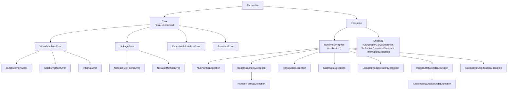
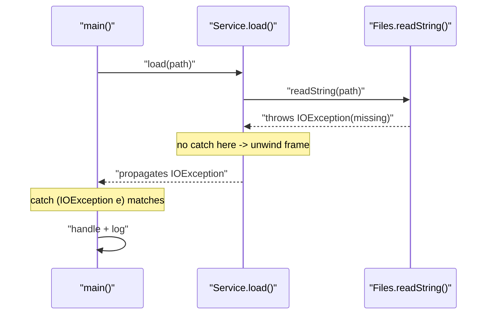
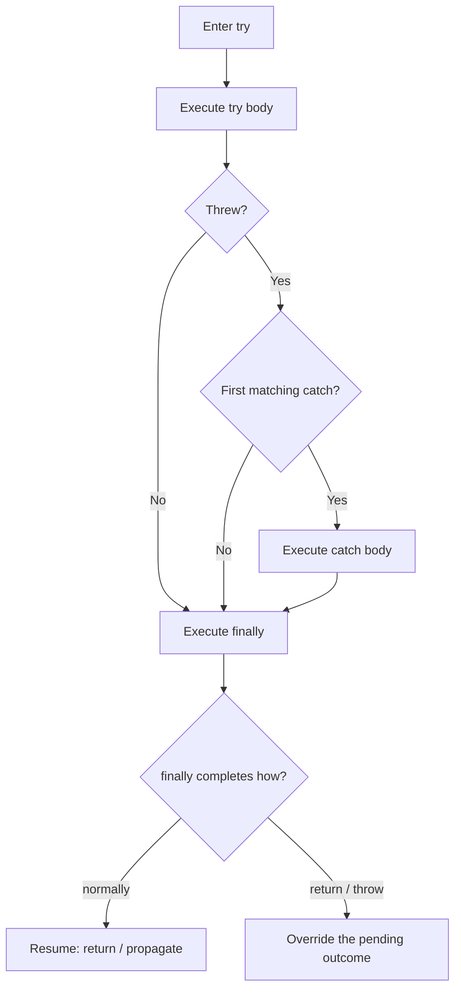
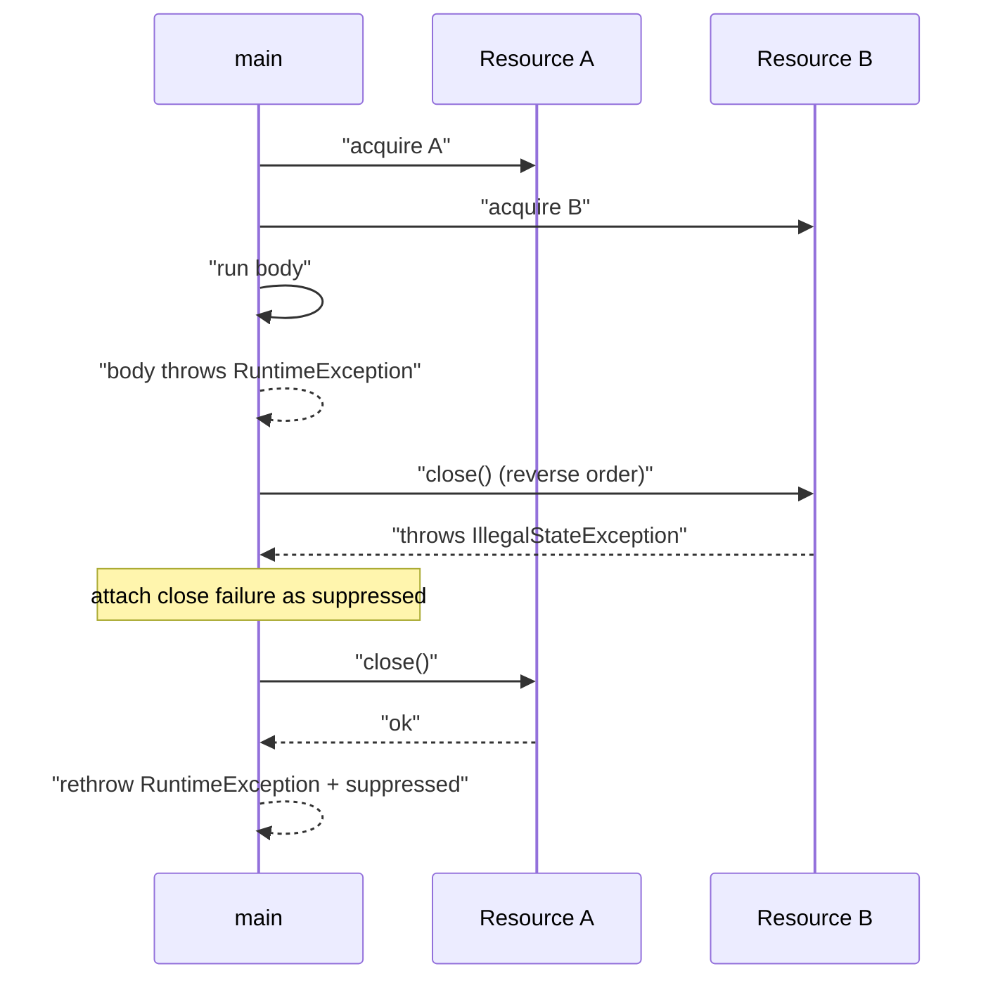

# Exception Handling

Exception handling is Java's structured mechanism for separating the *normal* control flow of a
program from the *failure* flow. A method either **returns** a value or **throws** a `Throwable`;
there is no third outcome. The compiler (for checked exceptions), the runtime (for `finally` and
resource cleanup), and the JVM (for stack traces) all cooperate to make failure propagation explicit.

The mental model to hold onto:

> An exception is an **object** that carries a snapshot of *what went wrong* (`message`, `cause`,
> `suppressed`, `stackTrace`). **Throwing** is a non-local `goto` that unwinds the call stack until a
> matching `catch` is found or the thread dies. **`finally`/try-with-resources** guarantee cleanup
> regardless of whether the exit was normal, `return`, `break`, or `throw`.

Interviewers use this topic to test precision, not trivia: the exact order of `finally`, whether a
`return` in `finally` swallows an exception, close order and suppressed exceptions, covariant
`throws`, and whether you know *when not to use exceptions at all*.

---

## The Throwable Type Hierarchy

Everything throwable descends from `java.lang.Throwable`. Only instances of `Throwable` (and its
subclasses) can be thrown or caught. `Throwable` is a concrete class, not an interface — so a class
cannot "implement" throwability; it must extend `Throwable`/`Exception`/`RuntimeException`/`Error`.



### `Throwable`'s data and API

Every throwable carries five pieces of state, and the API is built around them:

| Member | Meaning |
|---|---|
| `getMessage()` | Human-readable detail passed to a constructor; may be `null`. |
| `getLocalizedMessage()` | Overridable, defaults to `getMessage()`. |
| `getCause()` | The throwable that *caused* this one (`null` if none). |
| `getSuppressed()` | Throwables that occurred *while handling* this one (try-with-resources, `addSuppressed`). |
| `getStackTrace()` | `StackTraceElement[]` snapshot captured at construction. |
| `initCause(Throwable)` | Set the cause **once**, if not already set by constructor. |
| `addSuppressed(Throwable)` | Attach a suppressed throwable; throws `IllegalArgumentException` for self. |
| `fillInStackTrace()` | Native method that walks the current thread stack; called by constructors. |
| `printStackTrace()` | Dump message + cause chain + suppressed + frames to `System.err`. |
| `setStackTrace(StackTraceElement[])` | Replace frames (used by frameworks to hide internals). |

Construction-time capture is the important detail: `fillInStackTrace()` runs when you `new` the
throwable, **not** when you `throw` it. That is why hot-loop allocation of never-thrown exceptions is
still expensive.

### `Error` vs `Exception`

`Error` means "the JVM or platform is in a condition the application cannot reasonably recover
from." Catching `Error` is usually wrong: an `OutOfMemoryError` may fire on every subsequent
allocation, a `StackOverflowError` leaves little stack to run recovery logic, and a `LinkageError`
means class-loading invariants are broken. The conventional exception to the rule is catching
`AssertionError` in tests, and some frameworks catch `StackOverflowError` defensively around
user-supplied parsers.

Common `Error` subtypes you must recognize:

- `OutOfMemoryError` — subclasses include `Java heap space`, `GC overhead limit exceeded`,
  `Metaspace`, `Direct buffer memory`, `unable to create native thread`, and
  `Requested array size exceeds VM limit`. Each points at a different remediation.
- `StackOverflowError` — thrown when a thread's stack exhausts its frames (typically infinite
  recursion). Setting a larger `-Xss` moves the failure, it does not fix it. There is **no exact
  recursion depth** guaranteed; it depends on frame size and `-Xss`.
- `ExceptionInInitializerError` — a `<clinit>` (static initializer) threw; wraps the original cause.
- `NoClassDefFoundError` / `NoSuchMethodError` — class-loading/linkage failures at runtime.
- `AssertionError` — thrown by the `assert` statement when `-ea` is enabled.

> Rule: catch `Exception`, not `Throwable`/`Error`. If you must catch `Throwable` (top-level request
> handlers, thread-pool workers, tests), rethrow `Error`s you cannot handle and never swallow them.

### Checked vs unchecked

A **checked** exception is any `Throwable` that is not a `RuntimeException` and not an `Error`. The
compiler forces the caller to either catch it or declare it in `throws`. **Unchecked** exceptions
(`RuntimeException` and its subclasses, plus `Error`) need no declaration.

| Axis | Checked (`Exception` minus `RuntimeException`) | Unchecked (`RuntimeException`, `Error`) |
|---|---|---|
| Compiler enforcement | Must catch or declare | None |
| Typical meaning | Recoverable, expected external failure | Programming bug or unrecoverable condition |
| Examples | `IOException`, `SQLException`, `InterruptedException`, `ReflectiveOperationException` | `NullPointerException`, `IllegalArgumentException`, `IndexOutOfBoundsException`, `ArithmeticException` |
| Call-site ergonomics | Pollutes signatures; drives lambdas to wrap | Clean signatures |
| Recovery strategy | Retry, fallback, translate, ask user | Fix the code; validate inputs up front |
| Used by streams/lambdas | Cannot be thrown from `Function`/`Supplier` | Fine |

Java's own design guidance (from *Effective Java*): use checked exceptions for conditions the caller
can *reasonably recover from*, and runtime exceptions for programming errors. Most modern frameworks
(Spring, Hibernate) have trended toward runtime exceptions precisely because checked exceptions
complicate interfaces and lambda usage. Both positions are defensible in an interview — what matters
is that you can articulate the trade-off.

---

## Creating and Throwing: `throw`, `throws`, and Propagation

### The `throw` statement

`throw` requires a single expression whose static type is `Throwable` or a subtype. Throwables are
ordinary objects; you can reuse an instance (but never do — a stack trace belongs to a moment in
time), and you can throw from expressions.

```java
public static int divide(int a, int b) {
    if (b == 0) {
        throw new ArithmeticException("Division by zero: " + a + "/" + b);
    }
    return a / b;
}

public static void validate(String s) {
    if (s == null) {
        throw new IllegalArgumentException("s must not be null");
    }
}
```

Edge case: `throw null;` compiles (the null is assignable to `Throwable`) but throws a
`NullPointerException` at runtime. Verified on Java 21:

```text
got NPE, message=Cannot throw exception because "null" is null
```

### The `throws` clause

`throws` is a **declaration** on a method or constructor listing the checked exceptions it may
propagate. It is not executable code. Unchecked exceptions may also be listed (documentation only).
A method may declare an exception it never throws; it may not throw a checked exception it does not
declare (directly or via a widened override).

```java
public int readLength(Path p) throws IOException {      // declares checked
    return Files.readString(p).length();                // Files.readString throws IOException
}

static {                                                // static initializer
    // A <clinit> cannot declare checked exceptions; wrap them:
    try { Class.forName("com.example.Driver"); }
    catch (ClassNotFoundException e) { throw new ExceptionInInitializerError(e); }
}
```

Propagation is a stack unwind: if `readLength` throws `IOException` and its caller does not catch it,
the JVM discards `readLength`'s frame and repeats in the caller, until a `catch` matches or the
thread terminates. Catching by supertype matches subclasses (`catch (IOException e)` catches
`FileNotFoundException`).



### Covariant (narrowed) exceptions in overrides

An overriding method may **narrow** but never **widen** the set of checked exceptions declared by the
overridden method. The same applies to return types (covariant returns) and, for generics, type
variables.

```java
class Repository {
    void save() throws IOException, SQLException { }
}
class InMemoryRepository extends Repository {
    @Override
    void save() throws IOException { }          // OK: subset
}
// class FileRepository extends Repository {
//     @Override
//     void save() throws Exception { }         // COMPILE ERROR: widens checked set
// }
```

Rules to memorize:

- A subclass override may declare **no** checked exceptions, a **subset**, or a subtype.
- It may declare **any** unchecked exceptions (they are not part of the contract).
- If the supertype declares `throws Exception`, an override may declare anything that is an
  `Exception`.
- Constructors participate in the same rule via the superclass constructor call chain: a subclass
  constructor must declare at least what `super(...)` throws.

Narrowing lets clients depend on an abstract method without knowing the implementation's exception
details; the interface becomes the exception contract.

---

## `try` / `catch` / `finally`: Exact Execution Semantics

A `try` must be followed by at least one `catch` or a `finally`. Blocks execute in a fixed order:

1. The `try` body runs.
2. If it completes normally, control goes to `finally` (then to the next statement).
3. If it throws, the JVM searches the attached `catch` clauses **top to bottom** for the first whose
   parameter type is assignable from the thrown type. `finally` runs after the matching `catch`.
4. If no `catch` matches, `finally` runs and the exception keeps propagating.
5. `finally` always runs on the way out — whether the exit is normal, `return`, `break`, `continue`,
   or `throw`.



Verified execution order:

```java
static int demo() {
    System.out.println("1 try-enter");
    try {
        System.out.println("2 try-body");
        if (true) throw new IllegalStateException("X");
        return 10;
    } catch (IllegalStateException e) {
        System.out.println("3 catch");
        return 20;
    } finally {
        System.out.println("4 finally");
    }
}
```

```text
1 try-enter
2 try-body
3 catch
4 finally
result=20
```

`finally` runs *after* the `catch`, *before* the value is actually returned to the caller.

### `return` in `finally` swallows exceptions

If `finally` executes a `return`, it discards any in-flight exception and returns instead. This is
one of the most common interview traps.

```java
static int swallow() {
    try {
        throw new RuntimeException("boom");
    } finally {
        return 42;
    }
}
// prints: swallow=42   (the RuntimeException is silently dropped)
```

Compilers emit a warning on `return` inside `finally` for exactly this reason. Never write it.

### Modifying the return value in `finally`

The pending return value is evaluated and stored **before** `finally` runs. Reassigning a local
variable in `finally` therefore does **not** change a primitive/immutable return value — but mutating
the *object a returned reference points to* does.

```java
static int capture() {                 // returns 1, not 2
    int x = 1;
    try { return x; } finally { x = 2; }
}

static StringBuilder captureRef() {    // returns "ab"
    StringBuilder sb = new StringBuilder("a");
    try { return sb; } finally { sb.append("b"); }
}
```

```text
capture=1
captureRef=ab
```

The primitive `x` was copied into the return slot (`1`) before `finally` reassigned the local; the
reference `sb` was copied too, but both copies alias the same `StringBuilder`, so the mutation is
visible.

### A `throw` in `finally` replaces the original exception

If `finally` throws, its exception supersedes the in-flight one, and the original is **lost** unless
you chain it manually (`addSuppressed` or a wrapped cause).

```java
static int finallyThrows() {
    try { return 1; }
    finally { throw new IllegalStateException("finally wins"); }
}
// finallyThrows -> java.lang.IllegalStateException: finally wins   (return 1 is abandoned)
```

### When `finally` does **not** run

- `System.exit(int)` / `Runtime.getRuntime().halt(int)` — terminates the JVM immediately.
- The thread is killed/daemon and the JVM shuts down (`finally` on daemon threads is not guaranteed).
- An infinite loop, deadlock, or a crash (native `SIGSEGV`) inside the `try`.
- A `finally` that itself never returns.

Verified `System.exit` behavior — only `try` is printed, `finally` is skipped:

```text
try
```

### `finally` vs try-with-resources

`finally` is manual, error-prone cleanup. Since Java 7, **try-with-resources** handles the common
resource case correctly, including suppression. Prefer it. See the next section.

---

## try-with-resources

Introduced in Java 7, try-with-resources automatically calls `close()` on every declared resource
when the block exits, in **reverse declaration order**, and preserves failures correctly.

```java
try (BufferedReader reader = Files.newBufferedReader(path)) {
    return reader.readLine();
}   // reader.close() called here, even on exception or return
```

### `AutoCloseable` vs `Closeable`

| Aspect | `AutoCloseable` (Java 7) | `Closeable` (Java 5) |
|---|---|---|
| Package | `java.lang` | `java.io` |
| Method | `void close() throws Exception` | `void close() throws IOException` |
| Relation | Parent | `Closeable extends AutoCloseable` |
| Thrown type | Any `Exception` | `IOException` only (narrower) |
| Idempotent? | Not required | Contract says `close()` has no effect if already closed |
| Used by | Anything resource-like (`Compiler`, `ExecutorService`) | I/O streams and readers/writers |

Implement `Closeable` for I/O (so callers get the narrower `IOException` contract); implement
`AutoCloseable` for non-I/O resources. `close()` should be **idempotent** and should ideally not
throw when it is only releasing an already-consumed resource.

### Close order and suppressed exceptions

Resources declared left-to-right are closed right-to-left. If the body throws and `close()` also
throws, the **body's exception is primary** and the close exception is attached as **suppressed**.
If the body completes normally, the first close exception becomes primary and later ones are
suppressed. Verified:

```java
static class R1 implements AutoCloseable {
    public void close() { System.out.println("close R1"); }
}
static class R2 implements AutoCloseable {
    public void close() {
        System.out.println("close R2");
        throw new IllegalStateException("close failed R2");
    }
}

static void run() throws Exception {
    try (R1 a = new R1(); R2 b = new R2()) {
        System.out.println("body");
        throw new RuntimeException("body failed");
    }
}

public static void main(String[] args) {
    try { run(); }
    catch (Throwable t) {
        System.out.println("caught: " + t);
        for (Throwable s : t.getSuppressed()) System.out.println("  suppressed: " + s);
    }
}
```

```text
body
close R2
close R1
caught: java.lang.RuntimeException: body failed
  suppressed: java.lang.IllegalStateException: close failed R2
```

And when the body is fine but both closes throw:

```text
-- body ok, both closes fail --
body
closing B
closing A
primary: java.lang.IllegalStateException: B close fail
  suppressed: java.lang.IllegalStateException: A close fail
```

Note the two different "primary" rules. Both preserve all failures, which is the entire point of
suppression.



### Effective-final resources (Java 9+)

Java 9 allowed an already-declared resource to be used without a second variable, as long as it is
`final` or effectively final:

```java
void copy(Path in, Path out) throws IOException {
    var reader = Files.newBufferedReader(in);   // effectively final
    var writer = Files.newBufferedWriter(out);
    try (reader; writer) {                      // Java 9+
        reader.transferTo(writer);
    }
}
```

### Null resources: JDK 8 vs JDK 9+

The compiler generates different cleanup code across versions:

- **Java 7–8:** `close()` was invoked unconditionally. A `null` resource caused a
  `NullPointerException` during cleanup.
- **Java 9+:** the synthesized code null-checks before `close()`, so a `null` resource is silently
  ignored. Verified on Java 21:

```java
try (AutoCloseable r = null) {
    System.out.println("body ran");
}
```

```text
-- null resource --
body ran
after
```

This is a behavioral change worth calling out; code that relied on the JDK 8 NPE will not throw on
modern JDKs.

### Implementing `AutoCloseable` correctly

```java
final class Connection implements AutoCloseable {
    private boolean closed;

    @Override
    public void close() {                 // declare an exception only if you truly throw one
        if (closed) return;               // idempotent
        closed = true;
        System.out.println("releasing connection");
    }
}
```

Guidelines:

- Make `close()` idempotent.
- Do not throw from `close()` unless failure is meaningful; when you do, let try-with-resources
  attach it as suppressed.
- Never call `close()` twice manually inside a try-with-resources body; keep the resource owned by
  the header.
- A resource that wraps another resource should still `close()` it once.
- **Self-suppression is rejected**: `addSuppressed(this)` throws
  `IllegalArgumentException: Self-suppression not permitted` on Java 21 (verified). The compiler's
  generated suppression path avoids this internally.

---

## Multi-catch and Precise Rethrow

### Multi-catch: `catch (A | B e)`

One handler can catch several alternatives, reducing duplication.

```java
try {
    process();
} catch (IOException | SQLException e) {     // no subclass relationship allowed
    throw new ServiceException("processing failed", e);
}
```

Rules:

- The alternatives must be **disjoint**: they may not be related by subclassing. Otherwise the
  compiler reports: `Alternatives in a multi-catch statement cannot be related by subclassing`
  (verified, e.g. `IOException | FileNotFoundException`).
- The catch parameter is **implicitly final**; you cannot reassign `e`.
- The static type of `e` is the **least upper bound** of the alternatives (often a common
  supertype), so members available are only those common to all alternatives. If you need
  alternative-specific handling, use separate catches.

### Precise rethrow

When you catch a broad type and rethrow the same variable, the compiler performs **precise rethrow
analysis**: it constrains what may escape to the exception types actually thrown by the `try` block,
not the declared catch type. This lets you keep `throws` clauses narrow.

```java
static void precise() throws IOException, SQLException {
    try {
        throw new IOException("io");
    } catch (Exception e) {
        throw e;   // compiler knows only IOException|SQLException can escape
    }
}
```

Without precise rethrow (pre-Java 7), this required declaring `throws Exception` or wrapping. The
mechanism: the compiler tracks the "fact that the variable `e` may refer to" and infers the throwable
set from the `try` block's actual `athrow` sites, not from the catch signature. It only applies when
the rethrown expression is exactly the catch parameter (possibly through a `final` local alias in
recent versions); if you assign `e` to another variable of a broader type first, the precision is
lost.

---

## Exception Chaining

Chaining records causality: *this* exception happened *because of* another. The preferred API is the
constructor overload `(String message, Throwable cause)`.

```java
class AppException extends Exception {
    private static final long serialVersionUID = 1L;
    AppException(String msg, Throwable cause) { super(msg, cause); }
}

static void readMissing() throws AppException {
    try {
        throw new FileNotFoundException("config.yml missing");
    } catch (FileNotFoundException e) {
        throw new AppException("Cannot load config", e);   // cause preserved
    }
}
```

Verified output: `top: Cannot load config` / `cause: java.io.FileNotFoundException: config.yml missing`.

`initCause(Throwable)` is the legacy path for exceptions whose constructor does not take a cause; it
can be called **once**, and only if the cause was not already set by a constructor:

```text
-- initCause self --
iae: Self-causation not permitted
-- initCause twice --
ise: Can't overwrite cause with java.lang.RuntimeException: second
```

### `cause` vs `suppressed`

These answer different questions:

- **`cause`** — "why did this fail?" One exception is the direct consequence of another. A
  translated/domain exception wraps its infrastructure root cause.
- **`suppressed`** — "what else went wrong while dealing with this?" Multiple independent failures
  in the same cleanup sequence. Try-with-resources uses this automatically (body failure + close
  failure).

Use `addSuppressed` when you must continue handling rather than replace:

```java
try {
    doWork();
} finally {
    try { cleanup(); }
    catch (Throwable t) { primary.addSuppressed(t); }   // never lose the cleanup failure
}
```

Do not flatten a cause into a string message ("failed: " + e.getMessage()) — that destroys the
stack trace and the causal chain.

---

## Custom Exceptions

Create a domain exception when callers need to distinguish a condition and you want to attach
context.

```java
public class OrderNotFoundException extends RuntimeException {
    private static final long serialVersionUID = 1L;
    private final long orderId;

    public OrderNotFoundException(long orderId) {
        super("Order not found: " + orderId);
        this.orderId = orderId;
    }
    public OrderNotFoundException(long orderId, Throwable cause) {
        super("Order not found: " + orderId, cause);
        this.orderId = orderId;
    }
    public long getOrderId() { return orderId; }
}
```

Guidelines:

- **Extend which base?** `RuntimeException` for programming/domain errors that a boundary can
  translate into a response; checked `Exception` only if the caller is *forced* to handle a
  recoverable condition. Never extend `Error`.
- **Provide the standard constructors**: `(String)`, `(String, Throwable)`, and `(Throwable)` for
  frameworks (Jackson/reflection instantiate exceptions reflectively).
- **Never drop the cause**: always forward `cause` to `super`.
- **Add context as fields**, not just in the message, so handlers can act programmatically.
- **Serialization caveat**: exceptions are `Serializable`; fields must be serializable, and you must
  provide a `serialVersionUID` or face `InvalidClassException` across binary-compatible changes.
  See [Serialization](../06-Reflection/29-Serialization.md). Records are serializable and can be
  used for very small exception types, but a record's canonical constructor is used on
  deserialization.
- Avoid subclass explosion. A small, closed hierarchy (often one root domain exception) is usually
  better than dozens of leaf types.

---

## Checked Exceptions in Functional Interfaces and Streams

None of `Function`, `Supplier`, `Consumer`, `Predicate`, `Runnable`, or `Callable` (except
`Callable.call`, which declares `throws Exception`) declare checked exceptions. So a lambda body that
calls a checked-throwing method cannot propagate it directly:

```java
// Files.readString throws IOException; this does NOT compile:
// paths.stream().map(p -> Files.readString(p)).toList();
```

Three established strategies:

1. **Wrap in a runtime exception** — clearest, stack-trace preserving.
   ```java
   List<String> contents = paths.stream()
       .map(p -> {
           try { return Files.readString(p); }
           catch (IOException e) { throw new UncheckedIOException(e); }
       })
       .toList();
   ```
   `java.io.UncheckedIOException` (Java 8) and `java.util.concurrent.CompletionException` are the
   JDK's own wrappers. `CompletionException` is what `CompletableFuture.join()` throws around a
   failed stage — see [CompletableFuture](../04-Multithreading/20-CompletableFuture.md).

2. **A checked-aware functional interface** — define `@FunctionalInterface interface ThrowingFunction<T,R> { R apply(T t) throws Exception; }` and adapt it to a `Function` with a wrapper at the boundary. This keeps the throwing call and the adaptation explicit.

3. **Sneaky throw** — bypass the compiler's checked-exception check via erasure. It works because
   the JVM does not enforce checked exceptions at runtime; only `javac` does.

   ```java
   @SuppressWarnings("unchecked")
   static <T extends Throwable, R> R sneaky(Throwable t) throws T { throw (T) t; }

   static void noDeclaredChecked() {
       sneaky(new IOException("checked but undeclared"));   // compiles, no throws clause
   }
   ```

   Verified: `sneaky: java.io.IOException: checked but undeclared`.

   This is powerful and dangerous: callers get an unexpected checked exception with no signature
   documentation, breaking the contract. Lombok's `@SneakyThrows` does exactly this at the
   bytecode level. Prefer explicit wrapping in production code; use `sneakyThrow` only in narrow
   adapter utilities (and document it loudly).

Never let a checked exception leak into a lambda-typed API unannounced. Wrap it *and set the cause*
so the failure is recoverable at the boundary.

---

## Best Practices

- **Fail fast and loud.** Validate arguments at the top of public methods with
  `Objects.requireNonNull(x, "x")` or explicit `IllegalArgumentException`. Bad state discovered
  early is far cheaper than corruption discovered late.
- **Do not catch `Throwable`, `Error`, or bare `Exception` broadly.** Catch the narrowest type you
  can actually handle. `catch (Exception e) { /* ignore */ }` is a defect, not defensive programming.
- **Never swallow.** An empty `catch` (or a body that only prints) hides failures. If you truly
  ignore, log at `DEBUG` with the exception and a comment explaining why.
- **Log or rethrow, not both.** Logging an exception and rethrowing it produces duplicate stack
  traces at every layer ("double logging"). If you add context, rethrow a *new* exception with the
  cause; if you handle it, log once at the handling boundary.
- **Do not use exceptions for control flow.** Using `NumberFormatException` to test numeric input is
  slower and less clear than pre-validating. Exceptions should be exceptional.
- **Translate at boundaries.** Do not leak `SQLException`/`IOException` into domain services. Catch
  infrastructure exceptions at the repository/adapter and throw a domain exception with the cause
  attached. This keeps the domain decoupled and testable.
- **Prefer try-with-resources over `finally`.** Let the compiler handle null-safety, reverse order,
  and suppression.
- **`Optional` vs exceptions.** Use `Optional` for an *expected, normal* absence ("no user with that
  id" when callers routinely probe). Use exceptions for *exceptional* or contract-violating
  conditions. Never return `null` to signal absence from an API you control. See
  [Optional](../03-Functional/15-Optional.md).
- **Validation vs exceptions.** Distinguish *validation* (rejecting malformed caller input, often
  aggregated and returned as 400) from *failure* (an operation could not complete). Bean Validation
  (`@Valid`, `ConstraintViolationException`) is for the former; exceptions for the latter.
- **Document exceptions** with `@throws`/`@exception` Javadoc, especially unchecked ones that are
  part of the contract.

---

## Performance of Exceptions

Exceptions are cheap to *skip* and moderately expensive to *create*, dominated by stack-trace
capture.

- **`fillInStackTrace()` is the cost.** It is a native method that walks the thread's frames and
  builds a `StackTraceElement[]`. It runs in the constructor, so even a never-thrown `new Exception()`
  pays it. Typical cost is on the order of microseconds and grows with stack depth.
- **Suppress trace capture** when you throw high-frequency control exceptions:
  ```java
  class FastException extends RuntimeException {
      FastException(String msg) { super(msg, null, false, false); }
      // message, cause=null, enableSuppression=false, writableStackTrace=false
  }
  ```
  Verified: `getStackTrace().length == 0`.
- **Global switch**: `-XX:-StackTraceInThrowable` makes all throwables carry no stack trace.
  Verified:
  ```text
  java EHStack                 -> stackTrace length = 1
  java -XX:-StackTraceInThrowable EHStack -> stackTrace length = 0
  ```
  Use only in diagnostic-hostile, latency-critical contexts; you lose all debuggability.
- **Fill-in at throw time instead of construction**: some libraries call
  `fillInStackTrace()` lazily or `setStackTrace(...)` to control the frames. Setting a smaller
  array reduces memory and serialization cost.
- **Hot loops**: throwing inside a loop can dominate CPU. Replace expected failures with
  pre-checks, `Optional`, or sentinel returns.
- **Memory**: each throwable retains a `StackTraceElement[]` and references to its cause/suppressed
  chain; a long-lived exception (e.g., cached in a field) retains those frames, which can retain
  class loaders and cause leaks.
- **`StackOverflowError` in deep recursion** is itself expensive and leaves recovery little stack.

> Rule of thumb: exceptions are for the exceptional path. If an exception is part of the normal,
> frequent control flow, redesign it. Optimize construction (trace capture), not `athrow`.

See [JVM Performance](../08-Advanced/38-JVM-Performance.md) for flag-level tuning.

---

## Logging and Boundary Translation

- **Levels**: `TRACE` < `DEBUG` < `INFO` < `WARN` < `ERROR`. Log an exception at `ERROR` only when it
  represents a lost operation; expected recoveries (validation failures, cache misses) are `DEBUG`
  or `WARN`. Logging everything at `ERROR` destroys alerting signal.
- **Log once, at the boundary that handles it.** If a layer rethrows, it must not also log at
  `ERROR`. Include the stack trace exactly once.
- **Correlation IDs**: attach a request/trace id via MDC (SLF4J) so a log line can be correlated
  across layers and services. Do not rely on message text.
- **Never log secrets** — exception messages often embed PII or credentials (e.g., a failed URL with
  an API key). Sanitize at the logging point.
- **Service-boundary translation (Spring, brief)**: infrastructure exceptions are mapped to a stable
  API error at the web layer. A `@RestControllerAdvice` with `@ExceptionHandler` methods (or
  `ProblemDetail` / RFC 7807) translates `MethodArgumentNotValidException` →
  `400`, `OrderNotFoundException` → `404`, `AccessDeniedException` → `403`, and unexpected
  `Exception` → `500`, while logging the cause server-side. Keep domain code free of HTTP types. (A
  dedicated Spring module would go deeper; this is the pointer.)

```text
Controller @ExceptionHandler  ->  translates  ->  HTTP status + error body
        ^
        |  receives domain exceptions only
   Service layer  -> catches infrastructure (SQLException) -> throws ServiceException(cause)
        ^
        |  infrastructure exceptions stay here
   Repository / adapter
```

---

## Common Pitfalls

### `NullPointerException` and helpful messages (Java 14+)

JEP 358 added **helpful NullPointerExceptions**: the JVM records *why* a dereference failed, producing
messages like `Cannot invoke "Object.toString()" because "<local1>" is null`. It was opt-in in Java
14 (`-XX:+ShowCodeDetailsInExceptionMessages`) and **on by default since Java 15**. Verified on
Java 21:

```text
msg=Cannot invoke "Object.toString()" because "<local1>" is null
msg=Cannot load from object array because "<local2>" is null
```

Caveats: the extra analysis adds a small cost on the NPE path; the message names bytecode-local
variables (`<local1>`), which may not match source names without `-g`; and any code parsing NPE
messages will break. Prefer `Objects.requireNonNull` with an explicit message for logic that is
*expected* to validate.

### `ClassCastException`, `NumberFormatException`, `IllegalStateException` vs `IllegalArgumentException`

- **`ClassCastException`**: an invalid downcast. Message on Java 21 includes modules and loader:
  `class java.lang.String cannot be cast to class java.lang.Integer (java.lang.String and
  java.lang.Integer are in module java.base of loader 'bootstrap')`. Prefer pattern matching
  (`instanceof`) to avoid it — see [Pattern Matching](../07-Modern-Java/34-Pattern-Matching.md).
- **`NumberFormatException`** extends `IllegalArgumentException`; message is `For input string:
  "12x"`. Use it to reject malformed numeric input, not as a parser API.
- **`IllegalArgumentException` vs `IllegalStateException`** — the classic distinction:
  - `IllegalArgumentException`: *a supplied argument is invalid* (caller's fault), e.g.
    `parseInt("12x")`, `new ArrayList<>(-1)`.
  - `IllegalStateException`: *the object is in a state where the call is not valid* (callee/context),
    e.g. reading from a closed stream, `Iterator.remove()` before `next()`.
- **`IndexOutOfBoundsException`** (with subtype `ArrayIndexOutOfBoundsException`) and
  `ArithmeticException` (integer `/` or `%` by zero) are other frequent runtime exceptions.
- **`ConcurrentModificationException`**: fail-fast detection of structural modification during
  iteration; it is a best-effort signal, not a guarantee, and is unrelated to thread-safety
  guarantees (see [Concurrent Collections](../02-Collections/11-Concurrent-Collections.md)).

---

## Comparison Tables

### Checked vs unchecked

| Dimension | Checked | Unchecked |
|---|---|---|
| Bases | `Exception` non-runtime | `RuntimeException`, `Error` |
| Enforcement | `javac` requires catch/declare | None |
| Recovery expectation | Caller can recover | Bug / unrecoverable |
| Signature impact | Pollutes `throws`; blocks lambdas | Clean |
| Typical use | I/O, SQL, remote calls, `InterruptedException` | Validation, illegal state, bugs |
| Framework trend | Declining (wrapped at boundaries) | Preferred |

### `finally` vs try-with-resources

| Dimension | `finally` | try-with-resources |
|---|---|---|
| Cleanup order | Manual; you choose | Automatic, reverse declaration |
| Null resource | NPE only if you call method on null | Null-guarded since Java 9 |
| Exception + cleanup failure | Original lost unless you chain manually | Original primary, cleanup suppressed |
| Readability | Verbose, nested | Concise |
| Multiple resources | Nested try/finally | Single header |
| Since | Java 1.0 | Java 7 |
| Recommended | Only when there is no `AutoCloseable` | Default for all resources |

### `Exception` vs `Error`

| | `Exception` | `Error` |
|---|---|---|
| Causer | Application/environment | JVM/platform |
| Declarable | Checked ones, yes | Never declared |
| Recoverable | Often | Rarely |
| Examples | `IOException`, `SQLException` | `OutOfMemoryError`, `StackOverflowError` |
| Handling advice | Catch narrowly | Let it propagate; rethrow caught `Error` |

### `cause` vs `suppressed`

| | `cause` | `suppressed` |
|---|---|---|
| Question answered | "because of what?" | "what else failed?" |
| Cardinality | One | Many |
| Set by | Constructor / `initCause` | `addSuppressed` / try-with-resources |
| Accessor | `getCause()` | `getSuppressed()` |
| Typical use | Wrapping/translation | Cleanup failures |

### `throw` vs `throws`

| | `throw` | `throws` |
|---|---|---|
| Kind | Statement (executable) | Clause (declaration) |
| Operand | One `Throwable` expression | Comma-separated exception types |
| Enforces | Actually raises | Compile-time contract for checked types |
| Multiple per method | Yes, many `throw`s | One `throws` list |

---

# Interview Questions

## Beginner

**Q:** What is the difference between `Error` and `Exception`?

**A:** Both extend `Throwable`, but they signal different severities. `Error` represents conditions
the application normally cannot recover from and that originate in the JVM/platform:
`OutOfMemoryError`, `StackOverflowError`, `NoClassDefFoundError`, `AssertionError`. `Exception`
represents conditions a program can often handle: `IOException`, `SQLException`, `RuntimeException`
subtypes such as `NullPointerException`. You generally catch `Exception` (and usually a narrow
subtype), not `Error`. Catching `Throwable` is reserved for top-level handlers/thread pools, where
you must rethrow `Error`s you cannot handle.

**Q:** What are checked and unchecked exceptions?

**A:** Checked exceptions are all `Throwable` subtypes that are not `RuntimeException` and not
`Error`. The compiler forces you to either catch them or declare them with `throws`. Unchecked
exceptions are `RuntimeException` and its subclasses plus `Error`; they require no declaration.
Example checked: `IOException` — a file might be missing at runtime, and callers may reasonably
recover. Example unchecked: `NullPointerException` — a programming bug.

**Q:** What is the difference between `throw` and `throws`?

**A:** `throw` is a statement that actually raises a `Throwable` (`throw new IOException()`); `throws`
is a method/constructor declaration listing checked exceptions that may escape the method
(`void read() throws IOException`). A method can contain many `throw` statements but has one `throws`
clause.

**Q:** Does `finally` always execute?

**A:** It executes for every normal exit from the `try`/`catch`: falling off the end, `return`,
`break`, `continue`, or a thrown exception (after a matching `catch`, or on the way out if none
matches). It does **not** run if the JVM terminates first — `System.exit()`, `Runtime.halt()`, the
process is killed, or the thread is a daemon killed at shutdown — nor if the `try` never completes
(infinite loop, deadlock, native crash).

**Q:** What is the difference between `final`, `finally`, and `finalize()`?

**A:** `final` is a modifier (constant field, non-overridable method/class). `finally` is a block that
runs on exit from a `try`. `finalize()` was a deprecated `Object` method the GC could call before
reclaiming an object; it is deprecated for removal (since Java 9/18) and replaced by
`Cleaner`/try-with-resources. They are unrelated despite similar spelling.

**Q:** When is `catch (Exception e)` acceptable versus problematic?

**A:** It is acceptable at a **boundary** — a request handler, a thread-pool worker, a scheduled job —
where you must prevent one request from killing the worker and you translate to a user-visible error.
It is problematic in ordinary method bodies because it hides distinct failures that should be
handled differently (and it catches exceptions you never anticipated, including subclasses added
later), causing silent misbehavior.

**Q:** What is a stack trace?

**A:** A list of `StackTraceElement` frames captured when a `Throwable` is constructed, showing the
call path from the throw point upward: class, method, file, and line. It is produced by
`Throwable.fillInStackTrace()`, a native method invoked by throwable constructors. It is the primary
debugging artifact and the main reason exception construction is not free.

## Intermediate

**Q:** Explain the exact execution order of `try`, `catch`, and `finally` when the `try` throws.

**A:** The `try` body runs until the throwing statement. The JVM searches `catch` clauses top to
bottom and runs the first matching one. Then `finally` runs. Then the outcome (normal completion,
`return`, or re-propagation) proceeds. Verified order for a throw caught by a matching clause:
`1 try-enter`, `2 try-body`, `3 catch`, `4 finally`, `result=20`. If no `catch` matches, `finally`
runs and the exception continues unwinding to the caller.

**Q:** Why does `return` inside `finally` swallow exceptions? Show an example.

**A:** A `return` in `finally` abandons the exception currently in flight and returns a value instead,
so the caller sees normal completion and the exception is discarded. Example:

```java
static int swallow() {
    try { throw new RuntimeException("boom"); }
    finally { return 42; }
}
// returns 42; RuntimeException is lost
```

The compiler warns about this. Never return from `finally`.

**Q:** Can changing a variable in `finally` change the method's return value?

**A:** For a primitive/immutable return, no: the return value is evaluated and copied into the return
slot before `finally` runs, so reassigning the local does not affect it (`capture()` returns `1`
even though `x = 2` in `finally`). For a returned reference, the *reference* is copied, but mutating
the referenced object is visible to the caller (`captureRef()` returns `"ab"`). To change a
primitive result you would need an explicit `return` in `finally`, which is the swallow trap.

**Q:** What is the difference between `Closeable` and `AutoCloseable`?

**A:** `AutoCloseable` (Java 7, `java.lang`) declares `void close() throws Exception`;
`Closeable` (Java 5, `java.io`) extends it and narrows to `void close() throws IOException`, with the
documented contract that repeated `close()` is a no-op. Use `Closeable` for I/O so callers get the
narrower exception contract; use `AutoCloseable` for non-I/O resources.

**Q:** In what order are resources closed in try-with-resources?

**A:** Reverse declaration order — the last resource declared is closed first. Verified: with
`try (R1 a = new R1(); R2 b = new R2())`, the output is `close R2` then `close R1`.

**Q:** What is a suppressed exception and when is it used?

**A:** A throwable attached to another throwable, retrieved via `getSuppressed()`. It records
additional failures that occurred while handling the primary one, without replacing it. The canonical
use is try-with-resources: if the body throws and `close()` also throws, the body's exception is
primary and the close exception is suppressed. You can add one manually with
`primary.addSuppressed(t)`. Self-suppression is rejected: `addSuppressed(this)` throws
`IllegalArgumentException: Self-suppression not permitted` on Java 21.

**Q:** What are the rules for multi-catch?

**A:** `catch (A | B e)` handles multiple alternatives with one block. The alternatives must be
disjoint — not related by subclassing — or the compiler reports `Alternatives in a multi-catch
statement cannot be related by subclassing`. The parameter `e` is implicitly `final` and its
declared type is the least upper bound of the alternatives, so you can only use members common to
all of them.

**Q:** What is exception chaining and how do you do it?

**A:** Chaining records that one exception was caused by another, preserving the original failure
context. Preferred: pass the cause to the constructor, `new AppException("Cannot load config", e)`.
Legacy/custom types without a cause constructor use `initCause(e)`, callable once and only if the
cause was not set. Retrieve with `getCause()` and print with `printStackTrace()`. Never flatten a
cause into a message string.

**Q:** How do you declare exceptions for an overriding method?

**A:** The override may declare no checked exceptions, a subset, or subtypes of those declared by the
overridden method — it may not add or widen checked exceptions. Unchecked exceptions can always be
added. This is "covariant exception narrowing." For example, overriding
`void save() throws IOException, SQLException` with `void save() throws IOException` is legal; with
`void save() throws Exception` is not.

## Advanced

**Q:** Explain precise rethrow.

**A:** When a method catches a broad type and rethrows the caught variable directly, the compiler
analyzes the `try` block and restricts what may escape to the concrete exceptions actually thrown
there, instead of the declared catch type. This lets you write `catch (Exception e) { throw e; }` in
a method that declares only `throws IOException, SQLException`. It applies only when the rethrown
expression is the catch parameter itself (or an effectively-final alias); assigning to a broader
variable loses the precision.

**Q:** What happens if both the `try` body and `close()` throw in try-with-resources?

**A:** The body's exception is primary; the close exception is suppressed. Verified:
`caught: java.lang.RuntimeException: body failed` with
`suppressed: java.lang.IllegalStateException: close failed R2`. If the body succeeds and multiple
closes throw, the first close exception is primary and the remaining are suppressed. This preserves
all failures, which manual `finally` cleanup usually fails to do.

**Q:** How does try-with-resources compile? What bytecode does `javac` generate?

**A:** It is sugar over nested `try/finally`. For `try (R r = ...) { body }`, the compiler emits code
equivalent to acquiring `r`, then a `try` around the body, plus a `finally` that closes `r` if it is
non-null, catching any throwable from `close()` and calling `addSuppressed` on the primary exception
(or making it primary if the body completed normally). The JDK 9+ version adds the null guard that
JDK 8 lacked. There is no special `close` opcode — it is ordinary `invokeinterface AutoCloseable.close`.

**Q:** Why is constructing an exception expensive, and how can you reduce the cost?

**A:** The dominant cost is `fillInStackTrace()`, a native method invoked by every `Throwable`
constructor that walks the current thread's stack and allocates a `StackTraceElement[]`. Strategies:
disable trace capture with the protected constructor
`super(message, cause, enableSuppression, writableStackTrace)` passing `false`; override
`fillInStackTrace()` to return `this`; use the global `-XX:-StackTraceInThrowable`; avoid throwing in
hot paths; and reuse logic that does not need traces for high-frequency control flow. Verified:
a throwable built with `writableStackTrace=false` has `getStackTrace().length == 0`, and
`-XX:-StackTraceInThrowable` reduces a normal exception's trace to length `0`.

**Q:** When should a domain layer use checked versus unchecked exceptions?

**A:** If the caller can meaningfully recover and the API contract should force them to acknowledge
it, use checked. If the condition is a programming error or is translated at a boundary anyway,
unchecked is more ergonomic. In layered applications, unchecked domain exceptions plus a
web/framework boundary that maps them to responses is the common choice, because checked exceptions
leak infrastructure details and complicate functional/stream code. What matters is consistency: do
not mix conventions arbitrarily within a layer.

**Q:** How do checked exceptions interact with `CompletableFuture` and streams?

**A:** Lambdas passed to `Function`, `Supplier`, `Consumer`, `Predicate` cannot throw checked
exceptions, so a checked-throwing call must be wrapped — `UncheckedIOException`,
`CompletionException`, or a custom runtime wrapper that sets the cause. `CompletableFuture.join()`
throws `CompletionException` wrapping the stage's failure, while `get()` throws `ExecutionException`.
Streams likewise force wrapping in `map`/`filter`. Java has no built-in checked-aware functional
interfaces; you either wrap explicitly or define your own `ThrowingFunction` and adapt.

**Q:** What is the difference between `ExecutionException`, `CompletionException`, and
`UncheckedIOException`?

**A:** `ExecutionException` (checked) is thrown by `Future.get()` when the task failed; its cause is
the task's exception. `CompletionException` (unchecked) is thrown by `CompletableFuture.join()` and
by dependent stages, also wrapping the original cause. `UncheckedIOException` (Java 8, unchecked)
wraps an `IOException` so I/O failures can cross lambda/stream boundaries. All three preserve the
original via `getCause()`.

## Expert

**Q:** How does the JVM unwind the stack when an exception propagates, and what is a `finally` in
bytecode?

**A:** Propagation uses the `athrow` instruction. The JVM consults the exception table of the current
method — a list of `[startPC, endPC, handlerPC, catchType]` entries. It finds the first entry whose
range covers the current PC and whose `catchType` is the thrown class or a superclass (or `0` for
`finally`/`any`). If found, the stack is unwound to the frame's operand stack state and control
jumps to `handlerPC` with the throwable pushed. If not, the frame is popped and the throwable is
re-thrown in the caller. `finally` is compiled as a `catch-all` handler (`catchType = 0`) that runs
the finally code and then re-`athrow`s the pending throwable (or a synthetic variable holding it).
`return`/`break`/`continue` through a `finally` are compiled as jumps to the finally block followed by
the stored outcome. This is why `finally` cannot be "skipped" by normal `return`.

**Q:** Why does `throw null` compile, and what exactly happens?

**A:** `throw` accepts any expression assignable to `Throwable`, and the null type is assignable to
every reference type, so `throw null;` compiles. At runtime the JVM's `athrow` requires a non-null
reference; a null operand causes a `NullPointerException` to be thrown instead. On Java 21 the
helpful-NPE machinery produces the message `Cannot throw exception because "null" is null`.

**Q:** Explain the `getSuppressed`/`addSuppressed` contract and its restrictions.

**A:** `addSuppressed(Throwable)` appends to an internal suppressed list that is created lazily and
also preserved by `printStackTrace`/`getSuppressed`. Restrictions: throwing/adding `null` is a no-op
or rejected; `addSuppressed(this)` throws `IllegalArgumentException("Self-suppression not
permitted")` on modern JDKs; `enableSuppression=false` (constructor flag) makes all suppression
calls no-ops; and a `Throwable` instance may not appear as its own ancestor chain via suppression in
some cases. Suppression is better than replacing the exception because it preserves the primary
failure.

**Q:** How would you design an exception hierarchy for a large service?

**A:** Define one root runtime exception (e.g. `ServiceException`) carrying a stable error code and an
optional cause, then a small closed set of subtypes for categories that callers actually branch on
(`NotFound`, `Conflict`, `Validation`, `Unavailable`). Keep infrastructure exceptions at the adapter
boundary, translating them into domain types with the cause attached. Do not expose `SQLException`
or HTTP statuses in the domain. Use sealed types (see
[Sealed Classes](../07-Modern-Java/33-Sealed-Classes.md)) to make the hierarchy exhaustive and
enforce it at compile time. Avoid a leaf per message; classify by *caller action*, not by message.

**Q:** What are the risks of caching/reusing exception instances?

**A:** A throwable captures its stack trace at construction, so reuse attributes a stale call path
to every throw. It is also mutable (cause, suppressed, stack trace) and not thread-safe, so concurrent
`addSuppressed`/`initCause` corrupts state. Additionally, a long-lived exception retains references
to the frames' classes and class loaders, which can leak class loaders in containers. Reuse only
special "frozen" exceptions with `writableStackTrace=false` and no mutable state, and only when you
accept the loss of diagnostic location.

**Q:** How do you handle exceptions across thread boundaries and virtual threads?

**A:** Each thread has its own stack, so exceptions propagate only within a thread. `Thread` offers
`setUncaughtExceptionHandler`/`Thread.UncaughtExceptionHandler`; the default prints the trace and may
terminate the thread or the JVM. In executors, a task's exception is captured by the `Future`
(`get()` → `ExecutionException`, `join()` → `CompletionException`). Virtual threads (see
[Virtual Threads](../04-Multithreading/22-Virtual-Threads.md)) inherit the same model; uncaught
exceptions go to the thread's handler. Shared mutable state accessed from multiple threads also
raises visibility concerns — see [Java Memory Model](../04-Multithreading/23-Java-Memory-Model.md).

## Scenario Based

**Q:** A REST endpoint catches `Exception` and returns `200 OK` with a generic message. What is wrong
and how do you fix it?

**A:** It conflates success with failure, breaks HTTP semantics, hides errors from clients and
monitoring, and swallows the stack trace. Fix it by letting domain exceptions propagate to a
centralized handler (e.g. `@RestControllerAdvice`/`@ExceptionHandler`) that maps
`NotFoundException` → `404`, `ValidationException` → `400`, `AccessDeniedException` → `403`, and
unexpected exceptions → `500`, logging the cause once server-side (with a correlation id) and
returning a stable error body. Never catch the broad `Exception` just to fabricate a 200.

**Q:** A batch job processes 10 million rows and throws/catches an exception for each malformed
row. Throughput collapsed. How do you fix it?

**A:** Throwing exceptions per row makes stack-trace capture dominate. Replace exception-driven
control flow with validation: pre-check each row, collect malformed row references into a list, and
report them at the end; parse without exceptions. If you must signal per-row failure, use a result
type/`Optional` or a `writableStackTrace=false` exception and reserve real exceptions for truly
exceptional rows. Also batch and avoid logging per row.

**Q:** Your service calls a payment gateway; `IOException` bubbles up as a raw `IOException` out of
your public API. Is that acceptable?

**A:** No. Leaking `IOException` couples callers to a transport detail and exposes unstable contracts.
Catch it at the adapter boundary, translate to a domain exception such as
`PaymentGatewayException("gateway timeout", e)` with the cause attached, define retry/fallback
policy there, and let the web layer map it to `503`. This keeps the domain transport-agnostic and
testable, and preserves the root cause for diagnostics.

**Q:** A `try (FileInputStream in = new FileInputStream(file))` block now throws
`FileNotFoundException` in the constructor. Does `finally`/try-with-resources close anything?

**A:** No. If the constructor throws, the resource variable is never assigned and there is nothing to
close; the exception propagates. That is correct — there is no half-open resource to leak (the
constructor is responsible for cleaning up anything it acquired before failing). Only successfully
constructed resources are closed.

**Q:** An `OutOfMemoryError` is caught in a catch-all block that tries to serialize an error report
and retry. What is wrong?

**A:** `Error`s indicate the JVM is out of resources; allocating more objects to build a report may
throw additional `OutOfMemoryError`s, and retrying may repeat the failure. The catch block itself may
fail. Catch-all handlers should rethrow `Error`s (or at least `VirtualMachineError`) rather than
attempt rich recovery. Logging minimal, pre-allocated diagnostic data and letting the process die
(for restart) is safer.

**Q:** How do you decide between returning `Optional.empty()` and throwing when a lookup misses?

**A:** If a miss is an *expected, routine* outcome callers handle inline (lookup by id that may not
exist), return `Optional` — it avoids exception cost and documents the possibility. If a miss is a
*contract violation* in the caller's flow (fetching a required entity that must exist for the
operation), throw a domain `NotFoundException`. The distinction is about whether absence is normal or
exceptional, not about style.

## Output Prediction

**Q:** What does this print, and why?

```java
public class P1 {
    static int f() {
        int x = 1;
        try {
            return x;
        } finally {
            x = 2;
        }
    }
    public static void main(String[] args) {
        System.out.println(f());
    }
}
```

**Output:**

```text
1
```

Reason: When `return x` executes, the value `1` is evaluated and stored in the method's return slot
before `finally` runs. `finally` then reassigns the local `x` to `2`, but the return slot already
holds `1`, so `1` is returned. Reassigning a primitive in `finally` cannot change an already-captured
return value.

**Q:** What does this print?

```java
public class P2 {
    static int f() {
        try {
            throw new RuntimeException("boom");
        } finally {
            return 42;
        }
    }
    public static void main(String[] args) {
        System.out.println(f());
    }
}
```

**Output:**

```text
42
```

Reason: The `RuntimeException` is thrown, but before it can propagate, `finally` executes
`return 42`. A `return` in `finally` discards the in-flight exception and returns normally, so the
caller sees `42` and never observes the exception. This is why `javac` warns on `return` in `finally`.

**Q:** What does this print?

```java
public class P3 {
    static class A implements AutoCloseable {
        public void close() { System.out.println("A"); }
    }
    static class B implements AutoCloseable {
        public void close() { System.out.println("B"); throw new RuntimeException("B-fail"); }
    }
    void run() {
        try (A a = new A(); B b = new B()) {
            throw new RuntimeException("body");
        } catch (Throwable t) {
            System.out.println("caught=" + t.getMessage());
            for (Throwable s : t.getSuppressed()) System.out.println("suppressed=" + s.getMessage());
        }
    }
    public static void main(String[] args) { new P3().run(); }
}
```

**Output:**

```text
B
A
caught=body
suppressed=B-fail
```

Reason: Resources close in reverse order, so `B` then `A`. `B.close()` prints `B` and throws. Since
the body already threw `RuntimeException("body")`, the body failure is primary; `B`'s failure becomes
suppressed. `A.close()` prints `A` and does not throw. The catch prints the primary message (`body`)
then the suppressed message (`B-fail`).

**Q:** What does this print?

```java
public class P4 {
    static void f() {
        try (AutoCloseable r = null) {
            System.out.println("body");
        } catch (Exception e) {
            System.out.println("caught=" + e.getClass().getSimpleName());
        }
        System.out.println("after");
    }
    public static void main(String[] args) { f(); }
}
```

**Output:**

```text
body
after
```

Reason: On Java 9 and later, the compiler null-guards the generated `close()` call, so a `null`
resource is ignored. No exception is thrown and the catch is skipped. On Java 7/8 the same code would
have thrown a `NullPointerException` during cleanup.

**Q:** What does this print?

```java
public class P5 {
    static String work() throws java.io.IOException, java.sql.SQLException {
        throw new java.io.IOException("io");
    }
    public static void main(String[] args) {
        try {
            System.out.println(work());
        } catch (java.io.IOException | java.sql.SQLException e) {
            System.out.println(e.getMessage());
        } catch (Exception e) {
            System.out.println("fallback");
        }
    }
}
```

**Output:**

```text
io
```

Reason: `work()` declares both checked exceptions, so a multi-catch of `IOException | SQLException`
is legal even though only `IOException` is actually thrown at runtime. The alternatives are disjoint
(no subclass relationship), so the code compiles. The thrown `IOException` matches the first handler,
printing `io`; the later `catch (Exception e)` is legal but not reached. Note: if the `try` body could
not throw a checked type in the multi-catch, `javac` would reject it with `exception SQLException is
never thrown in body of corresponding try statement`.

**Q:** What does this print?

```java
public class P6 {
    static int f() {
        try {
            System.out.println("try");
            return 1;
        } finally {
            System.out.println("finally");
        }
    }
    public static void main(String[] args) {
        System.out.println("result=" + f());
    }
}
```

**Output:**

```text
try
finally
result=1
```

Reason: `return 1` evaluates the return value, then runs `finally`, printing `finally`, before the
value `1` is returned. The caller then prints `result=1`. This confirms `finally` runs after the
return expression is evaluated but before control returns.

## Internal Working

**Q:** How does the JVM find the right `catch` clause?

**A:** Each method has an exception table mapping bytecode ranges to handlers:
`{start_pc, end_pc, handler_pc, catch_type}`. When `athrow` executes, the JVM looks for the first
table entry where `start_pc <= pc < end_pc` and `catch_type` is `0` (catch-all, used by `finally`)
or is the thrown class or one of its superclasses. If found, it clears the operand stack to the
handler's frame state, pushes the throwable, and jumps to `handler_pc`. If not found, it pops the
current frame and repeats in the caller. If no frame remains, the thread's uncaught-exception handler
runs and the thread terminates.

**Q:** What exactly does `fillInStackTrace()` do and when is it called?

**A:** It is a native method on `Throwable` that inspects the current thread's call stack and builds
a `StackTraceElement[]`, one per frame, recording class, method, file, and line. It is invoked by
`Throwable`'s constructors (unless `writableStackTrace` was `false`), so the trace reflects the
*construction* site, not the throw site. Overriding it to return `this` or disabling writable stack
trace avoids the cost. The array is stored in a private field and returned (a copy) by
`getStackTrace()`.

**Q:** How is `finally` implemented in bytecode, given the JVM has no `finally` instruction?

**A:** `javac` duplicates the `finally` code or, more commonly, emits it once and arranges control
flow to reach it: a catch-all handler (`catch_type = 0`) runs the finally body on the exception path
and re-`athrow`s the saved throwable; on the normal/`return` path, a jump targets the same finally
code, after which the stored return value is returned or the stored exception is rethrown. This is
why `finally` intercepts `return`, `break`, and `continue` — the compiler routes them through the
finally block.

**Q:** Why does the JDK 9 compiler differ from JDK 8 for try-with-resources?

**A:** JDK 9 changed the desugaring to be null-safe and to use `Throwable.addSuppressed` uniformly.
In JDK 7/8, `close()` was invoked without a null check, so a null resource threw NPE. JDK 9+ emits a
null guard before each `close()`, matching the intent that a null resource is simply "nothing to
close." JDK 9 also allowed effectively-final existing variables in the resource specification. Both
changes are compiler-side; the JVM's `AutoCloseable.close` invocation is unchanged.

**Q:** What state does a `Throwable` hold, and how does `getSuppressed` avoid allocation?

**A:** A `Throwable` holds `detailMessage`, `cause` (with a sentinel `NULL_CAUSE` for "not set" and
`CAUSE_CAPTION` for formatting), a lazily created `suppressedExceptions` list (null until the first
`addSuppressed`, or a shared sentinel `SUPPRESSED_SENTINEL` when suppression is disabled), and a
`backtrace` object (or `null` when writable stack trace is off). `getSuppressed()` returns a fresh
zero-length array rather than allocating a list when there are none, which is why the common
no-suppression case has no per-exception list allocation.

## Tricky Questions

**Q:** Does `finally` run if the `try` block calls `System.exit(0)`?

**A:** No. `System.exit` initiates JVM shutdown and does not unwind the stack through `finally`
blocks. Verified: a program printing `try` then calling `System.exit(0)` prints only `try`; the
`finally` never runs. `Runtime.getRuntime().halt(status)` likewise terminates immediately. Shutdown
hooks run, but `finally` blocks do not.

**Q:** Can you have a `try` without `catch` or `finally`? Can you have `try` with only `finally`?

**A:** A `try` must be followed by at least one `catch` or a `finally`. A `try` with only a `finally`
(no `catch`) is legal and is the classic resource-cleanup idiom. Since Java 7, a try-with-resources
can stand alone with neither `catch` nor `finally`, because the resource declaration itself provides
the cleanup.

**Q:** Is the type of a multi-catch parameter one of the alternatives?

**A:** Not necessarily. The declared type is the least upper bound of the alternatives, which may be
a common supertype or an intersection. You can only call methods present on that bound. For example,
`catch (IOException | SQLException e)` gives `e` a type whose members are those common to `IOException`
and `SQLException` (both `Exception` subtypes), so you cannot call `SQLException.getSQLState()`
without a cast or a separate handler.

**Q:** Can an overriding method declare an unchecked exception that the overridden method does not?

**A:** Yes. The checked-exception narrowing rule does not apply to unchecked exceptions, because
callers are never forced to handle them. An override may freely throw new `RuntimeException`
subtypes. This is why changing a superclass method to a runtime exception is source-compatible.

**Q:** You catch `Exception`, log it, and rethrow it. Is that good practice?

**A:** Generally no: it causes double logging (this layer logs, the handling layer logs again) and
adds no value unless you attach context by wrapping in a new exception with the cause. Either handle
it completely and log once, or rethrow (wrapped with context, cause preserved) without logging. If
you must log AND rethrow, log at `DEBUG`/`WARN` and rely on the boundary for the single `ERROR`.

**Q:** Does `try (var r = ...)` close `r` if the body returns from inside the block?

**A:** Yes. `return` from inside a try-with-resources body still triggers `close()` for all resources
(in reverse order) before the method actually returns, because the compiler wraps the block in a
`finally` that closes them. If `close()` throws during an in-flight `return`, the body completes
normally (the return value is pending), the close exception becomes primary, and the return is
abandoned in favor of propagating the exception.

**Q:** What is the difference between `catch (Exception e)` and `catch (Throwable t)`, and why does
the compiler sometimes reject catching a checked exception that is never thrown?

**A:** `catch (Exception e)` handles all non-`Error` throwables; `catch (Throwable t)` additionally
handles `Error`. The compiler rejects `catch` of a checked exception type when the `try` body cannot
throw it (no statement declares/throws it and it is not a supertype of a thrown checked exception):
`exception X is never thrown in body of corresponding try statement`. This guards against dead
handlers. Unchecked exceptions and their supertypes (like `Exception`/`Throwable`) bypass this check.

**Q:** Is `catch (Exception e) { throw e; }` in a method that declares `throws IOException` always
legal?

**A:** Only when precise rethrow analysis can prove that only `IOException` (or subtypes) can escape
from the `try` body. If the body can also throw another checked exception, or if `e` is reassigned
(to a broader variable) before the rethrow, precision is lost and the compiler requires the broader
type. Assigning `e` to a `final` local alias and rethrowing the alias preserves precision in modern
`javac`.

**Q:** Why might an empty `catch` be worse than letting the program crash?

**A:** An empty `catch` silently continues with corrupt or partial state, so a failure surfaces far
from its cause with no diagnostic trail. A crash fails fast at the source, preserving the stack
trace. If you truly must ignore an exception, log it (with the exception object, not just a message)
and add a comment justifying the ignore, so future readers understand the intent.

**Q:** Do exceptions have any effect on `synchronized` blocks or `volatile`?

**A:** Yes, indirectly. A `synchronized` block releases its monitor when an exception propagates out
of it, as part of stack unwinding; the `athrow` path performs the monitorexit. For `volatile`, no
special handling is needed on the exception path, but any writes performed before the throw are
still governed by the Java Memory Model. Uncaught exceptions in a thread do not "flush" or roll back
writes — see [Synchronization](../04-Multithreading/17-Synchronization.md) and
[Java Memory Model](../04-Multithreading/23-Java-Memory-Model.md).
