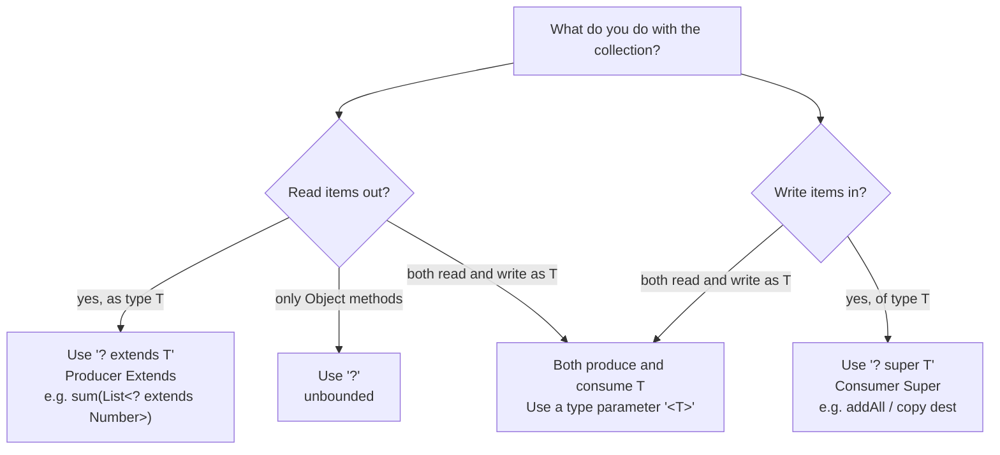
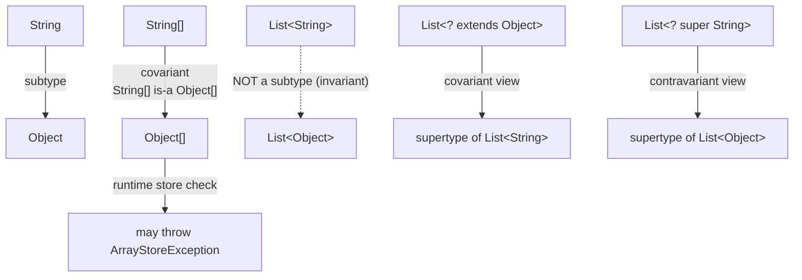
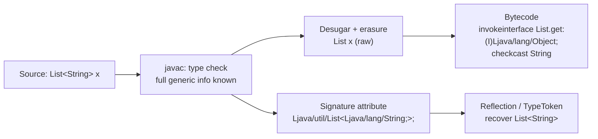
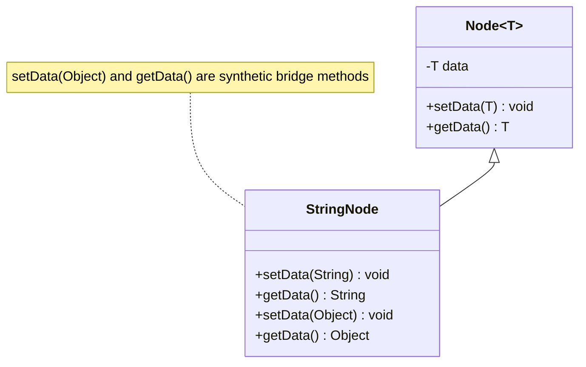

# Generics

Generics are Java's *compile-time* type-parameter mechanism. The mental model that unlocks every
interview question is this: **the compiler knows the type parameters, but the JVM does not.** All
type information lives in the compiler and in the class file's optional `Signature` attribute; at
the bytecode level the type parameters are **erased** and replaced by their bounds (or `Object`),
with `checkcast` instructions and **bridge methods** inserted to preserve run-time behavior.

Everything follows from that split:

- Safety and casts are a *compile-time* concern — the compiler rejects `List<String>.add(42)` and
  inserts the casts you used to write by hand.
- Because the JVM is type-erased, `List<String>` and `List<Integer>` are the same class at run time,
  which is exactly why generic arrays, `instanceof List<String>`, and `new T[]` are forbidden.
- Raw types reopen the hole erasure creates, so mixing them produces `ClassCastException` at a
  distance — the classic "heap pollution" story.

Read this module as: *why generics exist* → *declaring them* → *bounds* → *wildcards and variance*
→ *erasure and its consequences* → *bridge methods, heap pollution, raw types* → *inference* →
*traps and performance*. The internals (erasure, bridge methods, signatures) are what separate a
senior answer from a junior one.

---

## 1. Motivation: Compile-Time Type Safety, No Casts

Before Java 5 there were no generics; collections held `Object` and every retrieval needed a cast:

```java
// Pre-generics (Java 1.4) — compiles, fails at runtime
List list = new ArrayList();
list.add("hello");
list.add(Integer.valueOf(42));
String s = (String) list.get(1);   // ClassCastException at run time
```

The bug is not "a cast" — it is that the error is only discovered at run time, far from the code
that introduced it. Generics move that failure to compile time:

```java
List<String> list = new ArrayList<>();
list.add("hello");
// list.add(42);                    // compile error: incompatible types
String s = list.get(0);             // no cast needed; compiler inserts one
```

Four concrete benefits:

| Benefit | What it means |
|---|---|
| **Compile-time type safety** | Wrong element types are rejected by `javac`, not at runtime. |
| **No explicit casts** | The compiler inserts the necessary `checkcast` at the use site. |
| **Generic algorithms** | One implementation works for every element type (e.g. `List.sort`). |
| **Self-documenting APIs** | The signature `Map<String,List<Order>>` states the contract. |

> **Rule:** Generics are a *language/compiler* feature for static safety, not a runtime feature. The
> JVM has no idea a `List<String>` exists.

### The cost of the model

Because the JVM is erased, you cannot (a) ask a generic object for its type parameters at runtime,
(b) create a `new T[...]`, (c) overload on `List<String>` vs `List<Integer>`, or (d) catch `T`.
Each of these reappears later in this module with the workaround.

---

## 2. Generic Classes, Interfaces, Methods, Constructors

### 2.1 Generic classes

A **type parameter** is declared in angle brackets after the class name and is in scope for the
whole class body:

```java
public final class Box<T> {
    private T value;
    public Box(T value) { this.value = value; }
    public T get() { return value; }
    public void set(T value) { this.value = value; }
    public <R> Box<R> map(java.util.function.Function<? super T, ? extends R> f) {
        return new Box<>(f.apply(value));
    }

    public static void main(String[] args) {
        Box<String> b = new Box<>("hi");
        Box<Integer> n = b.map(String::length);
        System.out.println(b.get() + " / " + n.get());
    }
}
```

Output:

```text
hi / 2
```

Type parameters are **invariant** and **not inherited as concrete types**: `Box<String>` is not a
`Box<Object>`. A subclass can *bind* the parameter:

```java
class StringBox extends Box<String> {
    StringBox(String v) { super(v); }
}
```

### 2.2 Generic interfaces

```java
interface Mapper<A, B> { B map(A a); }

class Lengths implements Mapper<String, Integer> {
    public Integer map(String s) { return s.length(); }
}
```

`Comparable<E>`, `Comparator<T>`, `Iterable<T>`, `Function<T,R>`, `Supplier<T>`, `List<E>`,
`Map<K,V>` are all generic interfaces.

### 2.3 Generic methods

A method can introduce its own type parameter — declared **before the return type**:

```java
public class Utils {
    static <T> T first(java.util.List<T> list) { return list.get(0); }
    static <K, V> java.util.Map<V, K> invert(java.util.Map<K, V> in) {
        java.util.Map<V, K> out = new java.util.HashMap<>();
        in.forEach((k, v) -> out.put(v, k));
        return out;
    }
    public static void main(String[] args) {
        System.out.println(first(java.util.List.of("a", "b")));
        System.out.println(invert(java.util.Map.of("one", 1)));
    }
}
```

Output:

```text
a
{1=one}
```

The type parameter of a *method* is independent of any class type parameter, which is why generic
static methods can exist even when the enclosing class is non-generic.

### 2.4 Generic constructors

Constructors may declare their own type parameters. A constructor's parameter is in scope only
inside that constructor:

```java
class Holder {
    <T> Holder(T value) { System.out.println("Holder(" + value + ")"); }
}
// new Holder("generic ctor"); new Holder(42);
```

To *store* a constructor-inferred value you need the class parameter or a field of `Object`.
Note the erasure trap: a generic constructor can clash with the class's own erased constructor:

```java
class Pair<K, V> {
    Pair(K k, V v) { }
    // <X> Pair(K k, X x) { }   // ERROR: name clash: both erase to Pair(Object, Object)
}
```

Adding a *bound* changes the erased descriptor and removes the clash:

```java
class Pair<K, V> {
    Pair(K k, V v) { }
    <X extends Number> Pair(K k, X x) { }   // erases to (Object, Number) -> OK
}
```

### 2.5 Naming conventions (JLS §6.1, §6.4)

| Kind | Convention | Example |
|---|---|---|
| Type parameter | Single uppercase capital | `T`, `E`, `K`, `V`, `N`, `R` |
| Class parameter | `T` or a descriptive noun | `Box<T>`, `Result<T>` |
| Element / key / value | `E`, `K`, `V` | `List<E>`, `Map<K,V>` |
| Number / return / result | `N`, `R` | `Function<T,R>` |
| Method parameter | often `T` or descriptive | `<T> T id(T)` |

`K,V,E` are conventions, not rules. Do **not** use lowercase type parameters; they are legal but
unreadable.

---

## 3. Bounded Type Parameters

### 3.1 Single bound

`<T extends Number>` restricts `T` to `Number` or a subtype, letting the body call `Number`
methods:

```java
static double half(Number n) { return n.doubleValue() / 2; }
static <T extends Number> double sum(java.util.List<T> xs) {
    double s = 0;
    for (T x : xs) s += x.doubleValue();
    return s;
}
// sum(List.of(1, 2, 3)) -> 6.0
```

`extends` in a bound means "extends or implements" for interfaces too (there is no `implements`
keyword for bounds).

### 3.2 Multiple bounds and intersection types

Use `&` for multiple bounds; the **first may be a class**, the rest must be interfaces:

```java
static <T extends Number & Comparable<T>> boolean between(T lo, T mid, T hi) {
    return lo.compareTo(mid) <= 0 && mid.compareTo(hi) <= 0;
}
// between(1, 2, 3) -> true
// between(1.0, 2.5, 3.0) -> true
```

The type `Number & Comparable<T>` is an **intersection type**. It also appears in casts:

```java
Runnable r = (Runnable & java.io.Serializable) () -> {};
System.out.println(r instanceof Runnable);                 // true
System.out.println(r instanceof java.io.Serializable);     // true
```

> **Rule:** At most one class bound, and it must be first. `<T extends Comparable<T> & Number>` is
> a compile error because the class bound must lead.

### 3.3 Recursive / self-referential bounds (CRTP)

A bound may refer to the type parameter being declared. This is the "Curiously Recurring Template
Pattern" (CRTP) from C++, used to build fluent builders and type-safe comparables:

```java
class Builder<T extends Builder<T>> {
    String name = "";
    @SuppressWarnings("unchecked")
    final T self() { return (T) this; }
    T withName(String n) { this.name = n; return self(); }
}

class UserBuilder extends Builder<UserBuilder> {
    int age;
    UserBuilder withAge(int a) { this.age = a; return self(); }
}
// new UserBuilder().withName("bob").withAge(30)  -> fluent, age/name both reachable
```

### 3.4 `Enum<E extends Enum<E>>` — the canonical self-bound

`java.lang.Enum` is declared (verify with `javap java.lang.Enum`):

```text
public abstract class java.lang.Enum<E extends java.lang.Enum<E>>
        implements Constable, Comparable<E>, Serializable
```

`E` must be the enum type itself, so that `compareTo(E)` and `getDeclaringClass()` return the
concrete enum. This enables generic helpers over any enum:

```java
enum Color { RED, GREEN, BLUE }

static <E extends Enum<E>> java.util.Map<String, E> byName(Class<E> type) {
    java.util.Map<String, E> m = new java.util.LinkedHashMap<>();
    for (E e : type.getEnumConstants()) m.put(e.name(), e);
    return m;
}
// byName(Color.class).keySet() -> [RED, GREEN, BLUE]
// Enum.valueOf(Color.class, "GREEN") -> GREEN
```

### 3.5 Where `<T super ...>` is illegal

The `super` keyword is **only** legal in wildcards (`? super T`), never as a type-parameter bound:

```java
// class C<T super Number> {}      // ERROR: > expected / illegal
// static <T super Number> void f(){}  // ERROR
```

A type parameter can only have *upper* bounds. Lower bounds exist only as wildcards
(`List<? super Integer>`), which is the contravariant side of PECS.

---

## 4. Wildcards and PECS

A **wildcard** `?` stands for an unknown type argument. Three forms:

| Form | Name | Meaning |
|---|---|---|
| `?` | unbounded | any type |
| `? extends T` | upper-bounded | some unknown subtype of `T` (T included) |
| `? super T` | lower-bounded | some unknown supertype of `T` (T included) |

### 4.1 What you can do with each

```java
void use(java.util.List<? extends Number> pe,
         java.util.List<? super Integer> ps,
         java.util.List<?> u) {
    Number n = pe.get(0);   // READ as Number
    // pe.add(1);           // ERROR: cannot add (unknown subtype)
    pe.add(null);           // only null is allowed

    Object o = ps.get(0);   // READ as Object only
    ps.add(1);              // WRITE Integer (and subtypes)
    ps.add(null);

    Object x = u.get(0);    // READ as Object
    u.add(null);            // only null
    // u.add(1);            // ERROR
}
```

Compiler diagnostics for the illegal calls:

```text
error: incompatible types: int cannot be converted to CAP#1
        pe.add(1);
  where CAP#1 is a fresh type-variable:
    CAP#1 extends Number from capture of ? extends Number
```

> `CAP#1` is the **captured** type variable the compiler invents for a wildcard.

### 4.2 PECS — Producer Extends, Consumer Super

> A `? extends T` collection *produces* (you read `T` items out). A `? super T` collection
> *consumes* (you write `T` items in). If it does both, use a type parameter `<T>`.

```java
// Producer: reads numbers, never writes
static double sum(java.util.List<? extends Number> src) {
    double s = 0;
    for (Number n : src) s += n.doubleValue();
    return s;
}
// Consumer: writes integers, never reads usefully
static void addInts(java.util.List<? super Integer> dst, int... xs) {
    for (int x : xs) dst.add(x);
}

sum(java.util.List.of(1, 2, 3));            // 6.0
sum(java.util.List.of(1.5, 2.5));           // 4.0
java.util.List<Number> nums = new java.util.ArrayList<>();
addInts(nums, 1, 2, 3);                     // [1, 2, 3]
java.util.List<Object> objs = new java.util.ArrayList<>();
addInts(objs, 4, 5);                        // [4, 5]
```

The JDK itself encodes PECS: `Collections.copy(List<? super T> dest, List<? extends T> src)` and
`List.addAll(Collection<? extends E>)`.



### 4.3 Wildcards vs type parameters

Use a **type parameter** when the type appears more than once (relating inputs/outputs). Use a
**wildcard** when it appears once and callers should pass many instantiations:

```java
// BAD: restricts callers to a single T; List<Integer> vs List<Long> mismatch
static void printBad(java.util.List<Number> xs) { }
// GOOD: accepts List<Integer>, List<Double>, ...
static void printGood(java.util.List<? extends Number> xs) {
    xs.forEach(System.out::println);
}
```

> **Rule (Effective Java Item 31):** use wildcards for *input* parameters; use type parameters when
> the type must be named to tie arguments/results together.

### 4.4 Wildcard capture and the helper pattern

A wildcard is not a name, so you cannot swap two elements of a `List<?>` directly — each `get`
yields a *different* capture. The standard fix is a **capture helper**: a private generic method
with a named type parameter.

```java
static void swapFirstTwo(java.util.List<?> list) { helper(list); }
private static <T> void helper(java.util.List<T> list) {
    T tmp = list.get(0);
    list.set(0, list.get(1));
    list.set(1, tmp);
}
// List.of(1,2,3,4) -> [2, 1, 3, 4]
```

```java
static void reverse(java.util.List<?> list) { helperReverse(list); }
private static <T> void helperReverse(java.util.List<T> list) {
    for (int i = 0, j = list.size() - 1; i < j; i++, j--) {
        T tmp = list.get(i);
        list.set(i, list.get(j));
        list.set(j, tmp);
    }
}
// ["a","b","c"] -> [c, b, a]
```

`Collections.swap` and `Collections.reverse` are implemented exactly this way: the public method
takes `List<?>` and forwards to a `private static <T>` helper. This is called *capture conversion*;
the compiler renames the wildcard to a fresh `CAP#n` and exposes it as `T` inside the helper.

---

## 5. Invariance vs Covariance vs Contravariance

### 5.1 The definitions

- **Covariant**: `S <: T` implies `Box<S> <: Box<T>` (direction preserved).
- **Contravariant**: `S <: T` implies `Box<T> <: Box<S>` (direction reversed).
- **Invariant**: no such relationship.

Java generics are **invariant**; arrays are **covariant**.

```java
List<Integer> ints = new ArrayList<>();
// List<Number> nums = ints;             // ERROR: incompatible types
// error: ArrayList<Integer> cannot be converted to List<Number>
```

### 5.2 Why arrays are covariant and generics are not

Arrays were covariant before generics (Java 1.0) and pay for it with a runtime check:

```java
Object[] arr = new String[3];   // covariant reference: compiles
try {
    arr[0] = 42;                // Integer stored into String[] at runtime
} catch (ArrayStoreException e) {
    System.out.println("ArrayStoreException: " + e.getMessage());
}
```

Output:

```text
ArrayStoreException: java.lang.Integer
```

The JVM stores the *component type* of every array object and checks each store. Generics chose
the opposite trade-off: `List<Integer>` cannot become a `List<Number>` at compile time, so no
per-element check is ever needed, and no `ArrayStoreException` can occur through generics alone.



### 5.3 The variance table

| Relationship | Arrays | Generics |
|---|---|---|
| `String[]` → `Object[]` | allowed (covariant) | n/a |
| `List<String>` → `List<Object>` | — | **forbidden** (invariant) |
| `List<String>` → `List<? extends Object>` | — | allowed (covariant view) |
| `List<Object>` → `List<? super String>` | — | allowed (contravariant view) |
| Unsafe write detected | at runtime (`ArrayStoreException`) | at compile time |
| Runtime representation | keeps component type | erased |

---

## 6. Type Erasure In Depth

### 6.1 The erasure algorithm (JLS §4.6)

Type erasure maps a type to a non-generic type:

| Source | Erased to |
|---|---|
| Unbounded type parameter `T` | `Object` |
| Bound `T extends Number` | `Number` |
| Multiple bounds `T extends Number & Comparable<T>` | **leftmost** bound, `Number` |
| `List<T>` | `List` (raw) |
| `List<String>`, `List<Integer>` | `List` |
| Generic method `<T> T id(T)` | `Object id(Object)` |
| Generic method `<T extends Comparable<T>> T max(...)` | `Comparable max(...)` |
| `T[]` | `Object[]` (or bound array) |

Erasure is applied **after** type checking, immediately before bytecode generation. Everything the
compiler learned is discarded except:

- **Synthetic casts** (`checkcast`) at use sites,
- **Bridge methods** in subclasses/implementations,
- The optional **`Signature`** attribute on the class/method/field, which preserves the generic
  type *as a string* so reflection can recover it.

### 6.2 Erasure is real: same class at runtime

```java
import java.util.*;

public class Erasure {
    static class Box<T> {}
    public static void main(String[] args) {
        Box<Integer> a = new Box<>();
        Box<String> b = new Box<>();
        System.out.println(a.getClass() == b.getClass());   // true
        System.out.println(a.getClass().getName());         // Erasure$Box
        System.out.println(a instanceof Box);               // true (raw only)

        List<Integer> li = new ArrayList<>();
        List<String> ls = new ArrayList<>();
        System.out.println(li.getClass() == ls.getClass()); // true
        System.out.println(li.getClass().getName());        // java.util.ArrayList
    }
}
```

Output:

```text
true
Erasure$Box
true
true
java.util.ArrayList
```

### 6.3 Erasure of a generic method, shown with `javap`

Source:

```java
public class GenMethodErasure {
    static <T extends Number> void lim(T t) {}
    static <T> T id(T t) { return t; }
    static <T extends Comparable<T>> T pick(T a, T b) { return a; }

    public static void main(String[] args) {
        lim(1);
        lim(1.0);
        System.out.println(id("x"));
        System.out.println(pick("a", "b"));
    }
}
```

`javap -c -p GenMethodErasure` (abridged):

```text
static <T extends java.lang.Number> void lim(T);
    Code: 0: return

static <T> T id(T);
    Code: 0: aload_0
          1: areturn

static <T extends java.lang.Comparable<T>> T pick(T, T);
    Code: 0: aload_0
          1: areturn

public static void main(java.lang.String[]);
    ...
       4: invokestatic  lim:(Ljava/lang/Number;)V          // T -> Number
      19: invokestatic  id:(Ljava/lang/Object;)Ljava/lang/Object;  // T -> Object
      22: checkcast     class java/lang/String               // compiler-inserted cast
      35: invokestatic  pick:(Ljava/lang/Comparable;Ljava/lang/Comparable;)Ljava/lang/Comparable;
      38: checkcast     class java/lang/String
```

Note: after erasure the methods print `<T ...>` in `javap` because the `Signature` attribute is
kept, but the **descriptors** in the `invokestatic` comments are the erased ones (`Number`,
`Object`, `Comparable`).

### 6.4 Bounded erasure inserts `checkcast` for non-leftmost bounds

For `<T extends Number & Comparable<T>>`, the leftmost bound `Number` is used and a cast to
`Comparable` is inserted where the second bound's methods are needed:

```java
static class Pair<T extends Number & Comparable<T>> {
    final T a, b;
    Pair(T a, T b) { this.a = a; this.b = b; }
    T max() { return a.compareTo(b) >= 0 ? a : b; }
}
```

`javap -c -p BoundedErasure$Pair` (abridged):

```text
BoundedErasure$Pair<T extends java.lang.Number & java.lang.Comparable<T>>;
  final T a;   // Field a:Ljava/lang/Number;
  final T b;   // Field b:Ljava/lang/Number;

  T max();
       1: getfield a:Ljava/lang/Number;
       4: checkcast class java/lang/Comparable      // second bound
      11: invokeinterface Comparable.compareTo:(Ljava/lang/Object;)I
```

Fields are `Number`; the `checkcast Comparable` exists only because `Number` has no `compareTo`.

### 6.5 What erasure forbids

```java
// 1) Cannot create a generic array (not reifiable)
// static <T> T[] make() { return new T[10]; }        // error: generic array creation
// static List<String>[] la() { return new List<String>[10]; }  // error

// 2) Wildcard arrays ARE allowed (reifiable)
static List<?>[] lb() { return new List<?>[10]; }      // OK

// 3) instanceof cannot test type arguments
// if (l instanceof List<String>) { }                  // error: cannot be safely cast

// 4) A class type parameter is not available in static context
class C<T> { /* static T x; */ }                       // error: non-static type variable T

// 5) No generic exception classes
// class E<T> extends Exception { }                    // error: generic class may not extend Throwable

// 6) Cannot catch a type parameter
// static <T extends Exception> void f() { try {} catch (T e) {} }  // error: unexpected type
```

Exact diagnostics:

```text
error: generic array creation
    static <T> T[] make() { return new T[10]; }
error: List<CAP#1> cannot be safely cast to List<String>
        if (l instanceof List<String>) { }
error: non-static type variable T cannot be referenced from a static context
error: a generic class may not extend java.lang.Throwable
error: unexpected type
        try { } catch (T e) { }
  required: class
  found:    type parameter T
```

> **"Reifiable"** = a type whose runtime representation carries no erased type arguments.
> Primitives, raw types, non-generic classes, unbounded wildcards, and arrays of reifiable types
> are reifiable. `List<String>`, `T`, and `List<? extends Number>` are *not*.

### 6.6 `Class<T>` token pattern

When you need the runtime type — e.g. to allocate an array — pass a `Class<T>` token:

```java
static <T> T[] newArray(Class<T> type, int n) {
    @SuppressWarnings("unchecked")
    T[] arr = (T[]) java.lang.reflect.Array.newInstance(type, n);
    return arr;
}
// String[] arr = newArray(String.class, 3);  -> [Ljava.lang.String;
```

This is exactly what `Collection.toArray(T[])`, `EnumSet.noneOf(Class<E>)`, and
`Enum.valueOf(Class<T>, String)` do.

### 6.7 Super type tokens (`TypeToken`)

`Class<T>` cannot express `List<String>` (a parameterized type). A **super type token** captures it
by subclassing an anonymous/abstract class with the parameterized type, then reading the
`Signature` through reflection:

```java
import java.lang.reflect.*;
import java.util.*;

public abstract class TypeToken<T> {
    private final Type type;
    protected TypeToken() {
        this.type = ((ParameterizedType) getClass().getGenericSuperclass())
                        .getActualTypeArguments()[0];
    }
    public Type type() { return type; }
    public Class<?> raw() {
        Type t = type;
        while (t instanceof ParameterizedType pt) t = pt.getRawType();
        return (Class<?>) t;
    }

    static class StringList extends TypeToken<List<String>> { }

    public static void main(String[] args) {
        TypeToken<List<String>> t = new StringList();
        System.out.println(t.type());                  // java.util.List<java.lang.String>
        System.out.println(t.raw());                   // interface java.util.List
        System.out.println(t.type() instanceof ParameterizedType); // true
    }
}
```

Output:

```text
java.util.List<java.lang.String>
interface java.util.List
true
```

Gson's `TypeToken` and Jackson's `TypeReference` are production versions of this pattern; they
memorialize the erased type in a subclass's `Signature` and read it back.



### 6.8 Reflection of generic types (brief)

The `java.lang.reflect` API exposes what `Signature` records: `ParameterizedType`,
`TypeVariable<D>`, `GenericArrayType`, `WildcardType`, `GenericDeclaration`, plus
`Class.getTypeParameters()`, `getGenericSuperclass()`, `getGenericInterfaces()`,
`Method.getGenericParameterTypes()`, and `Field.getGenericType()`. This is covered in depth in
[Reflection](../06-Reflection/27-Reflection.md); here it is enough to know it exists and that it is
the only way to read generic intent back.

---

## 7. Bridge Methods and Synthetic Methods

### 7.1 The problem erasure creates for overriding

Consider:

```java
class Node<T> {
    private T data;
    public void setData(T data) { this.data = data; }
    public T getData() { return data; }
}
class StringNode extends Node<String> {
    @Override public void setData(String data) { super.setData(data); }
    @Override public String getData() { return super.getData(); }
}
```

After erasure `Node` has `void setData(Object)` and `Object getData()`. `StringNode` has
`void setData(String)` and `String getData()` — these **do not override** the erased methods
(different parameter/return types). Yet this must work:

```java
Node<String> n = new StringNode();
n.setData("hello");      // must call StringNode.setData
System.out.println(n.getData());  // must return String
```

Output:

```text
hello
hello
```

### 7.2 The fix: bridge methods

`javac` generates synthetic bridge methods in `StringNode`:

```text
public java.lang.Object getData();
    flags: (0x1041) ACC_PUBLIC, ACC_BRIDGE, ACC_SYNTHETIC
    Code: 0: aload_0
          1: invokevirtual getData:()Ljava/lang/String;   // delegates to real one
          4: areturn

public void setData(java.lang.Object);
    flags: (0x1041) ACC_PUBLIC, ACC_BRIDGE, ACC_SYNTHETIC
    Code: 0: aload_0
          1: aload_1
          2: checkcast class java/lang/String           // narrow Object back to String
          5: invokevirtual setData:(Ljava/lang/String;)V
          8: return
```

`javap -c -p Bridge$StringNode` (methods):

```text
class Bridge$StringNode extends Bridge$Node<java.lang.String> {
  public void setData(java.lang.String);
       2: invokespecial Bridge$Node.setData:(Ljava/lang/Object;)V

  public java.lang.String getData();
       1: invokespecial Bridge$Node.getData:()Ljava/lang/Object;
       4: checkcast class java/lang/String
       7: areturn

  public java.lang.Object getData();          // BRIDGE
       1: invokevirtual getData:()Ljava/lang/String;
       4: areturn

  public void setData(java.lang.Object);      // BRIDGE
       2: checkcast class java/lang/String
       5: invokevirtual setData:(Ljava/lang/String;)V
       8: return
}
```

So the `Object` method from the superclass dispatches to the `String` method. `getData()` the
bridge delegates; `setData` the bridge checks the incoming `Object` **is** a `String` before
delegating — that `checkcast` is a real runtime cost and the source of `ClassCastException` when
raw types are used.

### 7.3 Covariant returns and JDK bridges

Bridge methods also appear for covariant return types (since Java 5) and in the JDK itself. For
example `java.lang.Enum` implements `Comparable<E>`, so its `compareTo(E)` gets a
`compareTo(Object)` bridge:

```text
public final int compareTo(E);
public int compareTo(java.lang.Object);    // bridge, ACC_BRIDGE + ACC_SYNTHETIC
```

> **Bridges are invisible to source code but visible to reflection** (`Method.isBridge()`,
> `isSynthetic()`) and to `javap`. They account for the "extra" methods you may see on a generic
> subclass.



---

## 8. Heap Pollution, Unchecked Warnings, `@SafeVarargs`

### 8.1 Heap pollution

**Heap pollution** is when a variable of a parameterized type refers to an object that is not of
that type. It cannot happen without an unchecked operation (raw types, unchecked casts, or generic
varargs). It surfaces later as `ClassCastException`:

```java
@SuppressWarnings("unchecked")
static <T> List<T> cast(List<?> l) { return (List<T>) l; }  // unchecked cast

List<Integer> ints = List.of(1, 2, 3);
List<String> strs = cast(ints);      // heap pollution, no error yet
System.out.println(strs.size());     // 3
String s = strs.get(0);              // checkcast String -> ClassCastException
```

Output:

```text
3
Exception in thread "main" java.lang.ClassCastException: class java.lang.Integer
    cannot be cast to class java.lang.String
```

### 8.2 Unchecked warnings

`javac -Xlint:unchecked` reports the exact operations that can pollute the heap:

```java
static List<String>[] makeArray() { return new List[0]; }        // unchecked conversion
static <T> List<T> cast(Object o) { return (List<T>) o; }        // unchecked cast
List raw = new ArrayList(); raw.add("a");                        // unchecked call to add(E)
List<String> typed = raw;                                        // unchecked conversion
```

```text
warning: [unchecked] unchecked conversion
    static List<String>[] makeArray() { return new List[0]; }
  required: List<String>[]
  found:    List[]
warning: [unchecked] unchecked cast
    static <T> List<T> cast(Object o) { return (List<T>) o; }
warning: [unchecked] unchecked call to add(E) as a member of the raw type List
        raw.add("a");
warning: [unchecked] unchecked conversion
        List<String> typed = raw;
```

> An *unchecked* warning means "the normal type-safety guarantee does not apply here". Every such
> warning is a place where `ClassCastException` may appear somewhere else.

### 8.3 Generic varargs internals

A varargs parameter `T...` is compiled to `T[]`. Since `T[]` is not reifiable, the compiler:

1. Creates an array of the **erased** component type — for unbounded `T` that is `Object[]`.
2. Passes it as the array.
3. Emits a warning (`Possible heap pollution`) unless the method is annotated `@SafeVarargs`.

```java
static <T> List<T> of(T... xs) { return Arrays.asList(xs); }
```

```text
warning: [unchecked] Possible heap pollution from parameterized vararg type T
    static <T> List<T> of(T... xs) { ... }
```

The danger is passing a caller-provided array whose runtime type is more specific than `Object[]`:

```java
// If a method stores a String[] into the varargs array and the caller passed Integer[],
// the runtime store fails with ArrayStoreException — the classic pair-swap heap pollution.
```

### 8.4 `@SafeVarargs` rules (JLS §9.6.4.7)

`@SafeVarargs` suppresses the warning and is a **promise** that the method does not store anything
into the varargs array. It is legal only on:

| Target | Allowed since |
|---|---|
| `static` methods | Java 7 |
| `final` instance methods | Java 7 |
| Constructors | Java 9 |
| `private` instance methods | Java 9 |

```java
@SafeVarargs static <T> List<T> stat(T... xs) { return List.of(xs); }
@SafeVarargs final <T> List<T> fin(T... xs) { return List.of(xs); }
@SafeVarargs private <T> List<T> priv(T... xs) { return List.of(xs); }

// @SafeVarargs <T> List<T> notAllowed(T... xs) { ... }
//   error: Invalid SafeVarargs annotation. Instance method is neither final nor private.
```

> **When it is truly safe:** you only *read* the array (forward it, iterate, copy out). If you ever
> *write* into it or expose it, do not annotate — the pollution is real.

### 8.5 `@SuppressWarnings`

`@SuppressWarnings("unchecked")` is the escape hatch when you have proven safety. Scope it as
tightly as possible — on a local variable or a single method, never on a whole class:

```java
Map<String, List<String>> m = new HashMap<>();
@SuppressWarnings("unchecked")
List<String> v = (List<String>) (List<?>) m.computeIfAbsent("k", k -> new ArrayList<>());
```

Widely used values: `"unchecked"`, `"rawtypes"`, `"deprecation"`, `"removal"`, `"cast"`
(`@SuppressWarnings({"unchecked", "rawtypes"})`).

---

## 9. Raw Types

The **raw type** of `List<E>` is `List`. Using it disables generic checking and triggers unchecked
warnings. Raw types exist for backward compatibility with pre-Java-5 code and for class literals
and reflection (`List.class`, `Class<List>`).

```java
@SuppressWarnings({"rawtypes", "unchecked"})
public static void main(String[] args) {
    List<String> strings = new ArrayList<>();
    strings.add("a");
    List raw = strings;      // raw reference to the SAME object
    raw.add(42);             // accepted silently
    System.out.println(strings);         // [a, 42]
    String s = strings.get(1);           // implicit checkcast -> ClassCastException
}
```

Output:

```text
[a, 42]
Exception in thread "main" java.lang.ClassCastException: class java.lang.Integer
    cannot be cast to class java.lang.String
```

Behavior notes:

- You may assign a parameterized type to a raw type (always allowed, unchecked warning on the
  reverse).
- Operations on a raw type erase all type parameters, including those of *methods* that then
  return `Object` (so `raw.get(0)` returns `Object`).
- Mixing raw and parameterized types in the same expression ("raw soup") can make the compiler
  drop checks across an entire statement — the worst kind of unchecked behavior.
- `List<?>` is **not** a raw type: it is safe, checked, and only forbids adding non-null elements.

---

## 10. Generic Inheritance and Type Inference

### 10.1 The diamond operator and target typing

Java 7 added the diamond `<>`: infer the constructor's type arguments from the target type.

```java
Map<String, List<Integer>> m = new HashMap<>();     // Java 7+
```

Java 9 extended the diamond to **anonymous classes** (but not to anonymous classes whose inferred
type is itself anonymous — the class body may not refer to the inferred parameter):

```java
Comparator2<String> cmp = new Comparator2<>() {
    @Override public int compare(String a, String b) { return a.compareTo(b); }
};
// cmp.compare("a", "b") -> -1
```

> The **target type** is the type the expression is expected to have (assignment, argument,
> return). Inference uses it. `Collections.emptyList()` becomes `List<String>` when the target is
> `List<String>`, but `List<Object>` when assigned to `var` (no target).

```java
var list1 = Collections.emptyList();          // inferred List<Object>
List<String> list2 = Collections.emptyList(); // target-typed List<String>
// list2.add("x") compiles; both are the same java.util.Collections$EmptyList class
```

### 10.2 Inference with method arguments

Type arguments are inferred from actual arguments and the target type. Explicit arguments
(`Collections.<String>emptyList()`, `Utils.<Integer>first(...)`) are a fallback when inference
fails or the desired type is ambiguous.

```java
static <T> List<T> singleton(T t) { return List.of(t); }
static <T> void copy(List<? super T> dst, List<? extends T> src) {
    for (T t : src) dst.add(t);
}

singleton("hi");                       // T = String
Inference.<Integer>singleton(5);       // T = Integer (explicit)

List<Object> dst = new ArrayList<>();
copy(dst, List.of("a", "b"));          // T inferred as String -> [a, b]
List<Number> nums = new ArrayList<>();
copy(nums, List.of(1, 2, 3));          // T inferred as Integer -> [1, 2, 3]
```

### 10.3 Inference failure messages

Two common failures and what they look like:

```java
static <T> T id(T t) { return t; }
// var x = id();     // cannot infer T
```

```text
error: method id in class InfFail cannot be applied to given types;
  required: T
  found:    no arguments
  reason: cannot infer type-variable(s) T
```

Conflicting arguments produce an *equality-constraint* failure:

```java
static <T> List<T> merge(List<T> x, List<T> y) { return x; }
List<String> a = new ArrayList<>();
List<Integer> b = new ArrayList<>();
List<String> c = merge(a, b);
```

```text
error: inference variable T has incompatible equality constraints Integer,String
  where T is a type-variable:
    T extends Object declared in method <T>merge(List<T>,List<T>)
```

### 10.4 `var` and generics (Java 10+)

`var` infers the *static* type from the initializer, so generic types are fully inferred:

```java
var list = new ArrayList<String>();   // ArrayList<String>
var map  = new HashMap<String, List<Integer>>();
var max  = Collections.max(List.of(3, 9, 1));   // Integer
// var empty = Collections.emptyList();          // List<Object>, not List<?>
```

> `var` is **not** dynamic typing and cannot be used for fields, parameters, or return types.

---

## 11. Generics with `Comparable`, `Comparator`, and Enums

### 11.1 `Comparable<T>` and `Comparator<T>`

`Comparable<T>` makes a type self-comparable; `Comparator<T>` is an external ordering. Both
leverage bounds with wildcards in the JDK signatures:

```text
public static <T extends Comparable<? super T>> T max(Collection<? extends T>)
public static <T> T max(Collection<? extends T>, Comparator<? super T>)
```

The `? super T` on the comparator lets a `Comparator<Object>` order a `List<String>`:

```java
static <T extends Comparable<? super T>> T maxViaComparator(List<T> list) {
    return Collections.max(list);
}
// maxViaComparator(List.of("a", "c", "b")) -> c
// Collections.max(List.of(3, 9, 1))         -> 9
```

```java
Comparator<Person> byAge = Comparator.comparingInt(p -> p.age);
sorted.sort(byAge);                        // [al(25), bob(30), cy(40)]
Comparator<Person> byName = Comparator.comparing(p -> p.name);
people.stream().max(byName).orElseThrow(); // cy(40)
```

> **Why `Comparable<? super T>` and not `Comparable<T>`?** A subtype may inherit comparison from a
> supertype (e.g. `java.sql.Timestamp extends java.util.Date implements Comparable<Date>`), so the
> looser `? super T` is required for `Collections.max` to compile against it.

### 11.2 Generic enums

Every enum implicitly extends `Enum<E extends Enum<E>>` and implements `Comparable<E>`. You can
write `Enum<E>`-bounded helpers:

```java
enum Color { RED, GREEN, BLUE }

static <E extends Enum<E>> E parse(Class<E> type, String name) {
    return Enum.valueOf(type, name);
}
// parse(Color.class, "GREEN") -> GREEN
// Color.RED.compareTo(Color.BLUE) -> -2
// Color.RED instanceof Enum -> true
```

`EnumSet<E extends Enum<E>>` and `EnumMap<K extends Enum<K>, V>` are the collections built on this
bound (see [Collections Part 1](../02-Collections/08-Collections-Part-1.md)).

### 11.3 Generic arrays pitfalls

You cannot create generic arrays because they are not reifiable. Three workarounds, each with a
trade-off:

```java
// 1) Object[] cast (unchecked; may fail on use)
@SuppressWarnings("unchecked")
static <T> T[] arrayOf(int n) { return (T[]) new Object[n]; }

// 2) Class<T> token (safe, needs the caller to supply the type)
static <T> T[] newArray(Class<T> type, int n) {
    @SuppressWarnings("unchecked")
    T[] a = (T[]) java.lang.reflect.Array.newInstance(type, n);
    return a;
}

// 3) Use a collection (List<T>) instead of an array
List<T> list = new ArrayList<>();
```

Workaround 1 is dangerous: `String[] s = arrayOf(3)` fails at the *use* site because the actual
array is `Object[]`. Workaround 2 is what the JDK uses.

### 11.4 `toArray` and the "array of T" idiom

`Collection.toArray(T[])` is a generic method on a generic interface with a subtle contract:

```java
List<String> list = List.of("a", "b", "c");
Object[] a = list.toArray();               // [Ljava.lang.Object;
String[] b = list.toArray(new String[0]);  // [Ljava.lang.String;
String[] big = new String[5];
String[] d = list.toArray(big);            // reuses big: [a, b, c, null, null]
```

Passing `new T[0]` is correct and lets the collection allocate an array of the right size.
Passing a wrongly-typed array compiles (`T` is inferred independently) but fails at runtime:

```java
list.toArray(new Integer[0]);   // ArrayStoreException
```

---

## 12. Generics vs C++ Templates; and `List<?>` vs `List<Object>` vs raw `List`

### 12.1 Java generics vs C++ templates

| Axis | Java generics | C++ templates |
|---|---|---|
| Instantiation | **Erased**: one class, one method | **Monomorphized**: one copy per instantiation |
| Code size / binary | Small, shared | Larger (code bloat) |
| Runtime type info | Erased (only `Signature`) | Full, available |
| Primitive types | Boxing required (`List<int>` illegal) | `vector<int>` native |
| Constraints | Bounds (`extends`) | Concepts / SFINAE |
| Compilation model | Separate (`javac` per file) | Header-only instantiation |
| `new T[]` / `T` value | Forbidden / cannot `new T()` | Allowed |
| Metaprogramming | Not supported (patterns, lambdas) | TMP, `constexpr`, type traits |
| Safety | Type-erased soundness; unchecked only via raw types | Templates can produce inscrutable errors |
| Demand loading | Lazy class loading | Compile-time generated |

The central difference: **erasure keeps one runtime class; templates keep the runtime types and pay
with duplicated code.** Java gains small binaries and shared code; C++ gains zero-overhead
specialization.

### 12.2 `List<?>` vs `List<Object>` vs raw `List`

| Operation | `List<?>` | `List<Object>` | raw `List` |
|---|---|---|---|
| `get(i)` returns | `Object` | `Object` | `Object` |
| `add("x")` | **no** (only `null`) | yes | yes, unchecked warning |
| `add(42)` | no | yes | yes, unchecked warning |
| `size()` / `clear()` / `remove` | yes | yes | yes |
| Type-safe? | yes | yes | **no** (unchecked) |
| Accepts `List<String>`? | yes | **no** | yes |
| `instanceof List` | yes | yes | yes |
| Typical use | read-only any list | list of truly anything | legacy / class literals |

> **Rule:** Prefer `List<?>` for "read anything" parameters, `List<Object>` only when you genuinely
> need to store arbitrary objects, and never raw `List` in new code.

---

## 13. Common Mistakes and Interview Traps

### 13.1 Adding through an upper-bounded wildcard

```java
static void bad(List<? extends Number> xs) { /* xs.add(1); */ } // ERROR
static void goodNumber(Number n, List<Number> xs) { xs.add(n); } // name the type
```

You cannot add a non-null value to `? extends` because the compiler cannot know the actual type
argument. Use a type parameter or a lower-bounded wildcard.

### 13.2 `Arrays.asList` is not `List.of`

| Feature | `Arrays.asList(...)` | `List.of(...)` |
|---|---|---|
| Backing | the passed array (a *view*) | immutable copy |
| `set` | allowed | `UnsupportedOperationException` |
| `add`/`remove` | `UnsupportedOperationException` | `UnsupportedOperationException` |
| Nulls | allowed | rejected (`add` throws, but `contains(null)` throws too) |
| Size | fixed | fixed |
| `Arrays.asList(int[])` | `List<int[]>` of size 1 (!) | no primitive overload |

```java
List<Integer> list = Arrays.asList(1, 2, 3);
list.getClass().getName();   // java.util.Arrays$ArrayList
list.set(0, 99);             // [99, 2, 3]
list.add(4);                 // UnsupportedOperationException

String[] arr = {"x", "y"};
List<String> view = Arrays.asList(arr);
arr[0] = "Z";
// view is now [Z, y]: the list is a live view over the array

Arrays.asList(new int[]{1,2,3}).size();  // 1 — a single int[] element, not 3
```

### 13.3 The `List<int[]>` trap

`Arrays.asList(1, 2, 3)` with a real `int[]` variable (not literals) returns `List<int[]>` of size
1, because arrays are objects and varargs only boxes when the *declared* type calls for it:

```java
int[] data = {1, 2, 3};
List<int[]> one = Arrays.asList(data);   // size 1, element = data
List<Integer> three = Arrays.asList(1, 2, 3); // literals -> varargs Integer...
```

### 13.4 Generic method shadows class parameter

```java
class C<T> {
    <T> void f(T t) { }   // the method's T hides the class's T
}
```

This is legal but confusing; the method's `T` wins inside `f`.

### 13.5 Cannot catch or throw only the type parameter

`throw new T()` is illegal; `catch (T e)` is illegal. Use a `Supplier<X extends Exception>` or a
factory.

### 13.6 `@SafeVarargs` used to silence a real problem

Do not annotate a method that stores into or returns the varargs array. That trades a warning for a
latent `ArrayStoreException`/`ClassCastException`.

### 13.7 Overloading on erased signatures

```java
void f(List<String> xs) { }
// void f(List<Integer> xs) { }   // ERROR: same erasure List
```

### 13.8 `NullPointerException` from immutable collections

`List.of("a").contains(null)`, `Map.of().get(null)` throw NPE; `Arrays.asList("a", null).contains(null)`
returns `true`. Immutable collections reject null *arguments*.

---

## 14. Performance Implications

| Aspect | Effect |
|---|---|
| **Class footprint** | Erasure means one class/method serves all type arguments — small binaries, no monomorphization bloat. |
| **Runtime checks** | Compiler-inserted `checkcast` at use sites; usually free after JIT, but present in interpreter/first passes. |
| **Bridge methods** | Add a virtual call plus (for setters) a `checkcast`; the JIT inlines them, so cost is one extra frame in cold code. `Method.isBridge()` can even cause a method to look "different" to reflection-based frameworks. |
| **Boxing** | `List<Integer>` stores heap `Integer` objects; `List<int>` is illegal. Primitive-heavy code pays allocation/cache misses. |
| **Megamorphic dispatch** | A bridge plus normal override can make a call site bimorphic/megamorphic, defeating some inline caches. Rarely significant. |
| **Startup / memory** | No run-time type tables for parameters beyond the `Signature` string; negligible. |
| **Array covariance** | Every array store is checked; generic arrays avoid this but are illegal. |
| **Lambdas/method refs** | Generic functional interfaces (`Function<T,R>`) are erased to `Function`; `invokedynamic` bootstraps target them efficiently (see [Lambda](../03-Functional/12-Lambda.md)). |

> Generics are almost always a *zero or negative-cost abstraction* relative to manual
> `Object`+cast code: the cast moved to the compiler but is the same bytecode you would have
> written. The only real costs are **boxing** and the rare **bridge-method** dispatch.

---

## 15. Best Practices

- Prefer **interfaces + bounds** over raw types; never use raw `List` in new APIs.
- Use **`? extends T` for producers, `? super T` for consumers** (PECS); use `<T>` when relating
  multiple parameters.
- Name the actual type parameter when callers must pass a homogeneous type; use wildcards only for
  flexibility.
- Keep **`@SuppressWarnings` scopes minimal** and always explain (in a comment) why the operation
  is safe.
- Use `@SafeVarargs` **only** when the method never writes to or escapes the array.
- Prefer **`List` over arrays** for generic elements; if you need an array, use `toArray(new T[0])`
  or a `Class<T>` token.
- Prefer **`List.of` / `Map.of`** for immutable literals; remember the null-hostile semantics.
- Beware **`Arrays.asList`** for primitives (`List<int[]>`) and its fixed-size view.
- Declare bounds the **loosest that works** (`Comparable<? super T>`, not `Comparable<T>`) so
  callers' types fit.
- Do not use generics for **runtime type discrimination** — that is what `Class<T>` tokens and
  reflection are for.

---

## Cross-links

- [Java Fundamentals](01-Java-Fundamentals.md) — the object model generics build on.
- [OOP Concepts](02-OOP-Concepts.md) — overriding, covariance, and polymorphism behind bridges.
- [Exception Handling](06-Exception-Handling.md) — why generic exception classes are illegal.
- [Collections Part 1](../02-Collections/08-Collections-Part-1.md) and
  [Part 2](../02-Collections/09-Collections-Part-2.md) — the generic collection APIs.
- [HashMap Internals](../02-Collections/10-HashMap-Internals.md) — erased `Node<K,V>` in practice.
- [Lambda](../03-Functional/12-Lambda.md) / [Streams](../03-Functional/13-Streams.md) —
  generic functional interfaces and `invokedynamic`.
- [Reflection](../06-Reflection/27-Reflection.md) — reading `Signature`/`ParameterizedType`.
- [Records](../07-Modern-Java/32-Records.md) — `record` type parameters (module 32).
- [Bytecode](../08-Advanced/44-Bytecode.md) — `checkcast`, `Signature`, bridge flags.
- [Java 5](../09-Version-History/46-Java-5.md) — generics introduced;
  [Java 7](../09-Version-History/48-Java-7.md) diamond; [Java 9](../09-Version-History/50-Java-9.md)
  diamond-anonymous and `@SafeVarargs` on private/constructors.

---

# Interview Questions

## Beginner

**Q:** What problem do generics solve?

**A:** They move type errors from run time to compile time and remove manual casts. Before generics
a `List` held `Object`, so `(String) list.get(i)` could throw `ClassCastException` far from the bug.
With `List<String>` the compiler rejects `list.add(42)` and inserts the `checkcast` itself.

**Q:** Are `List<String>` and `List<Integer>` different types at run time?

**A:** No. Due to type erasure both erase to the raw class `java.util.ArrayList` (or `List`), so
`new ArrayList<String>().getClass() == new ArrayList<Integer>().getClass()` is `true`. All type
information is compile-time only; only the optional `Signature` attribute preserves it for
reflection.

**Q:** What is a type parameter and where can it be declared?

**A:** A type parameter is a placeholder type declared in angle brackets. It can be declared on a
**class** (`class Box<T>`), an **interface** (`interface Mapper<A,B>`), a **method**
(`static <T> T id(T t)`), or a **constructor** (`<T> Holder(T t)`). Class parameters cannot be used
in static context.

**Q:** What is the diamond operator?

**A:** The `<>` introduced in Java 7 lets the compiler infer constructor type arguments from the
target: `Map<String,List<Integer>> m = new HashMap<>();`. Java 9 extended it to anonymous classes.

**Q:** What are the conventional type-parameter names?

**A:** `T` (type), `E` (element), `K`/`V` (key/value), `N` (number), `R` (result). They are
conventions, not keywords.

**Q:** What does `List<?>` mean?

**A:** A list of some unknown type. You can read elements as `Object`, call `size()`, `remove()`,
`clear()`, and add `null`, but you cannot add a non-null value. It is the safe, checked alternative
to a raw `List`.

**Q:** Difference between `List<?>` and `List<Object>`?

**A:** `List<Object>` is a list you may store any object in; `List<?>` is a read-only view of some
unknown element type. `List<String>` is assignable to `List<?>` but not to `List<Object>`.

**Q:** Can you create `new T[10]`?

**A:** No. `T` is not reifiable, so generic array creation is a compile error
(`error: generic array creation`). Use a `List<T>` or an `Array.newInstance(Class<T>, n)` token.

**Q:** What is a raw type and why does it exist?

**A:** A raw type is a generic type used without type arguments (`List`). It exists for backward
compatibility with pre-Java-5 code and for class literals/reflection. It disables checking and
produces unchecked warnings.

**Q:** What does `T extends Number` mean as a bound?

**A:** It restricts `T` to `Number` or a subtype and lets the body call `Number` methods. The
erasure of `T` becomes `Number`. `extends` is used for interface bounds too.

## Intermediate

**Q:** Explain PECS with an example.

**A:** Producer Extends, Consumer Super. A `List<? extends Number>` produces numbers (you can
`get` a `Number`) but you cannot `add`. A `List<? super Integer>` consumes integers (you can
`add(1)`) but `get` returns only `Object`. Method `sum(List<? extends Number>)` reads; method
`copy(List<? super T> dst, List<? extends T> src)` reads from src and writes to dst.

**Q:** Why is `List<Integer>` not a `List<Number>` when arrays are covariant?

**A:** Generics are invariant for safety. If `List<Integer>` were a `List<Number>`, you could
`add(3.14)` through the `Number` reference and break the list. Arrays are covariant for historical
reasons and compensate with a runtime `ArrayStoreException` check on every store. Generics chose
compile-time rejection over runtime checks.

**Q:** What is type erasure and what exactly is erased?

**A:** Erasure replaces type parameters with their leftmost bound or `Object`, replaces
parameterized types with raw types, inserts casts, and generates bridges. `T` → `Object`,
`T extends Number` → `Number`, `T extends Number & Comparable<T>` → `Number`,
`List<String>` → `List`, `<T> T id(T)` → `Object id(Object)`.

**Q:** What are the limits of erasure?

**A:** No `new T[]`, no `instanceof List<String>`, no `new T()`, no generic exception classes, no
catching `T`, no overloading on erased signatures, and class type parameters unavailable in static
contexts. Workarounds: `Class<T>` tokens, `Array.newInstance`, factories/`Supplier`.

**Q:** What is a bridge method and why does it exist?

**A:** When a subclass binds a type argument (`StringNode extends Node<String>`) and overrides,
the erased signatures differ (`setData(String)` vs `setData(Object)`), so it would not override.
The compiler synthesizes a bridge `setData(Object)` (`ACC_BRIDGE`, `ACC_SYNTHETIC`) that casts and
delegates to the real method, preserving polymorphism.

**Q:** How do you show bridge methods?

**A:** `javap -c -p 'Bridge$StringNode.class'` lists both the real methods and the bridge methods,
whose flags are `(0x1041) ACC_PUBLIC, ACC_BRIDGE, ACC_SYNTHETIC`. At runtime
`Method.isBridge()` returns true.

**Q:** What is heap pollution?

**A:** A parameterized variable referencing an object that is not of that type, caused by an
unchecked operation (raw type, unchecked cast, generic varargs). It surfaces later as
`ClassCastException` at a `checkcast` inserted elsewhere.

**Q:** What are the rules for `@SafeVarargs`?

**A:** Legal only on static methods, final instance methods, private instance methods (Java 9+), and
constructors (Java 9+). It promises the method does not write to or escape the varargs array. Do
not use it to silence a real pollution.

**Q:** Why is `Comparable<? super T>` used in `Collections.max` instead of `Comparable<T>`?

**A:** So that a type can inherit comparison from a supertype (e.g. `Timestamp implements
Comparable<Date>`), and so that a `Comparator<Object>` can compare `String`s. The `? super T`
relaxes the bound to any supertype's comparison, maximizing applicability.

**Q:** What is the wildcard capture helper pattern?

**A:** A wildcard is not a name, so you cannot use two `get`s of `List<?>` as the same type. A
`private static <T> void helper(List<T> list)` captures the wildcard as `T`; the public
`List<?>` method forwards to it. `Collections.reverse`/`swap` use exactly this.

**Q:** Can you add to a `List<? extends Number>`?

**A:** Only `null`. The actual element type could be `Integer`, `Double`, or anything else, so the
compiler prevents an unsafe add (`CAP#1 cannot be converted`). Use a type parameter or
`List<? super Number>` if you need to add.

## Advanced

**Q:** What is `CAP#1` in compiler errors?

**A:** The compiler's fresh name for a captured wildcard. Each read of a `List<? extends Number>`
may be a different captured subtype, which is why you cannot assume a single type and cannot add.

**Q:** Why does the class file keep a `Signature` attribute if types are erased?

**A:** `Signature` (JVMS §4.7.9) stores the generic type as a string so that reflection, IDE
tooling, serialization libraries, and dependency injection can recover parameterized types. It does
not change execution; the JVM ignores it for dispatch.

**Q:** How does a super type token work despite erasure?

**A:** You subclass an abstract type with the parameterized type (`class StringList extends
TypeToken<List<String>>`). The subclass's `Signature` records `List<String>`; the base constructor
reads `getClass().getGenericSuperclass()` as a `ParameterizedType` and extracts the argument. Gson
`TypeToken` and Jackson `TypeReference` do this.

**Q:** Explain the difference between `.class`, `getClass()`, and a `Class<T>` token.

**A:** `Foo.class` is a class literal (compile-time, works for raw/primitive). `getClass()` is the
runtime class of an instance (erased to the raw class). A `Class<T>` token is a parameter carrying
the type argument so a generic method can act on it (`newArray(String.class, n)`).

**Q:** Why can't you overload `f(List<String>)` and `f(List<Integer>)`?

**A:** Both erase to `f(List)`, so they have the same signature — `error: name clash: have the same
erasure`. The same applies to generic constructors that erase to the class's constructor.

**Q:** What does "reifiable" mean and which types are it?

**A:** Reifiable = fully represented at run time with no erased type arguments. Primitives,
non-generic classes, raw types, unbounded wildcards, and arrays of reifiable components. Not
reifiable: `T`, `List<String>`, `List<? extends Number>`. Only reifiable types may be used with
`instanceof`, `new`, and array creation.

**Q:** How does a generic method's bound affect its erased signature?

**A:** The leftmost bound replaces the parameter. For `<T extends Number & Comparable<T>> T max(...)`
the leftmost is `Number`, so it erases to `Number max(...)`; for `<T extends Comparable<T>> T max(...)`
the leftmost is `Comparable`, so it erases to `Comparable max(...)`. A common mistake is to say it
erases to the *last* bound. Fields also get the leftmost bound, and casts to any later bound are
inserted at the points where that bound's methods are used.

**Q:** What is covariance of return types and how does it interact with generics?

**A:** An overriding method may narrow the return type (Java 5+). Under erasure a covariant return
needs a bridge to satisfy the superclass's erased return type. Generic subclasses and covariant
returns both rely on the same bridge mechanism.

**Q:** Why can a generic class not extend `Throwable`?

**A:** Because a `catch` clause cannot name a type parameter, and exception dispatch/stack handling
needs the concrete exception type at runtime; erasure would make a generic exception's type
arguments meaningless. The JLS forbids it: `a generic class may not extend java.lang.Throwable`.

**Q:** When does an unchecked warning become a real runtime failure?

**A:** When the polluted value is read through a parameterized type, the compiler-inserted
`checkcast` fails. E.g. a raw `List` holding an `Integer` read as a `String`, or a
`List<String>[]` actually holding `List<Integer>`, or a bridge setter receiving the wrong type.

## Expert

**Q:** Walk through what `javac` does to a generic method from source to bytecode.

**A:** Parse and attribute types with full generics; run type inference/checking; **desugar** the
method: erase type parameters to bounds, rewrite `T` uses to erased types, insert `checkcast` at
call sites where a more specific type was assumed, generate bridge methods in overriders, and
generate `Signature` attributes. The result is plain JVM bytecode with `invokestatic
id:(Ljava/lang/Object;)Ljava/lang/Object;` plus `checkcast`.

**Q:** How does the JVM handle a call through a wildcard at the bytecode level?

**A:** There is no wildcard at the bytecode level. `List<? extends Number>.get(0)` compiles to
`invokeinterface List.get:(I)Ljava/lang/Object;` followed by `checkcast
java/lang/Number` (because the accessor for a bounded wildcard is a capture whose bound is
`Number`). Unbounded `?` erases the cast to no-op or to `Object`.

**Q:** Why is `Arrays.asList(int[])` size 1? Explain via erasure/varargs.

**A:** `asList` is `<T> List<T> asList(T... a)`. With a single `int[]` argument, `T` infers to
`int[]` (arrays are reference types and there is no primitive varargs expansion for an
already-formed array), so you get a one-element `List<int[]>`. With literal `1, 2, 3`, the compiler
boxes to `Integer...` and `T = Integer`.

**Q:** Explain a signature-polymorphic interaction: how do varargs and `@SafeVarargs` relate to
`invokedynamic`/`MethodHandles`?

**A:** `MethodHandle.invokeExact` is signature-polymorphic and *not* erased the usual way; its
descriptor is compiled per call site. Generic varargs, by contrast, are erased to the bound array
(`Object[]` for unbounded), and `@SafeVarargs` only suppresses the compiler's warning about storing
heterogeneous values into that array — it has no runtime effect.

**Q:** How would you implement a type-safe heterogeneous container (Effective Java Item 33)?

**A:** Use a `Map<Class<?>, Object>` with a generic accessor that captures the key's type:
`<T> void put(Class<T> key, T value)` and `<T> T get(Class<T> key) { return key.cast(map.get(key)); }`.
The `Class<T>` token bridges the erased generic `T` at the API boundary while the map stays raw
internally.

**Q:** What does the JIT do with bridge methods and inserted casts?

**A:** Bridge methods are tiny delegators; after inlining the JIT removes them from hot paths, and
the `checkcast` becomes redundant if escape analysis proves the type. Cold/interpreted paths still
pay a virtual dispatch and a type check. Reflection-based frameworks listing methods can see
bridges, which is why they check `isBridge()`.

**Q:** Why does `getClass()` not return `Class<List<String>>`?

**A:** `Class` objects are per-erased-class (`Class<List>`), and there is no class object for
parameterized types — the JVM has no `List<String>` class. `getClass()` returns
`java.util.ArrayList` for any `ArrayList<E>`. To recover `List<String>`, read the `Signature`
through `getGenericSuperclass()`/`getGenericReturnType()` as a `TypeToken` does.

**Q:** Explain why a `List<? super Integer>` cannot be passed to a method expecting
`List<? extends Number>`.

**A:** `? super Integer` is a supertype of `Integer` (e.g. `Object`, `Number`), while
`? extends Number` is a subtype of `Number`. The capture bounds are `? super Integer` (lower) vs
`? extends Number` (upper), and there is no subtype relation that satisfies both, so the assignment
is rejected. They are contravariant and covariant views in opposite directions.

## Scenario Based

**Q:** You must write `sum` for any numeric list. Which signature do you choose and why?

**A:** `static double sum(List<? extends Number> xs)`. Producer (read-only) → PECS says extends;
`? extends Number` accepts `List<Integer>`, `List<Double>`, etc., which a `<T extends Number>`
parameter would not (it forces a single homogeneous type). Inside, iterate as `Number` and call
`doubleValue()`.

**Q:** Your API returns a list and callers must add items to it. Design the parameter.

**A:** Accept `List<? super T>` (e.g. `void fill(List<? super String> out)`), or return a
`List<T>` and let callers add. A `List<? extends T>` return would prevent callers from adding.

**Q:** You see `@SuppressWarnings("unchecked")` on a method that casts `Object` to `List<T>`. How do
you review it?

**A:** Verify the cast is justified by an invariant the compiler cannot see (e.g. the map only ever
stores values of the corresponding key type), keep the suppression local, add a comment, and
prefer a safer design (`Class<T>` token, `Map<Class<?>, Object>`, or a typed builder) when the
invariant is not locally provable.

**Q:** A `ClassCastException` appears in a line with no cast, five methods away from a raw-type
insertion. How do you debug it?

**A:** It is heap pollution: a raw/unchecked operation put the wrong type into a parameterized
container. Run with `javac -Xlint:unchecked` to find the insertion, inspect `-Xlint:rawtypes`, and
look for bridges via `javap`. The `checkcast` is at the read site; the corruption is at the write
site.

**Q:** You need to build an object of type `T` inside a generic utility. What options exist?

**A:** Pass a `Supplier<T>`/factory, or a `Class<T>` token and call `type.getDeclaredConstructor().newInstance()`
(reflection module). You cannot `new T()`. For collections, `ArrayList::new` as `Supplier`.

**Q:** A team uses raw `List` in a legacy module. How do you migrate without breaking callers?

**A:** Introduce parameterized signatures at the API boundary, keep internal raw use behind a facade,
turn on `-Xlint:unchecked`/`-Werror` incrementally per package, and replace raw fields with
`List<?>` where only reads occur. Then target the raw spots reported by the linter, adding
`@SuppressWarnings` only where proven.

**Q:** You need a method that accepts either a `List<String>` or a `List<Integer>` and only reads
`toString()` of elements. Signature?

**A:** `void dump(List<?> xs) { for (Object o : xs) System.out.println(o); }`. Using `List<?>` is
more general than `List<? extends Object>` (identical here) and far better than raw `List` because
it stays type-checked.

**Q:** A comparator must order `List<Person>` by a field, and a `Comparator<Object>` already exists
for that field. Can you reuse it?

**A:** Yes: `list.sort(existingObjectComparator)` works because `List.sort` takes
`Comparator<? super E>` and `Comparator<Object>` is a `Comparator<? super Person>`. This is the
practical payoff of the `? super T` bound.

## Output Prediction

**Q:** What does this print?

```java
import java.util.*;
List<Integer> a = new ArrayList<>();
List<String> b = new ArrayList<>();
System.out.println(a.getClass() == b.getClass());
System.out.println(a.getClass().getName());
```

**A:**

```text
true
java.util.ArrayList
```

Line by line: both `ArrayList` instances erase to the same runtime class `java.util.ArrayList`, so
the two `getClass()` references are `==`; the name is the erased class name, with no type
arguments.

**Q:** What does this print, and does it compile?

```java
Object[] arr = new String[2];
try { arr[0] = 42; } catch (ArrayStoreException e) { System.out.println("ASE"); }
arr[0] = "ok";
System.out.println(((String) arr[0]).length());
```

**A:**

```text
ASE
2
```

`new String[2]` has component type `String`; the JVM checks the store of `Integer` and throws
`ArrayStoreException`. `"ok"` stores fine, and its length is `2`.

**Q:** What is the output?

```java
List<String> list = Arrays.asList("a", "b");
System.out.println(list.getClass().getName());
list.set(0, "z");
System.out.println(list);
try { list.add("c"); } catch (UnsupportedOperationException e) { System.out.println("UOE"); }
```

**A:**

```text
java.util.Arrays$ArrayList
[z, b]
UOE
```

`Arrays.asList` returns a fixed-size view backed by the array: `set` is allowed, structural `add`
throws `UnsupportedOperationException`.

**Q:** What does this print?

```java
List<Integer> ints = List.of(1, 2, 3);
List<? extends Number> pe = ints;
Number n = pe.get(0);
System.out.println(n.intValue() + 1);
```

**A:**

```text
2
```

`pe.get(0)` is read as `Number` (upper-bounded producer); `intValue()` returns `1`, plus `1` → `2`.
No add is attempted, so it compiles.

**Q:** Predict the output and the exception.

```java
@SuppressWarnings("unchecked")
static <T> List<T> cast(List<?> l) { return (List<T>) l; }
List<Integer> ints = List.of(1, 2, 3);
List<String> s = cast(ints);
System.out.println(s.size());
System.out.println(s.get(0));
```

**A:**

```text
3
Exception in thread "main" java.lang.ClassCastException: class java.lang.Integer cannot be
    cast to class java.lang.String
```

The unchecked cast succeeds (erased), `size()` is fine, but `s.get(0)` inserts `checkcast String`
and fails on the `Integer` element.

**Q:** What does this print?

```java
enum E { A, B, C }
System.out.println(E.A.compareTo(E.C));
System.out.println(E.A.name());
System.out.println(E.class.getEnumConstants().length);
```

**A:**

```text
-2
A
3
```

`compareTo` compares ordinals `0` and `2` → `-2`; `name()` is `A`; there are three constants.

**Q:** What does `Arrays.asList(new int[]{1,2,3}).size()` return?

**A:** `1`. The single `int[]` argument makes `T = int[]`, producing a one-element list whose only
element is the array. Use `IntStream.of(...).boxed().collect(...)` or `Arrays.stream(arr).boxed()`
to get three `Integer`s.

## Internal Working

**Q:** At which compiler phase does erasure happen?

**A:** After attribution and type inference/checking, during **desugaring** (the
`TransTypes`/`Lower` stages in javac), just before bytecode generation. The compiler rewrites
generic trees to erased trees, inserts `checkcast` (`TransTypes.visitTypeCast`), and emits bridge
methods; `Signature` attributes are written by code generation.

**Q:** What is the `Signature` attribute?

**A:** A class-file attribute (JVMS §4.7.9) attached to classes, methods, and fields that stores
the generic type as a string, e.g. `Ljava/util/List<Ljava/lang/String;>;`. It is optional and
ignored for execution, but reflection reads it to reconstruct `ParameterizedType`, `TypeVariable`,
`WildcardType`, and `GenericArrayType`.

**Q:** What flags mark a bridge method and how does the JVM treat it?

**A:** `ACC_BRIDGE` (0x0040) and `ACC_SYNTHETIC` (0x1000); `javap` shows
`(0x1041) ACC_PUBLIC, ACC_BRIDGE, ACC_SYNTHETIC`. The JVM treats it as an ordinary method for
dispatch; it is generated only to satisfy the erased supertype signature, so source code never
names it. Reflection exposes `Method.isBridge()`.

**Q:** When exactly is a `checkcast` inserted?

**A:** Whenever a value of an erased type is used where a more specific type is expected: reading
`List<String>.get(0)` (erased to `Object`), calling a method whose parameter erases to `Object`
from a context expecting the bound, or inside a bridge setter before delegating. It is generated by
`TransTypes` and can fail with `ClassCastException`.

**Q:** How is a generic varargs method compiled?

**A:** `T...` becomes an array of the erased component (`Object[]` for unbounded `T`), created at
the call site. The compiler emits the `Possible heap pollution` warning because the runtime array
is `Object[]` while the static type claims `T[]`. `@SafeVarargs` suppresses the warning only.

**Q:** Why is `Enum<E extends Enum<E>>` necessary?

**A:** It ensures every enum passes *itself* as the type argument so inherited methods like
`compareTo(E)` and `getDeclaringClass()` return the concrete enum type, not a raw `Enum`. Without
the self-bound, `E` could be any `Enum`, and the API would lose type precision.

**Q:** How does the compiler enforce that `<T extends A & B>` erases to `A`?

**A:** The erasure of a type variable is its **leftmost** bound (`A`). `B` is enforced at
compile time for method resolution, and where `B`'s members are used the compiler inserts a
`checkcast B` (as seen with `T extends Number & Comparable<T>` producing a `checkcast
Comparable`).

**Q:** Where does the class-file `Method.isBridge()` information come from at runtime?

**A:** From the `ACC_BRIDGE` bit in the method's `access_flags`. `java.lang.reflect.Method`
exposes it via `isBridge()`, populated when the VM parses the class file. `isSynthetic()` comes
from `ACC_SYNTHETIC`.

## Tricky Questions

**Q:** Does `new ArrayList<String>() instanceof List` compile?

**A:** Yes. `instanceof` is allowed only against reifiable types; `List` is raw and reifiable. You
may add a cast-less test but you cannot write `instanceof List<String>` (not reifiable).

**Q:** Can a generic class have a static field of its type parameter?

**A:** No: `static T x;` is `non-static type variable T cannot be referenced from a static
context`, because a static member is shared across all instantiations and `T` is per-instance's
compile-time parameter.

**Q:** Is `List<?>` the same as `List<Object>`?

**A:** No. `List<?>` is a wildcard type you cannot add to (except `null`), while `List<Object>` is
addable. `List<String>` converts to `List<?>` but not to `List<Object>`.

**Q:** Can you assign a `List<String>` to a `List` and back?

**A:** Yes, both directions compile; the back-conversion produces an unchecked warning. The raw
reference can then `add` a non-`String`, causing `ClassCastException` on later reads.

**Q:** Does `@SafeVarargs` remove the array allocation or runtime checks?

**A:** No. It only suppresses the compiler warning. The erased array (e.g. `Object[]`) is still
created, and no runtime type checking of the array element type is added.

**Q:** Why does `Optional` not allow `Optional<? extends T>` in its `map`?

**A:** `Optional.map` is declared `<U> Optional<U> map(Function<? super T,? extends U>)` — it uses
`? extends U` for the producer side of the function's result, consistent with PECS, so callers
keep flexibility without wildcards on the `Optional` itself (an `Optional` is a producer).

**Q:** Can two methods differ only by wildcard in a parameter?

**A:** No, if they erase to the same signature. `f(List<? extends Number>)` and `f(List<? super
Number>)` both erase to `f(List)` → name clash. If bounds differ in erasure (e.g.
`f(List<String>)` vs `f(List<Integer>)`, both `List`), still a clash.

**Q:** What happens if you pass a `Class<?>` to `Enum.valueOf`?

**A:** It compiles as `Enum.valueOf(Class<T>, String)` with `T` inferred from the argument, but the
result type is the enum type. If the class is not an enum or the name is absent, it throws
`IllegalArgumentException`, not `ClassCastException`.

**Q:** Is `arrays are covariant` a design bug?

**A:** It is a legacy compatibility decision. It allows `Object[] a = new String[0]` and is why
`ArrayStoreException` exists; generics deliberately avoided the same hazard by being invariant.

**Q:** Why can `List<Integer>` not be assigned to `List<Number>` even though `Integer` is a
subtype of `Number`?

**A:** Because generic types are invariant: allowing it would permit `add(3.14)` through the
`Number` reference, corrupting the list. Use `List<? extends Number>` for a read-only covariant
view.

**Q:** Does erasure mean there is no runtime cost to generics at all?

**A:** No. You pay for compile-inserted `checkcast`s (usually optimized away), bridge-method
dispatch (usually inlined), and **boxing** of primitives (`List<Integer>` stores heap objects).
The generic type machinery itself adds no per-call metadata.

**Q:** Can you make an array of a parameterized type via `new List<?>[10]`?

**A:** Yes — `List<?>[]` is legal because unbounded wildcards are reifiable. `new List<String>[10]`
is not. You may cast the wildcard array to `List<String>[]` with an unchecked warning.

**Q:** Why does `Collections.emptyList()` assigned to `var` become `List<Object>` while assigned to
`List<String>` stays `List<String>`?

**A:** Inference uses the target type. With an explicit `List<String>` target, `T` is inferred as
`String`. With `var`, there is no target, so `T` falls back to `Object`. The runtime object is the
same immutable `Collections$EmptyList`.

**Q:** Are `List<String>` and `List<String>[]` reifiable?

**A:** `List<String>` is not (erased argument); `List<String>[]` is not either (array of a
non-reifiable component). `List<?>[]` is reifiable. Only arrays of reifiable components are
reifiable.
