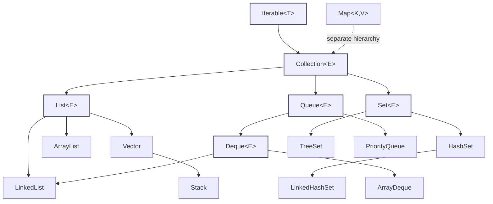
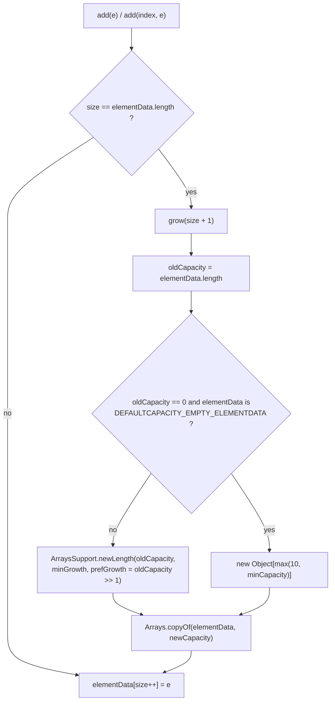
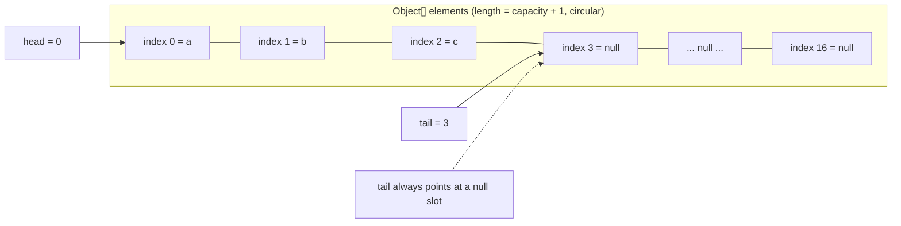
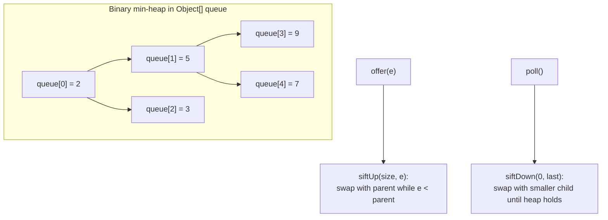
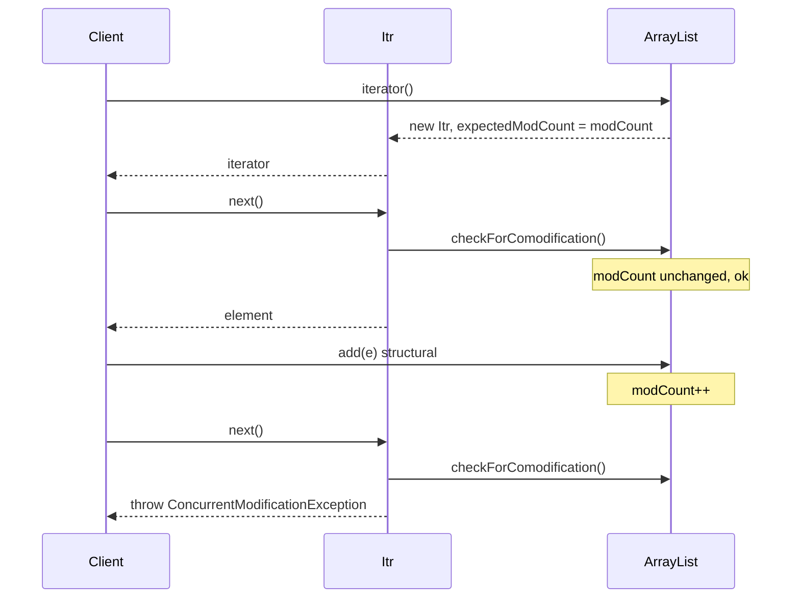

# Collections Framework, Part 1

The Java Collections Framework is a set of interfaces (`Collection`, `List`, `Set`, `Queue`, `Deque`, `Map`) and concrete implementations (`ArrayList`, `HashSet`, `ArrayDeque`, …) that model groups of objects. The mental model that makes every interview answer easy:

> **An interface defines the *contract* (what operations and what guarantees); an implementation defines the *data structure* (how it is stored and what it costs). Choose the contract from your algorithm, then choose the implementation from your access pattern.**

Two invariants thread through everything:

1. **The hierarchy** — `Iterable` is the root of iteration; `Collection` extends it; `List`, `Set`, `Queue`, `Deque` extend `Collection`. `Map` deliberately does **not** extend `Collection` (it is a key-to-value mapping, not a bag of elements), though `Map.keySet()`, `values()` and `entrySet()` are collection *views*.
2. **The cost model** — the JDK's `ArrayList` is a dynamic array, `LinkedList` a doubly linked list, `HashSet`/`HashSet`-family a hash table, `TreeSet` a red-black tree, `ArrayDeque` a circular array, `PriorityQueue` a binary heap. Every "which one should I use" question is answered by matching the access pattern to that cost model.

Part 1 covers `List`, `Set`, `Queue`/`Deque`, iteration and the `Collections` utility. `Map` internals, sorting algorithms in depth, and concurrent collections are covered in [Collections Framework, Part 2](09-Collections-Part-2.md), [HashMap Internals](10-HashMap-Internals.md) and [Concurrent Collections](11-Concurrent-Collections.md).

## The Collection Hierarchy

Everything except `Map` is a `Collection`. `Map` is a parallel hierarchy, connected to `Collection` only through its views.



Key facts about the roots:

- `Iterable<T>` declares one method, `Iterator<T> iterator()`, plus (since Java 8) default `forEach`, and `spliterator()`. **Only `Iterable` participates in the enhanced `for` loop.**
- `Collection<E>` extends `Iterable<E>` and adds `add`, `remove`, `contains`, `size`, `isEmpty`, `clear`, `toArray`, `addAll`, `removeAll`, `retainAll`, `containsAll`, `removeIf` (Java 8), `stream`/`parallelStream` (Java 8).
- `List<E>` adds positional access: `get(int)`, `set(int, E)`, `add(int, E)`, `indexOf`, `lastIndexOf`, `subList`, `listIterator`, and `sort` (Java 8).
- `Set<E>` adds the no-duplicates invariant.
- `Queue<E>` adds `offer`/`poll`/`peek`; `Deque<E>` adds two-ended `addFirst`/`addLast`/`pollFirst`/`pollLast`, plus `push`/`pop`.
- `Map<K,V>` is **not** a `Collection`. It declares `put`, `get`, `remove`, `containsKey`, `containsValue`, `entrySet`, `keySet`, `values`, `merge` (Java 8), `compute` (Java 8), etc.

### Java 21: SequencedCollection

Java 21 (JEP 431) inserted a new interface between `Collection` and the ordered collections:

```
Collection
 └─ SequencedCollection       (addFirst, addLast, getFirst, getLast, removeFirst, removeLast, reversed)
     ├─ List                  (via a retrofitted extends)
     └─ SequencedSet          (extends Set)
         └─ SequencedMap      (Map also gains these methods)
```

`List`, `Deque`, `LinkedHashSet`, and `LinkedHashMap`/`TreeMap` now expose `getFirst()`, `getLast()`, `addFirst()`, `addLast()`, and `reversed()` which returns a **reverse-order view** (not a copy). On Java 8/11/17 these names do not exist; you used `get(0)`, `get(size()-1)`, `Collections.reverse` (a mutation) instead.

```java
import java.util.*;

public class SequencedDemo {
    public static void main(String[] args) {
        List<String> list = new ArrayList<>(List.of("a", "b", "c"));
        list.addFirst("z");
        list.addLast("y");
        System.out.println(list);              // [z, a, b, c, y]
        System.out.println(list.getFirst());   // z
        System.out.println(list.reversed());   // [y, c, b, a, z] (view)

        Deque<Integer> d = new ArrayDeque<>(List.of(1, 2, 3));
        System.out.println(d.reversed());      // [3, 2, 1]
    }
}
```

## The Iterable / Iterator Contract

`Iterable` is the abstraction of "something you can traverse". The enhanced `for` loop (`for (T x : c)`) is pure compiler sugar: it desugars to an explicit `Iterator` over any `Iterable`, and to an index loop over an array.

```java
// This...
for (String s : list) { System.out.println(s); }

// ...is compiled to roughly this:
for (Iterator<String> it = list.iterator(); it.hasNext(); ) {
    String s = it.next();
    System.out.println(s);
}
```

`Iterator<E>` has exactly three methods: `hasNext()`, `next()`, and `remove()` (default throws `UnsupportedOperationException`). `ListIterator<E>` extends `Iterator` and adds `hasPrevious`, `previous`, `nextIndex`, `previousIndex`, `set`, and `add`.

| Type | Direction | Extra operations | Available on |
|---|---|---|---|
| `Iterator` | forward only | `remove` | every `Collection` |
| `ListIterator` | both directions | `set`, `add` | only `List` |
| `Spliterator` | forward, splittable | `trySplit`, `tryAdvance` | every `Iterable` (used by streams) |

> **Rule:** The enhanced `for` loop works on arrays and `Iterable`. It does not use `Iterator` for arrays — the compiler emits an index-based loop, which is why you cannot call `remove()` inside it and why iterating an array never throws `ConcurrentModificationException`.

`Iterator.remove()` is the *only* structural modification allowed during iteration of fail-fast collections, and it is safe because the iterator fixes up its own bookkeeping (`modCount` and `cursor`) after the removal. Calling `remove()` twice in a row throws `IllegalStateException` because the iterator must be advanced by `next()` between removals.

## List

A `List` is an **ordered sequence** with positional access and duplicates allowed. The three primary implementations differ entirely in their backing structure.

### ArrayList internals

`ArrayList<E> extends AbstractList<E> implements List<E>, RandomAccess, Cloneable, Serializable`. Its fields:

```java
transient Object[] elementData; // the backing array (name in the JDK: elementData)
private int size;               // number of logical elements
// modCount lives in AbstractList, inherited
```

- **Default capacity is 10 and is lazy (since Java 7).** `new ArrayList<>()` stores the shared sentinel `DEFAULTCAPACITY_EMPTY_ELEMENTDATA` (a static empty array) and allocates no 10-element array until the first `add`. In Java 6 and earlier the 10-element array was allocated eagerly in the constructor.
- `new ArrayList<>(0)` stores a *different* sentinel, `EMPTY_ELEMENTDATA`. This distinction matters: the first `add` on a default list jumps straight to capacity 10, whereas on an `ArrayList<>(0)` it grows to only capacity 1.

The growth path is `add` → `grow(size + 1)` → `ArraysSupport.newLength(oldCapacity, minGrowth, prefGrowth)` where `minGrowth = size + 1 - oldCapacity` and `prefGrowth = oldCapacity >> 1`. For the common single-element overflow this yields:

```
newCapacity = oldCapacity + (oldCapacity >> 1)   // 1.5x, integer arithmetic
```



Growth is a **full array copy** — `O(n)` time and a fresh allocation — even though only one element is added. That is why pre-sizing with `new ArrayList<>(expectedSize)` or `ensureCapacity` is a standard optimization.

```java
import java.util.*;
import java.lang.reflect.*;

public class ArrayListGrowth {
    static int capacity(ArrayList<?> list) throws Exception {
        Field f = ArrayList.class.getDeclaredField("elementData");
        f.setAccessible(true);
        return ((Object[]) f.get(list)).length;
    }

    public static void main(String[] args) throws Exception {
        ArrayList<Integer> list = new ArrayList<>();
        System.out.println(capacity(list));            // 0  (lazy, no array yet)
        list.add(1);
        System.out.println(capacity(list));            // 10
        for (int i = 2; i <= 10; i++) list.add(i);
        System.out.println(capacity(list));            // 10
        list.add(11);
        System.out.println(capacity(list));            // 15  (10 + 10>>1)
        for (int i = 12; i <= 15; i++) list.add(i);
        System.out.println(capacity(list));            // 15
        list.add(16);
        System.out.println(capacity(list));            // 22  (15 + 15>>1)
    }
}
```

Run with `java --add-opens java.base/java.util=ALL-UNNAMED ArrayListGrowth`.

**Modulo, not bit-masking.** Unlike `HashMap`, `ArrayList` never masks indices — it is a plain array with an upfront bounds check. `get(int)` is `elementData[index]` plus a range check, so it is `O(1)` and extremely cache-friendly. `ArrayList` implements the **marker interface `RandomAccess`**, which algorithms (like `Collections.binarySearch` and `Collections.shuffle`) test to choose an index loop over an iterator.

**`modCount`.** `AbstractList` maintains `protected transient int modCount`, incremented on every *structural* modification (`add`, `remove`, `clear`, `ensureCapacity` when it actually grows). Iterators snapshot it as `expectedModCount`; any mismatch during traversal raises `ConcurrentModificationException`. See the fail-fast section below.

Important `ArrayList` methods:

| Method | Effect |
|---|---|
| `ensureCapacity(int)` | Pre-allocates at least the given capacity (avoids incremental copies). Increments `modCount` only if it grows. |
| `trimToSize()` | Shrinks `elementData` to `size`, freeing tail memory. Increments `modCount`. |
| `subList(from, to)` | Returns a **view** backed by the same array (see below). |
| `removeIf(Predicate)` | Bulk conditional removal, implemented over the iterator (so it is CME-safe internally). |
| `indexOf` / `lastIndexOf` | `O(n)` linear scan using `equals`. |
| `get(int)` / `set(int, E)` | `O(1)`. |
| `add(int, E)` / `remove(int)` | `O(n)` worst case due to `System.arraycopy`. |

### subList is a view, not a copy

`subList(fromIndex, toIndex)` returns an inner class `ArrayList.SubList` (technically `AbstractList.SubList` for `ArrayList`'s inherited path; both share the parent's `modCount`). Writes propagate both ways, and structural changes to the parent invalidate the view.

```java
import java.util.*;

public class SubListDemo {
    public static void main(String[] args) {
        List<Integer> list = new ArrayList<>(List.of(0, 1, 2, 3, 4, 5));
        List<Integer> sub = list.subList(1, 4);
        System.out.println(sub);          // [1, 2, 3]

        sub.set(0, 99);                   // writes through to the parent
        System.out.println(list);         // [0, 99, 2, 3, 4, 5]

        sub.clear();                      // removes the view's range from the parent
        System.out.println(list);         // [0, 4, 5]

        List<Integer> l2 = new ArrayList<>(List.of(0, 1, 2, 3, 4, 5));
        List<Integer> v = l2.subList(1, 4);
        l2.add(6);                        // structural change to parent
        try { v.get(0); }
        catch (ConcurrentModificationException e) {
            System.out.println("view invalidated");  // prints this
        }
    }
}
```

> **Pitfall:** `list.subList(1, 3).clear()` is a clean way to delete a range, but keeping a `subList` reference while mutating the parent is a latent `ConcurrentModificationException`. Non-structural changes (`set`) do **not** invalidate the view.

### remove(int) vs remove(Object)

This is one of the most common traps. `List` has two overloads and overload resolution is by *compile-time* type.

```java
List<Integer> l = new ArrayList<>(List.of(10, 20, 30));
l.remove(1);                        // remove(int index) -> removes 20
// l.remove(Integer.valueOf(1));    // remove(Object) -> removes the value 1 (absent)

List<Integer> l2 = new ArrayList<>(List.of(10, 20, 30));
boolean removed = l2.remove(Integer.valueOf(20)); // true, removes value 20
```

For a `List<String>` there is no ambiguity: `remove("x")` bounds to `remove(Object)`. For `List<Integer>` you **must** box with `Integer.valueOf(n)` when you mean value removal.

### Arrays.asList vs List.of vs List.copyOf

| Factory | Type | Nulls | `set` | `add`/`remove` | Backed by array? |
|---|---|---|---|---|---|
| `Arrays.asList(a, b, c)` | `Arrays$ArrayList` | allowed | yes | throws `UnsupportedOperationException` | yes, writes through |
| `Arrays.asList(intArray)` | `Arrays$ArrayList` | n/a | — | — | **size 1, element is `int[]`** |
| `List.of(a, b, c)` | `ImmutableCollections.ListN/List12` | **forbidden (NPE)** | throws `UOE` | throws `UOE` | no |
| `List.copyOf(coll)` | immutable copy | **forbidden (NPE)** | throws `UOE` | throws `UOE` | no (detached snapshot) |
| `Collections.unmodifiableList(l)` | view wrapper | allowed | throws `UOE` | throws `UOE` | **reflects later writes to `l`** |

```java
import java.util.*;

public class Factories {
    public static void main(String[] args) {
        String[] arr = {"a", "b", "c"};
        List<String> asList = Arrays.asList(arr);
        asList.set(0, "z");
        System.out.println(Arrays.toString(arr));   // [z, b, c]  (writes through!)
        // asList.add("d");                          // UnsupportedOperationException

        List<String> of = List.of("a", "b", "c");
        // of.set(0, "z");                           // UnsupportedOperationException
        // of.contains(null);                        // NullPointerException

        List<String> backing = new ArrayList<>(List.of("a", "b"));
        List<String> view = Collections.unmodifiableList(backing);
        List<String> snap = List.copyOf(backing);
        backing.add("c");
        System.out.println(view);                    // [a, b, c]
        System.out.println(snap);                    // [a, b]

        int[] prim = {1, 2, 3};
        System.out.println(Arrays.asList(prim).size()); // 1  (List<int[]>, a classic bug)
    }
}
```

> **Trap:** `Arrays.asList(new int[]{1,2,3})` returns a `List<int[]>` of size 1, not `List<Integer>` of size 3 — autoboxing does not happen for a whole array. Use `IntStream.of(...).boxed().toList()` or build an `ArrayList` manually.

**`List.of` / `Set.of` / `Map.of` (Java 9+)** are truly immutable, reject nulls, are serializable, and throw `NullPointerException` on lookup-by-null (not `contains` returning false). `List.copyOf` (Java 10+) is a null-rejecting snapshot useful to defensively copy a caller's list.

### LinkedList internals

`LinkedList<E> extends AbstractSequentialList<E> implements List<E>, Deque<E>, Cloneable, Serializable`. It is an **unrolled-free doubly linked list** of `Node` objects:

```java
private static class Node<E> {
    E item;
    Node<E> next;
    Node<E> prev;
}
transient Node<E> first;
transient Node<E> last;
transient int size;
```

Each element costs a `Node` object (~24-byte header on a 64-bit HotSpot, compressed oops) plus three references = roughly **32 bytes of overhead per element** versus `ArrayList`'s 4-byte reference. Indexed access is `O(n)` because `get(i)` walks from the nearer end (it compares `i` to `size/2`). There is no `RandomAccess` marker.

```java
import java.util.*;

public class LinkedVsArray {
    public static void main(String[] args) {
        List<Integer> ll = new LinkedList<>();
        List<Integer> al = new ArrayList<>();
        int n = 20_000;
        for (int i = 0; i < n; i++) { ll.add(i); al.add(i); }

        long t0 = System.nanoTime();
        long s1 = 0; for (int i = 0; i < n; i++) s1 += ll.get(i);
        long t1 = System.nanoTime();
        long s2 = 0; for (int i = 0; i < n; i++) s2 += al.get(i);
        long t2 = System.nanoTime();

        System.out.println(s1 == s2);                 // true
        System.out.printf("LinkedList get: %d us%n", (t1 - t0) / 1000);
        System.out.printf("ArrayList  get: %d us%n", (t2 - t1) / 1000);
        // LinkedList get is ~100x slower; ArrayList is cache-friendly.
    }
}
```

**When `LinkedList` actually wins:** only when you do many `addFirst`/`removeFirst` or `addLast`/`removeLast` **at the ends** *and* you already hold the node / use a `Deque`/`ListIterator` iterator (where insertion/removal is `O(1)`). For positional `add`/`remove`/`get`, `ArrayList` beats it due to cache locality even though both are `O(n)` in theory. In practice, `ArrayDeque` beats `LinkedList` as a `Deque` too (no per-node allocation, better locality). Modern guidance: **prefer `ArrayList`; prefer `ArrayDeque` for deque/stack/queue use; treat `LinkedList` as a niche.**

Because `LinkedList` implements `Deque`, it exposes `addFirst`, `addLast`, `pollFirst`, `pollLast`, `push`, `pop`, `peek`, `descendingIterator`.

### Vector and Stack (legacy)

`Vector` is a synchronized growable array from JDK 1.0 (predating the Collections Framework). `Stack extends Vector` and adds LIFO methods. Both are considered obsolete:

- Every method (`add`, `get`, `size`, …) takes the **same monitor** on the `Vector` instance, so it is coarse-grained and slow under contention — and still not safe for compound actions or iteration (which requires external synchronization).
- `Stack`'s inheritance from `Vector` is a classic design error: a `Stack` is-a `Vector`, so it exposes indexed `get(int)` and `insertElementAt`, letting callers violate LIFO.
- `Vector` grows by `capacityIncrement` (default doubling) rather than 1.5x, and it has the legacy `Enumeration` API.

```java
Vector<String> v = new Vector<>(List.of("x", "y"));
Enumeration<String> e = v.elements();     // legacy cursor
while (e.hasMoreElements()) System.out.print(e.nextElement() + " "); // x y

Stack<Integer> s = new Stack<>();
s.push(1); s.push(2);
System.out.println(s.pop());              // 2
System.out.println(s instanceof Vector);  // true (a Stack is a Vector)
```

Use `ArrayList` instead of `Vector`, and `ArrayDeque` instead of `Stack`. For thread safety, `CopyOnWriteArrayList` or `Collections.synchronizedList` (with external locking for iteration).

### CopyOnWriteArrayList (pointer)

`CopyOnWriteArrayList` is a fail-safe, thread-safe `List` in `java.util.concurrent`. Every mutation copies the entire backing array; reads are lock-free and never throw `ConcurrentModificationException`. It is ideal for **read-mostly, rarely-mutated** listener registries, and pathological for write-heavy workloads. Full treatment in [Concurrent Collections](11-Concurrent-Collections.md).

### List comparison

| Operation | ArrayList | LinkedList | Vector |
|---|---|---|---|
| `get(i)` / `set(i)` | `O(1)` | `O(n)` | `O(1)` (synchronized) |
| `add(e)` at end | amortized `O(1)` | `O(1)` | amortized `O(1)` (sync) |
| `add(i, e)` | `O(n)` | `O(n)` to find, `O(1)` to link | `O(n)` |
| `remove(i)` | `O(n)` | `O(n)` | `O(n)` |
| `contains` | `O(n)` | `O(n)` | `O(n)` |
| Iteration | very fast, cache-friendly | slower (pointer chasing) | fast, sync overhead |
| Backing | `Object[]` (1.5x growth) | doubly linked nodes | `Object[]` (2x growth) |
| Per-element overhead | 4 bytes (ref) | ~32 bytes (node) | 4 bytes (ref) |
| `RandomAccess` | yes | no | yes |
| Thread-safe | no | no | yes (coarse) |

## Set

A `Set` is a `Collection` with **no duplicate elements**. "Duplicate" is decided by `equals`/`hashCode` for hash-based sets, and by `compareTo`/`compare` for `TreeSet`.

### HashSet internals

`HashSet<E> extends AbstractSet<E>` and is nothing more than a **thin wrapper around a `HashMap`**:

```java
public class HashSet<E> extends AbstractSet<E> implements Set<E>, Cloneable, Serializable {
    transient HashMap<E, Object> map;
    static final Object PRESENT = new Object(); // shared dummy value
    // add(e): return map.put(e, PRESENT) == null
    // contains(e): map.containsKey(e)
    // remove(e): map.remove(e) == PRESENT
}
```

Every element is stored as a **key** in the backing `HashMap` with the constant `PRESENT` sentinel as the value. This explains the `boolean` return of `add`: `put` returns the previous value or `null`, so `add` returns `true` iff the key was absent.

Default capacity is 16 (per `HashMap`), load factor 0.75. Iteration order is unspecified and depends on `hashCode` and capacity — never rely on it. HashSet permits **one** null element. Full hashing mechanics are in [HashMap Internals](10-HashMap-Internals.md); here we only need the wrapper contract.

```java
Set<String> s = new HashSet<>();
System.out.println(s.add("b"));   // true
System.out.println(s.add("b"));   // false  (already present)
s.add(null);                      // one null allowed
```

### LinkedHashSet internals

`LinkedHashSet<E> extends HashSet<E>` (and, in Java 21, `implements SequencedSet<E>`). Its constructors call the `HashSet` package-private constructor that creates a `LinkedHashMap` instead of a `HashMap`. The only difference from `HashSet` is that each entry also participates in a doubly linked list, giving **predictable insertion-order iteration**. Cost: two extra references per entry and slightly slower `add`/`remove`.

```java
LinkedHashSet<String> s = new LinkedHashSet<>();
s.add("a"); s.add("b"); s.add("c");
s.add("a");                 // no move; still first
System.out.println(s);      // [a, b, c]
s.remove("b"); s.add("b");  // re-inserted at the end
System.out.println(s);      // [a, c, b]
```

> **Note:** Re-adding an existing element does **not** change its position. Only remove-then-add moves it to the tail. Iteration over `LinkedHashSet` is `O(size)`, whereas `HashSet` iteration is `O(capacity + size)`.

### TreeSet internals

`TreeSet<E> extends AbstractSet<E> implements NavigableSet<E>` is a wrapper around a `TreeMap`, which is a **red-black tree** (a self-balancing binary search tree). Elements are kept **sorted** by their natural ordering (`Comparable`) or by a supplied `Comparator`.

```java
private transient NavigableMap<E, Object> m; // a TreeMap in practice
```

Core complexity: `add`, `remove`, `contains` are `O(log n)`. Iteration is in ascending sorted order. TreeSet offers the `NavigableSet` navigation API:

| Method | Meaning |
|---|---|
| `first()` / `last()` | smallest / largest |
| `floor(e)` | greatest element `<= e` (or null) |
| `ceiling(e)` | smallest element `>= e` (or null) |
| `lower(e)` / `higher(e)` | strict `<` / `>` |
| `pollFirst()` / `pollLast()` | remove and return first / last |
| `headSet(to)` / `tailSet(from)` | range **views** |
| `subSet(from, to)` | range view |
| `descendingSet()` / `descendingIterator()` | reverse view |

```java
import java.util.*;

public class TreeSetDemo {
    public static void main(String[] args) {
        TreeSet<Integer> ts = new TreeSet<>(List.of(10, 5, 20, 15, 5));
        System.out.println(ts);                 // [5, 10, 15, 20]
        System.out.println(ts.floor(12));       // 10
        System.out.println(ts.ceiling(12));     // 15
        System.out.println(ts.headSet(15));     // [5, 10]   (exclusive by default)
        System.out.println(ts.tailSet(15));     // [15, 20]
        System.out.println(ts.descendingSet()); // [20, 15, 10, 5]

        // Natural ordering cannot order null:
        // new TreeSet<String>().add(null);     // NullPointerException
        TreeSet<String> withNulls =
            new TreeSet<>(Comparator.nullsFirst(Comparator.naturalOrder()));
        withNulls.add(null); withNulls.add("b"); withNulls.add("a");
        System.out.println(withNulls);          // [null, a, b]
    }
}
```

**Null handling:** a `TreeSet` with natural ordering throws `NullPointerException` on `add(null)` (there is no natural order for null). A comparator that handles null (`Comparator.nullsFirst`) permits it.

**Sortedness is defined by `compareTo`, not `equals`.** This is a classic bug source:

```java
TreeSet<String> byLength = new TreeSet<>(Comparator.comparingInt(String::length));
System.out.println(byLength.add("bb"));  // true
System.out.println(byLength.add("aa"));  // false -> compare == 0 with "bb", treated as duplicate
System.out.println(byLength.size());     // 1
System.out.println(byLength);            // [bb]  (the first element is retained)
```

> **Rule:** For `TreeSet`/`TreeMap`, `compareTo`/`compare` returning 0 means "equal for this set", even if `equals` returns false. This violates the general `Set` contract if ordering is inconsistent with `equals`; the JDK docs explicitly permit it but call it out as a hazard.

### EnumSet internals

`EnumSet<E extends Enum<E>>` is an abstract **sealed** class (sealed since Java 17 with `permits RegularEnumSet, JumboEnumSet`) with two implementations:

- `RegularEnumSet` uses a single `long` as a **bit vector** (`elements`), one bit per enum constant. Supports enums with `<= 64` constants.
- `JumboEnumSet` uses a `long[]` for enums with more than 64 constants.

All operations (`add`, `contains`, `remove`, `retainAll` as bitwise AND, `complementOf` as bitwise NOT) are effectively `O(1)` bit operations. Iteration is in **ordinal order** (declaration order). `EnumSet` is not thread-safe, does not permit null, and cannot be instantiated directly — only via factories.

```java
import java.util.*;

public class EnumSetDemo {
    enum Day { MON, TUE, WED, THU, FRI, SAT, SUN }

    public static void main(String[] args) {
        EnumSet<Day> weekend = EnumSet.of(Day.SAT, Day.SUN);
        System.out.println(weekend);                         // [SAT, SUN]
        System.out.println(EnumSet.range(Day.MON, Day.FRI)); // [MON, TUE, WED, THU, FRI]
        System.out.println(EnumSet.complementOf(weekend));   // [MON, TUE, WED, THU, FRI]
        System.out.println(EnumSet.allOf(Day.class));        // [MON, TUE, WED, THU, FRI, SAT, SUN]
    }
}
```

EnumSet is the canonical choice for enum flags — far cheaper than `HashSet<Enum>`.

### Immutable sets

`Set.of(...)` (Java 9+), `Set.copyOf(...)` (Java 10+) and `Collections.unmodifiableSet(...)` mirror their `List` counterparts: `Set.of`/`Set.copyOf` are immutable and reject nulls; `unmodifiableSet` is a null-allowing view over a live backing set. `Set.of` throws `IllegalArgumentException` on duplicate arguments at construction. Iteration order of `Set.of` is unspecified.

### Set comparison

| Operation | HashSet | LinkedHashSet | TreeSet | EnumSet |
|---|---|---|---|---|
| Backing | `HashMap` | `LinkedHashMap` | red-black `TreeMap` | bit vector / `long[]` |
| `add`/`remove`/`contains` | `O(1)` avg | `O(1)` avg | `O(log n)` | `O(1)` |
| Iteration order | unspecified | insertion order | sorted order | ordinal order |
| Iteration cost | `O(capacity + size)` | `O(size)` | `O(size)` | `O(#constants)` |
| Nulls | one null | one null | no (natural order) | no |
| Ordering API | no | no | `NavigableSet` | ordinal only |
| Typical use | general set | ordered set | sorted range queries | enum flags |

## Queue and Deque

A `Queue` is a collection for holding elements prior to processing, usually FIFO. `Deque` (double-ended queue) supports both ends. The **same logical operation has two methods — one that throws on failure and one that returns a sentinel** — and interviewers love to ask which is which.

| Operation | Throws on failure | Returns sentinel | Sentinel |
|---|---|---|---|
| Insert at tail | `add(e)` | `offer(e)` | `false` |
| Remove head | `remove()` | `poll()` | `null` |
| Examine head | `element()` | `peek()` | `null` |

`Deque` adds the two-ended variants: `addFirst`/`offerFirst`, `addLast`/`offerLast`, `removeFirst`/`pollFirst`, `removeLast`/`pollLast`, `getFirst`/`peekFirst`, `getLast`/`peekLast`. `Deque` also defines `push`/`pop` (stack semantics on the head) and `descendingIterator`.

```java
import java.util.*;

public class QueueMethods {
    public static void main(String[] args) {
        Deque<String> d = new ArrayDeque<>();
        d.offer("x");
        System.out.println(d.poll());        // x
        System.out.println(d.poll());        // null (empty)
        // d.remove();                       // NoSuchElementException
        // d.element();                      // NoSuchElementException
    }
}
```

### ArrayDeque internals

`ArrayDeque<E> extends AbstractCollection<E> implements Deque<E>` is a **resizable circular array** with two indices, `head` and `tail`.

- The array always keeps **one null slot** at `tail` to disambiguate full from empty; the backing array length is `capacity + 1`. The default constructor allocates `new Object[16 + 1]`, i.e. it holds 16 elements.
- Indices wrap using explicit modular arithmetic helpers — `head = dec(head, length)`, `tail = inc(tail, length)` — **not bit-masking**. (Older descriptions say "power-of-two capacity, `& (length-1)`"; that was the JDK 8 design. Modern `ArrayDeque`, since JDK 9, uses a length of `N+1` and true modulo so capacity need not be a power of two.)
- Growth: `grow(needed)` doubles while small and grows by 50% once the array reaches 64 slots. The `jump` is `oldCapacity + 2` for `oldCapacity < 64`, otherwise `oldCapacity >> 1`.



`ArrayDeque` **does not permit null elements** (`add(null)` throws `NullPointerException`) — necessary because `poll` returns `null` to signal emptiness. It is the recommended implementation for both `Queue` and `Stack` usage; it beats `LinkedList` and `Stack` on memory and speed.

```java
import java.util.*;

public class ArrayDequeDemo {
    public static void main(String[] args) {
        Deque<String> d = new ArrayDeque<>();
        d.addLast("b"); d.addFirst("a"); d.addLast("c");
        System.out.println(d);              // [a, b, c]
        System.out.println(d.pollFirst());  // a
        System.out.println(d.pollLast());   // c
        System.out.println(d);              // [b]

        Deque<Integer> stack = new ArrayDeque<>();
        stack.push(1); stack.push(2); stack.push(3);
        System.out.println(stack.pop());    // 3
        System.out.println(stack);          // [2, 1]
    }
}
```

### PriorityQueue internals

`PriorityQueue<E> extends AbstractQueue<E>` is a **binary min-heap** stored in an `Object[] queue`. The heap property is `queue[parent] <= queue[child]` for all children, with `parent(i) = (i-1)/2`, `left = 2i+1`, `right = 2i+2`. Default initial capacity is 11. It does **not** implement `Deque` and is **not thread-safe**.

- **Insertion** (`offer`) appends at `queue[size]` then calls `siftUp(i, e)`: bubble the new element up by swapping with its parent while it is smaller.
- **Removal** (`poll`) takes `queue[0]`, moves the last element to the root, then `siftDown(0, x)`: repeatedly swap with the smaller child until the heap property holds.
- Both are `O(log n)`.



**Critical:** `PriorityQueue`'s iterator is **not sorted**; it walks the heap array and yields no meaningful order. Only `poll()` (or `remove()`) yields elements in priority order. This is the single most-asked PriorityQueue fact.

```java
import java.util.*;

public class PriorityQueueDemo {
    public static void main(String[] args) {
        PriorityQueue<Integer> pq = new PriorityQueue<>(List.of(5, 1, 9, 3, 7, 2));
        System.out.println(pq);                 // [1, 3, 2, 5, 7, 9]  (heap array order)
        while (!pq.isEmpty()) System.out.print(pq.poll() + " ");  // 1 2 3 5 7 9
        System.out.println();

        PriorityQueue<Integer> max = new PriorityQueue<>(Comparator.reverseOrder());
        max.addAll(List.of(5, 1, 9, 3, 7, 2));
        System.out.println(max.peek());         // 9  (max-heap via reversed comparator)
    }
}
```

- **Ordering:** natural ordering by default; pass a `Comparator` (e.g. `Comparator.reverseOrder()`, `Comparator.comparing`) for custom priority. Elements must be mutually comparable or a `ClassCastException` is thrown on insertion.
- **Nulls:** rejected — `add(null)` throws `NullPointerException`.
- **Ties:** `PriorityQueue` makes **no guarantee** about the relative order of elements that compare equal; do not depend on FIFO/LIFO among equal priorities. To get stable behavior, encode a sequence number in the comparator.
- `peek()` is `O(1)`; `contains`/`remove(Object)` are `O(n)` (linear scan, and `remove` then re-heapifies).
- Construction from a collection runs `heapify()`, which is `O(n)`, cheaper than `n` insertions (`O(n log n)`).

### Stack vs Deque

| Aspect | `Stack` (legacy) | `ArrayDeque` as stack |
|---|---|---|
| Underlying | `Vector` (synchronized array) | circular array |
| Synchronization | yes, coarse | no |
| Null | allowed | rejected |
| Extra surface | inherits `Vector` indexed methods | clean `Deque` API |
| Performance | slower | faster |
| Recommendation | avoid | use for LIFO |

> **Best practice:** `Deque<Integer> stack = new ArrayDeque<>();` and use `push`/`pop`/`peek`. Also `Deque` for queues (`offer`/`poll`), never `LinkedList`.

## Iteration and Fail-Fast Behavior

**Fail-fast** iterators detect structural modification during traversal and throw `ConcurrentModificationException` (CME) at the next `next()`/`remove()` call. **Fail-safe** iterators traverse a snapshot or a concurrent structure and never throw CME; they may or may not reflect concurrent changes.

The mechanism is `modCount`. In `AbstractList` (and mirrored in `HashMap`'s inner iterators and `AbstractCollection`'s), every structural modification increments `modCount`. An iterator captures `expectedModCount = modCount` at creation; each `next()` calls `checkForComodification()`:

```java
final void checkForComodification() {
    if (modCount != expectedModCount)
        throw new ConcurrentModificationException();
}
```

`Iterator.remove()` is safe because after removing it sets `expectedModCount = modCount` and fixes `cursor`. Additions (`add`) have no safe iterator equivalent on a plain `Iterator` — `ListIterator.add` exists and is safe.



```java
import java.util.*;

public class FailFast {
    public static void main(String[] args) {
        // 1. Removing via enhanced for -> usually CME
        List<String> l1 = new ArrayList<>(List.of("a", "b", "c", "d"));
        try {
            for (String s : l1) if (s.equals("a")) l1.remove(s);
        } catch (ConcurrentModificationException e) {
            System.out.println("for-each remove: ConcurrentModificationException");
        }

        // 2. iterator.remove() is the correct pattern
        List<String> l2 = new ArrayList<>(List.of("a", "b", "c"));
        for (Iterator<String> it = l2.iterator(); it.hasNext(); ) {
            if (it.next().equals("b")) it.remove();
        }
        System.out.println(l2);   // [a, c]
    }
}
```

> **Surprising corner case:** fail-fast is **best-effort**. Removing the *second-to-last* element during an enhanced-for often does **not** throw, because after `next()` advances `cursor`, `remove` shrinks `size` to `cursor`, so `hasNext()` (`cursor != size`) becomes false and `next()` is never called again:
> ```java
> List<String> l = new ArrayList<>(List.of("a","b","c","d"));
> for (String s : l) if (s.equals("c")) l.remove(s); // no exception!
> System.out.println(l);  // [a, b, d]
> ```
> **Never rely on CME for correctness** — the JDK documents it as bug-detection only. Use `iterator.remove()` or `removeIf`.

### Fail-fast vs fail-safe

| Collection | Iterator type | CME on concurrent structural change? | Sees changes during iteration? |
|---|---|---|---|
| `ArrayList`, `LinkedList`, `Vector` | fail-fast | yes | n/a (throws) |
| `HashSet`, `LinkedHashSet`, `TreeSet` | fail-fast | yes | n/a |
| `ArrayDeque`, `PriorityQueue` | fail-fast | yes | n/a |
| `CopyOnWriteArrayList`, `CopyOnWriteArraySet` | fail-safe (snapshot) | no | no (snapshot) |
| `ConcurrentHashMap` | fail-safe (weakly consistent) | no | maybe |

### Enhanced for over arrays vs iterables

```java
int[] arr = {1, 2, 3};
int sum = 0;
for (Integer x : arr) sum += x;   // compiles: int[] uses index loop, x autoboxed
System.out.println(sum);          // 6
```

For arrays the compiler emits a classic indexed loop (`for (int i = 0; i < arr.length; i++)`), so no `Iterator` is created and no CME is possible.

## The Collections Utility Class

`java.util.Collections` is a static factory/algorithm class. Highlights:

| Method | Purpose | Complexity |
|---|---|---|
| `sort(list)` / `sort(list, cmp)` | stable in-place sort | `O(n log n)` |
| `binarySearch(list, key)` | search a sorted list | `O(log n)` random access, `O(n)` for `LinkedList` |
| `reverse(list)` | reverse in place | `O(n)` |
| `shuffle(list)` / `shuffle(list, rnd)` | Fisher–Yates shuffle | `O(n)` |
| `swap(list, i, j)` | swap two positions | `O(1)` |
| `frequency(coll, o)` | count occurrences | `O(n)` |
| `disjoint(a, b)` | true if no common element | `O(n)`/`O(m)` |
| `nCopies(n, o)` | immutable list of `n` copies | lazy view |
| `singletonList(o)` | immutable one-element list | `O(1)` |
| `emptyList()` / `emptySet()` / `emptyMap()` | shared immutable empties | `O(1)` |
| `unmodifiableList(l)` | null-allowing unmodifiable view | wrapper |
| `synchronizedList(l)` | thread-safe wrapper | lock per call |
| `min` / `max` | extremum by comparator | `O(n)` |
| `addAll`, `replaceAll`, `fill`, `copy`, `rotate` | bulk ops | various |

**Sorting and stability.** `List.sort` (and `Collections.sort`) delegate to `Arrays.sort(Object[])`, which uses **TimSort** — a stable, adaptive merge/insertion hybrid, `O(n log n)` worst case and near-`O(n)` on partially sorted input. Stability means equal elements retain their relative order:

```java
import java.util.*;

public class SortDemo {
    record P(String name, int age) {}

    public static void main(String[] args) {
        List<P> people = new ArrayList<>(List.of(
            new P("Bob", 30), new P("Ann", 25), new P("Cal", 30), new P("Dee", 25)));
        people.sort(Comparator.comparingInt(P::age));
        // Ann and Dee (age 25) keep input order; Bob before Cal (age 30)
        System.out.println(people);
        // [P[name=Ann, age=25], P[name=Dee, age=25], P[name=Bob, age=30], P[name=Cal, age=30]]
    }
}
```

> **Note:** Stability applies to **object** sorting (TimSort). `Arrays.sort(int[])` uses dual-pivot quicksort, which is **not stable** — but primitives have no identity, so it does not matter. Sorting a `List.of(...)` throws `UnsupportedOperationException` because `set` is unsupported.

**`binarySearch` contract.** The list **must be sorted ascending** by the same comparator, otherwise the result is undefined. Returns the index if found; otherwise `-(insertionPoint) - 1`:

```java
List<Integer> s = new ArrayList<>(List.of(1, 2, 5, 7, 9));
System.out.println(Collections.binarySearch(s, 7)); // 3
System.out.println(Collections.binarySearch(s, 6)); // -4  (insertion point 3)
```

**unmodifiable vs immutable vs synchronized.**

```java
List<String> backing = new ArrayList<>(List.of("a", "b"));
List<String> view = Collections.unmodifiableList(backing); // live view; set/add throw UOE
List<String> copy = List.copyOf(backing);                 // immutable, null-rejecting snapshot
backing.add("c");
System.out.println(view);  // [a, b, c]  (reflects the mutation)
System.out.println(copy);  // [a, b]     (snapshot taken earlier)
```

| Wrapper | Reads backing changes? | `set`/`add` | Nulls | Truly immutable? |
|---|---|---|---|---|
| `Collections.unmodifiableList` | yes | throws `UOE` | allowed | no (backing can change) |
| `List.copyOf` / `List.of` | no | throws `UOE` | rejected (`NPE`) | yes |
| `Collections.synchronizedList` | yes | allowed, synchronized | allowed | no |

> **Pitfall:** `Collections.synchronizedList` serializes individual calls but **iteration still requires external synchronization**:
> ```java
> List<String> sync = Collections.synchronizedList(new ArrayList<>());
> synchronized (sync) {        // must lock around the whole traversal
>     for (String s : sync) { /* ... */ }
> }
> ```

## Equality, hashCode, and Nullability

Collections are only as correct as the `equals`/`hashCode` contract of their elements:

> **Contract:** If `a.equals(b)` then `a.hashCode() == b.hashCode()`. `equals` must be reflexive, symmetric, transitive, and consistent. Equal objects must hash equally; unequal objects *may* collide.

- **Hash-based collections (`HashSet`, `LinkedHashSet`, and `HashMap` keys)** use `hashCode` to pick a bucket and `equals` to disambiguate within it. Violating the contract silently breaks lookup — the element becomes "lost" in the wrong bucket.
- **Sorted collections (`TreeSet`, `PriorityQueue`)** use `compareTo`/`compare` only; they never call `equals`. Consistency between ordering and `equals` is recommended — `BigDecimal`, for example, is notorious: `new BigDecimal("1.0").equals(new BigDecimal("1.00"))` is `false` but `compareTo` is `0`, so a `TreeSet<BigDecimal>` will treat them as duplicates while a `HashSet` will not.
- **`List`** uses `equals` element-wise for `contains`/`equals`.

**Mutable elements are a trap.** If an element's `hashCode` depends on mutable state, mutating it after insertion changes its hash, so `contains`/`remove` look in the wrong bucket and fail:

```java
Set<List<Integer>> set = new HashSet<>();
List<Integer> key = new ArrayList<>(List.of(1, 2));
set.add(key);
key.add(3);                                   // hash changes!
System.out.println(set.contains(key));        // false
System.out.println(set.size());               // 1  (stranded, still in the set)
```

`List.equals`/`hashCode` depend on contents, so this generally affects lists-as-keys. The fix is to use immutable elements (`List.of`, records, `String`) or never mutate after insertion.

**Null handling by collection** (all verified on Java 21):

| Collection | `add(null)` | Notes |
|---|---|---|
| `ArrayList`, `LinkedList`, `Vector`, any `Arrays.asList` | allowed | multiple nulls fine |
| `ArrayDeque`, `PriorityQueue` | `NullPointerException` | null is the empty sentinel |
| `HashSet`, `LinkedHashSet` | allowed | at most one null element |
| `TreeSet` (natural order) | `NullPointerException` | no null ordering; comparator may allow |
| `EnumSet` | `NullPointerException` | bit vector cannot encode null |
| `List.of`, `Set.of`, `List.copyOf`, `Set.copyOf` | `NullPointerException` | immutable factories reject null |
| `Collections.unmodifiableList` | allowed | it is a view |

Also note `List.of(...).contains(null)` throws `NullPointerException`, whereas `Arrays.asList(...).contains(null)` returns a boolean.

## Performance Comparison and Choosing a Structure

### Big-O summary

| Structure | get | add (end) | add (pos) | remove (pos) | contains | iterate |
|---|---|---|---|---|---|---|
| `ArrayList` | `O(1)` | amortized `O(1)` | `O(n)` | `O(n)` | `O(n)` | `O(n)` fast |
| `LinkedList` | `O(n)` | `O(1)` | `O(n)` | `O(n)` | `O(n)` | `O(n)` slow |
| `ArrayDeque` | `O(1)` ends | amortized `O(1)` | `O(1)` ends | `O(1)` ends | `O(n)` | `O(n)` |
| `HashSet` | — | `O(1)` avg | — | `O(1)` avg | `O(1)` avg | `O(capacity + n)` |
| `LinkedHashSet` | — | `O(1)` avg | — | `O(1)` avg | `O(1)` avg | `O(n)` |
| `TreeSet` | — | `O(log n)` | — | `O(log n)` | `O(log n)` | `O(n)` sorted |
| `EnumSet` | — | `O(1)` | — | `O(1)` | `O(1)` | `O(#constants)` |
| `PriorityQueue` | `peek O(1)` | `O(log n)` | — | `O(log n)` poll | `O(n)` | unsorted |

### Memory overhead per element

| Structure | Reference per element | Extra per-element overhead |
|---|---|---|
| `ArrayList` | 4 bytes | none (amortized array slack) |
| `Vector` | 4 bytes | none, but synchronized |
| `LinkedList` | 4 bytes | ~32-byte `Node` + 3 refs |
| `ArrayDeque` | 4 bytes | none; one unused slot |
| `HashSet`/`LinkedHashSet` | 4 bytes (key) + dummy value | `Node`/`Entry` (~32–48 bytes); LinkedHashSet adds 2 refs |
| `TreeSet` | key + dummy value | `TreeMap.Entry` (~40 bytes, 3 refs + red/black bit) |
| `EnumSet` | 1 bit per constant | one `long` (or `long[]`) total |

(4 bytes is with compressed ordinary object pointers, the default on 64-bit HotSpot heaps under ~32 GB.)

### Choosing the right structure

| Requirement | Choose |
|---|---|
| Indexed access / most common list | `ArrayList` |
| Frequent insert/remove at ends only, as a deque/stack/queue | `ArrayDeque` |
| Frequent insert/remove in the middle with a held `ListIterator` | `LinkedList` (rarely) |
| Unique elements, no ordering | `HashSet` |
| Unique elements, preserve insertion order | `LinkedHashSet` |
| Unique elements, sorted / range queries | `TreeSet` |
| Enum flags | `EnumSet` |
| Priority ordering / top-K | `PriorityQueue` |
| Read-mostly thread-safe list | `CopyOnWriteArrayList` |

> **Rule of thumb:** reach for `ArrayList` for lists and `ArrayDeque` for queues/stacks by default; use hash-based sets for uniqueness and `TreeSet` only when you need sorted order or navigation. Pre-size `ArrayList`/`HashSet` when the size is known to avoid repeated rehashing/copying.

## Best Practices and Common Mistakes

**Best practices**

- Program to interfaces: declare `List<T>`, `Set<T>`, `Deque<T>`, not the implementations, unless you need an implementation-specific method.
- Pre-size: `new ArrayList<>(n)`, `new HashMap<>(n / 0.75f + 1)`, `new HashSet<>(n)` when `n` is known.
- Use `List.of`/`Set.of`/`Map.of`/`List.copyOf` for immutable data; use `Collections.unmodifiableList` only for a live read-only view.
- Use `removeIf` for conditional bulk removal; use `iterator.remove()` for single removals during iteration.
- Use `ArrayDeque` for stacks and queues; avoid `Stack`, `Vector`, and `Hashtable`.
- Keep collection elements immutable and with well-defined `equals`/`hashCode`.
- Prefer `EnumSet`/`EnumMap` for enum-keyed data.
- Use `Comparator` chaining (`thenComparing`) for stable multi-key ordering.

**Common mistakes**

| Mistake | Correct approach |
|---|---|
| `list.remove(1)` on `List<Integer>` expecting value removal | `list.remove(Integer.valueOf(1))` |
| `Arrays.asList(...)` then `add` (UOE) | `new ArrayList<>(Arrays.asList(...))` |
| `Arrays.asList(intArray)` expecting `List<Integer>` | `IntStream.of(...).boxed().toList()` |
| Modifying a collection in enhanced `for` | `iterator.remove()` or `removeIf` |
| Storing mutable objects as `HashSet`/`HashMap` keys | Use immutable keys |
| Relying on `HashSet` iteration order | Use `LinkedHashSet`/`TreeSet` |
| Expecting `PriorityQueue` iteration to be sorted | `poll()` repeatedly |
| Holding a `subList` while structurally changing the parent | Copy with `List.copyOf(sub)` |
| Relying on `Collections.synchronizedList` for iteration safety | Synchronize around the traversal |
| `new TreeSet<>(String.CASE_INSENSITIVE_ORDER)` then expecting `equals` semantics | Remember `compareTo == 0` means duplicate |

# Interview Questions

## Beginner

**Q:** What is the Java Collections Framework?

**A:** A unified architecture of interfaces (`Collection`, `List`, `Set`, `Queue`, `Deque`, `Map`), implementations (`ArrayList`, `HashSet`, `ArrayDeque`, `TreeMap`, …), and algorithms (`Collections.sort`, `binarySearch`). It provides reusable data structures with a common API, so client code can be written against interfaces and the implementation swapped. It was introduced in JDK 1.2 (building on earlier `Vector`/`Hashtable`).

**Q:** Is `Map` a `Collection`?

**A:** No. `Map<K,V>` extends neither `Collection` nor `Iterable`. It models a key-to-value mapping, not a bag of elements. Its `keySet()`, `values()`, and `entrySet()` return `Collection`/`Set` views, which is the only connection. This is why you cannot iterate a `Map` directly with a for-each over its entries without calling `entrySet()`.

**Q:** Difference between `List`, `Set`, and `Queue`?

**A:** `List` is an ordered sequence allowing duplicates and positional access. `Set` forbids duplicates. `Queue` models FIFO processing with `offer`/`poll`/`peek`. All three extend `Collection`; `Deque` extends `Queue` and adds two-ended access.

**Q:** What is the difference between `Collection` and `Collections`?

**A:** `java.util.Collection` is the root interface for lists, sets, and queues. `java.util.Collections` is a final utility class of static methods (`sort`, `unmodifiableList`, `synchronizedList`, `emptyList`, `reverse`, `shuffle`). The "s" suffix is the conventional naming for a utility class.

**Q:** `ArrayList` vs `LinkedList` — which is faster and when?

**A:** `ArrayList` is faster for almost all workloads because of array cache locality; `get`/`set` are `O(1)`. `LinkedList` only wins for frequent insertion/removal at the ends with a held iterator/node; even then `ArrayDeque` is usually better. Per-element memory is far lower for `ArrayList`.

**Q:** What does `HashSet.add` return?

**A:** `true` if the element was not already present and was added; `false` if it was already present. Internally it returns `map.put(e, PRESENT) == null`, because `HashMap.put` returns the previous value.

**Q:** How do you make a collection unmodifiable?

**A:** `Collections.unmodifiableList/Set/Map` returns a read-only *view* (writes throw `UnsupportedOperationException`, but it reflects later changes to the backing collection). For a truly immutable snapshot use `List.copyOf`, `Set.copyOf`, `Map.copyOf`, or the `List.of`/`Set.of`/`Map.of` factories (Java 9+). Guava's `ImmutableList` is the third-party equivalent.

**Q:** What is the difference between `add`/`offer`, `remove`/`poll`, and `element`/`peek` on a `Queue`?

**A:** `add`, `remove`, `element` throw exceptions on failure (`IllegalStateException`/`NoSuchElementException`). `offer`, `poll`, `peek` return `false`/`null` instead. Use the `offer`/`poll`/`peek` family when failure is normal (e.g., bounded queues).

## Intermediate

**Q:** Explain how `ArrayList` grows.

**A:** The backing `elementData` starts as a shared sentinel (default capacity 10 is allocated lazily on first `add`). When an `add` would exceed the array length, `grow(minCapacity)` computes `newCapacity = oldCapacity + max(minGrowth, oldCapacity >> 1)` via `ArraysSupport.newLength`, i.e. **1.5x**, then `Arrays.copyOf` allocates and copies. Typical 1.5x sequence under single-element adds: 10 → 15 → 22 → 33. The copy is `O(n)`, amortized over adds to `O(1)`.

**Q:** Why is the first `add` on `new ArrayList<>()` a special case?

**A:** Because the default constructor does not allocate; it stores `DEFAULTCAPACITY_EMPTY_ELEMENTDATA`. On first `add`, `grow` sees that sentinel and allocates `max(10, minCapacity)`. By contrast `new ArrayList<>(0)` stores `EMPTY_ELEMENTDATA`, so its first growth computes `newLength(0, 1, 0) = 1` and it grows to capacity 1, then 2, 3, 4, 6, 9, … — slower for many adds.

**Q:** What does `modCount` do and how does fail-fast work?

**A:** `modCount` is a protected counter in `AbstractList` incremented on every structural modification. Each iterator snapshots it into `expectedModCount`; `next()` and `remove()` call `checkForComodification()` and throw `ConcurrentModificationException` when the values differ. `Iterator.remove()` is safe because it updates `expectedModCount = modCount` after removing. It is single-threaded bug detection, not a concurrency guarantee — hence "best-effort".

**Q:** Why does removing elements with a for-each loop throw `ConcurrentModificationException`, but `iterator.remove()` does not?

**A:** The for-each loop internally holds an iterator but the `list.remove(...)` call modifies the list directly, incrementing `modCount` without updating the iterator's `expectedModCount`. The next `next()` sees the mismatch. `iterator.remove()` removes through the iterator, which then synchronizes its own counters.

**Q:** What is a `subList` and is it a copy?

**A:** No, it is a **view** that shares the parent's storage and `modCount`. `set` on the view writes through; `clear` on the view removes the parent's range; structural changes to the parent invalidate the view (later access throws CME). If you need a detached copy, use `List.copyOf(list.subList(a, b))`.

**Q:** `Arrays.asList` vs `List.of`?

**A:** `Arrays.asList` returns a fixed-size view **backed by the array**: `set` works and writes through; `add`/`remove` throw `UnsupportedOperationException`; nulls allowed. `List.of` returns a truly immutable list: all mutations throw, nulls are rejected (including `contains(null)` which throws NPE). `Arrays.asList(new int[]{...})` yields size 1, while `List.of` has no primitive-array trap because the arguments are varargs of the boxed type.

**Q:** How does `TreeSet` order and deduplicate elements?

**A:** Via a red-black `TreeMap` using `Comparable.compareTo` (natural order) or a supplied `Comparator.compare`. Two elements are "equal" when the comparison returns 0 — `equals` is ignored. This is why a comparator inconsistent with `equals` changes set membership despite the `Set` contract.

**Q:** What is the difference between `HashSet`, `LinkedHashSet`, and `TreeSet`?

**A:** All three are `Set`s. `HashSet` is a hash table (unspecified order, `O(1)` ops). `LinkedHashSet` adds a doubly linked list for insertion-order iteration (still `O(1)`, slightly more memory). `TreeSet` is a red-black tree maintaining sorted order with `O(log n)` ops and the `NavigableSet` API (`floor`, `ceiling`, `headSet`, …).

**Q:** How does `PriorityQueue` store elements and why is iteration not sorted?

**A:** It is a binary min-heap in an array. Only the root (`queue[0]`) is guaranteed to be the minimum; children satisfy `parent <= child` but siblings and subtrees are unordered. Iteration walks the array in index order, which has no sorted meaning. `poll()` returns elements in order because each removal re-heapifies.

**Q:** What is a `Deque` and why prefer `ArrayDeque` over `Stack`?

**A:** `Deque` is a double-ended queue. `ArrayDeque` is a circular array supporting `O(1)` insertion/removal at both ends, is faster than the synchronized legacy `Stack`, and has a cleaner API (`push`/`pop`/`peek`). `Stack` extends `Vector`, so it is synchronized (slow) and leaks indexed access that can break LIFO invariants.

## Advanced

**Q:** What exactly does `ArraysSupport.newLength` compute, and why is `ArrayList` growth described as 1.5x?

**A:** `ArraysSupport.newLength(oldLength, minGrowth, prefGrowth)` returns `oldLength + max(minGrowth, prefGrowth)`, with overflow guards and rounding to `SOFT_MAX_ARRAY_LENGTH` for huge arrays. `ArrayList.grow` passes `minGrowth = minCapacity - oldCapacity` and `prefGrowth = oldCapacity >> 1`. For one-at-a-time adds, `minGrowth = 1 <= prefGrowth`, so the result is `old + old/2` = 1.5x. If a bulk `addAll` needs more, `minGrowth` dominates and the array grows by exactly what is needed.

**Q:** Why does `ArrayList` implement `RandomAccess` and who consumes it?

**A:** `RandomAccess` is a marker interface (no methods) declaring that indexed access is `O(1)` and preferable to iterator traversal. Generic algorithms branch on it: `Collections.binarySearch`, `Collections.shuffle`, `Collections.reverse`, `Collections.fill`, `Collections.copy`, and `List.equals` all do `instanceof RandomAccess` and use index loops for `ArrayList` but iterators/list-iterators for `LinkedList`.

**Q:** Explain `ArrayDeque`'s circular-array design in Java 21.

**A:** Fields `Object[] elements`, `int head`, `int tail`. The array length is `capacity + 1` and `elements[tail]` is always null, which disambiguates a full deque (`head == tail`) from an empty one only together with the null-slot check. `addFirst` does `es[head = dec(head, len)] = e`; `addLast` writes at `tail` then `tail = inc(tail, len)`. Wrapping uses explicit `inc`/`dec` with `modulus = elements.length`, **not** bitwise AND, so capacity need not be a power of two (a difference from the pre-Java-9 implementation). Growth doubles while `oldCapacity < 64` (jump `oldCapacity + 2`) then 50%; on growth a wrapped array is copied and rotated.

**Q:** How does `HashSet` relate to `HashMap`?

**A:** `HashSet` holds a `transient HashMap<E,Object> map` and uses a single shared static sentinel `PRESENT` as the value for every key. `add` = `map.put(e, PRESENT) == null`; `contains` = `map.containsKey(e)`; `remove` = `map.remove(e) == PRESENT`. `LinkedHashSet` only changes the backing map to `LinkedHashMap` via a package-private `HashSet` constructor; `TreeSet` swaps to `TreeMap` and implements `NavigableSet` by delegating.

**Q:** Why is `TreeSet`'s `contains` `O(log n)` but `HashSet`'s `O(1)`, and when does the constant factor matter?

**A:** `HashSet` computes a hash and jumps to a bucket (average `O(1)`). `TreeSet` walks a balanced tree (`O(log n)` comparisons, each potentially expensive). For very large `n` the log factor matters, but if comparisons are cheap and `n` is modest, hashing overhead and poor cache behavior can make `TreeSet` competitive. Correctness requirements (sorted/range access) usually decide, not microbenchmarks.

**Q:** How does `EnumSet` achieve near-`O(1)` operations?

**A:** It stores membership as bits. `RegularEnumSet` uses one `long`; `JumboEnumSet` uses `long[]`. `add`/`remove` are bit set/clear; `contains` is a bit test; bulk operations are bitwise AND/OR/NOT. Iteration scans set bits and maps them back to enum constants by ordinal. Hence no hashing, no boxing beyond the enum instances, and tiny memory.

**Q:** What are the equality requirements for elements in hash-based vs sorted collections?

**A:** Hash-based collections require a correct `equals`/`hashCode` contract: equal elements must have equal hash codes. Sorted collections require a total order via `Comparable`/`Comparator`; they use `compare == 0` for equality and ignore `equals`. Mixing both (e.g., using a `TreeSet` whose comparator is inconsistent with `equals`) means `contains` may disagree with `equals` — legal per the JDK docs but a frequent bug.

**Q:** How does an iterator detect concurrent modification in `HashMap` vs `ArrayList`?

**A:** Both use `modCount`-style counters. `ArrayList` inherits `modCount` from `AbstractList`. `HashMap` has its own `modCount`; its `HashIterator` captures it and `nextNode()` throws CME when it changes. Additionally, `ArrayDeque`'s iterator checks for `null` cells (`nonNullElementAt`) to detect corruption from concurrent modification, since ArrayDeque does not track a full `modCount` per iteration in the same way.

## Expert

**Q:** Is `ConcurrentModificationException` a guarantee of thread-safety failure?

**A:** No. It is a *best-effort* bug detector for structural modification during iteration. It can be thrown by a single thread that mutates directly while iterating, and it may **not** be thrown under genuine concurrent modification (no happens-before, no atomicity). It must never be used for control flow or relied upon for correctness. True thread safety requires external synchronization, `Collections.synchronizedX`, or a `java.util.concurrent` collection.

**Q:** Why can `modCount` overflow, and does it matter?

**A:** `modCount` is a plain `int`. After `2^31 - 1` structural modifications it wraps to negative. The check compares equality (`modCount != expectedModCount`), not ordering, so wraparound is harmless as long as an iterator never sees exactly `2^31` modifications between creation and traversal — at which point the counters could coincidentally match. This is astronomically unlikely and not defended against.

**Q:** How does `ArrayList.removeAll` differ between `ArrayList` and the `AbstractCollection` default, and why does it matter?

**A:** `ArrayList` overrides `removeAll`/`retainAll` with an optimized path (`batchRemove`) that, when the argument is small or not a `Set`, repeatedly calls `contains` rather than iterating the argument; when the argument is large it iterates the list and tests membership. Both may be `O(n*m)`. `AbstractCollection`'s defaults always iterate the receiver. Choosing the smaller collection as the argument can change which is iterated and thus the effective cost.

**Q:** What is the time complexity of `LinkedList.contains` vs `ArrayList.contains`, and does `RandomAccess` matter?

**A:** Both are `O(n)` linear scans. `ArrayList` wins in practice because scanning a contiguous array is cache-friendly and each step is a bounds-checked load, while `LinkedList` chases pointers to scattered `Node` objects (cache misses). Complexity alone hides a large constant factor here.

**Q:** Why does `subList` of a `List.of` behave differently from `subList` of an `ArrayList`?

**A:** `List.of` returns `ImmutableCollections.ListN`, whose `subList` returns an `ImmutableCollections.SubList` that is also immutable. `set` throws `UnsupportedOperationException` rather than writing through. An `ArrayList.subList` returns a mutable view sharing storage. Both are views (not copies), but only the mutable backing supports mutation.

**Q:** How does `PriorityQueue` handle a comparator that changes the priority of an element already in the queue?

**A:** It does not. `PriorityQueue` assumes element priority is stable while enqueued. Mutating a stored object so its comparison changes corrupts the heap invariant, and subsequent `poll` returns an order that violates priority. There is no notification/re-heapify on mutation. The workaround is to remove and re-add, or use a structure supporting decrease-key (not in the JDK).

**Q:** Why is `Vector` considered obsolete when it is synchronized?

**A:** Synchronization on every method makes single-threaded use slower and multi-threaded compound operations still unsafe (check-then-act races), and iteration requires external locking anyway. Its `capacityIncrement` growth (default doubling) and `Enumeration` API are legacy. `CopyOnWriteArrayList` (read-mostly) and `Collections.synchronizedList` (explicit locking) are better modern choices.

**Q:** How does `List.copyOf` decide whether to copy?

**A:** `List.copyOf` rejects nulls (`NPE`), and if the argument is already an `ImmutableCollections` list it may return it as-is (no copy); otherwise it creates a new immutable list snapshot regardless of the source type. The result is guaranteed immutable and unaffected by later source mutations. `Set.copyOf` similarly returns the same instance for an immutable set.

## Scenario Based

**Q:** A service returns a list of results; callers sometimes try to add to it and get `UnsupportedOperationException`. The code used `Arrays.asList(...)`. What happened and how do you fix it?

**A:** `Arrays.asList` returns a fixed-size view over the backing array, so `add`/`remove` are unsupported. If callers need to mutate, return `new ArrayList<>(results)`. If they should not mutate, return `List.copyOf(results)` (immutable, null-rejecting) and document it. Do not return `Arrays.asList` if downstream code may add.

**Q:** You see an intermittent `ConcurrentModificationException` under load, but the code is single-threaded in each request. What is the likely cause?

**A:** Structural modification during iteration, commonly: a for-each loop that calls `list.remove(...)`/`map.remove(...)`, a stream that mutates the source collection, or a listener that modifies a collection being iterated. Fix by using `iterator.remove()`/`removeIf`/`removeIf` on a copy, or by iterating over a snapshot (`new ArrayList<>(coll)`). If it only appears under load, check shared mutable collections accessed by multiple request threads — that is a genuine race requiring a concurrent collection or locking.

**Q:** You need a deduplicated collection that preserves insertion order and you occasionally need the smallest element. Which do you pick?

**A:** `LinkedHashSet` for insertion-order dedup, but it has no ordered navigation. If you need both insertion-order iteration and min/max, maintain both (a `LinkedHashSet` plus a `TreeSet`/`PriorityQueue`), or use `TreeSet` if sorted iteration is acceptable in place of insertion order. `TreeSet` gives `first()`/`last()`/`floor`/`ceiling` in `O(log n)` but loses insertion order.

**Q:** A task scheduler uses `PriorityQueue<Task>` and jobs with equal priority are being reordered arbitrarily between runs. Why and how to make it deterministic?

**A:** `PriorityQueue` does not define ordering among elements that compare equal, so equal-priority tasks may come out in any order. Encode a monotonically increasing sequence number as a tie-breaker: `Comparator.comparingInt(Task::priority).thenComparingLong(Task::seq)`. This makes it a stable FIFO among equal priorities.

**Q:** You must choose between `ArrayList` and `LinkedList` for a queue where you add at the tail and remove from the head millions of times. What do you choose?

**A:** Neither directly — use `ArrayDeque`. It gives `O(1)` `addLast`/`pollFirst`, uses one array instead of millions of `Node` objects, and has far better cache behavior. `ArrayList` would be `O(n)` per head removal; `LinkedList` is `O(1)` but allocates a node per element and suffers pointer-chasing.

**Q:** Your `HashSet<Person>` `contains` returns false for a `Person` you know is in the set, after that person's `firstName` changed. Explain and fix.

**A:** If `Person.hashCode` includes `firstName`, mutating it changed the hash. The element remains in the bucket computed with the old hash, but `contains` searches the bucket for the new hash, so it is stranded. Fix: make `Person` immutable (or at least make the fields used in `hashCode` immutable/final), or do not mutate elements after insertion. Consider using an ID-based key instead.

**Q:** A method takes a `List` and wants to defensively protect against the caller mutating it later. Should it use `Collections.unmodifiableList(list)` or `List.copyOf(list)`?

**A:** `List.copyOf(list)` if the caller's list might change after the call — it takes an immutable snapshot detached from the caller. `Collections.unmodifiableList` only blocks writes through the returned view; the caller's original reference can still mutate the backing and the view would reflect it. `List.copyOf` also rejects nulls, which may or may not be desired.

## Output Prediction

**Q1.** What is the output?

```java
import java.util.*;

public class P1 {
    public static void main(String[] args) {
        List<Integer> nums = new ArrayList<>(List.of(10, 20, 30, 20, 40));
        nums.remove(1);
        System.out.println(nums);

        List<Integer> nums2 = new ArrayList<>(List.of(10, 20, 30, 20, 40));
        System.out.println(nums2.remove(Integer.valueOf(20)));
        System.out.println(nums2);
    }
}
```

**Output:**

```text
[10, 30, 20, 40]
true
[10, 30, 20, 40]
```

**Reason:** `remove(1)` is `remove(int index)`, deleting the element at index 1 (value 20), yielding `[10, 30, 20, 40]`. `remove(Integer.valueOf(20))` boxes to `Integer`, selecting `remove(Object)`, which removes the first element equal to 20 and returns `true`, also yielding `[10, 30, 20, 40]`.

**Q2.** What is the output?

```java
import java.util.*;

public class P2 {
    public static void main(String[] args) {
        List<Integer> list = new ArrayList<>(List.of(0, 1, 2, 3, 4, 5));
        List<Integer> sub = list.subList(1, 4);
        sub.set(0, 99);
        System.out.println(list);
        sub.clear();
        System.out.println(list);
    }
}
```

**Output:**

```text
[0, 99, 2, 3, 4, 5]
[0, 4, 5]
```

**Reason:** `subList` is a view. `sub.set(0, 99)` writes index 1 of the parent. `sub.clear()` removes the parent range `[1, 4)`, leaving indices 0 (value 0) and 4, 5 (values 4, 5).

**Q3.** What is the output?

```java
import java.util.*;

public class P3 {
    public static void main(String[] args) {
        PriorityQueue<Integer> pq = new PriorityQueue<>(List.of(5, 1, 9, 3, 7, 2));
        System.out.println(pq);
        while (!pq.isEmpty()) System.out.print(pq.poll() + " ");
    }
}
```

**Output:**

```text
[1, 3, 2, 5, 7, 9]
1 2 3 5 7 9 
```

**Reason:** The constructor heapifies into a min-heap. The heap array happens to be `[1, 3, 2, 5, 7, 9]` (iteration order = array order, not sorted). `poll()` repeatedly extracts the minimum and re-heapifies, yielding ascending order. (The heap array layout is an implementation detail; only the `poll` order is guaranteed.)

**Q4.** What is the output?

```java
import java.util.*;

public class P4 {
    public static void main(String[] args) {
        String[] arr = {"a", "b", "c"};
        List<String> asList = Arrays.asList(arr);
        asList.set(0, "z");
        System.out.println(Arrays.toString(arr));
        try { asList.add("d"); }
        catch (UnsupportedOperationException e) { System.out.println("A"); }

        List<String> of = List.of("a", "b", "c");
        try { of.add("d"); }
        catch (UnsupportedOperationException e) { System.out.println("B"); }
        try { of.contains(null); }
        catch (NullPointerException e) { System.out.println("C"); }
    }
}
```

**Output:**

```text
[z, b, c]
A
B
C
```

**Reason:** `Arrays.asList` is backed by `arr`, so `set` writes through (`arr[0] = "z"`). Its `add` throws `UnsupportedOperationException` (A). `List.of` is immutable, so `add` throws (B), and `contains(null)` throws `NullPointerException` because immutable factories reject null lookups (C).

**Q5.** What is the output?

```java
import java.util.*;

public class P5 {
    public static void main(String[] args) {
        Set<List<Integer>> set = new HashSet<>();
        List<Integer> key = new ArrayList<>(List.of(1, 2));
        set.add(key);
        key.add(3);
        System.out.println(set.contains(key));
        System.out.println(set.size());
    }
}
```

**Output:**

```text
false
1
```

**Reason:** `ArrayList.hashCode` depends on contents. After `key.add(3)`, the element's hash changed, so `contains` searches the wrong bucket and returns `false`. The element is still physically in the set, so `size()` is 1 — it is "stranded" and effectively unreachable.

**Q6.** What is the output?

```java
import java.util.*;

public class P6 {
    public static void main(String[] args) {
        List<String> l = new ArrayList<>(List.of("a", "b", "c", "d"));
        for (String s : l) if (s.equals("c")) l.remove(s);
        System.out.println(l);
    }
}
```

**Output:**

```text
[a, b, d]
```

**Reason:** This does **not** throw. Removing `"c"` (index 2) advances the iterator's cursor to 3 while `size` becomes 3; `hasNext()` is `cursor != size` → `false`, so `next()` is never called and the `modCount` mismatch goes undetected. This demonstrates that fail-fast is best-effort and must not be relied upon.

**Q7.** What is the output?

```java
import java.util.*;

public class P7 {
    public static void main(String[] args) {
        TreeSet<Integer> ts = new TreeSet<>(List.of(10, 5, 20, 15, 5));
        System.out.println(ts.floor(12));
        System.out.println(ts.ceiling(12));
        System.out.println(ts.headSet(15));
        System.out.println(ts.tailSet(15));
    }
}
```

**Output:**

```text
10
15
[5, 10]
[15, 20]
```

**Reason:** The set is `[5, 10, 15, 20]` (duplicate 5 dropped, sorted). `floor(12)` is the greatest element <= 12 = 10; `ceiling(12)` is the smallest >= 12 = 15. `headSet(15)` is exclusive of 15 (`[5, 10]`); `tailSet(15)` is inclusive (`[15, 20]`).

## Internal Working

**Q:** Walk through `ArrayList.add(E)` at the bytecode/field level.

**A:** `add(E e)` calls `add(e, elementData, size)`; if `size == elementData.length`, it calls `grow()` → `grow(size + 1)`. `grow` computes the new length with `ArraysSupport.newLength`, sets `elementData = Arrays.copyOf(elementData, newCapacity)`, and increments `modCount`. Finally `elementData[size++] = e` and it returns `true`. `get(int)` is `Objects.checkIndex`-style bounds checking plus `elementData[index]` with an unchecked cast. There is no hashing or masking.

**Q:** How does `ArrayList.Itr` implement `next()`?

**A:** It has `int cursor`, `int lastRet = -1`, and `int expectedModCount`. `hasNext()` is `cursor != size`. `next()` calls `checkForComodification()`, saves `i = cursor`, reads `elementData[i]`, sets `cursor = i + 1`, `lastRet = i`, and returns the element; if `i >= size` it throws `NoSuchElementException`. `remove()` requires `lastRet >= 0` (else `IllegalStateException`), calls the list removal, then sets `cursor = lastRet` and `lastRet = -1`, and finally `expectedModCount = modCount`.

**Q:** How does `siftUp` differ from `siftDown` in `PriorityQueue`?

**A:** `siftUp(i, x)` positions a newly appended element: while `i > 0`, compute `parent = (i - 1) >>> 1`; if `x` is not smaller than `queue[parent]`, stop; otherwise move the parent down and continue from `parent`, finally placing `x`. `siftDown(i, x)` restores the heap after removing the root: it repeatedly chooses the smaller of the two children and moves it up until `x` is smaller than both children or a leaf is reached. `poll()` calls `siftDown(0, lastElement)`. Both are `O(log n)`.

**Q:** How does `ArrayDeque` handle wrap-around during `grow`?

**A:** When the circular buffer is full (`head == tail` is not sufficient alone — the code checks the null slot), `addFirst`/`addLast` calls `grow(1)`. If the logical order wraps (`tail < head`, or `tail == head && es[head] != null`), the tail segment is shifted forward by `newCapacity - oldCapacity` via `System.arraycopy`, and the freed head region is nulled. This "linearizes" the elements so subsequent modular arithmetic works with the new length.

**Q:** How is `HashSet` iteration implemented and why is it `O(capacity + size)`?

**A:** `HashSet.iterator()` returns the backing `HashMap`'s key iterator. `HashMap`'s `HashIterator` scans the bucket array `table` left to right, and within each bucket walks the `Node` chain (or tree). It visits every bucket whether or not it has elements, so cost is proportional to capacity plus the number of entries, unlike `LinkedHashSet`, which follows the linked list and costs only `O(size)`.

**Q:** Where is `modCount` declared and does `HashSet` have one?

**A:** `modCount` is declared `protected transient int modCount` in `AbstractList` (for lists). `HashSet` itself has no `modCount`; its iterator is supplied by the backing `HashMap`, which has its own `transient int modCount`. `AbstractCollection`/`AbstractSet` do not define a `modCount`; only the concrete structures that need fail-fast behavior do.

**Q:** How does `EnumSet` map an enum constant to a bit?

**A:** Each enum constant has an `ordinal()` (0-based declaration index). `RegularEnumSet` stores `elements` as a `long`; `add(e)` sets bit `e.ordinal()` via `elements |= (1L << e.ordinal())`, `contains` tests it, `remove` clears it. `JumboEnumSet` splits the ordinal across `long[]` (bit `ordinal % 64` of word `ordinal / 64`). `universe` (the cached enum constants array) maps set bits back to constants during iteration.

## Tricky Questions

**Q:** `List<Integer> l = new ArrayList<>(); l.add(1); l.remove(1);` — does it compile, and what happens?

**A:** It compiles and calls `remove(int index)`, removing index 1 — but after adding only one element (index 0), index 1 is out of range, so it throws `IndexOutOfBoundsException`. If you meant to remove the value 1, use `l.remove(Integer.valueOf(1))`. This overload ambiguity is a top interview trap for `List<Integer>`.

**Q:** Will `Arrays.asList(1, 2, 3).add(4)` compile?

**A:** Yes, it compiles (the static type is `List<Integer>`), but it throws `UnsupportedOperationException` at runtime because `Arrays.asList` returns a fixed-size view. Compilation success says nothing about mutability — a common source of production bugs.

**Q:** Is `List.of("a", "b")` equal to `Arrays.asList("a", "b")`?

**A:** Yes, `equals` returns `true` because `AbstractList.equals` compares elements positionally and both are `List`s with the same elements. They are equal but not identical in behavior: mutability and null handling differ.

**Q:** Does `new HashSet<>(List.of("a", "b", "a")).size()` equal 3?

**A:** No, it is 2 — duplicates are removed. `List.of` itself would throw `IllegalArgumentException` on duplicate `"a"`, but here it is `Set.of` that rejects duplicates; `List.of` allows them. Then `HashSet` deduplicates.

**Q:** What does `TreeSet` do when `compareTo` returns 0 but `equals` returns false?

**A:** It treats them as duplicates: the second element is not added and `add` returns `false`. Example: a `TreeSet<String>` with `String.CASE_INSENSITIVE_ORDER` holds only one of `"Apple"`/`"apple"`. This is permitted by the `Set`/`TreeSet` docs but can surprise code that relies on `equals`.

**Q:** Can `ConcurrentModificationException` be thrown when there is no concurrency at all?

**A:** Yes — it is triggered by structural modification during iteration in a single thread, which is its most common cause. It has nothing to do with `java.util.concurrent`; the name is about modification racing an active iterator, not about threads.

**Q:** Why does `Collections.unmodifiableList(Arrays.asList(...))` still allow writes through the array?

**A:** `unmodifiableList` only intercepts calls made on the wrapper; it does not copy. If you hold the original array or `Arrays.asList` reference, you can still mutate the backing storage and the "unmodifiable" view will reflect it. For real immutability, copy: `List.copyOf(...)`.

**Q:** Is `HashMap` iteration order the same as insertion order if no rehashing occurs?

**A:** Usually not. Bucket order depends on `hashCode` mixed with the table index (`(n - 1) & hash`), so the scan order is effectively arbitrary relative to insertion. It may coincidentally match for small sets of string keys but is never guaranteed. Use `LinkedHashMap`/`LinkedHashSet` for insertion order.

**Q:** Does `removeIf` on an `ArrayList` risk `ConcurrentModificationException`?

**A:** Not for the removal itself: `ArrayList.removeIf` (via `removeIf`/`batchRemove`) iterates with a bit set of indices and compacts in place, updating `modCount` once. The predicate must not structurally modify the list; if it does, behavior is undefined. `removeIf` is the safe, idiomatic replacement for manual iterator removal.

**Q:** Why does `PriorityQueue` reject `null` while `LinkedList` (also a `Queue`) allows it?

**A:** `PriorityQueue` needs to compare elements, and `null` has no ordering — natural ordering would throw `NullPointerException` anyway, so it rejects null eagerly and consistently. `LinkedList` is a general `Deque`/`List` that does not order elements, so it permits null (which conflicts with `Deque`'s "null means empty" convention, another reason `ArrayDeque` is preferred).

**Q:** What is the output of `new ArrayList<>(List.of()).size()` if `List.of` is empty?

**A:** `new ArrayList<>(List.of())` calls the `Collection` constructor; with an empty collection it stores the shared `EMPTY_ELEMENTDATA` sentinel and `size()` is 0. The first `add` then grows to capacity 1 (like `ArrayList(0)`), not 10. This is a subtle difference from `new ArrayList<>()`.

**Q:** Is `Collections.synchronizedList(list)` safe to iterate concurrently?

**A:** No. Individual method calls are synchronized, but iteration spans many calls, so you must manually synchronize on the returned list for the whole traversal: `synchronized (syncList) { for (T x : syncList) { ... } }`. Alternatively, use `CopyOnWriteArrayList` for read-mostly cases or take a snapshot first.
