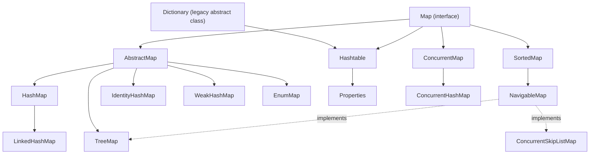
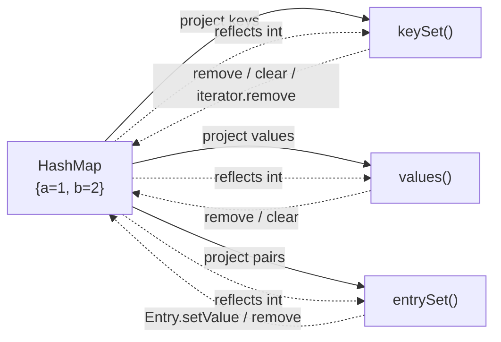
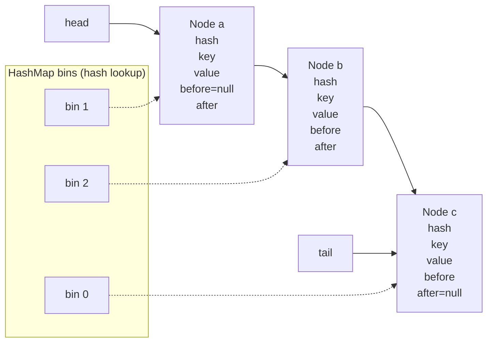
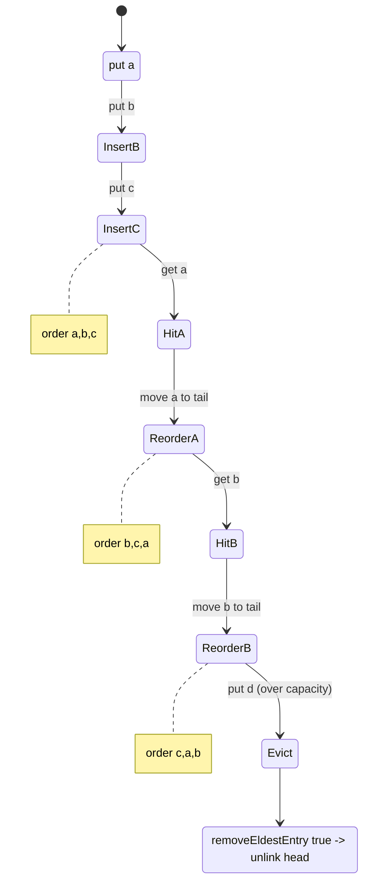
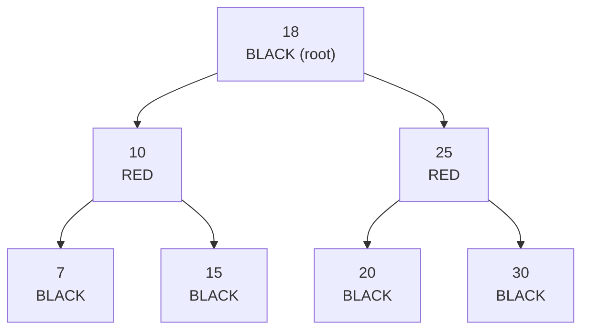
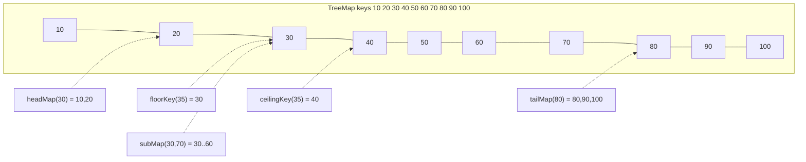
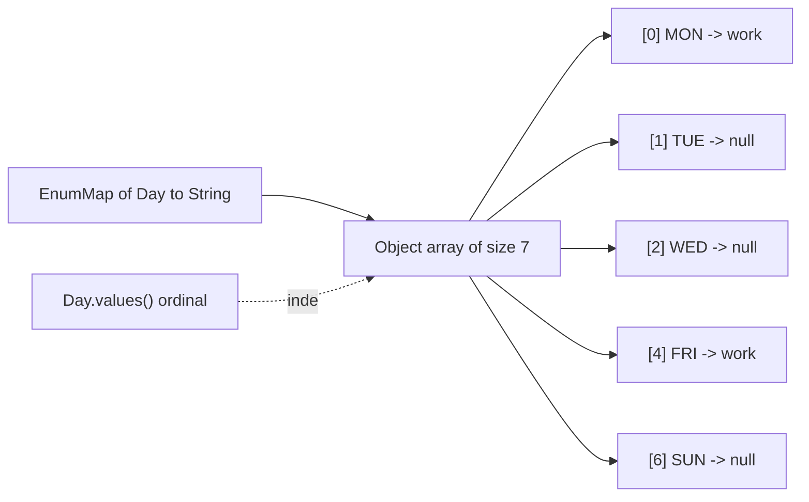
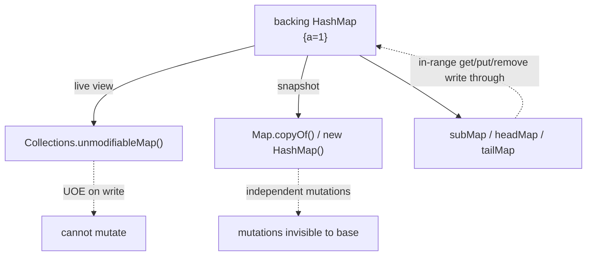
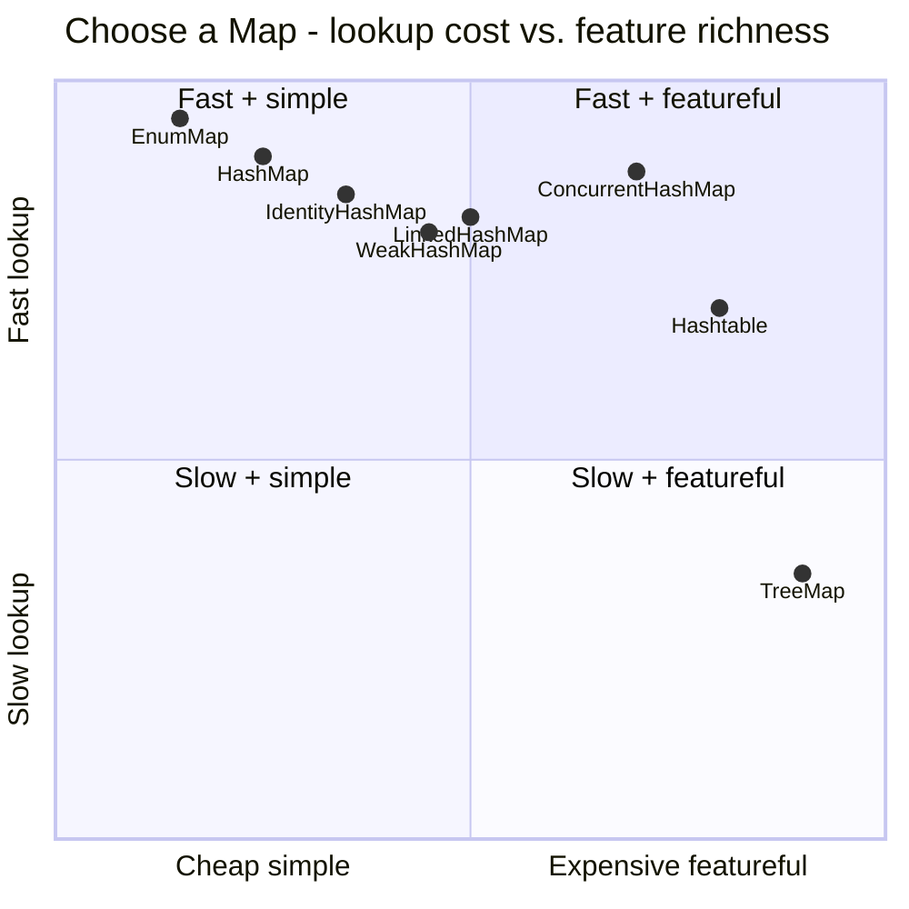

# Collections Framework, Part 2

A `Map` is the one collection abstraction that is *not* a `Collection`: it maps **keys** to **values** and enforces **key uniqueness**, not value uniqueness. Everything an interviewer probes about maps reduces to four questions: (1) *where does the key live* (hash bucket vs tree vs ordinal array vs linked list)? (2) *in what order do I iterate*? (3) *are nulls allowed, and does equality mean `equals` or `==`*? (4) *is what I am holding a view or a copy*?

Where Part 1 covered `List`/`Set`/`Queue` and their internals, this module covers the `Map` hierarchy end to end: the contract, the default-method algebra (`compute`, `merge`, …), live views, iteration order per implementation, `LinkedHashMap` (including LRU caches), `TreeMap` and `NavigableMap` range views, the legacy classes, the special-purpose maps, sorting with `Comparable`/`Comparator`, collection equality/`hashCode` rules, and views vs copies. `HashMap`'s internal table mechanics are owned by [HashMap Internals](10-HashMap-Internals.md); concurrent maps by [Concurrent Collections](11-Concurrent-Collections.md); here `HashMap` appears only as the reference implementation of the contract.

> Mental model: a `Map` is a *set of `Map.Entry` objects*. `keySet()`, `values()` and `entrySet()` are three projections of that one set. The implementation decides how the set is physically stored (array + buckets, buckets + linked list, red-black tree, linked list, ordinal array) and therefore decides **iteration order**, **null tolerance**, **equality semantics**, and **complexity**.

## The `Map` hierarchy

`Map` sits *outside* the `Collection` interface (a deliberate JDK 1.2 design choice: a map is a set of pairs, not a bag of elements). `SortedMap` adds key ordering; `NavigableMap` (Java 6) adds range navigation and directional views. `Dictionary` is the pre-Collections abstract legacy parent of `Hashtable`.



| Implementation | Backing structure | Key order | Null key | Null value | Key equality | Thread-safe | get / put average |
|---|---|---|---|---|---|---|---|
| `HashMap` | table of bins (array→list→tree) | none (hash) | 1 allowed | allowed | `equals`/`hashCode` | no | O(1) |
| `LinkedHashMap` | `HashMap` + doubly-linked list | insertion **or** access | 1 allowed | allowed | `equals`/`hashCode` | no | O(1) |
| `TreeMap` | red-black tree | sorted | no (unless comparator allows) | allowed | `compare` (not `equals`) | no | O(log n) |
| `Hashtable` | table of bins | none (hash) | **no** | **no** | `equals`/`hashCode` | yes (single lock) | O(1) |
| `IdentityHashMap` | open-addressed array | none | 1 allowed | allowed | `==` / `System.identityHashCode` | no | O(1) |
| `WeakHashMap` | table + `ReferenceQueue` weak keys | none | 1 allowed | allowed | `equals`/`hashCode` | no | O(1) |
| `EnumMap` | ordinal-indexed `Object[]` | enum declaration order | no | allowed | `==` (enum identity) | no | O(1) |
| `ConcurrentHashMap` | bins + CAS/synchronized | none (hash) | **no** | **no** | `equals`/`hashCode` | yes (striped) | O(1) |
| `Properties` | `Hashtable<Object,Object>` | none | no | no | `equals`/`hashCode` | yes | O(1) |

Note the two thread-safe entries: `Hashtable` guards *every* method with one intrinsic lock (coarse), while `ConcurrentHashMap` uses per-bin CAS and synchronized bin heads; see [Concurrent Collections](11-Concurrent-Collections.md).

## The `Map` contract

### The seven abstract methods

Everything in `Map` is expressible through seven primitives that every implementation must define:

| Method | Contract |
|---|---|
| `V put(K, V)` | Associate; return previous value or `null` (ambiguous with "was absent **or** previous was `null`"—use `containsKey` to disambiguate) |
| `V get(Object)` | Return mapped value or `null`. **Key typed `Object`**, not `K`—so you can `get` with any type; a type that can't equal any key just returns `null` (except `TreeMap`, which may throw `ClassCastException`) |
| `V remove(Object)` | Remove mapping; return previous value or `null` |
| `boolean containsKey(Object)` | Is there a mapping for this key? |
| `boolean containsValue(Object)` | Is any value `equals` to this? **O(n)** for hash maps |
| `int size()` | Number of mappings |
| `Set<Map.Entry<K,V>> entrySet()` | Live set view of all mappings |

`keySet()` and `values()` have default implementations built from `entrySet()` in `AbstractMap`, but every concrete JDK map overrides them with a true view for performance.

> Rule: `containsValue` is O(n) on `HashMap`/`LinkedHashMap`/`IdentityHashMap`. Never put it in a hot loop.

### `Map.Entry` and mutability

`Map.Entry` is the pair. Before Java 8 you had to call `entry.setValue(v)` or `map.put(entry.getKey(), v)`; Java 8 added the **default methods** `getKey`/`getValue` plus the comparator factories, and `Map.Entry` became a nest interface of `Map` (so `Map.Entry` is the canonical name; `AbstractMap.SimpleEntry` remains the general-purpose implementation). Key sets are immutable through the entry (`setKey` was removed in Java 9); values are mutable via `setValue`, and `setValue` **writes through to the backing map**.

```java
Map<String, Integer> m = new HashMap<>();
m.put("a", 1);
m.put("b", 2);
for (Map.Entry<String, Integer> e : m.entrySet()) {
    e.setValue(e.getValue() * 10);   // write-through
}
System.out.println(m);   // {a=10, b=20}
```

### The default-method algebra (Java 8)

These are the methods that turn maps into atomic-ish read-modify-write operators. Each has a *precise* behavior that interviewers love to test.

| Method | If key absent | If key present | Multiple ops? | Returns |
|---|---|---|---|---|
| `getOrDefault(k, d)` | `d` | mapped value (even if `null`!) | no | value or default |
| `putIfAbsent(k, v)` | puts `v` | no-op if value non-null; **puts if value is `null`** | no (2 ops) | previous value |
| `computeIfAbsent(k, f)` | applies `f`, inserts if result non-null | no-op if value non-null; **applies `f` if value is `null`** | yes | current value |
| `computeIfPresent(k, f)` | no-op | applies `f`; removes if result `null` | yes | new value |
| `compute(k, f)` | applies `f`, inserts if result non-null | applies `f`; removes if result `null` | yes | new value |
| `merge(k, v, f)` | inserts `v` | `f(old, v)`; removes if result `null` | yes | new value |
| `replace(k, v)` | no-op | replaces | no | previous value |
| `replace(k, old, new)` | no-op | replaces only if currently `old` | no (atomic predicate) | `boolean` |
| `replaceAll(f)` | — | rewrites every value | yes | — |
| `forEach(biConsumer)` | — | visits every pair | no | — |

Two null traps that were verified on Java 21:

```java
Map<String, String> m = new HashMap<>();
m.put("k", null);
System.out.println(m.putIfAbsent("k", "new")); // null  (treated as absent!)
System.out.println(m.get("k"));                // new

Map<String, Integer> c = new HashMap<>();
c.put("a", null);
System.out.println(c.computeIfAbsent("a", x -> 5)); // 5 (mapped-null counts as absent)

Map<String, Integer> g = new HashMap<>();
g.put("n", null);
System.out.println(g.getOrDefault("n", 42)); // null, NOT 42 — presence wins
```

> Rule: `getOrDefault` keys off **presence**, not null-ness. `putIfAbsent`/`computeIfAbsent` key off **non-null value** — a mapped `null` is treated as absent. This asymmetry is a classic trap.

`merge` **rejects a null value argument** (it inspects `value` immediately and throws `NullPointerException`), but *accepts* a remapping function that returns `null`, which removes the key:

```java
Map<String, Integer> m = new HashMap<>();
m.put("a", 1);
m.merge("a", 5, Integer::sum);        // a=6
try { m.merge("a", null, Integer::sum); } catch (NullPointerException e) { /* NPE */ }
m.merge("a", 1, (x, y) -> null);      // key "a" removed
```

### Re-entrancy and the "modified during computation" rule

The remapping functions must **not** structurally modify the map (except through the operator itself). `HashMap.computeIfAbsent` contains an explicit guard: if the map is modified *during* the computation, it throws `ConcurrentModificationException` (`java.util.HashMap:1183`, the "Recursive update" check). Also, a remapping function must be **fast and side-effect free**; if it recurses into the same map you get a `ConcurrentModificationException` or, for `compute`, infinite recursion / `StackOverflowError`.

```java
Map<String, Integer> m = new HashMap<>();
try {
    m.computeIfAbsent("a", k -> { m.put("b", 1); return 1; }); // structural change inside fd
} catch (ConcurrentModificationException e) {
    // thrown: "Recursive update"
}
```

### Live views (`keySet`, `values`, `entrySet`)

All three are **backed views**, not snapshots. Mutations go both ways.



| View | Add support | Remove support | `iterator.remove` | Writes back |
|---|---|---|---|---|
| `keySet()` | no (`add`/`addAll` throw `UnsupportedOperationException`) | yes | yes | removes mapping |
| `values()` | no | yes | yes | removes mapping |
| `entrySet()` | no | yes | yes | removes mapping; `setValue` updates value |
| `Map.of(...)` / `Map.copyOf` views | no | no (unmodifiable) | no | immutable |

Because they share the map's `modCount`, iterating any view while the map is structurally modified throws `ConcurrentModificationException` (best-effort, fail-fast):

```java
Map<String, Integer> m = new HashMap<>(Map.of("a", 1, "b", 2));
try {
    for (String k : m.keySet()) m.put("c", 3); // structural update
} catch (ConcurrentModificationException e) {
    // thrown
}
```

### Null rules across the contract

| Map | null key | null value | Notes |
|---|---|---|---|
| `HashMap` | yes (exactly one) | yes | `get(null)` works |
| `LinkedHashMap` | yes | yes | inherits from `HashMap` |
| `TreeMap` (natural ordering) | **no** | yes | `put(null, …)` → `NPE` from `compareTo` |
| `TreeMap` with `Comparator` | only if comparator handles it | yes | e.g. `Comparator.nullsFirst` |
| `Hashtable` | **no** | **no** | throws `NPE` |
| `ConcurrentHashMap` | **no** | **no** | throws `NPE` |
| `IdentityHashMap` | yes | yes | unlike `HashMap`, allows null key |
| `WeakHashMap` | yes | yes | null key is a normal strong ref (never evicted) |
| `EnumMap` | **no** | yes | `put(null, …)` → `NPE`; `containsKey(null)` returns `false` |
| `Map.of`/`Map.copyOf` | **no** | **no** | `NPE` at construction |

## Iteration order by implementation

There is no `Map` contract for iteration order, so this is the single most common source of "works on my machine" bugs. Verified orderings on Java 21 (`banana`, `apple`, `cherry`, `date` inserted in that order):

| Map | `keySet()` iteration | Guarantee |
|---|---|---|
| `HashMap` | `[banana, date, apple, cherry]` | none; may change across resizes/JDK versions |
| `LinkedHashMap` (insertion) | `[banana, apple, cherry, date]` | insertion order |
| `LinkedHashMap` (access) | least-recently-accessed first | access order |
| `TreeMap` | `[apple, banana, cherry, date]` | sort order |
| `EnumMap` | enum declaration (ordinal) order | fixed |
| `Map.of` | unspecified | none |

> Rule: never rely on `HashMap` order. If order matters, use `LinkedHashMap` (insertion), `TreeMap` (sorted), or `EnumMap` (enum order).

## `HashMap` (pointer)

`HashMap` is the hash-table reference implementation: an array of bins, each bin a linked list that converts to a red-black tree once it exceeds `TREEIFY_THRESHOLD = 8` and the table is at least `MIN_TREEIFY_CAPACITY = 64`. Default capacity 16, load factor 0.75, threshold = capacity × loadFactor, resize doubles capacity. Its iteration order is the table-scan order (bucket index, then within-bucket order). `null` key hashes to bucket 0. The full internal mechanism — `hash(key) = h ^ (h >>> 16)`, `tableSizeFor`, treeification, `modCount`, the `Node`/`TreeNode` layout — belongs to [HashMap Internals](10-HashMap-Internals.md). Here, treat it as the baseline O(1) map.

## `LinkedHashMap`

`LinkedHashMap` extends `HashMap` and adds a **doubly-linked list threading through all entries**. It inherits the hash table (so O(1) lookup) and overlays order via two extra fields per node (`before`, `after`) plus `head`/`tail` pointers on the map. Every `put` links a new node at the tail; every `remove` unlinks it; with access order, every `get`/`getOrDefault`/`compute*`/`merge`/`put` on an existing key **moves the node to the tail**.



### Insertion order vs access order

The third constructor argument selects the mode:

```java
// insertion order (default): false
LinkedHashMap<String, Integer> ins = new LinkedHashMap<>();

// access order: true  (cap, loadFactor, accessOrder)
LinkedHashMap<String, Integer> acc = new LinkedHashMap<>(16, 0.75f, true);
acc.put("a", 1); acc.put("b", 2); acc.put("c", 3);
System.out.println(acc.keySet());  // [a, b, c]
acc.get("a");
System.out.println(acc.keySet());  // [b, c, a]  <-- get() moved "a" to tail
acc.get("b");
System.out.println(acc.keySet());  // [c, a, b]
```

Verified: an *insertion-ordered* map is **not** reordered by `get` (`[a, b, c]` stays `[a, b, c]`), while an access-ordered map reorders on every access. Reads also include `getOrDefault`, `compute`, `computeIfAbsent`, `computeIfPresent`, `merge`, `replace`, and `put` on an existing key — all "accesses".



### Building an LRU cache with `removeEldestEntry`

The classic use. `LinkedHashMap` calls `removeEldestEntry(eldest)` after every insertion; returning `true` unlinks the **head**, which in access-order mode is the least-recently-used entry.

```java
import java.util.*;

public class LruCache<K, V> extends LinkedHashMap<K, V> {
    private final int capacity;

    public LruCache(int capacity) {
        super(16, 0.75f, true);   // access order
        this.capacity = capacity;
    }

    @Override
    protected boolean removeEldestEntry(Map.Entry<K, V> eldest) {
        return size() > capacity;
    }

    public static void main(String[] args) {
        LruCache<Integer, String> cache = new LruCache<>(3);
        for (int i = 1; i <= 5; i++) cache.put(i, "v" + i);
        System.out.println(cache.keySet());  // [3, 4, 5]
        cache.get(3);                        // touch 3 -> most recently used
        cache.put(6, "v6");                  // evicts LRU: 4
        System.out.println(cache.keySet());  // [5, 3, 6]
    }
}
```

Verified output: `[3, 4, 5]` then `[5, 3, 6]`. Note `removeEldestEntry` receives `eldest` too, so you can implement TTL/weighted eviction; return `false` to *observe* evictions without removing. If you use **insertion order** with the same override, you get a FIFO cache, not LRU (verified `[2, 3]` after inserting 1,2,3 with capacity 2).

### `LinkedHashMap` specifics and pitfalls

- `LinkedHashMap` supports `null` key and values.
- `containsValue` is O(n) (list walk).
- `accessOrder=true` makes iteration order unstable across gets — never iterate an access-ordered map expecting insertion order.
- Access order adds a **structural** move on every `get`, but does not bump `modCount`; iterating while `get`-ing is safe.
- `LinkedHashMap` is not thread-safe. For an LRU under concurrency, wrap with `Collections.synchronizedMap` **and** guard iteration with the map's monitor, or use a purpose-built cache (Caffeine). A synchronized wrapper makes each `get` atomic but the touch-and-evict sequence is not atomic across threads.
- The three-arg constructor signature is `(initialCapacity, loadFactor, accessOrder)`; forgetting `true` silently gives a FIFO cache.

## `TreeMap`

`TreeMap` implements `NavigableMap` with a **red-black tree** — a self-balancing binary search tree guaranteeing O(log n) `get`/`put`/`remove` and sorted iteration.

### Red-black tree properties

A red-black tree is a BST where every node carries one bit of color, satisfying:
1. Every node is red or black.
2. The root is black.
3. Every leaf (`null`/NIL) is black.
4. A red node has no red child (no two reds in a row).
5. Every path from a node to its descendant NIL leaves contains the same number of black nodes (**black-height**).

These invariants force height ≤ 2·log₂(n+1), i.e. O(log n). `TreeMap` rebalances with **left/right rotations plus recoloring** after `put`/`remove` via `fixAfterInsertion`/`fixAfterDeletion`; each `Entry` carries its color explicitly in a `boolean` field (`BLACK = true`, `RED = false`). The important interview point: `TreeMap` is a *balanced* BST, so no adversarial key order degrades it to O(n) (unlike a plain BST).



### Ordering: `Comparable` vs `Comparator`

- No comparator: keys must implement `Comparable<? super K>`; `TreeMap` calls `key.compareTo(other)`. Keys that aren't mutually comparable → `ClassCastException` at insertion.
- With a `Comparator<? super K>`: `TreeMap` calls `comparator.compare(a, b)`, so keys need not be `Comparable` and nulls can be handled.

```java
TreeMap<Object, Integer> raw = new TreeMap<>();
raw.put("s", 1);
raw.put(4, 2);   // ClassCastException: String cannot be cast to Integer
```

TreeMap key equality is defined by the **comparator/natural ordering**, *not* `equals`. If the comparator says two keys are equal (returns 0), the second `put` overwrites the first even if `equals` is false. Verified:

```java
TreeMap<String, Integer> t = new TreeMap<>(Comparator.comparingInt(String::length));
t.put("ab", 1);
t.put("cd", 2);      // compare("cd","ab") == 0 -> treated as same key
System.out.println(t.size());  // 1
System.out.println(t);         // {ab=2}  (value replaced, key kept)
```

> Rule: a `Comparator` inconsistent with `equals` is legal for `TreeMap` but produces surprising `size()`/`get()` results. Keep comparators consistent with `equals` unless you deliberately want this.

### `null` handling

Natural-ordering `TreeMap` rejects a `null` key (`compareTo` NPEs), but permits **null values**. A custom comparator can admit a null key:

```java
TreeMap<String, String> t = new TreeMap<>(Comparator.nullsFirst(Comparator.naturalOrder()));
t.put(null, "n");
t.put("a", "a");
System.out.println(t);   // {null=n, a=a}
```

`TreeMap.get(null)` with natural ordering would also NPE — guard with `containsKey` logic or a null-tolerant comparator.

### `NavigableMap` API

`SortedMap` gave ordering; `NavigableMap` (Java 6) adds *navigation* and *directional/range* views.

| Method | Returns |
|---|---|
| `firstKey()` / `lastKey()` | extreme key (throws `NoSuchElementException` if empty) |
| `firstEntry()` / `lastEntry()` | extreme entry |
| `pollFirstEntry()` / `pollLastEntry()` | extreme entry **and removes** it |
| `lowerKey(k)` | greatest key **< k**, else `null` |
| `floorKey(k)` | greatest key **≤ k**, else `null` |
| `ceilingKey(k)` | smallest key **≥ k**, else `null` |
| `higherKey(k)` | smallest key **> k**, else `null` |
| `lowerEntry`/`floorEntry`/`ceilingEntry`/`higherEntry` | corresponding `Map.Entry` |
| `headMap(k)` / `headMap(k, inclusive)` | view of keys `< k` (or `≤`) |
| `tailMap(k)` / `tailMap(k, inclusive)` | view of keys `≥ k` (or `>`) |
| `subMap(from, to)` / `subMap(from, incl, to, incl)` | view of a key range |
| `descendingMap()` / `descendingKeySet()` | reversed-order views |
| `navigableKeySet()` | a `NavigableSet` view of keys |

Verified on a `TreeMap` with keys 10..100:

```java
System.out.println(tm.floorKey(35));    // 30
System.out.println(tm.lowerKey(30));    // 20
System.out.println(tm.ceilingKey(35));  // 40
System.out.println(tm.higherKey(30));   // 40
System.out.println(tm.headMap(30));         // {10=..., 20=...}
System.out.println(tm.headMap(30, true));   // {10=..., 20=..., 30=...}
System.out.println(tm.tailMap(80));         // {80=..., 90=..., 100=...}
System.out.println(tm.subMap(30, 70));      // {30=..., 40=..., 50=..., 60=...}
System.out.println(tm.subMap(30, true, 70, true)); // adds key 70
System.out.println(tm.descendingMap().firstKey()); // 100
```

`subMap(4, 2)` (from > to) throws `IllegalArgumentException: fromKey > toKey`. Endpoints are **exclusive by default** in the two- and four-arg `subMap` (`from` inclusive, `to` exclusive in the two-arg overload).



### Range views are backed

`headMap`/`tailMap`/`subMap`/`descendingMap` return **live views**. Removing through the view removes from the tree; inserting a key *outside* the view range throws `IllegalArgumentException`.

```java
TreeMap<Integer, String> tm = new TreeMap<>();
for (int i = 1; i <= 10; i++) tm.put(i * 10, "v" + i * 10);

NavigableMap<Integer, String> sub = tm.subMap(30, true, 70, true);
sub.remove(50);
System.out.println(tm.containsKey(50));  // false  <-- reflected in backing map

tm.put(45, "x");                         // allowed: 45 is in [30,70]
try { sub.put(5, "y"); }                 // IllegalArgumentException: out of range
catch (IllegalArgumentException e) { }
```

### When to use `TreeMap`

- Need keys **sorted** or range queries (`subMap`, `headMap`, `floor`/`ceiling`).
- Need navigation (`firstEntry`, `higherKey`, `descendingMap`).
- Cost: O(log n) per operation vs O(1) hash. Constant factor is higher (pointer chasing, poor cache locality) — for a few thousand entries a `HashMap` + sort-on-demand is often faster.

## Legacy maps: `Hashtable`, `Properties`, `Vector`, `Stack`

### `Hashtable`

`Hashtable` predates `HashMap` (Java 1.0). It is a hash table like `HashMap` but:
- **Every public method is `synchronized`** on the instance (verified via reflection: `get`/`put` are `synchronized`, `HashMap.get` is not). This makes single-method operations atomic but gives **coarse, single-lock** scalability — far worse than `ConcurrentHashMap`.
- **No null keys or values** — throws `NullPointerException`.
- Iteration is fail-fast, but `Enumeration` (legacy) is not.
- Its default initial capacity is 11 and it uses a `rehash()` scheme (old prime capacities), not power-of-two.

```java
Hashtable<String, String> ht = new Hashtable<>();
ht.put(null, "x");   // NullPointerException
ht.put("x", null);   // NullPointerException
```

> Rule: `Hashtable` is **obsolete**. Use `HashMap` for single-threaded and `ConcurrentHashMap` for concurrent code. `Collections.synchronizedMap(new HashMap<>())` is the documented replacement for the old synchronized behavior (but still requires external locking for iteration).

### `Properties`

`Properties` extends `Hashtable<Object, Object>` but is intended for **String keys and values**; `getProperty`/`setProperty` enforce `String`, while the inherited raw `put`/`get` remain untyped. It knows the ISO-8859-1 `.properties` format via `load`/`store` (and `loadFromXML`/`storeToXML`), plus a defaults chain.

```java
Properties p = new Properties();
p.load(new StringReader("a=1\nb=2\n# comment\nc=3\n"));
System.out.println(p.getProperty("a"));            // 1
System.out.println(p.getProperty("nope", "dflt")); // dflt

Properties defaults = new Properties();
defaults.setProperty("z", "9");
Properties child = new Properties(defaults);
System.out.println(child.getProperty("z"));        // 9  (falls back to defaults)
```

Pitfalls: `.properties` files are read as **ISO-8859-1** (escape non-ASCII or use `loadFromXML`); `load` **does not close** the stream; duplicate keys silently overwrite; the defaults chain can hide a key you thought was absent.

### `Vector` / `Stack` (pointer)

`Vector` is a synchronized growable array; `Stack extends Vector` adds `push`/`pop`/`peek` (LIFO). Both are legacy: `Vector`'s per-method locking is coarse, and `Stack` inherits unrelated `Vector` methods (you can `add(0, e)` into a stack). Prefer `ArrayList` and `ArrayDeque` (for stack/queue). See [Collections Framework, Part 1](08-Collections-Part-1.md). Note: `Vector`/`Stack` belong to the `List` family and are listed here only for completeness.

## Special-purpose maps

### `IdentityHashMap`

A `Map` that uses **reference equality (`==`)** instead of `equals`, and `System.identityHashCode(obj)` instead of `hashCode()`. Internals: an **open-addressed** array of `Object[]` where keys occupy even slots and values odd slots (linear probing with a probe distance). Consequences:
- Two `.equals()` but distinct objects are **different keys**.
- `null` key is allowed (unlike `HashMap`? no, `HashMap` also allows null — the difference is `==`, not null).
- Not `equals`/`hashCode`-based, so it violates the general `Map` contract (documented and intentional).
- Semantics: `System.identityHashCode(obj)` may collide; identity maps resolve collisions by `==` comparison (correct, but weaker hash distribution).

```java
IdentityHashMap<String, String> ihm = new IdentityHashMap<>();
HashMap<String, String> hm = new HashMap<>();
String a = new String("key");
String b = new String("key");   // a.equals(b) == true, a == b == false

ihm.put(a, "A");
hm.put(a, "A");
System.out.println(ihm.get(b)); // null   (different reference)
System.out.println(hm.get(b));  // A      (equals match)
ihm.put(b, "B");
System.out.println(ihm.size()); // 2      (two distinct identities)
```

Use cases: graph/topology traversal tracking visited nodes by identity, serialization/proxy graphs, `javac`'s internal symbol tables. Never use it as a general cache.

### `WeakHashMap`

A `Map` whose **keys are held weakly**. Internally it stores keys via `WeakReference` (an `Entry extends WeakReference`), and registers a `ReferenceQueue`. When GC clears a key, the stale entry sits in the queue until the next map operation **expunges** it (so the map cleans up lazily, not eagerly). Values are held strongly, so a value that references its own key creates a **strong-reference cycle** that pins the entry forever — a classic leak.

```java
WeakHashMap<Object, String> whm = new WeakHashMap<>();
Object wk = new Object();
whm.put(wk, "v");
System.out.println(whm.size());  // 1
wk = null;                       // drop the only strong ref
System.gc(); Thread.sleep(200);
System.out.println(whm.size());  // 0  (entry expunged)
```

| Aspect | `WeakHashMap` | `HashMap` |
|---|---|---|
| Key reference | weak | strong |
| Eviction | GC-driven, lazy (on next access) | none |
| Thread-safe | no | no |
| null key | allowed, never evicted (strong) | allowed |
| Iteration determinism | non-deterministic (GC timing) | non-deterministic |
| Intended use | canonicalizing caches keyed by identity-ish keys | general map |

Caching caveats: because eviction is GC- and timing-dependent, `size()` is not a reliable bound; entries may persist until the next operation; and if any strong reference to the key remains *anywhere*, the entry is pinned. Avoid `WeakHashMap` for bounded caches; use a proper cache library.

### `EnumMap`

`EnumMap` is backed by a plain `Object[]` indexed by the enum constant's **ordinal**. `get`/`put` compile to an array access after an ordinal lookup — the fastest map available (no hashing, no comparison). Keys must come from a single enum type (enforced at construction via `Class<E>`), null keys are rejected, and iteration follows **declaration order**.

```java
enum Day { MON, TUE, WED, THU, FRI, SAT, SUN }

EnumMap<Day, String> em = new EnumMap<>(Day.class);
em.put(Day.FRI, "work");
em.put(Day.MON, "work");
System.out.println(em.keySet()); // [MON, FRI] — declaration order, not insertion
```



Pitfalls: creating from an empty enum and then adding constants via reflection is broken; `EnumMap` serializes as an array plus the enum class; `EnumMap` is preferred over `HashMap<Enum, V>` everywhere for speed and order.

### Immutable maps: `Map.of`, `Map.ofEntries`, `Map.copyOf`

Java 9 added `Map.of()` (0–10 pairs), `Map.ofEntries(Map.entry(...)…)` (unbounded), and `Map.copyOf(Map)`.

```java
Map<String, Integer> m = Map.of("x", 1, "y", 2);
m.put("z", 3);   // UnsupportedOperationException
m.put(null, 1);  // NPE (Map.of rejects nulls at construction and mutation)
m.getOrDefault("q", 0); // allowed (read-only default methods work)

Map<String, Integer> copied = Map.copyOf(new HashMap<>(m));
copied.put("z", 3);  // UnsupportedOperationException
```

| Factory | Null keys/values | Duplicate keys | Max size | Order |
|---|---|---|---|---|
| `Map.of(k, v, …)` | rejected (`NPE`) | `IllegalArgumentException` | 10 pairs | unspecified |
| `Map.ofEntries(...)` | rejected (`NPE`) | `IllegalArgumentException` | unbounded | unspecified |
| `Map.copyOf(m)` | rejected (`NPE`) | n/a (from map) | unbounded | unspecified |
| `Collections.unmodifiableMap(m)` | whatever `m` allows | n/a | n/a | that of `m` (view!) |

> Rule: `Map.copyOf` is a **defensive copy** (later changes to the source are invisible) whereas `Collections.unmodifiableMap` is a **view** (later changes show through). `Map.copyOf` rejects nulls; `unmodifiableMap` tolerates them if the backing map does.

## Sorting: `Comparable`, `Comparator`, and maps

### `Comparable` and its contract

`Comparable<T>.compareTo` defines the **natural ordering**. Its contract mirrors `equals`:
- Antisymmetry: `sgn(x.compareTo(y)) == -sgn(y.compareTo(x))`.
- Transitivity: `x.compareTo(y) > 0 && y.compareTo(z) > 0` ⟹ `x.compareTo(z) > 0`.
- Consistency: `x.compareTo(y) == 0` ⟹ `sgn(x.compareTo(z)) == sgn(y.compareTo(z))`.

> Strongly recommended (and required by `SortedSet`/`SortedMap`): **`compareTo` should be consistent with `equals`**. When it is not, sorted collections silently drop "duplicate" elements that aren't `equals`. E.g. `new BigDecimal("1.0")` and `new BigDecimal("1.00")` are `compareTo`-equal but `!equals`, so a `TreeSet` keeps only one.

```java
public record Person(String name, int age) implements Comparable<Person> {
    @Override
    public int compareTo(Person other) {
        return Integer.compare(this.age, other.age); // consistent with equals when ages differ
    }
}
```

### The `Comparator` factory methods (Java 8)

```java
Comparator<Person> byAge  = Comparator.comparingInt(Person::age);
Comparator<Person> byName = Comparator.comparing(Person::name);
Comparator<Person> chain  = byAge.thenComparing(byName);
Comparator<Person> reverse = chain.reversed();
Comparator<String> nullSafe = Comparator.nullsFirst(Comparator.naturalOrder());
Comparator<Person> byNameNullsLast = Comparator.comparing(
        Person::name, Comparator.nullsLast(String::compareTo));
```

| Factory | Purpose |
|---|---|
| `comparing(keyExtractor)` | derive `Comparable` key |
| `comparing(keyExtractor, keyComparator)` | derive key + custom comparator (null-safe keys) |
| `comparingInt` / `Long` / `Double` | avoid boxing for primitive keys |
| `thenComparing(…)` | secondary/tertiary tie-break |
| `reversed()` | reverse (returns a new comparator) |
| `naturalOrder()` / `reverseOrder()` | base orderings |
| `nullsFirst(c)` / `nullsLast(c)` | null-tolerant wrapper |
| `comparingInt`…`reversed` type-inference trap | `naturalOrder().reversed()` needs `Comparator.<T>naturalOrder()` |

Type-inference pitfall (verified compile error otherwise):

```java
list.sort(Comparator.naturalOrder().reversed());     // ERROR: inferred Object
list.sort(Comparator.<String>naturalOrder().reversed()); // OK
list.sort(Comparator.comparing(Person::name).reversed()); // OK: target type flows in
```

`nullsFirst(Comparator.comparingInt(Person::age))` is required if an element can be null; a bare `comparingInt` on a list containing a `null` element throws `NullPointerException` (verified) because the extractor is called on the null element.

### TimSort stability

`List.sort`/`Arrays.sort` (for object/reference arrays) use **TimSort**, a stable merge sort: equal elements retain their original relative order. This matters for multi-key sorting — you may sort by the *least* significant key first, then by the most significant, and stability preserves the earlier ordering. (`Arrays.sort` on primitive arrays uses dual-pivot quicksort, which is **not** stable.) Sorting a `List` in place is O(n log n) and allocates a temp array for the merge.

`Collections.sort(list, cmp)` is equivalent to `list.sort(cmp)` (since Java 8; `List.sort` is the default-method delegator).

### Sorting maps

A `Map` itself has no order API; you sort its `entrySet`.

```java
Map<String, Integer> m = new HashMap<>();
m.put("b", 2); m.put("a", 3); m.put("c", 1);

// by key -> TreeMap
TreeMap<String, Integer> byKey = new TreeMap<>(m);       // {a=3, b=2, c=1}

// by value -> sort a list of entries
List<Map.Entry<String, Integer>> byVal = new ArrayList<>(m.entrySet());
byVal.sort(Map.Entry.comparingByValue());                 // [c=1, b=2, a=3]
byVal.sort(Map.Entry.<String, Integer>comparingByValue().reversed()); // [a=3, b=2, c=1]
```

| Goal | Approach |
|---|---|
| Iterate keys sorted | `new TreeMap<>(map)` or `TreeMap` from the start |
| Iterate entries by key | `map.entrySet().stream().sorted(Map.Entry.comparingByKey())` |
| Iterate entries by value | `sorted(Map.Entry.comparingByValue())` |
| Value then key tie-break | `comparingByValue().thenComparing(comparingByKey())` |
| Descending key | `new TreeMap<>(Comparator.reverseOrder())` |
| Preserve sorted result | collect into `LinkedHashMap` (`Collectors.toMap(..., LinkedHashMap::new)`) |

`Map.Entry.comparingByKey()`/`comparingByValue()` are built-in comparator factories; the value one benefits from an explicit type witness when chaining `thenComparing`.

## Collection equality and `hashCode`

The `equals`/`hashCode` contracts for the three families:

- **`List`**: equal iff same size and element-wise equal **at the same index** → **order-sensitive**. `[1,2] != [2,1]`.
- **`Set`**: equal iff same size and `containsAll` → **order-insensitive**. `{1,2} == {2,1}`.
- **`Map`**: equal iff same set of `equals`-equal key→value mappings → **order-insensitive**, and `Map` equality crosses implementations: a `HashMap` can equal a `LinkedHashMap` or `TreeMap` with the same mappings (verified).

`hashCode` is defined *through* `equals`:
- `List.hashCode = 31ⁿ⁻¹·h(x₁) + … + h(xₙ)` (positional).
- `Set.hashCode = Σ h(e)` (sum, because order doesn't matter).
- `Map.hashCode = Σ (h(key) ^ h(value))` over entries (XOR so order doesn't matter).

`AbstractList`, `AbstractSet`, `AbstractMap` implement these correctly; if you extend them, override `equals`/`hashCode` only with great care. `Map.Entry.hashCode` is `Objects.hashCode(key) ^ Objects.hashCode(value)`.

> The `equals`/`hashCode` contract for keys: equal keys must have equal hash codes. A **mutable key** breaks this. If you mutate a key after insertion, its bucket is computed from the *old* hash; `get`/`containsKey` with the new hash miss it. Verified:

```java
Map<List<Integer>, String> m = new HashMap<>();
List<Integer> key = new ArrayList<>(List.of(1));
m.put(key, "x");
key.add(2);                       // mutate the key
System.out.println(m.get(key));        // null
System.out.println(m.containsKey(key)); // false
```

Use immutable keys (String, Integer, enums, records, `List.of`). Never use a mutable object or an array (arrays use identity `equals`/`hashCode`!) as a `HashMap` key.

### The "equal keys but different identity" traps

- `new Integer(1)` vs `Integer.valueOf(1)`: `equals` true (fine as keys).
- `String` vs `StringBuilder`: no `equals` override in `StringBuilder` → identity semantics.
- Two `BigDecimal`s equal in value but different scale: `equals` false (but `compareTo` 0) → in a `TreeMap` they collapse.
- `double` `NaN`: `Double.NaN` boxes to a value where `equals` is true but `==` is false, and `hashCode` is consistent; fine as a `HashMap` key, dangerous if you relied on `==`.
- `Object[]`/arrays: identity `equals`/`hashCode` → each array is a distinct key even with equal contents.

## Views vs copies

This distinction is the single biggest correctness footgun in map APIs.

| Thing | Kind | Reads reflect later source changes | Writes |
|---|---|---|---|
| `Collections.unmodifiableMap(m)` | view | **yes** | throw `UnsupportedOperationException` |
| `Collections.synchronizedMap(m)` | view | yes | allowed (synchronized) |
| `map.keySet()` / `values()` / `entrySet()` | view | yes | removal allowed |
| `subMap` / `headMap` / `tailMap` / `descendingMap` | view | yes (range-restricted writes) | removal + in-range insert |
| `new HashMap<>(m)` | copy | no | allowed |
| `new TreeMap<>(m)` | copy + sort | no | allowed |
| `Map.copyOf(m)` | immutable copy | no | throw `UnsupportedOperationException` |

```java
Map<String, Integer> base = new HashMap<>(Map.of("a", 1));
Map<String, Integer> view = Collections.unmodifiableMap(base);
Map<String, Integer> copy = Map.copyOf(base);

base.put("b", 2);
System.out.println(view);  // {a=1, b=2}  <-- reflects base
System.out.println(copy);  // {a=1}       <-- frozen

view.put("c", 3);   // UnsupportedOperationException
```



### Concurrent modification of views

Any view shares the backing map's `modCount`. Structural modification during iteration of *any* view throws `ConcurrentModificationException` (fail-fast). The only sanctioned way to remove during iteration is `iterator.remove()` or `values().removeIf(...)`. Removing through a *different* view while iterating is also a structural change and throws.

```java
Map<String, Integer> m = new HashMap<>(Map.of("a", 1, "b", 2, "c", 3));
m.values().removeIf(v -> v % 2 == 1);  // OK: uses internal iterator
System.out.println(m);                 // {b=2}
```

For a truly concurrent map, iteration is weakly consistent and does **not** throw (`ConcurrentHashMap`) — see [Concurrent Collections](11-Concurrent-Collections.md).

## Performance comparison

Approximate operation costs (average; JDK 21, typical sizes). "Iteration" assumes a full `entrySet` walk; "memory/entry" is the per-entry overhead beyond the key/value objects.

| Map | get | put | remove | Iteration | Ordered? | Null key/value | Thread-safe | Memory/entry | Choose when |
|---|---|---|---|---|---|---|---|---|---|
| `HashMap` | O(1) | O(1) amortized | O(1) | O(cap + n) | no | yes/yes | no | ~36 B (Node) | general purpose |
| `LinkedHashMap` | O(1) | O(1) | O(1) | O(n) | insertion/access | yes/yes | no | ~36 B + 2 refs | need order or LRU |
| `TreeMap` | O(log n) | O(log n) | O(log n) | O(n) sorted | sorted | no/yes | no | ~40 B (Entry) | sorted/range queries |
| `Hashtable` | O(1) | O(1) | O(1) | O(cap + n) | no | no/no | yes (coarse) | ~36 B | legacy only; avoid |
| `IdentityHashMap` | O(1) | O(1) | O(1) | O(cap) | no | yes/yes | no | ~16 B (2 slots) | identity semantics |
| `WeakHashMap` | O(1) | O(1) | O(1) | O(cap) | no | yes/yes | no | ~48 B (ref chain) | GC-managed keys |
| `EnumMap` | O(1) | O(1) | O(1) | O(n) | enum order | no/yes | no | one array slot | enum keys |
| `ConcurrentHashMap` | O(1) | O(1) | O(1) | weakly consistent | no | no/no | yes (striped) | ~36 B | concurrent access |

Memory constants are implementation-dependent (compressed oops, JDK version) and given for intuition, not precision. `HashMap`'s `Node` is a 32-byte object (12-byte header + `hash` int + 3 references) plus the table slot; `TreeNode` is larger and only allocated for treeified bins.



**Decision cheat-sheet**
- Default: `HashMap`.
- Need insertion order or LRU: `LinkedHashMap`.
- Need sorted keys / range / navigation: `TreeMap`.
- Enum keys: `EnumMap` (always beats `HashMap<Enum, V>`).
- Identity semantics: `IdentityHashMap`.
- GC-managed keys: `WeakHashMap`.
- Many threads: `ConcurrentHashMap` (never `Hashtable`).
- Small immutable constant: `Map.of` / `Map.ofEntries` / `Map.copyOf`.

## Best practices

- Use **interface types** (`Map`, `NavigableMap`) for variables and return types; instantiate the concrete class ([Generics](../01-Fundamentals/07-Generics.md)).
- Prefer `Map.of`/`Map.copyOf` for immutable maps; `Map.copyOf` for defensive copies at API boundaries.
- Size a `HashMap`/`LinkedHashMap` up-front when the count is known: `new HashMap<>((int)(n / 0.75f) + 1)` avoids rehashing.
- Use `computeIfAbsent` for "multimap" construction: `map.computeIfAbsent(k, x -> new ArrayList<>()).add(v)`.
- Use `merge` for counters: `counts.merge(word, 1, Integer::sum)`.
- Use `getOrDefault` for lookups, but remember it returns the mapped `null` for a present null value.
- Iterate via `entrySet()` (one hash computation per entry), not `keySet()` + `get` (two). Verified measurement over 100 000 entries: `entrySet` was faster (≈32 ms vs ≈42 ms on this machine; the gap widens with cache misses). Do not over-index on a single microbenchmark — use JMH for real numbers.
- Never mutate a key object after insertion; keys must be immutable and have stable `hashCode`.
- Keep `Comparator`s consistent with `equals`; document when you deliberately don't.
- Make `Comparator`s null-safe when inputs can be null.
- Don't use `Hashtable`/`Vector`/`Stack`; replace with `HashMap`/`ArrayList`/`ArrayDeque`.
- For a shared cache, use `ConcurrentHashMap.computeIfAbsent` with a bounded cache library (Caffeine), not `WeakHashMap`.
- When exposing a map, return `Map.copyOf(...)` (immutable snapshot) or an unmodifiable view deliberately — know which you're returning.

## Common mistakes and pitfalls

**1. Relying on `HashMap` iteration order.**

```java
// WRONG: order is unspecified
for (String k : new HashMap<>(config).keySet()) { ... }
// RIGHT: use LinkedHashMap for insertion order
for (String k : new LinkedHashMap<>(config).keySet()) { ... }
```

**2. `getOrDefault` vs null values.**

```java
Map<String,Integer> m = new HashMap<>();
m.put("k", null);
int v = m.getOrDefault("k", 0);  // WRONG if you expect 0; it is null -> NPE on unbox
int w = Optional.ofNullable(m.get("k")).orElse(0); // RIGHT
```

**3. `computeIfAbsent` returning a mapping function that inspects the same map** → `ConcurrentModificationException` or infinite recursion.

**4. Using an array or mutable object as a key.** Identity `equals`/unstable `hashCode` → lookups miss.

**5. `TreeMap` with keys not mutually `Comparable`** → `ClassCastException` only at insertion time (not at declaration), so it may not fail in unit tests with one key.

**6. `Map.of` with a null** → immediate `NullPointerException`, often at static-init time.

**7. Assuming `Collections.unmodifiableMap` freezes the data** — it freezes *this reference*; the backing map can still change (and can be mutated through the original reference). Use `Map.copyOf` for a snapshot. (See `java.util.ImmutableCollections`.)

**8. Iterating a view while modifying the map** → `ConcurrentModificationException`. Use `iterator.remove()` / `removeIf`.

**9. `LinkedHashMap` access-order surprise** — iterating an access-ordered map after reads yields access order, not insertion order.

**10. `putIfAbsent` on a key mapped to `null`** replaces the null (because it checks the *value*), unlike `containsKey`. Combine with `computeIfAbsent` when the distinction matters.

**11. `Comparable` inconsistent with `equals`** — `TreeMap`/`TreeSet` collapse keys/elements (`new BigDecimal("1.0")` vs `"1.00"`), losing data.

**12. `Hashtable`/`Properties` nulls** — `Properties.put(null, ...)` throws `NPE`; `getProperty` returns `null` for a missing key (use the two-arg overload for defaults).

**13. `WeakHashMap` value referencing its key** — pins the entry; effectively a memory leak.

**14. Chaos from `removeEldestEntry`** — it is invoked by `put`/`putAll` but not by `compute*`/`merge` in a way you might expect across JDK versions; pin your JDK and test. It is also called *after* insertion, so `size()` already includes the new entry.

## Interview tips

- Be ready to draw the `Map` hierarchy and to say *why* `Map` is not a `Collection`.
- The default-method algebra (`compute`, `computeIfAbsent`, `merge`, `getOrDefault`, `putIfAbsent`) is a favourite: quote exact null/presence semantics.
- Expect "implement an LRU cache" — `LinkedHashMap(cap, 0.75f, true)` + `removeEldestEntry` is the expected answer; be ready to discuss its non-thread-safety.
- For `TreeMap`, know red-black complexity, the `NavigableMap` methods, **backed range views**, and comparator-vs-`equals` semantics.
- For sorting, mention TimSort stability and the `Comparator` factory chain (`comparing`/`thenComparing`/`reversed`/`nullsFirst`).
- Distinguish **views** (`unmodifiableMap`, `subMap`, `keySet`) from **copies** (`Map.copyOf`, `new HashMap<>`); interviewers probe whether changes show through.
- Have a one-sentence reason for every special map: `IdentityHashMap` (`==`), `WeakHashMap` (GC keys), `EnumMap` (ordinal array), `Hashtable` (obsolete synchronized).

# Interview Questions

## Beginner

**Q:** What is a `Map` and how does it differ from a `Collection`?

**A:** A `Map<K,V>` is an object that maps unique keys to values. It is **not** a `Collection` because a `Collection` stores individual elements, whereas a `Map` stores key→value *pairs* (`Map.Entry`). Consequently `Map` does not extend `Iterable` (you iterate `keySet()`, `values()`, or `entrySet()`), has no `add`/`remove(element)` semantics, and enforces key uniqueness rather than element uniqueness. A `Collection` has at most one null policy; a `Map` has separate key-null and value-null policies.

**Q:** Name the main `Map` implementations and when you'd use each.

**A:** `HashMap` — general-purpose O(1) map, undefined order. `LinkedHashMap` — preserves insertion or access order (LRU). `TreeMap` — keys sorted, O(log n), supports ranges/navigation. `Hashtable` — legacy synchronized map, no nulls, avoid. `IdentityHashMap` — keys compared by `==`. `WeakHashMap` — keys weakly referenced, GC-evicted. `EnumMap` — enum keys, ordinal array, fastest. `ConcurrentHashMap` — thread-safe (see [Concurrent Collections](11-Concurrent-Collections.md)).

**Q:** Which maps allow a `null` key and which allow `null` values?

**A:** `HashMap`, `LinkedHashMap`, `IdentityHashMap`, `WeakHashMap` allow both. `TreeMap` allows null values and rejects a null key under natural ordering (unless the comparator handles null). `Hashtable`, `ConcurrentHashMap`, `EnumMap`, and the immutable `Map.of` family reject null keys (and mostly null values too: `Hashtable` and `ConcurrentHashMap` reject both; `EnumMap` allows null values). `Map.of` rejects both keys and values that are null.

**Q:** What does `map.get(key)` return when the key is absent?

**A:** `null`. But `null` is ambiguous: it also means "the key is present and mapped to `null`". To distinguish, use `containsKey(key)`. Use `getOrDefault(key, default)` when you only care about the absent case, remembering it returns the real value (even `null`) when the key is present.

**Q:** How do you iterate a `Map` and what is the most efficient way?

**A:** Iterate `entrySet()` — `for (Map.Entry<K,V> e : map.entrySet()) { e.getKey(); e.getValue(); }`. This computes the entry once. `keySet()` + `get(key)` does a second hash lookup per entry; `values()` only when you don't need keys. Java 8 added `map.forEach((k, v) -> ...)`.

**Q:** What is a `Map.Entry`?

**A:** A single key/value pair returned by `entrySet()`. `getKey()`/`getValue()` read it; `setValue(v)` writes through to the backing map. `Map.Entry` is a nested interface of `Map` (since Java 9 both `getKey` and the comparator factories are there). Its `hashCode` is `key.hashCode() ^ value.hashCode()`.

**Q:** Difference between `put`, `putIfAbsent`, and `getOrDefault`?

**A:** `put(k,v)` always associates and returns the old value. `putIfAbsent(k,v)` puts only if the key is absent **or mapped to null**, returning the old value. `getOrDefault(k,d)` never writes; it returns the value if the key is present (even null), else `d`.

**Q:** Is `HashMap` thread-safe?

**A:** No. Concurrent structural modification can corrupt the table or throw `ConcurrentModificationException`; iteration is fail-fast. Use `ConcurrentHashMap` for concurrent access, or externally synchronize. `Collections.synchronizedMap` wraps it with a single lock, which is correct but not scalable, and still requires external locking for iteration.

**Q:** How do you remove a mapping?

**A:** `map.remove(key)` removes and returns the previous value; `map.remove(key, value)` removes only if currently mapped to that value and returns `boolean`. To remove during iteration, use `iterator.remove()` or `values().removeIf(...)`.

**Q:** What does `Map.of("a", 1, "b", 2)` produce and can you modify it?

**A:** An immutable map with the given entries. Any structural modification (`put`, `remove`, `clear`) throws `UnsupportedOperationException`; null keys/values throw `NullPointerException` at construction. It is a compact, `serializable`, immutable implementation from Java 9.

## Intermediate

**Q:** Explain `computeIfAbsent`, `computeIfPresent`, `compute`, and `merge`, with exact semantics.

**A:** All are atomic read-modify-write defaults on `Map`:
- `computeIfAbsent(k, f)`: if `k` absent or mapped to null, compute `v = f(k)`; if `v != null`, insert and return `v`; else return `null` (no insert). Otherwise return the existing value.
- `computeIfPresent(k, f)`: if `k` present with non-null value, compute `newV = f(k, oldV)`; if `newV == null` remove, else replace. Returns the new value.
- `compute(k, f)`: compute `newV = f(k, oldV)` (oldV null if absent); if `newV == null` remove (or do nothing if absent), else insert/replace.
- `merge(k, v, f)`: `v` must be non-null (else `NPE`). If `k` absent or mapped to null, insert `v`. Else compute `f(oldV, v)`; if null, remove, else replace.

Common use: `map.computeIfAbsent(k, x -> new ArrayList<>()).add(e)` and `counts.merge(word, 1, Integer::sum)`.

**Q:** What is the difference between `keySet()`, `values()`, and `entrySet()` mutability?

**A:** They are live views. None support `add`/`addAll` (throws `UnsupportedOperationException`), but all support `remove`, `clear`, `removeAll`, `retainAll`, and `iterator.remove`, which write through to the map. `entrySet` entries additionally support `setValue`. Changes to the map are visible in all views; iteration is fail-fast on structural modification.

**Q:** How does `LinkedHashMap` maintain insertion order internally?

**A:** It extends `HashMap` and adds a doubly-linked list. Each `Entry` has `before`/`after` references; the map keeps `head`/`tail`. On insert, the new entry is linked at the tail; on removal, it's unlinked. The hash table still provides O(1) lookups; the list provides iteration order. This is why `LinkedHashMap` costs two extra references per entry versus `HashMap`.

**Q:** How do you build an LRU cache with `LinkedHashMap`?

**A:** Use access order and override `removeEldestEntry`:

```java
class LruCache<K,V> extends LinkedHashMap<K,V> {
    private final int capacity;
    LruCache(int capacity) { super(16, 0.75f, true); this.capacity = capacity; }
    @Override protected boolean removeEldestEntry(Map.Entry<K,V> e) { return size() > capacity; }
}
```

Access order moves each accessed entry to the tail; the eldest (head) is the LRU and is removed when `size() > capacity`. Alternative: `removeEldestEntry` in insertion order gives FIFO. Note it is not thread-safe.

**Q:** What is the difference between access-order and insertion-order `LinkedHashMap`?

**A:** Insertion order (default, the 3-arg ctor's `accessOrder=false`) iterates in the order keys were inserted, and `get` does **not** reorder. Access order (`new LinkedHashMap<>(cap, 0.75f, true)`) moves any *accessed* entry (via `get`, `put` existing, `compute*`, `merge`, `replace`) to the tail, so iteration is LRU→MRU. Access order has a small write cost on every read.

**Q:** What are the `NavigableMap` range methods and are they inclusive?

**A:** `subMap(from, to)` — `from` inclusive, `to` exclusive. `subMap(from, fromInclusive, to, toInclusive)` — explicit. `headMap(to)` — `< to`; `headMap(to, inclusive)` — `≤ to`. `tailMap(from)` — `≥ from`; `tailMap(from, inclusive)` — `> from` if inclusive is false... precisely: `tailMap(from, false)` is `> from`. All return **backed** views: writes propagate, but inserts outside the range throw `IllegalArgumentException`.

**Q:** Are `TreeMap`'s `subMap`/`headMap` results views or copies?

**A:** Views. `sub.remove(50)` removes key 50 from the backing `TreeMap` (verified). You can also `put` keys that fall inside the range; keys outside throw `IllegalArgumentException`. `Map.copyOf(subMap)` produces an independent immutable snapshot.

**Q:** How do you sort a map by value?

**A:** Sort its entry set:

```java
List<Map.Entry<K,V>> list = new ArrayList<>(map.entrySet());
list.sort(Map.Entry.comparingByValue());
// descending:
list.sort(Map.Entry.<K,V>comparingByValue().reversed());
```

For a `LinkedHashMap` result: `map.entrySet().stream().sorted(...).collect(Collectors.toMap(Map.Entry::getKey, Map.Entry::getValue, (a,b)->a, LinkedHashMap::new))`.

**Q:** What is `Comparator.comparing` and why use `comparingInt`?

**A:** `Comparator.comparing(keyExtractor)` builds a comparator from a `Comparable` key. `comparingInt`/`comparingLong`/`comparingDouble` take a `ToIntFunction` etc., avoiding boxing and autoboxing overhead and being null-unsafe on the derived key. Chain with `thenComparing`. Wrap with `nullsFirst`/`nullsLast` for null elements.

**Q:** What does `Map.copyOf` do versus `Collections.unmodifiableMap`?

**A:** `Map.copyOf(m)` makes an **immutable defensive copy**: later changes to `m` are invisible, and the result rejects all mutations and nulls. `Collections.unmodifiableMap(m)` returns a **read-only view**: mutations throw, but the view reflects later changes to `m`. Use `copyOf` to safely publish state; `unmodifiableMap` to expose a live read-only reference.

**Q:** What is the equality contract for maps?

**A:** Two maps are equal if they contain the same set of key→value mappings where keys and values are `equals`-equal — order doesn't matter, and implementations may differ (`HashMap`, `TreeMap`, `LinkedHashMap` with equal content are equal). `hashCode` = sum over entries of `key.hashCode() ^ value.hashCode()`. `AbstractMap` implements both.

**Q:** Can a `TreeMap` contain two keys that are `equals`? Two that are not `equals` but compare equal?

**A:** A `TreeMap` defines uniqueness by the comparator/natural ordering: `compareTo`/`compare` returning 0 means "same key". So two keys that are not `equals` but compare equal **collapse** into one entry (the second `put` overwrites). Two keys that are `equals` necessarily compare equal if the comparator is consistent with `equals`, so they also collapse. Prefer comparators consistent with `equals`.

## Advanced

**Q:** How does `WeakHashMap` evict entries and what are the caching caveats?

**A:** Keys are wrapped in `WeakReference` entries registered with a `ReferenceQueue`. When the GC clears a weakly reachable key, a reference lands in the queue. On the next map operation, `expungeStaleEntries()` drains the queue and removes those entries from the table. Consequences: eviction is **GC- and timing-dependent**, not immediate; `size()` may be stale between operations; a strong reference to the key anywhere pins the entry; and if a **value references its own key**, the value (held strongly) keeps the key reachable, defeating eviction. Therefore `WeakHashMap` is unsuitable for bounded caches — use a real cache with size/expiry limits.

**Q:** Explain the internals of `IdentityHashMap` and why it is not a general map.

**A:** It stores keys and values interleaved in a single `Object[]` (`table[i]` = key, `table[i+1]` = value) using **open addressing / linear probing** with a non-power-of-two table length and a probe step. Hashing uses `System.identityHashCode`, and equality uses `==`. Because it ignores `equals`/`hashCode`, it violates the `Map` contract deliberately (documented). It also does not defend against identity-hash collisions weakly? It handles them by `==` probing; performance can degrade under many colliding identity hashes. Use it for identity-keyed graphs/proxies, never as a value cache.

**Q:** How is `EnumMap` implemented and why is it faster than `HashMap<Enum, V>`?

**A:** It stores values in an `Object[]` of size `keyUniverse.length` (the number of constants), indexed by `key.ordinal()`. `get`/`put`/`containsKey` validate the key's class via a cached `Class` reference and index directly — no hashing and no `equals`. It also iterates in enum declaration order and cannot hold foreign keys. For enum keys it is strictly better in time and space than `HashMap<Enum,V>`.

**Q:** What is the red-black tree invariant and how does `TreeMap` maintain it?

**A:** Invariants: root black; leaves (NIL) black; red nodes have black children; equal black-height on all root-to-leaf paths. These bound height at 2·log₂(n+1). `TreeMap.put` inserts a red node then calls `fixAfterInsertion`, which recolors and performs at most two rotations; `deleteEntry` calls `fixAfterDeletion` with recolor + at most three rotations. Both are O(log n). `TreeMap`'s `Entry` stores the color (red = `false`, black = `true`) and left/right/parent pointers.

**Q:** How does HashMap-style `modCount` fail-fast work across views, and what exactly counts as structural?

**A:** `AbstractMap`/`HashMap` maintain a `modCount` incremented on **structural** changes (insert/remove that changes size, resize, treeify). Iterators snapshot `modCount` and compare on each `next`/`remove`; a mismatch throws `ConcurrentModificationException`. `setValue` / `replace` / `compute` that only changes a value is **not** structural and does not bump `modCount`, so it won't invalidate an iterator. The check is best-effort: it detects unsynchronized concurrent modification *if* any subsequent iteration happens; it is not a thread-safety mechanism.

**Q:** Why can two `BigDecimal`s be `compareTo`-equal but not `equals`, and what breaks?

**A:** `BigDecimal.equals` compares scale as well as value, so `1.0` and `1.00` are not equal, while `compareTo` ignores scale and returns 0. In a `TreeMap`/`TreeSet` (ordering-based), they collapse to one key/element; in a `HashMap`/`HashSet` (hashing-based), they are distinct. The `Comparable` javadoc recommends consistency with `equals` precisely to avoid this. Use `stripTrailingZeros` or a consistent comparator if scale shouldn't matter.

**Q:** What can go wrong with `HashMap` mutable keys, and how do you detect it?

**A:** Hashing happens at insertion time. If a key's `equals`/`hashCode` change afterward, the entry remains in the bucket for the *old* hash. `get`/`containsKey` compute the *new* hash, land in a different bucket (or the same bucket but fail `equals`), and miss. The entry becomes unreachable except through iteration (`entrySet`), and `remove` can't find it either. Detect by using only immutable keys; defensively copy mutable keys (e.g., `List.copyOf`) before insertion.

**Q:** What is the difference between fail-fast and weakly consistent iterators, and which maps use which?

**A:** Fail-fast (`HashMap`, `LinkedHashMap`, `TreeMap`, `Hashtable`) throw `ConcurrentModificationException` on best-effort detection of concurrent structural modification via `modCount`. Weakly consistent (`ConcurrentHashMap`, `ConcurrentSkipListMap`, `CopyOnWriteArrayList`) do **not** throw; they may or may not reflect concurrent changes but guarantee no `CME` and no infinite loops. See [Concurrent Collections](11-Concurrent-Collections.md).

**Q:** How does `TreeMap` decide equality, and what happens with `put` when `compare == 0` but `!equals`?

**A:** It uses the comparator only: if `compare(existingKey, newKey) == 0`, the key is treated as identical. `put` replaces the *value* but keeps the original key object (`t.value = value`, key unchanged). The map's `size` doesn't grow. So you can lose distinct keys. Verified example: a length comparator collapses `"ab"` and `"cd"` to one entry.

**Q:** What are the memory/performance differences between `HashMap` and `TreeMap`?

**A:** `HashMap` averages O(1) with a table of `Node` (≈32-byte objects) and good cache locality across bins but random heap access; iteration is O(capacity + size). `TreeMap` is O(log n) with pointer-chasing treap nodes (poor cache locality) and larger per-entry cost (`Entry` has parent/left/right/color plus key/value). For small maps, `TreeMap`'s log factor and constant overhead make `HashMap` (or a sorted snapshot) faster. `TreeMap` wins only when you need ordered operations/ranges.

## Expert

**Q:** Explain the exact sequence of `HashMap.computeIfAbsent` and its recursion guard.

**A:** `computeIfAbsent` hashes the key, locates the bin, and if absent (or mapped null), records `mc = modCount`, calls the mapping function, then checks whether the table/`modCount` changed during the call. If the size grew or `modCount != mc`, it throws `ConcurrentModificationException("Recursive update")` (JDK `HashMap:1183`) and discards the result. This guards against a mapping function that mutates the map. The function must be side-effect-free with respect to the map.

**Q:** Why is `Map` not part of the `Collection` hierarchy, and what would break if it were?

**A:** A `Map`'s element type would be `Map.Entry`, but the crucial operations (`get(key)`, `put(key, value)`) are key-based, not element-based, and `remove(Object)` would be ambiguous between a key and an entry. Making `Map extends Collection<Entry>` would force inherited methods that don't make sense (e.g., `add(entry)` semantics for duplicate keys, `contains(entry)`), and would break the `size()`/`isEmpty` semantic tie to entries (already true) while adding key/value operations that don't fit. This is why the JDK kept `Map` separate and provides `entrySet()` bridging (`AbstractMap` is a `Collection`-like set of entries).

**Q:** What happens to a `LinkedHashMap` in access-order mode when you call `get` during iteration, and is it safe?

**A:** Accessing an existing key moves its node to the tail. This is a *link* change, not a table structural change, so `modCount` is **not** incremented and `ConcurrentModificationException` is **not** thrown. Iteration sees a possibly reordered list but does not fail. However, `get` of an *absent* key does nothing, and `put` of a *new* key is structural and will invalidate an active iterator. This is an easy source of subtle bugs. Also, an `accessOrder` map's `entrySet` iteration order changes as you read through it.

**Q:** Describe the bytecode/semantics difference between `getOrDefault`, `containsKey`+`get`, and `Optional`.

**A:** `getOrDefault` is one virtual call and one null check (`Node<K,V> e = getNode(key); return (e == null) ? defaultValue : e.value;`)—it never double-hashes. `containsKey` + `get` does two lookups (two `getNode` calls) and is therefore roughly twice the hash cost; it also has a TOCTOU race under concurrency. `Optional.ofNullable(map.get(k)).orElse(d)` allocates an `Optional` and cannot distinguish absent from present-null (it treats both as empty), so it is semantically closest to `getOrDefault` but with allocation; `Optional` is intended for return types, not map lookups (see [Optional](../03-Functional/15-Optional.md)).

**Q:** How does `TreeMap`'s backing range view enforce its bounds?

**A:** `subMap`/`headMap`/`tailMap` return a `TreeMap.NavigableSubMap`-family object holding the backing tree plus lower/upper `Entry` sentinels (with inclusivity flags). `get`/`put`/`remove` first check `inRange(key)` against those bounds; out-of-range `put` throws `IllegalArgumentException`, and reads outside the range behave as if the key were absent. Iteration starts at the lower bound and stops at the upper bound. The view shares the backing tree and its `modCount`, so writes propagate and fail-fast applies across all views.

**Q:** What is the memory layout of a `HashMap` bin after treeification, and when does it revert?

**A:** A bin exceeding `TREEIFY_THRESHOLD` (8) entries while the table is at least `MIN_TREEIFY_CAPACITY` (64) is converted from `Node` linked list to a red-black tree of `TreeNode`s (each adds `parent`, `left`, `right`, `prev`, and a `red` flag). If the table is smaller than 64, the map **resizes** instead of treeifying. During a later resize, if a bin's tree has ≤ `UNTREEIFY_THRESHOLD` (6) entries, it is converted back to a linked list. TreeNode ordering uses `Comparable`-based tie-breaking or `System.identityHashCode` when keys aren't comparable, preserving the O(log n) worst case for collision-heavy bins. See [HashMap Internals](10-HashMap-Internals.md).

**Q:** Explain `Map.Entry`'s role in the `Spliterator` and stream pipeline.

**A:** `HashMap.entrySet().spliterator()` and `keySet().spliterator()` return a `Spliterator` over the table with `Spliterator.SIZED | DISTINCT | (ORDERED for LinkedHashMap/TreeMap) | (SORTED for TreeMap)`. The hash map's spliterator splits by *table index ranges* (not by count), so parallel streams over a huge `HashMap` split evenly by capacity, but the workload per split can be uneven with many empty bins. `TreeMap` supplies `SORTED` and can be split by key ranges, enabling efficient parallel range processing. Streams and collectors are covered in [Streams](../03-Functional/13-Streams.md) and [Collectors](../03-Functional/14-Collectors.md).

**Q:** Under what conditions is `Hashtable` still appropriate?

**A:** Essentially never in new code. It is appropriate only for interoperability with very old serialized forms or APIs that require `Properties` (which extends it), and even then `Properties` is the real requirement. `ConcurrentHashMap` is dramatically more scalable. If you need a synchronized `Map` for correctness with low contention, `Collections.synchronizedMap` is the documented replacement, but note iteration still needs manual synchronization.

**Q:** How does `Properties` inheritance/defaults interact with `containsKey`?

**A:** `Properties.getProperty(key)` checks this instance, then walks the `defaults` chain; `getProperty(key, default)` adds a final fallback. But the inherited `containsKey`/`get` (from `Hashtable`) look **only at this instance**, not the defaults. So `getProperty("z")` may return `"9"` while `containsKey("z")` is `false` — a genuine inconsistency to know. Also `propertyNames()` includes defaults; `stringPropertyNames()` filters to keys+values that are `String`.

## Scenario Based

**Q:** You must return configuration to callers and guarantee that later internal changes never leak, but you also have a hot path that reads it millions of times.

**A:** Return `Map.copyOf(internalConfig)`. It gives an immutable snapshot with a compact, hash-efficient implementation, and callers can't mutate it. If you need the same live view (rare), return `Collections.unmodifiableMap(internalConfig)` and document that it reflects later changes — but for isolation, `copyOf` is correct. Because the map is small and read-only, consider flattening to fields or a record for the absolute hot path.

**Q:** A service uses `HashMap<String, Session>` and occasionally loses sessions. Logs show the map size is correct but `get` returns null. What's the likely cause?

**A:** Mutable keys or a broken `equals`/`hashCode`. If `Session`'s key (or `String`-like wrapper) changes its hash after insertion, lookups miss while `entrySet` iteration still shows the entry, and `size()` stays correct. Fix: keys must be immutable with stable `hashCode` (use the session id `String`, or a `record`). Also check for `String` built from a mutable array or an `Object[]` used as a key (identity semantics).

**Q:** You need a bounded in-memory cache with LRU eviction for a single-threaded batch job. How do you implement it?

**A:** `LinkedHashMap(capacity, 0.75f, true)` with `removeEldestEntry` returning `size() > capacity`. For concurrency, do **not** just wrap it — the get-touch + evict sequence isn't atomic. Use a striped/concurrent cache (Caffeine) or `ConcurrentHashMap` with an external eviction policy. If exact LRU under concurrency is required, a `ConcurrentLinkedDeque` + `ConcurrentHashMap` design is needed.

**Q:** You need to group a list into a map of key → list, and the code is verbose. What's the idiomatic Java 21 way?

**A:** `stream().collect(Collectors.groupingBy(classifier))` (see [Collectors](../03-Functional/14-Collectors.md)); for imperative code, `map.computeIfAbsent(key, x -> new ArrayList<>()).add(value)`. Never do `List<X> l = map.get(k); if (l == null) { l = new ArrayList<>(); map.put(k, l); } l.add(v);` — that's three hash lookups and not atomic.

**Q:** A developer picks `Hashtable<Long, Long>` for a multi-threaded counter cache. It is correct but throughput collapses. What's wrong and what's the fix?

**A:** `Hashtable` locks the whole map on every method, so all threads serialize on one monitor — a classic contention bottleneck. Replace with `ConcurrentHashMap` and use `map.merge(k, 1L, Long::sum)` or `compute`/`computeIfAbsent` for atomic updates. Only fall back to `Hashtable` for legacy interop.

**Q:** You have 50 000 enum-keyed counters and need fast lookup and deterministic iteration. `HashMap<MyEnum, Long>` is slow and unordered. What do you do?

**A:** Use `EnumMap<MyEnum, Long>`. It indexes by ordinal into a flat array (no hashing, no boxing of keys for lookup beyond the enum reference), iterates in declaration order, and is far faster and more compact. If you need concurrency, `EnumMap` has no concurrent variant — wrap with an array of `LongAdder`s or use `ConcurrentHashMap` (losing the ordinal fast path).

**Q:** An API currently returns a `HashMap`. Callers sort it by value and produce inconsistent output across runs. How do you make output deterministic while preserving the value sort?

**A:** Sort the `entrySet` by value with a stable tie-break on key, then collect into a `LinkedHashMap`:

```java
Map<K,V> sorted = map.entrySet().stream()
    .sorted(Map.Entry.<K,V>comparingByValue().thenComparing(Map.Entry.comparingByKey()))
    .collect(Collectors.toMap(Map.Entry::getKey, Map.Entry::getValue,
             (a,b) -> a, LinkedHashMap::new));
```

The `thenComparing(key)` tie-break removes the instability when multiple entries share a value.

**Q:** A `TreeMap<Instant, Event>` is used for time-ordered events, and a query for a window `[start, end)` is slow. How do you use `NavigableMap`?

**A:** Use `map.subMap(start, true, end, false)` to get a **backed view** of just the window, then iterate that view — O(log n + k) instead of O(n). For "events at or after start" use `tailMap(start)`. For nearest-event queries use `floorEntry`/`ceilingEntry`. Remember the view is live; don't retain it across structural mutations of the backing map without care.

## Output Prediction

**Q:** What is the output?

```java
import java.util.*;
public class Main {
    public static void main(String[] args) {
        Map<String, Integer> m = new HashMap<>();
        m.put("a", 1);
        m.put("b", 2);
        m.put("a", 3);
        System.out.println(m.size());
        System.out.println(m.get("a"));
        System.out.println(m.getOrDefault("z", 9));
        m.put("c", null);
        System.out.println(m.getOrDefault("c", 9));
        System.out.println(m.containsKey("c"));
    }
}
```

**A:** Output:
```text
3
3
9
null
true
```
Line 1: keys `a`, `b`, `c` → size 3. Line 2: `"a"` was overwritten to 3. Line 3: absent key → default 9. Line 4: `"c"` **is present** with a null value, so `getOrDefault` returns the value `null`, *not* 9. Line 5: `containsKey("c")` is true despite the null value.

**Q:** What is the output?

```java
import java.util.*;
public class Main {
    public static void main(String[] args) {
        LinkedHashMap<String, Integer> m = new LinkedHashMap<>(16, 0.75f, true);
        m.put("a", 1); m.put("b", 2); m.put("c", 3);
        m.get("a");
        m.put("b", 20);
        System.out.println(m.keySet());
    }
}
```

**A:** Output:
```text
[c, a, b]
```
Start order `[a, b, c]`. `get("a")` moves `a` to the tail → `[b, c, a]`. `put("b", 20)` is an access of the existing key `b`, moving it to the tail → `[c, a, b]`. (In access-order mode, updates to existing keys also count as accesses.)

**Q:** What is the output?

```java
import java.util.*;
public class Main {
    enum E { A, B, C }
    public static void main(String[] args) {
        EnumMap<E, String> m = new EnumMap<>(E.class);
        m.put(E.C, "c");
        m.put(E.A, "a");
        System.out.println(m.keySet());
        TreeMap<String, Integer> t = new TreeMap<>(Comparator.comparingInt(String::length));
        t.put("ab", 1);
        t.put("cd", 2);
        System.out.println(t.size() + " " + t);
    }
}
```

**A:** Output:
```text
[A, C]
1 {ab=2}
```
`EnumMap` iterates in declaration order regardless of insertion, so `C` then `A` becomes `[A, C]`. The length comparator treats `"ab"` and `"cd"` as equal keys, so the second `put` overwrites the value of the first: size 1, `{ab=2}` (original key retained).

**Q:** What is the output?

```java
import java.util.*;
public class Main {
    public static void main(String[] args) {
        Map<String, Integer> m = new HashMap<>();
        m.merge("k", 1, Integer::sum);
        m.merge("k", 2, Integer::sum);
        m.merge("k", 3, (a, b) -> null);
        System.out.println(m.containsKey("k") + " " + m.size());
        try { m.merge("x", null, Integer::sum); }
        catch (NullPointerException e) { System.out.println("npe"); }
    }
}
```

**A:** Output:
```text
false 0
npe
```
First `merge` inserts `k=1` (absent). Second merges `1+2=3`. Third remapping returns `null`, which **removes** the key. So `containsKey` is false and size 0. The final `merge` with a `null` value argument throws `NullPointerException` because `merge` rejects null values.

**Q:** What is the output?

```java
import java.util.*;
public class Main {
    public static void main(String[] args) {
        TreeMap<Integer, String> t = new TreeMap<>();
        for (int i = 1; i <= 5; i++) t.put(i, "v" + i);
        NavigableMap<Integer, String> h = t.headMap(3);
        System.out.println(h);
        NavigableMap<Integer, String> h2 = t.headMap(3, true);
        System.out.println(h2);
        NavigableMap<Integer, String> s = t.subMap(2, 5);
        s.remove(3);
        System.out.println(t.containsKey(3) + " " + t.keySet());
    }
}
```

**A:** Output:
```text
{1=v1, 2=v2}
{1=v1, 2=v2, 3=v3}
false [1, 2, 4, 5]
```
`headMap(3)` is exclusive → keys 1,2. `headMap(3, true)` inclusive → 1,2,3. The `subMap(2,5)` view is backed, so `s.remove(3)` removes key 3 from the backing `TreeMap`; `containsKey(3)` false and keys are `[1, 2, 4, 5]`.

**Q:** What is the output?

```java
import java.util.*;
public class Main {
    public static void main(String[] args) {
        IdentityHashMap<String, Integer> id = new IdentityHashMap<>();
        HashMap<String, Integer> eq = new HashMap<>();
        String a = new String("k");
        String b = new String("k");
        id.put(a, 1);
        eq.put(a, 1);
        System.out.println(id.get(b) + " " + eq.get(b));
        id.put(b, 2);
        System.out.println(id.size() + " " + eq.size());
    }
}
```

**A:** Output:
```text
null 1
2 1
```
`a.equals(b)` is true but `a == b` is false. `IdentityHashMap` uses `==`, so `id.get(b)` is `null`; `HashMap` uses `equals`, so `eq.get(b)` is 1. Inserting `b` into `id` creates a second entry (size 2), while `eq` still has one mapping.

**Q:** What is the output?

```java
import java.util.*;
public class Main {
    public static void main(String[] args) {
        Map<String, Integer> m = new HashMap<>();
        m.put("a", 1);
        m.put("b", 2);
        try {
            for (String k : m.keySet()) {
                if (k.equals("a")) m.put("c", 3);
            }
        } catch (ConcurrentModificationException e) {
            System.out.println("cme");
        }
        System.out.println(m.size());
    }
}
```

**A:** Output:
```text
cme
3
```
The `for-each` over `keySet()` uses a fail-fast iterator that snapshots `modCount`. `m.put("c", 3)` is a structural change (size 2→3) and bumps `modCount`, so the next `hasNext()`/`next()` throws `ConcurrentModificationException`, caught and printed. The map already contains all three entries, so `size()` is 3.

## Internal Working

**Q:** Walk through what `HashMap.put(k, v)` does at the bytecode/field level.

**A:** (1) `hash(key) = (h = key.hashCode()) ^ (h >>> 16)` (spread high bits to reduce collisions given power-of-two masking). (2) Index `(n - 1) & hash`. (3) If the bin is empty, allocate a `Node`. (4) If the bin is a red-black tree, insert via `putTreeVal` (O(log n)). (5) Else scan the list; if an `equals` key is found, overwrite its value and return the old value; else append a `Node` and, if the list reaches `TREEIFY_THRESHOLD` (8) and table length ≥ 64, call `treeifyBin`. (6) If `++size > threshold`, `resize()`, doubling capacity and rehashing (splitting each bin into low/high halves at `hash & oldCap`). `modCount` is incremented on structural change. Full detail: [HashMap Internals](10-HashMap-Internals.md).

**Q:** How does `LinkedHashMap` hook into `HashMap`'s internals?

**A:** `LinkedHashMap.Entry` extends `HashMap.Node` with `before`/`after`. `LinkedHashMap` overrides `newNode`, `afterNodeAccess` (moves the node to the tail when `accessOrder`), `afterNodeInsertion` (calls `removeEldestEntry(eldest)` and unlinks the head if true), and `afterNodeRemoval` (unlinks from the list). This is a textbook application of the **template method** pattern: `HashMap`'s `put`/`get`/`remove` call these hooks, and `LinkedHashMap` supplies ordering behavior without reimplementing hashing. The hash table itself is unchanged.

**Q:** How does `TreeMap` pick the "equal" branch during `put`?

**A:** `TreeMap.put` walks from root using `cmp = key.compareTo(currentKey)` (or `comparator.compare(key, currentKey)`). If `cmp < 0` go left, `> 0` go right, `== 0` means the key is found → set `t.value = value` and return the old value. It never calls `equals`. After inserting a new red node, `fixAfterInsertion` restores the red-black invariants.

**Q:** What does the `entrySet().iterator()` of `HashMap` actually iterate?

**A:** It lazily scans the `table` array index by index, and within each bin follows the `next` pointer of the `Node` (or the tree's linked list of `TreeNode`s, which maintain `prev`/`next`). It tracks `index` (next table slot), `current`, and a snapshot `expectedModCount`. Removal via the iterator uses `HashMap.this.removeNode`.

**Q:** How does `Map.of` achieve immutability and compactness?

**A:** For 0–10 entries it uses specialized classes `MapN` (`java.util.ImmutableCollections.Map1`…`MapN`) holding alternating key/value fields in a single `Object[]` (well, `MapN` stores an `Object[]` of length `2n`). `Map1` stores `k0`, `v0` as fields. They implement all mutators by throwing `UnsupportedOperationException`, reject nulls in the constructor, and compute `hashCode` lazily/cached. `MapN` for `n > 1` is unordered; `Map1`/`Map0` trivially ordered.

**Q:** How does `Map.copyOf` treat a source map with `null` values or duplicate keys?

**A:** It rejects nulls (`NPE`) and, because the source is already a `Map`, there are no duplicate keys. It returns a `MapN`/`MapN`-like immutable instance. For an already-immutable source it may return the same instance (JDK optimizes `ImmutableCollections` copies). So `Map.copyOf(Map.of(...))` can be identity-preserving.

**Q:** Why is `HashMap`'s `table` length always a power of two?

**A:** Because index computation uses `(n - 1) & hash` instead of `% n`; this works as a fast modulo only when `n` is a power of two. `tableSizeFor(cap)` rounds the requested capacity up to the next power of two. This is why the *effective* capacity can exceed what you passed (e.g., `new HashMap<>(10)` allocates 16 on first put).

**Q:** How does `LinkedHashMap`'s `removeEldestEntry` get invoked, and what is `eldest`?

**A:** `HashMap.putVal` calls `afterNodeInsertion(evict)` after inserting a new node. `LinkedHashMap.afterNodeInsertion` calls `removeEldestEntry(head)`; if it returns true, it removes the head node (the least recently inserted/accessed). `eldest` is the head entry, provided so the policy can inspect it (TTL/weight). It is called on `put`/`putAll` but not on `compute`/`merge` unless those route through insertion (they may or may not touch the hook across versions — test on your JDK).

## Tricky Questions

**Q:** Is `Map.put` returning `null` always equivalent to "the key was absent"?

**A:** No. `null` means "no previous value **or** the previous value was `null`". Use `containsKey` before `put`, or `putIfAbsent`, or `getOrDefault`, depending on intent. This ambiguity is the reason `putIfAbsent` and `compute` exist.

**Q:** Does `putIfAbsent("k", v)` insert when `"k"` is mapped to `null`?

**A:** Yes. `putIfAbsent` checks the *value*, and a mapped `null` is treated as absent, so it inserts. This differs from "key absent" semantics. Verified: returns `null`, then `get` returns the new value.

**Q:** Does `getOrDefault("k", d)` return `d` when `"k"` is mapped to `null`?

**A:** No. It returns `null`. `getOrDefault` checks *presence* via the node, not value null-ness.

**Q:** Can you put a `null` key into a `TreeMap` with a natural comparator?

**A:** No — `compareTo` on `null` throws `NullPointerException`. With a `Comparator.nullsFirst(...)` comparator you can, and the null key sorts first.

**Q:** Are `HashMap`, `TreeMap`, and `LinkedHashMap` with the same entries `equals`?

**A:** Yes, if they contain the same mappings. `Map` equality is content-based and implementation-agnostic. (`TreeMap` uses comparator equality for insertion, but once inserted, `equals` is byte-for-byte the mapping comparison; edge case: a `TreeMap` with an inconsistent comparator can hold two `!equals` keys that a `HashMap` would not, so equality could differ in exotic cases.)

**Q:** If two keys have the same `hashCode` but are not `equals`, what happens in a `HashMap`?

**A:** They share a bucket and are chained in a linked list (or tree if the bin grows past the threshold). Lookups compare `equals` within the bin. Correctness is preserved; performance degrades to O(n) per lookup only if many keys collide in the same bin (beyond the treeification threshold it becomes O(log n)). This is why `hashCode` quality matters.

**Q:** Does mutating a `Map.Entry` obtained from `entrySet()` affect the map?

**A:** `entry.setValue(v)` writes through to the map. You cannot `setKey` (removed in Java 9). Mutating the key *object* (not the reference) is the mutable-key hazard: it can make the entry unreachable via lookup.

**Q:** Is `Collections.unmodifiableMap(map)` a copy?

**A:** No, it's a view. If the backing `map` changes, the view reflects it. If you mutate through the original reference, the "unmodifiable" view shows the change.

**Q:** Can `Map.copyOf` return the same instance you passed?

**A:** Yes, if the argument is already an immutable `ImmutableCollections` map, it may return it unchanged (no defensive copy needed). For a mutable source, it constructs an immutable copy.

**Q:** What happens if a `Comparator` returns an int overflow (e.g., `a - b` for large ints)?

**A:** The sign can be wrong (overflow), violating antisymmetry/transitivity and producing `IllegalArgumentException: Comparison method violates its general contract!` from TimSort, or mis-sorted output. Use `Integer.compare(a, b)` instead of `a - b`. This is a classic production bug.

**Q:** Is `HashMap` iteration order stable across JDK versions or `put` order?

**A:** No. It depends on capacity, resizing history, and `hashCode`; a different JDK or a different insertion/resize sequence can yield a different order. Never assert on it.

**Q:** Why does `new HashMap<>(Map.of("a",1))` sometimes iterate in a different order than `Map.of("a",1,"b",2)`?

**A:** `Map.of` uses unspecified ordering (and its own hash-mixing/placement), while `HashMap` iterates by table index. Even ignoring that, `Map.of` for small n may have a different internal layout. Never rely on either.

**Q:** Can you use a `HashMap` as a key in another `HashMap`?

**A:** Only if the inner map is not mutated while used as a key and you accept `HashMap`'s own `equals`/`hashCode` (which are content-based). It works, but it is fragile; prefer an immutable key type (`record`, `List.copyOf`, `Map.copyOf`).

**Q:** What does `TreeMap.firstEntry()` do on an empty map?

**A:** Throws `NoSuchElementException`. Use `pollFirstEntry()` (returns `null` on empty) or check `isEmpty()` first. `floorKey`/`ceilingKey` return `null` rather than throwing on empty.

**Q:** Does `TreeMap.subMap(a, b)` throw if `a` or `b` is absent from the map?

**A:** No. The endpoints need not be present keys; they are just bounds. `subMap(30, 70)` over keys 10..100 works even if 30 or 70 are absent. Only `from > to` or (for sorted with comparator) incomparable endpoints throw `IllegalArgumentException`/`ClassCastException`.

**Q:** What is the output of `new HashMap<>(0).put(...)` regarding capacity?

**A:** `new HashMap<>(0)` initially creates no table (or a table only on first put); the first `put` allocates capacity 16 because `putVal` calls `resize()` which uses the default initial capacity when the table is null. So an explicit initial capacity of 0 still becomes 16 on first insert. (Passing a tiny capacity does not make the table tiny after insert.)

**Q:** Is `Properties` a `Map<String, String>`?

**A:** Not exactly. `Properties extends Hashtable<Object, Object>`; `getProperty`/`setProperty` are String-typed accessors, but `put`/`get` accept `Object`. The "String keys/values" rule is a convention/feature of `load`/`store`, not a type guarantee. `stringPropertyNames()` gives the String-only view including defaults.

**Q:** Can an `EnumMap` be created for an empty enum via reflection and later populated?

**A:** No. `EnumMap` is constructed with `Class<E>` and sized to `E.class.getEnumConstants().length` at construction. Enums are fixed at class-loading, and you cannot add constants dynamically without a custom classloader/Unsafe hacks that will break `EnumMap`. Create it after the enum type is complete.

**Q:** Does `HashMap` allow a `null` key and a `null` value simultaneously?

**A:** Yes. `put(null, null)` is legal; `get(null)` returns `null` and `containsKey(null)` is true. The single null key lives in bucket 0 because `hash(null) = 0`.
