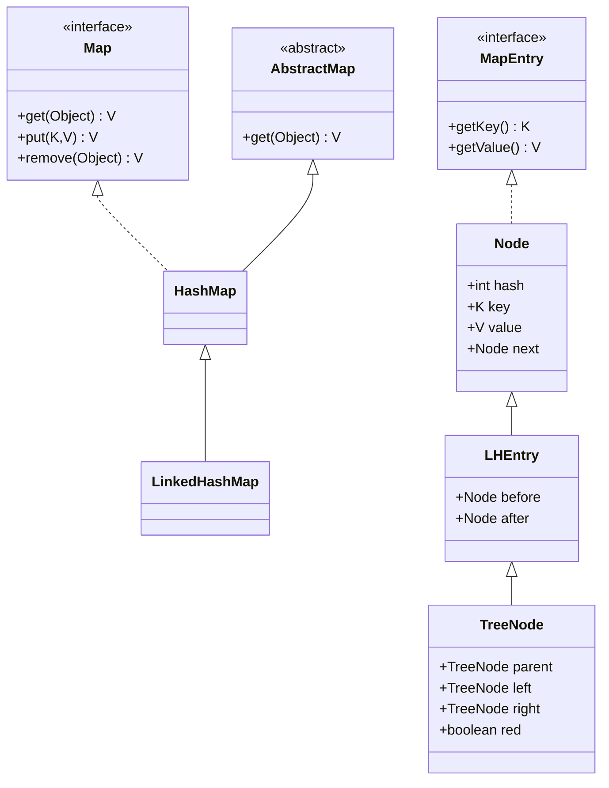
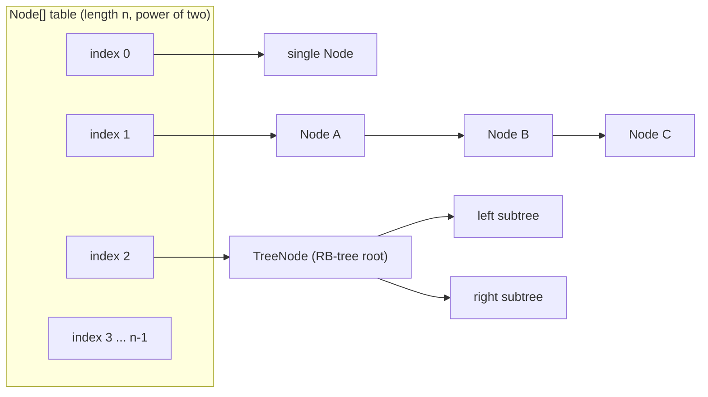
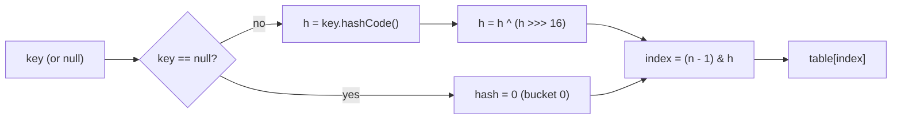
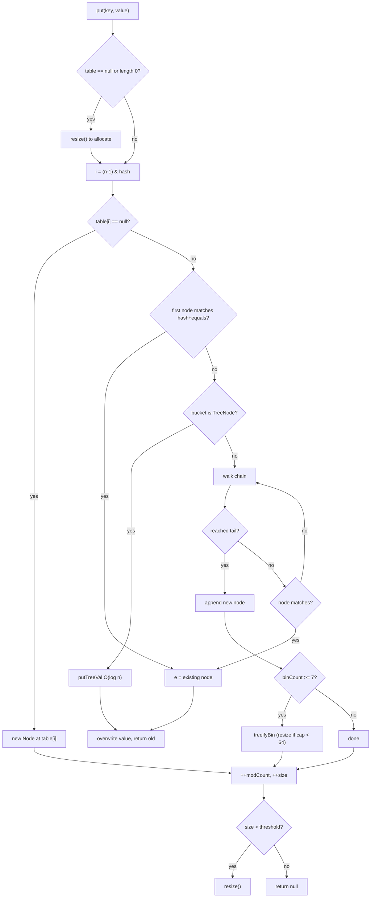
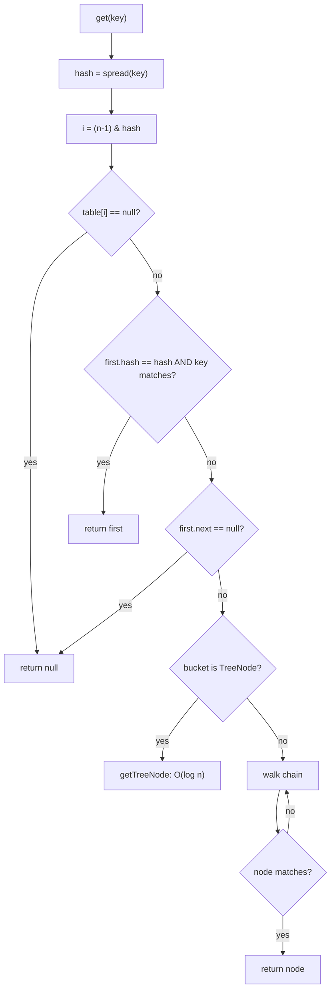
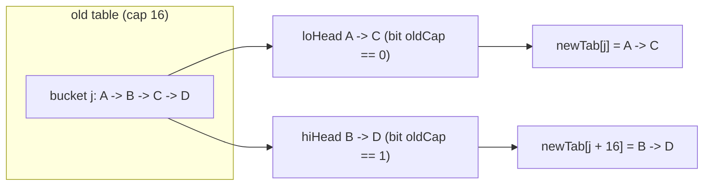
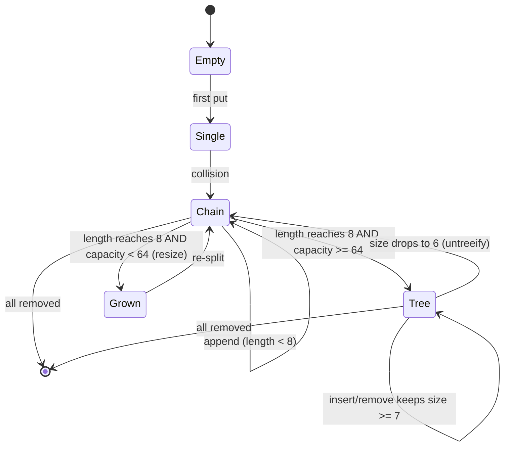
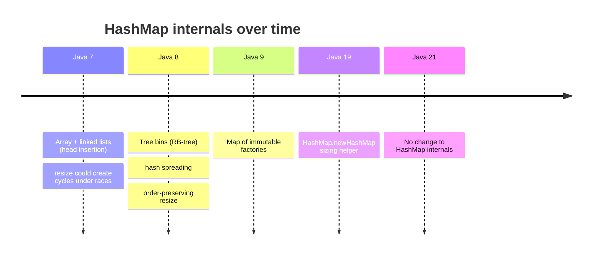

# HashMap Internals

`HashMap<K,V>` is an **array of buckets**, where each bucket holds either a single node, a linked
list of colliding nodes, or (after enough collisions) a **red-black tree**. The mental model that
answers almost every interview question is: *the map computes an index from `hashCode()`, stores the
entry there, and resolves collisions by chaining — with a tree fallback that bounds the worst case.*

Everything else follows from that single idea:

- `get`/`put` are **O(1) average** because the array index is computed directly from the key's hash.
- They degrade to **O(n)** when many keys land in one bucket (bad hashes or an adversary), and to
  **O(log n)** once that bucket treeifies.
- **Power-of-two capacity** lets the index be a cheap bit-mask (`(n-1) & hash`) instead of a modulo,
  and makes resize a clean bit test.
- **`equals` and `hashCode` are a contract**: break it (or mutate a key in place) and entries become
  unreachable while still occupying memory.
- It is **not thread-safe**; concurrent resize in old JDKs could even spin forever.

Read this module as: structure → hashing → `put` → `get` → resize → treeify → collisions →
contract → iteration → concurrency → sizing → evolution → performance. The internals (the exact
fields, the spread function, the resize split, the treeify thresholds) are what separate a senior
answer from a memorised one.

> **One-line invariant:** `table[i]` contains all nodes whose spread hash has `(n - 1) & hash == i`.
> Search walks only that bucket, so the bucket size is the real cost of a lookup.

---

## 1. The Data Structure

`HashMap` extends `AbstractMap` and stores its state in a handful of fields. On 64-bit HotSpot with
compressed oops the object shell is **48 bytes** (verified with JOL):

```java
public class HashMap<K,V> extends AbstractMap<K,V>
        implements Map<K,V>, Cloneable, Serializable {

    transient Node<K,V>[] table;   // the bucket array; null until first insert
    transient int size;            // number of key-value mappings
    transient int modCount;        // structural-modification counter (fail-fast)
    int threshold;                 // capacity * loadFactor; resize when size > threshold
    final float loadFactor;        // default 0.75
    // (AbstractMap supplies transient keySet, values; HashMap adds transient entrySet)
}
```

| Field | Meaning | Interview note |
|---|---|---|
| `Node<K,V>[] table` | Bucket array; length is always a power of two | `null` for an empty map created with no capacity |
| `size` | Number of entries (not array length) | `size()` returns this |
| `modCount` | Incremented on every structural change | Drives `ConcurrentModificationException` |
| `threshold` | `capacity * loadFactor`; resize trigger | Before table allocation at construction it temporarily holds the *initial capacity* |
| `loadFactor` | `final`; space/time trade-off | Default `0.75f`, set once at construction |

### 1.1 `Node<K,V>` and `TreeNode<K,V>`

Each bucket element is a `Node`. `javap -p` confirms the exact fields:

```text
class java.util.HashMap$Node<K, V> implements java.util.Map$Entry<K, V> {
  final int hash;
  final K key;
  V value;
  java.util.HashMap$Node<K, V> next;
}

final class java.util.HashMap$TreeNode<K, V>
        extends java.util.LinkedHashMap$Entry<K, V> {
  java.util.HashMap$TreeNode<K, V> parent;
  java.util.HashMap$TreeNode<K, V> left;
  java.util.HashMap$TreeNode<K, V> right;
  java.util.HashMap$TreeNode<K, V> prev;
  boolean red;
  // + key, value, hash, next inherited from Node
}
```

Two details worth memorising:

- `hash` is the **spread hash** (`hashCode() ^ (hashCode() >>> 16)`), cached at insert time so
  lookups compare a precomputed int instead of recomputing.
- `TreeNode` extends `LinkedHashMap.Entry`, which itself extends `HashMap.Node`, giving the tree
  node the `hash/key/value/next` fields **plus** `parent/left/right/prev/red` for the red-black tree
  and the doubly-linked `prev`/`next` chain used while still a list.

### 1.2 Type hierarchy



### 1.3 Bucket memory layout



**Figure 1 —** Buckets are heterogeneous: empty, a lone node, a linked list, or a tree bin. The map
never stores a type tag; the runtime class of `table[i]` tells the algorithm which path to take.

### 1.4 Reflection: watching the fields change

You can inspect a live map on Java 21 with `--add-opens java.base/java.util=ALL-UNNAMED`:

```java
import java.lang.reflect.*;
import java.util.*;

public class Internals {
    static Object field(Object o, String name) throws Exception {
        Field f = HashMap.class.getDeclaredField(name);
        f.setAccessible(true);
        return f.get(o);
    }
    public static void main(String[] args) throws Exception {
        HashMap<String,Integer> m = new HashMap<>();
        System.out.println("after new: table=" + field(m, "table")
            + " size=" + field(m, "size")
            + " threshold=" + field(m, "threshold")
            + " loadFactor=" + field(m, "loadFactor"));

        m.put("a", 1);
        Object[] table = (Object[]) field(m, "table");
        System.out.println("after put: capacity=" + table.length
            + " size=" + field(m, "size")
            + " threshold=" + field(m, "threshold"));

        for (int i = 0; i < 12; i++) m.put("k" + i, i);
        table = (Object[]) field(m, "table");
        System.out.println("after 13 puts: capacity=" + table.length
            + " size=" + field(m, "size")
            + " threshold=" + field(m, "threshold"));
    }
}
```

Output (Java 21, matches `HashMap` source exactly):

```text
after new: table=null size=0 threshold=0 loadFactor=0.75
after put: capacity=16 size=1 threshold=12
after 13 puts: capacity=32 size=13 threshold=24
```

The empty map defers allocation: `table` is `null` and `threshold` is `0` until the first `put`.
The first insert allocates a 16-slot array and sets `threshold = 16 * 0.75 = 12`. The 13th entry
exceeds 12 and triggers a resize to 32 (`threshold = 24`).

---

## 2. Hashing: Spread, Index, and Power-of-Two Capacity

### 2.1 The spread function

`HashMap` does **not** use `hashCode()` directly. It applies a supplemental hash:

```java
static final int hash(Object key) {
    int h;
    return (key == null) ? 0 : (h = key.hashCode()) ^ (h >>> 16);
}
```

`h >>> 16` is an **unsigned right shift**: it moves the high 16 bits into the low 16 without sign
extension, and `^` folds them onto the low 16. This is called **hash spreading** (or perturbation).

**Why it matters.** The index computation is `(n - 1) & hash`, where `n` is a power of two. When `n`
is small, only the **low `log2(n)` bits** of the hash are used; every higher bit is masked away. If a
class's `hashCode` has poor entropy in its low bits but good entropy in its high bits, all keys would
collide. Spreading mixes the high bits down so they participate in the index.

Verified demonstration — two keys whose `hashCode`s differ only in bit 16:

```java
public class HighBits {
    static int hash(Object key) { int h; return (key == null) ? 0 : (h = key.hashCode()) ^ (h >>> 16); }
    public static void main(String[] args) {
        Integer a = 0;          // hashCode 0
        Integer b = 1 << 16;    // hashCode 65536, differs only in bit 16
        int cap = 16;
        System.out.println("WITHOUT spread idx: " + ((cap - 1) & a.hashCode()) + " vs " + ((cap - 1) & b.hashCode()));
        System.out.println("WITH spread idx:    " + ((cap - 1) & hash(a)) + " vs " + ((cap - 1) & hash(b)));
    }
}
```

```text
WITHOUT spread idx: 0 vs 0
WITH spread idx:    0 vs 1
```

Without spreading both keys map to bucket 0; spreading separates them. Full trace of a real string:

```text
hashCode("hello") = 99162322
spread(h)         = 99163451        // h ^ (h >>> 16), where h>>>16 = 1513
cap=16 index(h)=2   index(spread)=11
cap=32 index(h)=18  index(spread)=27
cap=64 index(h)=18  index(spread)=59
```

### 2.2 Index computation `(n - 1) & hash`

Because `n` is always a power of two, `hash % n` equals `hash & (n - 1)`. The bit-mask is faster
than `%`, and — crucially — it uses the **low k bits** of the hash when `n = 2^k`. `n - 1` is a mask
of `k` one-bits.

> **Rule:** `index = hash & (capacity - 1)`. This is why capacity must be a power of two, and why the
> spread function exists (to make those low bits depend on the whole hash).

### 2.3 `tableSizeFor`: rounding capacity up to a power of two

If you pass a non-power-of-two initial capacity, `HashMap` rounds it up:

```java
static final int tableSizeFor(int cap) {
    int n = -1 >>> Integer.numberOfLeadingZeros(cap - 1);
    return (n < 0) ? 1 : (n >= MAXIMUM_CAPACITY) ? MAXIMUM_CAPACITY : n + 1;
}
```

It computes `2^ceil(log2(cap))`. Verified values:

| Input | `tableSizeFor` |
|---|---|
| 1 | 1 |
| 9 | 16 |
| 10 | 16 |
| 75 | 128 |
| 100 | 128 |

### 2.4 The capacity constants

| Constant | Value | Role |
|---|---|---|
| `DEFAULT_INITIAL_CAPACITY` | `1 << 4` = 16 | Size of the table on first insert |
| `MAXIMUM_CAPACITY` | `1 << 30` = 1,073,741,824 | Largest table; further growth stops resizing |
| `DEFAULT_LOAD_FACTOR` | `0.75f` | `threshold = capacity * loadFactor` |
| `TREEIFY_THRESHOLD` | 8 | Chain length that triggers treeification |
| `UNTREEIFY_THRESHOLD` | 6 | Tree size that reverts to a list |
| `MIN_TREEIFY_CAPACITY` | 64 | Minimum table size before treeification is allowed |

`table` length is **never** larger than `MAXIMUM_CAPACITY`; beyond that `threshold` becomes
`Integer.MAX_VALUE` and the map simply accumulates chains.

### 2.5 Hashing flow



**Figure 2 —** Null keys are special-cased to hash `0` and therefore always map to bucket `0`.

---

## 3. `put` / `putVal`: The Full Algorithm

`put` delegates to `putVal`. The public methods `put`, `putIfAbsent`, and `compute*` all funnel
through it (or a sibling), so understanding `putVal` covers all insertion.

```java
final V putVal(int hash, K key, V value, boolean onlyIfAbsent, boolean evict) {
    Node<K,V>[] tab; Node<K,V> p; int n, i;
    if ((tab = table) == null || (n = tab.length) == 0)
        n = (tab = resize()).length;                 // (1) lazy init / ensure table
    if ((p = tab[i = (n - 1) & hash]) == null)
        tab[i] = newNode(hash, key, value, null);    // (2) empty bucket -> new node
    else {
        Node<K,V> e; K k;
        if (p.hash == hash &&
            ((k = p.key) == key || (key != null && key.equals(k))))
            e = p;                                   // (3) first node matches
        else if (p instanceof TreeNode)
            e = ((TreeNode<K,V>)p).putTreeVal(this, tab, hash, key, value); // (4) tree bin
        else {
            for (int binCount = 0; ; ++binCount) {
                if ((e = p.next) == null) {
                    p.next = newNode(hash, key, value, null);   // (5) append to chain
                    if (binCount >= TREEIFY_THRESHOLD - 1)
                        treeifyBin(tab, hash);       // (6) maybe treeify
                    break;
                }
                if (e.hash == hash &&
                    ((k = e.key) == key || (key != null && key.equals(k))))
                    break;                           // (7) found existing key in chain
                p = e;
            }
        }
        if (e != null) {                             // (8) existing key -> overwrite
            V oldValue = e.value;
            if (!onlyIfAbsent || oldValue == null)
                e.value = value;
            afterNodeAccess(e);                      // LinkedHashMap hook
            return oldValue;
        }
    }
    ++modCount;
    if (++size > threshold)
        resize();                                    // (9) grow
    afterNodeInsertion(evict);                       // LinkedHashMap hook
    return null;
}
```

Step by step:

1. **Lazy init.** If `table` is `null` or empty, `resize()` allocates the initial table
   (16 by default, or the constructor-provided capacity). `resize()` doubles as the allocator.
2. **Empty bucket.** Compute the index; if empty, drop in a new `Node` — the fast path.
3. **First-node hit.** Compare `hash` first (cheap int), then `==` (reference identity), then
   `equals`. Ordering matters: `hash` mismatch short-circuits, and `==` avoids an `equals` call when
   it is literally the same key object.
4. **Tree bin.** If the bucket is a `TreeNode`, delegate to `putTreeVal`, which walks the red-black
   tree in O(log n).
5. **Chain append.** Otherwise walk the linked list and append the new node at the tail (JDK 8+
   append; JDK 7 prepended at the head).
6. **Treeify check.** After appending, if the chain reached 8 nodes, call `treeifyBin` — which may
   instead resize if the table is still smaller than `MIN_TREEIFY_CAPACITY` (64).
7. **Chain hit.** If a node with the same `hash` and equal key is found, stop; it will be
   overwritten.
8. **Overwrite semantics.** If an existing node was found, replace its value (unless `onlyIfAbsent`
   and the value is present) and return the **previous value**. Otherwise return `null`.
9. **Grow.** Increment `size`; if it exceeds `threshold`, `resize()` doubles the table.

### 3.1 Return semantics

| Call | Returns |
|---|---|
| `put(k, v)` | Previous value, or `null` if the key was absent (or previously mapped to `null`) |
| `putIfAbsent(k, v)` | Previous value (does nothing if a non-null value exists) |
| `put` on existing key | Old value; `size` unchanged; `modCount` unchanged |
| `put` on new key | `null`; `size` and `modCount` both increment |

> **Trap:** `put` returning `null` is ambiguous — it could mean "inserted a new key" or "the key was
> present with a `null` value". Use `containsKey` when that distinction matters.

### 3.2 `putVal` flowchart



**Figure 3 —** The complete insert path. Note that treeify and resize are two distinct growth
mechanisms: one fixes a *long chain*, the other fixes *high load*.

### 3.3 Duplicate keys and overwrite

```java
Map<String,Integer> m = new HashMap<>();
m.put("x", 1);
Integer old = m.put("x", 99);
System.out.println("put returned old=" + old + " now=" + m.get("x") + " size=" + m.size());
```

```text
put returned old=1 now=99 size=4
```

The `equals` method — not `==` — decides key identity, so two distinct objects that are `equals` and
share a `hashCode` are the same key.

---

## 4. `get` / `getNode`: The Lookup Algorithm

```java
final Node<K,V> getNode(Object key) {
    Node<K,V>[] tab; Node<K,V> first, e; int n, hash; K k;
    if ((tab = table) != null && (n = tab.length) > 0 &&
        (first = tab[(n - 1) & (hash = hash(key))]) != null) {
        if (first.hash == hash &&                          // (1) always check first node
            ((k = first.key) == key || (key != null && key.equals(k))))
            return first;
        if ((e = first.next) != null) {
            if (first instanceof TreeNode)
                return ((TreeNode<K,V>)first).getTreeNode(hash, key);  // (2) tree search
            do {
                if (e.hash == hash &&                      // (3) walk the chain
                    ((k = e.key) == key || (key != null && key.equals(k))))
                    return e;
            } while ((e = e.next) != null);
        }
    }
    return null;
}
```

The same three-way comparison as `put`: **hash equality**, then **reference `==`**, then
**`equals`**. Checking `hash` first is a critical optimization — it filters almost all non-matching
nodes with an int compare.



**Figure 4 —** `getNode` never computes a full hash of the *stored* keys — it compares the cached
`Node.hash`.

---

## 5. Resize / Rehash

When `size > threshold`, the table **doubles** and every entry is redistributed. This is the single
most expensive operation, so sizing the map correctly to avoid it matters.

### 5.1 What `resize()` does

```java
final Node<K,V>[] resize() {
    Node<K,V>[] oldTab = table;
    int oldCap = (oldTab == null) ? 0 : oldTab.length;
    int oldThr = threshold;
    int newCap, newThr = 0;
    if (oldCap > 0) {
        if (oldCap >= MAXIMUM_CAPACITY) {
            threshold = Integer.MAX_VALUE;     // stop growing
            return oldTab;
        }
        else if ((newCap = oldCap << 1) < MAXIMUM_CAPACITY &&
                 oldCap >= DEFAULT_INITIAL_CAPACITY)
            newThr = oldThr << 1;              // double the threshold
    }
    else if (oldThr > 0)                       // capacity provided in constructor
        newCap = oldThr;
    else {                                     // first insert with defaults
        newCap = DEFAULT_INITIAL_CAPACITY;
        newThr = (int)(DEFAULT_LOAD_FACTOR * DEFAULT_INITIAL_CAPACITY);
    }
    if (newThr == 0) {
        float ft = (float)newCap * loadFactor;
        newThr = (newCap < MAXIMUM_CAPACITY && ft < (float)MAXIMUM_CAPACITY)
                 ? (int)ft : Integer.MAX_VALUE;
    }
    threshold = newThr;
    Node<K,V>[] newTab = (Node<K,V>[])new Node[newCap];
    table = newTab;
    // ... redistribute oldTab into newTab ...
    return newTab;
}
```

### 5.2 The JDK 8 `lo` / `hi` split (the key trick)

Rather than recomputing `hash % newCap` for every entry, JDK 8 exploits the power-of-two property.
For an entry at old index `j` with cached hash `h`, its new index is either:

- `j` if `(h & oldCap) == 0`, or
- `j + oldCap` if `(h & oldCap) != 0`.

Because the new capacity is exactly twice the old, the only new bit that matters is `oldCap` itself
(a single bit). So each bucket is split into a **lo list** (stays at `j`) and a **hi list** (moves to
`j + oldCap`), preserving relative order:

```java
for (int j = 0; j < oldCap; ++j) {
    Node<K,V> e;
    if ((e = oldTab[j]) != null) {
        oldTab[j] = null;
        if (e.next == null)
            newTab[e.hash & (newCap - 1)] = e;             // lone node: recompute index
        else if (e instanceof TreeNode)
            ((TreeNode<K,V>)e).split(this, newTab, j, oldCap); // tree split
        else {                                             // preserve order, split list
            Node<K,V> loHead = null, loTail = null;
            Node<K,V> hiHead = null, hiTail = null;
            Node<K,V> next;
            do {
                next = e.next;
                if ((e.hash & oldCap) == 0) {
                    if (loTail == null) loHead = e; else loTail.next = e;
                    loTail = e;
                } else {
                    if (hiTail == null) hiHead = e; else hiTail.next = e;
                    hiTail = e;
                }
            } while ((e = next) != null);
            if (loTail != null) { loTail.next = null; newTab[j] = loHead; }
            if (hiTail != null) { hiTail.next = null; newTab[j + oldCap] = hiHead; }
        }
    }
}
```

Verified index behavior — keys `0,16,32,48` collide at capacity 16, then separate as the table grows:

```text
cap=16
key=0  hash=0   idx16=0 idx32=0  idx64=0
key=16 hash=16  idx16=0 idx32=16 idx64=16
key=32 hash=32  idx16=0 idx32=0  idx64=32
key=48 hash=48  idx16=0 idx32=16 idx64=48
```

At 16 all four are in bucket 0. At 32 the `(h & oldCap)` test (`oldCap = 16`) splits keys 16 and 48
to bucket `0 + 16`. At 64 the split again separates 32 and 48. **No re-hashing of keys occurs** —
only the cached `hash` is re-masked.



**Figure 5 —** Each old bucket splits into at most two new buckets, `j` and `j + oldCap`. This is
what makes JDK 8 resize O(n) with **no** per-key hashing.

### 5.3 Threshold after a resize

`threshold = newCap * loadFactor`. For default settings:

| Capacity | Threshold (0.75) |
|---|---|
| 16 | 12 |
| 32 | 24 |
| 64 | 48 |
| 128 | 96 |
| 256 | 192 |

### 5.4 Why JDK 7 rehash could hang (the infamous infinite loop)

JDK 7's `transfer()` **prepended** nodes to the new bucket (head insertion), reversing the chain
order on every resize. Under concurrent `put` from two threads both resizing the same map, the
order-reversal could make a `next` pointer point back to an earlier node, forming a **cycle**. A
subsequent `get` on that bucket would then spin forever at 100% CPU — a livelock that never throws.

JDK 8 fixed the fixable part by **preserving relative order** in the lo/hi lists, so a cycle cannot
form. But `HashMap` is still **not thread-safe**: concurrent writes can still lose updates, corrupt
`size`, or throw. The correct answer is always **`ConcurrentHashMap`**
(see [Concurrent Collections](11-Concurrent-Collections.md)), not "HashMap is fine now".

> **Rule:** Tree bins and order-preserving resize fix *performance pathologies*, not *thread safety*.
> Never share a plain `HashMap` across threads for writes.

### 5.5 Cost of resizing

A resize is O(n): allocate the new array and touch every node. Amortized over inserts it is O(1),
but a single unlucky `put` can stall for milliseconds on a large map. Pre-size to avoid it.

---

## 6. Treeification: Bounding the Worst Case

A bucket whose chain grows too long becomes a **red-black tree**, turning O(n) lookup into O(log n).

### 6.1 The three thresholds

| Constant | Value | Meaning |
|---|---|---|
| `TREEIFY_THRESHOLD` | 8 | At 8 nodes in a bin, `treeifyBin` is attempted |
| `UNTREEIFY_THRESHOLD` | 6 | A tree bin shrinks back to a list when it drops to 6 |
| `MIN_TREEIFY_CAPACITY` | 64 | Treeification is skipped (and the table resized instead) below this capacity |

`treeifyBin` first checks capacity:

```java
final void treeifyBin(Node<K,V>[] tab, int hash) {
    int n, index; Node<K,V> e;
    if (tab == null || (n = tab.length) < MIN_TREEIFY_CAPACITY)
        resize();                     // too small to treeify: grow instead
    else if ((e = tab[index = (n - 1) & hash]) != null) {
        // replace each Node with a TreeNode, link them, then treeify
    }
}
```

The rationale: with a small table, a long chain usually just means **too many entries for the
capacity**, not genuinely colliding hashes. Doubling the table spreads them out more cheaply than
building a tree.

### 6.2 Why 8? The Poisson argument

Under random hashes, the number of keys per bin follows a **Poisson distribution** with mean
`0.5` (at the default load factor 0.75 and assuming good hashing). The JDK source quotes:

```text
0:    0.60653066
1:    0.30326533
2:    0.07581633
3:    0.01263606
4:    0.00157952
5:    0.00015795
6:    0.00001316
7:    0.00000094
8:    0.00000006
```

A bin reaching 8 nodes has probability ≈ 6 × 10⁻⁸ — essentially "this is not bad luck, it is a bad
hash." Before that point, the constant factor of a tree (node overhead, tree maintenance) is not
worth paying. That is why the threshold is 8: it is chosen so that trees almost never trigger under
normal hashing, but do trigger under adversarial hashing.

The **hysteresis** between treeify (8) and untreeify (6) prevents thrashing: a bin sitting at exactly
7–8 entries would otherwise flip between list and tree on every insert/remove.

### 6.3 Tree ordering: `compareTo` then `tieBreakOrder`

Tree bins need a total order to build a balanced tree. `HashMap` orders by:

1. **Hash** (`int` compare).
2. If hashes are equal and the keys are `Comparable`, **`compareTo`**.
3. Otherwise **`tieBreakOrder`**, which compares `System.identityHashCode` and finally class name.

Step 3 means treeification works even for **non-`Comparable`** keys with identical hashes — the tree
is just ordered by identity. Verified: a `HashMap` of non-`Comparable` keys all hashing to `7` still
treeifies and retrieves all entries correctly.

### 6.4 Lifecycle of a bucket



**Figure 6 —** A bucket can be empty, a single node, a list, or a tree, and moves among these based
on size and table capacity. Note the "grown" detour: an 8-node chain in a 16-slot table resizes
instead of treeifying.

### 6.5 Verifying treeification

Force collisions by giving every key the same `hashCode`, then watch the bucket class:

```java
import java.lang.reflect.*;
import java.util.*;

public class Treeify2 {
    static final class Bad implements Comparable<Bad> {
        final int id;
        Bad(int id) { this.id = id; }
        @Override public int hashCode() { return 1; }        // all collide
        @Override public boolean equals(Object o) { return o instanceof Bad b && b.id == id; }
        @Override public int compareTo(Bad o) { return Integer.compare(id, o.id); }
    }
    static Object field(Object o, String name) throws Exception {
        Field f = HashMap.class.getDeclaredField(name); f.setAccessible(true); return f.get(o);
    }
    static String cls(Object o) { return o == null ? "null" : o.getClass().getSimpleName(); }

    public static void main(String[] args) throws Exception {
        HashMap<Bad,Integer> m = new HashMap<>();
        for (int i = 1; i <= 20; i++) {
            m.put(new Bad(i), i);
            Object[] t = (Object[]) field(m, "table");
            Object bucket = t[(t.length - 1) & 1];
            if (!cls(bucket).equals("Node"))
                System.out.println("after " + i + " keys: cap=" + t.length + " bucket=" + cls(bucket));
        }
    }
}
```

```text
after 11 keys: cap=64 bucket=TreeNode
```

Treeification only becomes possible at capacity 64 (`MIN_TREEIFY_CAPACITY`); before that, each
attempt triggers a resize until the table reaches 64, at which point the 11th colliding key builds
the tree.

Untreeification — remove down to 6 and the tree reverts to a list (verified):

```text
after 20: bucket=TreeNode
after removing 14 (6 left): size=6 bucket=Node
```

### 6.6 Red-black tree operations

`TreeNode` provides `putTreeVal`, `getTreeNode`, `removeTreeNode`, `split`, and `treeify`, each
performing standard red-black insert/delete with rotations and recoloring to maintain the
O(log n) height bound. After each structural change, `moveRootToFront` keeps the tree's root as the
**first node of the bucket** so lookups can start from `table[i]`.

> **Note:** the `prev`/`next` links are still maintained in a tree bin, so iteration order follows
> the original chain order (plus root moved to front), not tree order.

---

## 7. Collisions and Worst-Case Behavior

The average case is O(1), but the **worst case** depends on your hashes.

| Scenario | Bucket structure | Lookup cost |
|---|---|---|
| Well-distributed hashes | Mostly single nodes | O(1) |
| Bad luck / small table | Short chains | O(chain length), small |
| Bad `hashCode` (constant) | One long chain | O(n), or O(log n) after treeify |
| Adversarial collisions | Many 8+ chains | O(log n) per op (tree), still expensive |

### 7.1 Hash flooding

An attacker who can choose keys can compute keys that all collide in the same bucket. Every `put`
and `get` then walks a long chain: **algorithmic complexity denial of service** (a "hash-flooding"
or "HashDoS" attack). This famously affected web frameworks that copied request parameters straight
into a `HashMap` or `Hashtable`.

**Why `String` is especially exposed:** `String.hashCode` is `s[0]*31^(n-1) + s[1]*31^(n-2) + ...`
— fully deterministic, documented, and cheap to compute, so an attacker can precompute many strings
with the same hash. Verified formula:

```java
System.out.println("ab".hashCode());         // 3105
System.out.println('a' * 31 + 'b');          // 3105
```

### 7.2 Mitigations

1. **Tree bins (JDK 8+)** cap the worst case at O(log n) instead of O(n) for a single bucket. This
   raises the bar but does not eliminate the attack (log n is still not O(1)).
2. **Salted / randomized keys.** Wrap untrusted values in a key type whose `hashCode` mixes in a
   per-process secret (e.g. `Hashing.sipHash` / `HMAC`), so the attacker cannot predict collisions.
3. **Limit input size.** Cap the number of entries parsed from untrusted input (Tomcat, Jackson, and
   others shipped mitigations for cross-parameter hash collisions).
4. **Use a different structure** where order or hashing is not required, or a map whose hashing you
   control.

> **Historical note:** JDK 7u6+ had an experimental `jdk.map.althashing.threshold` system property
> that switched `HashMap` to alternative (randomized) hashing above a capacity. It was removed in
> JDK 8, replaced by tree bins. Do not cite it as a current feature.

### 7.3 Cache behavior

Array-index lookup is cache-friendly: the bucket array is contiguous, so the first node in a bucket
is usually found in the same cache line region. Chaining then follows pointers to heap-scattered
nodes, causing cache misses proportional to chain length. Tree bins have even worse locality but
fewer steps.

---

## 8. The `equals` / `hashCode` Contract in Practice

The `Map` invariant that HashMap *assumes* but never checks:

> **Contract:** if `a.equals(b)` then `a.hashCode() == b.hashCode()`. And `hashCode` must be
> consistent for the lifetime of the key while it is in the map.

Violations produce silent, maddening bugs.

### 8.1 Mutable keys: entries become unreachable

If a key's hash-affecting field changes after insertion, the entry sits in the **old** bucket forever
— `get` looks in the bucket computed from the **new** hash and misses.

```java
static final class Key {
    int id;
    Key(int id) { this.id = id; }
    @Override public boolean equals(Object o) { return o instanceof Key k && k.id == id; }
    @Override public int hashCode() { return id; }
    @Override public String toString() { return "Key(" + id + ")"; }
}

Map<Key,String> map = new HashMap<>();
Key k = new Key(1);
map.put(k, "one");
System.out.println(map.get(k));   // one
k.id = 2;                         // mutate the key
System.out.println(map.get(k));   // null     <-- lost
System.out.println(map.get(new Key(1))); // null
System.out.println(map.containsKey(k));  // false
System.out.println(map.size());          // still 1
System.out.println(map);                 // {Key(2)=one}  (toString shows the mutated key)
```

```text
before mutation: get(k)=one containsKey=true size=1
after  mutation: get(k)=null containsKey=false size=1
get(new Key(1))=null
get(new Key(2))=null
toString={Key(2)=one}
after put(Key(2)): size=2 map={Key(2)=one, Key(2)=two}
```

The entry is **still there** (`size == 1`) but unreachable by any key — a memory leak and a logic
bug. Adding `new Key(2)` does not overwrite the orphan; it creates a *second* entry whose `toString`
now prints two `Key(2)`s. **Use immutable keys, or `String`/`Integer`/records.**

> **Best practice:** make map keys `final`-field types (ideally `record`s or the immutable JDK
> types). If you must use a mutable key, never mutate the fields used by `equals`/`hashCode` while
> it is in a map.

### 8.2 Inconsistent `equals`/`hashCode`

- **`equals` without `hashCode`:** equal objects land in different buckets → lookups miss.
- **`hashCode` without `equals`:** equal hashes but unequal keys → both stored, lookups hit one.
- **Constant `hashCode`:** legal but forces every key into one bucket → O(n)/O(log n).

Verified:

```text
equals-only get(same id)=null (hashCode differs -> miss)
constant-hash map={InconsistentHash@1=0, InconsistentHash@1=1, ...}
```

### 8.3 `null` key

`HashMap` permits **one** `null` key (and many `null` values). The null key's hash is `0`, so it
lives in bucket `0`.

```text
null key: get(null)=42 containsKey(null)=true
```

This differs from `Hashtable` and `ConcurrentHashMap`, which reject `null` keys outright.

### 8.4 Duplicate keys overwrite

Only one mapping per key exists; `put` replaces the value and returns the old one (see section 3.3).

---

## 9. Iteration Order and Views

### 9.1 Order is unspecified

`HashMap` makes **no ordering guarantee**. Iteration walks `table` from index `0` upward and follows
each bucket's chain — i.e. **bucket order**, driven by `hashCode` and capacity, not insertion order.
Changing capacity (resize) can change the order even for the same keys.

Verified:

```text
LinkedHashMap iteration (insertion order)=[z, a, m]
HashMap iteration=[a, z, m]
```

`LinkedHashMap` adds a doubly-linked list (`before`/`after`) across all entries and iterates that,
giving insertion (or access) order at the cost of ~2 extra references per entry. See
[Collections Part 2](09-Collections-Part-2.md).

### 9.2 `keySet`, `values`, `entrySet` are live views

They are backed by the map and reflect changes both ways; removing from a view removes from the map.
Verified:

```text
before: keySet=[a, z, m] values=[1, 26, 13]
views are live: keySet=[a, b, z, m] values=[1, 2, 26, 13]
remove via keySet reflected in map={b=2, z=26, m=13}
```

### 9.3 Fail-fast iterators and `modCount`

Every structural modification (insert, remove, resize) increments `modCount`. Iterators snapshot it
and check on each `next()`: a mismatch throws `ConcurrentModificationException`. This is a
**best-effort bug detector**, not a synchronization mechanism.

```java
for (String key : m.keySet()) {
    if ("y".equals(key)) m.remove("z");   // ConcurrentModificationException
}
```

The safe removal is through the iterator itself:

```java
Iterator<String> it = m.keySet().iterator();
while (it.hasNext()) if ("y".equals(it.next())) it.remove();   // legal
```

> **Trap:** `modCount` only guards **structural** changes. `map.put(existingKey, newValue)` changes
> a value but not structure, so it will **not** throw, even though the iterator's value view may
> reflect the change.

---

## 10. Thread Safety

`HashMap` is **not** thread-safe. Its fields (`table`, `size`, `modCount`) are plain, unsynchronized
`int`s and references.

| Hazard | Result |
|---|---|
| Two threads `put` different keys | One update may be lost (`size` off, node dropped) |
| `put` + iterate concurrently | `ConcurrentModificationException` (if it's noticed) |
| Two threads resize together | Corrupted table; in JDK 7, a cyclic chain → infinite loop |
| `size()` during writes | Stale/incorrect value |

The JDK 7 infinite loop is the classic war story; JDK 8 removed the cycle but **not** the data races.
For concurrent use, see [Concurrent Collections](11-Concurrent-Collections.md):

- `ConcurrentHashMap` — lock striping / CAS on bins, weakly consistent iterators, no `null` keys.
- `Collections.synchronizedMap(new HashMap<>())` — a single global lock; correct but low throughput.

> **Rule:** "not throwing `ConcurrentModificationException`" does **not** mean safe. Data races in
> `HashMap` are silent.

---

## 11. Capacity Sizing and Memory

### 11.1 Choose the initial capacity

To avoid any resize, the initial capacity must satisfy `capacity * loadFactor >= expectedEntries`,
i.e.:

```text
initialCapacity = ceil(expectedEntries / loadFactor)
```

```java
int expected = 1000;
Map<String,Integer> m = new HashMap<>((int) Math.ceil(expected / 0.75));  // -> 1334 -> 2048 slots
// or, Java 19+:
Map<String,Integer> m2 = HashMap.newHashMap(expected);                    // same math, clearer
```

`HashMap.newHashMap(int numMappings)` (added in **Java 19**) applies exactly this. Both round up to
the next power of two internally.

Verified capacity behavior:

```text
new HashMap<>(100):              final cap=256 threshold=192 size=100
new HashMap<>(ceil(100/0.75)):   final cap=256 threshold=192 size=100
default:                         final cap=256 threshold=192 size=100
```

Note that the *final* capacity is the same for all three — the difference is **how many resizes**
happened on the way, which is pure waste. `new HashMap<>(100)` starts at 128 (threshold 96) and
resizes once at entry 97; the pre-sized version never resizes.

### 11.2 Memory per entry

Measured with JOL on Java 21 (64-bit HotSpot, compressed oops):

```text
HashMap object shell: 48 bytes
Node instance:        32 bytes
Node[] of 16 slots:   80 bytes   (16-byte array header + 4 bytes per ref)
```

| Component | Size (compressed oops) |
|---|---|
| `HashMap` shell | 48 B (header + 6 fields, aligned) |
| Bucket array | 16 B header + 4 B × capacity |
| Per `Node` | 32 B (header + `hash`, key ref, value ref, next ref) |
| Keys/values | whatever the objects cost (often the dominant part) |

So the **per-entry overhead** of the map itself is ~32–36 bytes (a `Node` plus its array slot),
**excluding** the key and value objects. A `HashMap` with 1M entries of small keys therefore holds
~32 MB of `Node`s plus the array plus the key/value objects. For memory-tight maps consider a
specialized structure or `int[]`-based maps.

### 11.3 Load factor trade-offs

| Load factor | Space | Collisions / resize | Best for |
|---|---|---|---|
| `0.75` (default) | balanced | Good balance of space and time | General use |
| `0.5` | ~33% more table memory | Fewer collisions, faster lookups | Latency-sensitive, read-heavy |
| `1.0` | Least memory | More collisions, longer chains | Memory-tight, tolerant of slowness |
| `> 1.0` | Fewer slots than entries | Mandatory chaining everywhere | Rarely appropriate |

**Why exactly 0.75?** It is the value in the JDK's Poisson analysis: with mean `0.5` per bin, a bin
reaching 8 nodes has probability ~6 × 10⁻⁸. It balances **time** (collision probability grows with
load) against **space** (higher load wastes less array). It is a documented default, not a
theoretical optimum.

---

## 12. JDK Evolution

| Version | Change that matters here |
|---|---|
| Java 1.2 | `HashMap` introduced with array + linked-list chaining |
| Java 5 | Generics; `ConcurrentHashMap` |
| Java 8 | **Tree bins** (red-black, `TREEIFY_THRESHOLD=8`), **hash spreading**, order-preserving `resize` (`lo`/`hi`), `compute*`/`merge`/`getOrDefault`/`forEach` |
| Java 9 | `Map.of` / `Map.entry` immutable factories (not `HashMap`) |
| Java 19 | `HashMap.newHashMap(int)` and `newLinkedHashMap(int)` static factories |
| Java 21 | No structural change to `HashMap`; records and `var` make immutable keys easier |

JDK 8 is the watershed: it is where `HashMap` gained its current internal shape. If an interviewer
says "HashMap internals", they mean the JDK 8+ design. There is **no** JDK 19+ replacement for
`HashMap` itself — `HashMap.newHashMap` is only a sizing convenience.



**Figure 7 —** The design stabilised in Java 8; later releases add convenience, not new internals.

---

## 13. Performance Summary

| Operation | Average | Worst (list) | Worst (tree bin) | Notes |
|---|---|---|---|---|
| `put` | O(1) | O(n) | O(log n) | Amortized O(1) incl. resize |
| `get` | O(1) | O(n) | O(log n) | Depends on bucket size |
| `remove` | O(1) | O(n) | O(log n) | Tree may untreeify |
| `containsKey` | O(1) | O(n) | O(log n) | Same as `get` |
| `resize` | O(n) | — | — | Triggered at `size > threshold` |
| Iteration | O(capacity + size) | — | — | Walks the whole table |
| `size` | O(1) | — | — | Returns a field |

Additional costs to mention:

- **Allocation:** one `Node` per entry; keys/values may be boxed.
- **Cache:** array traversal is contiguous; chain/tree traversal follows scattered pointers.
- **Resize spikes:** a single resize is O(n) and can cause a latency spike; pre-size to avoid.
- **`hashCode` calls:** computed once per `put`/`get` call for the *lookup key*; stored keys reuse
  the cached `Node.hash`. A costly `hashCode` (e.g. hashing a large string) is paid on every call.

### 13.1 HashMap vs alternatives

| Map | Ordering | `null` keys | Thread-safe | Worst-case lookup |
|---|---|---|---|---|
| `HashMap` | None | 1 null key | No | O(log n) (tree bin) |
| `LinkedHashMap` | Insertion/access | 1 null key | No | O(log n) |
| `TreeMap` | Sorted by key | No (unless comparator allows) | No | O(log n) |
| `Hashtable` | None | No | Yes (synchronized) | O(n) |
| `ConcurrentHashMap` | None | No | Yes | O(log n) |

(Other Map implementations are covered in [Collections Part 2](09-Collections-Part-2.md) and
[Concurrent Collections](11-Concurrent-Collections.md).)

---

## 14. Common Mistakes and Best Practices

### 14.1 Common mistakes

| Mistake | Consequence | Fix |
|---|---|---|
| Mutable key modified after insert | Entry unreachable, leak | Immutable keys |
| `equals` without `hashCode` (or vice versa) | Lookups miss / duplicates | Always override both, consistently |
| `hashCode` returning a constant | Everything in one bucket | Distribute well |
| Assuming insertion order | Wrong output | Use `LinkedHashMap` |
| Using `HashMap` across threads | Lost updates, corruption, (JDK 7) hang | `ConcurrentHashMap` |
| Not pre-sizing a large map | Repeated O(n) resizes | Size to `entries / 0.75` |
| Removing inside a for-each | `ConcurrentModificationException` | Use `Iterator.remove` |
| Trusting `put` return `null` as "absent" | Ambiguity with null values | `containsKey` |

### 14.2 Best practices

- **Prefer immutable keys**: `String`, boxed primitives, enums, records.
- **Always override `equals` and `hashCode` together**, using the same fields, and never mutate
  those fields while in a map. `Objects.hash(...)` / `Objects.equals(...)` / IDE-generated methods
  are fine.
- **Pre-size** large or long-lived maps: `new HashMap<>(expected / 0.75f + 1)` or
  (Java 19+) `HashMap.newHashMap(expected)`.
- **Use `LinkedHashMap`** when insertion/access order is required (e.g. LRU caches via
  `removeEldestEntry`).
- **Use `ConcurrentHashMap`** for shared mutable maps; use `Map.of`/`Map.copyOf` for read-only.
- **Treat iteration order as unspecified**; never depend on it.
- **Beware untrusted keys** (hash flooding): tree bins mitigate but a salted key or input limit is
  the real defense.

```java
// Wrong: rely on iteration order
for (String k : hashMap.keySet()) { /* assumed sorted */ }

// Right: ask for order explicitly
Map<String,Integer> ordered = new TreeMap<>(hashMap);
```

---

## Cross-links

- [Collections Part 1: List, Set, Queue](08-Collections-Part-1.md)
- [Collections Part 2: Map, sorting, views](09-Collections-Part-2.md)
- [Concurrent Collections](11-Concurrent-Collections.md)
- [Java Memory Areas & Memory Management](../01-Fundamentals/04-Java-Memory-Areas.md)
- [Garbage Collection](../08-Advanced/39-Garbage-Collection.md)

---

# Interview Questions

## Beginner

**Q:** What data structure does `HashMap` use internally?

**A:** An array of buckets (`Node<K,V>[] table`). Each bucket is `null`, a single `Node`, a linked
list of `Node`s (chaining for collisions), or a red-black tree (`TreeNode`) once a chain grows long.
Key lookup computes a bucket index from the key's hash, then searches only that bucket.

**Q:** What are the default initial capacity and load factor?

**A:** `DEFAULT_INITIAL_CAPACITY = 16` and `DEFAULT_LOAD_FACTOR = 0.75f`. The table is not allocated
until the first `put`; at that point it becomes 16 slots and `threshold = 16 * 0.75 = 12`.

**Q:** Does `HashMap` allow `null` keys and values?

**A:** Yes to both. Exactly one `null` key is allowed (it hashes to `0`, bucket `0`), and any number
of keys may map to `null` values. `Hashtable` and `ConcurrentHashMap` forbid `null` keys.

**Q:** What is the time complexity of `get` and `put`?

**A:** O(1) average. Worst case is O(n) with a linked-list bucket, or O(log n) after the bucket
treeifies. Resize makes a single `put` O(n) occasionally, but the amortized cost stays O(1).

**Q:** Is `HashMap` ordered? Does it preserve insertion order?

**A:** No. Iteration follows bucket order, determined by `hashCode` and capacity, and may change
after a resize. Use `LinkedHashMap` for insertion/access order or `TreeMap` for sorted order.

**Q:** Is `HashMap` thread-safe?

**A:** No. Concurrent writes can lose updates, corrupt state, and (in JDK 7) cause an infinite loop
during resize. Use `ConcurrentHashMap`, or synchronize externally.

**Q:** How do you remove an entry while iterating?

**A:** Use the iterator's own `remove()` method. Removing via the map during a for-each throws
`ConcurrentModificationException` because `modCount` changes.

**Q:** What does `put` return?

**A:** The previous value associated with the key, or `null` if there was none (or the previous value
was itself `null`).

## Intermediate

**Q:** Why does `HashMap` require the capacity to be a power of two?

**A:** So the index can be computed as `(n - 1) & hash` — a bit-mask instead of an expensive `%`.
`n - 1` is a mask of the low `log2(n)` bits. It also makes resize a single-bit test
(`(hash & oldCap) == 0`) rather than a full re-hash.

**Q:** What is the supplemental hash function and why is it applied?

**A:** `h = key.hashCode() ^ (h >>> 16)`. It XOR-folds the high 16 bits into the low 16 so that,
for small tables where only the low bits are used as an index, the high bits still influence the
bucket. It reduces collisions for `hashCode` implementations with poor low-bit entropy.

**Q:** What happens when `hashCode` returns the same value for all keys?

**A:** All keys map to one bucket. It becomes a linked list of length `size` (O(n) per lookup) and,
once capacity reaches 64 and the chain hits 8, a red-black tree (O(log n)). It remains correct but
very slow.

**Q:** Explain the `equals`/`hashCode` contract and what breaks if you violate it.

**A:** Equal objects must have equal hash codes, and both must be stable while the key is in the map.
Violating it: `equals`-equal but hash-different keys land in different buckets, so `get` misses;
`hash`-equal but not `equals` keys are stored separately. Mutating a key's hashed fields makes the
entry unreachable.

**Q:** What is the difference between `threshold` and `size`?

**A:** `size` is the current number of entries. `threshold = capacity * loadFactor` is the entry
count that triggers the next resize. A resize happens when `size > threshold`.

**Q:** What does `resize()` do, and how does JDK 8 avoid re-hashing each key?

**A:** It doubles the table and redistributes entries. For each node, the new index is either `j` or
`j + oldCap` depending on the single test `(hash & oldCap) == 0`, so the cached hash is re-masked
with one bit rather than recomputed. The old bucket splits into a `lo` list and a `hi` list.

**Q:** Why does `init capacity` not equal what you pass to `new HashMap<>(n)`?

**A:** The constructor converts it with `tableSizeFor`, rounding up to the next power of two, and
stores it in `threshold` until first use. `new HashMap<>(100)` starts with a 128-slot table. To store
`n` entries without resizing, pass `ceil(n / 0.75)`.

**Q:** What is `modCount` for?

**A:** It counts structural modifications and backs the fail-fast iterators. Each `next()` compares
its snapshot to the map's `modCount`; a difference throws `ConcurrentModificationException`. It is
best-effort, not a concurrency guarantee.

**Q:** How does `HashMap` handle a `null` key?

**A:** `hash(null)` returns `0`, placing it in bucket `0`. Search still uses `key == null` checks
before calling `equals`, because `null.equals` would NPE.

## Advanced

**Q:** Walk through `putVal` in detail.

**A:** (1) If the table is null/empty, call `resize()` to allocate. (2) Compute `i = (n-1) & hash`;
if the bucket is empty, insert a new `Node`. (3) Else compare the first node: `hash` then `==` then
`equals`; if equal, mark for overwrite. (4) Else if it's a `TreeNode`, call `putTreeVal`. (5) Else
walk the chain; if the key is found, mark for overwrite; else append at the tail and, if the chain
reached `TREEIFY_THRESHOLD - 1` after appending, call `treeifyBin`. (6) On overwrite, replace value
and return old. (7) Else `++modCount`, `++size`, resize if `size > threshold`, return `null`.

**Q:** Why is `TREEIFY_THRESHOLD` 8 and `UNTREEIFY_THRESHOLD` 6?

**A:** Under random hashing the bin occupancy is Poisson with mean 0.5; P(bin has 8) ≈ 6e-8, so a bin
of 8 almost certainly means a bad/hostile hash, where a tree's O(log n) is worth its overhead. The
gap between 8 and 6 is hysteresis to stop a bin oscillating between list and tree at the boundary.

**Q:** What is `MIN_TREEIFY_CAPACITY` and why does it exist?

**A:** It is 64. `treeifyBin` refuses to build a tree when `table.length < 64` and calls `resize()`
instead. In a small table a long chain usually means the table is too small, not that the hashes
truly collide, so spreading (growing) is cheaper than tree maintenance.

**Q:** How does a tree bin order keys, and what if keys are not `Comparable`?

**A:** First by hash; if hashes tie and keys are `Comparable`, by `compareTo`; otherwise by
`tieBreakOrder`, which uses `System.identityHashCode` then class name. So treeification works even
for non-`Comparable` keys with identical hashes.

**Q:** Explain the JDK 7 concurrent-resize infinite loop and how JDK 8 fixed it.

**A:** JDK 7 `transfer` prepended nodes, reversing each chain during resize. Two threads resizing the
same map could interleave to create a cycle in a chain, so a later `get` looped forever. JDK 8
preserves relative order by splitting into `lo`/`hi` lists, so no cycle can form — but it is still
not thread-safe; data races and lost updates remain.

**Q:** What is a red-black tree and why is it used for tree bins?

**A:** A self-balancing binary search tree with O(log n) height, guaranteeing worst-case O(log n)
search/insert/delete via rotations and recoloring. It bounds a colliding bucket's cost. `TreeNode`
implements the standard algorithms (`treeify`, `putTreeVal`, `removeTreeNode`, `split`).

**Q:** Why can `HashMap` resize be triggered by adding a collision, not just adding entries?

**A:** Because `treeifyBin` calls `resize()` when the table is smaller than 64. So inserting a key
that lengthens a chain can cause a capacity doubling even if `size` is below `threshold`.

**Q:** What exactly is stored in `Node.hash`, and why cache it?

**A:** The **spread** hash (`hashCode() ^ hashCode() >>> 16`), computed once at insert. During a
lookup, `getNode` computes the spread hash of the query key once and compares it against cached
node hashes, avoiding recomputation of every stored key's hash and enabling the fast `hash` filter.

**Q:** Is the order-preserving JDK 8 resize a "fix" for thread safety?

**A:** No. It eliminates only the cycle-induced infinite loop. `size` updates, table writes, and
`modCount` remain unsynchronized, so concurrent writes still lose data and can corrupt the map. Use
`ConcurrentHashMap`.

## Expert

**Q:** Derive where the `lo`/`hi` split index comes from.

**A:** With old capacity `n` (power of two) and new capacity `2n`, the index is `hash & (2n - 1)`.
`2n - 1` adds exactly one high bit (the `n` bit) to the mask. So the new index equals the old
`hash & (n - 1)` unless the `n` bit of hash is set, in which case it is old index `+ n`. Hence the
single test `(hash & n) == 0` selects `j` vs `j + n`. No re-hash needed.

**Q:** Prove the Poisson claim for bin occupancy.

**A:** With `size = s` keys uniformly and independently hashed into `n` buckets, the count per
bucket is Binomial(s, 1/n), which tends to Poisson(λ = s/n). At the resize threshold s/n = 0.75, so
λ = 0.75? The JDK's quoted figures use λ = 0.5 (a parameter choice reflecting its assumptions); with
λ = 0.5, P(k) = e^−0.5 · 0.5^k / k!, giving 0.6065 at k=0 down to ~6e-8 at k=8. The engineering
takeaway, not the exact constant, is that 8 is astronomically unlikely by chance.

**Q:** How would you defend a service against hash-flooding via request parameters?

**A:** Do not let untrusted strings become `HashMap` keys with their built-in hash. Options:
(i) cap the number/collision rate of accepted keys; (ii) wrap values in a key type whose hash is
salted with a per-process random secret (SipHash/HMAC); (iii) use a bounded structure (e.g. streaming
parse, reject on threshold). Tree bins only reduce O(n) to O(log n) — they are mitigation, not a
cure. This mirrors the Tomcat `maxParameterCount` and cross-parameter collision mitigations.

**Q:** Quantify the memory overhead of a `HashMap` entry and how you would shrink it.

**A:** Per entry: a 32-byte `Node` plus a 4-byte array slot (compressed oops) ≈ 36 bytes, plus the
key/value objects. The empty shell is 48 bytes; the array is `16 + 4·capacity` bytes. To shrink:
pre-size correctly to avoid over-allocation, use interned/small keys, avoid boxing (specialized
maps like `fastutil`/Eclipse Collections store primitives in arrays), or use `Map` implementations
that pack entries contiguously.

**Q:** Why is `hashCode` spread by `h ^ (h >>> 16)` and not, say, `h % prime` or a multiply-shift
hash?

**A:** The mask index needs the *low* bits, so folding high into low is the minimal fix. A prime
modulo would force capacity to be prime (as in some hash tables) and lose the bit-mask/index and
single-bit resize benefits. Multiply-shift (e.g. Fibonacci hashing) redistributes well but adds a
multiply and still needs the high bits extracted; Java chose the cheapest adequate perturbation to
keep `2^k` tables.

**Q:** Does treeification change the fail-fast behavior or iteration order?

**A:** No. `TreeNode` retains `next`/`prev` links, so iteration still follows chain order (with the
tree root moved to the front of the bucket). `modCount` and fail-fast semantics are unchanged because
tree operations still count as structural modifications.

**Q:** What is the exact effect of a load factor of 1.0 on treeification probability, and why might
it trigger trees more often?

**A:** With λ = 1.0 (s/n = 1), P(bin has ≥ 8) is far larger than at 0.5 (roughly Poisson(1) tail:
P(8) ≈ 9.1e-5), so long chains and treeifications become likelier. It saves table memory but
increases collisions, resizes-freedom notwithstanding.

**Q:** Is `HashMap` serialization consistent across JVMs with different capacities?

**A:** The serialized form writes `capacity`, `size`, `loadFactor`, then each key/value via
`writeObject`, and on read rebuilds the map. Capacity is restored (subject to validation), and
`hashCode` is recomputed per JVM/run. So the *state* is portable, but the physical table layout (and
thus iteration order) may differ.

## Scenario Based

**Q:** A production cache keyed by a mutable `User` object intermittently returns stale/missing
values after users update their profile. What happened?

**A:** `User` likely overrides `equals`/`hashCode` on mutable fields (e.g. `email`). When a field
used in the hash changes after the key was inserted, the entry stays in the old bucket while lookups
compute the new hash and miss — the entry leaks and appears missing. Fix: key by an immutable id
(`Long`/`UUID`) or make the key immutable; never mutate hash-relevant fields while the key is in the
map.

**Q:** You must load 2 million rows into a `HashMap` for a batch job; it is slow and pauses are
visible. How do you fix it?

**A:** Pre-size to avoid repeated O(n) resizes: `new HashMap<>(2_000_000 / 0.75f + 1)` (or
`HashMap.newHashMap(2_000_000)` on Java 19+). This avoids ~17 resizes. Also ensure keys have a cheap,
well-distributed `hashCode`; if latency is critical, consider a lower load factor or a primitive
map. The visible pauses are resize spikes (allocation + re-link of millions of nodes).

**Q:** An interviewer says "just use `HashMap` in the shared request handler, it's fine because
you'll get a `ConcurrentModificationException` if it's broken." Correct them.

**A:** That's wrong. The CME is only a best-effort detector and may not fire; concurrent `put`s can
instead silently lose updates or corrupt the table (and in JDK 7 hang). "No exception" is not
"correct". Use `ConcurrentHashMap` for shared mutable maps, or `synchronizedMap` if a global lock is
acceptable.

**Q:** You observe a 100% CPU spin with a stack trace entirely inside `HashMap.get`, but no
deadlock. What is this and how do you prevent it?

**A:** This is the JDK 7 concurrent-resize cycle: a chain became circular, so `get` loops forever.
It only affects JDK 7 (and older) plain `HashMap` under concurrent writes. Prevent it by upgrading to
JDK 8+ and — most importantly — by never sharing a `HashMap` for concurrent writes; use
`ConcurrentHashMap`.

**Q:** A security review flags that user-controlled query parameters are inserted into a `HashMap`.
What is the risk and mitigation?

**A:** Hash-flooding (DoS). An attacker can craft many keys with identical hashes; every `put`/`get`
then walks a long chain. Even with JDK 8 tree bins, the cost degrades to O(log n) per op, which is
enough to exhaust CPU. Mitigate by limiting parameter count, salting key hashes with a per-process
secret, or not storing untrusted strings in a plain hash map.

**Q:** You need an LRU cache. Would you use `HashMap`?

**A:** Not directly. Use `LinkedHashMap` with `accessOrder = true` and override
`removeEldestEntry` to evict the least-recently-used entry. A plain `HashMap` has no ordering or
eviction. `LinkedHashMap` reuses `HashMap` internals plus a doubly-linked list of entries.

## Output Prediction

**Q:** What does this print?

```java
Map<String,Integer> m = new HashMap<>();
m.put("x", 1);
Integer old = m.put("x", 99);
System.out.println(old + " " + m.get("x") + " " + m.size());
```

**A:**

```text
1 99 1
```

Line by line: the first `put` inserts `x=1` and returns `null` (ignored). The second `put` finds an
existing key `"x"` (same hash and `equals`), overwrites its value with `99`, returns the old value
`1`. The map still has one entry, so `size` is `1`.

**Q:** What does this print, and why?

```java
class Key { int id; Key(int id){this.id=id;}
  public boolean equals(Object o){ return o instanceof Key k && k.id==id; }
  public int hashCode(){ return id; } }
Map<Key,String> m = new HashMap<>();
Key k = new Key(1);
m.put(k, "one");
k.id = 2;
System.out.println(m.get(k) + " " + m.size());
```

**A:**

```text
null 1
```

The key was inserted with hash `1`, so the entry sits in the bucket for hash `1`. After
`k.id = 2`, `k.hashCode()` returns `2`, so `get(k)` looks in the bucket for hash `2` and finds
nothing → `null`. The original entry is still present (size `1`) but unreachable — a classic mutable-
key leak.

**Q:** What does this print?

```java
Map<String,Integer> m = new HashMap<>(16, 0.75f);
System.out.println(m.size() + " " + m.isEmpty());
m.put(null, 5);
System.out.println(m.get(null) + " " + m.containsKey(null));
```

**A:**

```text
0 true
5 true
```

A fresh `HashMap` is empty (`size` 0). `put(null, 5)` is legal: `hash(null)` is `0`, and `get(null)`
/ `containsKey(null)` both use the null-aware path, returning `5` and `true`.

**Q:** What does this print?

```java
Map<Integer,String> m = new HashMap<>();
m.put(1, "a"); m.put(2, "b"); m.put(3, "c");
int before = m.size();
m.remove(2);
m.remove(2);
System.out.println(before + " " + m.size() + " " + m.get(2));
```

**A:**

```text
3 2 null
```

Three entries inserted. The first `remove(2)` deletes it and returns `"b"` (ignored); the second
`remove(2)` finds nothing and returns `null`. Final size is `2`, and `get(2)` is `null`.

**Q:** What does this print?

```java
Map<String,Integer> m = new HashMap<>();
for (int i = 0; i < 20; i++) m.put("k" + i, i);
System.out.println(m.size());
try {
    for (String k : m.keySet()) m.remove(k);
} catch (ConcurrentModificationException e) {
    System.out.println("CME");
}
```

**A:** It prints `20` then `CME`. The first loop is fine. In the second, the first
`m.remove(k)` is a structural change that increments `modCount`; the iterator's next `next()`
detects the mismatch and throws `ConcurrentModificationException`. Note the map is left partially
modified. The correct approach is `iterator.remove()`.

**Q:** What does this print?

```java
System.out.println("Aa".hashCode() == "BB".hashCode());
System.out.println("Aa".hashCode());
```

**A:**

```text
true
2112
```

`"Aa"` and `"BB"` are the canonical Java hash-collision strings: both hash to `2112` (a known
artefact of the `31·h + c` formula). They are equal-hash but not `equals`, so a `HashMap` stores
both, in the same bucket, and both are retrievable — a demonstration that hash equality does not
imply key equality.

## Internal Working

**Q:** What does the table look like immediately after `new HashMap<>()` and after the first `put`?

**A:** Immediately after construction, `table == null`, `size == 0`, `threshold == 0`,
`loadFactor == 0.75`. On the first `put`, `resize()` runs with `oldCap == 0, oldThr == 0`, so it
allocates `new Node[16]` and sets `threshold = 12`. Verified via reflection:
`after new: table=null size=0 threshold=0` then `after put: capacity=16 size=1 threshold=12`.

**Q:** How does `get` avoid calling `equals` on every node?

**A:** It first compares the cached `int hash` (`e.hash == hash`) — a single int comparison filters
out almost all non-matching nodes. Only on a hash match does it try `==` (identity) and then
`equals`. Ordering `hash → == → equals` minimizes expensive comparisons.

**Q:** How is the tree bin kept as the bucket's head?

**A:** After tree operations, `TreeNode.moveRootToFront` re-links the chain so the red-black root is
also the first `Node` in `table[index]`. Lookups therefore start at `table[i]` and call
`getTreeNode` from the root, while iteration continues to follow the `next` chain.

**Q:** What does `resize()` do when `oldCap >= MAXIMUM_CAPACITY`?

**A:** It sets `threshold = Integer.MAX_VALUE` and returns the existing table without growing. The
map then keeps accepting entries into chains/trees; no further capacity growth is possible.

**Q:** Under what condition does inserting one entry double the table even though `size <= threshold`?

**A:** When the entry lengthens a chain to `TREEIFY_THRESHOLD` (8) while `table.length < 64`, because
`treeifyBin` calls `resize()` instead of building a tree. So a collision can trigger a resize.

**Q:** How many resizes occur while inserting 100 entries into `new HashMap<>(100)`?

**A:** One. The constructor sets `threshold = tableSizeFor(100) = 128`; the first `put` allocates a
128-slot table with `threshold = 96`. The 97th insertion (`97 > 96`) resizes to 256. Pre-sizing with
`ceil(100/0.75) = 134` also yields a 256-slot table but with **zero** resizes.

**Q:** What JOL says about `HashMap` and `Node` sizes on Java 21?

**A:** `HashMap` instance = 48 bytes; `Node` = 32 bytes; a `Node[]` of 16 = 80 bytes (16-byte header
plus 4 bytes per reference under compressed oops). So the per-entry map overhead is roughly 36 bytes
before counting key/value objects.

**Q:** What fields does reflection show changing from `m.put("a", 1)` to 13 puts?

**A:** Capacity 16 → 32 (when `size` exceeded threshold 12), `size` 1 → 13, and `threshold` 12 → 24.
This confirms the resize trigger is `size > capacity * loadFactor`.

## Tricky Questions

**Q:** `new HashMap<>(0)` — is it valid, and what capacity results?

**A:** Yes. `tableSizeFor(0)` clamps to a minimum of 1, so `threshold` becomes 1; on first `put`,
`resize()` sees `oldThr = 1` and allocates a **1-slot** table, which — because `1 * 0.75` truncates
to `0` — immediately overflows `size > threshold` and resizes again to 2 slots (threshold 1).
Verified: capacity after the first put is 2. This is legal but silly; pass a realistic expected size.

**Q:** If two keys have the same `hashCode` but are not `equals`, can both be stored?

**A:** Yes. They share a bucket but are distinct keys. The chain/tree stores both, and lookup
disambiguates by `equals`. Verified with `"Aa"`/`"BB"` (both hash 2112): both coexist.

**Q:** Does `HashMap` ever shrink when you remove entries?

**A:** No. `remove` decrements `size` and may untreeify a tree bin to a list, but the `table` never
shrinks. Capacity is monotonic until you construct a new map.

**Q:** Can `size()` be less than the number of `Node`s in the table?

**A:** No for a healthy map: `size` counts entries and there is exactly one `Node` per entry. A
mutable-key bug can create **two** entries that are `equals` (with the same printed key) because the
orphan's hash no longer matches; `size` still counts both, correctly, as two entries.

**Q:** Is it true that `HashMap` "rehashes" every key on resize?

**A:** No in JDK 8+. It reuses the cached `Node.hash` and applies a single-bit test
(`hash & oldCap`) to choose `j` or `j + oldCap`. No `hashCode()` calls occur during resize. (JDK 7
recomputed the index via modulo but still cached hashes.)

**Q:** Why does `put` sometimes return `null` even though the key existed?

**A:** Because the previous value was `null`. `put` returns the old value, and `null` is a legal
value, so `null` is ambiguous between "new key" and "old value was null". Use `containsKey` to
disambiguate.

**Q:** If `hashCode` is `return 1;` for all keys, is `HashMap` still correct?

**A:** Yes, but with terrible performance: everything is one chain (O(n)), upgrading to a tree
(O(log n)) once capacity ≥ 64 and the chain reaches 8. It is a legal but pathological `hashCode`.

**Q:** Does making the `table` array larger than `MAXIMUM_CAPACITY` ever happen?

**A:** No. `resize` stops doubling at `1 << 30`, setting `threshold = Integer.MAX_VALUE`. Beyond
that, chains/trees absorb further entries.

**Q:** Why can't you use a `HashMap` as a key of another `HashMap` safely if you mutate it?

**A:** Because `HashMap.hashCode` is `sum` of entry hash codes and `equals` compares entries, so
mutating a map used as a key changes its hash/equality and corrupts the outer map's bucket — the same
mutable-key hazard as any object.

**Q:** Is iteration order stable between two `HashMap`s populated with the same keys in the same
order?

**A:** Usually yes for identical keys, capacity, and JVM version (same hashes → same buckets), but
it is **not guaranteed** and can differ across JVM versions, capacities, or after resizes. Never
rely on it.

**Q:** `map.put(new String("a"), 1)` then `map.get(new String("a"))` — does it find it?

**A:** Yes. `String` implements `equals`/`hashCode` by content, so two distinct `String` instances
with the same characters are the same key. Contrast with two distinct objects lacking `equals`
(default identity), which would not match.
