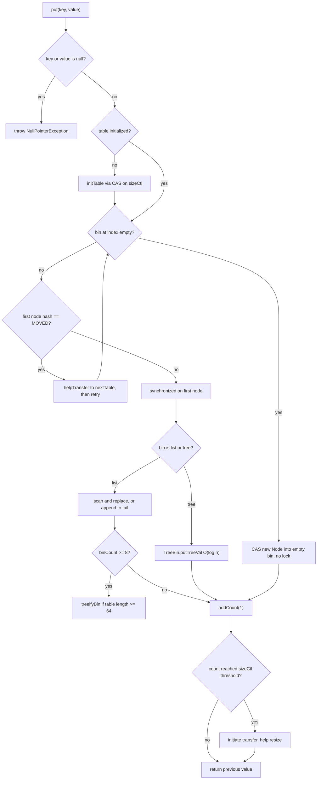
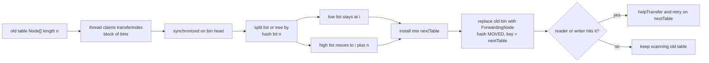
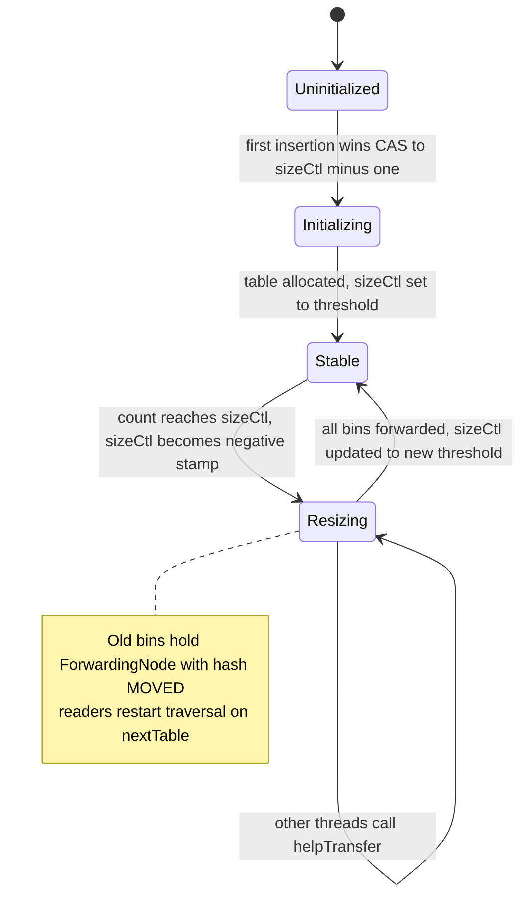
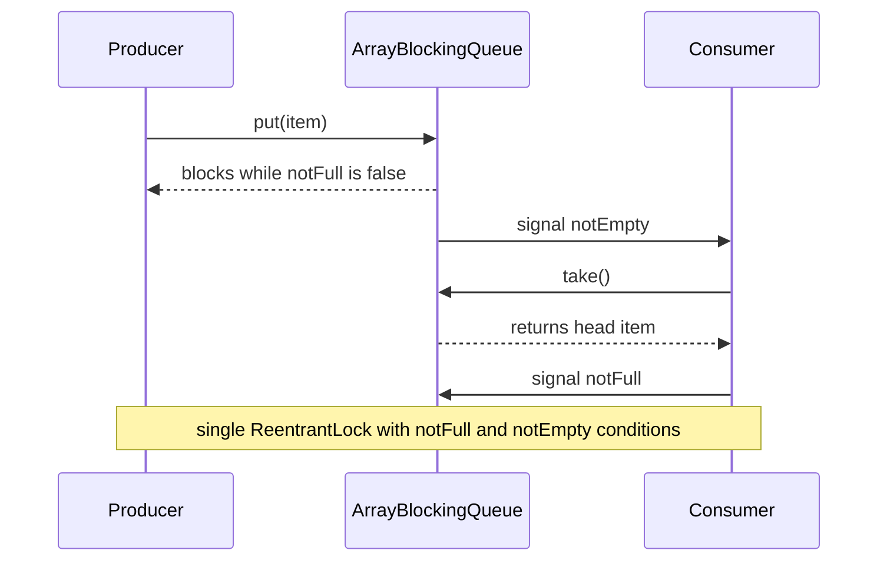
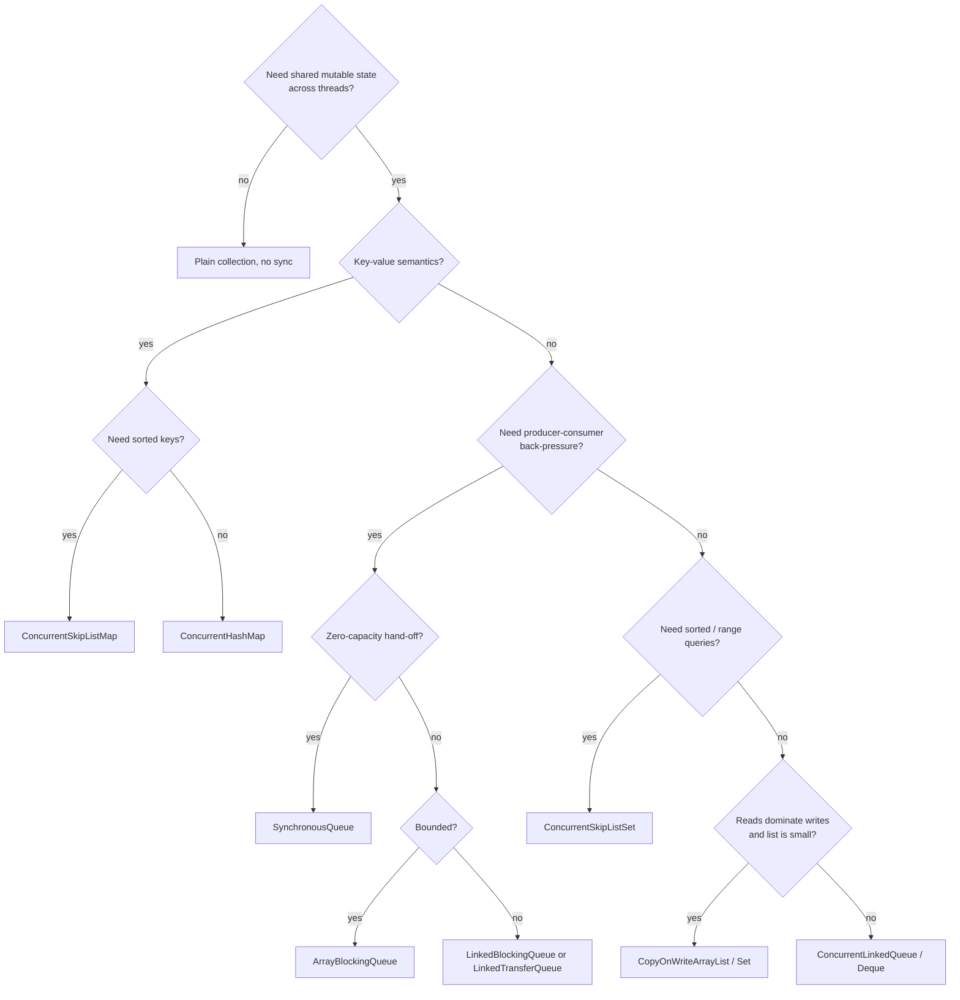

# Concurrent Collections

A **concurrent collection** is a collection whose methods can be invoked safely by multiple threads
*simultaneously* without external synchronization, with a precisely specified (and usually
weaker-than-you-think) consistency contract. The mental model that unlocks every interview question
is this: **there is no single "thread-safe collection".** There are several distinct concurrency
strategies, and each buys safety at a different price:

- **Lock striping / per-bin locking** — `ConcurrentHashMap`. Writers lock only the bin they touch;
  readers never lock. Best for high-throughput shared maps.
- **Copy-on-write** — `CopyOnWriteArrayList` / `CopyOnWriteArraySet`. Writers copy the whole array;
  readers read an immutable snapshot. Best when reads massively outnumber writes.
- **Lock-free (CAS / non-blocking)** — `ConcurrentLinkedQueue`, `ConcurrentSkipListMap`. No locks at
  all; progress is guaranteed by compare-and-swap loops. Best for unbounded, lock-free pipelines.
- **Blocking with conditions** — the `BlockingQueue` family. Locks *by design* to implement
  back-pressure (`put`/`take` block). Best for producer-consumer hand-off.
- **A single global lock (the anti-pattern)** — `Collections.synchronizedXxx` and `Hashtable`.
  Correct for single operations, disastrous for compound operations and throughput.

Everything follows from three questions you must ask about any shared collection:

1. **What is atomic?** A single method call — or only a compound sequence that the class explicitly
   provides (e.g. `computeIfAbsent`)?
2. **What do iterators guarantee?** Fail-fast, weakly consistent, or a frozen snapshot?
3. **What is the write cost vs the read cost, and how much contention is expected?**

Read this module as: *why the synchronized wrappers leak* → *`ConcurrentHashMap` in depth* →
*copy-on-write* → *blocking queues* → *lock-free queues* → *skip lists* → *iterator guarantees* →
*mistakes, performance, and selection*. The internals (`sizeCtl`, `CounterCell`, `ForwardingNode`,
`TreeBin`, `ReservationNode`, the Michael–Scott algorithm) are what separate a senior answer from a
junior one.

> **Boundary note:** `HashMap` internals (buckets, `hash`, treeify) live in
> [HashMap Internals](10-HashMap-Internals.md); lock APIs (`ReentrantLock`, `Condition`) live in
> [Locks](../04-Multithreading/18-Locks.md); the executor framework in
> [Concurrency Utilities](../04-Multithreading/19-Concurrency-Utilities.md); the memory model in
> [Java Memory Model](../04-Multithreading/23-Java-Memory-Model.md). This module uses those but does
> not re-teach them.

---

## 1. Why `Collections.synchronizedXxx` Is Often Insufficient

### 1.1 What the wrappers actually do

`Collections.synchronizedMap`, `synchronizedList`, `synchronizedSet`, `synchronizedSortedMap`, etc.
return a **delegating wrapper** that synchronizes *each method* on a single **mutex** object
(the wrapper itself, unless you pass one explicitly). The implementation is mechanical:

```java
static class SynchronizedMap<K,V> implements Map<K,V> {
    private final Map<K,V> m;      // backing map
    final Object mutex;            // the single lock

    public V get(Object key)    { synchronized (mutex) { return m.get(key); } }
    public V put(K key, V v)    { synchronized (mutex) { return m.put(key, v); } }
    public int size()           { synchronized (mutex) { return m.size(); } }
    // ... every method gets the same synchronized (mutex) wrapper
}
```

Two structural properties matter:

1. **One lock for the whole collection.** Every read *and* every write serializes on `mutex`. Even
   `get` blocks behind a slow `put`. Throughput collapses under contention.
2. **Atomicity is per-method only.** The wrapper cannot make a *sequence* of calls atomic. Your
   `if (!map.containsKey(k)) map.put(k, v)` is two separately-locked calls with a window in between.

### 1.2 Compound operations are not atomic

The classic lost-update bug:

```java
Map<String, Integer> m = Collections.synchronizedMap(new HashMap<>());
m.put("k", 0);

// WRONG: check-then-act across two locked calls
Integer v = m.get("k");   // lock, read 0, unlock
m.put("k", v + 1);        // lock, write 1, unlock
```

Run with 8 threads released simultaneously by a barrier (all read before any writes), and the result
is deterministic: **every update but one is lost**.

```java
import java.util.*;
import java.util.concurrent.*;

public class CompoundDemo {
    static final int N = 8;

    static void lostUpdates() throws Exception {
        Map<String, Integer> m = Collections.synchronizedMap(new HashMap<>());
        m.put("k", 0);
        CyclicBarrier barrier = new CyclicBarrier(N);          // all read, then all write
        ExecutorService pool = Executors.newFixedThreadPool(N);
        for (int i = 0; i < N; i++) {
            pool.submit(() -> {
                try {
                    Integer v = m.get("k");
                    barrier.await();
                    m.put("k", v + 1);
                } catch (Exception e) { throw new RuntimeException(e); }
            });
        }
        pool.shutdown();
        pool.awaitTermination(5, TimeUnit.SECONDS);
        System.out.println("check-then-act get+put => " + m.get("k")
                + " (expected 1, " + N + " updates lost)");
    }
}
```

Output (deterministic — the barrier forces the interleaving):

```text
check-then-act get+put => 1 (expected 1, 8 updates lost)
```

### 1.3 Iteration throws `ConcurrentModificationException` unless you lock

The wrapper delegates `iterator()` to the *backing* collection, whose iterator is **fail-fast**. The
Javadoc is explicit: you must manually wrap iteration in `synchronized (map) { ... }`. Forgetting
this yields a non-deterministic `ConcurrentModificationException`:

```java
Map<String, Integer> m = Collections.synchronizedMap(new HashMap<>());
m.put("a", 1);
m.put("b", 2);
int seen = 0;
for (String k : m.keySet()) {   // WRONG: not synchronized externally
    seen++;
    m.put("c", 3);              // structural modification during iteration
}
```

Iterating without holding `m`'s monitor throws partway through; the verified trace prints:

```text
synchronizedMap iterator => ConcurrentModificationException
```

Correct form (the documented pattern — synchronize on the **map**, not the view):

```java
synchronized (m) {
    for (String k : m.keySet()) { /* safe */ }
}
```

### 1.4 What the wrapper *does* make atomic (a nuance interviewers love)

Since Java 8, `SynchronizedMap` overrides the `Map` default methods so that each is performed under
the single lock: `getOrDefault`, `forEach`, `replaceAll`, `putIfAbsent`, `remove(k,v)`, `replace`,
`computeIfAbsent`, `computeIfPresent`, `compute`, `merge`. So these *single-method* compounds **are**
atomic — the problem is only caller-side sequences:

```java
Map<String, Integer> m = Collections.synchronizedMap(new HashMap<>());
// 8 threads race to install the first value
if (m.putIfAbsent("k", id) == null) firstWins.incrementAndGet();
```

Verified output:

```text
synchronizedMap.putIfAbsent winners => 1 (expected 1)
```

But `synchronizedMap` still suffers the single-lock throughput ceiling and the iteration footgun,
which is why **`ConcurrentHashMap` is the default replacement**.

### 1.5 Summary table: wrapper failure modes

| Failure mode | Cause | Symptom | Fix |
|---|---|---|---|
| Lost updates | Check-then-act across methods | Wrong final value | `compute` / `merge` / `putIfAbsent` |
| `ConcurrentModificationException` | Fail-fast iterator, no external lock | Crash under load | `synchronized(map){...}` or use `ConcurrentHashMap` |
| Single-lock bottleneck | One mutex for all reads/writes | Poor scaling | `ConcurrentHashMap` (per-bin locks) |
| `size()` unreliable for control flow | View over changing map | Wrong branch | Don't branch on `size()` |
| `containsKey` + `put` race | Two windows | Duplicate/overwritten entries | Atomic verb |

> **Rule:** `Collections.synchronizedXxx` provides *thread-safe single operations*, not *thread-safe
> business operations*. Reach for a purpose-built concurrent collection instead.

---

## 2. `ConcurrentHashMap` — Design and Internals

`ConcurrentHashMap` (CHM) is the workhorse. It is a hash table engineered so that **reads never
block and writers rarely block each other**.

### 2.1 Version history: `Segment` (JDK 7) vs `Node[]` (JDK 8+)

| Aspect | JDK 7 | JDK 8, 11, 17, 21 |
|---|---|---|
| Structure | `Segment<K,V>[]`, each a `ReentrantLock` with its own `HashEntry[]` | one `volatile Node<K,V>[] table` |
| Concurrency unit | **segment** (default 16, fixed by `concurrencyLevel`) | **bin** (individual bucket) |
| Empty-bin insert | segment lock | **CAS**, lock-free |
| Non-empty-bin update | segment lock | `synchronized` on the **first node of the bin** |
| Read | lock-free (volatile `value`) | lock-free (volatile table entry + `Node.val`) |
| `size()` | optimistic; locks **all** segments if counts change | `LongAdder`-style `baseCount` + `CounterCell[]` |
| Resize | per-segment rehash | table-wide, **cooperative** `transfer` with `ForwardingNode` |
| Collision worst case | linked list O(n) | **red-black tree** (`TreeBin`) O(log n) |
| `sizeCtl` | not present | central control field |
| `Segment` class | runtime locking | retained **only for serialization compatibility** |

The JDK 8 change was a huge win: concurrency is now bounded by the number of *distinct bins* being
written, not by a fixed number of segments.

### 2.2 The core idea: `Node[]` + CAS + per-bin `synchronized`

The Javadoc ("Overview") states the design goal precisely: *maintain concurrent readability while
minimizing update contention.* The `table` is a power-of-two array of bins. Most bins hold a list of
`Node`s (usually 0 or 1). The mechanism:

- **Table access uses `volatile` reads/writes and CAS** (via `jdk.internal.misc.Unsafe` intrinsics):
  `tabAt` = acquire read, `casTabAt` = CAS, `setTabAt` = release write.
- **Inserting the first node into an empty bin is a CAS** — no lock at all:
  ```java
  if ((f = tabAt(tab, i = (n - 1) & hash)) == null) {
      if (casTabAt(tab, i, null, new Node<K,V>(hash, key, value)))
          break; // no lock when adding to empty bin
  }
  ```
- **Updating a non-empty bin locks the first node** of that bin (`synchronized (f)`), then validates
  that it is still the first node (retrying otherwise). No per-bin lock objects are allocated — the
  node itself is the monitor.
- The **top bit of the node's hash field** is reused for control values, because the mask guarantees
  a normal hash's top bit is free:
  ```java
  static final int MOVED     = -1; // hash for forwarding nodes
  static final int TREEBIN   = -2; // hash for roots of trees
  static final int RESERVED  = -3; // hash for transient reservations
  static final int HASH_BITS = 0x7fffffff;
  static final int spread(int h) { return (h ^ (h >>> 16)) & HASH_BITS; }
  ```

Under random hashes the Javadoc estimates lock-collision probability for two threads at roughly
`1 / (8 * #elements)`.

### 2.3 Fields you must be able to name

| Field | Type | Meaning |
|---|---|---|
| `table` | `transient volatile Node<K,V>[]` | the bins; lazily initialized, power-of-two length |
| `nextTable` | `transient volatile Node<K,V>[]` | non-null only during resize |
| `sizeCtl` | `transient volatile int` | init/resize control (see below) |
| `baseCount` | `transient volatile long` | uncontended element counter, updated by CAS |
| `counterCells` | `transient volatile CounterCell[]` | contended counters (LongAdder-style) |
| `cellsBusy` | `transient volatile int` | spinlock for creating/growing `counterCells` |
| `transferIndex` | `transient volatile int` | next bin index (plus one) to split while resizing |

**`sizeCtl` encoding** (the classic exam question):

- `-1` → table is being **initialized** (some thread won the CAS to build it).
- `-(1 + k)` → table is being **resized**; `k` threads are actively helping. The negative value is
  also decorated with a *resize generation stamp* (`resizeStamp(n) << RESIZE_STAMP_SHIFT`) so
  overlapping resizes of different tables cannot be confused.
- `0` → default: use `DEFAULT_CAPACITY` (16) on first init.
- `> 0` → if `table == null`, the initial capacity to use; otherwise the **next element count
  threshold that triggers a resize** (≈ `n - n/4`).

### 2.4 `put` / `putVal` walkthrough



Key behaviors of `putVal`:

- Throws `NullPointerException` for null key **or** value, before doing anything.
- `putIfAbsent` shares this code path (`onlyIfAbsent` flag) and, as a fast path, checks the first
  node **without locking** before the `synchronized` block.
- Only *writers* to the same bin contend; readers just do volatile reads.
- `addCount` decides whether to resize; under contention it only checks the threshold when a bin
  already held ≥ 2 nodes (to avoid cache thrashing on the counter) — about 1 in 8 puts.

### 2.5 Tree bins (collision hardening)

When a bin's list reaches `TREEIFY_THRESHOLD` (8) **and** the table length is at least
`MIN_TREEIFY_CAPACITY` (64), the bin is converted to a red-black tree (`TreeBin` + `TreeNode`), and
reverts to a list when it shrinks to `UNTREEIFY_THRESHOLD` (6). This bounds worst-case lookup to
O(log n) even under adversarial hash collisions.

A `TreeBin` does **not** order purely by `compareTo` (keys may not be mutually comparable): it orders
primarily by **hash**, then by `compareTo` when available, then by class name and `identityHashCode`
as tie-breakers. It uses a small parasitic read-write lock so that tree readers wait for structural
rotations by writers.

### 2.6 Lazy initialization

The table is **not** allocated by the constructor; the first insertion calls `initTable`, which
CAS-es `sizeCtl` from a non-negative value to `-1`. Only one thread builds `table`; losers spin and
then retry. This keeps an empty CHM tiny and avoids resizing when the first operation is a `putAll`
or a constructor-from-map.

### 2.7 Resize / `transfer` / `ForwardingNode`

Resizing doubles the table. Because the length is a power of two, each old bin's elements either
**stay at index `i`** or **move to `i + n`** depending on one bit (`hash & n`). The resize is
**cooperative**: any thread that notices the table is being resized can help.



`ForwardingNode` (hash `MOVED`, its `key` field points at the new table) is the hand-off marker.
`helpTransfer` lets the encountering thread join before retrying; `tryPresize`/`addCount` coordinate
the generation via the `sizeCtl` stamp. During transfer, an average of only ~1/6 of nodes must be
cloned; the rest are reused.



### 2.8 `size()` as a LongAdder

`size()` is backed by a `LongAdder` specialization: a `baseCount` updated by CAS when uncontended,
plus a `CounterCell[]` (each cell `@jdk.internal.vm.annotation.Contended` to avoid false sharing)
when updates contend. `sumCount()` adds them. Consequences:

- `size()` is **O(1)** and needs no locks (unlike JDK 7, which could lock all segments).
- Under concurrent mutation, `size()` is only an **estimate**: it may not reflect in-flight updates.
- `mappingCount()` returns the count as a `long` (use it when the count can exceed `Integer.MAX_VALUE`).
- `isEmpty()` is `sumCount() <= 0`, ignoring transient negatives.

Never drive control flow off `size()` for exactly this reason.

### 2.9 Why no null keys or values

`ConcurrentHashMap` forbids null keys **and** null values:

```java
ConcurrentHashMap<String,Integer> m = new ConcurrentHashMap<>();
m.put(null, 1);   // NullPointerException
m.put("x", null); // NullPointerException
```

The Javadoc: *"Like `Hashtable` but unlike `HashMap`, this class does not allow `null` to be used as
a key or value."* The rationale is concurrency: `get` must be able to use `null` as an unambiguous
*"absent"* signal. If null values were legal, `get(k) == null` could mean "absent", "present with a
null value", or "the value changed concurrently" — and atomically-intended methods like
`computeIfAbsent` (whose mapping function uses a null return to mean "establish no mapping") would be
unimplementable. `Hashtable` has the same rule; `HashMap` (single-threaded) does not.

### 2.10 Weakly consistent iterators and memory consistency

CHM's iterators (`keySet().iterator()`, `entrySet()`, `values()`) are **weakly consistent**:

- They **never throw `ConcurrentModificationException`.**
- They are guaranteed to traverse each element present at creation **at most once**.
- They **may or may not** reflect modifications made after creation — no guarantee either way.
- `size()`, `isEmpty()`, `containsValue()` are best-effort snapshots for the same reason.

Verified: mutating a CHM while iterating it is allowed (contrast with 1.3):

```java
Map<String, Integer> chm = new ConcurrentHashMap<>();
chm.put("a", 1);
chm.put("b", 2);
int seen = 0;
for (String k : chm.keySet()) {
    seen++;
    chm.put("c" + k, 9);  // allowed; weakly consistent
}
System.out.println("no exception, seen=" + seen + ", size=" + chm.size());
```

Observed on Java 21: `no exception, seen=4, size=6`. The *guarantee* is "no exception"; `seen` is
implementation-dependent and must not be relied upon.

**Memory consistency** (from the `java.util.concurrent` package spec): *"Actions in a thread prior to
placing an object into any concurrent collection happen-before actions subsequent to the access or
removal of that element from the collection in another thread."* In practice, a successful `get`
bears a happens-before relation with the `put`/`compute` that stored the value (release write to the
node/array entry, acquire read by the reader).

### 2.11 The atomic compound methods

This is the single most important API-level point: **use the atomic verbs, never hand-roll
check-then-act.**

| Method | Semantics | Note |
|---|---|---|
| `putIfAbsent(k, v)` | put only if no mapping | returns previous value or null |
| `replace(k, v)` | replace only if present | returns old value or null |
| `replace(k, old, new)` | replace only if currently `old` | returns boolean |
| `remove(k, v)` | remove only if currently `v` | returns boolean |
| `computeIfAbsent(k, f)` | compute and store if absent; `f` runs **once** | `f` must not modify the map |
| `computeIfPresent(k, f)` | recompute only if present | return null removes mapping |
| `compute(k, f)` | recompute (or remove if `f` returns null) | key may be absent |
| `merge(k, v, f)` | `f(old, v)` or insert `v` if absent | `f` returning null removes mapping |
| `search` / `reduce` / `forEach` (with `parallelismThreshold`) | parallel bulk ops over a snapshot-ish view | function must be associative/commutative |

Demonstration — `merge` is atomic and contention-safe:

```java
ConcurrentHashMap<String, Integer> m = new ConcurrentHashMap<>();
// 8 threads, released together, each does:
m.merge("k", 1, Integer::sum);
System.out.println(m.get("k"));   // 8
```

Verified output: `merge(k,1,Integer::sum) => 8`. And `computeIfAbsent` runs its mapping function
**exactly once** even when 8 threads race:

```text
computeIfAbsent mapping calls => 1 (expected 1)
```

Verified API behavior on Java 21:

```text
putIfAbsent(null-absent) => null
putIfAbsent(exists) => 1, value=1
replace(a,1,2) => true, value=2
remove(a, 2) => true, containsKey=false
compute(b, +10) => 11
computeIfPresent(b, *2) => 22
merge(b, 5, sum) => 27
merge(c, 5, sum) => 5
```

**Frequency-map idiom** (documented): use `LongAdder` values so counting does not serialize on the
same value object:

```java
ConcurrentHashMap<String, LongAdder> freq = new ConcurrentHashMap<>();
freq.computeIfAbsent(key, k -> new LongAdder()).increment();
```

### 2.12 The `computeIfAbsent` recursion pitfall

The mapping function **must not modify the map**. Because it runs while the bin is locked (or while a
`ReservationNode` occupies an empty bin), a recursive update can deadlock, livelock, or corrupt
progress. JDK 9+ detects the detectable case and throws:

```java
ConcurrentHashMap<String,String> m = new ConcurrentHashMap<>();
m.computeIfAbsent("a", k -> m.computeIfAbsent("a", k2 -> "v"));
```

Verified output:

```text
recursion => IllegalStateException: Recursive update
```

Mechanics: for an empty bin, `computeIfAbsent` first CAS-es in a `ReservationNode` (hash `RESERVED`,
key/value null), then runs the function. A recursive call that meets the reservation (or a list whose
`next` pointer changed under it) throws `IllegalStateException("Recursive update")`. A *cross-key*
cycle (`a→b→a` in different bins) that the detector cannot see can deadlock instead — another reason
to keep mapping functions pure.

Also note: a mapping function that returns `null` establishes **no** mapping (and `containsKey`
stays false); it is not stored as a null value (which is illegal anyway).

```text
mapping returns null => null, containsKey=false
```

### 2.13 Performance vs `Hashtable` / `synchronizedMap`

`Hashtable` synchronizes *every* method on the whole table (a single global monitor); the
`synchronizedMap` wrapper is equivalent. CHM's `get` is lock-free and writers touch only one bin, so
it scales with cores. A representative benchmark (8 threads, 500k interleaved `put`+`get` each):

```java
static void run(String name, Map<Integer,Integer> map) throws Exception {
    ExecutorService pool = Executors.newFixedThreadPool(8);
    CountDownLatch start = new CountDownLatch(1);
    // each worker: start.await(); for i in 0..500_000 { map.put(i,i); map.get(i); }
}
```

Representative output (machine-dependent; **ordering** is the point, not the absolute numbers):

```text
ConcurrentHashMap       195 ms
Hashtable               476 ms
synchronizedMap         582 ms
```

CHM is typically several times faster and, critically, keeps improving as cores are added, whereas
the single-lock variants do not.

### 2.14 CHM vs `Hashtable` vs `synchronizedMap`

| Axis | `ConcurrentHashMap` | `Hashtable` | `Collections.synchronizedMap` |
|---|---|---|---|
| Locking | per-bin CAS + `synchronized(bin)` | one global monitor | one mutex |
| Reads | lock-free | locked | locked |
| Null key/value | forbidden | forbidden | allowed (delegates) |
| Atomic compounds | rich (`compute`, `merge`, …) | only legacy (`putIfAbsent`… since 8) | overridden defaults, single-mutex |
| Iterators | weakly consistent, no CME | fail-fast (Enumeration safe) | fail-fast, must sync externally |
| `size()` | O(1) approximate | locked, exact | locked, exact |
| Scale with cores | yes | no | no |
| Use today | default choice | legacy | legacy / simple copies |

> **Rule:** Prefer `ConcurrentHashMap`. Reach for `Hashtable`/`synchronizedMap` only in legacy code,
> or when the backing map is not thread-safe and everything is dictated by one external lock anyway.

---

## 3. `CopyOnWriteArrayList` / `CopyOnWriteArraySet`

### 3.1 Semantics

Backed by a `private transient volatile Object[] array`. Every mutation performs
`Arrays.copyOf(array, …)`, modifies the copy, and publishes it with a `volatile` write
(`setArray`) under a short writer lock (`final transient Object lock = new Object()`). Readers read
the current array reference and never lock at all.

```
array (volatile)  --->  [ e0 | e1 | e2 ]        // a reader holds this snapshot forever
writer add(e3): copy -> [ e0 | e1 | e2 | e3 ] -> volatile publish
```

Consequences:

- **Reads never block and never throw `ConcurrentModificationException`.**
- **Iterators are snapshots**: created from the array at that instant, they are immutable and never
  see later changes.
- **`size()` is O(1)** (just `array.length`).
- **Writes are O(n)** and allocate a fresh array each time — the "memory churn" cost.

### 3.2 Snapshot iterators vs fail-fast

Verified contrast:

```java
// ArrayList: fail-fast
for (String s : arrayList) { arrayList.add("x"); }   // ConcurrentModificationException

// CopyOnWriteArrayList: snapshot
int seen = 0;
for (String s : cow) { seen++; cow.add("x" + seen); } // never throws
```

Observed output:

```text
ArrayList iterator => ConcurrentModificationException
CopyOnWriteArrayList iterator => no exception, seen=2, size=4 (snapshot is fixed at 2)
```

The loop body saw exactly the 2 original elements even though the list grew to 4.

### 3.3 `CopyOnWriteArraySet`

It wraps a `CopyOnWriteArrayList` and implements `add` via `addIfAbsent`, so it is **O(n)** per add
but guarantees uniqueness, and its iterators are snapshots too:

```text
add a => true
add a again => false
set size => 1
```

### 3.4 Iterator mutation is unsupported

Snapshot iterators cannot mutate the underlying collection:

```text
CopyOnWrite iterator.remove => UnsupportedOperationException
```

### 3.5 When to use — and when not to

| Property | Implication |
|---|---|
| Great for read-mostly, write-rare | Ideal for **listener/observer lists**, config that changes rarely |
| Iteration is always safe | No external synchronization needed |
| No CME ever | Robust in hot read paths |
| Each write copies the whole array | Avoid with large arrays or frequent writes |
| GC pressure / allocation | `add` in a loop is O(n²) time and O(n²) allocation |
| No random-access penalty | `get(i)` is O(1) on the snapshot |

**Use when:** reads vastly outnumber writes and the collection is small-to-moderate (event
listeners, read-only registries refreshed occasionally).

**Do NOT use when:** writes are frequent (every write copies), the collection is huge, or you need
atomic compound updates across elements. For a concurrent set with frequent writes, prefer
`ConcurrentHashMap.newKeySet()`; for a concurrent list with frequent writes, consider a
`ConcurrentLinkedQueue`/`ConcurrentLinkedDeque` or an external lock.

---

## 4. The `BlockingQueue` Family

`BlockingQueue<E>` adds blocking back-pressure to `Queue`. It is the canonical producer-consumer
primitive.

### 4.1 The four method forms

Every blocking queue supports four behaves-differently variants (Javadoc table):

|  | Throws exception | Returns special value | Blocks | Times out |
|---|---|---|---|---|
| **Insert** | `add(e)` | `offer(e)` → `false` | `put(e)` | `offer(e, t, unit)` |
| **Remove** | `remove()` | `poll()` → `null` | `take()` | `poll(t, unit)` |
| **Examine** | `element()` | `peek()` → `null` | — | — |

`BlockingQueue` does **not** permit null elements (null is the "no element" sentinel).

### 4.2 Implementations

| Implementation | Bound | Ordering | Locks | Typical use |
|---|---|---|---|---|
| `ArrayBlockingQueue` | fixed | FIFO | **one** `ReentrantLock` + 2 conditions | bounded hand-off, back-pressure |
| `LinkedBlockingQueue` | optional (default `Integer.MAX_VALUE`) | FIFO | **two** locks (put/take) + `AtomicInteger` count | high-throughput pools |
| `PriorityBlockingQueue` | unbounded | **priority**, not FIFO | one lock | priority scheduling |
| `SynchronousQueue` | zero | rendezvous | CAS/stack-or-queue | thread hand-off, cached pools |
| `DelayQueue` | unbounded | by delay expiry | one lock + condition | retries, timers, TTL |
| `LinkedTransferQueue` | unbounded | FIFO | CAS (lock-free) | `transfer`/hand-off |
| `LinkedBlockingDeque` | optional | FIFO/LIFO both ends | one lock | work-stealing-ish deques |

### 4.3 `ArrayBlockingQueue`

Bounded, backed by a circular `Object[]`. Uses **one** `ReentrantLock` with two `Condition`s:
`notEmpty` (consumers wait) and `notFull` (producers wait). Optional fairness constructor
`new ArrayBlockingQueue<>(cap, true)` makes the lock fair (FIFO waiters) at a throughput cost.

```java
BlockingQueue<Integer> q = new ArrayBlockingQueue<>(4);
q.put(1);              // blocks if full
Integer x = q.take();  // blocks if empty
```

Verified timeout/offer semantics on a full/empty queue:

```text
offer on full (no wait) => false
offer on full (50ms) => false
poll => only
poll on empty (no wait) => null
poll on empty (50ms) => null
```

### 4.4 `LinkedBlockingQueue`

Optionally bounded linked nodes. It uses **two locks** (`putLock`, `takeLock`) and an
`AtomicInteger count`, so a producer and a consumer can proceed concurrently — higher throughput
than `ArrayBlockingQueue`. The trap: the default constructor is **effectively unbounded**
(`Integer.MAX_VALUE`), which can silently exhaust the heap under a fast producer.

```text
LinkedBlockingQueue default remainingCapacity => 2147483647
remainingCapacity == Integer.MAX_VALUE => true
```

### 4.5 `PriorityBlockingQueue`

Unbounded blocking queue over a **binary heap**. `take` returns the smallest element per natural
ordering or the supplied `Comparator`; it is **not FIFO** and not stable. Because it is unbounded,
`put` never blocks — only `take`/`poll` do when empty. Nested classes of the same priority may come
out in arbitrary order. Nulls are not allowed.

```text
PriorityBlockingQueue order => 1 2 3 4 5
```

### 4.6 `SynchronousQueue` — rendezvous

A queue with **no internal capacity**: each `put` must meet a `take`. It is the classic hand-off
primitive and is what `Executors.newCachedThreadPool()` uses to give a new task directly to an idle
worker.

- `size()` is always 0, `isEmpty()` always true, `peek()` always null.
- `offer(e)` succeeds **only if a consumer is already waiting**.
- Non-fair mode is a **LIFO stack**; fair mode is a **FIFO queue**.

Verified:

```text
isEmpty => true, size => 0, peek => null
offer with no taker => false
offer with taker => true
taker received => handoff
```

### 4.7 `DelayQueue`

An unbounded queue of `Delayed` elements; an element becomes available only after its delay expires.
`take` blocks until an expired element exists, returning it in delay order. Elements must implement
`java.util.concurrent.Delayed` (`getDelay(TimeUnit)` and `compareTo`).

**Edge case that trips people up:** `peek()` returns the internal heap head **regardless of expiry**,
while `poll()` returns null when nothing has expired:

```text
peek immediately => a
poll immediately => null
remaining size => 1
```

Verified ordering (shortest delay first):

```text
poll immediately => null
take order => first, second
```

### 4.8 `LinkedTransferQueue`

Unbounded, lock-free (`CAS`), and implements `TransferQueue`. `transfer(e)` **hands the element
directly to a waiting consumer, otherwise enqueues and blocks until consumed**; `tryTransfer(e)`
hands off only if a consumer is waiting right now (else returns `false` without enqueuing). Plain
`put`/`add`/`offer` enqueue without waiting. Verified:

```text
tryTransfer with no consumer => false
put then size => 1, poll => 1
transfer handed off => 7, size after => 0
tryTransfer with timeout, no consumer => false
```

### 4.9 `LinkedBlockingDeque`

A **double-ended** `BlockingDeque`: optionally bounded, supports `putFirst`/`putLast`,
`takeFirst`/`takeLast`, and is the standard choice for a work queue where you may push back or steal
from either end.

```text
deque takeFirst => 1, takeLast => 3
```

### 4.10 Producer-consumer example (verified)

```java
import java.util.concurrent.*;

public class BQDemo {
    public static void main(String[] args) throws Exception {
        BlockingQueue<Integer> q = new ArrayBlockingQueue<>(4);
        int items = 100;
        Thread producer = new Thread(() -> {
            try {
                for (int i = 1; i <= items; i++) q.put(i);
                q.put(-1);                 // poison pill
            } catch (InterruptedException e) { Thread.currentThread().interrupt(); }
        });
        Thread consumer = new Thread(() -> {
            try {
                long sum = 0;
                for (int v; (v = q.take()) != -1; ) sum += v;
                System.out.println("consumer sum => " + sum + " (expected 5050)");
            } catch (InterruptedException e) { Thread.currentThread().interrupt(); }
        });
        producer.start(); consumer.start();
        producer.join();  consumer.join();
    }
}
```

Output:

```text
consumer sum => 5050 (expected 5050)
```



---

## 5. `ConcurrentLinkedQueue` / `ConcurrentLinkedDeque`

Lock-free, **non-blocking**, unbounded queues implementing the **Michael–Scott** algorithm: a linked
list where `head`/`tail` advance by `CAS` and nodes carry a "deleted" marker. No locks, so no thread
can block another.

- `offer`/`add` are O(1) and never fail (unbounded).
- `poll` is O(1); returns `null` when empty **instead of blocking**.
- `peek` returns the head or null.
- **`size()` is O(n) and approximate**: it walks the whole list, and concurrent mutations can make
  the count stale ("bear in mind that, unlike in most collections, this method is NOT a
  constant-time operation"). Prefer `isEmpty()` (O(1)) for emptiness checks.
- Iterators are weakly consistent and never throw `ConcurrentModificationException`.

Verified:

```text
empty poll => null, isEmpty => true
size (O(n)) => 3, peek => 1, poll => 1
deque => [0, 1, 2], removeLast => 2
```

Use `ConcurrentLinkedQueue` for high-throughput, unbounded, non-blocking pipelines where back-pressure
is handled elsewhere. Use a `BlockingQueue` when producers must be throttled.

---

## 6. `ConcurrentSkipListMap` / `ConcurrentSkipListSet`

These are the **sorted**, lock-free concurrent map/set. They implement `ConcurrentNavigableMap` /
`NavigableSet` using a **skip list**: a hierarchy of linked levels where each level skips over more
nodes, giving O(log n) expected search/insert/delete without ever taking a lock (nodes are linked via
`CAS`).

- Sorted by natural ordering or a `Comparator`; keys and values cannot be null.
- Expected O(log n) for `get`/`put`/`remove`/`containsKey`.
- `size()` is O(1) via an internal `LongAdder`.
- Rich navigation: `firstKey`, `lastKey`, `floorKey`, `ceilingKey`, `higherKey`, `lowerKey`,
  `headMap`, `tailMap`, `subMap`, `descendingMap`.
- Iterators are weakly consistent and never throw CME.

Verified:

```text
keys sorted => [1, 2, 3, 4, 5, 7, 10]
firstKey=1, lastKey=10
floorKey(6)=5, ceilingKey(6)=7
headMap(5,true)=[1, 2, 3, 4, 5]
subMap(3,true,7,true)=[3, 4, 5, 7]
descendingMap keys => [10, 7, 5, 4, 3, 2, 1]
set sorted, size=3 => [a, b, c]
set.ceiling("aa") => b
```

**When to use which:**

| Need | Choose |
|---|---|
| Sorted keys, concurrent | `ConcurrentSkipListMap` |
| Unordered key-value, max throughput | `ConcurrentHashMap` (faster constant factor) |
| Sorted, single-threaded | `TreeMap` (cheaper, but not thread-safe) |
| Sorted set, concurrent | `ConcurrentSkipListSet` (backed by the map) |

A skip list's constant factor is worse than a hash table's, so use `ConcurrentSkipListMap` only when
you genuinely need ordering or range queries; otherwise `ConcurrentHashMap` wins.

---

## 7. Iterator Guarantees: Fail-Fast vs Weakly Consistent vs Snapshot

This table is a favourite interview probe. Be precise about what each guarantees.

| Property | **Fail-fast** | **Weakly consistent** | **Snapshot** |
|---|---|---|---|
| Examples | `ArrayList`, `HashMap`, `Hashtable`, `synchronizedXxx` views | `ConcurrentHashMap`, `ConcurrentLinkedQueue`, `ConcurrentSkipListMap`, most BlockingQueues | `CopyOnWriteArrayList`, `CopyOnWriteArraySet` |
| On concurrent structural change | throws `ConcurrentModificationException` | never throws CME | never throws CME |
| Sees changes after creation? | undefined; usually throws | may or may not (best effort) | **no** — frozen at creation |
| Element guarantee | may miss/duplicate on misuse | each element present at creation traversed at most once | exact snapshot |
| Cost | cheap; `modCount` check | cheap; no locking | array copy on every write |
| Safe to modify while iterating? | no | yes | yes (write is separate) |
| Backing memory | live | live | copy |

> **Rule of thumb:** fail-fast detects bugs; weakly consistent tolerates concurrency; snapshot gives
> you a stable, immutable view. Choose the collection for the guarantee you need, not the other way
> around.

---

## 8. Common Mistakes and Pitfalls

### 8.1 Check-then-act (the number one bug)

```java
// WRONG
if (!map.containsKey(k)) {
    map.put(k, computeExpensive(k));
}
```

```java
// RIGHT - atomic, function runs at most once per key
map.computeIfAbsent(k, k2 -> computeExpensive(k2));
// or, for a precomputed value:
map.putIfAbsent(k, value);
```

### 8.2 `get` + `put` "increment" race

```java
// WRONG - lost updates under contention
Integer v = map.get(k);
map.put(k, v == null ? 1 : v + 1);
```

```java
// RIGHT
map.merge(k, 1, Integer::sum);
// or
map.compute(k, (kk, v) -> v == null ? 1 : v + 1);
```

### 8.3 Using `size()` for control flow

```java
// WRONG - size() is an estimate under concurrency
if (map.size() < LIMIT) map.put(k, v);
```

```java
// RIGHT - make the bounded decision itself atomic, e.g. a semaphore, or a
// dedicated counter with compareAndSet; never branch on a changing size().
```

Same for `ConcurrentLinkedQueue.size()`, which is O(n) *and* approximate.

### 8.4 Assuming `get` + conditional `put` is atomic

Getting a value and then deciding to write is two operations. If the decision must be atomic, it has
to be expressed as a single CHM verb (`compute`, `merge`, `replace`, `remove(k,v)`).

### 8.5 Null handling

```java
// WRONG - ConcurrentHashMap rejects null key and value
map.put(null, null);  // NullPointerException
```

```java
// RIGHT - model "no value" explicitly
map.remove(k);                          // absence, not a null value
map.putIfAbsent(k, defaultValue);       // sentinel default instead of null
// or use HashMap + external lock if you truly need nulls
```

### 8.6 Mutating the map inside a mapping/remapping function

```java
// WRONG - can deadlock or throw "Recursive update"
map.computeIfAbsent(k, k2 -> { map.put("other", 1); return 1; });
```

Keep `compute*`/`merge` functions pure (no access to the same map).

### 8.7 `Collections.synchronizedMap` with compound operations, or iterating without the lock

```java
// WRONG - iterations must hold the wrapper's monitor
for (var e : syncMap.entrySet()) { ... }     // may throw CME
```

```java
// RIGHT
synchronized (syncMap) {
    for (var e : syncMap.entrySet()) { ... }
}
```

### 8.8 Treating `CopyOnWriteArrayList` as a general-purpose list

Every `add` copies the whole array. Appending n items is O(n²) time and allocation. If you find
yourself writing to it in a loop, you have the wrong collection.

### 8.9 Assuming queue ordering where there is none

`PriorityBlockingQueue` is not FIFO; `ConcurrentHashMap` iteration order is unspecified;
`ConcurrentLinkedQueue` is FIFO but its `size()` is approximate. Match the collection to the
ordering contract you actually require.

---

## 9. Performance and Selection

### 9.1 Concurrency strategy performance

| Collection | Read cost | Write cost | Reads block? | Writes block? | Scales with cores | Iterator |
|---|---|---|---|---|---|---|
| `ConcurrentHashMap` | O(1), lock-free | O(1) amortized, per-bin | no | only same-bin | yes | weakly consistent |
| `Hashtable` / `synchronizedMap` | O(1) + global lock | O(1) + global lock | yes | yes | no | fail-fast |
| `CopyOnWriteArrayList` | O(1), no lock | **O(n)** copy | no | writer lock | writes don't scale | snapshot |
| `ArrayBlockingQueue` | O(1) + lock | O(1) + lock | yes (empty) | yes (full) | limited (1 lock) | weakly consistent |
| `LinkedBlockingQueue` | O(1) + takeLock | O(1) + putLock | yes (empty) | yes (full) | better (2 locks) | weakly consistent |
| `ConcurrentLinkedQueue` | O(1) CAS | O(1) CAS | no | no | yes (lock-free) | weakly consistent |
| `ConcurrentSkipListMap` | O(log n) | O(log n) | no | no | yes (lock-free) | weakly consistent |
| `SynchronousQueue` | — | O(1) rendezvous | yes | yes | yes | — |

### 9.2 Throughput vs contention

- **Low contention** (few threads, or disjoint keys): all approaches are close; CHM still avoids
  lock overhead on reads.
- **High contention** (many threads, hot keys): single-lock variants (`Hashtable`,
  `synchronizedMap`) serialize and collapse; CHM keeps working because contention localizes to a bin.
- **Hot single key**: even CHM serializes writes to one bin (`synchronized` on that bin's head).
  If one key dominates, shard it (`computeIfAbsent(k, ... LongAdder)` then `increment()`) or
  `LongAdder`-style striping.
- **Read-mostly, rare writes, small data**: `CopyOnWriteArrayList` can be excellent despite O(n)
  writes.
- **Back-pressure required**: only a `BlockingQueue` gives it; lock-free queues do not throttle.

### 9.3 "Which collection?" decision guide



### 9.4 Best practices

1. **Never hand-roll compound operations** on a concurrent map — use `compute`/`merge`/`putIfAbsent`.
2. **Prefer `ConcurrentHashMap`** over `Hashtable`/`synchronizedMap` in all new code.
3. **Keep mapping/remapping functions pure** (no map mutation, short, no blocking I/O).
4. **Size hint** CHM: pass an `initialCapacity` when the size is known to avoid rehashing.
5. **Do not branch on `size()`**; make the decision atomic (semaphore, atomic counter, `compute`).
6. **Iterators are not atomic snapshots** for weakly consistent collections; if you need a consistent
   point-in-time view, copy it explicitly.
7. **Bounded queues prevent OOM**: always set a capacity for `LinkedBlockingQueue` unless unbounded is
   intentional.
8. **Choose the guarantee first**: fail-fast vs weakly consistent vs snapshot.
9. **Measure under realistic contention**; microbenchmarks with one thread hide the entire point.

## Cross-links

- [Collections Framework, Part 1](08-Collections-Part-1.md) and [Part 2](09-Collections-Part-2.md)
- [HashMap Internals](10-HashMap-Internals.md) — buckets, hashing, treeify (the single-threaded base)
- [Generics](../01-Fundamentals/07-Generics.md) — why `new Node<K,V>[n]` needs unchecked casts
- [Threads](../04-Multithreading/16-Threads.md) and [Synchronization](../04-Multithreading/17-Synchronization.md)
- [Locks](../04-Multithreading/18-Locks.md) — `ReentrantLock`, `Condition` used by the blocking queues
- [Concurrency Utilities](../04-Multithreading/19-Concurrency-Utilities.md) — executors, latches, `LongAdder`
- [Fork/Join](../04-Multithreading/21-ForkJoin.md) — the common pool used by CHM bulk operations
- [Java Memory Model](../04-Multithreading/23-Java-Memory-Model.md) — happens-before behind volatile/CAS

---

# Interview Questions

## Beginner

**Q:** What does it mean for a collection to be "thread-safe", and is `Collections.synchronizedMap` enough?
**A:** It means its own operations can be invoked from multiple threads without corrupting internal
state. `Collections.synchronizedMap` synchronizes each method on one mutex, so individual calls are
atomic and safe. But it does **not** make a *sequence* of calls atomic (check-then-act races still
lose updates), and its iterators remain fail-fast unless the caller manually synchronizes on the map.
For real concurrency, use `ConcurrentHashMap`.

**Q:** Why can't `ConcurrentHashMap` store null keys or values?
**A:** Because `get` uses `null` as the unambiguous "absent" signal. With concurrent mutation, a null
value would make `get(k) == null` ambiguous among "absent", "value is null", and "changed
concurrently". It also makes `computeIfAbsent`-style atomic methods impossible, since they use a null
return to mean "establish no mapping." `Hashtable` has the same rule; `HashMap` (single-threaded)
allows nulls.

**Q:** What is a `ConcurrentModificationException` and which concurrent collections avoid it?
**A:** It is thrown by **fail-fast** iterators when the backing collection is structurally modified
outside the iterator (detected via a `modCount` check). `ConcurrentHashMap`,
`CopyOnWriteArrayList`, `ConcurrentLinkedQueue`, `ConcurrentSkipListMap`, and the blocking queues all
avoid it because their iterators are weakly consistent or snapshots.

**Q:** Name the main concurrent collections and one use case each.
**A:** `ConcurrentHashMap` — shared caches/counters; `CopyOnWriteArrayList` — listener registries;
`ArrayBlockingQueue`/`LinkedBlockingQueue` — producer-consumer; `SynchronousQueue` — direct
hand-off (`newCachedThreadPool`); `ConcurrentLinkedQueue` — lock-free pipelines;
`ConcurrentSkipListMap` — concurrent sorted/range queries; `DelayQueue` — retries/timeouts.

**Q:** Is `ConcurrentHashMap.get()` blocking?
**A:** No. `get` is a lock-free volatile read of the bin; it never blocks and never throws.

**Q:** What does `CopyOnWriteArrayList.add` do under the hood?
**A:** It copies the entire backing array, appends the element to the copy, and publishes the new
array with a volatile write (under a short writer lock). Existing iterators keep the old snapshot.

## Intermediate

**Q:** How does `ConcurrentHashMap` differ between JDK 7 and JDK 8+?
**A:** JDK 7 used an array of `Segment`s, each a `ReentrantLock` guarding its own `HashEntry[]`
(lock striping, fixed concurrency level). JDK 8+ uses one `volatile Node[]` table: empty-bin inserts
are CAS, non-empty-bin updates `synchronized` on the bin's first node, `size()` uses a
`LongAdder`-style counter, resizing is cooperative with `ForwardingNode`, and long bins become
red-black trees. The `Segment` class survives only for serialization compatibility.

**Q:** Explain `sizeCtl` in `ConcurrentHashMap`.
**A:** A single volatile int that multiplexes init/resize state: `-1` means initialization in
progress; other negative values encode resize generation and the number of helping threads
(`-(1 + k)`); `0` means use the default capacity; a positive value is the initial capacity (if the
table is null) or the resize threshold once initialized.

**Q:** Why does `computeIfAbsent` sometimes throw `IllegalStateException("Recursive update")`?
**A:** The mapping function must not modify the map. When computing for an empty bin, CHM installs a
`ReservationNode` (hash `RESERVED`) and runs the function while holding the bin. If the function
recursively updates the same bin, CHM detects it (reservation or changed `next`) and throws rather
than deadlocking. Cross-bin cycles can still deadlock, so functions should be pure.

**Q:** What is a weakly consistent iterator? Give the exact guarantee.
**A:** It never throws `ConcurrentModificationException`, and it traverses each element present at
creation at most once; it may or may not reflect modifications made after creation. This is the
iterator contract for `ConcurrentHashMap`, `ConcurrentLinkedQueue`, `ConcurrentSkipListMap`, and most
blocking queues.

**Q:** Compare `ArrayBlockingQueue` and `LinkedBlockingQueue`.
**A:** ABQ is fixed-capacity, array-backed, and uses **one** lock with two conditions. LBQ is
optionally bounded (default effectively unbounded) and uses **two** locks plus an atomic count, so a
producer and consumer proceed in parallel — higher throughput, but a memory-footprint risk if left
unbounded.

**Q:** What is `SynchronousQueue` and who uses it?
**A:** A zero-capacity rendezvous queue: every `put` must meet a `take`, `size()` is always 0, and
`peek()` is always null. `Executors.newCachedThreadPool()` uses it to hand each new task directly to
an idle thread (or create one).

**Q:** Why is `ConcurrentLinkedQueue.size()` discouraged?
**A:** It is not constant-time — it walks the entire list, and because of concurrency it is only an
approximation. Use `isEmpty()` (O(1)) to test emptiness.

## Advanced

**Q:** Walk through `putVal` for `ConcurrentHashMap`.
**A:** If the table is null, `initTable` (CAS on `sizeCtl`). If the target bin is empty, CAS a new
node in (no lock). If the bin head has hash `MOVED`, `helpTransfer` and retry. Otherwise
`synchronized` on the bin head, validate it is still the head, then either scan/replace/append the
list, or `putTreeVal` for a tree; treeify if `binCount >= 8`. Finally `addCount(1)` which may
trigger/help a resize. Returns the previous value (or null).

**Q:** How does concurrent resizing work?
**A:** Doubling the table means each bin's elements either stay at `i` or move to `i + n`, decided by
`hash & n`. A thread allocating `nextTable` sets `sizeCtl` to a negative stamp; other threads observe
this and call `helpTransfer`. Threads claim blocks of bins via `transferIndex` (reducing contention),
lock each bin head, split its list/tree, and install it in `nextTable`. Each migrated old bin is
replaced by a `ForwardingNode` whose `key` is `nextTable`; readers/writers hitting it restart on the
new table. Only ~1/6 of nodes need cloning.

**Q:** How does `ConcurrentHashMap` count elements without a lock?
**A:** A LongAdder specialization: CAS into `baseCount` when uncontended, else accumulate into
`CounterCell[]` cells (each `@Contended` to avoid false sharing). `sumCount()` sums them. It is O(1)
but only an estimate during concurrent updates, and `mappingCount()` returns it as a long.

**Q:** Why does `CopyOnWriteArrayList` have a writer lock at all if it is copy-on-write?
**A:** To serialize concurrent writers so their copies do not clobber each other (otherwise two
writers could each copy the same base array and lose one update). Readers never take the lock; they
just read the volatile `array` field.

**Q:** When is `CopyOnWriteArrayList` a bad choice, and what would you use instead?
**A:** With frequent writes, the whole-array copy makes updates O(n) time and O(n) allocation, and
appending n items is O(n²). Use a `ConcurrentLinkedQueue`/`ConcurrentLinkedDeque`, a
`ConcurrentHashMap.newKeySet()`, or a lock-guarded collection instead.

**Q:** `ConcurrentSkipListMap` vs `ConcurrentHashMap` — which and why?
**A:** Use `ConcurrentSkipListMap` only when you need sorted order or `NavigableMap` range/`floor`/
`ceiling` queries; it is lock-free with O(log n) operations. Otherwise `ConcurrentHashMap` has a
better constant factor and O(1) average lookups.

**Q:** Must the functions passed to `compute`/`merge` be side-effect free?
**A:** They must not modify the map (recursion/`IllegalStateException`/deadlock risk). More broadly
they should be short and commutative/associative for bulk operations, since execution order is not
defined and they may run under a bin lock.

## Expert

**Q:** Explain the role of `ForwardingNode` and `ReservationNode`.
**A:** `ForwardingNode` (hash `MOVED`, `key = nextTable`) is installed in an old bin after it is
migrated; encountering it redirects traversals and updates to `nextTable`. `ReservationNode` (hash
`RESERVED`) is a temporary placeholder CAS-ed into an empty bin while a `computeIfAbsent` mapping
function runs, so other threads block or detect a recursive update instead of racing the insert.

**Q:** Why does `ConcurrentHashMap` use `synchronized` on the bin head rather than `ReentrantLock`?
**A:** Allocating a distinct lock per bin would waste memory (bins vastly outnumber concurrent
writers). Using the first node as its own monitor is free, and monitor locking is cheap after
biased/thin-lock optimizations. Correctness relies on the invariant that a node once first in a bin
stays first until deleted or the bin is invalidated, so re-validating `tabAt(tab,i)==f` after
acquiring suffices.

**Q:** How does `ConcurrentHashMap` avoid false sharing and cache thrashing in its counters?
**A:** `CounterCell` is annotated `@jdk.internal.vm.annotation.Contended`, padding cells to separate
cache lines. It also delays resize threshold checks under contention (only after a bin holds ≥ 2
nodes), avoiding frequent reads of the counter, which the Javadoc notes can cause cache thrashing.

**Q:** What exactly does the JMM guarantee for an element published into a concurrent collection?
**A:** From the `java.util.concurrent` package spec: actions in a thread before placing an object into
a concurrent collection happen-before actions after another thread accesses or removes that element.
Mechanically this is a release write (volatile/CAS) on publication and an acquire read on access.

**Q:** Can two `ConcurrentHashMap` bins be locked simultaneously by concurrent writers?
**A:** Yes — each writer locks only its own bin, so different-bin writers proceed in parallel. That is
the source of scalability; it also means there is **no global atomicity** across bins, so a
multi-key invariant is not automatically consistent without additional coordination.

**Q:** How would you implement an atomic bounded set (max N elements) with concurrent access?
**A:** Do not branch on `size()`. Options: (a) a `Semaphore(N)` acquired before insert and released on
remove; (b) an atomic counter updated with `compareAndSet` as part of the `compute`/insert path, and
insert only if the CAS reserved a slot; (c) a bounded `BlockingQueue` if it is really a queue. All
move the capacity check into a single atomic step.

**Q:** Why can `ConcurrentSkipListMap.size()` be O(1) while `ConcurrentLinkedQueue.size()` is O(n)?
**A:** The skip list maintains an element counter via an internal `LongAdder` updated on mutations, so
`size()` just reads it. The linked queue has no such counter (adding one would be an extra hot CAS on
every enqueue); it derives size by traversal.

## Scenario Based

**Q:** A metrics service increments per-endpoint counters from hundreds of threads; the current
`Map<String,Long>` behind a `synchronized` wrapper is a bottleneck. Redesign.
**A:** Use `ConcurrentHashMap<String, LongAdder>`, with
`counters.computeIfAbsent(endpoint, k -> new LongAdder()).increment()`. The `computeIfAbsent` runs
once per endpoint; the frequent `increment()` is a striped, per-`LongAdder` CAS that does not contend
globally. Avoid `merge(k, 1L, Long::sum)` here only if the single key is extremely hot — `LongAdder`
handles that striping for you. Set an `initialCapacity` based on expected endpoint count.

**Q:** You need an in-memory rate limiter shared across threads, keyed by user id, that allows at
most K concurrent in-flight requests per user. What data structures and why?
**A:** A `ConcurrentHashMap<String, AtomicInteger>` created via `computeIfAbsent`, incremented with an
atomic reservation: `int now = counter.incrementAndGet(); if (now > K) { counter.decrementAndGet();
reject; }`. Decrement on completion. Never use `map.get`+compare+`put` (race). On completion you must
`remove` unreferenced counters or they leak (or use `computeIfPresent` to clamp to zero/remove).

**Q:** A `LinkedBlockingQueue` used for an email queue occasionally causes `OutOfMemoryError`.
**A:** The default `LinkedBlockingQueue` is effectively unbounded (`Integer.MAX_VALUE`). Fix: give an
explicit capacity (`new LinkedBlockingQueue<>(10_000)`) and handle `offer` failures with back-pressure
or overflow handling, or use `ArrayBlockingQueue` for a hard bound. Monitor queue depth.

**Q:** You maintain a cache of listeners that are added/removed rarely but notified thousands of
times per second. Which list?
**A:** `CopyOnWriteArrayList`. Notifications iterate the lock-free volatile snapshot (safe, fast, no
CME); rare `add`/`remove` pay the O(n) copy. `addIfAbsent` prevents duplicate listeners.

**Q:** Two threads must exchange single items synchronously, and the producer should block until the
consumer receives. Which queue?
**A:** `SynchronousQueue` (or `LinkedTransferQueue.transfer`). `SynchronousQueue.put` blocks until a
consumer `take`s; it has zero capacity so no buffering surprises. `newCachedThreadPool` uses exactly
this.

**Q:** You need the top-N highest-priority pending jobs, processed by many workers, and also range
queries by priority. Which structure?
**A:** `ConcurrentSkipListMap<Priority,Job>` / `ConcurrentSkipListSet` if you need ordered range
queries (`firstEntry`, `subMap`) under concurrency; use `PriorityBlockingQueue` if you only need
`take`-in-priority-order with blocking.

**Q:** During a rolling config refresh, a background thread swaps a config `Map` that hundreds of
reader threads consult on every request. Should readers lock?
**A:** No. Publish an immutable `Map` via a `volatile` field (or `AtomicReference`); readers read the
volatile reference and swap to the new immutable map on refresh (copy-on-write style). If you need
incremental updates, use `ConcurrentHashMap`. This avoids reader locks entirely.

## Output Prediction

**Q:** What does this print, and why?

```java
import java.util.*;
import java.util.concurrent.*;

public class Predict1 {
    public static void main(String[] args) {
        ConcurrentHashMap<String,Integer> m = new ConcurrentHashMap<>();
        System.out.println(m.putIfAbsent("a", 1));
        System.out.println(m.putIfAbsent("a", 2));
        System.out.println(m.get("a"));
    }
}
```

**A:** Output:

```text
null
1
1
```

Line by line: the first `putIfAbsent` finds no mapping and returns `null`, storing 1. The second finds
an existing mapping (1), does **not** overwrite, and returns the existing value 1. The final `get`
returns 1.

**Q:** What does this print?

```java
import java.util.*;
import java.util.concurrent.*;

public class Predict2 {
    public static void main(String[] args) {
        BlockingQueue<String> q = new ArrayBlockingQueue<>(1);
        q.add("a");
        System.out.println(q.offer("b"));
        System.out.println(q.poll());
        System.out.println(q.poll());
    }
}
```

**A:** Output:

```text
false
a
null
```

`add("a")` fills the single slot. `offer("b")` cannot enqueue (no capacity) and returns `false`
without blocking. `poll()` removes and returns "a". The second `poll()` finds an empty queue and
returns `null`.

**Q:** What does this print?

```java
import java.util.*;
import java.util.concurrent.*;

public class Predict3 {
    public static void main(String[] args) {
        CopyOnWriteArrayList<Integer> list = new CopyOnWriteArrayList<>(List.of(1, 2, 3));
        int sum = 0;
        for (int x : list) {
            sum += x;
            list.add(x * 10);
        }
        System.out.println(sum);
        System.out.println(list.size());
    }
}
```

**A:** Output:

```text
6
6
```

The enhanced-for uses a snapshot iterator over `[1,2,3]`, so it sums 6 and visits exactly 3 elements;
each add appends to a *new* array and is invisible to the iterator. Three adds later the list holds
`[1,2,3,10,20,30]`, size 6. No `ConcurrentModificationException`.

**Q:** What does this print?

```java
import java.util.concurrent.*;

public class Predict4 {
    public static void main(String[] args) {
        ConcurrentHashMap<String,String> m = new ConcurrentHashMap<>();
        try {
            m.computeIfAbsent("a", k -> m.computeIfAbsent("a", k2 -> "v"));
            System.out.println("ok");
        } catch (IllegalStateException e) {
            System.out.println("caught: " + e.getMessage());
        }
    }
}
```

**A:** Output:

```text
caught: Recursive update
```

The outer `computeIfAbsent` reserves the empty bin with a `ReservationNode` and invokes the function,
which re-enters `computeIfAbsent` on the same key and detects the reservation, throwing
`IllegalStateException("Recursive update")`.

**Q:** What does this print?

```java
import java.util.concurrent.*;

public class Predict5 {
    public static void main(String[] args) {
        ConcurrentSkipListMap<Integer,String> m = new ConcurrentSkipListMap<>();
        for (int i : new int[]{3, 1, 4, 1, 5}) m.put(i, "v" + i);
        System.out.println(m.keySet());
        System.out.println(m.floorKey(2));
        System.out.println(m.ceilingKey(2));
    }
}
```

**A:** Output:

```text
[1, 3, 4, 5]
1
3
```

The skip list keeps keys sorted and unique (the duplicate `1` overwrites). `floorKey(2)` gives the
greatest key ≤ 2 → 1; `ceilingKey(2)` gives the smallest key ≥ 2 → 3.

**Q:** What does this print?

```java
import java.util.*;
import java.util.concurrent.*;

public class Predict6 {
    public static void main(String[] args) {
        SynchronousQueue<Integer> q = new SynchronousQueue<>();
        System.out.println(q.offer(1));
        System.out.println(q.peek());
        System.out.println(q.isEmpty());
    }
}
```

**A:** Output:

```text
false
null
true
```

With no waiting consumer, `offer` cannot hand off and returns `false`. A `SynchronousQueue` never
holds an element, so `peek` returns `null` and `isEmpty` returns `true`.

## Internal Working

**Q:** What data structure is `ConcurrentHashMap`'s `table` and how are bins indexed?
**A:** A lazily-allocated, power-of-two-length `volatile Node<K,V>[]`. The index is
`(n - 1) & spread(key.hashCode())` where `spread(h) = (h ^ (h >>> 16)) & 0x7fffffff`; identical to
`HashMap`'s spread except the mask clears the sign bit so negative control hashes stay distinct.

**Q:** How is a single bin updated without allocating a lock?
**A:** The first node of the bin is used as the monitor: `synchronized (f)`. After acquiring, the
writer re-checks `tabAt(tab, i) == f` (the head may have changed or the bin been migrated),
retrying if needed. The invariant "a node once first stays first until deleted or the bin is
invalidated" makes this correct.

**Q:** Describe the resize generation stamp in `sizeCtl`.
**A:** `resizeStamp(n) = Integer.numberOfLeadingZeros(n) | (1 << (RESIZE_STAMP_BITS - 1))`, shifted
left by `RESIZE_STAMP_SHIFT` and OR-ed with the number of resizers. The stamp identifies which table
size is being resized so a thread cannot accidentally help an unrelated/overlapping resize.

**Q:** How does `CopyOnWriteArrayList` publish changes safely to readers?
**A:** The `array` field is `volatile`. Writers build a new array and call `setArray`, a volatile
write; readers call `getArray`, a volatile read. This establishes happens-before: a reader sees
either the old complete array or the new complete array, never a partially built one.

**Q:** What algorithm underlies `ConcurrentLinkedQueue`?
**A:** The Michael–Scott non-blocking queue: a singly linked list with `head`/`tail` updated by CAS,
and a `next` pointer that can point to a sentinel/itself during transitions. It guarantees lock-free
progress for enqueue/dequeue without ever blocking.

**Q:** How is a skip list structured?
**A:** Multiple levels of sorted linked lists; level 0 contains all elements, each higher level is a
sparser "express lane." Search descends levels, advancing while the next node is less than the target.
Expected O(log n) with randomized level assignment. Concurrent versions link/unlink nodes with CAS.

**Q:** Where is `LongAdder` used inside the concurrent collections?
**A:** `ConcurrentHashMap` uses a specialized version (`baseCount` + `CounterCell[]`) for its size; a
`ConcurrentSkipListMap` holds an internal `LongAdder` for its size. Both trade exact instantaneous
reads for scalable writes.

**Q:** What locks does `ArrayBlockingQueue` use and what are the conditions?
**A:** One `ReentrantLock`, with two `Condition`s: `notEmpty` (consumers await when the queue is
empty; producers signal on insert) and `notFull` (producers await when full; consumers signal on
remove). `LinkedBlockingQueue` splits these into separate `putLock`/`takeLock` for concurrency.

## Tricky Questions

**Q:** Is `map.get(k); map.put(k, compute())` safe on a `ConcurrentHashMap` just because each call is
thread-safe?
**A:** No. Each call is atomic, but the pair is not; another thread can interleave between them and
the compute may run multiple times or overwrite a concurrent update. Use `computeIfAbsent` to make
the whole thing atomic.

**Q:** Does `ConcurrentHashMap` guarantee that iteration sees all entries added before the iterator
was created?
**A:** It guarantees each element present at creation is traversed **at most once**, not that every
one is seen if the map is concurrently modified. For a stable view, copy the entries.

**Q:** Why is `ConcurrentHashMap` iteration "weakly consistent" instead of "fail-fast"?
**A:** Fail-fast would require a global modification counter and lock, defeating concurrency. Instead
CHM's `Traverser` walks `table` bins directly (following `ForwardingNode`s into `nextTable`), which
never blocks and cannot throw CME, at the cost of not reflecting concurrent changes deterministically.

**Q:** Can `CopyOnWriteArrayList` throw `ConcurrentModificationException`?
**A:** Never from its iterators (they are snapshots). You can still get unrelated concurrency bugs,
but the list's own iteration is exception-free by design.

**Q:** Is `Collections.synchronizedMap(new HashMap<>()).putIfAbsent` atomic?
**A:** Yes — since Java 8 `SynchronizedMap` overrides the `Map` default methods and runs each under
the single mutex. A caller-side `containsKey` followed by `put`, however, is not atomic.

**Q:** Why might using one very hot key be slow even on a `ConcurrentHashMap`?
**A:** All updates to that key `synchronized` on the same bin head, serializing them. Mitigate with
striped values (`LongAdder`) so the hot path becomes a per-cell atomic increment instead of a
per-bin lock.

**Q:** Does `ConcurrentHashMap.size()` ever return a value larger than the true count?
**A:** Under concurrent mutation it can be stale in either direction (in-flight inserts/removals),
though `sumCount()` ignores transient negatives. Treat it as an estimate.

**Q:** What happens if two threads call `computeIfAbsent` for the same absent key simultaneously?
**A:** Exactly one runs the mapping function and installs the value; the others block briefly on the
bin/reservation and then return the computed value without invoking their function. Verified: the
mapping function runs exactly once.

**Q:** Can `ConcurrentLinkedQueue` hold `null`?
**A:** No — like the other concurrent collections here, it rejects null (`NullPointerException`),
because null is used to signal absence.

**Q:** Which concurrent collection would you use for a lock-free stack (LIFO)?
**A:** `ConcurrentLinkedDeque` supports `push`/`pop` at one end (LIFO), or use
`ConcurrentLinkedQueue` as a stack by adding/removing at the tail semantics as needed; there is no
dedicated concurrent stack, though `SynchronousQueue` non-fair mode behaves LIFO internally.

**Q:** Why is `ConcurrentHashMap` not a drop-in replacement when your code needs `null` values?
**A:** Because CHM rejects null values, and `get` returning null means "absent". Migrating code that
relies on null values requires modeling absence explicitly (e.g. `Optional`, a sentinel, or removal)
and can change semantics in `compute`/`merge` where a null return removes the mapping.
