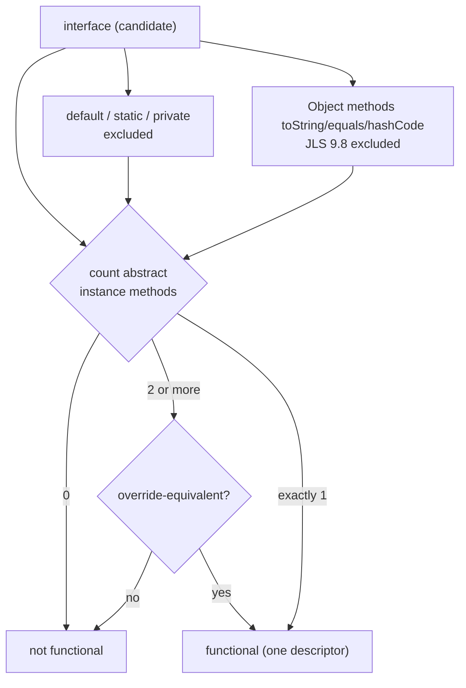
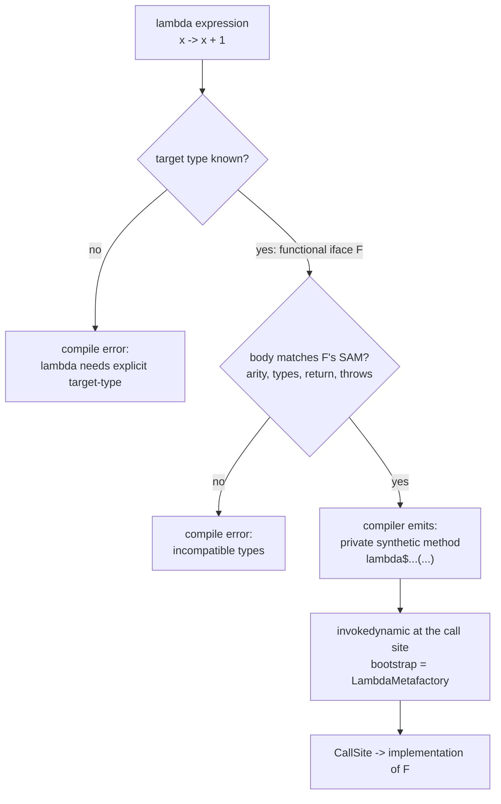
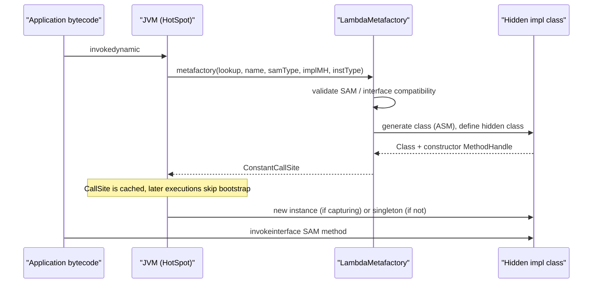
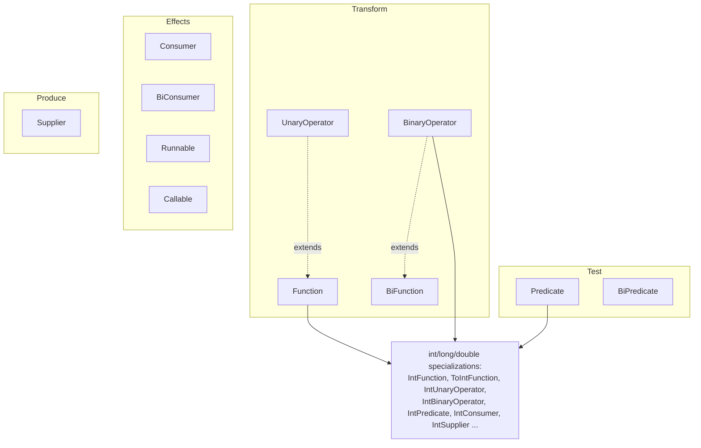
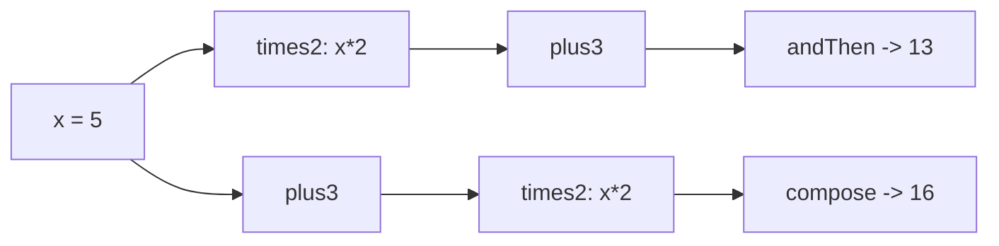
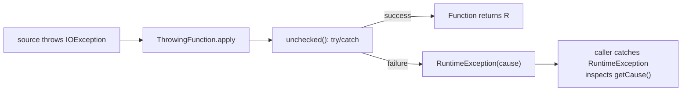

# Lambda Expressions

A **lambda expression** is a compact way to write a *function literal* — an anonymous implementation
of a **functional interface**. The mental model that answers almost every interview question is this:
**a lambda is not a function and not an object; it is an expression that the compiler converts, at a
call site, into an implementation of a target type.** The target type is supplied by the surrounding
context (assignment, argument, return, cast), and the runtime implementation is produced lazily by
`invokedynamic` + `java.lang.invoke.LambdaMetafactory` — the first time that call site executes, not
at class load.

Everything follows from that split:

- There is **no lambda type in the language**. `x -> x + 1` has no type until a *target type* (a
  functional interface) is known. This is **target typing**, and it is why `var f = x -> x + 1;` does
  not compile but `Function<Integer,Integer> f = x -> x + 1;` does.
- A functional interface has exactly one **abstract** method (the SAM). `default` and `static`
  methods, and redeclared `Object` methods, are invisible to the SAM rule.
- Lambdas **capture variables by value**. Captured locals must be `final` or **effectively final**;
  captured fields go through the captured `this` reference and stay live.
- Inside a lambda, `this` is the **enclosing instance** — unlike an anonymous class, where `this` is
  the anonymous instance. This single rule changes instance-field access and what the class file
  contains.
- Lambdas produce **no separate `.class` file**. The compiler emits a private synthetic method plus an
  `invokedynamic` instruction; the JVM synthesizes the implementation class on first execution.

Read this module as: *functional interfaces* → *syntax* → *target typing* → *capture and `this`* →
*lambda vs anonymous class* → *method references* → *the `java.util.function` catalog* → *composition*
→ *checked exceptions* → *serialization* → *closures and concurrency* → *performance* → *tables and
best practices*. The internals (`invokedynamic`, `LambdaMetafactory`, effectively-final capture) are
what separate a senior answer from a junior one.

> **Version baseline:** everything here is Java 21. Differences for Java 8, 11, 17, and 21 are called
> out inline. Lambdas arrived in **Java 8** and have not changed semantically since; later releases
> added **`var` parameters (11)** and **`Predicate.not` (11)**.

---

## 1. Functional Interfaces and the SAM Rule

A **functional interface** is an interface with exactly **one abstract method** — the *single abstract
method* (SAM) / *function descriptor*. That method is also called the interface's *function type*
because it defines the signature a lambda must implement.

```java
@FunctionalInterface
interface Calculator {
    int apply(int a, int b);          // the SAM — the function descriptor

    default int applyTwice(int x) {   // default methods do NOT count
        return apply(apply(x, x), apply(x, x));
    }
    static Calculator adder() {       // static methods do NOT count
        return (a, b) -> a + b;
    }
    // Object methods redeclared here do NOT count:
    String toString();
    boolean equals(Object o);
    int hashCode();
}
```

What counts toward the SAM:

| Member kind | Counts toward SAM? | Why |
|---|---|---|
| Abstract instance method | **Yes** (must be exactly one) | This is the function descriptor. |
| `default` method | No | Has a body; not abstract. |
| `static` method | No | Not an instance contract. |
| `private` method (Java 9+) | No | Has a body. |
| Redeclared `Object` method (`toString`, `equals`, `hashCode`) | No | Implemented by every `Object`; JLS 9.8 excludes them. |
| Abstract method redeclared from `Object` in a *class* sense | No | Same exclusion. |
| Inherited abstract methods that are override-equivalent | Counts as **one** | All collapse to one function descriptor. |

> **Rule:** A functional interface must have exactly one abstract method *after* removing `default`,
> `static`, `private`, and the `public` methods of `java.lang.Object`. More than one → not functional.
> Zero → not functional.

### 1.1 `@FunctionalInterface`

`@FunctionalInterface` is an **optional** marker annotation (`java.lang.FunctionalInterface`,
`@Retention(RUNTIME)`). It is a *compile-time guarantee*: the compiler errors if the interface is not
functional. It does **not** change the class file's semantics.

```java
@FunctionalInterface
interface Bad { void a(); void b(); }
// error: Unexpected @FunctionalInterface annotation
//     Bad is not a functional interface
//       multiple non-overriding abstract methods found in interface Bad
```

- Annotation placement matters for the *error*, not the runtime. Any interface with one abstract
  method is functional and can be a lambda target **whether or not** it is annotated
  (`Runnable`, `Comparator`, `Callable` are functional but not all annotated).
- Put it on every functional interface you author: it documents intent and prevents accidental
  additions of a second abstract method.
- It cannot be applied to a class, enum, or annotation type.

### 1.2 Inheritance and the function descriptor

A functional interface may extend others, as long as the total abstract method set is a single
override-equivalent signature:

```java
@FunctionalInterface
interface A { int f(int x); }

@FunctionalInterface
interface B extends A { }          // still functional: inherits the single SAM

@FunctionalInterface
interface C extends A { int g(int x); } // NOT functional: two distinct abstracts
```

Generic functional interfaces may declare type parameters; the lambda's parameter types are inferred
from the *target type's* type arguments:

```java
@FunctionalInterface
interface Mapper<A, B> { B map(A a); }

Mapper<String, Integer> len = s -> s.length();  // A=String, B=Integer
```

Because generics erase, `Mapper<String,Integer>` and `Mapper<Integer,String>` are the same runtime
class; the SAM signature erases to `Object map(Object)`. See
[Generics](../01-Fundamentals/07-Generics.md).

### 1.3 The SAM rule and `Object` methods — a diagram



---

## 2. Lambda Syntax Forms

A lambda has the shape `(parameters) -> body`. The parameter list may omit types (inferred from the
target type) and parentheses may be omitted for exactly one untyped parameter.

```java
// (a) zero parameters — parentheses required
Runnable r1 = () -> System.out.println("run");

// (b) one untyped parameter — parentheses optional
Function<String, Integer> f1 = s -> s.length();          // no parens
Function<String, Integer> f2 = (s) -> s.length();        // parens allowed

// (c) multiple untyped parameters — parentheses required
BiFunction<Integer, Integer, Integer> add = (a, b) -> a + b;

// (d) explicit parameter types — parentheses required
BiFunction<Integer, Integer, Integer> add2 = (Integer a, Integer b) -> a + b;

// (e) expression body — implicit return, no semicolon
Function<Integer, Integer> inc = x -> x + 1;

// (f) block body — needs explicit return (unless void/void-compatible)
Function<Integer, Integer> inc2 = x -> { return x + 1; };

// (g) void body in a block — no return value expected
Consumer<String> print = s -> { System.out.println(s); };

// (h) one parameter, explicit type — parentheses required
Function<String, Integer> f3 = (String s) -> s.length();

// (i) var parameters (Java 11+) — requires parentheses, enabled for annotations
Function<String, String> up = (var s) -> s.toUpperCase();
Function<String, String> up2 = (@Deprecated var s) -> s.toUpperCase(); // annotation motivation
```

Rules and edge cases:

- **Expression body**: the expression's value is the lambda's result. `x -> x + 1` is an expression
  body; `x -> { x + 1; }` would be a block body with **no return**, and in a value-returning target
  it is a compile error.
- **Block body** with a value-returning target must `return` on every path; otherwise
  `error: missing return statement`.
- **`var` parameters (Java 11)** let you put annotations on inferred parameters; you cannot mix
  `var` and explicit types (`(var a, Integer b)` is illegal), and you cannot mix typed and untyped
  parameters (`(int a, b)` is illegal).
- A lambda cannot declare a **throws** clause. If the target method declares checked exceptions
  (`Callable.call()`), the lambda body may throw them; if it does not (`Function.apply`), it may not.
- A **cast** body is needed when the same lambda must target different types, or when the target type
  is ambiguous: `var r = (Runnable) () -> {};`.

### 2.1 Untyped vs typed parameters

| Form | Example | When to use |
|---|---|---|
| Zero params | `() -> 42` | `Supplier`, `Runnable` |
| One untyped | `x -> x * 2` | almost always; least noise |
| One parenthesized untyped | `(x) -> x * 2` | when a `var`/annotation is needed, or style |
| Multiple untyped | `(a, b) -> a + b` | normal multi-arg |
| Explicit types | `(String s) -> s.length()` | to force a target, resolve overloads, add casts |
| `var` parameters (11+) | `(var s) -> s.length()` | attach annotations to inferred params |
| Block body | `x -> { int y = x + 1; return y; }` | multiple statements, locals |

---

## 3. Target Typing and Context

A lambda is **poly expression**: its type is derived from the context that expects it. The same source
syntax can implement different interfaces depending on the expected type.

```java
interface Adder { int add(int a, int b); }
interface Multiplier { int mul(int a, int b); }

Adder ad = (a, b) -> a + b;        // SAM add(int,int)
Multiplier mu = (a, b) -> a * b;   // SAM mul(int,int)
```

The contexts that supply a target type (JLS 15.27.3):

| Context | Example |
|---|---|
| **Assignment** | `Runnable r = () -> {};` |
| **Invocation argument** | `list.forEach(x -> System.out.println(x));` |
| **Return statement** | `return () -> 42;` (method return type is the target) |
| **Cast** | `(Runnable) () -> {}` explicitly fixes the target |
| **Ternary** | `cond ? a -> a : b -> b;` (each branch target-typed) |
| **Array initializer** | `Runnable[] rs = { () -> {}, () -> {} };` |
| **Explicit generic method argument** | `Collections.sort(list, (a,b) -> a.compareTo(b));` |
| **Constructor argument** | `new Thread(() -> {}).start();` |

**No target type → compile error.** `var f = x -> x + 1;` fails with:
`error: cannot infer type for local variable f (lambda expression needs an explicit target-type)`.
`Object o = x -> x;` fails too: `Object` is not a functional interface, so it cannot be a target.

### 3.1 The target type drives the SAM signature

The lambda's parameter types and arity come from the target:

```java
// BiFunction<Integer,Integer,Integer> has apply(Integer,Integer) -> Integer
BiFunction<Integer, Integer, Integer> add = (a, b) -> a + b;

// The SAME body would not fit a UnaryOperator<T> because arity differs.
```

When the target's type arguments are inferred (generic methods), the lambda body participates in
inference:

```java
static <T> T pick(Supplier<T> s) { return s.get(); }
String s = pick(() -> "hello");   // T inferred as String from the lambda's return
```

### 3.2 Ambiguous targets

If two overloads accept *different* functional interfaces with the same arity, and the body is
applicable to both, the call is ambiguous — the compiler reports `reference to X is ambiguous` or
`incompatible types`. Fix by casting the lambda or by choosing a non-overlapping target:

```java
void run(Runnable r) {}
void run(Callable<String> c) {}
// run(() -> {});                      // ambiguous: could be either
run((Runnable) () -> {});              // disambiguated by cast
```

### 3.3 Conversion flow



---

## 4. Variable Capture, Closures, and Effectively Final

A lambda may use variables from its enclosing scope. This is a **closure** over those values. But
Java's closure is deliberately restricted:

> **Rule (JLS 15.27.2):** A local variable or method/constructor parameter referenced from a lambda
> body must be `final` or **effectively final** — never reassigned after initialization. The lambda
> captures the **value**, not a reference to the stack slot.

```java
int base = 10;                     // effectively final (never reassigned)
Function<Integer, Integer> f = x -> x + base;
System.out.println(f.apply(5));    // 15
```

Reassigning after the lambda is written breaks it:

```java
int base = 1;
Runnable r = () -> System.out.println(base);
base = 2;                          // compile error:
// error: local variables referenced from a lambda expression must be final or effectively final
```

### 4.1 Why effectively final? (the actual mechanism)

Java has **no separate closure frame**. Unlike JavaScript or Scala, the JVM has no "closure
environment" object for a lambda that outlives the stack frame. When a lambda captures a local, the
compiler **copies the local's value into a synthetic parameter** of the generated implementation
method / constructor. Concretely:

1. For `x -> x + base`, the compiler emits
   `private static Integer lambda$main$0(Integer x, int base)` (or the capture becomes a field of the
   generated class), with `base` copied in.
2. If the enclosing variable could later change, the copy would silently *diverge* from the original
   — a classic closure-by-value bug. Java forbids the divergence outright by requiring effectively
   final.
3. Because the copy is a **by-value snapshot**, a mutable *reference* (array, object) still reaches the
   same heap object, so mutating *its contents* is allowed; only rebinding the *variable* is not.

```java
int[] box = {0};                   // 'box' is effectively final (rebinding never happens)
Runnable inc = () -> box[0]++;     // mutating contents is fine
inc.run(); inc.run();
System.out.println(box[0]);        // 2
```

The `int[] box` idiom is the standard workaround for "I need a mutable captured counter". Because the
captured reference is fixed, the lambda sees live contents. Prefer `AtomicInteger` for thread safety
(see §12).

### 4.2 What can be captured

| Captured thing | Rule | Live updates visible? |
|---|---|---|
| Local variable / parameter | must be `final`/effectively final; **copied by value** | No — snapshot |
| `this` | always captured (implicitly) if referenced | Fields read through `this` are live |
| Instance field (via implicit `this`) | no effectively-final restriction | **Yes** — read at call time |
| Static field | no restriction; resolved at call time | **Yes** |
| Array element / object field | variable itself final; contents mutable | **Yes** (same heap object) |
| Method reference to an instance method | captures the receiver | Receiver's state live |

```java
public class Capture {
    static int staticCounter = 0;
    int instanceCounter = 0;

    public static void main(String[] args) {
        Capture c = new Capture();
        Runnable r = () -> { c.instanceCounter++; staticCounter++; };
        r.run();
        System.out.println(c.instanceCounter + ", " + staticCounter); // 1, 1
    }
}
```

### 4.3 Capturing `this` and field access

If a lambda body references an instance field or `this` explicitly, the lambda **captures `this`**.
The field is not copied; it is read through the captured receiver at invocation time, so it sees the
current value:

```java
int field = 1;
Supplier<Integer> s = () -> field;   // captures 'this', reads live field
field = 99;
System.out.println(s.get());         // 99
```

This is the crucial difference from a captured *local* (which is frozen at capture time):

```java
int local = 1;
Supplier<Integer> snap = () -> local;  // would freeze 1... but reassignment is forbidden
// local = 99;                          // so this line cannot compile
```

### 4.4 Shadowing rules

- A lambda parameter **cannot shadow** a local variable, a method parameter, or an enclosing lambda
  parameter. `int x = 1; Function<Integer,Integer> f = x -> x + 1;` →
  `error: variable x is already defined in method ...`.
- A lambda parameter **can** shadow a *field* of the enclosing class (fields are not in the same
  lexical namespace as locals):

```java
class C {
    int x = 5;
    IntUnaryOperator f = x -> x + 1;   // OK: parameter x shadows field x
}
```

- There is **no `this` shadowing**: you cannot declare a parameter named `this` (keyword).
- Nested lambdas may not reuse each other's parameter names:
  `a -> a -> a` → `error: variable a is already defined in method ...`; use `a -> b -> a + b`.

### 4.5 No non-local returns, no tail-call magic

- `return` inside a lambda returns **from the lambda**, not the enclosing method. A lambda is like a
  method body; `break`/`continue` of an enclosing loop are illegal inside a lambda body (the lambda is
  a distinct executable body).
- `yield` (switch expressions) may be used inside a lambda body only for its own switch.

---

## 5. `this` Semantics: Lambda vs Anonymous Class

The lambda's `this` is the **enclosing instance**; the anonymous class's `this` is the **anonymous
instance**. This is the single most-tested subtlety.

```java
public class ThisDemo {
    String name = "outer";

    class Anon {
        String name = "Anon-field";

        Runnable anon() {
            return new Runnable() {
                public void run() {
                    // 'this' is the anonymous Runnable: it has no 'name'
                    System.out.println("anon outer via Anon.this = " + Anon.this.name);
                }
            };
        }

        Runnable lambda() {
            // 'this' is the enclosing Anon instance
            return () -> {
                System.out.println("lambda this.name = " + this.name);
                System.out.println("lambda this == enclosing Anon: " + (this == Anon.this));
            };
        }
    }

    public static void main(String[] args) {
        ThisDemo t = new ThisDemo();
        Anon a = t.new Anon();
        a.anon().run();
        a.lambda().run();
    }
}
```

Output (verified on Java 21):

```text
anon outer via Anon.this = Anon-field
lambda this.name = Anon-field
lambda this == enclosing Anon: true
```

Inside the anonymous class, writing `this.name` would be a compile error (the `Runnable` has no
`name`); you must write `Anon.this.name`. Inside the lambda, `this.name` already means the enclosing
`Anon`, so no qualified `this` is needed.

### 5.1 Comparison table: `this`, scope, and class file

| Aspect | Lambda | Anonymous inner class |
|---|---|---|
| Meaning of `this` | Enclosing instance | The anonymous instance itself |
| Qualified `Enclosing.this` needed? | No — implicit | Yes, for outer state |
| Can it access `this` of enclosing? | Directly | Via `Enclosing.this` |
| Can it have its own fields? | No | Yes |
| Class file | None (synthetic method + `invokedynamic`) | `Outer$1.class` |
| `getClass().getName()` | `Outer$$Lambda/0x...` (hidden) | `Outer$1` |
| Can implement multiple methods? | Exactly one SAM | Any number (override many) |
| Can extend a class? | No | Yes (`new Base() {...}`) |
| Can declare state / local vars in body? | Yes, local variables in a block body | Yes |
| Can be recursive by referencing itself? | Only via a captured array/field trick | Yes, via `this` |
| Serialization | Only if target is `Serializable` | If class is serializable |
| Best for | Behavior passing | Behavior + state + multiple overrides |

### 5.2 Recursion workaround

A named method reference or field self-reference is required because a lambda body cannot name itself:

```java
IntUnaryOperator[] factorial = new IntUnaryOperator[1];
factorial[0] = n -> n <= 1 ? 1 : n * factorial[0].applyAsInt(n - 1);
System.out.println(factorial[0].applyAsInt(5)); // 120
```

---

## 6. Lambda vs Anonymous Inner Class: Internals

### 6.1 What the compiler emits

For a lambda, the compiler emits **no new class**. It emits:

1. A **private synthetic method** containing the lambda body, e.g. `lambda$main$0(Integer)`.
2. An **`invokedynamic`** instruction at the call site whose bootstrap method is
   `LambdaMetafactory.metafactory`.
3. Bootstrap arguments: the *samMethodType* (erased SAM signature), the *implMethod* handle (the
   synthetic method), and the *instantiatedMethodType* (the lambda's specialized signature).

Verified with `javac` + `javap -c -p -v BytecodeDemo`:

```text
private static void lambda$main$1();
private static java.lang.Integer lambda$main$0(java.lang.Integer);
...
0: invokedynamic #23,  0   // InvokeDynamic #0:apply:()Ljava/util/function/Function;
...
BootstrapMethods:
  0: REF_invokeStatic java/lang/invoke/LambdaMetafactory.metafactory:(...)
    Method arguments:
      (Ljava/lang/Object;)Ljava/lang/Object;                    // samMethodType (erased)
      REF_invokeStatic BytecodeDemo.lambda$main$0:(Ljava/lang/Integer;)Ljava/lang/Integer;
      (Ljava/lang/Integer;)Ljava/lang/Integer;                 // instantiatedMethodType
```

An anonymous class instead produces a real class file `Outer$1.class` with an `extends`/`implements`
clause, its own constructor, and its captured values as **final synthetic fields**.

### 6.2 The `invokedynamic` bootstrap sequence

On the **first execution** of the `invokedynamic` call site, the JVM calls the bootstrap method
(`LambdaMetafactory.metafactory`). It:

1. Validates that the target type is a functional interface and is *interface-conversion-compatible*.
2. Derives a runtime implementation class from the static arguments (via `MethodHandles.Lookup`,
   `InnerClassLambdaMetafactory`, `ClassWriter` in `jdk.internal.org.objectweb.asm`).
3. Defines that class as a **hidden class** (`Class.isHidden() == true`) — not registered by a normal
   loader, no `Outer$1.class` on disk.
4. Returns a `ConstantCallSite` whose target wraps the implementation constructor/handle and is
   **thread-safe and constant** thereafter.



### 6.3 `metafactory` vs `altMetafactory`

- `LambdaMetafactory.metafactory` handles the common case.
- `LambdaMetafactory.altMetafactory` is used when the lambda needs **marker bridges** or is
  **serializable** — that is, when the target interface extends `Serializable` or needs multiple
  interface bridges. Verified: a `(Runnable & Serializable)` lambda compiles to a bootstrap handle on
  `altMetafactory`.

### 6.4 Class-name and identity facts (verified)

```java
System.out.println(a.getClass().getName());   // Identity$$Lambda/0x00007fb270000a08
System.out.println(a.getClass().isSynthetic()); // true
System.out.println(a.getClass().isHidden());    // true
```

- Non-capturing lambda from the **same call site** returns the **same instance** every time
  (`makeNoCapture() == makeNoCapture()` → `true`), because HotSpot interns the constant call site.
- A **capturing** lambda returns a **new instance** per evaluation
  (`makeCapture(1) == makeCapture(1)` → `false`), since each evaluation must store the captured value.
- This interning is an implementation detail; the JLS only *permits* reuse of non-capturing lambdas.

### 6.5 Serialization differences

- An anonymous class is serialized if it implements `Serializable` and its captured fields are
  serializable; the compiler usually generates a `serialVersionUID` warning if absent.
- A lambda is serializable **only if its target type is serializable**. If so, the compiler adds a
  `private static Object $deserializeLambda$(SerializedLambda)` method and uses `altMetafactory` with
  the `FLAG_SERIALIZABLE` flag. See §10.

### 6.6 Comparison table: internals

| Aspect | Lambda | Anonymous class |
|---|---|---|
| Compiler output | synthetic method + `invokedynamic` | a new `.class` (`Outer$1`) |
| Runtime class creation | lazy at first `invokedynamic` execution | eager at class load (class loader) |
| Runtime class nature | hidden class | ordinary class |
| Linkage hint | `invokedynamic` + `LambdaMetafactory` | `new Outer$1(...)`, `invokespecial` |
| Captured state | bootstrap arguments / constructor params | final synthetic fields |
| Multiple SAM work | one | many |
| Static initialization cost | near zero until first use | `.class` parsing at load time |
| JIT | clean, monomorphic call site; inlines well | also inlines well |
| `getClass()` | hidden synthetic class | `Outer$1` |

---

## 7. Method References

A **method reference** is shorthand for a lambda whose body already exists as a method (or
constructor). It has the form `Qualifier::name`. The compiler reuses the existing method handle as
the implementation, so the emitted `invokedynamic` points at that method directly instead of a
synthetic `lambda$...` method.

### 7.1 The six kinds

```java
public class MethodRefs {
    static int staticLen(String s) { return s.length(); }
    int instLen(String s) { return s.length(); }

    MethodRefs() {}
    MethodRefs(String tag) { System.out.println("ctor with tag " + tag); }

    public static void main(String[] args) {
        // 1. Type::staticMethod
        Function<String, Integer> f1 = MethodRefs::staticLen;

        // 2. obj::instanceMethod  (bound receiver)
        MethodRefs obj = new MethodRefs();
        Function<String, Integer> f2 = obj::instLen;

        // 3. Type::instanceMethod (unbound — receiver becomes the first argument)
        Function<String, Integer> f3 = String::length;

        // 4. Type::new (constructor)
        Supplier<MethodRefs> s1 = MethodRefs::new;
        Function<String, MethodRefs> s2 = MethodRefs::new;

        // 5. this::instanceMethod
        // 6. super::instanceMethod
        System.out.println(f1.apply("abcd"));  // 4
        System.out.println(f2.apply("abc"));   // 3
        System.out.println(f3.apply("ab"));    // 2
        System.out.println(s1.get() != null);  // true
        System.out.println(s2.apply("x") != null); // ctor with tag x, then true
    }
}
```

| Kind | Syntax | Lambda equivalent | Notes |
|---|---|---|---|
| Static | `Type::staticMethod` | `(a,b) -> Type.staticMethod(a,b)` | no receiver captured |
| Bound instance | `expr::instanceMethod` | `(a) -> expr.instanceMethod(a)` | captures the receiver `expr` |
| Unbound instance | `Type::instanceMethod` | `(recv,a) -> recv.instanceMethod(a)` | receiver is the first SAM arg |
| Constructor | `Type::new` | `(a) -> new Type(a)` | any matching constructor |
| Array constructor | `int[]::new` | `n -> new int[n]` | `IntFunction<int[]>` |
| `super::` | `super::method` | `() -> super.method()` | parent implementation |
| `this::` | `this::method` | `(a) -> this.method(a)` | current instance |

### 7.2 Bound vs unbound — the receiver becomes an argument

The number of lambda parameters of an unbound instance reference is **one more** than the method's
parameters, because the first parameter supplies the receiver:

```java
BiFunction<String, Integer, String> substringAt = String::substring; // (s, begin) -> s.substring(begin)
Function<String, Integer> length = String::length;                   // (s) -> s.length()
List<String> words = Arrays.asList("banana", "apple", "cherry");
words.sort(String::compareToIgnoreCase);   // (a,b) -> a.compareToIgnoreCase(b)
System.out.println(words);                 // [apple, banana, cherry]
```

A **bound** reference captures the receiver, so `obj::instLen` has the same arity as the method (one
arg: the value):

```java
Function<String, Integer> f2 = obj::instLen;  // (s) -> obj.instLen(s)
```

### 7.3 Ambiguity rules

A method reference is resolved against the **target type's SAM**. When more than one method matches,
the reference is ambiguous:

```java
static String pick(CharSequence s) { return "CharSequence"; }
static String pick(Comparable<?> c) { return "Comparable"; }
// Function<String,String> f = Ambiguous2::pick;
// error: reference to pick is ambiguous
//   both method pick(CharSequence) in Ambiguous2 and method pick(Comparable<?>) in Ambiguous2 match
```

Rules of thumb:

- If no overload matches the SAM's parameter types, you get
  `no suitable method found for pick(Object)` / `invalid method reference`.
- If several match and none is more specific, you get `reference to X is ambiguous`.
- Fix with an explicit cast of the receiver/argument, a typed lambda, or an explicit type argument.
- Generic methods can be ambiguous on type inference; an explicit lambda often resolves it.

### 7.4 When a method reference is clearer

- The body is a **single delegation**: `list.forEach(System.out::println)`, `map(String::trim)`,
  `Comparator.comparing(Person::name)`.
- The method already exists and has a meaningful name.
- The lambda would be pure boilerplate (`x -> obj.m(x)`).

Use a **lambda** instead when you need to reorder arguments, add a cast, compute an expression, drop
an argument, or when the reference is ambiguous.

```java
// method reference — direct delegation
people.sort(Comparator.comparing(Person::name));

// lambda — when you must transform/combine
people.sort((p1, p2) -> p1.age() - p2.age());
```

See [Streams](13-Streams.md) for the idiomatic use of method references in pipelines.

---

## 8. `java.util.function`: The Standard Functional Interfaces

`java.util.function` (Java 8) supplies the functional interfaces most APIs use. The generic family:

| Interface | Function descriptor | Intent | Composition |
|---|---|---|---|
| `Function<T,R>` | `R apply(T t)` | transform T → R | `andThen`, `compose`, `identity` |
| `BiFunction<T,U,R>` | `R apply(T t, U u)` | transform (T,U) → R | `andThen` |
| `UnaryOperator<T>` | `T apply(T t)` (extends `Function<T,T>`) | same-type transform | inherited |
| `BinaryOperator<T>` | `T apply(T t, T u)` (extends `BiFunction<T,T,T>`) | same-type combine | `minBy`, `maxBy` |
| `Consumer<T>` | `void accept(T t)` | side effect | `andThen` |
| `BiConsumer<T,U>` | `void accept(T t, U u)` | side effect (two) | `andThen` |
| `Supplier<T>` | `T get()` | producer | — |
| `Predicate<T>` | `boolean test(T t)` | boolean test | `and`, `or`, `negate`, `not`, `isEqual` |
| `BiPredicate<T,U>` | `boolean test(T t, U u)` | boolean test (two) | `and`, `or`, `negate` |
| `Runnable` | `void run()` | task, no result, no checked exception | — |
| `Callable<V>` | `V call() throws Exception` | task, result, checked exception | — |

```java
Function<String, Integer> len = String::length;
BiFunction<Integer, Integer, Integer> sum = Integer::sum;
Consumer<String> print = System.out::println;
Supplier<Double> random = Math::random;
Predicate<String> empty = String::isEmpty;
UnaryOperator<String> trim = String::trim;
BinaryOperator<Integer> max = BinaryOperator.maxBy(Integer::compareTo);
System.out.println(len.apply("abc"));        // 3
System.out.println(sum.apply(2, 3));         // 5
System.out.println(random.get() >= 0.0);     // true
System.out.println(empty.test(""));          // true
System.out.println(trim.apply("  x  "));     // x
System.out.println(max.apply(4, 9));         // 9
```

`Function.identity()` returns `t -> t`; it is useful when a mapping stage must be a no-op or when an
API requires a `Function` and you already have the key:

```java
System.out.println(Function.<String>identity().apply("hi")); // hi
```

### 8.1 `Runnable` vs `Callable`

| Aspect | `Runnable` | `Callable<V>` |
|---|---|---|
| Method | `void run()` | `V call() throws Exception` |
| Returns value | No | Yes |
| Checked exceptions | Cannot throw | May throw any `Exception` |
| Package | `java.lang` | `java.util.concurrent` |
| Used by | `Thread`, `Executor.execute` | `ExecutorService.submit` |

### 8.2 Primitive specializations (avoid autoboxing)

Boxing on every `apply`/`test` call is a real cost in hot loops. For `int`, `long`, and `double`,
the JDK provides primitive-specialized interfaces with no boxing:

| Generic | `int` variant | `long` variant | `double` variant |
|---|---|---|---|
| `Function<T,R>` | `IntFunction<R>`, `ToIntFunction<T>`, `IntToLongFunction`, `IntToDoubleFunction` | `LongFunction<R>`, `ToLongFunction<T>`, ... | `DoubleFunction<R>`, `ToDoubleFunction<T>`, ... |
| `UnaryOperator<T>` | `IntUnaryOperator` | `LongUnaryOperator` | `DoubleUnaryOperator` |
| `BinaryOperator<T>` | `IntBinaryOperator` | `LongBinaryOperator` | `DoubleBinaryOperator` |
| `Predicate<T>` | `IntPredicate` | `LongPredicate` | `DoublePredicate` |
| `Consumer<T>` | `IntConsumer` | `LongConsumer` | `DoubleConsumer` |
| `Supplier<T>` | `IntSupplier` | `LongSupplier` | `DoubleSupplier` |
| `BiFunction<T,U,R>` | `IntBinaryOperator` / `ToIntBiFunction<T,U>` | `LongBinaryOperator` | `DoubleBinaryOperator` |
| mixed | `IntToDoubleFunction`, `DoubleToIntFunction`, `ToIntBiFunction`, ... | | |

```java
IntFunction<String> intFn = i -> "i" + i;
ToIntFunction<String> toInt = String::length;
IntPredicate positive = n -> n > 0;
IntUnaryOperator increment = n -> n + 1;
IntBinaryOperator addInt = (a, b) -> a + b;
IntSupplier answer = () -> 42;
IntConsumer consumed = n -> System.out.println("consumed " + n);
DoubleToIntFunction trunc = d -> (int) d;

System.out.println(intFn.apply(3));          // i3
System.out.println(toInt.applyAsInt("hello")); // 5
System.out.println(positive.test(5));        // true
System.out.println(increment.applyAsInt(5)); // 6
System.out.println(addInt.applyAsInt(5, 6)); // 11
System.out.println(answer.getAsInt());       // 42
consumed.accept(9);                          // consumed 9
System.out.println(trunc.applyAsInt(3.9));   // 3
```

Note the naming convention:

- `IntFunction<R>` — takes `int`, returns `R`.
- `ToIntFunction<T>` — takes `T`, returns `int`.
- `IntToLongFunction` — takes `int`, returns `long`.
- The methods are named after the *return kind*: `applyAsInt`, `getAsInt`, `test` (for predicates),
  `accept` (for consumers).

### 8.3 The `java.util.function` family — hierarchy diagram



---

## 9. Composition: Building Pipelines

The generic interfaces provide **default methods** to compose functions without streams.

### 9.1 `Function`: `andThen` and `compose`

```java
Function<Integer, Integer> times2 = x -> x * 2;
Function<Integer, Integer> plus3 = x -> x + 3;

System.out.println(times2.andThen(plus3).apply(5)); // (5*2)+3 = 13
System.out.println(times2.compose(plus3).apply(5)); // (5+3)*2 = 16
System.out.println(Function.<String>identity().apply("hi")); // hi
```

- `f.andThen(g)` = `x -> g.apply(f.apply(x))` — left to right.
- `g.compose(f)` = `x -> g.apply(f.apply(f))`... precisely `g.compose(f).apply(x) == g.apply(f.apply(x))`
  — right to left; `f.andThen(g)` equals `g.compose(f)`.
- Both accept `? super R` / `? extends` typed functions (`andThen(Function<? super R, ? extends V>)`),
  enabling covariance: a `Function<Number,String>` can be appended after a `Function<Object,Number>`.
- `andThen(null)` throws `NullPointerException` **at composition time** (`Objects.requireNonNull`);
  if the *previous* function returns `null`, `g.apply(null)` may throw at **call time**.

### 9.2 `Predicate`: `and`, `or`, `negate`, `not`, `isEqual`

```java
Predicate<Integer> positive = x -> x > 0;
Predicate<Integer> even = x -> x % 2 == 0;

System.out.println(positive.and(even).test(4));   // true
System.out.println(positive.or(even).test(-2));   // true
System.out.println(positive.negate().test(-1));   // true
System.out.println(Predicate.not(positive).test(-1)); // true (Java 11)
System.out.println(Predicate.isEqual("a").test("a")); // true (uses Objects.equals)
```

- `Predicate.not(Predicate)` is the **static** form introduced in **Java 11**; it enables
  `list.removeIf(Predicate.not(String::isBlank))` where `negate()` would be method-reference-hostile.
- Combination short-circuits: `a.and(b)` does not call `b` if `a` is false; `a.or(b)` does not call
  `b` if `a` is true.

### 9.3 `Consumer.andThen`

```java
Consumer<String> a = s -> System.out.println("a:" + s);
Consumer<String> b = s -> System.out.println("b:" + s);
a.andThen(b).accept("x");
// a:x
// b:x
```

### 9.4 `BinaryOperator` factories

`BinaryOperator.minBy(Comparator)` and `maxBy(Comparator)` build a `BinaryOperator<T>` from a
comparator. `BinaryOperator` also inherits `andThen`.

### 9.5 Pipelines without streams

```java
Function<Integer, Integer> pipeline = times2.andThen(plus3).andThen(x -> x - 1);
System.out.println("pipeline: " + pipeline.apply(5)); // ((5*2)+3)-1 = 12
```

Composition is lazy: nothing runs until `apply`/`test`/`accept` is called. This is exactly the model
streams build on (see [Streams](13-Streams.md) and [Collectors](14-Collectors.md)).

### 9.6 Composition direction



---

## 10. Checked Exceptions Inside Lambdas

The standard functional interfaces are chosen so that their SAMs do **not** declare checked
exceptions, except `Callable.call()`. This means a lambda body cannot throw a checked exception when
the target is `Function`, `Consumer`, `Supplier`, `Predicate`, etc.:

```java
Function<String, String> f = path -> read(path); // error: unreported exception IOException
static String read(String p) throws IOException { ... }
```

Why: `Function.apply` declares no `throws`; a lambda body may not throw checked exceptions the SAM
does not allow. This is deliberate — it keeps `Stream.map` etc. total.

### 10.1 Three legitimate fixes

**Fix 1 — use a checked-capable interface** such as `Callable` or your own `ThrowingFunction`:

```java
@FunctionalInterface
interface ThrowingFunction<T, R> {
    R apply(T t) throws Exception;
}
```

**Fix 2 — wrap and unwrap.** Adapt to `Function` by catching and rethrowing as unchecked:

```java
static <T, R> Function<T, R> unchecked(ThrowingFunction<T, R> f) {
    return t -> {
        try { return f.apply(t); }
        catch (Exception e) { throw new RuntimeException(e); }
    };
}
```

Verified output: applying it to a missing file yields a `RuntimeException` whose
`getCause()` is `java.io.FileNotFoundException`.

**Fix 3 — sneaky throw.** Erase the checkedness via generics:

```java
@SuppressWarnings("unchecked")
static <E extends Throwable> void sneakyThrow(Throwable t) throws E { throw (E) t; }

Runnable sneaky = () -> sneakyThrow(new IOException("boom"));
try { sneaky.run(); }
catch (Throwable e) { System.out.println("sneaky escaped as = " + e.getClass().getSimpleName()); }
// sneaky escaped as = IOException
```

The catch must be `Throwable` (a real `IOException` escapes where the compiler expected none). This
compiles because `E` is inferred as an unchecked type at the call site, so the compiler believes no
checked exception is thrown; at runtime the object's real class is thrown. **Caveat:** sneaky throw
defeats the compiler's exception checking, breaks caller assumptions, and its behavior depends on JVM
exception-table rules; use it only in tightly-controlled framework code, never in application logic.
See [Exception Handling](../01-Fundamentals/06-Exception-Handling.md) for the checked/unchecked
model.

### 10.2 `Comparator` and `Callable` as escape hatches

- Comparator functions cannot throw checked exceptions.
- `Callable<V>` is the standard checked-capable producer: `ExecutorService.submit(Callable)` returns a
  `Future<V>` that carries the exception. See [Concurrency Utilities](../04-Multithreading/19-Concurrency-Utilities.md).

### 10.3 Wrapping pipeline



---

## 11. Serialization of Lambdas

An anonymous class is serializable if it implements `Serializable` and all captured state is
serializable. A lambda is serializable **only if its target type is serializable**.

```java
Runnable r = (Runnable & Serializable) () -> System.out.println("serializable lambda");
// Serialize, then deserialize and run.
```

Output (verified): `serializable lambda`, and the deserialized object's class is a hidden generated
class such as `SerialLambda$$Lambda/0x00007fa764000a08`.

Internals:

- The cast `(Runnable & Serializable)` creates an **intersection type** target; the compiler records
  the marker interface on the functional interface argument.
- The bootstrap uses `LambdaMetafactory.altMetafactory` with the `FLAG_SERIALIZABLE` flag (verified:
  `altMetafactory` appears in the constant pool).
- The compiler emits `private static Object $deserializeLambda$(SerializedLambda)` which validates the
  serialized metadata (declaring class, method name, signature) and re-links the lambda.
- At runtime, `writeObject` stores a `java.lang.invoke.SerializedLambda` describing the lambda;
  `readObject` invokes `$deserializeLambda$` to reconstruct it.

Caveats (brief):

- Captured values must themselves be `Serializable`; otherwise serialization fails with
  `NotSerializableException`. Verified: a lambda capturing a non-serializable object throws
  `NotSerializableException`.
- Deserialization requires the **declaring class** to be on the classpath and the lambda's identity
  metadata to still match. Renaming or changing the enclosing method after serializing breaks it.
- The generated class name and lambda identity are **not stable across compilers/JDK versions**;
  never persist a serialized lambda across JVM/compiler upgrades.
- Serializing lambdas is fragile — prefer serializing data (values) and re-creating behavior, or use
  a named serializable class. See [Serialization](../06-Reflection/29-Serialization.md).

---

## 12. Closures, Mutable State, and Thread Safety

Lambdas make it easy to accidentally share mutable state across threads.

### 12.1 The captured-local snapshot

A captured local is a frozen snapshot, so it is inherently safe but cannot be updated. A captured
*field* or *array contents* is live shared state and **is not synchronized**:

```java
int[] counter = {0};                  // captured reference is fixed; contents are shared
Runnable inc = () -> counter[0]++;    // NOT thread-safe: race on counter[0]
```

### 12.2 Making captures thread-safe

| Need | Correct tool |
|---|---|
| Thread-safe counter | `AtomicInteger` / `LongAdder` |
| Visibility without atomicity | `volatile` on a field |
| Compound update | `synchronized`, `ReentrantLock`, `VarHandle` |
| Immutable snapshot | capture a `final` immutable value (records, `String`) |

```java
AtomicInteger counter = new AtomicInteger();
Runnable inc = counter::incrementAndGet;  // thread-safe
```

### 12.3 Capturing `this` keeps the whole object reachable

A lambda that reads any instance field captures the enclosing instance, keeping it alive as long as
the lambda is referenced. Long-lived lambdas (registered listeners, `CompletableFuture` callbacks,
caches) can therefore retain large object graphs and cause `OutOfMemoryError`. Extract the needed
value into a local before capturing:

```java
// BAD: retains 'this' (and everything it references)
executor.submit(() -> doWork(this.config));
// BETTER: capture only the immutable value
Config cfg = this.config;
executor.submit(() -> doWork(cfg));
```

### 12.4 Closures over loop variables

Because captured locals must be effectively final, capturing a loop variable works naturally per
iteration only if it is declared inside the loop:

```java
for (String name : names) {                 // 'name' is a fresh effectively-final var per iteration
    callbacks.add(() -> System.out.println(name));
}
```

The older `for (int i = 0; ...)` index is *not* effectively final if mutated; copy it inside the body
(`int j = i;`) or use an enhanced for. Note this is a *language* guarantee (each iteration's variable
is effectively final), not a runtime frame capture.

See [Threads](../04-Multithreading/16-Threads.md), [Synchronization](../04-Multithreading/17-Synchronization.md),
and the [Java Memory Model](../04-Multithreading/23-Java-Memory-Model.md) for the memory-visibility
rules behind these bugs.

---

## 13. Performance

### 13.1 Cost model

| Operation | Cost | Notes |
|---|---|---|
| Defining a lambda | one `invokedynamic` per call site | resolves once; then constant call site |
| Evaluating a **non-capturing** lambda | effectively free | HotSpot returns the interned singleton |
| Evaluating a **capturing** lambda | one object allocation | constructor stores captured values |
| Invoking the SAM | `invokeinterface` (or inlined) | monomorphic call sites inline aggressively |
| Method reference | same linkage, impl handle points at the real method | may skip a synthetic method entirely |
| Boxing in `Function<Integer,...>` | allocation / cache lookup per call | avoided by primitive specializations |
| `Stream` setup | small object graph per stream | see [Streams](13-Streams.md) |

### 13.2 `invokedynamic` and the JIT

- The first execution of an `invokedynamic` call site runs the bootstrap and **links** a
  `ConstantCallSite`; subsequent executions are as cheap as an ordinary virtual call, and the JIT
  sees a **constant target** it can inline.
- Monomorphic-and-stable call sites (a field holding one lambda implementation) inline extremely
  well, often better than `new Inner()` when it keeps the object out of the heap.
- **Megamorphic** call sites (many different lambda implementations at one invocation) inline poorly;
  this is a reason to avoid generic "callback of the day" designs more than a reason to avoid
  lambdas.
- Escape analysis can **scalar-replace** a capturing lambda when it does not escape, removing the
  allocation.

### 13.3 Allocation facts (verified)

```java
static Runnable makeNoCapture() { return () -> {}; }
static Supplier<Integer> makeCapture(final int x) { return () -> x; }

makeNoCapture() == makeNoCapture(); // true  -> non-capturing lambda is a singleton
makeCapture(1)  == makeCapture(1);  // false -> capturing lambda allocates per evaluation
```

> **Rule of thumb:** hoist a **non-capturing** lambda to a `static final` field or a named method to
> make intent explicit and guarantee reuse; a capturing lambda must allocate, so avoid creating one
> inside a hot loop when a primitive specialization or a hoisted value-holder would do.

### 13.4 Avoiding autoboxing

Prefer `IntUnaryOperator` over `Function<Integer,Integer>`, `ToIntFunction<T>` over
`Function<T,Integer>`, etc. Micro-benchmarks are noisy (JIT escape analysis frequently removes the
boxing), but the *correct API* is the primitive one: it removes allocation from the source rather
than relying on the optimizer. Real hot paths in `Stream` are `mapToInt`/`mapToLong`/`mapToDouble`
and `IntStream` for this reason.

### 13.5 Lambda vs method reference vs anonymous class (qualitative)

| Aspect | Lambda | Method ref | Anonymous class |
|---|---|---|---|
| Class-file footprint | smallest | smallest | largest (`Outer$1.class`) |
| First-use cost | bootstrap on first call | bootstrap on first call | class load + verification at startup |
| Steady-state call cost | same | same | same |
| Allocation (no capture) | none (singleton) | none (singleton) | one per `new` |
| JIT inlining | excellent | excellent | excellent |
| Best in hot loops | yes | yes | acceptable |
| Startup/linkage | lazy | lazy | eager at class load |

The realistic differences are **startup and footprint** (anonymous classes cost class loading up
front; lambdas link lazily), not steady-state throughput. For most application code, choose by
clarity, not by performance.

---

## 14. Comparison Tables

### 14.1 Lambda vs anonymous class vs method reference

| Axis | Lambda | Anonymous class | Method reference |
|---|---|---|---|
| Syntax | `(a,b) -> expr` | `new I() { ... }` | `Type::method` |
| `this` | enclosing instance | anonymous instance | depends (bound/unbound) |
| Class file | none (hidden, lazy) | `Outer$1.class` | none (points at method) |
| Multiple methods | no (one SAM) | yes | no |
| Own state | no | yes | no |
| Extend a class | no | yes | no |
| Captured locals | effectively final, by value | effectively final, by value | by value |
| Serialization | only if target `Serializable` | if class serializable | only if target `Serializable` |
| Recursion | via array/field trick | via `this` | named method |
| Linkage | `invokedynamic` | `new`/`invokespecial` | `invokedynamic` |
| Best for | behavior passing | behavior + state + overrides | delegating to an existing method |

### 14.2 Core functional interfaces at a glance

| Interface | Params | Return | Checked throws | Typical use |
|---|---|---|---|---|
| `Supplier<T>` | 0 | `T` | no | produce/defer |
| `Consumer<T>` | 1 | void | no | forEach/accept |
| `Function<T,R>` | 1 | `R` | no | map |
| `BiFunction<T,U,R>` | 2 | `R` | no | reduce/merge |
| `Predicate<T>` | 1 | boolean | no | filter |
| `BiPredicate<T,U>` | 2 | boolean | no | two-arg filter |
| `UnaryOperator<T>` | 1 (T) | `T` | no | update in place |
| `BinaryOperator<T>` | 2 (T,T) | `T` | no | reduce |
| `Runnable` | 0 | void | no | execute |
| `Callable<V>` | 0 | `V` | **yes** | submit |

---

## 15. Best Practices

- Prefer **method references** for pure delegation; use lambdas when you must transform or combine.
- Keep lambda bodies **short**; extract a named private method when the body exceeds a few lines —
  it is more readable, testable, and stack-trace friendly.
- Use **primitive specializations** (`IntUnaryOperator`, `ToIntFunction`, ...) in hot paths.
- Do not capture `this` in long-lived callbacks; snapshot the **immutable value** you need.
- Use `AtomicInteger`/`AtomicReference` (not `int[]`) when a captured mutable must be shared across
  threads.
- Mark your own functional interfaces `@FunctionalInterface`.
- Never use **sneaky throw** in application code; wrap into an unchecked exception with the original
  as `cause`.
- Do not rely on lambda **class names or identity** across builds or deserialization.
- Prefer a **named class/interfaces** over serializing lambdas.
- Remember `Function.identity()` avoids a pointless `x -> x`.
- When you catch a lambda exception, rethrow with context: `throw new RuntimeException("failed for " + key, e)`.

---

## 16. Version Notes (8 → 21)

| Version | Change relevant to lambdas |
|---|---|
| **Java 8** | Lambdas, method references, functional interfaces, `java.util.function`, default methods. |
| **Java 9** | `private` interface methods (usable in functional interfaces); `List.of`/`Map.of` aid functional code. |
| **Java 10** | `var` for locals — but **not** for a bare lambda (`var f = x -> x;` is illegal; no target type). |
| **Java 11** | `var` in lambda parameters (`(var x) -> ...`) and **`Predicate.not`**. |
| **Java 16** | `instanceof` pattern matching (usable inside lambda bodies). |
| **Java 17** | Records (excellent lambda-friendly value carriers); sealed classes support exhaustive dispatch. |
| **Java 21** | Record patterns / pattern matching for `switch` (great inside lambdas); virtual threads make lambdas the natural task unit. |

See [Java 8](../09-Version-History/49-Java-8.md), [Java 11](../09-Version-History/52-Java-11.md),
and [Records](../07-Modern-Java/32-Records.md).

---

# Interview Questions

## Beginner

**Q:** What is a lambda expression?

**A:** A lambda is a compact expression that implements a **functional interface** (an interface with a
single abstract method). `x -> x + 1` implements, for example, `Function<Integer,Integer>`. It is
target-typed: the surrounding context supplies the interface, and the JVM creates the implementation
via `invokedynamic`.

**Q:** What is a functional interface?

**A:** An interface with exactly one abstract method — its function descriptor. `default`, `static`,
`private` methods and redeclared `Object` methods (`toString`, `equals`, `hashCode`) do not count.
Examples: `Runnable`, `Callable`, `Comparator`, `Function`, `Predicate`.

**Q:** What does `@FunctionalInterface` do?

**A:** It is an optional compile-time assertion. It makes the compiler fail if the interface has zero
or more than one abstract method. It has no runtime effect; any single-abstract-method interface can
be a lambda target whether annotated or not.

**Q:** List the lambda syntax forms.

**A:** `() -> expr` (no params), `x -> expr` (one inferred param, no parens), `(x) -> expr`, `(a,b) ->
expr` (multi), `(String s) -> expr` (typed), `x -> { statements; return y; }` (block body), and Java
11 `(var x) -> expr`.

**Q:** Can a lambda have multiple parameters and statements?

**A:** Yes. Use parentheses for multiple parameters and a block body for multiple statements:
`(a, b) -> { int s = a + b; return s * 2; }`. Note the explicit `return` in a block body.

**Q:** What is the difference between `() -> {}` and `() -> { return; }`?

**A:** None semantically for a void target: both are void-compatible bodies. In a value-returning
target, `{ return; }` is a compile error (no value) and needs `return expr;`.

**Q:** What is a method reference?

**A:** Shorthand for a lambda that delegates to an existing method or constructor, written
`Qualifier::name`. Kinds: `Type::static`, `obj::instance`, `Type::instance` (unbound),
`Type::new`, `this::`, `super::`.

**Q:** What is the difference between `Predicate` and `Function`?

**A:** `Predicate<T>` returns `boolean` (`test`); `Function<T,R>` returns any `R` (`apply`).
`Predicate` has `and`, `or`, `negate`; `Function` has `andThen`, `compose`.

**Q:** What does `Function.identity()` return?

**A:** A function that returns its input unchanged (`t -> t`). Often used when an API needs a mapping
function but the value already is the desired result.

**Q:** What is the difference between a lambda and an anonymous class regarding `this`?

**A:** In a lambda, `this` refers to the **enclosing instance**. In an anonymous class, `this` refers
to the **anonymous instance**. To reach outer state from an anonymous class you write
`Outer.this.field`.

**Q:** Can a lambda be assigned to `Object`?

**A:** No. `Object o = x -> x + 1;` is a compile error because `Object` is not a functional interface
and provides no target type.

## Intermediate

**Q:** Why must captured local variables be effectively final?

**A:** Because Java has no separate closure frame; it copies the captured value into the generated
implementation (as a synthetic parameter/field). If the variable could change afterward, the copy
would diverge from the original, producing surprising behavior. Requiring effectively final prevents
that class of bug. Captured *fields* are read through the captured `this` and stay live.

**Q:** What exactly does "effectively final" mean?

**A:** A local variable or parameter that is never reassigned after initialization (including
compound assignments and `++`/`--`), and is therefore treated as `final` for capture purposes. It
need not have the `final` keyword.

**Q:** Explain target typing with an example.

**A:** A lambda's type comes from context: `Runnable r = () -> {};` vs `Supplier<?> s = () -> 1;`.
The same `() -> {}` can implement `Runnable` or a custom interface with a `void` no-arg SAM. No
context → compile error, e.g. `var f = x -> x;`.

**Q:** What are the target-typing contexts?

**A:** Assignment, method/constructor invocation argument, return statement, cast, ternary branches,
array initializer, and explicit generic method type arguments.

**Q:** How does an unbound instance method reference differ from a bound one?

**A:** `obj::m` (bound) captures `obj` as the receiver; the lambda has the same arity as `m`.
`Type::m` (unbound) takes the receiver as the **first** lambda parameter, so it has one extra
parameter: `String::length` is `s -> s.length()`, and `String::substring` as a `BiFunction` is
`(s, begin) -> s.substring(begin)`.

**Q:** Explain `andThen` vs `compose`.

**A:** For `f.andThen(g)`, `f` runs first then `g`: `g.apply(f.apply(x))`. For `f.compose(g)`, `g`
runs first then `f`: `f.apply(g.apply(x))`. Thus `f.andThen(g)` is `g.compose(f)`.

**Q:** What is the difference between `Predicate.negate()` and `Predicate.not`?

**A:** `negate()` is an instance default method (`p.negate()`). `Predicate.not(p)` is a static method
added in Java 11 that is friendlier to method references, e.g.
`removeIf(Predicate.not(String::isBlank))`.

**Q:** Why can't a `Function` lambda throw a checked exception?

**A:** Because `Function.apply` does not declare any checked exception, and a lambda body may not
throw checked exceptions not allowed by the target SAM. Use `Callable` or a custom
`ThrowingFunction`, or wrap in a `RuntimeException`.

**Q:** What is the difference between `Runnable` and `Callable`?

**A:** `Runnable.run()` returns void and cannot throw checked exceptions; `Callable.call()` returns a
value and declares `throws Exception`. `Callable` is used with `ExecutorService.submit` and produces a
`Future`.

**Q:** How do you make a lambda serializable?

**A:** Target a functional interface that extends `Serializable`, either by declaring one or by using
an intersection cast `(Runnable & Serializable) () -> ...`. The compiler then uses
`altMetafactory` and generates `$deserializeLambda$`.

**Q:** What is a primitive specialization in `java.util.function`?

**A:** A functional interface avoiding boxing for `int`/`long`/`double`, e.g. `IntUnaryOperator`,
`ToIntFunction<T>`, `IntPredicate`, `IntConsumer`, `IntSupplier`, `DoubleToIntFunction`. Methods are
named after the return kind (`applyAsInt`, `getAsInt`).

**Q:** Can a lambda parameter shadow a local variable? A field?

**A:** It cannot shadow a local or a method parameter (compile error "variable ... is already
defined"). It **can** shadow an instance/static field, because fields are not in the local namespace.

**Q:** What is the class of a lambda object? Is it a file on disk?

**A:** It is a hidden, synthetic class such as `Outer$$Lambda/0x...`. It is generated at runtime by
`LambdaMetafactory` and is **not** stored as a `.class` file.

## Advanced

**Q:** What bytecode does the compiler emit for a lambda?

**A:** A private synthetic method (`lambda$method$n`) containing the body, plus an `invokedynamic`
instruction at the call site whose bootstrap is `LambdaMetafactory.metafactory` (or
`altMetafactory`). No anonymous class file is produced.

**Q:** Walk through the `invokedynamic` bootstrap.

**A:** On first execution the JVM calls the bootstrap method with a `MethodHandles.Lookup`, the SAM
name, the SAM `MethodType`, and static arguments (implementation method handle, instantiated type).
`LambdaMetafactory` validates the target, generates an implementation class with ASM, defines it as a
hidden class, and returns a `ConstantCallSite`. Later executions skip the bootstrap.

**Q:** Why does a lambda not need a separate class file while an anonymous class does?

**A:** The `invokedynamic` mechanism (JSR 292) lets linkage happen lazily at runtime, so the compiler
can defer class generation to `LambdaMetafactory`. Anonymous classes predate `invokedynamic` and must
be ordinary class files loaded eagerly.

**Q:** What is a `SerializedLambda` and `$deserializeLambda$`?

**A:** `SerializedLambda` is the serialized form of a lambda, capturing the declaring class, method,
and captured arguments. `$deserializeLambda$` is a compiler-generated static method that validates
that metadata and reconstructs the lambda. Both are used only for serializable lambdas.

**Q:** Are non-capturing lambdas singletons? Is that guaranteed?

**A:** HotSpot returns the same instance for repeated evaluation of the same non-capturing call site,
but the JLS only *permits* reuse; it is not guaranteed. Never depend on it for correctness. Capturing
lambdas produce a new instance per evaluation.

**Q:** What is the difference between `metafactory` and `altMetafactory`?

**A:** `metafactory` handles the common case. `altMetafactory` takes a flags array and handles
additional markers/bridges and serializable lambdas (it is what a `Serializable` lambda uses).

**Q:** How does the JIT treat lambda call sites?

**A:** The linked `ConstantCallSite` gives the JIT a stable target, so monomorphic lambda call sites
inline like normal virtual calls; escape analysis can scalar-replace capturing lambdas; megamorphic
call sites (many different implementations) inline poorly.

**Q:** Why do primitive specializations matter for performance?

**A:** Generic interfaces box `int`/`long`/`double` on every call. Primitive interfaces remove the
allocation and unboxing instructions at the source, which matters in hot loops; relying on escape
analysis to delete boxing is fragile.

**Q:** How does the compiler represent `this` inside a lambda?

**A:** The generated implementation method receives the enclosing instance (or its captured values).
If the body references an instance field or `this`, the lambda captures the enclosing `this` as a
captured value, so field reads are live and keep the enclosing object reachable.

**Q:** Why is `(var x) -> ...` allowed but `(var x, int y) -> ...` not?

**A:** `var` parameters were added (Java 11) to allow annotations on inferred parameters. Mixing `var`
with explicit types, or mixing implicitly and explicitly typed parameters, is disallowed to keep the
grammar unambiguous.

**Q:** Can a lambda implement a `Serializable` interface implicitly if it captures only serializable
values?

**A:** No. Serializability is determined by the **target type**, not the captured values. The target
must be a `Serializable` functional interface; captured values must *also* be serializable or
serialization fails with `NotSerializableException`.

## Expert

**Q:** Explain capturing `this` versus capturing a field from the compiler's perspective.

**A:** When the body uses `this` or an instance field, the compiler records the enclosing instance as
a captured argument of the bootstrap/constructor. The lambda class stores that reference; the field is
resolved through it at call time, so mutations are visible. A captured local, by contrast, is copied
by value at evaluation time and frozen.

**Q:** What happens to a capturing lambda under escape analysis?

**A:** If the JIT proves the lambda instance does not escape, C2 can scalar-replace it — eliminating
the allocation and inlining the body. This is optimization, not a guarantee; do not write code whose
correctness depends on it.

**Q:** Does a lambda keep the enclosing object alive? When does that matter?

**A:** Yes, if it captures `this` (directly or via a field). Long-lived lambdas such as listeners or
`CompletableFuture` callbacks can retain large object graphs. Snapshot the immutable value instead of
capturing `this`.

**Q:** Why is the generated lambda class a hidden class, and what are the implications?

**A:** Hidden classes (`Lookup.defineHiddenClass`, JEP 371) cannot be discovered by name, have no
`ClassLoader` registration, and can be unloaded with their constant pool. Implications: lambda class
names are unstable, `Class.forName` cannot find them, and they should never be referenced
reflectively.

**Q:** Can you obtain the functional interface type and captured arguments of a lambda at runtime?

**A:** Not reliably from the lambda object. There is no public API to introspect captures. You can
inspect `getClass()` (hidden) and, for serializable lambdas, `writeReplace` yields a
`SerializedLambda`, but relying on this is fragile and version-dependent.

**Q:** What are the exact JLS rules for the SAM of an interface?

**A:** Per JLS 9.8, a functional interface has exactly one abstract method excluding: methods that
override `java.lang.Object`'s `public` methods, `default` methods, `static` methods, and `private`
methods. Abstract methods that are override-equivalent collapse into one. The `@FunctionalInterface`
annotation enforces this at compile time.

**Q:** How does variance appear in `andThen`/`compose` signatures, and why?

**A:** `default <V> Function<T,V> andThen(Function<? super R, ? extends V> after)` — the `? super R`
accepts functions that can consume the result of the first, and `? extends V` allows the output to be
a subtype; this maximizes applicability while preserving type safety, mirroring PECS.

**Q:** What is the interaction between lambdas and the module system for serialization?

**A:** Deserializing a lambda requires the declaring class to be resolvable in the deserializing
context. With JPMS, if the lambda's class is not exported/accessible to the deserializer's module, or
the runtime image changed, deserialization fails. This is one more reason not to persist lambdas.

**Q:** How would you design a checked-exception-safe functional API?

**A:** Define a `@FunctionalInterface ThrowingX<...> { R apply(...) throws E; }` with static adapters
that translate to the standard interfaces (`unchecked`), or accept the throwing interface directly
and declare the checked exception in the consuming method. Prefer wrapping with the original as
`cause` and never sneaky-throw in library code.

**Q:** Why can two lambdas with identical bodies be different classes?

**A:** Each lambda expression is a distinct **call site** with its own bootstrap and generated class.
Identity and class are per-call-site, not per-body; two textual occurrences of `x -> x + 1` are
different lambda expressions and typically different classes (non-capturing ones may share the
interned instance per call site, but not across call sites).

## Scenario Based

**Q:** A team registers a cache-eviction callback as a lambda inside a singleton service; the heap
grows without bound and listeners are never released. What happened?

**A:** The callback captures `this` of the service (it reads a field), so every callback holds a
strong reference to the service and everything the service references, including the cache it was
meant to evict. Fix: capture only the immutable data needed, or use a `WeakReference`/dedicated
listener object, and remove listeners on shutdown. This is the captured-`this` retention bug.

**Q:** `list.removeIf(s -> s.startsWith("x"))` works, but a teammate needs the negation and writes
`list.removeIf(s -> !s.startsWith("x"))` with a null-producing helper and gets an NPE. How do you
advise?

**A:** Prefer `Predicate.not(...)` for readability and null-safety discipline:
`list.removeIf(Predicate.not(String::isBlank))`. Ensure the predicate never receives null (filter
nulls first or use `Objects::nonNull`). Do not hide null handling inside a negated lambda.

**Q:** You must run a task that reads a file (throws `IOException`) inside a `Stream.map`. What do
you do?

**A:** Do not sneaky-throw. Either change the pipeline to handle exceptions explicitly (map to a
result type like `Either`/`Optional` or a record), or wrap with a `ThrowingFunction.unchecked(...)`
adapter and catch `RuntimeException` at the pipeline boundary, unwrapping `getCause()`. For truly
independent tasks, prefer `CompletableFuture.supplyAsync` with checked-capable suppliers.

**Q:** A hot path maps `List<Integer>` with `Function<Integer,Integer>` and profiling shows boxing.
What change do you recommend?

**A:** Replace with primitive specializations: use `IntStream` / `mapToInt` and
`IntUnaryOperator`/`ToIntFunction`, or `ToIntFunction<T>` where the source is generic. This removes
boxing/unboxing at the source instead of relying on escape analysis.

**Q:** You need a callback that can throw a checked exception and is consumed by an API that requires
`Function`. How do you bridge it safely?

**A:** Define `ThrowingFunction<T,R>` and an `unchecked` adapter that catches `Exception` and throws
`new RuntimeException(e)`. At the call boundary, catch `RuntimeException` and inspect `getCause()` to
recover the original. Document that the original is the cause; never lose it.

**Q:** A serialized lambda stored in a queue fails to deserialize after a refactor. Why?

**A:** Lambda serialization encodes the declaring class, method name, and signature. Renaming the
enclosing method or changing the class invalidates `$deserializeLambda$` validation, so
deserialization fails. Persist data, not behavior; if behavior must be persisted, use a named
serializable class with a stable `serialVersionUID`.

## Output Prediction

**Q:** What does this print?

```java
import java.util.function.*;
public class P1 {
    public static void main(String[] args) {
        int base = 10;
        Function<Integer, Integer> f = x -> x + base;
        System.out.println(f.apply(5));
        int[] box = {0};
        Runnable inc = () -> box[0]++;
        inc.run(); inc.run();
        System.out.println(box[0]);
    }
}
```

**A:**

```text
15
2
```

Line by line: `f.apply(5)` adds the captured snapshot `base = 10` → `15`. The array reference is
captured by value but its element is mutable, so two increments make `box[0] == 2`.

**Q:** What does this print?

```java
import java.util.function.*;
public class P2 {
    public static void main(String[] args) {
        Function<Integer, Integer> times2 = x -> x * 2;
        Function<Integer, Integer> plus3 = x -> x + 3;
        System.out.println(times2.andThen(plus3).apply(5));
        System.out.println(times2.compose(plus3).apply(5));
    }
}
```

**A:**

```text
13
16
```

`andThen` runs `times2` first: `(5*2)+3 = 13`. `compose` runs `plus3` first: `(5+3)*2 = 16`.

**Q:** What does this print?

```java
import java.util.function.*;
public class P3 {
    public static void main(String[] args) {
        Predicate<Integer> positive = x -> x > 0;
        Predicate<Integer> even = x -> x % 2 == 0;
        System.out.println(positive.or(even).test(-2));
        System.out.println(positive.negate().test(-1));
    }
}
```

**A:**

```text
true
true
```

`-2` is not positive but is even, so `or` is `true`. `-1` is not positive, so `negate` is `true`.

**Q:** What does this print?

```java
import java.util.function.*;
public class P4 {
    public static void main(String[] args) {
        IntUnaryOperator square = x -> x * x;
        ToIntFunction<String> len = String::length;
        System.out.println(square.applyAsInt(6));
        System.out.println(len.applyAsInt("hello"));
    }
}
```

**A:**

```text
36
5
```

`6*6 = 36`; `"hello".length() = 5`. No boxing occurs because both are primitive specializations.

**Q:** What does this print, and does it compile?

```java
import java.util.function.*;
public class P5 {
    public static void main(String[] args) {
        int x = 1;
        Function<Integer, Integer> f = x -> x + 1;
        System.out.println(f.apply(2));
    }
}
```

**A:** It does **not** compile:
`error: variable x is already defined in method main(String[])`. A lambda parameter cannot shadow a
local variable in the same method scope.

**Q:** What does this print?

```java
import java.util.function.*;
public class P6 {
    public static void main(String[] args) {
        int n = 5;
        java.util.function.IntUnaryOperator inc = v -> v + n;
        System.out.println(inc.applyAsInt(10));
    }
}
```

**A:**

```text
15
```

`n` is effectively final and captured by value; `10 + 5 = 15`.

**Q:** What does this print?

```java
public class P7 {
    interface A { int f(int x); }
    interface B extends A { }
    public static void main(String[] args) {
        A a = x -> x + 1;
        B b = x -> x * 2;
        System.out.println(a.f(3) + b.f(3));
    }
}
```

**A:**

```text
10
```

Both `A` and `B` have a single abstract method (`B` inherits `f`), so both are functional. `a.f(3) =
3+1 = 4`; `b.f(3) = 3*2 = 6`; their sum is `10`.

**Q:** What does this print?

```java
public class P8 {
    public static void main(String[] args) {
        java.util.function.Supplier<java.util.function.Supplier<Integer>> curried = () -> () -> 7;
        System.out.println(curried.get().get());
    }
}
```

**A:**

```text
7
```

A `Supplier` returning a `Supplier<Integer>`; two `get()` calls reach `7`.

## Internal Working

**Q:** What is `invokedynamic` and why was it chosen for lambdas?

**A:** `invokedynamic` (JSR 292, Java 7) is a bytecode instruction whose call target is produced by a
bootstrap method at first execution. It lets the *language* decide how to link a call without the JVM
hard-coding lambda semantics. The compiler emits stable bytecode; `LambdaMetafactory` (a library)
defines the implementation strategy, so it can evolve.

**Q:** What parameters does `LambdaMetafactory.metafactory` receive?

**A:** A `MethodHandles.Lookup` (for access control), the interface method name (e.g. `apply`), the
`MethodType` of the invoked type (the SAM erased), the `MethodType` of the SAM signature, the
implementation `MethodHandle`, and the instantiated `MethodType` (specialized types).

**Q:** How are captured variables passed to the generated class?

**A:** As captured arguments to the bootstrap/constructor and stored as `private final` fields (or
bound into the method handle). Non-capturing lambdas need no fields, so HotSpot can return a shared
singleton.

**Q:** Why is the lambda class hidden rather than a normal class?

**A:** Hidden classes avoid polluting the class-loader namespace, cannot be linked by name (so no
`Class.forName`), support access to private members of the capture site via the `Lookup`, and can be
unloaded when no longer referenced.

**Q:** Show the key bytecode parts of a lambda call site.

**A:** `javap -c -p -v` shows the synthetic `lambda$main$0`, the `invokedynamic` instruction, and a
`BootstrapMethods` entry referencing `LambdaMetafactory.metafactory` with the erased SAM type, the
implementation method handle, and the instantiated type.

**Q:** What does `Method.isSynthetic` / `Class.isHidden` return for lambda artifacts?

**A:** The synthetic `lambda$...` method is synthetic; the generated lambda class is synthetic and
hidden (`isHidden() == true`), and its name contains `$$Lambda` and a `/0x...` suffix.

**Q:** How does the compiler prevent checked-exception leakage through a lambda?

**A:** The SAM's `throws` clause constrains the body: a lambda targeting `Function` may not throw
checked exceptions. A lambda targeting `Callable` may. There is no runtime enforcement beyond normal
exception propagation.

**Q:** Where does the "effectively final" restriction come from mechanically?

**A:** Since the JVM captures by value (no closure frame), the compiler copies the local into the
implementation method's parameters/fields. Allowing later reassignment would make the copy stale, so
the language requires effectively final.

**Q:** How are method references linked differently from lambdas?

**A:** For `Type::method` the implementation method handle in the bootstrap points directly at the
existing method; the compiler need not emit a `lambda$...` synthetic method. Otherwise linkage and
call-site mechanics are identical.

**Q:** What happens at the first invocation versus later invocations?

**A:** First: bootstrap runs, the class is generated/defined, and a `ConstantCallSite` is linked.
Later: the linked target is invoked directly; no bootstrap, no class generation.

## Tricky Questions

**Q:** Is `Comparator<T>` a functional interface even though it has many methods?

**A:** Yes. `Comparator` has exactly one abstract method, `compare`. Its other methods (`reversed`,
`thenComparing`, `comparing`, ...) are `default` or `static`, so they do not count.

**Q:** Can two unrelated functional interfaces be implemented by one lambda?

**A:** No. A single lambda expression has exactly one target type. To implement two interfaces, use an
intersection cast `(A & B) () -> ...`, which is allowed only when the interfaces are
interface-compatible.

**Q:** Does `() -> {}` throw if used as a `Supplier`?

**A:** It will not compile as a `Supplier` because a void block is not value-compatible with
`Supplier.get()`. As a `Runnable`, it is fine.

**Q:** Why does `var f = (int x) -> x;` fail while `IntUnaryOperator f = (int x) -> x;` works?

**A:** `var` needs an initializer with a *denotable* type. A lambda is a poly expression with no type
of its own, so `var` cannot infer it. A functional-interface target supplies the type.

**Q:** Can a lambda be passed where an interface with two abstract methods is expected?

**A:** No. The target must have exactly one abstract method. Casting to such an interface is a compile
error.

**Q:** What is the value of `this` in a lambda defined in a `static` context?

**A:** There is no enclosing instance, so `this` is unavailable; a lambda expression in a static
method cannot reference `this`. Only static members and captured locals are accessible.

**Q:** Does a lambda respect `final` on captured locals only, or also on parameters?

**A:** Both. Method/constructor parameters, catch parameters, and enhanced-for variables referenced
from a lambda must be effectively final as well.

**Q:** Can a lambda body contain `break`/`continue` for an enclosing loop?

**A:** No. A lambda body is a separate executable body; `break`/`continue` can only target loops
*inside* the lambda, not loops containing it. Use `return` to exit the lambda.

**Q:** `x -> x` and `Function.identity()` — are they the same object?

**A:** No. They are different expressions/call sites and generally different (or at best
independently interned) instances. They are semantically equivalent.

**Q:** Can you make a recursive lambda without a helper method?

**A:** Yes, via a self-referential holder (array or a field) because the lambda cannot name itself:
`IntUnaryOperator[] f = new IntUnaryOperator[1]; f[0] = n -> n <= 1 ? 1 : n * f[0].applyAsInt(n-1);`.

**Q:** Is the lambda generated class the same for identical lambdas in two methods?

**A:** No. Each lambda expression is a distinct call site with its own generated class; classes are
per expression, not merged by body.

**Q:** Why can a lambda capture a field that is later modified but not a local?

**A:** A field is accessed through the captured `this` reference at call time, so it always reflects
the current value. A local is copied by value at capture time, so the language forbids later
modification to prevent divergence.

**Q:** What is the output of comparing a lambda to itself with `==`?

**A:** A capturing lambda compared to another evaluation of the same expression is generally `false`;
a non-capturing lambda from the same call site is `true` in HotSpot because it is interned. Neither
is guaranteed by the JLS.

**Q:** Can a lambda's SAM return type be primitive while the body returns a boxed type?

**A:** Yes, through autoboxing/unboxing in the lambda body (e.g. a target `ToIntFunction<T>` with body
`x -> someInteger`). This is legal but reintroduces boxing; prefer primitive-returning expressions.
