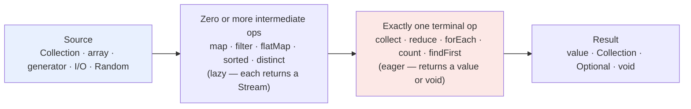
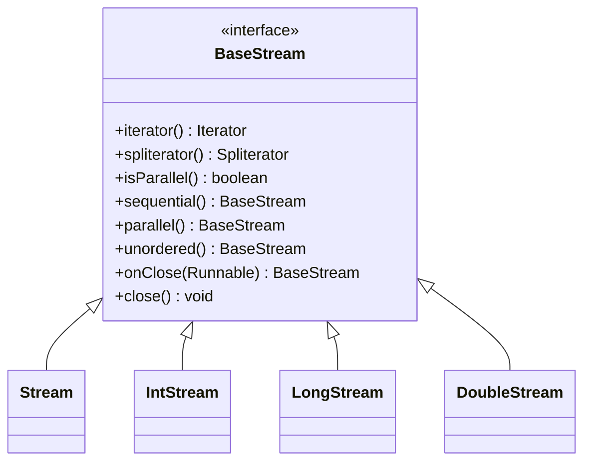
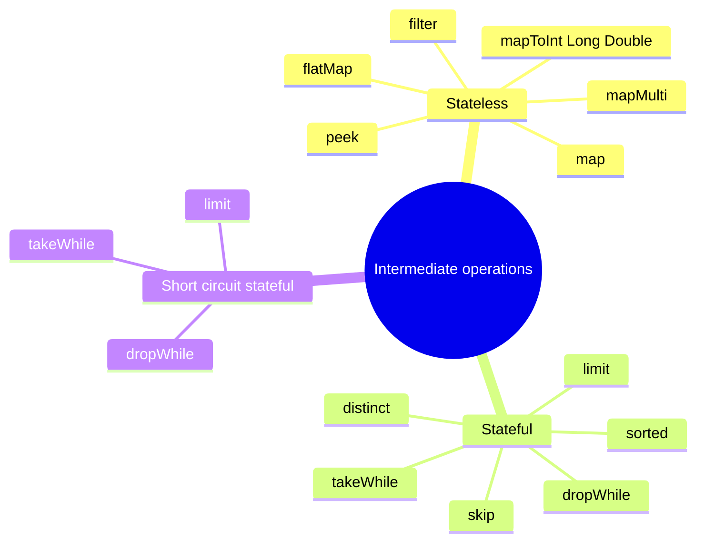
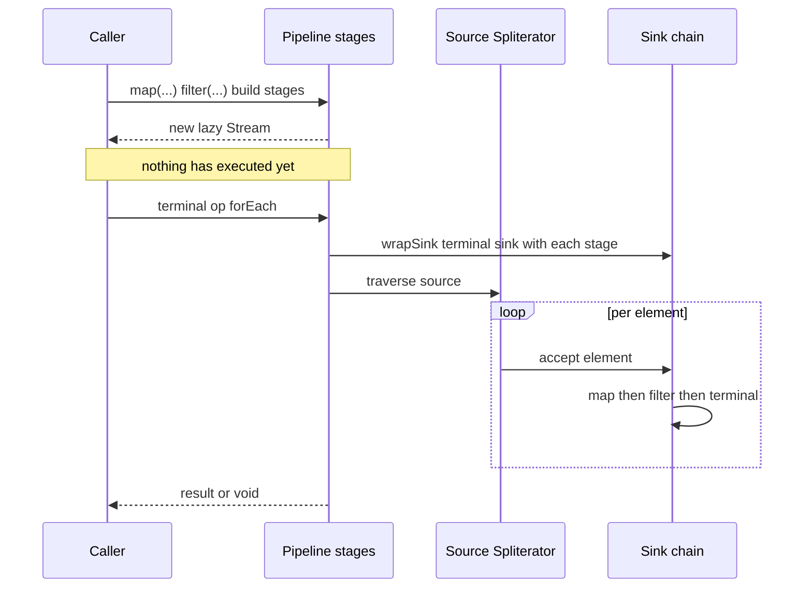
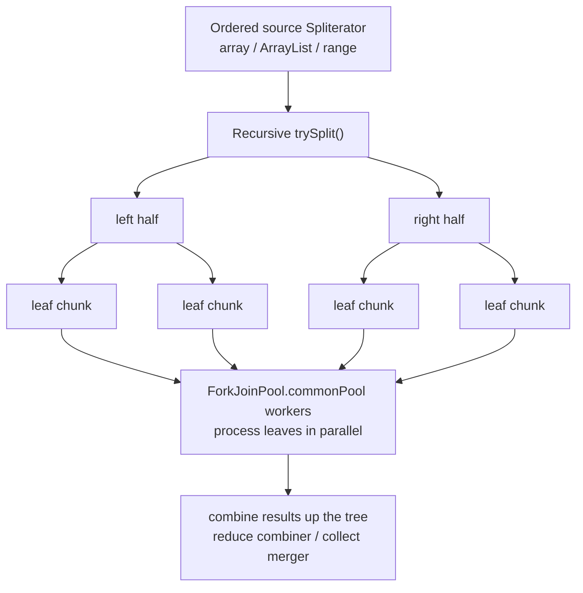

# Streams

A **stream** is a *lazy, single-use, non-storing view* over a sequence of elements that supports
functional-style bulk operations. The mental model that unlocks every interview question is the
**pipeline**:

```
source  ->  zero or more intermediate operations  ->  exactly one terminal operation
```

- A **source** turns data (a collection, array, generator, file, randomness source) into a stream.
- **Intermediate operations** (`map`, `filter`, `sorted`, …) return *another stream*. They are
  **lazy**: they build a description of work and execute nothing.
- A **terminal operation** (`collect`, `reduce`, `forEach`, `count`, …) drives the pipeline, returns
  a value (or `void`), and **consumes** the stream. A stream that has been consumed cannot be reused.

Everything else in this module follows from three properties that distinguish streams from
collections:

1. **No storage.** A stream does not hold elements; it is a pipeline over a source. Collections are
   data structures; streams are computations.
2. **Laziness.** Intermediate stages do not run until a terminal stage pulls elements through the
   fused pipeline. This is what makes infinite streams and short-circuiting work.
3. **Single use.** Once a terminal op runs, the stream's internal `linkedOrConsumed` flag flips and
   any further operation throws `IllegalStateException`.

> **Boundary note:** collector implementations, `Collectors` internals, and downstream collectors
> belong to [Collectors](14-Collectors.md). Lambda / `invokedynamic` mechanics belong to
> [Lambda Expressions](12-Lambda.md). `Optional` deep-dive belongs to [Optional](15-Optional.md).
> `ForkJoinPool` internals belong to
> [Fork/Join Framework](../04-Multithreading/21-ForkJoin.md). This module *uses* all of them but
> does not re-teach them.

---

## 1. The Pipeline Model



A pipeline is **closed** on one end by the source and on the other by the terminal op. You cannot
have a stream with zero terminal ops (nothing happens) or with two terminal ops (the second throws).
The canonical illegal shape is two terminals:

```java
Stream<Integer> s = Stream.of(1, 2, 3);
s.forEach(System.out::println);   // consumes s
s.count();                          // IllegalStateException: stream has already been operated upon or closed
```

> **Rule:** a stream instance may be traversed exactly once. If you need to traverse twice, call the
> source factory again (`list.stream()`), or materialise the result.

### 1.1 Streams vs Collections

| Axis | `Collection` (e.g. `List`) | `Stream` |
| --- | --- | --- |
| Stores data? | Yes — elements live in memory | No — a view/pipeline over a source |
| Traversed | Any number of times | Exactly once |
| When computed | Eagerly (already populated) | Lazily (on terminal op) |
| Size | Finite, known (`size()`) | May be infinite (`Stream.generate`, `Stream.iterate`) |
| Iteration style | External (`for`, `Iterator`) | Internal (`forEach`, `reduce`) |
| Parallelism | Manual (`parallelStream`, threads) | Declarative (`parallel()`, `parallelStream()`) |
| Mutability | Mutable / immutable variants | Never mutates the source |
| Reusable? | Yes | No |
| Typical use | Model state | Express a query/transformation |

The classic one-liner: **collections are about data, streams are about computation.** A stream is not
a data structure; it is a *functional pipeline* that can be consumed once.

---

## 2. Stream Types and the `BaseStream` Interface

`java.util.stream.BaseStream<T, S extends BaseStream<T, S>>` is the common super-interface. It
extends `AutoCloseable` and declares the fluent configuration methods shared by every stream type.



| Interface | Element carrier | Terminal reducers | Creation helpers |
| --- | --- | --- | --- |
| `Stream<T>` | `T` (boxed references) | `collect`, generic `reduce`, `toList` | `Stream.of`, `Stream.iterate` |
| `IntStream` | primitive `int` | `sum`, `average`, `summaryStatistics` | `IntStream.range`, `rangeClosed` |
| `LongStream` | primitive `long` | `sum`, `average`, `summaryStatistics` | `LongStream.range` |
| `DoubleStream` | primitive `double` | `sum`, `average`, `summaryStatistics` | `DoubleStream.of` |

`BaseStream` methods:

| Method | Purpose |
| --- | --- |
| `iterator()` | Adapts the stream to an external `Iterator` (a terminal-like escape hatch) |
| `spliterator()` | Access to the underlying `Spliterator` (source for parallel splitting) |
| `isParallel()` | Reports mode (a property of the whole pipeline, not of a stage) |
| `sequential()` / `parallel()` | Set mode; **the last call wins** for the whole pipeline |
| `unordered()` | Drops the encounter-order commitment (enables some optimizations) |
| `onClose(Runnable)` | Registers a close handler; handlers run in registration order on `close()` |
| `close()` | Runs close handlers; normally via try-with-resources |

The four concrete interfaces (`Stream`, `IntStream`, `LongStream`, `DoubleStream`) are **not** related
by inheritance; you move between reference and primitive streams with `mapToInt`/`boxed`/`asLongStream`
and friends. Primitive streams exist to avoid boxing and expose numeric reducers.

```java
// Move reference -> primitive -> reference
List<Integer> out = Stream.of("a", "bb", "ccc")
        .mapToInt(String::length)   // IntStream
        .filter(n -> n > 1)         // IntStream
        .boxed()                    // Stream<Integer>
        .toList();
System.out.println(out);            // [2, 3]
```

---

## 3. Creating Streams

Sources fall into a few families: **collections**, **arrays**, **literal/factory** helpers,
**generated** streams, **numeric ranges**, and **I/O/text** streams.

| Source | Example | Notes |
| --- | --- | --- |
| Collection | `list.stream()`, `set.stream()`, `map.entrySet().stream()` | Respects encounter order for ordered collections |
| Collection (parallel) | `list.parallelStream()` | Same as `.stream().parallel()` |
| `Arrays.stream` | `Arrays.stream(new int[]{1,2,3})` | Primitive overloads return primitive streams |
| `Stream.of` | `Stream.of("a","b")`, `Stream.of(arr)` | Varargs; `Stream.of(arr)` makes a `Stream<String>` |
| `Stream.builder` | `Stream.builder().add("x").add("y").build()` | Adding after `build()` throws `IllegalStateException` |
| `Stream.generate` | `Stream.generate(Math::random).limit(3)` | Unordered, infinite; supplier ignores index |
| `Stream.iterate` (2-arg) | `Stream.iterate(1, i -> i * 2)` | Java 8; always infinite |
| `Stream.iterate` (3-arg) | `Stream.iterate(1, i -> i < 100, i -> i * 2)` | Java 9; acts like a `for` loop, terminates on predicate |
| `IntStream.range` | `IntStream.range(1, 5)` | `[1, 5)` → 4 elements |
| `IntStream.rangeClosed` | `IntStream.rangeClosed(1, 5)` | `[1, 5]` → 5 elements |
| `Files.lines` | `Files.lines(path)` | Lazy, **must be closed** (holds an open file) |
| `BufferedReader.lines` | `reader.lines()` | Lazy I/O; not closed by the stream |
| `String.lines` | `"a\nb".lines()` | Java 11; splits on line terminators |
| `String.chars` / `codePoints` | `"abc".chars()` | `chars` = UTF-16 code units; `codePoints` handles surrogate pairs |
| `Pattern.splitAsStream` | `Pattern.compile(",").splitAsStream("a,b")` | Lazy splitting |
| `Random` streams | `rng.ints()`, `rng.ints(0, 10)`, `rng.doubles()` | Infinite unless bounded (`ints(n)`) |
| `Stream.empty` | `Stream.empty()` | Zero elements; useful base case |
| `Stream.concat` | `Stream.concat(a, b)` | Concatenates two streams lazily |
| `Stream.ofNullable` | `Stream.ofNullable(maybeNull)` | Java 9; 0 elements if null, 1 otherwise |

### 3.1 Representative creation snippet (verified)

```java
import java.util.*;
import java.util.stream.*;

public class CreateStreams {
    public static void main(String[] args) {
        System.out.println("of=" + Stream.of("a", "b").toList());
        System.out.println("range=" + IntStream.range(1, 5).sum());        // 1+2+3+4
        System.out.println("rangeClosed=" + IntStream.rangeClosed(1, 5).sum());
        System.out.println("iterate3=" + Stream.iterate(1, i -> i < 10, i -> i * 3).toList());
        System.out.println("iterate2=" + Stream.iterate(1, i -> i * 3).limit(3).toList());
        System.out.println("generate=" + Stream.generate(() -> "z").limit(3).toList());
        System.out.println("empty=" + Stream.empty().count());
        System.out.println("concat=" + Stream.concat(Stream.of(1, 2), Stream.of(3, 4)).toList());
        System.out.println("ofNullable=" + Stream.ofNullable(null).count()
                + " / " + Stream.ofNullable("v").count());
        System.out.println("split=" + java.util.regex.Pattern.compile(",")
                .splitAsStream("a,b,,c").toList());
        System.out.println("lines=" + "a\nb\nc".lines().toList());
        System.out.println("chars=" + "abc".chars().count());
    }
}
```

Output:

```text
of=[a, b]
range=10
rangeClosed=15
iterate3=[1, 3, 9]
iterate2=[1, 3, 9]
generate=[z, z, z]
empty=0
ofNullable=0 / 1
split=[a, b, , c]
lines=[a, b, c]
chars=3
```

> **`Stream.iterate` 2-arg vs 3-arg:** the 2-arg form always produces an infinite stream and you must
> bound it (`limit`) or short-circuit it; the 3-arg form (Java 9) takes a `hasNext` predicate and
> terminates naturally, making it the idiomatic replacement for an index-based `for` loop.

### 3.2 Closing I/O streams

`Files.lines`, `BufferedReader.lines`, and `Files.list` hold OS resources. Always use
try-with-resources:

```java
try (Stream<String> lines = java.nio.file.Files.lines(path)) {
    long nonBlank = lines.filter(l -> !l.isBlank()).count();
}
// stream is closed here; the file handle is released
```

`BaseStream.onClose` registers handlers that run in **registration order** when `close()` is called:

```java
try (Stream<Integer> s = Stream.of(1, 2)
        .onClose(() -> System.out.println("closed 1"))
        .onClose(() -> System.out.println("closed 2"))) {
    s.forEach(System.out::print);
    System.out.println();           // 12
}
// closed 1
// closed 2
```

---

## 4. Intermediate Operations

Intermediate ops are split into **stateless** and **stateful**. The distinction matters for
correctness under parallelism and for performance.



> A **stateless** op processes each element independently. A **stateful** op may need to see other
> elements (e.g. `sorted` buffers everything, `distinct` remembers seen values, `limit`/`skip` count).
> Stateful ops can require buffering and can inhibit parallelism.

### 4.1 Transformation: `map` vs `flatMap`

- `map(f)` is **one-to-one**: each input element yields exactly one output element (possibly of a
  different type).
- `flatMap(f)` is **one-to-many**: `f` returns a *stream* per element, and the streams are flattened
  into one output stream. It is the stream equivalent of `map` + `concat`.

```java
List<String> words = List.of("hello world", "foo bar");

// map: Stream<String[]>
List<String[]> mapped = words.stream().map(w -> w.split(" ")).toList();
System.out.println(mapped.size());                 // 2

// flatMap: Stream<String> (flattened)
List<String> flat = words.stream()
        .flatMap(w -> Arrays.stream(w.split(" ")))
        .toList();
System.out.println(flat);                          // [hello, world, foo, bar]
```

`mapToInt`/`mapToLong`/`mapToDouble` produce primitive streams; `flatMapToInt` etc. flatten into a
primitive stream:

```java
int total = Stream.of("a", "bb", "ccc")   // lengths 1 + 2 + 3 = 6
        .mapToInt(String::length)
        .sum();
System.out.println(total);                // 6

int ascii = Stream.of("a", "bb", "ccc")
        .flatMapToInt(String::chars)      // chars of every string
        .sum();
System.out.println(ascii);                // 590
```

> **`flatMap` and null returns:** if the mapper returns `null`, `flatMap` treats it as an *empty
> stream* (verified: no exception). Nulls *inside* the returned stream are passed through.

### 4.2 `mapMulti` (Java 16)

`mapMulti` is an imperative alternative to `flatMap` that avoids allocating an intermediate stream
per element. Its `BiConsumer` receives the element and a downstream `Consumer` you call zero or more
times.

```java
List<Integer> res = Stream.of(1, 2, 3)
        .<Integer>mapMulti((x, out) -> {
            out.accept(x);
            out.accept(x * 10);
        })
        .toList();
System.out.println(res);       // [1, 10, 2, 20, 3, 30]
```

Use `mapMulti` over `flatMap` when each element expands to a small, known number of outputs, because
it avoids creating a `Stream` object per element. There are primitive variants
`mapMultiToInt/ToLong/ToDouble`.

### 4.3 Filtering, deduplication, sorting

```java
System.out.println(Stream.of(3, 1, 4, 1, 5, 9, 2, 6, 5)
        .distinct().sorted().toList());                       // [1, 2, 3, 4, 5, 6, 9]
System.out.println(Stream.of("b", "a", "c")
        .sorted(Comparator.reverseOrder()).toList());         // [c, b, a]
System.out.println(Stream.of(2, 4, 6, 7, 8)
        .takeWhile(i -> i % 2 == 0).toList());                // [2, 4, 6]
System.out.println(Stream.of(2, 4, 6, 7, 8)
        .dropWhile(i -> i % 2 == 0).toList());                // [7, 8]
```

- `distinct()` uses `equals`/`hashCode` (via a `LinkedHashSet` for ordered streams).
- `sorted()` uses the natural order (elements must implement `Comparable`, else `ClassCastException`
  at traversal time) or a supplied `Comparator`. It is **stable** — equal elements keep encounter order.
- `takeWhile`/`dropWhile` (Java 9) are *ordered* predicates: `takeWhile` stops at the first element
  that fails; `dropWhile` discards the leading run that passes. On an unordered stream the behavior is
  deliberately unspecified.

### 4.4 `peek` (and why you should not rely on it)

`peek(consumer)` is intended for **debugging**; it passes each element through after running the
consumer. It is a no-op for the *result* but is officially "not guaranteed to be executed" in all
pipelines (e.g. the `count()` optimization can skip it). Never use `peek` for business side effects.

### 4.5 `boxed`, `asLongStream`, `asDoubleStream`

`IntStream.boxed()` produces `Stream<Integer>` (each element boxed). The reverse is `mapToInt`. Going
reference → primitive → reference is a common source of accidental allocation.

---

## 5. Terminal Operations

Terminal ops fall into groups: **iteration** (`forEach`, `forEachOrdered`), **folding**
(`reduce`, `collect`), **searching/short-circuiting** (`findFirst`, `findAny`, `anyMatch`,
`allMatch`, `noneMatch`), **aggregation** (`count`, `min`, `max`, `sum`, `average`,
`summaryStatistics`), and **materialisation** (`toArray`, `toList`).

| Terminal op | Kind | Returns | Short-circuits? |
| --- | --- | --- | --- |
| `forEach` | iteration | `void` | No |
| `forEachOrdered` | iteration | `void` | No |
| `collect` | mutable reduction | result container | No |
| `reduce` | immutable reduction | value / `Optional` | No |
| `count` | aggregation | `long` | May skip pipeline if `SIZED` |
| `min` / `max` | aggregation | `Optional` | No |
| `anyMatch` | search | `boolean` | Yes (stops at first true) |
| `allMatch` | search | `boolean` | Yes (stops at first false) |
| `noneMatch` | search | `boolean` | Yes (stops at first true) |
| `findFirst` | search | `Optional<T>` | Yes (on ordered streams) |
| `findAny` | search | `Optional<T>` | Yes |
| `toArray` | materialisation | `Object[]` / `T[]` | No |
| `toList` (Java 16) | materialisation | unmodifiable `List<T>` | No |
| `sum` / `average` | numeric aggregation | primitive / `OptionalDouble` | No |
| `summaryStatistics` | numeric aggregation | `Int/Long/DoubleSummaryStatistics` | No |

### 5.1 `forEach` vs `forEachOrdered`

`forEach` does **not** guarantee order, especially on parallel streams. `forEachOrdered` forces
encounter order even when parallel (at a throughput cost). See the verified parallel demo in
[§8](#8-parallel-streams).

### 5.2 `reduce`

`reduce` combines elements into a single immutable result. Three forms:

```java
// 1) One-arg: returns Optional (empty stream -> Optional.empty)
Optional<Integer> opt = Stream.of(1, 2, 3).reduce((a, b) -> a + b);
System.out.println(opt);                                    // Optional[6]
System.out.println(Stream.<Integer>empty().reduce(Integer::sum)); // Optional.empty

// 2) Identity + accumulator: returns a value (identity is the seed and the empty-stream result)
int withIdentity = Stream.of(1, 2, 3).reduce(10, Integer::sum);
System.out.println(withIdentity);                           // 16

// 3) Identity + accumulator + combiner: required for parallel streams
int parallelSafe = Stream.of(1, 2, 3).reduce(0, Integer::sum, Integer::sum);
System.out.println(parallelSafe);                           // 6
```

> **The combiner must be associative for parallel correctness.** For serial streams the combiner is
> unused (or used only in rare type-changing forms). With a non-associative accumulator, serial and
> parallel results diverge: `IntStream.rangeClosed(1,4).reduce(0, (a,b) -> a-b)` gives `-10` serial
> but `0` when parallel (observed) — and the parallel result is *not guaranteed*.

### 5.3 `collect`

`collect` is a *mutable reduction*: it accumulates into a mutable container (typically via
`Collectors`). It is generally more efficient than `reduce` for building collections/strings because
it avoids creating a new intermediate object per step. See [Collectors](14-Collectors.md) for the
full library.

```java
List<String> list = Stream.of("a", "b", "c").collect(Collectors.toList());
String joined = Stream.of("a", "b", "c").collect(Collectors.joining(", "));
System.out.println(joined);                                 // a, b, c
System.out.println(Stream.of(1, 2, 2, 3).collect(Collectors.toSet())); // [1, 2, 3]
```

### 5.4 `Stream.toList` (Java 16) vs `Collectors.toList`

```java
List<Integer> unmodifiable = Stream.of(1, 2, 3).toList();
unmodifiable.add(4);              // UnsupportedOperationException

List<Integer> mutable = Stream.of(1, 2, 3).collect(Collectors.toList());
mutable.add(4);
System.out.println(mutable);     // [1, 2, 3, 4]
```

| Aspect | `Stream.toList()` | `Collectors.toList()` |
| --- | --- | --- |
| Since | Java 16 | Java 8 |
| Mutability | **Unmodifiable** | Mutable (implementation-dependent, `ArrayList` in practice) |
| Null elements | Allowed | Allowed |
| Type/impl | `ImmutableCollections.ListN` | `ArrayList` |
| Use with `collect` | N/A (terminal op) | `collect(Collectors.toList())` |

> If you need an unmodifiable list *and* control over the collector downstream, use
> `Collectors.toUnmodifiableList()`, which additionally **rejects null** with `NullPointerException`.

### 5.5 Matching, finding, numeric aggregation

```java
System.out.println(Stream.<Integer>empty().allMatch(i -> i > 0)); // true  (vacuous truth)
System.out.println(Stream.<Integer>empty().anyMatch(i -> i > 0)); // false
System.out.println(Stream.<Integer>empty().noneMatch(i -> i > 0));// true
System.out.println(Stream.of(3, 1, 2).min(Integer::compareTo));   // Optional[1]
System.out.println(Stream.of("a", "bbb", "cc")
        .max(Comparator.comparingInt(String::length)));           // Optional[bbb]

IntSummaryStatistics stats = IntStream.of(1, 2, 3, 4, 5).summaryStatistics();
System.out.println(stats.getCount() + " " + stats.getSum() + " "
        + stats.getMin() + " " + stats.getMax() + " " + stats.getAverage());
// 5 15 1 5 3.0

System.out.println(IntStream.empty().average());   // OptionalDouble.empty
System.out.println(IntStream.empty().sum());       // 0
System.out.println(IntStream.empty().max());       // OptionalInt.empty
```

Numeric edge cases worth memorising:

- `sum()` on an empty primitive stream is **0**, never an exception.
- `average()`/`min()`/`max()` on empty return an empty `Optional*`.
- `IntStream.sum()` **silently overflows** (`IntStream.of(Integer.MAX_VALUE, 1).sum()` → `-2147483648`);
  use `LongStream`/`mapToLong` when overflow is possible.
- `anyMatch`/`allMatch`/`noneMatch` on an empty stream follow vacuous truth: `allMatch`/`noneMatch`
  → `true`, `anyMatch` → `false`.

---

## 6. Laziness, Short-Circuiting, and Infinite Streams

### 6.1 Laziness and fused evaluation

Building a pipeline only creates stage objects. When the terminal op runs, the JDK wraps the terminal
`Sink` with each intermediate `Sink` (from the terminal backwards to the source) and then drives the
source `Spliterator`, pushing each element through the whole chain. This is **element-at-a-time fusion**,
not stage-at-a-time materialisation.



Verified fused behaviour:

```java
Stream<Integer> pipeline = Stream.of(1, 2, 3)
        .map(i -> { System.out.println("map " + i); return i * 2; })
        .filter(i -> i > 2);
System.out.println("pipeline built, nothing ran");
pipeline.forEach(i -> System.out.println("out " + i));
```

Output (note interleaving: each element is fully processed before the next is pulled):

```text
pipeline built, nothing ran
map 1
map 2
out 4
map 3
out 6
```

### 6.2 The `count()` optimization

As an implementation optimization (JDK 9+), `count()` can return the size **without executing the
pipeline** when the stream is `SIZED`. Intermediate side effects (`peek`) are then skipped:

```java
long c = Stream.of("a", "b", "c")
        .peek(System.out::println)   // NOT executed
        .count();
System.out.println("count = " + c);  // count = 3
```

Adding a non-sizable op (`filter`, `flatMap`, …) forces real traversal:

```java
long c2 = Stream.of("a", "b", "c")
        .filter(s -> { System.out.println("filter " + s); return true; })
        .count();
// filter a
// filter b
// filter c
// count = 3
```

> **Consequence:** never rely on `peek`/`map` side effects for correctness — the JDK reserves the
> right to skip them. (This is why `count()` does not run `peek`, but `forEach` and `toList` do.)

### 6.3 Infinite streams and short-circuiting

An infinite source (`generate`, 2-arg `iterate`, unbounded `Random.ints()`) is safe **only** if the
pipeline contains a **short-circuiting** stage that terminates traversal:

| Short-circuiting intermediate | Effect |
| --- | --- |
| `limit(n)` | Takes at most `n` elements |
| `takeWhile(p)` | Stops at first element failing `p` |
| `dropWhile(p)` | Drops while `p` holds, then streams the rest (needs one failing element to stop dropping) |

| Short-circuiting terminal | Effect |
| --- | --- |
| `findFirst` / `findAny` | Stops at first match |
| `anyMatch` / `allMatch` / `noneMatch` | Stops when the boolean is decided |

```java
List<Integer> first5 = Stream.iterate(0, i -> i + 1).limit(5).toList();
System.out.println(first5);                                  // [0, 1, 2, 3, 4]

// short-circuit: anyMatch stops as soon as the predicate is true
boolean found = Stream.iterate(1, i -> i + 1)
        .peek(i -> System.out.println("tested " + i))
        .anyMatch(i -> i > 3);
System.out.println("found=" + found);
// tested 1
// tested 2
// tested 3
// tested 4
// found=true
```

> **`sorted` and `distinct` are NOT short-circuiting.** `Stream.iterate(1, i -> i + 1).sorted()` can
> never emit the smallest element because there is no smallest — the stateful op buffers forever and
> **the pipeline hangs** (until OOM). Likewise `distinct()` on an infinite source never completes.
> Put a `limit` *after* a stateful op only when the source is finite, or use `findFirst`-style
> terminals that let stateful ops short-circuit (e.g. `filter(...).sorted().findFirst()` only hangs
> because `sorted` must see all matches first).

Ordering of `limit` vs `filter` changes **how many elements are pulled** even when the result is the
same:

```java
System.out.println(Stream.iterate(1, i -> i + 1).limit(5).filter(i -> i % 2 == 0).toList());
// [2, 4]  (pulls 5 numbers)
System.out.println(Stream.iterate(1, i -> i + 1).filter(i -> i % 2 == 0).limit(3).toList());
// [2, 4, 6]  (pulls 6 numbers)
```

---

## 7. Encounter Order and `unordered()`

**Encounter order** is the order in which a stream's source presents elements. A stream is *ordered*
if it has a defined encounter order. Whether order is *respected* depends on the operation:

- `forEach` ignores encounter order when parallel; `forEachOrdered` respects it.
- `findFirst` respects encounter order; `findAny` is free to pick any element.
- `collect`, `reduce`, and `sorted` produce ordered results for ordered streams.
- `distinct`, `limit`, `skip`, `takeWhile` are affected by order; `unordered()` relaxes that.

`unordered()` is a hint that the order does not matter, which can unlock faster implementations
(e.g. parallel `distinct` can use a `ConcurrentHashMap` instead of a `LinkedHashSet`, and parallel
`limit` can grab arbitrary elements). It never reorders a sequential result in practice, but it
removes the guarantee:

```java
List<Integer> ordered = List.of(1, 2, 3, 4, 5);
System.out.println(ordered.stream().limit(3).toList());            // [1, 2, 3]
System.out.println(ordered.stream().unordered().limit(3).toList()); // [1, 2, 3] (no guarantee)
System.out.println(ordered.parallelStream().isParallel());          // true
System.out.println(ordered.parallelStream().unordered().limit(3).count()); // 3
```

> **Interview point:** `unordered()` does not *make* a stream random; it promises you do not care
> about order, letting the runtime drop ordering-preserving (expensive) machinery.

---

## 8. Parallel Streams

`parallelStream()` / `.parallel()` switch the pipeline to the **common `ForkJoinPool`**. Parallelism
is a property of the *entire* pipeline; `sequential()` and `parallel()` toggle the same flag, and
**the last call wins**.

```java
System.out.println(List.of(1, 2, 3).stream().parallel().sequential().isParallel()); // false
System.out.println(List.of(1, 2, 3).stream().sequential().parallel().isParallel()); // true
```

### 8.1 How parallelism is executed



The source's `Spliterator` is recursively split with `trySplit()`, producing a balanced tree of tasks.
Leaf tasks run on `ForkJoinPool.commonPool()` workers; partial results are combined bottom-up. See
[Fork/Join Framework](../04-Multithreading/21-ForkJoin.md) for the pool internals (work-stealing,
`CountedCompleter`); this module only covers the stream-facing behaviour.

Key facts:

- **Common pool size** defaults to `availableProcessors() - 1` (on a 12-core box,
  `ForkJoinPool.commonPool().getParallelism()` is `11`). Override with
  `-Djava.util.concurrent.ForkJoinPool.common.parallelism=N`.
- **A stream splits well only if the source splits well.** `ArrayList`, arrays, and `IntStream.range`
  have excellent `Spliterator`s; `LinkedList`, `Iterator`-backed sources (like `Files.lines`),
  and `Stream.iterate` split poorly or not at all, so parallelism buys little.
- **`Spliterator` characteristics** (`ORDERED`, `DISTINCT`, `SORTED`, `SIZED`, `SUBSIZED`, `IMMUTABLE`,
  `CONCURRENT`, `NONNULL`) tell the pipeline what optimizations are legal. `trySplit` must return a
  balanced prefix.

### 8.2 Ordering and `forEach` nondeterminism (verified)

`forEach` on a parallel stream processes elements in whatever order workers finish. Using a
thread-safe sink to observe (a raw `ArrayList` would corrupt), three runs on 0..19 gave:

```text
parallel forEach: [12, 14, 13, 11, 10, 2, 4, 3, 15, 7, 19, 5, 18, 0, 1, 8, 9, 6, 16, 17]
parallel forEach: [6, 5, 8, 9, 7, 2, 4, 3, 12, 1, 16, 0, 15, 14, 13, 17, 18, 11, 10, 19]
parallel forEach: [12, 6, 5, 8, 9, 14, 7, 13, 11, 10, 1, 0, 16, 15, 4, 2, 17, 18, 3, 19]
```

`forEachOrdered` preserves encounter order (verified: starts at 0, ends at 19). `collect` on an
ordered parallel stream also preserves order by merging in encounter order.

### 8.3 Thread safety: avoid stateful/mutating lambdas

Parallel streams run your lambdas on many threads concurrently. Any lambda that mutates shared state
is a data race.

```java
// WRONG: shared mutable sink, data race + possible exceptions
List<Integer> out = new ArrayList<>();
IntStream.range(0, 1000).parallel().forEach(out::add);   // lost updates / corruption

// RIGHT: use a collector (thread-safe merge) or a concurrent collection
List<Integer> safe = IntStream.range(0, 1000).parallel().boxed().collect(Collectors.toList());

// RIGHT: side-effect-free accumulation
long sum = LongStream.rangeClosed(1, 1_000_000).parallel().sum();   // 500000500000
```

- **Stateful lambdas** (e.g. a `HashSet` used as a filter to deduplicate) are incorrect under
  parallelism even if the operation "works" sequentially. Use `distinct()`.
- `forEach` on parallel + shared `StringBuilder`/`ArrayList` is the classic bug; even if it does not
  throw, updates are lost.
- If a side effect is unavoidable, use `forEachOrdered` (order, but still not atomic) or collect
  first, then iterate.

### 8.4 Custom `ForkJoinPool` submission

A parallel stream always uses the **common** pool, even if you invoke it inside a custom executor.
To run a stream in your own pool, submit the whole computation as a task to that pool:

```java
ForkJoinPool pool = new ForkJoinPool(4);
try {
    long sum = pool.submit(() ->
            IntStream.rangeClosed(1, 1000).parallel().asLongStream().sum()).get(); // 500500
    System.out.println(sum);
} finally {
    pool.shutdown();
}
```

> Simply calling `es.submit(() -> list.parallelStream()...)` on a regular `ExecutorService` does
> **not** change the stream's pool; the worker just blocks while the common pool does the work.

### 8.5 When parallel helps (and when it hurts)

| Helps | Hurts |
| --- | --- |
| Large `SIZED`, splittable sources (arrays, `ArrayList`, ranges) | Tiny inputs (fork/join overhead dominates) |
| CPU-bound, pure, per-element work | I/O-bound work (blocks pool workers) |
| Associative, side-effect-free reductions | Stateful lambdas / shared mutation (incorrect) |
| Expensive per-element computation | Cheap work where boxing/splitting dominates |
| Order-independent operations | Order-sensitive ops (`sorted`, `findFirst`, `limit`) add merge cost |

Practical rule: **only parallelise after measuring.** Parallel streams are a convenience, not a
general-purpose performance switch. For arbitrary async/IO work, prefer structured concurrency /
[`CompletableFuture`](../04-Multithreading/20-CompletableFuture.md) or virtual threads.

---

## 9. Performance

### 9.1 Boxing overhead

`Stream<Integer>` boxes every element. `IntStream`/`LongStream`/`DoubleStream` avoid that allocation
and expose `sum`/`average`/`summaryStatistics`. Prefer primitive streams for numeric pipelines.

```java
// Reference stream: boxes every value
long boxed = Stream.iterate(1, i -> i + 1).limit(100_000)
        .mapToLong(Integer::longValue).sum();

// Primitive stream: no boxing
long prim = LongStream.rangeClosed(1, 100_000).sum();
System.out.println(boxed + " " + prim);   // 5000050000 5000050000
```

Both compute the same sum, but the reference pipeline allocates ~100,000 `Integer` objects (plus
potential `Long` boxes on the way out). On realistic workloads this allocation and the resulting GC
pressure are often the dominant cost.

### 9.2 Lazy fusion avoids intermediate collections

Because stages fuse, `map().filter().mapToInt().sum()` performs a single pass with no intermediate
lists. The opposite style churns memory:

```java
// Bad: materialises a list between each stage
List<Integer> a = list.stream().map(f).collect(Collectors.toList());
List<Integer> b = a.stream().filter(p).collect(Collectors.toList());
int c = b.stream().mapToInt(Integer::intValue).sum();

// Good: one fused pass, no intermediates
int d = list.stream().map(f).filter(p).mapToInt(Integer::intValue).sum();
```

### 9.3 Stateful and short-circuit ops

- `sorted()` buffers all elements — `O(n)` extra memory, `O(n log n)` time; it also breaks
  short-circuiting for upstream infinite sources.
- `distinct()` retains seen elements — `O(n)` memory; ordered `distinct` uses `LinkedHashSet`
  (two links per entry).
- `limit`/`skip` are cheap but `skip(n)` on an unordered parallel stream may still process more.
- Place `filter` **before** `map` when the filter is cheaper or reduces the number of elements, and
  `limit` **before** expensive operations when possible.

### 9.4 `reduce` vs `collect`

For building mutable results (lists, maps, strings), `collect` avoids allocating a new immutable
result per element. A `reduce` that concatenates `String`s in a loop is `O(n^2)`; use
`Collectors.joining()`. Likewise prefer `collect(Collectors.toList())`/`toList()` over
`reduce(new ArrayList<>(), ...)`.

> Benchmarks are notoriously misleading; always measure with JMH. The qualitative levers are:
> avoid boxing, avoid materialising intermediates, avoid unnecessary stateful ops, and be sceptical
> of parallel for small inputs.

---

## 10. Common Mistakes and Pitfalls

### 10.1 Reusing a stream

```java
// WRONG
Stream<Integer> s = Stream.of(1, 2, 3);
s.count();
s.forEach(System.out::println);   // IllegalStateException

// RIGHT: recreate the stream, or materialise once
List<Integer> data = Stream.of(1, 2, 3).toList();
System.out.println(data.size());
data.forEach(System.out::println);
```

### 10.2 Side effects in `map`/`filter`

```java
// WRONG: mutating external state from map (fragile, wrong under parallelism)
List<Integer> seen = new ArrayList<>();
list.stream().map(x -> { seen.add(x); return x; }).count();   // may not even run if SIZED

// RIGHT: side-effect-free map; collect explicitly
List<Integer> out = list.stream().map(x -> x * 2).toList();
```

### 10.3 `forEach` with shared state (especially parallel)

```java
// WRONG
int[] total = {0};
IntStream.range(0, 1000).parallel().forEach(i -> total[0] += i);   // data race

// RIGHT
int sum = IntStream.range(0, 1000).parallel().sum();
```

### 10.4 `map` vs `flatMap`

```java
// WRONG: map produces a stream of arrays/lists, not flattened values
List<String[]> wrong = words.stream().map(w -> w.split(" ")).toList();

// RIGHT: flatMap flattens
List<String> right = words.stream().flatMap(w -> Arrays.stream(w.split(" "))).toList();
```

### 10.5 `findFirst` vs `findAny`

`findFirst` has ordering-semantics and a serial fast path (returns the first match deterministically).
`findAny` is free to return any match and is the right choice when order does not matter — it can be
faster on parallel streams. Do not use `findAny` if you rely on the *first* element.

### 10.6 `Collectors.toMap` duplicate keys

```java
// WRONG: throws IllegalStateException on duplicate key
Map<Integer,String> m = Stream.of("a", "b", "cc")
        .collect(Collectors.toMap(String::length, s -> s));
// java.lang.IllegalStateException: Duplicate key 1 (attempted merging values a and b)

// RIGHT: supply a merge function (or use groupingBy)
Map<Integer,String> ok = Stream.of("a", "b", "cc")
        .collect(Collectors.toMap(String::length, s -> s, (x, y) -> x + y));
System.out.println(ok);    // {1=ab, 2=cc}
```

Full `Collectors` semantics live in [Collectors](14-Collectors.md).

### 10.7 Infinite stream without short-circuit

```java
// WRONG: never terminates
Stream.iterate(1, i -> i + 1).forEach(System.out::println);
Stream.iterate(1, i -> i + 1).sorted().findFirst();   // hangs: sorted never emits

// RIGHT
Stream.iterate(1, i -> i + 1).limit(10).forEach(System.out::println);
```

### 10.8 `Optional.get()` in `reduce`/`findFirst`

```java
// WRONG: NoSuchElementException on empty input
int bad = list.stream().reduce(Integer::sum).get();

// RIGHT
int good = list.stream().reduce(0, Integer::sum);
// or
int alsoGood = list.stream().reduce(Integer::sum).orElse(0);
```

### 10.9 Negative `limit`/`skip`

Both throw `IllegalArgumentException` for negative arguments (verified).

### 10.10 Forgetting to close I/O streams

`Files.lines`, `Files.list`, `Files.walk` hold resources; always try-with-resources. A stream created
from `BufferedReader.lines()` does **not** close the reader when the stream closes.

---

## 11. Comparison Tables

### 11.1 `map` vs `flatMap`

| Aspect | `map` | `flatMap` |
| --- | --- | --- |
| Cardinality | 1 → 1 | 1 → 0..n |
| Mapper returns | a value `R` | a `Stream<R>` |
| Result | `Stream<R>` | flattened `Stream<R>` |
| Null mapper result | passes `null` through | treated as empty stream |
| Typical use | transform each element | expand/filter-and-expand, join nested collections |
| Primitive variants | `mapToInt/Long/Double` | `flatMapToInt/Long/Double` |

### 11.2 `findFirst` vs `findAny`

| Aspect | `findFirst` | `findAny` |
| --- | --- | --- |
| Order guarantee | Yes (encounter order) | No |
| Parallel behaviour | More constrained | Freer, potentially faster |
| Use when | You need the first match | Any match suffices |

### 11.3 Sequential vs parallel

| Aspect | Sequential | Parallel |
| --- | --- | --- |
| Thread | Calling thread | Common `ForkJoinPool` |
| Overhead | Minimal | Split/merge + coordination |
| Order | Preserved naturally | `forEach` unordered; use `forEachOrdered` |
| Stateful lambdas | Tolerated (still bad) | Incorrect |
| Best for | Small/ordered/IO work | Large CPU-bound pure work |
| Determinism | Deterministic | Often nondeterministic for order-sensitive sinks |

### 11.4 `for` loop vs stream

| Aspect | `for` loop | Stream |
| --- | --- | --- |
| Style | Imperative | Declarative |
| Laziness | N/A | Yes (infinite sources, short-circuit) |
| Parallel | Manual | `.parallel()` |
| Overhead | Lowest | Pipeline allocation, possible boxing |
| Readability | Explicit, verbose | Concise for transformations |
| Debugging | Step through | Harder (lambdas, laziness) |
| When | Tight numeric loops, complex control flow | Transform/filter/aggregate collections |

> Do not dogmatically stream everything. A simple indexed `for` over a primitive array is often the
> fastest and clearest code; streams shine for multi-stage transformations and aggregations.

---

## Cross-links

- [Lambda Expressions](12-Lambda.md) — lambdas, functional interfaces, `invokedynamic`.
- [Collectors](14-Collectors.md) — `groupingBy`, `partitioningBy`, downstream collectors.
- [Optional](15-Optional.md) — the return type of many terminal operations.
- [Fork/Join Framework](../04-Multithreading/21-ForkJoin.md) — the engine behind parallel streams.
- [Java Memory Model](../04-Multithreading/23-Java-Memory-Model.md) — happens-before for parallel sinks.
- [Collections Framework, Part 1](../02-Collections/08-Collections-Part-1.md) and
  [Part 2](../02-Collections/09-Collections-Part-2.md) — the sources you stream over.

---

# Interview Questions

## Beginner

**Q:** What is a stream, in one sentence?
**A:** A lazy, single-use pipeline over a sequence of elements that supports functional-style
intermediate operations terminated by exactly one terminal operation. It does not store data — it
describes a computation over a source (collection, array, generator, file, etc.).

**Q:** What are the three parts of a stream pipeline?
**A:** (1) A **source** that creates the stream; (2) zero or more **intermediate operations**
(`map`, `filter`, `sorted`, …) that return a new stream and are lazy; (3) exactly one **terminal
operation** (`collect`, `reduce`, `forEach`, `count`, …) that triggers execution and returns a value
or `void`.

**Q:** What is the difference between a collection and a stream?
**A:** A collection is a data structure that stores elements and can be traversed many times. A stream
is a view/computation over a source that is lazy, may be infinite, and can be consumed only once.
Collections are about data; streams are about computation.

**Q:** Are intermediate operations executed immediately?
**A:** No. They only build up a description (a chain of stages). Execution starts when the terminal
operation runs; elements are then pulled through all stages in a single fused pass.

**Q:** What happens if you call a terminal operation twice on the same stream?
**A:** The second call throws `java.lang.IllegalStateException` ("stream has already been operated
upon or closed"), because a stream is single-use.

**Q:** How do you create a stream from a `List`?
**A:** `list.stream()` for sequential, `list.parallelStream()` for parallel. Internally this calls
`StreamSupport.stream(spliterator(), false/true)`.

**Q:** Name a few ways to create a stream.
**A:** `Collection.stream`/`parallelStream`, `Arrays.stream`, `Stream.of`, `Stream.builder`,
`Stream.generate`, `Stream.iterate`, `Stream.empty`, `Stream.concat`, `Stream.ofNullable`,
`IntStream.range`/`rangeClosed`, `Files.lines`, `String.lines`/`chars`, `Pattern.splitAsStream`,
`Random.ints`.

**Q:** What does `map` do, and how does it differ from `flatMap`?
**A:** `map` is one-to-one: it applies a function to each element and replaces it. `flatMap` is
one-to-many: each element maps to a stream, and those streams are flattened into one output stream.
Use `flatMap` to expand nested collections/arrays.

**Q:** What is the difference between `forEach` and `forEachOrdered`?
**A:** `forEach` makes no ordering guarantee (important for parallel streams).
`forEachOrdered` guarantees encounter order even for parallel streams, at some throughput cost.

**Q:** What does `collect` do?
**A:** It performs a mutable reduction, accumulating elements into a mutable container (list, map,
string, etc.). It is usually implemented with a `Collector` from `Collectors`, e.g.
`collect(Collectors.toList())`.

**Q:** What is the difference between `Stream.toList()` and `Collectors.toList()`?
**A:** `Stream.toList()` (Java 16) returns an **unmodifiable** list; `collect(Collectors.toList())`
returns a **mutable** list (in practice an `ArrayList`). Both allow null elements.

**Q:** What does `count()` return?
**A:** A `long` — the number of elements (or the result of reducing each element to `1L` and summing).
On a `SIZED` stream the JDK may compute it without traversing the pipeline.

**Q:** What is the difference between `anyMatch`, `allMatch`, and `noneMatch`?
**A:** `anyMatch` is true if at least one element satisfies the predicate; `allMatch` if all do;
`noneMatch` if none do. All are short-circuiting. On an empty stream, `allMatch` and `noneMatch` are
vacuously `true`, while `anyMatch` is `false`.

**Q:** How do you make an infinite stream finite?
**A:** Bound it with a short-circuiting operation such as `limit(n)` or `takeWhile(predicate)`, or use
a short-circuiting terminal like `findFirst`/`findAny`/`anyMatch`.

**Q:** What is the difference between `findFirst` and `findAny`?
**A:** `findFirst` returns the first element in encounter order (deterministic); `findAny` may return
any element and can be faster on parallel streams.

**Q:** How do you convert a stream to an array?
**A:** `stream.toArray()` gives `Object[]`; `stream.toArray(String[]::new)` gives a typed array; a
primitive stream's `toArray()` gives the primitive array (`int[]`, `long[]`, `double[]`).

**Q:** Why do primitive streams exist?
**A:** To avoid boxing/unboxing overhead and to expose numeric operations: `sum`, `average`, `min`,
`max`, `summaryStatistics`. `IntStream`, `LongStream`, and `DoubleStream` process primitives directly.

**Q:** What does `peek` do?
**A:** It applies a `Consumer` to each element as it passes through the pipeline and returns the same
elements. It is intended for debugging and its execution is not guaranteed (e.g. `count()` on a
`SIZED` stream may skip it). Never use it for business side effects.

## Intermediate

**Q:** Explain lazy evaluation with a concrete example.
**A:**
```java
Stream<Integer> p = Stream.of(1, 2, 3)
        .map(i -> { System.out.println("map " + i); return i * 2; })
        .filter(i -> i > 2);
System.out.println("built");        // prints first
p.forEach(i -> System.out.println("out " + i));
```
Output is `built`, then `map 1`, `map 2`, `out 4`, `map 3`, `out 6`. Nothing runs at build time, and
elements are processed one at a time (fused), not stage by stage.

**Q:** Why is the `count()` result of a `peek`ed stream sometimes not prefixed by the peek output?
**A:** Because `count()` on a `SIZED` stream can be answered from the known size without executing
the pipeline (a JDK 9+ optimization), so `peek`'s consumer never runs. Add a sizing-changing op such
as `filter` to force traversal.

**Q:** What is a stateful intermediate operation, and why do they matter?
**A:** A stateful op may need to see multiple elements before producing output — `sorted` (buffers
all), `distinct` (remembers seen), `limit`/`skip` (count), `takeWhile`/`dropWhile`. They may require
buffering (extra memory), can prevent lazy short-circuiting, and can reduce parallel efficiency.

**Q:** Why can `sorted()` on an infinite stream hang?
**A:** `sorted` must see every element before it can emit the smallest, and an infinite stream has no
last element, so the stateful buffer grows until the process runs out of memory; the pipeline never
produces a result.

**Q:** What does `unordered()` do, and when does it help?
**A:** It removes the encounter-order guarantee. It can enable faster implementations, e.g. parallel
`distinct` using a `ConcurrentHashMap`, or parallel `limit` selecting arbitrary elements. It does not
randomise anything; it only tells the runtime you do not care about order.

**Q:** How do `limit` and `skip` interact with encounter order?
**A:** On ordered streams `limit(n)` takes the first `n` elements and `skip(n)` drops the first `n`,
in encounter order. On unordered streams they may operate on any elements, which can be more
efficient. Both throw `IllegalArgumentException` for negative arguments.

**Q:** Explain `reduce`'s three forms.
**A:** (1) `reduce(BinaryOperator)` → `Optional<T>` (empty for no elements); (2)
`reduce(identity, accumulator)` → `T`; (3) `reduce(identity, accumulator, combiner)` → `U`, where
the combiner merges partial results from parallel segments. The accumulator/combiner must be
associative (and the identity a true identity) for parallel correctness.

**Q:** Why does `reduce` need a combiner for parallel streams but not sequential ones?
**A:** Sequential execution folds left-to-right with the accumulator alone. Parallel execution splits
the stream, folds each segment, then combines the segment results with the combiner. If you provide
the 2-arg form, the JDK uses it and the combiner defaults to the accumulator, which is only correct
if the accumulator is associative.

**Q:** What is the difference between `reduce` and `collect`?
**A:** `reduce` is an immutable reduction — each step produces a new result. `collect` is a mutable
reduction — it mutates a container (with supplier/accumulator/combiner). `collect` is preferable for
building collections/strings because it avoids allocating a new result per element.

**Q:** What are `IntSummaryStatistics` and why use them?
**A:** A mutable accumulator produced by `summaryStatistics()` that tracks count, sum, min, max, and
average in one pass — far cheaper than calling `count()`, `sum()`, `min()`, `max()`, `average()`
separately (each of which would re-traverse).

**Q:** What does `mapToInt` return, and why would you use it?
**A:** An `IntStream` (primitive). It avoids boxing, enables `sum`/`average`/`range`-style operations,
and is the idiomatic bridge from `Stream<T>` to a numeric pipeline.

**Q:** How do you flatten a `Stream<List<T>>` into a `Stream<T>`?
**A:** `stream.flatMap(List::stream)`. Similarly `stream.flatMap(Arrays::stream)` for arrays.

**Q:** What is the difference between `Stream.of(arr)` and `Arrays.stream(arr)`?
**A:** `Arrays.stream(int[])` returns an `IntStream` (primitive). `Stream.of(int[])` treats the array
as a single element and returns `Stream<int[]>`. For object arrays, `Stream.of(T...)` is varargs and
splats, so `Stream.of(strArr)` gives `Stream<String>` — but always prefer `Arrays.stream` for clarity.

**Q:** When is `stream()` preferred over `parallelStream()`?
**A:** Almost always by default. Parallelism adds split/merge overhead and only pays off for large,
CPU-bound, pure, splittable workloads. For small, IO-bound, or order-sensitive work, sequential is
faster and simpler.

**Q:** What is encounter order and how can it be lost?
**A:** Encounter order is the order in which the source provides elements. It is "lost" for
observation when using `forEach` on a parallel stream (order unspecified) or when using operations
like `findAny`. `unordered()` explicitly gives up the order guarantee.

**Q:** What is the difference between `Stream.empty().reduce(...)` one-arg and `IntStream.empty().sum()`?
**A:** The one-arg `reduce` returns `Optional.empty()` because there is no identity; `IntStream.sum()`
returns `0` because a primitive-stream sum defines an identity of zero.

**Q:** How do you produce a side-effect-free numbering of elements (like an index)?
**A:** Streams have no built-in index. Options: `IntStream.range(0, list.size()).mapToObj(i -> ...)`,
an `AtomicInteger` held in a lambda (safe only sequentially), or a custom collector. Avoid relying on
mutable state inside `map`.

## Advanced

**Q:** Describe the JDK internal classes that implement a stream pipeline.
**A:** A source builds a `Head` (an `AbstractPipeline`). Intermediate ops create `StatelessOp` or
`StatefulOp` stage objects linked through `previousStage`/`nextStage`. The concrete pipelines are
`ReferencePipeline`, `IntPipeline`, `LongPipeline`, `DoublePipeline`. A terminal op is a `TerminalOp`
(e.g. `ReduceOps`, `Collectors`, `ForEachOps`, `FindOps`, `MatchOps`, `SliceOps`). At evaluation the
pipeline calls `wrapSink` to build a `Sink` chain and drives the source `Spliterator`.

**Q:** What is a `Sink`, and how does element processing flow?
**A:** A `Sink<T>` is a consumer with lifecycle hooks: `begin(long size)`, `accept(T)`,
`end()`, and `cancellationRequested()`. Primitive variants (`Sink.OfInt`, etc.) avoid boxing. The
terminal op's sink is wrapped, from the terminal back to the source, so each source element traverses
`map -> filter -> ... -> terminal` in one fused path.

**Q:** How are `StreamOpFlag`s used?
**A:** Each operation declares flags such as `SIZED`, `DISTINCT`, `SORTED`, `ORDERED`,
`SHORT_CIRCUIT`, and their negations. The framework combines them so it knows, for example, that a
pipeline is still `SIZED` (enabling the `count()` fast path) or `SHORT_CIRCUIT` (allowing
cancellation). The flags drive optimizations like `count()` not traversing.

**Q:** How does a parallel stream execute a reduction?
**A:** The source `Spliterator` is recursively partitioned via `trySplit()` into a tree of
`ForkJoinTask`s (e.g. `ReduceTask`, `ForEachTask`). Leaves are processed on `ForkJoinPool.commonPool`
workers; each produces a partial result; results are combined bottom-up with the combiner/collector
merger in encounter order (for ordered sinks).

**Q:** What role do `Spliterator` characteristics play?
**A:** They let the framework reason about legality of optimizations: `SIZED`/`SUBSIZED` enable size
shortcuts and balanced splitting; `ORDERED` enables order-preserving merges and `findFirst`;
`DISTINCT` enables `distinct()` elision; `SORTED` lets `sorted()` be skipped; `CONCURRENT` says the
source may be safely modified concurrently; `IMMUTABLE` allows structural sharing.

**Q:** How does `distinct()` differ for ordered versus unordered streams?
**A:** Ordered `distinct` uses a `LinkedHashSet`-backed stateful sink to both deduplicate and preserve
encounter order. Unordered (especially parallel) `distinct` uses a `ConcurrentHashMap`-based sink,
which is faster but makes no order promise.

**Q:** Why can `Files.lines` split poorly in parallel?
**A:** It wraps a `BufferedReader`'s line iterator, whose `Spliterator` cannot cheaply split (you
cannot index into a text file). `trySplit` returns `null`, so the whole file is processed as one
task — no parallelism. Use memory-mapped or record-oriented approaches if you truly need parallel
file processing.

**Q:** When would you submit a parallel stream to a custom `ForkJoinPool`?
**A:** When the common pool is a bottleneck or shared with other parallel work and you want
isolation/control over parallelism. Example:
`pool.submit(() -> list.parallelStream().map(...).sum()).get()`. Note that submitting to a plain
`ExecutorService` does not redirect the stream; only a `ForkJoinPool` (or its common-pool context)
does.

**Q:** What is the interaction between `parallel()` and `sequential()`?
**A:** They set the same boolean on the pipeline. The **last call wins** for the entire pipeline,
because the mode is a property of the pipeline, not of individual stages:
`stream().parallel().sequential().isParallel()` is `false`, and `.sequential().parallel()` is `true`.

**Q:** How does `flatMap` clear `SIZED` and why?
**A:** `flatMap` output cardinality is unknown (one mapper can yield any number of elements), so the
`SIZED` and `SUBSIZED` flags are cleared. Consequence: `count()` after `flatMap` must traverse, and
the source may no longer split efficiently after a `flatMap`.

**Q:** What is the difference in memory behaviour between `sorted` and `distinct`?
**A:** Both are stateful and buffer, but differently: `sorted` must retain **all** elements (or its
matches) to sort them, `O(n)` memory and `O(n log n)` time. `distinct` keeps only the distinct keys
seen so far in a set (`O(k)`, k = distinct count). In parallel, `distinct` merges per-task sets.

**Q:** Why is `IntStream.range(...).parallel().sum()` usually the fastest sum?
**A:** `IntStream.range` has a splittable, arithmetic `Spliterator` (`RangeIntSpliterator`) that
splits into balanced halves; `sum()` reduces primitives with no boxing and no intermediate objects.
Compare with `Stream.iterate` which is `ORDERED` and effectively unsplittable.

**Q:** Can you reuse a lambda's mutable state across parallel tasks safely?
**A:** No. Lambdas capture variables; a captured mutable object is shared by all tasks. Under
parallelism this is a data race (see [Java Memory Model](../04-Multithreading/23-Java-Memory-Model.md)).
Streams require **stateless** lambdas for correct parallel behaviour.

## Expert

**Q:** Walk the full lifecycle of `list.stream().filter(p).map(f).toList()`.
**A:** (1) `list.stream()` → `ReferencePipeline.Head` over the list's `Spliterator`, `SIZED|ORDERED`.
(2) `filter` → a new `StatelessOp` with `NOT_SIZED` and a sink that conditionally forwards.
(3) `map` → another `StatelessOp` whose sink transforms before forwarding. (4) `toList` → a
`TerminalOp` that evaluates: `wrapSink` builds `toListSink -> mapSink -> filterSink`, then the head
spliterator is traversed and each element flows through the chain into an accumulating list. The list
is wrapped as unmodifiable and returned; the head is marked consumed.

**Q:** Precisely why does `count()` sometimes skip `peek`, and how do you reason about it?
**A:** In JDK 9+, `count()` is implemented as `mapToLong(e -> 1L).sum()` with an optimization: if the
pipeline's `StreamOpFlag`s include `SIZED`, the exact size is known from the source and the pipeline
can be skipped, so intermediate side effects do not run. Any op that clears `SIZED` (e.g. `filter`,
`flatMap`) forces traversal and makes `peek` run. The lesson: side effects in the middle of a stream
are never semantically guaranteed.

**Q:** How does the framework decide to short-circuit, and what happens to upstream stateful ops?
**A:** Short-circuiting ops set the `SHORT_CIRCUIT` flag. During traversal, a sink signals
`cancellationRequested()` (e.g. `limit` after n elements, `findFirst` after a match, `anyMatch` after
true) and the driving loop stops pulling from the source. If an upstream op is stateful and cannot
emit incrementally (`sorted`), it must first consume all upstream elements, so cancellation cannot
help until the buffer is built — which is why `sorted` on an infinite stream hangs.

**Q:** Explain `trySplit` requirements and why `Stream.iterate` cannot be parallelised well.
**A:** `trySplit()` must return a `Spliterator` covering a *prefix* of the remaining elements such
that the union of the two parts equals the original, allowing balanced recursive partition. An
iterator-backed `iterate` stream (`InfiniteSupplyingSpliterator`/`StreamSpliterators`) is ordered and
cannot guess a balanced prefix cheaply, so it degrades to a single task; parallelism yields no
speedup and may even slow down due to task overhead.

**Q:** What is the difference between `SIZED` and `SUBSIZED`? Why does it matter?
**A:** `SIZED` means `estimateSize()` is exact for the current spliterator. `SUBSIZED` means all
spliterators produced by `trySplit` are themselves `SIZED`. `SUBSIZED` is what enables a balanced
partition into equal chunks; without it the framework cannot guarantee evenly sized subtasks even if
the top-level size is known.

**Q:** How do ordered parallel `collect` and `forEachOrdered` preserve order internally?
**A:** Ordered parallel sinks accumulate per-task partial results (lists) and merge them in
left-to-right encounter order during combine. `forEachOrdered` uses a barrier-like mechanism
(`ForEachOrderedTask`) that blocks a task until the task for the preceding chunk has finished, then
flushes its buffer — trading parallelism throughput for deterministic order.

**Q:** Why is a `ConcurrentHashMap`-based `distinct` legal only for unordered streams?
**A:** A concurrent map's `putIfAbsent` gives an atomic "first writer wins" decision but the winner
depends on scheduling, so the retained representative is arbitrary. That is acceptable when order
does not matter (unordered), but would violate the ordered guarantee that `distinct` keeps the first
occurrence.

**Q:** A teammate says "streams are always slower than loops, so never use them." How do you respond?
**A:** Blanket claims are wrong in both directions. Streams add pipeline/boxing overhead, but the JIT
inlines and fuses chains, and primitive streams avoid boxing. For multi-stage transformations,
readability and fewer bugs often outweigh small overheads; for hot numeric inner loops a hand-written
`for` can win. The right answer is to measure with JMH and choose per case; also note parallel streams
can win for large CPU-bound data but lose for small/IO-bound work.

**Q:** How would you make a stream pipeline interruptible/cancellable?
**A:** There is no public API to cancel a running stream. Short-circuiting ops are the only
cooperative stop. For long-running/cancellable computations, use `ForkJoinTask.cancel` via a custom
pool, or model the work with `CompletableFuture`/structured concurrency and check interruption in the
lambda. `findAny`/`limit` only stop when an element satisfies the condition.

**Q:** What are the memory-visibility guarantees for parallel stream lambdas?
**A:** The fork/join framework establishes happens-before between task submission, task execution, and
result retrieval (via `ForkJoinTask`'s internal synchronization), so a task observing the source data
after a `fork()` sees writes made before the fork. However, *sibling* tasks run concurrently and see
no ordering between each other — hence accumulated shared mutable state is unsafe. The stream pipeline
itself does not add synchronisation for user lambdas.

## Scenario Based

**Q:** You have a `List<Order>` of 10 million rows and need the total of `price * quantity` for orders
in a given region. Sequential stream takes 4 seconds. What do you do?
**A:** The operation is a pure, associative reduction over a large splittable `ArrayList`, so a
parallel stream is a good candidate: `orders.parallelStream().filter(o -> o.region().equals(r))
.mapToDouble(o -> o.price() * o.quantity()).sum()`. Use a primitive stream to avoid boxing, keep
lambdas stateless, and confirm the source is a real `ArrayList`/array. Measure; if the common pool is
contended, submit to a dedicated `ForkJoinPool`. Do not use `findFirst` or `forEach` ordering.

**Q:** Your parallel stream occasionally loses updates when appending to an `ArrayList` inside
`forEach`. Explain and fix.
**A:** `ArrayList` is not thread-safe, and parallel `forEach` runs on many workers concurrently, so
`add` races (lost updates, corruption, or `ArrayIndexOutOfBoundsException`). Fixes: use
`collect(Collectors.toList())` (thread-safe merging), a concurrent collection, or
`stream().forEachOrdered` only if you truly need order (it still is not atomic for compound updates).
Best: `map`/`filter` then `collect`.

**Q:** You need to read a 5 GB log file and count HTTP 500 responses. Sequential throughput is fine
but you want to explore parallelism. What do you advise?
**A:** `Files.lines` is backed by a `BufferedReader` whose `Spliterator` does not split, so
`parallel()` gives no speedup. Better approaches: read the file with the NIO `FileChannel` in chunks,
or split the file by byte ranges across threads, or use `parallel()` only after mapping to indexed
records. IO-bound work also blocks common-pool workers, starving other parallel streams. Recommend
sequential streaming or an explicit producer/consumer design.

**Q:** A pipeline `collection.stream().sorted().limit(10)` is slow on a huge collection. How can you
speed it up?
**A:** `sorted()` is `O(n log n)` and buffers all elements. For a top-10, use a bounded priority queue
(custom collector or `Stream` + manual `TreeSet`), or `Collectors` with a fixed-size heap, or
`Collections.nCopies`-style selection. If you only need the max, use `max()`. Also ensure the sort key
computation is cheap and consider whether a partial sort (`nth_element` style) is available. Avoid
materialising then sorting then limiting.

**Q:** You need deterministic numbering of elements in a parallel stream. What do you use?
**A:** Do not use a shared `AtomicInteger`/counter in `map` — the numbers would be assigned in
completion order, not encounter order. Instead index the source first:
`IntStream.range(0, list.size()).mapToObj(i -> new Pair(i, list.get(i)))`, or use a sequential stream,
or `collect` into an indexed structure. If you must parallelise, derive the index from the data
itself, not from shared mutable state.

**Q:** A method receives a `Stream<String>` parameter and needs to log all elements and also return
their count. How do you avoid the reuse problem?
**A:** You cannot traverse once and both log and count reliably with two terminals. Options: use
`peek(log)` and `count()` in one pipeline (but count may skip `peek`), or materialise once
(`List<String> list = stream.toList()`) and then log/count the list, or compute both with a single
`summaryStatistics`-like collector. The safest is to materialise if you need the stream twice.

**Q:** Your service uses `parallelStream()` and occasionally hangs under load. Common pool threads are
all blocked. Diagnose.
**A:** `parallelStream()` uses the shared common `ForkJoinPool`; if any lambda performs blocking I/O
or waits, its worker is stuck, and enough stuck workers can starve the pool (and other parallel
streams). Diagnostics: thread dump showing `ForkJoinPool.commonPool-worker-*` blocked; look for IO/
locks/`Thread.sleep` in stream lambdas. Fix: do not block in stream lambdas; use a dedicated pool or
virtual threads for IO; keep parallel streams CPU-bound and short.

## Output Prediction

**Q:** What does this print?
```java
import java.util.stream.*;
public class P1 {
    public static void main(String[] args) {
        Stream<Integer> s = Stream.of(1, 2, 3)
                .map(i -> { System.out.println("map " + i); return i * 2; })
                .filter(i -> i > 2);
        System.out.println("built");
        s.forEach(i -> System.out.println("out " + i));
    }
}
```
**A:** Output:
```text
built
map 1
map 2
out 4
map 3
out 6
```
Line by line: building the pipeline prints nothing (lazy). `forEach` pulls element 1 → `map 1`
produces 2 → `filter` rejects (2 > 2 is false). Element 2 → `map 2` produces 4 → accepted → `out 4`.
Element 3 → `map 3` produces 6 → accepted → `out 6`. Evaluation is per element, so `map` and `out`
interleave rather than running all `map`s first.

**Q:** What does this print?
```java
import java.util.stream.*;
public class P2 {
    public static void main(String[] args) {
        long c = Stream.of("a", "b", "c")
                .peek(System.out::println)
                .count();
        System.out.println("count=" + c);
    }
}
```
**A:** Output:
```text
count=3
```
`Stream.of("a","b","c")` is `SIZED`, and JDK 9+ `count()` can answer from the known size without
executing the pipeline, so the `peek` consumer never runs. Adding `filter` would force the prints.

**Q:** What does this print?
```java
import java.util.stream.*;
public class P3 {
    public static void main(String[] args) {
        boolean b = Stream.iterate(1, i -> i + 1)
                .peek(i -> System.out.println("tested " + i))
                .anyMatch(i -> i > 3);
        System.out.println("found=" + b);
    }
}
```
**A:** Output:
```text
tested 1
tested 2
tested 3
tested 4
found=true
```
`anyMatch` is short-circuiting: it tests 1 (false), 2 (false), 3 (false), 4 (true) and stops
immediately. Because it terminates, the otherwise-infinite `iterate` is safe.

**Q:** What does this print?
```java
import java.util.stream.*;
public class P4 {
    public static void main(String[] args) {
        try {
            Stream<Integer> s = Stream.of(1, 2, 3);
            s.forEach(System.out::print);
            System.out.println();
            s.count();
        } catch (IllegalStateException e) {
            System.out.println("ISE");
        }
    }
}
```
**A:** Output:
```text
123
ISE
```
`forEach` consumes the stream and prints `123`. Reusing the same stream in `count()` throws
`IllegalStateException` because a stream is single-use.

**Q:** What does this print?
```java
import java.util.*;
import java.util.stream.*;
public class P5 {
    public static void main(String[] args) {
        List<Integer> a = Stream.of(1, 2, 3).toList();
        try { a.add(4); } catch (UnsupportedOperationException e) { System.out.println("unmodifiable"); }
        List<Integer> b = Stream.of(1, 2, 3).collect(Collectors.toList());
        b.add(4);
        System.out.println(b);
    }
}
```
**A:** Output:
```text
unmodifiable
[1, 2, 3, 4]
```
`Stream.toList()` returns an unmodifiable list, so `add` throws. `Collectors.toList()` returns a
mutable `ArrayList`, so `add` succeeds.

**Q:** What does this print?
```java
import java.util.*;
import java.util.stream.*;
public class P6 {
    public static void main(String[] args) {
        System.out.println(Stream.<Integer>empty().allMatch(i -> i > 0));
        System.out.println(Stream.<Integer>empty().anyMatch(i -> i > 0));
        System.out.println(IntStream.empty().sum());
        System.out.println(IntStream.empty().average());
    }
}
```
**A:** Output:
```text
true
false
0
OptionalDouble.empty
```
`allMatch` is vacuously true on an empty stream; `anyMatch` is false. A primitive `sum` has identity
0, while `average` has no meaningful value and returns an empty `OptionalDouble`.

**Q:** What does this print?
```java
import java.util.*;
import java.util.stream.*;
public class P7 {
    public static void main(String[] args) {
        try {
            Map<Integer,String> m = Stream.of("a", "b", "cc")
                    .collect(Collectors.toMap(String::length, s -> s));
            System.out.println(m);
        } catch (IllegalStateException e) {
            System.out.println("duplicate key");
        }
    }
}
```
**A:** Output:
```text
duplicate key
```
`"a"` and `"b"` both have length 1, so `toMap` has a duplicate key and throws `IllegalStateException`
(unless a merge function is supplied). Exact message: `Duplicate key 1 (attempted merging values a
and b)`.

**Q:** What does this print (parallel ordering)?
```java
import java.util.*;
import java.util.stream.*;
public class P8 {
    public static void main(String[] args) {
        List<Integer> src = IntStream.range(0, 8).boxed().toList();
        src.parallelStream().forEachOrdered(i -> System.out.print(i + " "));
        System.out.println();
    }
}
```
**A:** Output (deterministic):
```text
0 1 2 3 4 5 6 7
```
`forEachOrdered` guarantees encounter order even in parallel. If `forEach` were used instead, the
order could be any permutation of 0..7 (nondeterministic).

**Q:** What does this print?
```java
import java.util.stream.*;
public class P9 {
    public static void main(String[] args) {
        System.out.println(Stream.iterate(0, i -> i + 2).limit(4).toList());
        System.out.println(Stream.iterate(1, i -> i < 10, i -> i * 3).toList());
    }
}
```
**A:** Output:
```text
[0, 2, 4, 6]
[1, 3, 9]
```
The 2-arg `iterate` is infinite; `limit(4)` takes the first four. The 3-arg `iterate` stops when the
predicate fails: 1, 3, 9, then 27 fails `27 < 10` and is not emitted.

**Q:** What does this print?
```java
import java.util.stream.*;
public class P10 {
    public static void main(String[] args) {
        System.out.println(Stream.of(3, 1, 4, 1, 5, 9, 2, 6, 5).distinct().sorted().toList());
        System.out.println(Stream.of(2, 4, 6, 7, 8).takeWhile(i -> i % 2 == 0).toList());
        System.out.println(Stream.of(2, 4, 6, 7, 8).dropWhile(i -> i % 2 == 0).toList());
    }
}
```
**A:** Output:
```text
[1, 2, 3, 4, 5, 6, 9]
[2, 4, 6]
[7, 8]
```
`distinct()` removes the duplicate 1s and 5s; `sorted()` orders ascending. `takeWhile` keeps the
leading evens `2,4,6` and stops at 7. `dropWhile` discards the leading evens `2,4,6` and keeps the
rest from the first element failing the predicate (7), i.e. `7,8`.

**Q:** What does this print?
```java
import java.util.stream.*;
public class P11 {
    public static void main(String[] args) {
        int seq = IntStream.rangeClosed(1, 4).reduce(0, (a, b) -> a - b);
        int par = IntStream.rangeClosed(1, 4).parallel().reduce(0, (a, b) -> a - b);
        System.out.println(seq);
        System.out.println(par);
    }
}
```
**A:** Output (observed):
```text
-10
0
```
`seq` folds left: `((0-1)-2)-3)-4 = -10`. The parallel version splits into chunks and combines with
the *same non-associative* function, giving `0` in this run. The parallel result is **not specified**
and may differ across runs/JDKs because `(a-b)` is not associative — the combiner is being misused.
The correct fix is an associative operator (`a+b`) or the 1/2-arg sequential form.

**Q:** What does this print?
```java
import java.util.*;
import java.util.stream.*;
public class P12 {
    public static void main(String[] args) {
        System.out.println(Stream.of("a", "bb", "ccc").flatMapToInt(String::chars).sum());
        System.out.println("abc".chars().count());
        System.out.println("a\uD83D\uDE00".chars().count());
        System.out.println("a\uD83D\uDE00".codePoints().count());
    }
}
```
**A:** Output:
```text
590
3
3
2
```
`flatMapToInt(String::chars)` concatenates the char values of all strings: `a=97`, `b=98*2=196`,
`c=99*3=297`, total `590`. `"abc".chars().count()` is 3. For `"a" + emoji`, `chars()` counts UTF-16
code units (3: `a` plus the two surrogate halves), whereas `codePoints()` counts Unicode code points
(2).

## Internal Working

**Q:** What data structure represents a built pipeline?
**A:** A linked chain of `AbstractPipeline` stage objects. The first is the `Head` (carries the
source `Spliterator` and source supplier); each intermediate op is a `StatelessOp` or `StatefulOp`
with `previousStage`/`nextStage` references. The concrete subclass depends on element type:
`ReferencePipeline`, `IntPipeline`, `LongPipeline`, `DoublePipeline`.

**Q:** How is a terminal operation evaluated?
**A:** `AbstractPipeline.evaluate(TerminalOp)` first calls `wrapSink(terminalSink)` to build the fused
`Sink` chain, then either `copyInto`/`forEachRemaining` for sequential or `invoke` (fork/join) for
parallel, and finally calls the terminal op's `get()` to extract the result. The pipeline is then
marked consumed.

**Q:** What is the role of `StreamSupport`?
**A:** It is the factory layer that wraps a `Spliterator` (and optional parallel flag) into a
`Head`-based pipeline with the right numeric type: `StreamSupport.stream`,
`stream.spliterator`, `intStream`, `longStream`, `doubleStream`. `Collection.stream()` and
`Arrays.stream()` ultimately call through `StreamSupport`.

**Q:** How is `count()` optimized for `SIZED` streams?
**A:** The pipeline can compute the count from the source spliterator's exact size (via
`getExactSizeIfKnown()`), skipping traversal when no op has cleared `SIZED`. Internally `count()` is
expressed as a mapping to `1L` and a `sum`, but the `SIZED` fast path avoids executing intermediate
sinks — observable because `peek` does not fire.

**Q:** How are short-circuit operations implemented?
**A:** They use the `SHORT_CIRCUIT` flag and sinks whose `cancellationRequested()` returns true once
their condition is met (`SliceOps` for `limit`/`skip`, `FindOps` for `findFirst`/`findAny`,
`MatchOps` for the match family). The source-driving loop checks this flag after each `accept` and
stops pulling.

**Q:** How does the framework build the balanced parallel task tree?
**A:** `AbstractPipeline` creates a task object (subclass of `AbstractTask`, itself a
`CountedCompleter`) that calls `sourceSpliterator.trySplit()` recursively while the split is
non-null and the estimated size is above a threshold, then processes leaves and combines partial
results up the tree using the collector's combiner or reduce's combiner.

**Q:** How does an ordered parallel collector retain order?
**A:** Ordered collectors (like `toList`) collect each task's elements into a per-task buffer and
combine left-to-right, so the final list matches encounter order. This is why a parallel
`collect(Collectors.toList())` on an ordered source still returns elements in source order (verified
`first=0`, `last=38` for a doubled 0..19 range).

**Q:** What does `wrapSink` do, precisely?
**A:** Starting from the terminal `Sink`, it walks the pipeline backwards, and for each upstream
stage calls that stage's `opWrapSink(flags, downstreamSink)` to produce a new sink that forwards into
the downstream sink. The result is a single chained sink whose `accept` runs every intermediate
operation in pipeline order for one element.

**Q:** How does `findFirst` differ internally from `findAny`?
**A:** `FindOps` uses a `FindSink`. `findFirst` requires ordered delivery, so on a parallel pipeline it
uses an ordered reduction that keeps the earliest match; `findAny` uses an unordered reduction that
can return whichever task finds a match first, avoiding the ordering cost.

**Q:** Where is boxing avoided internally?
**A:** In the primitive pipelines (`IntPipeline`, `LongPipeline`, `DoublePipeline`) and their
`Sink.OfInt`/`OfLong`/`OfDouble` variants, which carry primitive `accept(int)`/`accept(long)`/
`accept(double)` methods. Going through `Stream<Integer>` forces `Sink<T>` and boxed carriers;
`boxed()`/`mapToInt()` are the explicit bridge points.

**Q:** How does `distinct()` store seen elements?
**A:** Ordered: a stateful `DistinctOps` sink backed by a `LinkedHashSet` (preserves first-seen
order). Unordered: a `ConcurrentHashMap`-backed sink (`DistinctOps` with `CHM`) so parallel tasks can
test membership without locking.

## Tricky Questions

**Q:** If `map` is lazy, why does `Stream.of("a","b").map(s -> { throw new RuntimeException(); })`
not throw immediately?
**A:** Because no terminal op runs, the lambda is never invoked; the exception surfaces only when a
terminal operation traverses the pipeline. Building a stream performs no user work.

**Q:** Does `limit(0)` still execute upstream side effects?
**A:** Generally no traversal is needed for zero elements, so `map`/`peek` side effects do not run.
But do not depend on it — the contract for intermediate side effects is "may be skipped."

**Q:** Is `Stream.of(1,2,3).map(x -> x).count()` guaranteed to call the identity `map`?
**A:** No. `SIZED` is preserved and `count()` may skip the pipeline entirely, so the identity `map`
(and any `peek`) need not execute.

**Q:** What is wrong with `list.parallelStream().reduce(new ArrayList<>(), (acc, e) -> { acc.add(e);
return acc; }, (a, b) -> { a.addAll(b); return a; })`?
**A:** It shares a single mutable `ArrayList` as both identity and accumulator across all parallel
tasks, causing data races and incorrect results. The identity must be immutable and each partial
result independent. Use `collect(Collectors.toList())` instead.

**Q:** Why does `Files.walk(path)` need closing but `list.stream()` does not?
**A:** `Files.walk` holds an open directory stream (an OS resource); not closing it leaks file
descriptors. `list.stream()` only reads an in-memory collection, so there is nothing to release
(closing it is a harmless no-op).

**Q:** Can a stream be created from an `Iterator`?
**A:** Not directly; use `StreamSupport.stream(Spliterators.spliteratorUnknownSize(iterator, 0), false)`.
The resulting stream is `ORDERED` but not `SIZED` and splits poorly.

**Q:** `IntStream.range(1, 1).sum()` — what is the result, and why might it surprise you?
**A:** `0`. `range(1, 1)` is empty (upper bound exclusive), so `sum()` returns its identity 0. It is
not `1`; the interval is half-open.

**Q:** Does `sorted()` on an already-sorted stream re-sort it?
**A:** With a natural-order sort on a source flagged `SORTED`, the framework can elide the sort. With
a custom comparator or an unsorted source, it does the full sort. Do not rely on elision; it depends
on the source's `StreamOpFlag`s.

**Q:** Why can `peek` display fewer elements than expected right before a short-circuiting terminal?
**A:** Because short-circuiting stops pulling once the terminal is decided. For example,
`findFirst()` after `peek` stops at the first match, so later elements are never peeked. `peek` sees
exactly the elements that were pulled.

**Q:** What happens if a `flatMap` mapper throws?
**A:** The exception propagates wrapped/unwrapped out of the terminal operation (as an unchecked
runtime exception, or wrapped in the task's exception for parallel). There is no partial-result
recovery; the terminal operation fails.

**Q:** Does `Stream.concat(streamA, streamB)` evaluate both eagerly?
**A:** No — it is lazy. Both source streams are traversed only when the concatenated stream is driven
by a terminal op, and `streamA` is fully consumed before `streamB` begins.

**Q:** Is `Collectors.toList()` guaranteed to return an `ArrayList`?
**A:** No. The contract only promises a `List`; the implementation currently returns an `ArrayList`
but you must not rely on its concrete type or mutability guarantees beyond `List`. Use
`Stream.toList()` for the explicitly unmodifiable result.

**Q:** Two threads each run `parallelStream()` at the same time. What happens?
**A:** Both share the single `ForkJoinPool.commonPool()`. They compete for the same workers; a
blocking or long-running stream can starve the other. This is a common production trap — isolate
parallel stream work in dedicated pools or avoid blocking lambdas.

**Q:** Why is `forEach` on a parallel stream with an `AtomicInteger` counter still not deterministic
in terms of element-to-index mapping?
**A:** The `AtomicInteger` (or `LongAdder`) increment is atomic and safe, but the *order* in which
tasks/threads process elements is unspecified, so which element gets which number varies run to run.
Atomicity does not imply ordering.
