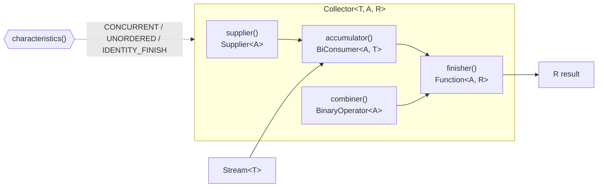
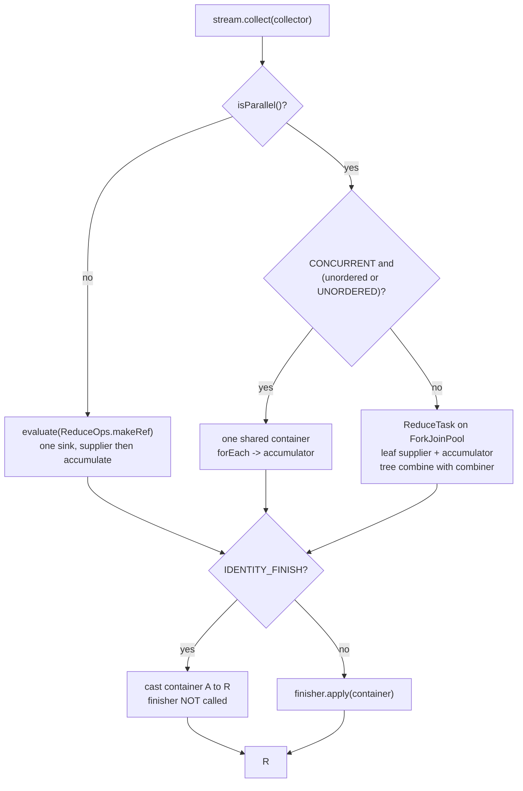
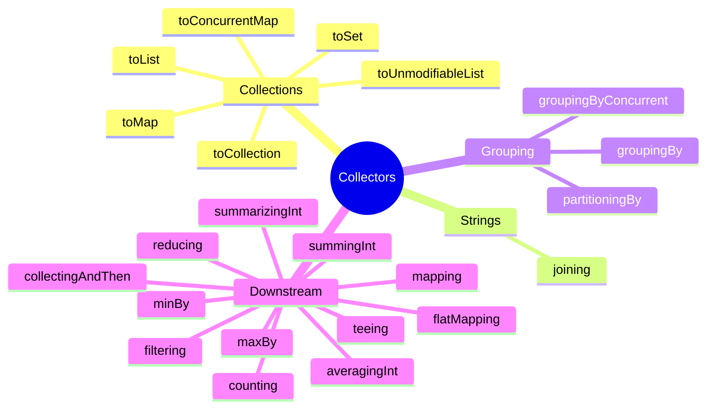
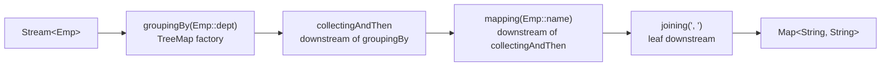

# Collectors

A `Stream` is a lazy description of a computation; a **collector** is the *terminal* object that says
how to turn the stream's elements into a final result. The mental model that unlocks every interview
question is this: **a collector is a parameterised, mutable, potentially-parallel reduction.** It is
not a function of the whole stream — it is a small bundle of four functions (create a container, put
one element in, merge two containers, finish the container) plus a bag of **characteristics** that
tell the stream engine what it may assume. The engine (`Stream.collect`) then drives those functions
— sequentially by feeding the accumulator each element, or in parallel by giving each fork/join leaf
its own container and folding the partial containers back together with the combiner.

Everything else in `java.util.stream.Collectors` is built by composing that one idea:

- `toList`, `toSet`, `toMap` are just specific supplier/accumulator/combiner triples.
- `groupingBy` is "start with a map; for each element, get or create a bucket and collect into it";
  the bucket is itself the result of a *downstream collector*, which is how nested reports work.
- `partitioningBy` is `groupingBy` with exactly two fixed boolean buckets — always both present.
- `mapping`, `filtering`, `flatMapping`, `counting`, `summingInt`, `joining`, `teeing` are all
  downstream collectors: each is a reducer meant to be nested inside another reducer.

Read this module as: *the contract* → *how `collect` drives it* → *the built-in collectors by
category* → *downstream composition* → *custom collectors* → *parallel semantics* → *performance* →
*traps*. The internals (`ReduceOps`, `CollectorImpl`, `Partition`, `CH_*` characteristic sets) are
what separate a senior answer from a junior one. For the pipeline that feeds collectors see
[Streams](13-Streams.md); for the lambdas you pass in see [Lambda Expressions](12-Lambda.md); for the
`Optional` produced by `minBy`/`maxBy` see [Optional](15-Optional.md).

> **Rule:** A collector describes *mutable reduction*: the accumulator mutates a mutable container
> (`A`, the accumulation type). `R` is the final result type; when `A == R` and no transformation is
> needed, the collector is marked `IDENTITY_FINISH` and the engine skips the finisher entirely.

---

## 1. The `Collector<T, A, R>` Contract

`java.util.stream.Collector<T, A, R>` has three type parameters and exactly five abstract methods:

| Type/name | Meaning |
|---|---|
| `T` | the type of **input elements** being collected |
| `A` | the **mutable accumulation** type (internal, usually hidden by a wildcard `?`) |
| `R` | the **final result** type returned by `collect` |

| Method | Signature | Role |
|---|---|---|
| `supplier` | `Supplier<A> supplier()` | Create a fresh, mutable result container. |
| `accumulator` | `BiConsumer<A, T> accumulator()` | Fold one element `T` into container `A`. |
| `combiner` | `BinaryOperator<A> combiner()` | Merge two partial containers `A` (parallel only, in effect). |
| `finisher` | `Function<A, R> finisher()` | Transform the final container `A` into result `R`. |
| `characteristics` | `Set<Characteristics> characteristics()` | Metadata the engine may exploit. |

### 1.1 The five methods, precisely

- **supplier** must return a *new* mutable container each call. Returning a shared/`static` container
  is the single most common broken custom collector (see §11). The engine may call it many times.
- **accumulator** must mutate only the container it is given. It must be stateless with respect to
  fields shared across invocations.
- **combiner** merges the second container into the first (or returns a merged one). It is essential
  for parallel reduction; for purely sequential streams the engine may never call it.
- **finisher** runs once at the very end, on the single accumulated container. It may return `null`
  if `R` permits, and it is allowed to return a view of the mutable container.
- **characteristics** returns an *immutable* `Set` (often `Collections.emptySet()` or one of the
  private `CH_*` constants inside `Collectors`).

### 1.2 The three characteristics

```java
public enum Characteristics {
    CONCURRENT, UNORDERED, IDENTITY_FINISH
}
```

| Characteristic | Contract | Engine consequence |
|---|---|---|
| `CONCURRENT` | The accumulator may be called on the *same* container from multiple threads. | For parallel streams, `collect` may use one shared container and call the accumulator concurrently (skipping per-thread containers and the combiner). |
| `UNORDERED` | The collection operation does not commit to preserving encounter order. | The pipeline's `ORDERED` flag is cleared (`ReduceOp.getOpFlags()` returns `StreamOpFlag.NOT_ORDERED`), enabling order-dropping optimisations. |
| `IDENTITY_FINISH` | The finisher is the identity: `A` is cast directly to `R`. | `collect` returns the container without calling `finisher`. The `finisher()` method may still be non-trivial — it is simply **ignored**. |

> **Trap:** `IDENTITY_FINISH` does not make the finisher *unnecessary code*; it makes it *dead code*.
> If you declare `IDENTITY_FINISH` but write a real transformation in the finisher, the transformation
> never runs. This is proven in §1.4.

### 1.3 Mutable reduction vs `reduce`

`Stream.reduce` is designed for **immutable** results: the accumulator returns a *new* value and the
stream never mutates anything. `Stream.collect` is designed for **mutable** results: the accumulator
mutates a container and returns `void`. The `Collector` contract models this explicitly through the
two distinct type parameters `A` (mutable container) and `R` (result).

```java
// reduce: immutable fold, returns a new value each step
int sum = Stream.of(1, 2, 3, 4).reduce(0, Integer::sum);

// collect: mutable reduction into a container
List<Integer> list = Stream.of(1, 2, 3, 4).collect(Collectors.toList());
```

Using `reduce` with a mutable identity is the classic parallel bug: every fork/join leaf shares the
same identity object and corrupts the result (see §11 and §12).

### 1.4 A first custom collector with `Collector.of`

`Collector.of` is the factory over the contract. The 5-argument overload takes
`(supplier, accumulator, combiner, finisher, characteristics...)`.

```java
import java.util.*;
import java.util.stream.*;

public class CustomUpper {
    static Collector<String, ?, String> upperJoined(String sep) {
        return Collector.of(
            StringBuilder::new,                                   // supplier   -> StringBuilder
            (sb, s) -> {                                          // accumulator
                if (sb.length() > 0) sb.append(sep);
                sb.append(s.toUpperCase());
            },
            (a, b) -> {                                           // combiner
                if (a.length() > 0 && b.length() > 0) a.append(sep);
                return a.append(b);
            },
            StringBuilder::toString,                              // finisher   -> String
            Collector.Characteristics.UNORDERED                   // characteristics
        );
    }

    public static void main(String[] args) {
        System.out.println(Stream.of("a", "b", "c").collect(upperJoined("-")));
    }
}
```

Output:

```text
A-B-C
```

Now the `IDENTITY_FINISH` trap. Suppose we build a logging collector that *claims*
`IDENTITY_FINISH` but has a non-trivial finisher:

```java
import java.util.*;
import java.util.stream.*;

public class IdentityFinishTrap {
    static <T> Collector<T, List<T>, List<T>> logging() {
        return Collector.of(
            () -> { System.out.println("supplier"); return new ArrayList<T>(); },
            (list, t) -> { System.out.println("accumulator <- " + t); list.add(t); },
            (a, b) -> { System.out.println("combiner"); a.addAll(b); return a; },
            a -> { System.out.println("finisher"); return List.copyOf(a); }, // never runs
            Collector.Characteristics.IDENTITY_FINISH
        );
    }

    public static void main(String[] args) {
        List<String> result = Stream.of("x", "y").collect(logging());
        System.out.println("result " + result.getClass().getSimpleName() + " " + result);
    }
}
```

Output:

```text
supplier
accumulator <- x
accumulator <- y
result ArrayList [x, y]
```

`finisher` is never printed: because of `IDENTITY_FINISH`, `collect` cast the `ArrayList` straight to
`List<T>` and returned the *mutable* container — the `finisher`'s `List.copyOf` was silently ignored.



---

## 2. How `collect()` Drives a Collector (Internal Working)

### 2.1 The exact dispatch in `ReferencePipeline.collect`

The reference implementation in `java.base/java/util/stream/ReferencePipeline.java` is the whole
story, and it is worth memorising:

```java
public final <R, A> R collect(Collector<? super P_OUT, A, R> collector) {
    A container;
    if (isParallel()
            && (collector.characteristics().contains(Collector.Characteristics.CONCURRENT))
            && (!isOrdered() || collector.characteristics().contains(Collector.Characteristics.UNORDERED))) {
        container = collector.supplier().get();                       // one shared container
        BiConsumer<A, ? super P_OUT> accumulator = collector.accumulator();
        forEach(u -> accumulator.accept(container, u));               // concurrent accumulate
    }
    else {
        container = evaluate(ReduceOps.makeRef(collector));           // sink-based reduction
    }
    return collector.characteristics().contains(Collector.Characteristics.IDENTITY_FINISH)
           ? (R) container                                            // finisher skipped
           : collector.finisher().apply(container);
}
```

Three facts follow immediately:

1. **The finisher is applied outside the pipeline**, exactly once, after all accumulation/combining.
2. **The "shared container" fast path** is taken only when the stream is parallel *and* the collector
   is `CONCURRENT` *and* (the stream is unordered *or* the collector is `UNORDERED`). Otherwise, even
   a `CONCURRENT` collector on an ordered stream falls back to the combiner path.
3. **`IDENTITY_FINISH` is checked only for the final cast** — it never influences how accumulation runs.

### 2.2 `ReduceOps.makeRef`: turning a collector into a sink

`evaluate(ReduceOps.makeRef(collector))` builds a `ReducingSink` that adapts the collector:

```java
public static <T, I> TerminalOp<T, I> makeRef(Collector<? super T, I, ?> collector) {
    Supplier<I> supplier = collector.supplier();
    BiConsumer<I, ? super T> accumulator = collector.accumulator();
    BinaryOperator<I> combiner = collector.combiner();
    class ReducingSink extends Box<I> implements AccumulatingSink<T, I, ReducingSink> {
        public void begin(long size)          { state = supplier.get(); }
        public void accept(T t)               { accumulator.accept(state, t); }
        public void combine(ReducingSink other){ state = combiner.apply(state, other.state); }
    }
    return new ReduceOp<T, I, ReducingSink>(StreamShape.REFERENCE) {
        public ReducingSink makeSink() { return new ReducingSink(); }
        public int getOpFlags() {
            return collector.characteristics().contains(Collector.Characteristics.UNORDERED)
                   ? StreamOpFlag.NOT_ORDERED : 0;
        }
    };
}
```

- `begin` calls **supplier** lazily, when the sink starts.
- `accept` calls **accumulator** per element.
- `combine` calls **combiner** — the merge point for parallel.

> **Internal detail:** `getOpFlags()` clears the `ORDERED` flag when the collector is `UNORDERED`.
> That is why `Collectors.toSet()` (which is `UNORDERED`) lets the engine relax ordering even in
> sequential pipelines.

### 2.3 Sequential vs parallel execution

`ReduceOp` implements the two evaluation strategies:

```java
public <P_IN> R evaluateSequential(PipelineHelper<T> helper, Spliterator<P_IN> spliterator) {
    return helper.wrapAndCopyInto(makeSink(), spliterator).get();
}
public <P_IN> R evaluateParallel(PipelineHelper<T> helper, Spliterator<P_IN> spliterator) {
    return new ReduceTask<>(this, helper, spliterator).invoke().get();
}
```

- **Sequential:** a single `ReducingSink` is pushed elements in encounter order. The combiner is not
  used.
- **Parallel:** a `ReduceTask` (a `java.util.stream.AbstractTask`, i.e. a `ForkJoinTask` on
  `ForkJoinPool.commonPool()`) recursively splits the `Spliterator` with `trySplit()`. Each **leaf**
  runs `wrapAndCopyInto(op.makeSink(), spliterator)` — so each leaf has its *own* container from the
  supplier. On completion, `onCompletion` folds `leftChild.getLocalResult()` and
  `rightChild.getLocalResult()` with `sink.combine`, which invokes the **combiner** up the tree. See
  [Fork/Join Framework](../04-Multithreading/21-ForkJoin.md) for the task mechanics.

### 2.4 The 3-argument `collect`

`Stream.collect(Supplier, BiConsumer, BiConsumer)` is the contract without the characteristics and
finisher wrapper:

```java
public final <R> R collect(Supplier<R> supplier,
                           BiConsumer<R, ? super P_OUT> accumulator,
                           BiConsumer<R, R> combiner) {
    return evaluate(ReduceOps.makeRef(supplier, accumulator, combiner));
}
```

It is `IDENTITY_FINISH` by construction and always carries the combiner path (no `CONCURRENT` fast
path). Note the combiner here is a `BiConsumer<R,R>` (mutate left), whereas the interface's
`Collector.combiner()` is a `BinaryOperator<A>` (return the merge).



---

## 3. Collecting to Collections

### 3.1 `toList`, `toSet`, `toCollection`

```java
List<String> list = stream.collect(Collectors.toList());
Set<String>   set  = stream.collect(Collectors.toSet());
Deque<String> deque = stream.collect(Collectors.toCollection(ArrayDeque::new));
```

Internals (from `Collectors.java`):

```java
public static <T> Collector<T, ?, List<T>> toList() {
    return new CollectorImpl<>(ArrayList::new, List::add,
        (left, right) -> { left.addAll(right); return left; }, CH_ID);
}
public static <T> Collector<T, ?, Set<T>> toSet() {
    return new CollectorImpl<>(HashSet::new, Set::add,
        (left, right) -> { if (left.size() < right.size()) { right.addAll(left); return right; }
                           else { left.addAll(right); return left; } }, CH_UNORDERED_ID);
}
public static <T, C extends Collection<T>> Collector<T, ?, C> toCollection(Supplier<C> f) {
    return new CollectorImpl<>(f, Collection::add,
        (r1, r2) -> { r1.addAll(r2); return r1; }, CH_ID);
}
```

- `toList` returns an `ArrayList` (reference implementation; the contract only promises "a `List`").
- `toSet` returns a `HashSet` and is `UNORDERED` — encounter order is lost.
- `toCollection` is the escape hatch: choose `TreeSet` (sorted), `LinkedHashSet` (insertion order),
  `ArrayDeque` (queue), `CopyOnWriteArrayList`, or a **pre-sized** `ArrayList` for performance.

Ordering of `toList` is guaranteed even in parallel, because the combiner preserves left-to-right
order. Verified:

```java
List<Integer> ordered = IntStream.range(0, 20).boxed().parallel()
    .collect(Collectors.toList());
System.out.println(ordered);
```

```text
[0, 1, 2, 3, 4, 5, 6, 7, 8, 9, 10, 11, 12, 13, 14, 15, 16, 17, 18, 19]
```

> **Mutability note:** on Java 21 `Collectors.toList()` still returns a mutable `ArrayList`
> (`stream.toList()` and `Collectors.toUnmodifiableList()` return immutable lists). Do not encode a
> *dependency* on `Collectors.toList()`'s mutability — it is explicitly unspecified.

### 3.2 `toMap` and its pitfalls

Four overloads: `(keyMapper, valueMapper)`, `(keyMapper, valueMapper, merge)`,
`(keyMapper, valueMapper, merge, mapFactory)`. The 2-argument form uses a "unique keys" accumulator
that throws on duplicates and rejects null values; the merge forms use `Map.merge`.

```java
record Person(String name, int age) {}
List<Person> people = List.of(
    new Person("Alice", 30), new Person("Bob", 25), new Person("Alice", 40));

// throws: duplicate key
people.stream().collect(Collectors.toMap(Person::name, Person::age));
```

Output of the caught exception:

```text
IllegalStateException -> Duplicate key Alice (attempted merging values 30 and 40)
```

Provide a merge function — the third argument is a `BinaryOperator<U>`:

```java
Map<String, Integer> merged = people.stream()
    .collect(Collectors.toMap(Person::name, Person::age, Integer::sum));
System.out.println(new TreeMap<>(merged));
```

```text
{Alice=70, Bob=25}
```

Null **values** throw `NullPointerException` (the 2-arg path calls `Objects.requireNonNull(value)`;
the merge path relies on `HashMap.merge`, which throws `NPE` on a null value):

```java
Map<String, String> base = new HashMap<>();
base.put("a", null);
base.entrySet().stream()
    .collect(Collectors.toMap(Map.Entry::getKey, Map.Entry::getValue)); // NPE
```

Null **keys** are *allowed* for the default `HashMap` (but not for `TreeMap` or the unmodifiable
maps):

```java
Map<String, Integer> m = Stream.of("x")
    .collect(Collectors.toMap(s -> (String) null, String::length));
System.out.println(m);   // {null=1}
```

Choose the implementation and pre-size it with the 4-arg form:

```java
TreeMap<String, Integer> tm = people.stream().collect(
    Collectors.toMap(Person::name, Person::age, Integer::sum,
                     () -> new TreeMap<>()));
```

### 3.3 Unmodifiable collectors (Java 10+)

`toUnmodifiableList`, `toUnmodifiableSet`, `toUnmodifiableMap` (2- and 3-arg) build an intermediate
mutable container and then freeze it in the finisher. In JDK 21 the list finisher uses
`SharedSecrets.getJavaUtilCollectionAccess().listFromTrustedArray(...)` returning an
`ImmutableCollections.ListN`/`List12`; the map finisher builds `Map.ofEntries(...)`.

```java
List<String> immutable = Stream.of("a", "b").collect(Collectors.toUnmodifiableList());
immutable.add("c");   // UnsupportedOperationException
```

Because `toUnmodifiableMap` finishes with `Map.ofEntries` (not just `Collections.unmodifiableMap`),
it rejects **both** null keys and null values, and its duplicate-key message is the same
`throwingMerger` text:

```text
toUnmodifiableMap null key:  NullPointerException        (message is null, from Map.ofEntries)
toUnmodifiableMap duplicate: IllegalStateException: Duplicate key a (attempted merging values 1 and 1)
```

Nulls in `toUnmodifiableList`/`Set` also throw `NPE`:

```java
Stream.of("a", null, "c").collect(Collectors.toUnmodifiableList()); // NPE
```

### 3.4 `toConcurrentMap`

`toConcurrentMap` produces a `ConcurrentHashMap` and is `CONCURRENT` + `UNORDERED` +
`IDENTITY_FINISH`, so a parallel stream uses **one shared map** with no combiner merging:

```java
ConcurrentMap<String, Integer> cm = people.stream().collect(
    Collectors.toConcurrentMap(Person::name, Person::age, Integer::sum));
System.out.println(cm.getClass().getSimpleName());  // ConcurrentHashMap
```

### 3.5 Collection collector comparison

| Collector | Result type (JDK impl) | Mutable? | Characteristics | Null elements |
|---|---|---|---|---|
| `toList` | `ArrayList` | yes | `IDENTITY_FINISH` | allowed |
| `toSet` | `HashSet` | yes | `UNORDERED`, `IDENTITY_FINISH` | allowed (one null) |
| `toCollection` | caller-supplied | usually yes | `IDENTITY_FINISH` | implementation-dependent |
| `toUnmodifiableList` | `ImmutableCollections.ListN` | no | none | **rejected (NPE)** |
| `toUnmodifiableSet` | `ImmutableCollections.SetN` | no | `UNORDERED` | **rejected (NPE)** |
| `toMap` | `HashMap` (or factory) | yes | `IDENTITY_FINISH` | null key allowed / null value rejected |
| `toUnmodifiableMap` | `ImmutableCollections.MapN` | no | none | **rejected (NPE)** |
| `toConcurrentMap` | `ConcurrentHashMap` | yes | `CONCURRENT`, `UNORDERED`, `IDENTITY_FINISH` | null key/value rejected |

---

## 4. `joining`

`joining` is the string collector. There are three overloads and every one returns a `String` with
characteristics `[]` (none) — it has a real finisher (`StringJoiner::toString`).

| Overload | Effect |
|---|---|
| `joining()` | concatenate with no separator |
| `joining(CharSequence delimiter)` | separator only |
| `joining(CharSequence delimiter, CharSequence prefix, CharSequence suffix)` | wrapped |

```java
List<String> words = List.of("alpha", "beta", "gamma");
System.out.println("[" + words.stream().collect(Collectors.joining()) + "]");
System.out.println(words.stream().collect(Collectors.joining(", ")));
System.out.println(words.stream().collect(Collectors.joining(", ", "[", "]")));
System.out.println(Stream.<String>empty().collect(Collectors.joining(", ", "[", "]")));
```

```text
[alphabetagamma]
alpha, beta, gamma
[alpha, beta, gamma]
[]
```

Internally the accumulator does `joiner.add(CharSequences.toString(element))` on a `StringJoiner`;
the combiner calls `joiner.merge(other)`; `null` elements are rendered as the literal text `null`
(because of `StringJoiner.add`). `joining` pair perfectly with `mapping` as a downstream collector:

```java
record Item(String name, String cat) {}
List<Item> items = List.of(new Item("Apple", "Fruit"),
                           new Item("Carrot", "Veg"),
                           new Item("Banana", "Fruit"));
String report = items.stream().collect(
    Collectors.groupingBy(Item::cat, TreeMap::new,
        Collectors.mapping(Item::name, Collectors.joining("+")))).toString();
System.out.println(report);
```

```text
{Fruit=Apple+Banana, Veg=Carrot}
```

---

## 5. Grouping and Partitioning

### 5.1 `groupingBy` (three overloads)

| Overload | Default map | Default downstream |
|---|---|---|
| `groupingBy(classifier)` | `HashMap` | `toList()` |
| `groupingBy(classifier, downstream)` | `HashMap` | caller-supplied |
| `groupingBy(classifier, mapFactory, downstream)` | caller-supplied | caller-supplied |

The core implementation (JDK 21):

```java
BiConsumer<Map<K, A>, T> accumulator = (m, t) -> {
    K key = Objects.requireNonNull(classifier.apply(t), "element cannot be mapped to a null key");
    A container = m.computeIfAbsent(key, k -> downstreamSupplier.get());
    downstreamAccumulator.accept(container, t);
};
```

Three consequences:

1. **The default map is `HashMap`**, so key ordering is unspecified. Pass `TreeMap::new` for sorted
   keys or `LinkedHashMap::new` for encounter order via the 3-arg form.
2. **A null classifier result throws `NPE`** with the exact message
   `element cannot be mapped to a null key` — because of the explicit `Objects.requireNonNull`.
3. **The downstream is `toList()` by default**, so values are mutable `ArrayList`s.

```java
record Employee(String dept, String name, int salary) {}
List<Employee> emps = List.of(
    new Employee("Eng", "Alice", 100),
    new Employee("Eng", "Bob", 120),
    new Employee("Sales", "Carol", 90),
    new Employee("Eng", "Dave", 110));

Map<String, List<Employee>> byDept = emps.stream()
    .collect(Collectors.groupingBy(Employee::dept));
System.out.println(byDept.getClass().getSimpleName());        // HashMap
System.out.println(new TreeSet<>(byDept.keySet()));           // [Eng, Sales]

Map<String, Long> counts = emps.stream()
    .collect(Collectors.groupingBy(Employee::dept, Collectors.counting()));
System.out.println(new TreeMap<>(counts));                    // {Eng=3, Sales=1}
```

### 5.2 `partitioningBy`

`partitioningBy(predicate)` and `partitioningBy(predicate, downstream)` return a special
`Map<Boolean, ?>` implemented by the private `Collectors$Partition`. Its `size()` is *always* 2 and
`isEmpty()` is *always* false, because the supplier pre-creates both `forTrue` and `forFalse`
containers via the downstream supplier:

```java
Supplier<Partition<A>> supplier = () ->
        new Partition<>(downstream.supplier().get(), downstream.supplier().get());
```

```java
Map<Boolean, Long> part = emps.stream()
    .collect(Collectors.partitioningBy(e -> e.salary() >= 100, Collectors.counting()));
System.out.println(part);   // {false=1, true=3}

Map<Boolean, List<Integer>> empty = Stream.<Integer>empty()
    .collect(Collectors.partitioningBy(i -> i > 0));
System.out.println(empty.getClass().getName());  // java.util.stream.Collectors$Partition
System.out.println(empty);                        // {false=[], true=[]}
```

Key facts interviewers probe:

- Both keys **always** exist, even for an empty stream.
- `size()` is always `2`; `isEmpty()` is always `false`; `get(key)` returns `null` for a non-Boolean
  key.
- The result is *not* a `HashMap` — it is the two-field `Partition` map.

### 5.3 Contrast with SQL `GROUP BY`

| Aspect | SQL `GROUP BY` | `groupingBy` | `partitioningBy` |
|---|---|---|---|
| Keys | arbitrary column values | arbitrary classifier (`K`) | only `Boolean` |
| Missing groups | absent | absent | **always both present** |
| Aggregates | SQL functions (`COUNT`, `SUM`, `AVG`) | downstream collectors | downstream collectors |
| Ordering | usually unspecified | unspecified (`HashMap`) | fixed two entries |
| Null keys | grouped as a `NULL` group | **`NPE`** (explicit null check) | n/a |

`groupingBy(path, counting())` with a `TreeMap` is the closest mental analogue to
`SELECT path, COUNT(*) FROM t GROUP BY path ORDER BY path`.

### 5.4 Nested grouping

The downstream of a `groupingBy` can itself be a `groupingBy`, yielding a two-level map. Each level
applies `computeIfAbsent` independently:

```java
Map<String, Map<String, List<Employee>>> nested = emps.stream().collect(
    Collectors.groupingBy(Employee::dept,
        Collectors.groupingBy(e -> e.salary() >= 100 ? "high" : "low")));
System.out.println(new TreeMap<>(nested).get("Eng").keySet());  // [high] (with the data above)
```

Add a `mapFactory` to each level to control ordering, and a terminal downstream such as
`counting`, `mapping`, or `summingInt` to shape the leaf.



---

## 6. Numerical, Statistical, and Reducing Collectors

Every collector here is a downstream reducer. Return types matter: `averagingInt` returns `Double`,
`counting` returns `Long`, and `minBy`/`maxBy` return `Optional<T>`.

| Collector | Return type | Empty-stream result | Characteristics |
|---|---|---|---|
| `counting` | `Long` | `0` | none |
| `summingInt` | `Integer` | `0` | none |
| `summingLong` | `Long` | `0` | none |
| `summingDouble` | `Double` | `0.0` | none |
| `averagingInt/Long/Double` | `Double` | `0.0` | none |
| `summarizingInt` | `IntSummaryStatistics` | zeros | none |
| `summarizingLong` | `LongSummaryStatistics` | zeros | none |
| `summarizingDouble` | `DoubleSummaryStatistics` | zeros | none |
| `reducing` | depends on form | identity / `Optional` | none |
| `minBy` / `maxBy` | `Optional<T>` | `Optional.empty()` | none |
| `mapping` | downstream's `R` | downstream-dependent | mirrors downstream exactly |
| `flatMapping` | downstream's `R` | downstream-dependent | mirrors downstream exactly |
| `filtering` | downstream's `R` | downstream-dependent | mirrors downstream exactly |
| `collectingAndThen` | `RR` | `after.apply(...)` | downstream minus `IDENTITY_FINISH` |
| `teeing` | merger result `R` | merger of both empty results | intersection of both (minus `IDENTITY_FINISH`) |

```java
List<Integer> nums = List.of(1, 2, 3, 4, 5);
System.out.println(nums.stream().collect(Collectors.counting()));            // 5
System.out.println(nums.stream().collect(Collectors.summingInt(Integer::intValue)));   // 15
System.out.println(Stream.<Integer>empty().collect(Collectors.averagingInt(Integer::intValue))); // 0.0
System.out.println(nums.stream().collect(Collectors.summarizingInt(Integer::intValue)));
```

```text
5
15
0.0
IntSummaryStatistics{count=5, sum=15, min=1, average=3.000000, max=5}
```

`reducing` has three forms: `reducing(op)` (returns `Optional`), `reducing(identity, op)`, and
`reducing(identity, mapper, op)`:

```java
System.out.println(nums.stream().collect(Collectors.reducing(0, Integer::sum)));          // 15
System.out.println(nums.stream().collect(
    Collectors.reducing(0, Integer::intValue, Integer::sum)));                            // 15
System.out.println(nums.stream().collect(Collectors.minBy(Integer::compareTo)));          // Optional[1]
System.out.println(Stream.<Integer>empty().collect(Collectors.minBy(Integer::compareTo))); // Optional.empty
```

> **`summingInt` overflow:** `summingInt` returns `int` and wraps on overflow. `2^31 - 1 + 1`
> silently becomes `Integer.MIN_VALUE`. Use `summingLong` when the sum can exceed `int` range.

```java
List<Integer> big = List.of(Integer.MAX_VALUE, 1);
System.out.println(big.stream().collect(Collectors.summingInt(Integer::intValue))); // -2147483648
System.out.println(big.stream().collect(Collectors.summingLong(Integer::longValue))); // 2147483648
```

`summingDouble` accumulates IEEE-754 rounding: `Stream.of(0.1, 0.2).collect(summingDouble(...))`
prints `0.30000000000000004`. For exact decimal sums use `BigDecimal` with a `reducing` collector.

---

## 7. Downstream Composition and Multi-Level Reports

The mental model: **every collector is a reducer, and any collector that does not produce the final
answer can be nested as another collector's downstream.** This is the entire power of `Collectors`.

### 7.1 `mapping`, `flatMapping`, `filtering`

`mapping` transforms each element *before* the downstream sees it: it is the collector analogue of
`Stream.map`, and is essential inside `groupingBy` where you can no longer call `stream().map(...)`.

```java
List<List<Integer>> lists = List.of(List.of(1, 2), List.of(3, 4));
System.out.println(nums.stream().collect(
    Collectors.mapping(Object::toString, Collectors.joining(","))));  // 1,2,3,4,5
System.out.println(nums.stream().collect(
    Collectors.filtering(n -> n % 2 == 0, Collectors.toList())));     // [2, 4]
System.out.println(lists.stream().collect(
    Collectors.flatMapping(List::stream, Collectors.toList())));      // [1, 2, 3, 4]
```

`flatMapping` and `filtering` were added in **Java 9** precisely because `groupingBy` hides the
stream: you cannot `filter`/`flatMap` a bucket without a downstream operator. `filtering` simply
guards the downstream accumulator with the predicate; `flatMapping` opens the mapped `Stream` in a
`try`-with-resources, calls `result.sequential().forEach(u -> downstreamAccumulator.accept(r, u))`,
and closes it — so the inner stream is always closed even on exception.

### 7.2 `collectingAndThen`

`collectingAndThen(downstream, finisher)` appends a finishing function. It is the pre-Java-10 idiom
for immutable results and is how you adapt any collector without writing one:

```java
List<Integer> unmod = nums.stream().collect(
    Collectors.collectingAndThen(Collectors.toList(), List::copyOf));
System.out.println(unmod.getClass().getSimpleName());   // ListN
```

### 7.3 `teeing` (Java 12)

`teeing(c1, c2, merger)` runs **two collectors in a single pass** over the same elements, using an
internal `PairBox` holding both accumulation containers, then applies the merger to both finished
results:

```java
String tee = nums.stream().collect(Collectors.teeing(
    Collectors.summingInt(Integer::intValue),   // R1 = Integer
    Collectors.counting(),                       // R2 = Long
    (sum, count) -> sum + "/" + count));         // R  = String
System.out.println(tee);   // 15/5
```

`teeing` is exactly the "average without two passes" idiom:
`teeing(summingDouble(x), counting(), (s, c) -> s / c)`. Its characteristics are the intersection of
both downstreams minus `IDENTITY_FINISH`, so it virtually always has a finisher of its own.

### 7.4 A multi-level report

`group by X → map to Y → join`, with `collectingAndThen` to post-process each bucket:

```java
record Emp(String dept, String name, int sal) {}
List<Emp> emps = List.of(new Emp("Eng", "Al", 100),
                         new Emp("Eng", "Bo", 200),
                         new Emp("Sales", "Ca", 150));
Map<String, String> report = emps.stream().collect(
    Collectors.groupingBy(Emp::dept, TreeMap::new,
        Collectors.collectingAndThen(
            Collectors.mapping(Emp::name, Collectors.joining(", ")),
            String::toUpperCase)));
System.out.println(report);
```

```text
{Eng=AL, BO, Sales=CA}
```

The nesting is literal: `groupingBy` → `collectingAndThen` → `mapping` → `joining`. Reading such a
pipeline from the outside in tells you how each bucket is built.



---

## 8. Custom Collectors

Write a custom collector when the reduction cannot be expressed by composing built-ins without
buffering the whole stream. The canonical example is **Top-N**: built-ins force you to materialise
every element (`toList`, then sort, then truncate), whereas a bounded min-heap keeps only `N` elements
and answers in `O(M log N)`.

```java
import java.util.*;
import java.util.stream.*;

public class TopN {
    static <T> Collector<T, PriorityQueue<T>, List<T>> topN(int n, Comparator<? super T> cmp) {
        return Collector.of(
            () -> new PriorityQueue<>(Math.max(1, n), cmp),          // min-heap of size n
            (heap, t) -> {                                            // accumulator
                if (heap.size() < n) heap.offer(t);
                else if (cmp.compare(t, heap.peek()) > 0) { heap.poll(); heap.offer(t); }
            },
            (a, b) -> {                                               // combiner
                for (T t : b) {
                    if (a.size() < n) a.offer(t);
                    else if (cmp.compare(t, a.peek()) > 0) { a.poll(); a.offer(t); }
                }
                return a;
            },
            heap -> { List<T> out = new ArrayList<>(heap); out.sort(cmp.reversed()); return out; }
        );
    }

    public static void main(String[] args) {
        List<Integer> nums = List.of(5, 1, 9, 3, 7, 2, 8, 6, 4, 0);
        System.out.println(nums.stream().collect(topN(3, Comparator.naturalOrder())));
        System.out.println(nums.parallelStream().collect(topN(3, Comparator.naturalOrder())));
    }
}
```

Output (both lines; the combiner makes the parallel result correct):

```text
[9, 8, 7]
[9, 8, 7]
```

### 8.1 `Collector.of` vs implementing the interface

`Collector.of` is preferable in almost all cases. Implement `Collector<T,A,R>` directly only when you
need a named type, javadoc, or to share the collector:

```java
final class PairToMap implements Collector<Pair, Map<String, Integer>, Map<String, Integer>> {
    public Supplier<Map<String, Integer>> supplier() { return HashMap::new; }
    public BiConsumer<Map<String, Integer>, Pair> accumulator() {
        return (m, p) -> m.merge(p.k, p.v, Integer::sum);
    }
    public BinaryOperator<Map<String, Integer>> combiner() {
        return (a, b) -> { b.forEach((k, v) -> a.merge(k, v, Integer::sum)); return a; };
    }
    public Function<Map<String, Integer>, Map<String, Integer>> finisher() {
        return Collections::unmodifiableMap;
    }
    public Set<Characteristics> characteristics() { return Collections.emptySet(); }
}
```

### 8.2 Rules for a correct custom collector

> 1. `supplier` returns a **fresh** mutable container every call.
> 2. `accumulator` mutates only its argument; it is pure apart from that.
> 3. `combiner` is **associative** — the engine may combine leaves in any tree shape.
> 4. Declare `IDENTITY_FINISH` **only** if the finisher really is the identity.
> 5. Declare `CONCURRENT` **only** if the accumulator is safe on a shared container.
> 6. Declare `UNORDERED` only if order does not matter.

`Collector.of` shapes two of these at construction. The overload **without** a finisher always adds
`IDENTITY_FINISH` and installs `castingIdentity()` as the finisher. The overload **with** a finisher
keeps your function but still records whatever characteristics you passed, so a stray
`IDENTITY_FINISH` makes `collect` skip that function entirely (see §1.4). Note also that `collect`
decides the `CONCURRENT` fast path at run time against the collector's characteristics and the
stream's order — the factory does not rewrite the characteristic set for that decision.

---

## 9. Parallel Collection Semantics

### 9.1 Why `groupingBy` is not `CONCURRENT`

`groupingBy`'s downstream buckets are plain mutable lists/maps. If the accumulator ran concurrently on
a shared `HashMap`, two threads could mutate the same bucket's `ArrayList` and corrupt it. Therefore
`groupingBy` deliberately declares only `IDENTITY_FINISH` (not `CONCURRENT`), so parallel streams use
**per-leaf maps** and merge them with `mapMerger`, which merges each bucket using the downstream's
combiner:

```java
BinaryOperator<Map<K, A>> merger = Collectors.<K, A, Map<K, A>>mapMerger(downstream.combiner());
```

If you *want* concurrency use `groupingByConcurrent`, which is `CONCURRENT` + `UNORDERED` and builds a
`ConcurrentHashMap`. Its downstream must then tolerate concurrent accumulation (e.g. `toConcurrentMap`
or `counting`), not a shared `ArrayList`.

### 9.2 `toConcurrentMap` vs `toMap` in parallel

`toConcurrentMap`'s `[CONCURRENT, UNORDERED, IDENTITY_FINISH]` characteristics trigger the shared
container fast path in `collect`: one `ConcurrentHashMap`, accumulator applied concurrently, no
combiner. `toMap` must merge partial maps tree-wise, which is more expensive:

```text
toConcurrentMap type: ConcurrentHashMap
```

### 9.3 Ordering

- `toList` preserves encounter order in parallel (combiner concatenates left then right).
- `toSet`/`toConcurrentMap`/`groupingByConcurrent` are `UNORDERED`; the `NOT_ORDERED` op flag lets the
  engine use `forEach` and drop ordering.
- `groupingBy` preserves the *relative* order within each bucket because buckets are appended
  left-to-right during combining, even though the map key set is unordered.

### 9.4 The combiner is only for parallel

The combiner is never invoked for a sequential stream. It *can* be invoked any number of times in
parallel, governed by how `trySplit` partitions the source. An instrumented collector on
`IntStream.range(0, 8).parallel()` shows a tree of merges whose shape and count vary by run:

```text
par supplier          (one per leaf)
...
par combiner [0, 1] + [2, 3]
par combiner [0, 1, 2, 3] + [4, 5, 6, 7]
parallel combiners invoked: 7 result size: 8   // count is not part of the contract
```

> **Never** rely on how many times `supplier`/`combiner` run, or on which thread runs them.

---

## 10. Performance

Collectors are convenient but not free. The costs, and how to avoid them:

| Cost | Where it comes from | Mitigation |
|---|---|---|
| **Boxing** | `Stream<Integer>` and `summingInt` box ints; `counting` boxes a `Long` per step | Use primitive streams (`IntStream.sum()`, `average()`) for numeric aggregates |
| **`toMap` growing** | default `HashMap::new` starts small and rehashes | Pass `() -> new HashMap<>(expectedSize / 0.75f + 1)` as the `mapFactory` |
| **Downstream allocation** | `groupingBy` allocates one `ArrayList` (or map) per distinct key via `computeIfAbsent` | Use `counting`/`summing`/`joining` (no per-element list) when you do not need the elements |
| **Pipeline overhead** | lambdas, sink indirection, `Spliterator` boxing | For hot loops a hand-written `for` loop can be several times faster and allocation-free |
| **`teeing` cost** | one `PairBox` plus two containers, two accumulator calls per element | Still cheaper than two separate passes; use it for average/variance in one pass |
| **Parallel overhead** | splitting, per-leaf containers, combiner merges, common-pool contention | Only parallelise large, CPU-bound, splittable sources; avoid `groupingBy` merges for tiny data |
| **`Collectors.toList()` type uncertainty** | no guarantee of `ArrayList` | Use `toCollection(ArrayList::new)` when the concrete type matters |

Rules of thumb:

- Prefer the **most specific collector** (e.g. `counting` over `mapping(x -> 1, summingInt(...))`).
- Collectors beat manual loops on **parallel** streams and **readability**; manual loops win on
  **single-threaded hot paths** and when you need to break out early (collectors cannot short-circuit).
- `groupingBy` with a `TreeMap` is `O(n log k)`; with a `HashMap` it is `O(n)`.
- `toConcurrentMap`/`groupingByConcurrent` avoid the combiner tree but pay contention on the shared
  map; at high core counts on large data they win, on small data they can lose.

---

## 11. Common Mistakes and Pitfalls

### 11.1 `toMap` duplicate keys

```java
// WRONG: throws IllegalStateException on the second "Alice"
Collectors.toMap(Person::name, Person::age);
// RIGHT: supply a merge function (and/or a map factory)
Collectors.toMap(Person::name, Person::age, Integer::sum);
```

### 11.2 `groupingBy` with a null classifier result

```java
// WRONG: NullPointerException: element cannot be mapped to a null key
Collectors.groupingBy(s -> s.region());   // region() may return null
// RIGHT: normalise the key
Collectors.groupingBy(s -> s.region() == null ? "UNKNOWN" : s.region());
```

A `TreeMap` factory also throws `NPE` on a null key even though `HashMap` would accept it.

### 11.3 Assuming `toList`'s result is mutable/immutable

```java
List<String> a = stream.collect(Collectors.toList());       // mutable ArrayList today...
List<String> b = stream.toList();                            // immutable since Java 16
List<String> c = stream.collect(Collectors.toUnmodifiableList()); // immutable, rejects null
// WRONG: rely on mutability of Collectors.toList() — unspecified
// RIGHT: materialise explicitly when you need to mutate
new ArrayList<>(stream.collect(Collectors.toList()));
```

### 11.4 Reusing a shared container (broken `supplier`)

```java
// WRONG: the supplier returns the SAME list every time -> contamination across collects
List<String> shared = new ArrayList<>();
Collector<String, List<String>, List<String>> broken = Collector.of(
    () -> shared, List::add, (a, b) -> { a.addAll(b); return a; });
Stream.of("a").collect(broken);   // [a]
Stream.of("b").collect(broken);   // [a, b]  <- leaked from the first collect
```

Reusing a *correct* collector object is fine (built-ins are stateless); reusing its *container* is
not.

### 11.5 Forgetting `mapping` inside `groupingBy`

```java
// WRONG: groups of Employee, not names
Map<String, List<Employee>> byDept = emps.stream()
    .collect(Collectors.groupingBy(Employee::dept));
// RIGHT: transform before the downstream collector sees the element
Map<String, List<String>> names = emps.stream().collect(
    Collectors.groupingBy(Employee::dept, Collectors.mapping(Employee::name, Collectors.toList())));
```

You cannot call `.map(...)` on a bucket — there is no stream there. Use the `mapping` downstream.

### 11.6 `partitioningBy` on a non-boolean

`partitioningBy` takes a `Predicate<T>` and only ever yields two keys. If you need more than two
groups, that is `groupingBy`, not `partitioningBy`. Also do not assume the map is a `HashMap`; it is
the two-entry `Partition` with `size() == 2` always.

### 11.7 `summingInt` overflow

```java
List<Integer> big = List.of(Integer.MAX_VALUE, 1);
big.stream().collect(Collectors.summingInt(Integer::intValue));   // -2147483648 (wrapped!)
big.stream().collect(Collectors.summingLong(Integer::longValue)); // 2147483648
```

### 11.8 More pitfalls

| Mistake | Symptom | Fix |
|---|---|---|
| `toUnmodifiableMap` with a null value/key | `NPE` from `Map.ofEntries` | filter/validate, or use `toMap` + `Collections.unmodifiableMap` |
| `toMap` with a null value | `NPE` from `requireNonNull`/`HashMap.merge` | map to a sentinel or filter |
| `reduce` with a mutable identity in parallel | corrupted/duplicated result | use `collect` |
| Declaring `IDENTITY_FINISH` with a real finisher | transformation silently skipped | remove the characteristic |
| Relying on `groupingBy` map ordering | flaky key order | pass `TreeMap::new` / `LinkedHashMap::new` |
| `minBy`/`maxBy` used without unwrapping | `Optional` leaking into the result | `orElse`/`orElseThrow`, or `collectingAndThen` |
| Many intermediate maps/lists in a pipeline | memory pressure | use `teeing`, primitive streams, or a single collector |

---

## 12. Comparison Tables

### 12.1 `toList` vs `toSet` vs `toMap`

| Axis | `toList` | `toSet` | `toMap` |
|---|---|---|---|
| Result | `List<T>` | `Set<T>` | `Map<K,V>` |
| Duplicates | kept | dropped | key collision handled by merge / throws |
| Order | encounter order | unordered | map-dependent |
| Null | allowed | one null allowed | key ok on `HashMap`; value rejected |
| Characteristics | `IDENTITY_FINISH` | `UNORDERED`, `IDENTITY_FINISH` | `IDENTITY_FINISH` |
| Need more | `toCollection` | `toCollection(TreeSet::new)` | 4-arg `toMap` factory |

### 12.2 `groupingBy` vs `partitioningBy`

| Axis | `groupingBy` | `partitioningBy` |
|---|---|---|
| Classifier | any `Function<T,K>` | `Predicate<T>` only |
| Result map | `HashMap` (default) | `Collectors$Partition` |
| Keys | as many as distinct classifier outputs | exactly `false` and `true` |
| Empty stream | empty map | map with two empty downstream values |
| Null key | `NPE` (explicit null check) | n/a |
| Concurrent variant | `groupingByConcurrent` | none |
| Downstream | `toList()` default | `toList()` default |

### 12.3 `reduce` vs `collect`

| Axis | `Stream.reduce` | `Stream.collect` |
|---|---|---|
| Result style | immutable value | mutable container then finish |
| Type params | one (`T` or `R`) | three (`T`, `A`, `R`) |
| Per-step alloc | often a new value per element | reuse one mutable container |
| Parallel correctness | requires associative, side-effect-free fn | combiner merges containers |
| Purpose | sums, products, min/max, string concat | lists, sets, maps, reports |
| Identity hazards | mutable identity shared across leaves | supplier isolates containers |
| Short-circuits? | `findAny`/`anyMatch` only | never |

---

## 13. Best Practices

> - Prefer the **most specific** built-in over composing general ones; it is clearer and usually faster.
> - Always provide a **merge function** to `toMap` unless duplicates are impossible.
> - Choose the **map factory** deliberately: `LinkedHashMap` for encounter order, `TreeMap` for sorted.
> - Prefer `toUnmodifiable*` (Java 10+) or `collectingAndThen(..., List::copyOf)` for immutable results.
> - Use `mapping`/`filtering`/`flatMapping` **inside** grouping instead of trying to re-stream buckets.
> - Use `teeing` for one-pass pairs (average, min+max, sum+count) instead of two passes.
> - Keep custom collectors **stateless** and mark characteristics honestly; `IDENTITY_FINISH` implies
>   the finisher is dead code.
> - Never mutate a container returned by a collector unless the API documents mutability; do not assume
>   `Collectors.toList()`'s concrete type.
> - For parallel throughput on maps, prefer `toConcurrentMap`/`groupingByConcurrent` when order is not
>   required.
> - When a collector pipeline is on a hot path and boxing/short-circuiting matters, benchmark against a
>   plain loop before committing.

---

# Interview Questions

## Beginner

**Q1. What is a `Collector` in one sentence?**
**A:** A `Collector<T, A, R>` is a strategy for *mutable reduction* of a stream: it supplies a mutable
accumulation container `A`, accumulates elements `T` into it, combines containers for parallel work,
and finishes into a result `R`, plus a set of `Characteristics` the engine may use. It is the object
that gives the terminal `collect` operation its behaviour.

**Q2. What do `T`, `A`, and `R` mean?**
**A:** `T` is the input element type, `A` is the internal mutable accumulation type (often hidden by
`?` in return signatures), and `R` is the final result type. E.g. `Collectors.toList()` is
`Collector<T, ?, List<T>>`: it accumulates into an `ArrayList` (`A = ArrayList<T>`) and returns a
`List<T>` (`R = List<T>`), with `IDENTITY_FINISH` collapsing `A` into `R`.

**Q3. Name the collector categories and a method for each.**
**A:** To collections (`toList`, `toSet`, `toMap`, `toCollection`), to strings (`joining`), grouping
(`groupingBy`, `partitioningBy`, `groupingByConcurrent`), numeric/statistical (`counting`,
`summingInt`, `averagingInt`, `summarizingInt`, `reducing`, `minBy`, `maxBy`), and downstream
combinators (`mapping`, `flatMapping`, `filtering`, `collectingAndThen`, `teeing`).

**Q4. What is the simplest way to collect a stream into a list?**
**A:** `stream.collect(Collectors.toList())` (mutable `ArrayList` in the JDK implementation) or
`stream.toList()` (immutable, since Java 16). If you need a specific list type,
`stream.collect(Collectors.toCollection(ArrayList::new))`.

**Q5. How do you collect into a `Map`?**
**A:** `Collectors.toMap(keyMapper, valueMapper)`. If keys can collide, add a merge function
(`toMap(k, v, Integer::sum)`); to control the map type add a `Supplier`
(`toMap(k, v, Integer::sum, TreeMap::new)`).

**Q6. What is the difference between `reduce` and `collect`?**
**A:** `reduce` folds immutable values (each step returns a new value); `collect` performs mutable
reduction into a container. `collect` is the right tool for lists, sets, maps, and reports, and is
parallel-safe because each leaf gets its own container via the supplier.

**Q7. What does `joining` do?**
**A:** Concatenates elements into a `String`, with optional delimiter/prefix/suffix:
`Collectors.joining(", ", "[", "]")`. It returns characteristics `[]` because it has a real finisher
(`StringJoiner::toString`).

**Q8. What does `groupingBy` return?**
**A:** A `Collector<T, ?, Map<K, List<T>>>` by default — a `HashMap` keyed by the classifier, with
each value a `List` of the elements in that group. Add a downstream to change the value type (e.g.
`counting()` gives `Map<K, Long>`).

**Q9. What is `counting` used for?**
**A:** It is a downstream collector that counts elements, returning a `Long`. It is most often nested:
`groupingBy(classifier, counting())` produces group sizes. It avoids materialising the elements.

**Q10. What is `partitioningBy`?**
**A:** A grouping into exactly two buckets by a `Predicate`, returning a special two-entry map with
boolean keys. Both keys always exist, even for an empty stream.

## Intermediate

**Q11. What are the three `Collector.Characteristics` and what do they mean?**
**A:** `CONCURRENT` — the accumulator is safe to run on a shared container from multiple threads;
`UNORDERED` — the operation does not preserve encounter order; `IDENTITY_FINISH` — the finisher is
the identity, so `A` is cast to `R` and the finisher is skipped. They are hints the engine uses, not
cosmetic labels.

**Q12. When does `collect` take the shared-container fast path?**
**A:** Only when the stream is parallel **and** the collector is `CONCURRENT` **and** the stream is
unordered **or** the collector is `UNORDERED`. Then it creates one container and calls the
accumulator from `forEach`, skipping per-thread containers and the combiner. `toConcurrentMap` and
`groupingByConcurrent` qualify.

**Q13. Why is `groupingBy` not `CONCURRENT`?**
**A:** Its buckets are ordinary mutable `ArrayList`s/`HashMap`s. Concurrent accumulation would race on
those buckets, so parallel streams use per-leaf maps and merge them with `mapMerger`, which merges
each bucket using the downstream combiner. If you need concurrency, use `groupingByConcurrent` with a
concurrency-tolerant downstream.

**Q14. How do you produce an immutable list/set/map from a stream?**
**A:** Java 10+: `toUnmodifiableList`, `toUnmodifiableSet`, `toUnmodifiableMap`. These reject null
elements (via `Map.ofEntries`/`ListN` finishers) and throw `UnsupportedOperationException` on
mutation. Before Java 10: `collectingAndThen(toList(), List::copyOf)`.

**Q15. What does `mapping` do and why is it needed?**
**A:** `mapping(mapper, downstream)` transforms each element before the downstream collector receives
it. It is required inside `groupingBy` because a bucket is not a stream — you cannot call `map` on
it. It is the collector equivalent of `Stream.map`.

**Q16. What are `filtering` and `flatMapping` (Java 9)?**
**A:** Downstream collectors that filter or one-to-many transform elements before the downstream sees
them, exactly because `groupingBy` hides the stream. `filtering(pred, downstream)` drops elements;
`flatMapping(mapper, downstream)` expands each element into a stream consumed by the downstream.

**Q17. Explain `collectingAndThen`.**
**A:** `collectingAndThen(downstream, finisher)` runs `downstream` and then applies `finisher` to its
result. It adapts any collector; e.g. `collectingAndThen(toList(), List::copyOf)` yields an immutable
list, and it is how `toUnmodifiableMap` is implemented internally.

**Q18. What is `teeing` (Java 12) and when do you use it?**
**A:** `teeing(c1, c2, merger)` runs two collectors over the same elements in a single pass and merges
their finished results. Classic use: average via
`teeing(summingDouble(x), counting(), (s, c) -> s / c)` — no double pass and no mutable intermediate.

**Q19. What does `groupingBy` use for keys that are null?**
**A:** It throws `NullPointerException` with the message `element cannot be mapped to a null key`,
from an explicit `Objects.requireNonNull(classifier.apply(t), ...)` in the accumulator. Normalise
nulls to a sentinel in the classifier.

**Q20. What does `toMap` do with duplicate keys and null values?**
**A:** Duplicate keys throw `IllegalStateException: Duplicate key X (attempted merging values a and b)`
unless a merge function is supplied. Null *values* throw `NullPointerException`. Null *keys* are
allowed with the default `HashMap`, but rejected by `toUnmodifiableMap` and by `TreeMap`.

**Q21. How do you control the map implementation returned by `groupingBy` or `toMap`?**
**A:** `groupingBy(classifier, mapFactory, downstream)` and `toMap(keyMapper, valueMapper, merge,
mapFactory)`. `mapFactory` is a `Supplier<M>`; e.g. `TreeMap::new` for sorted keys,
`LinkedHashMap::new` for encounter order, `ConcurrentHashMap::new` for the concurrent grouping forms.

**Q22. `averagingInt` returns what, and what does it return for an empty stream?**
**A:** A `Double`. For an empty stream it returns `0.0` (the implementation guards against division by
zero), not `NPE` or `Optional.empty()`. If you need to distinguish "empty" from "zero", use
`teeing` or wrap in `Optional`.

## Advanced

**Q23. Walk through what `collect` does internally.**
**A:** `ReferencePipeline.collect` checks for the parallel + `CONCURRENT` + unordered fast path; if
not applicable it calls `evaluate(ReduceOps.makeRef(collector))`. `makeRef` builds a `ReducingSink`
whose `begin` calls `supplier`, `accept` calls `accumulator`, `combine` calls `combiner`, and whose
`getOpFlags` clears `ORDERED` for `UNORDERED` collectors. Sequential evaluation runs
`wrapAndCopyInto(sink, spliterator)`; parallel runs a `ReduceTask` (a `ForkJoinTask` on the common
pool) that splits the spliterator, accumulates per leaf, and combines up the tree. Finally,
`collect` applies the finisher unless `IDENTITY_FINISH`, in which case it casts `A` to `R`.

**Q24. How does the combiner get invoked, and how many times?**
**A:** For parallel streams, each leaf's `ReducingSink.combine` is called by `ReduceTask.onCompletion`
to fold a child's local result into the parent's. The number and shape of combines is determined by
how `trySplit` partitions the source and is **not** part of the contract. Sequential streams never
call the combiner at all.

**Q25. What exactly is the result of `partitioningBy`?**
**A:** An instance of the package-private `Collectors$Partition`, an `AbstractMap<Boolean,T>` holding
`forTrue` and `forFalse`. `size()` is always 2 and `isEmpty()` always false, because both containers
are created eagerly by the supplier. `get(key)` returns `null` for a non-`Boolean` key.

**Q26. Why does `toUnmodifiableMap` reject null keys if `toMap` accepts them?**
**A:** `toUnmodifiableMap` finishes with `Map.ofEntries(map.entrySet().toArray(...))`, and
`Map.ofEntries` forbids null keys and values. `toMap` accumulates into a plain `HashMap`, which
permits a null key and only rejects null values.

**Q27. How does `teeing` preserve single-pass semantics?**
**A:** It wraps both downstreams in a `PairBox` holding `left` (A1) and `right` (A2) containers.
Accumulation feeds each element to both accumulators; combine folds both containers with their
respective combiners; `get` finishes both and applies the merger. One traversal, two results.

**Q28. Can a collector short-circuit?**
**A:** No. `collect` is a full reduction; it must consume every element to produce the result. Only
short-circuiting terminal operations (`findFirst`, `anyMatch`, `limit`) can stop early. If you need
early exit, `Collectors` is the wrong tool.

**Q29. How would you compute an average of `int`s with a collector without `averagingInt`?**
**A:** `teeing(summingLong(x), counting(), (sum, count) -> count == 0 ? 0.0 : (double) sum / count)`.
This uses `long` accumulation to avoid `int` overflow and one pass. `averagingInt` internally keeps a
two-element `int[]` (sum and count) and finishes with a guarded division.

**Q30. Why can marking a custom collector `CONCURRENT` be dangerous?**
**A:** `CONCURRENT` tells the engine it may call the accumulator concurrently on one container. If the
container is not thread-safe (e.g. an `ArrayList`), parallel collection races and corrupts state. Only
mark `CONCURRENT` with a concurrent container whose accumulator is atomic for your operation (or an
`UNORDERED` collector with commutative updates).

**Q31. How does the `UNORDERED` characteristic affect a pipeline mechanically?**
**A:** `ReduceOp.getOpFlags()` returns `StreamOpFlag.NOT_ORDERED` when the collector is `UNORDERED`,
clearing the stream's `ORDERED` flag. The engine can then avoid preserving encounter order — enabling
the shared-container `forEach` path and cheaper parallel traversal. `toSet` and `toConcurrentMap` are
`UNORDERED`.

**Q32. What is the difference between `Stream.toList()` and `Collectors.toList()`?**
**A:** `Stream.toList()` (Java 16) returns an **unmodifiable** list and throws `NPE` on nulls.
`Collectors.toList()` returns a list with no mutability guarantee (an `ArrayList` in the reference
implementation, which is mutable and accepts nulls). `Collectors.toList()` also has a parameterless
`collector` you can nest as a downstream; `Stream.toList()` is terminal and non-nestable.

## Expert

**Q33. Explain the interaction between `CONCURRENT`, `UNORDERED`, and encounter order in `collect`.**
**A:** The fast path requires `isParallel() && CONCURRENT && (!isOrdered() || UNORDERED)`. If the
stream is ordered and the collector is `CONCURRENT` but not `UNORDERED`, the engine must preserve
order, so it cannot use a shared container and falls back to the per-leaf + combiner path. Thus a
`CONCURRENT` collector that still cares about order gets no concurrency benefit for ordered streams;
`toConcurrentMap` sidesteps this precisely by being `UNORDERED`.

**Q34. How does `groupingBy`'s finisher work when the downstream is not `IDENTITY_FINISH`?**
**A:** When the downstream's characteristics are a subset of `{IDENTITY_FINISH}`, `groupingBy` returns
a collector with `CH_ID` and no finisher. Otherwise it captures `downstream.finisher()` and, in the
map finisher, does `intermediate.replaceAll((k, v) -> downstreamFinisher.apply(v))` before returning
the map — finishing every bucket in place. That is why a non-identity downstream adds a `replaceAll`
pass over the buckets.

**Q35. Why is the `Collectors` class full of two-element primitive arrays for numeric collectors?**
**A:** Because the accumulation type `A` must be a mutable container, but there is no primitive
mutable `int`/`long`/`double`. `averagingInt` uses `int[] {sum, count}` and `summarizingDouble` uses
`double[] {count, sum, min, max}`. The finisher converts the array into `Double`/statistics. This is
also why `summingInt` can overflow: the accumulator does `a[0] += value` in `int`.

**Q36. What are the memory/throughput trade-offs of `toConcurrentMap` vs `toMap` under heavy parallelism?**
**A:** `toConcurrentMap` uses one `ConcurrentHashMap` and applies the accumulator concurrently with no
combiner; this removes the tree of map merges but concentrates updates on a single contended map
(striped/cas-based). `toMap` creates a `HashMap` per leaf and merges them; the merges are `O(total
keys)` per level and can dominate for high key counts, but uncontended per-leaf work scales better
until merge cost overtakes. The right choice depends on key cardinality, core count, and contention.

**Q37. Can the same `Collector` instance be shared across threads and streams?**
**A:** Yes, for well-behaved collectors: the contract requires the collector to be stateless apart
from the container created by its supplier, and the built-ins are. The unsafe thing is a custom
collector whose supplier closes over shared mutable state (returning the same container), which
breaks isolation. There is no thread-safety guarantee on a collector's *functions* if they capture
mutable state.

**Q38. How would you implement a collector that computes both mean and variance in one pass?**
**A:** Use `Collector.of` with a `double[] {n, mean, m2}` accumulator (Welford's algorithm): the
accumulator updates `n`, `mean`, `m2` incrementally; the combiner merges two Welford states using the
parallel merge formula; the finisher returns `variance = m2 / (n - 1)`. This avoids a second pass and
the catastrophic cancellation of the naive `sum of squares` formula. `teeing` with `summarizingDouble`
also gives mean but not variance.

**Q39. What is the significance of `Collector.of`'s finisher replacement?**
**A:** `Collector.of` wraps the finisher so that when `IDENTITY_FINISH` is present it substitutes
`castingIdentity()`, i.e. `a -> (R) a`. The user-supplied finisher is discarded even though it was
provided — a compile-time no-op trap. This enforces the characteristic's contract at the factory level
rather than trusting the caller.

**Q40. Explain how `mapping` preserves the downstream's characteristics.**
**A:** `mapping` returns a collector whose characteristics mirror the downstream: if the downstream is
`IDENTITY_FINISH`, so is `mapping`; the accumulator applies the mapper then delegates to the downstream
accumulator, and the combiner is the downstream's combiner. It does not change accumulation semantics,
only which elements reach the downstream.

## Scenario Based

**S1. You must build a `Map<String, Integer>` from a stream but the source has duplicate keys and a few
values are null. `toMap` keeps throwing. What do you do?**
**A:** Duplicates are handled with a merge function; null values must be removed or replaced *before*
the collector (the 2-arg path calls `Objects.requireNonNull`). For example:
`stream.filter(v -> v != null).collect(toMap(k, v, (a, b) -> b))` if later values should win, or
`(a, b) -> a + b` to aggregate. If you actually want all values per key, that is not a `Map` — use
`groupingBy(key, mapping(value, toList()))`. Never rely on `toMap` tolerating nulls.

**S2. A junior reports that `groupingBy` "sometimes just gives an empty map" for a non-empty stream.
Diagnose.**
**A:** Two likely causes: (a) the classifier returns keys that are all `null`, which throws `NPE`
instead — so if they caught it, they may be seeing an empty result elsewhere; or (b) they used
`partitioningBy` semantics expecting a `false` bucket that is absent, but `groupingBy` omits groups
with no elements, so a filter removed all elements of a key. The real subtlety: `groupingBy` never
creates empty groups; only `partitioningBy` always has both keys. Ask whether they expected a key with
zero elements — that requires `partitioningBy` or pre-seeding the map.

**S3. You need the average salary per department and the headcount, in one pass, over a large parallel
stream. Which collector?**
**A:** `groupingBy(Employee::dept, teeing(summingLong(Employee::salary), counting(),
(sum, n) -> new Stats(sum, n)))`. `teeing` gives both aggregates in a single traversal; use `long`
summation to avoid `int` overflow; the downstream `teeing` has no `IDENTITY_FINISH`, so `groupingBy`
finishes each bucket with `replaceAll`. Avoid `averagingInt` alone because it returns only the average
and no count.

**S4. You collect top-100 scores with `sorted().limit(100)` on huge input and it OOMs. Fix it.**
**A:** `sorted()` buffers the entire stream. Replace it with a bounded custom collector (a `PriorityQueue`
of size 100) as in §8. The accumulator keeps only 100 elements; memory is `O(100)`, time `O(n log
100)`. The combiner merges bounded heaps, so it works in parallel. This is a case where a custom
collector genuinely beats composing built-ins.

**S5. A report built with `groupingBy` comes out with keys in a different order each run, and the team
wants deterministic output. Fix without changing the collector chain.**
**A:** Supply a deterministic map factory: `groupingBy(Employee::dept, TreeMap::new, downstream)` for
sorted keys or `LinkedHashMap::new` for encounter order. The default `HashMap` has no ordering
contract. Do not post-sort with streaming if you can control the factory — it is one less pass. For a
`ConcurrentHashMap`-based pipeline, sort after collecting, since concurrency and ordering are at odds.

**S6. You have `List<Order>` each with line items; you want total revenue per customer. The obvious
`Reduce` version has a mutable `BigDecimal` identity and gives wrong totals in parallel. Explain and
fix.**
**A:** `reduce(identity, accumulator)` reuses one identity object; in parallel every leaf shares it, so
mutations race and values are double-counted. Use `collect(groupingBy(Order::customer,
summingDouble(Order::total)))` or, for exact money, `groupingBy(customer, reducing(BigDecimal.ZERO,
Order::total, BigDecimal::add))`. `collect` creates a fresh container per leaf via the supplier, which
is exactly what `reduce` with a mutable identity fails to do.

**S7. A service joins names per team and a null name crashes production. Trace it.**
**A:** `Collectors.joining` does not throw on nulls — it renders the string `"null"` via
`StringJoiner.add(CharSequences.toString(el))`. The crash almost certainly comes from an earlier step:
`mapping(name -> name.toUpperCase(), joining(...))` throws `NPE` when `name` is null, or from
`toUnmodifiableList`/`toUnmodifiableMap` rejecting nulls. Decide on null policy deliberately: filter
nulls (`filter(Objects::nonNull)`), map to `""`, or use `"UNKNOWN"`. Document it.

**S8. You need an insertion-ordered, immutable `Map<String,Item>` keyed by id. Which collector chain?**
**A:** `collectingAndThen(toMap(Item::id, identity, (a, b) -> b, LinkedHashMap::new),
Collections::unmodifiableMap)`. On Java 10+ you might reach for `toUnmodifiableMap`, but it is backed
by `Map.ofEntries`, which does **not** preserve insertion order and rejects nulls; so the explicit
`LinkedHashMap` + `unmodifiableMap` chain is the correct choice when order matters.

## Output Prediction

**P1. Predict the output.**
```java
var r = Stream.of("a", "bb", "ccc")
    .collect(Collectors.groupingBy(String::length, Collectors.counting()));
System.out.println(new TreeMap<>(r));
```
**Output:**
```text
{1=1, 2=1, 3=1}
```
**Reason:** `groupingBy(String::length, counting())` groups by string length (1, 2, 3) and counts each
group (one element each), producing a `HashMap<Integer, Long>`. Wrapping in `TreeMap` sorts keys
ascending, giving `{1=1, 2=1, 3=1}`.

**P2. Predict the output.**
```java
System.out.println(Stream.of(1, 2, 3, 4)
    .collect(Collectors.partitioningBy(i -> i > 2, Collectors.counting())));
```
**Output:**
```text
{false=2, true=2}
```
**Reason:** `partitioningBy` always creates two buckets. Two elements (1, 2) are `<= 2` (false) and
two (3, 4) are `> 2` (true). The downstream `counting` yields `Long`s. The `Partition` map's
`entrySet` prints `false` then `true`.

**P3. Predict the output.**
```java
System.out.println(Stream.of("a", "b", "c")
    .collect(Collectors.joining("-", "<", ">")));
```
**Output:**
```text
<a-b-c>
```
**Reason:** `joining(delimiter, prefix, suffix)` concatenates `a-b-c` and wraps it with `<` and `>`.

**P4. Predict the output.**
```java
System.out.println(Stream.<Integer>empty()
    .collect(Collectors.summingInt(Integer::intValue)));
System.out.println(Stream.<Integer>empty()
    .collect(Collectors.averagingInt(Integer::intValue)));
```
**Output:**
```text
0
0.0
```
**Reason:** `summingInt` starts from `0` and returns `Integer`; `averagingInt` guards division by zero
and returns `Double` `0.0` for an empty stream.

**P5. Predict the output.**
```java
System.out.println(Stream.of(1, 2, 3)
    .collect(Collectors.teeing(
        Collectors.summingInt(Integer::intValue),
        Collectors.counting(),
        (s, c) -> s + c)));
```
**Output:**
```text
9
```
**Reason:** `summingInt` gives `6`, `counting` gives `3L`, and the merger computes `6 + 3 = 9`. Both
run in one pass; `teeing`'s own finisher applies the merger.

**P6. Predict the output.**
```java
System.out.println(Stream.of(Integer.MAX_VALUE, 1)
    .collect(Collectors.summingInt(Integer::intValue)));
```
**Output:**
```text
-2147483648
```
**Reason:** `summingInt` accumulates in an `int`. `Integer.MAX_VALUE + 1` wraps to
`Integer.MIN_VALUE` (`-2147483648`). Use `summingLong` for a correct `2147483648`.

**P7. Predict the output.**
```java
List<String> list = Stream.of("a", "b").collect(Collectors.toList());
System.out.println(list.getClass().getSimpleName());
try {
    Stream.of("a", "b").toList().add("c");
    System.out.println("mutable");
} catch (UnsupportedOperationException e) {
    System.out.println("immutable");
}
```
**Output:**
```text
ArrayList
immutable
```
**Reason:** `Collectors.toList()` returns an `ArrayList` in the JDK implementation; `Stream.toList()`
(since Java 16) returns an unmodifiable list, so `add` throws `UnsupportedOperationException`.

**P8. Predict the output.**
```java
record Emp(String dept, String name, int sal) {}
List<Emp> emps = List.of(new Emp("Eng", "Al", 100),
                         new Emp("Eng", "Bo", 200),
                         new Emp("Sales", "Ca", 150));
System.out.println(emps.stream().collect(
    Collectors.groupingBy(Emp::dept, TreeMap::new,
        Collectors.collectingAndThen(
            Collectors.mapping(Emp::name, Collectors.joining(", ")),
            String::toUpperCase))));
```
**Output:**
```text
{Eng=AL, BO, Sales=CA}
```
**Reason:** Group by dept (`TreeMap` → `Eng`, `Sales`); per bucket, `mapping` extracts names, `joining`
produces `Al, Bo` / `Ca`, and `collectingAndThen(String::toUpperCase)` uppercases each bucket result.

**P9. Predict the output.**
```java
System.out.println(Stream.of(1, 2, 3, 4, 5)
    .collect(Collectors.filtering(n -> n % 2 == 0, Collectors.toList())));
System.out.println(Stream.of(List.of(1, 2), List.of(3))
    .collect(Collectors.flatMapping(List::stream, Collectors.toList())));
```
**Output:**
```text
[2, 4]
[1, 2, 3]
```
**Reason:** `filtering` keeps evens; `flatMapping` expands each inner list through `List::stream` and
collects the union.

**P10. Predict the output and whether the finisher runs.**
```java
Collector<String, List<String>, List<String>> c = Collector.of(
    ArrayList::new,
    List::add,
    (a, b) -> { a.addAll(b); return a; },
    a -> { System.out.println("finisher"); return List.copyOf(a); },
    Collector.Characteristics.IDENTITY_FINISH);
List<String> r = Stream.of("x").collect(c);
System.out.println(r.getClass().getSimpleName() + " " + r);
```
**Output:**
```text
ArrayList [x]
```
**Reason:** `IDENTITY_FINISH` makes `collect` cast the container `A` (`ArrayList`) directly to `R`
(`List`), so the finisher — including its print — never executes. The result is the mutable
`ArrayList`, not the `List.copyOf` snapshot.

## Internal Working

**Q41. Show the exact code path from `stream.collect` to the collector's methods.**
**A:** `ReferencePipeline.collect(Collector)` checks the parallel/`CONCURRENT`/unordered fast path;
otherwise it calls `evaluate(ReduceOps.makeRef(collector))`. `makeRef` reads
`collector.supplier()`, `.accumulator()`, `.combiner()` and creates a `ReducingSink` whose `begin`
calls the supplier, `accept` calls the accumulator, and `combine` calls the combiner. `collect` then
applies `collector.finisher()` unless the collector is `IDENTITY_FINISH`, in which case it performs an
unchecked cast from `A` to `R`.

**Q42. What builds the parallel reduction tree?**
**A:** `ReduceOps.ReduceTask`, a `java.util.stream.AbstractTask` (hence a `ForkJoinTask`) run on
`ForkJoinPool.commonPool()`. `compute()` splits the `Spliterator` with `trySplit()`; each leaf runs
`helper.wrapAndCopyInto(op.makeSink(), spliterator)`; `onCompletion` combines
`leftChild.getLocalResult()` and `rightChild.getLocalResult()` via `sink.combine`, which calls the
collector's combiner.

**Q43. Where is the finisher applied, and how many times?**
**A:** In `ReferencePipeline.collect`, once, after `evaluate` (or after the concurrent `forEach`). It
is never applied inside the sink or the parallel tasks. For `IDENTITY_FINISH` it is skipped and the
container is cast instead. So a finisher must be pure and cheap, since it runs exactly once per
`collect`.

**Q44. How does `groupingBy`'s combiner merge buckets?**
**A:** Via `Collectors.mapMerger(downstream.combiner())`. It iterates the right map's entries, and for
each key either inserts the right bucket or merges it into the left bucket using the downstream
combiner, mutating the left map in place and returning it. This is why `groupingBy` can run in parallel
with per-leaf `HashMap`s while the downstream (e.g. `toList`) is not `CONCURRENT`.

**Q45. What does `CollectorImpl` look like and why is it a record?**
**A:** `CollectorImpl<T,A,R>` is a private record in `Collectors` holding the supplier, accumulator,
combiner, optional finisher, and characteristics. It is the concrete `Collector` returned by every
built-in. A record keeps it immutable and boilerplate-free; the constructor validates that a
`CONCURRENT` collector is also `UNORDERED` (for its own fast-path reasoning is not required, but the
factory substitutes `castingIdentity()` for `IDENTITY_FINISH`).

**Q46. How are `toUnmodifiableList` and `toUnmodifiableMap` finished?**
**A:** `toUnmodifiableList` accumulates into an `ArrayList` and finishes with
`SharedSecrets.getJavaUtilCollectionAccess().listFromTrustedArray(list.toArray())`, producing an
`ImmutableCollections.ListN`/`List12`. `toUnmodifiableMap` accumulates into a `HashMap` and finishes
with `Map.ofEntries(map.entrySet().toArray(new Map.Entry[0]))`, producing an
`ImmutableCollections.MapN` that rejects null keys/values and does not preserve insertion order.

**Q47. Why does `teeing` compute its characteristics as an intersection?**
**A:** A `teeing` collector is only as concurrent/ordered as *both* of its components. If either
downstream is not `CONCURRENT`, `teeing` cannot be; if either is not `UNORDERED`, `teeing` must
preserve order. It also always has a real finisher (the merger), so it removes `IDENTITY_FINISH`. The
JDK special-cases: if either downstream's characteristics are a subset of `{IDENTITY_FINISH}`, the
result is `CH_NOID`.

**Q48. What is `Objects.requireNonNull` doing in `groupingBy`'s accumulator?**
**A:** It enforces that classifier results are non-null, throwing
`NullPointerException: element cannot be mapped to a null key`. `HashMap` would otherwise accept a null
key, but the collector deliberately forbids it so that null keys cannot silently create an `UNKNOWN`
group and so that map factories like `TreeMap` behave consistently.

## Tricky Questions

**T1. Does `groupingBy` ever call the combiner on a sequential stream?**
**A:** No. For sequential streams the single `ReducingSink` accumulates in order, and `combine` is
only invoked by `ReduceTask.onCompletion` in the parallel path. The combiner exists for parallel
reduction; you cannot rely on it being called (or not) in a way that changes semantics — it must be
consistent with the accumulator.

**T2. Is `Collectors.toList()` immutable in Java 21?**
**A:** No. It returns a mutable `ArrayList` in the reference implementation, and the API explicitly
provides no guarantee of type, mutability, serializability, or thread-safety. `Stream.toList()` and
`Collectors.toUnmodifiableList()` return immutable lists. Do not depend on `Collectors.toList()`
mutability.

**T3. Can you pass a `HashMap::new` factory to `groupingBy` and then mutate the returned map after?**
**A:** Yes — the returned map is a plain `HashMap` (when the downstream is `IDENTITY_FINISH`), so you
can mutate it. But if the downstream is not `IDENTITY_FINISH`, `groupingBy` still returns the map
(after `replaceAll`), and it is still mutable. Mutating it is fine; mutating the *buckets* returned by
the default `toList` is also fine because they are `ArrayList`s.

**T4. Why does `toMap` with two equal keys sometimes not throw?**
**A:** It always throws for equal keys unless a merge function is supplied. If it appears not to, the
keys are not equal under `equals`/`hashCode` (e.g. distinct mutable objects with identity semantics),
or the stream was empty/only had one such key. The exception is raised by `uniqKeysMapAccumulator`
(`putIfAbsent` returns non-null) or by the merge path's `throwingMerger`.

**T5. What happens if you reuse one `Collector` on two streams?**
**A:** For stateless built-ins, nothing bad — the supplier creates a fresh container per execution. It
is only unsafe for a custom collector whose supplier returns captured shared mutable state, which
contaminates results across executions. Prefer `Collector.of` with a lambda `() -> new Container()`.

**T6. Is `partitioningBy` guaranteed to have exactly two entries in iteration order `false`, `true`?**
**A:** The `Partition` map's `entrySet` yields two entries; the observed order is `false` then `true`
in the JDK implementation, but only `size() == 2` and "both keys present" are contractual. Do not rely
on iteration order; look up by boolean key.

**T7. `Stream.of("a","b").collect(Collectors.toMap(s -> s.toUpperCase(), String::length, (a,b) -> a))`
— output?**
**A:** `{A=1, B=1}`. Both keys `A`, `B` are distinct; `String::length` gives 1 for each. The merge
function is never invoked because there are no collisions.

**T8. Why is `Collectors.counting()` not `CONCURRENT`?**
**A:** Its accumulator is `(a, t) -> a + 1` on a `Long` — it relies on returning a new `Long` (or the
boxed accumulator) and is not designed for shared-container mutation across threads. `Stream.count()`
for primitive streams uses a specialized `CountingSink` for speed; `Collectors.counting()` is the
generic downstream form used inside grouping.

**T9. Can the downstream of `groupingByConcurrent` be `toList()`?**
**A:** Not safely. `toList()` accumulates into a plain `ArrayList`, which is not thread-safe; with a
`CONCURRENT` collector the engine may call that accumulator from multiple threads on the same bucket.
Use a concurrent-aware downstream such as `toConcurrentMap`, `counting`, or `toUnmodifiableList` only
if its accumulator is safe — in general prefer `Collectors.toConcurrentMap` or a custom concurrent
downstream.

**T10. `teeing(toList(), toSet(), (l, s) -> l.size() + s.size())` on `[1,1,2]` — output?**
**A:** List size is 3, set size is 2, so the result is `5`. Two branches see the same stream in one
pass; the merger combines the finished results. Duplicate handling differs: `toList` keeps duplicates,
`toSet` drops them.

**T11. What does `Collectors.mapping(Object::toString, Collectors.counting())` count?**
**A:** It counts elements (the mapper's result is ignored by `counting`) — `counting`'s accumulator
only increments. The mapper still runs for every element, so it is wasted work; just use `counting()`.
This is a common accidental inefficiency.

**T12. Why does `toUnmodifiableMap` return an `NPE` with a null message for a null key?**
**A:** Its finisher is `Map.ofEntries(...)`, whose internal validation throws
`NullPointerException` without a detail message for null keys/values. `toMap`'s null-value check throws
with a message (`requireNonNull`), but `Map.ofEntries` does not. Read the message (or absence of one)
to tell which code path failed.

**T13. If `groupingBy`'s classifier returns a key equal to a previous one but with a different
`hashCode`, what happens?**
**A:** The `HashMap` treats them as different buckets (different hash), so they become separate groups;
`equals` only matters within a hash bucket. This violates the `equals`/`hashCode` contract and yields
duplicate logical groups. Always ensure keys obey the contract (see
[HashMap Internals](../02-Collections/10-HashMap-Internals.md)).

**T14. Can a collector's `characteristics()` be modified after creation?**
**A:** It must return an immutable set; the built-ins return one of the `CH_*` constants or
`Collections.emptySet()`. Returning a mutable set lets callers corrupt the engine's assumptions (e.g.
toggle `IDENTITY_FINISH`), so return an immutable set. `Collector.of` stores what you give it.

**T15. `Stream.of(1,2,3).collect(Collectors.reducing(0, Integer::sum))` vs
`reduce(0, Integer::sum)` — any difference?**
**A:** Semantically the same sum (`6`). `Collectors.reducing(identity, op)` is a `Collector`, so it
can be nested as a downstream (e.g. inside `groupingBy(..., reducing(0, Integer::sum))`). It is
implemented with a one-element box and `CH_NOID`, so it does have a real finisher (`a -> a[0]`).
`Stream.reduce` is a terminal operation usable only directly on a stream. Neither short-circuits.
