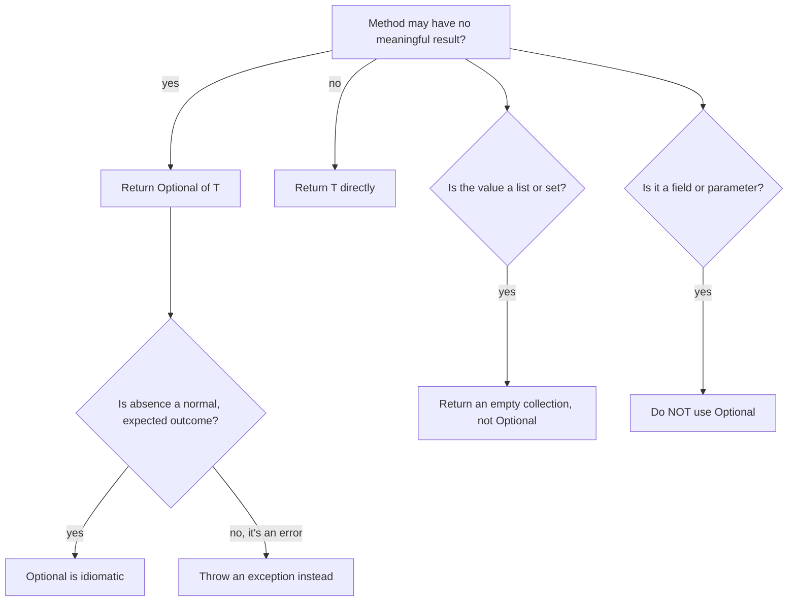
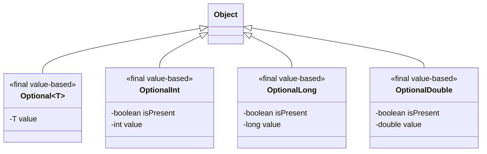
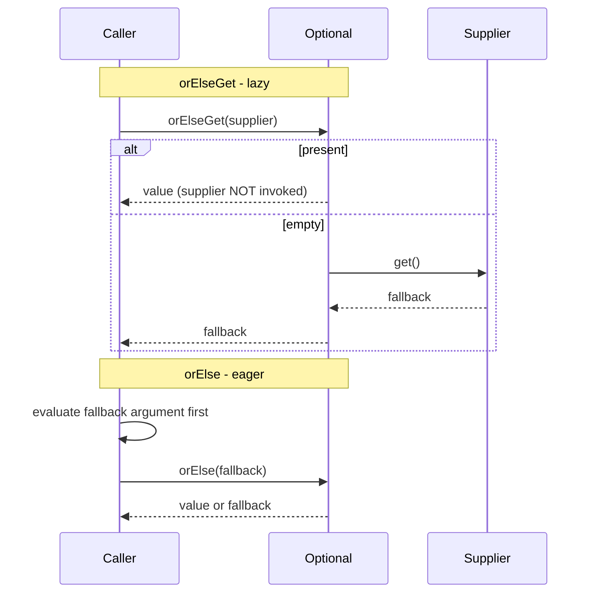
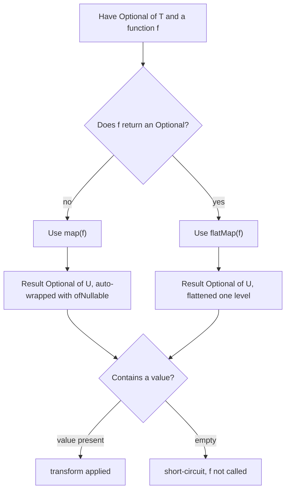

# Optional

`Optional<T>` is a **container object that may or may not hold a value**. It is Java's type-level
answer to the "absent return value" problem: instead of returning `null` (which carries no
information at compile time and explodes later as a `NullPointerException`), a method advertises
`Optional<T>` and the *caller is forced by the type system to consider the empty case*.

The mental model that answers almost every interview question is: **`Optional` is a value-based
monad that wraps a single reference; `null` inside it means "empty"; every operation either
propagates emptiness or transforms the value, and the only ways to leave the container are explicit
terminals (`orElse*`, `get`, `ifPresent*`, `stream`).**

Everything else follows from that:

- It is a **return-type tool**, not a general null replacement. Fields, parameters, arrays,
  collections, and nested `Optional<Optional<T>>` are anti-patterns.
- The empty case is represented by an **internal `null` field**, not a separate class.
- Because it is **value-based**, you must never rely on identity: no `==`, no `synchronized`, no
  `System.identityHashCode`, and it is **not serializable**.
- The transform operators (`map`, `flatMap`, `filter`, `or`, `stream`) are where the real value
  lives; `isPresent()` + `get()` is a disguised `if (x != null)`, not idiomatic use.
- **Eager vs lazy matters**: `orElse(v)` always evaluates `v`; `orElseGet(supplier)` does not.
- The wrapper **allocates** (16 bytes), and generic `Optional<Integer>` also **boxes**; primitive
  optionals (`OptionalInt` and friends) remove the box but keep the wrapper.

Read this module as: motivation → internals → creation → access → transformation → primitive
optionals → streams → anti-patterns → performance → best practices → comparison tables. The
difference between a memorised answer and a senior one is knowing *why* each operator behaves the
way it does and *what it costs*.

> **One-line invariant:** an `Optional<T>` is either "present with a non-null `value`" or "empty with
> `value == null`"; no operator ever calls a mapper/predicate/consumer/supplier unless the container
> is present, except `orElse`, whose argument Java evaluates eagerly before the method is even
> called.

---

## 1. Motivation: The "Billion-Dollar Mistake"

At the 2009 QCon London, **Tony Hoare** — who introduced the null reference in ALGOL W in 1965 —
called it his **"billion-dollar mistake"**. The problem is not the concept of "no value"; it is that
`null` is a member of *every* reference type, so it can appear where no one expects it, and nothing
in the type system warns you.

### 1.1 The problems `Optional` addresses

1. **A `null` return is silent.** `User find(String id)` returning `null` gives the caller no
   compile-time hint. The first failure is a runtime `NullPointerException`, often far from the
   source.
2. **`null` is ambiguous.** `Map.get(key)` returns `null` both when the key is absent and when it is
   mapped to a `null` value. For a method, `null` cannot express "no result" vs "a result that
   happens to be null" without separate conventions.
3. **Absence is not documented in the signature.** Javadoc/`@Nullable` annotations are external; the
   return type is the only contract the compiler enforces. `Optional<T>` makes absence part of the
   type.
4. **The caller can forget to check.** With `Optional`, forgetting is harder: you must call a
   terminal, and the only forcing one (`get`) is deliberately awkward.

`Optional` is a **monad** in the functional sense (a "Maybe"/"Option" type): it supports
`map`/`flatMap` and lets you chain computations that may short-circuit to empty without a single
`if (x != null)`.

### 1.2 What `Optional` is NOT for

The Javadoc and the JDK team are explicit: `Optional` is **primarily intended as a method return
type**. Using it elsewhere is almost always a defect.

| Misuse | Why it is wrong | Do this instead |
|---|---|---|
| **Field** `Optional<String> name;` | Not `Serializable` (breaks entities/DTOs and many frameworks), adds a wrapper per field, and "null field" is already a clear notion inside a class | Keep a plain field; expose an `Optional`-returning *accessor* if you must |
| **Method parameter** `void f(Optional<X> x)` | Caller is forced to wrap; overloading is clearer; you still need a null check at the call boundary | Overloads, or accept `@Nullable X` and validate once |
| **Array/element** `Optional<String>[]` | Absurd nesting; an absent element is just a `null` (or omit it) | Sparse structure, or `Map<Integer,T>` |
| **Collection element** `List<Optional<String>>` | `Optional` of `Optional`-like nesting; empty slots are better modelled by not putting them in | Filter first (`flatMap(Optional::stream)`) |
| **`Optional<Optional<T>>`** | Double container; use `flatMap` to flatten | `flatMap(x -> returnsOptional(x))` |
| **`Optional<List<T>>` for "no results"** | An **empty collection** already encodes "no elements" with zero allocation | Return `List.of()` |
| **`Optional<int>`** | Illegal — generics require reference types; would box | `OptionalInt` / `OptionalLong` / `OptionalDouble` |
| **Anywhere "to avoid nulls" globally** | You just move the null one level away and pay an allocation | Use it where absence is meaningful and local |



---

## 2. What `Optional` Actually Is (Internals)

`Optional` is a **final class** with a **single instance field** and a **private constructor**. The
empty case is not a subclass — it is the same class with `value == null`, plus a cached singleton for
the empty instance. Verified with `javap -p java.util.Optional`:

```text
public final class java.util.Optional<T> {
  private static final java.util.Optional<?> EMPTY;
  private final T value;
  public static <T> java.util.Optional<T> empty();
  private java.util.Optional(T);
  public static <T> java.util.Optional<T> of(T);
  public static <T> java.util.Optional<T> ofNullable(T);
  public T get();
  public boolean isPresent();
  public boolean isEmpty();
  public void ifPresent(java.util.function.Consumer<? super T>);
  public void ifPresentOrElse(java.util.function.Consumer<? super T>, java.lang.Runnable);
  public java.util.Optional<T> filter(java.util.function.Predicate<? super T>);
  public <U> java.util.Optional<U> map(java.util.function.Function<? super T, ? extends U>);
  public <U> java.util.Optional<U> flatMap(java.util.function.Function<? super T, ? extends java.util.Optional<? extends U>>);
  public java.util.Optional<T> or(java.util.function.Supplier<? extends java.util.Optional<? extends T>>);
  public java.util.stream.Stream<T> stream();
  public T orElse(T);
  public T orElseGet(java.util.function.Supplier<? extends T>);
  public T orElseThrow();
  public <X extends java.lang.Throwable> T orElseThrow(java.util.function.Supplier<? extends X>) throws X;
  public boolean equals(java.lang.Object);
  public int hashCode();
  public java.lang.String toString();
}
```

Key consequences of this shape:

- **`empty()` returns the cached `EMPTY` singleton**, so `Optional.empty() == Optional.empty()` is
  `true` *in today's implementation*. This is an implementation detail you must **not** rely on.
- **`of(x)` always constructs a new object** (unless the value is `null`, in which case it throws), so
  `Optional.of("a") == Optional.of("a")` is `false`.
- **There is no common supertype** shared by `Optional`, `OptionalInt`, `OptionalLong`, and
  `OptionalDouble` other than `Object`. You cannot write a method that uniformly accepts all four.
- `equals`/`hashCode`/`toString` are defined by the contained value, so the class is **value-based**.

### 2.1 Value-based class: the rules

Since Java 8, `Optional` is documented as **value-based**: a final class whose instances are
immutable, equal by state, freely substitutable, and with **no accessible identity**. The compiler
and JVM are therefore free to inline, cache, or duplicate instances. Practical rules:

| Operation | Verdict | Reason |
|---|---|---|
| `a.equals(b)` | Allowed | Compares contained value (with `Optional.equals`) |
| `a == b` | **Forbidden** | Identity is not part of the contract; `empty()` caching is incidental |
| `synchronized (optional)` | **Forbidden** | The monitor is not an addressable identity |
| `System.identityHashCode(optional)` | **Forbidden** | Identity hash is unspecified |
| Using it as a `Map` key | Allowed *by `equals`/`hashCode`*, but unusual | Prefer the raw value or an explicit wrapper |
| Serializing it | **Forbidden — not `Serializable`** | `Serializable.class.isAssignableFrom(Optional.class)` is `false` |

The serialization point is verified at compile time: `Optional.of("x") instanceof java.io.Serializable`
does not even compile because the compiler knows a `final` class cannot suddenly implement an
interface — a strong hint that `Optional` must never cross a serialization boundary (sessions, RMI,
caches, entities).

### 2.2 Type structure



---

## 3. Creating Optionals

Three factories, and the distinction between them is the source of the first interview trap.

| Factory | Result | On `null` input |
|---|---|---|
| `Optional.empty()` | Empty container (cached `EMPTY`) | n/a |
| `Optional.of(v)` | Present | **Throws `NullPointerException` immediately** |
| `Optional.ofNullable(v)` | Present if `v != null`, else empty | Returns empty |

```java
Optional<String> a = Optional.empty();
Optional<String> b = Optional.of("value");
Optional<String> c = Optional.ofNullable(null);
Optional<String> d = Optional.ofNullable("value");

System.out.println(a);                 // Optional.empty
System.out.println(b);                 // Optional[value]
System.out.println(c.isEmpty());       // true (Java 11+)
System.out.println(Optional.of(null)); // NullPointerException
```

Verified output:

```text
Optional.empty
Optional[value]
true
Optional.of(null) -> NPE msg=null
```

Notes:

- The `NullPointerException` thrown by `of(null)` has **no message** on Java 21 (verified
  `getMessage() == null`); do not parse the message.
- `ofNullable(null)` returns the **same cached empty instance** as `empty()`, so
  `Optional.ofNullable(null) == Optional.empty()` is `true` in the current JDK.
- `of` does **not** cache present values; each call allocates.
- Wrapping an `Optional` in an `Optional` is legal but wrong: `Optional.ofNullable(Optional.empty())`
  yields `Optional[Optional.empty]`. Use `flatMap` to avoid nesting.

> **Rule:** use `of` when you know the value is non-null (fail fast on programming errors) and
> `ofNullable` when the value may legitimately be `null` (typically at the boundary of legacy/null-
> returning APIs).

---

## 4. Accessing the Value

The terminal operations decide what happens when the value is absent. Prefer them over `get()`.

### 4.1 `get()` — the operation to avoid

`get()` returns the value or throws `NoSuchElementException: No value present`. It is **not
deprecated** (a proposed deprecation was withdrawn), but it is discouraged because it reintroduces
the very runtime failure `Optional` exists to prevent.

```java
System.out.println(Optional.of("x").get());       // x
System.out.println(Optional.empty().get());       // throws NoSuchElementException
```

```text
x
empty().get() -> NSEE msg=No value present
```

> Use `get()` only when presence was already proven (rare). Reaching for it is a code smell; switch
> to `orElse`, `orElseGet`, `ifPresent`, `map`, or `orElseThrow`.

### 4.2 `isPresent()` / `isEmpty()`

`isPresent()` returns `true` for a present container; `isEmpty()` (Java 11) is its negation. They are
useful for logging and for `if/else` on the container, but **`isPresent()` + `get()` is an
anti-pattern** (see §8.1).

```java
System.out.println(Optional.of("x").isPresent()); // true
System.out.println(Optional.empty().isEmpty());   // true
```

### 4.3 `orElse(T)` vs `orElseGet(Supplier)` — eager vs lazy

This is the single most asked `Optional` question. Java is **eagerly evaluated**: the argument to
`orElse` is computed *before* the method is entered, so a costly fallback runs even when the value is
present.

```java
static String log = "";
static String sideEffect(String tag) { log += tag + ";"; return tag; }

log = "";
String a = Optional.of("present").orElse(sideEffect("ELSE"));
System.out.println("orElse present result=" + a + " log=" + log);

log = "";
String b = Optional.of("present").orElseGet(() -> sideEffect("GET"));
System.out.println("orElseGet present result=" + b + " log=" + log);
```

Verified output:

```text
orElse present result=present log=ELSE;
orElseGet present result=present log=
```

The `orElse` branch ran `sideEffect("ELSE")` even though the value was present; `orElseGet` never
called the supplier. When the container is empty, both produce the fallback.

```java
String c = Optional.<String>empty().orElse(sideEffect("ELSE"));      // log=ELSE;
String d = Optional.<String>empty().orElseGet(() -> sideEffect("GET")); // log=GET;
```

> **Rule:** if the default is an allocation, I/O, database call, or expensive computation, use
> `orElseGet`. Use `orElse` only for cheap, side-effect-free constants.

### 4.4 `orElseThrow`

- `orElseThrow()` (Java 10) throws `NoSuchElementException: No value present` when empty.
- `orElseThrow(Supplier<X>)` throws the exception produced by the supplier; this is the idiomatic way
  to turn "absent" into a domain exception.

```java
Optional.empty().orElseThrow();
Optional.<String>empty().orElseThrow(() -> new IllegalStateException("custom"));
```

```text
orElseThrow() -> NSEE msg=No value present
orElseThrow(sup) -> custom
```

Chaining with `orElseThrow` is idiomatic for "get or fail":

```java
User u = repository.findById(id)
                   .orElseThrow(() -> new NotFoundException("User " + id + " not found"));
```

### 4.5 `or(Supplier<Optional<T>>)` — Java 9, Optional-returning fallback

Unlike `orElse`/`orElseGet`, `or` returns an **`Optional`**, so it can be chained. The supplier is
lazy and is called only when the current container is empty; it must **not** return `null`.

```java
Optional<String> r = Optional.<String>empty()
        .or(() -> Optional.empty())      // still empty
        .or(() -> Optional.of("third")); // present
System.out.println(r);                   // Optional[third]
```

Short-circuit proof: a present container never calls the supplier.

```java
log = "";
Optional<String> s = Optional.of("x").or(() -> { log += "OR;"; return Optional.of("y"); });
System.out.println(s + " log=" + log);   // Optional[x] log=
```

> Use `or` for **fallback provider chains** (`findUser("alice").or(() -> findUser("bob")).or(...)`)
> where each fallback is itself optional.

### 4.6 `ifPresent` / `ifPresentOrElse`

`ifPresent(Consumer)` runs the action only when present. `ifPresentOrElse(Consumer, Runnable)` (Java
9) handles both branches in one call, avoiding `isPresent()`+`get()`.

```java
Optional.of("v").ifPresent(s -> System.out.print("present:" + s));
Optional.<String>empty().ifPresent(s -> System.out.print("present"));
// prints: present:v

Optional.of("v").ifPresentOrElse(s -> System.out.print("P:" + s), () -> System.out.print("E"));
Optional.<String>empty().ifPresentOrElse(s -> System.out.print("P"), () -> System.out.print("E"));
// prints: P:vE
```

### 4.7 Lazy vs eager call flows



---

## 5. Transforming the Value

### 5.1 `map` — transform and re-wrap

`map(f)`:
1. If empty, return `empty()` (function never called).
2. Else apply `f` to the value and wrap the result with `Optional.ofNullable` — so a `null` result
   becomes `empty`.

Because the result is auto-wrapped, `map` is the wrong tool when `f` already returns an `Optional`:
you get `Optional<Optional<U>>`.

```java
Optional<String> name = Optional.of("alice");
System.out.println(name.map(String::length));                 // Optional[5]
System.out.println(name.map(s -> Optional.of(s.length())));   // Optional[Optional[5]]  <-- nested!
System.out.println(name.map(s -> (Integer) null));            // Optional.empty
System.out.println(Optional.<String>empty().map(String::toUpperCase)); // Optional.empty
```

Verified output:

```text
Optional[5]
Optional[Optional[5]]
Optional.empty
Optional.empty
```

### 5.2 `flatMap` — transform when the mapper returns `Optional`

`flatMap(f)` expects `f` to return an `Optional`, applies it, and returns it **without an extra
wrapper**, flattening one level. If `f` returns `null`, `flatMap` throws `NullPointerException`
(unlike `map`, which tolerates a `null` result).

```java
Optional<Integer> flat = Optional.of("alice").flatMap(s -> Optional.of(s.length()));
System.out.println(flat); // Optional[5]
```

### 5.3 `filter` — keep the value only if it matches

`filter(p)`: empty stays empty; present stays present if `p.test(value)`, else becomes empty. The
predicate is **not called on empty**.

```java
System.out.println(Optional.of("abc").filter(s -> s.startsWith("a"))); // Optional[abc]
System.out.println(Optional.of("abc").filter(s -> s.startsWith("z"))); // Optional.empty
System.out.println(Optional.<String>empty().filter(s -> true));        // Optional.empty
```

### 5.4 `stream()` — bridge to the Stream API (Java 9)

`stream()` yields a `Stream` of 0 or 1 element. It is the canonical way to flatten a
`Stream<Optional<T>>` (see §7).

```java
System.out.println(Optional.empty().stream().count());   // 0
System.out.println(Optional.of("x").stream().count());   // 1
```

### 5.5 `map` vs `flatMap` decision flow



`or` chaining and transformations compose into a full pipeline:


---

## 6. Primitive Optionals: `OptionalInt`, `OptionalLong`, `OptionalDouble`

Generics cannot be primitive, so `Optional<Integer>` must **box**. The JDK provides three dedicated
classes to avoid that boxing. They are **separate final classes**, not subtypes of `Optional`.

```text
public final class java.util.OptionalInt {
  private final boolean isPresent;
  private final int value;
  public int getAsInt();
  public boolean isPresent();
  public boolean isEmpty();
  public void ifPresent(java.util.function.IntConsumer);
  public void ifPresentOrElse(java.util.function.IntConsumer, java.lang.Runnable);
  public java.util.stream.IntStream stream();
  public int orElse(int);
  public int orElseGet(java.util.function.IntSupplier);
  public int orElseThrow();
  public <X extends java.lang.Throwable> int orElseThrow(java.util.function.Supplier<? extends X>) throws X;
}
```

Crucially, the primitive optionals have **no `map`, `flatMap`, `filter`, or `or`** (verified:
reflection lists only `empty`, `equals`, `getAsInt`, `hashCode`, `ifPresent`, `ifPresentOrElse`,
`isEmpty`, `isPresent`, `of`, `orElse`, `orElseGet`, `orElseThrow`, `stream`, `toString`). To transform
one you must box (e.g. `oi.stream().map(x -> ...)`) or extract with `getAsInt`.

```java
OptionalInt oi = OptionalInt.of(7);
OptionalLong ol = OptionalLong.of(9L);
OptionalDouble od = OptionalDouble.of(1.5);
System.out.println(oi.getAsInt() + " " + ol.getAsLong() + " " + od.getAsDouble()); // 7 9 1.5
System.out.println(OptionalInt.empty().orElse(-1));                               // -1
System.out.println(oi.stream().sum());                                            // 7
OptionalInt.empty().getAsInt();                                                   // NoSuchElementException
```

```text
primitive = 7 9 1.5
empty oi.orElse(-1) = -1
oi.stream().sum() = 7
empty getAsInt -> NSEE msg=No value present
OptionalInt has map? false
```

| Aspect | `Optional<Integer>` | `OptionalInt` |
|---|---|---|
| Boxing | Yes (each present value boxes) | No |
| Object size | 32 bytes (16 wrapper + 16 `Integer`) | 24 bytes |
| `map`/`flatMap`/`filter` | Yes | **No** |
| `or` | Yes | **No** |
| `get` method | `get()` | `getAsInt()` |
| `ifPresent` lambda | `Consumer<Integer>` | `IntConsumer` (avoids boxing) |
| Stream bridge | `Stream<Integer>` | `IntStream` |
| Use for | general `Integer` logic | numeric hot paths, `Stream` terminals |

> `Double.NaN` nuance: `Optional<Double>` compares `Double.NaN` as equal to itself
> (`Optional.of(Double.NaN).equals(Optional.of(Double.NaN))` is `true`), because `Double.equals`
> special-cases NaN; `OptionalInt`/`OptionalDouble` implement the same value semantics.

---

## 7. Optional and Streams

Several terminal stream operations return `Optional` precisely because "no element" is a legitimate
outcome:

| Terminal | Returns | Empty when |
|---|---|---|
| `findFirst()` | `Optional<T>` | stream is empty |
| `findAny()` | `Optional<T>` | stream is empty |
| `min(cmp)` / `max(cmp)` | `Optional<T>` | stream is empty |
| `reduce(op)` | `Optional<T>` | stream is empty |
| `average()` | `OptionalDouble` | stream is empty |
| `IntStream.min()` / `max()` | `OptionalInt` | stream is empty |
| `IntStream.findFirst()` / `findAny()` | `OptionalInt` | stream is empty |

```java
Optional<Integer> first = Stream.of(3, 1, 2).filter(n -> n > 1).findFirst(); // Optional[3]
Optional<Integer> max   = Stream.of(3, 1, 2).max(Integer::compareTo);        // Optional[3]
Optional<Integer> sum   = Stream.of(1, 2, 3).reduce(Integer::sum);           // Optional[6]
```

### 7.1 Flattening `Stream<Optional<T>>`

`flatMap(Optional::stream)` discards empties and unwraps the rest, which is the correct way to
process a stream of possibly-absent values.

```java
List<Integer> r = Stream.of(Optional.of(1), Optional.<Integer>empty(), Optional.of(3))
        .flatMap(Optional::stream)
        .collect(Collectors.toList());
System.out.println(r); // [1, 3]
```

A more realistic pipeline:

```java
List<String> names = ids.stream()
        .map(this::findUser)            // Stream<Optional<User>>
        .flatMap(Optional::stream)      // Stream<User> (empties dropped)
        .map(User::name)
        .toList();
```

> Without `flatMap(Optional::stream)` you would need `.filter(Optional::isPresent).map(Optional::get)`
> — the anti-pattern §8.1 is about.

For a full treatment of the operators and collectors, see [Streams](13-Streams.md) and
[Collectors](14-Collectors.md).

---

## 8. Anti-Patterns (Wrong vs Right)

### 8.1 `isPresent()` + `get()`

```java
// Wrong: glorified null check, and get() can still throw if refactored badly
if (opt.isPresent()) {
    return opt.get().toUpperCase();
} else {
    return "UNKNOWN";
}

// Right: ask the container to do the work
return opt.map(String::toUpperCase).orElse("UNKNOWN");
```

### 8.2 `get()` without a presence check

```java
// Wrong: throws NoSuchElementException
String s = opt.get();

// Right: recover or fail with intent
String s = opt.orElse("default");
String t = opt.orElseThrow(() -> new IllegalStateException("missing config"));
```

### 8.3 `orElse(expensiveCall())`

```java
// Wrong: loadFromDb() runs even when the value is present
return opt.orElse(loadFromDb(id));

// Right: lazy
return opt.orElseGet(() -> loadFromDb(id));
```

### 8.4 `Optional` fields, parameters, and setters

```java
// Wrong: Optional in the data model
public class User {
    private Optional<String> email;              // not Serializable, extra indirection
    public void setEmail(Optional<String> e) {}  // forces callers to wrap
}

// Right: plain nullable field, Optional only on the exit path
public class User {
    private String email;                        // may be null internally
    public Optional<String> email() { return Optional.ofNullable(email); }
}
```

Framework integrations (JPA/Hibernate, Jackson, JAXB) and session replication rely on
`Serializable`/bean conventions that `Optional` violates. Keep it at the API boundary.

### 8.5 `Optional` in collections

```java
// Wrong: holey list, nesting, and pain for every consumer
List<Optional<String>> list = List.of(Optional.of("a"), Optional.empty());

// Right: only real values; empty means "none"
List<String> list2 = List.of("a");
```

### 8.6 Returning `Optional` where an exception is correct

```java
// Arguable: absence is exceptional, not a normal outcome
Optional<Config> load();

// Clear: the caller cannot ignore the failure
Config load() throws ConfigException;
```

Use `Optional` for **expected, common absence**; use exceptions for **exceptional** conditions.

### 8.7 Serializing `Optional`

```java
// Wrong: compiles nowhere near Serializable
class Session implements Serializable {
    Optional<String> token;   // NotSerializableException at runtime if it were, and it is not
}
```

`Optional` does not implement `Serializable` (verified `false`). Store the raw value or a custom
nullable field.

### 8.8 `Optional<Optional<T>>`

```java
// Wrong
Optional<Optional<Address>> x = userOpt.map(u -> Optional.ofNullable(u.address()));

// Right
Optional<Address> x2 = userOpt.flatMap(u -> Optional.ofNullable(u.address()));
```

---

## 9. Performance

`Optional` is cheap but **not free**, and it is a wrapper, so it can allocate.

### 9.1 Object sizes (measured with JOL on Java 21)

| Object | Total size | Note |
|---|---|---|
| `Optional` shell | **16 bytes** | one reference field + 12-byte header, padded |
| `Optional<String>` excluding interned value | 16 bytes | the `String` is shared |
| `Optional<Integer>` (present, fresh box) | 32 bytes | 16 wrapper + 16 `Integer` |
| `OptionalInt` | **24 bytes** | boolean + int, no boxing |
| `OptionalLong` / `OptionalDouble` | 24 bytes | boolean + 8-byte payload |
| boxed `Integer` | 16 bytes | overhead of boxing alone |
| primitive `int` | 4 bytes / 0 on stack | the baseline `OptionalInt` avoids |

Verified:

```text
Optional shell    : 32 bytes (incl. fresh Object)   -> 16-byte shell once the payload is removed
OptionalInt       : 24 bytes
OptionalLong      : 24 bytes
OptionalDouble    : 24 bytes
Integer boxed     : 16 bytes
```

### 9.2 When it matters

- **Hot paths / tight loops**: returning `Optional` from a method called millions of times allocates
  one 16-byte object per call. Escape analysis (`-XX:+DoEscapeAnalysis`, on by default) can
  **scalar-replace** an `Optional` that does not escape, but a returned `Optional` escapes by
  definition, so the allocation usually sticks and adds GC pressure.
- **Generic optionals on primitives**: `Optional<Integer>` costs 32 bytes and boxes each value;
  `OptionalInt` costs 24 bytes with no boxing. For numeric-heavy code prefer primitive optionals or
  a sentinel/primitive return.
- **Readability wins**: in ordinary service/DAO code the throughput cost is negligible compared to
  I/O; the allocation is noise. Do not micro-optimise `Optional` away at the cost of clarity, but do
  not use it as a universal field type either.

> **Rule of thumb:** `Optional` on public/service API return types — fine. `Optional` in a
> per-request, per-element hot loop — measure; consider primitive optionals or plain values.

---

## 10. Best Practices

1. **Use `Optional` as a return type** for methods that may legitimately have no result:
   `findById`, `max`, `firstOrNull`, cache lookups.
2. **Never use `Optional` for fields, method parameters, setters, or collection elements.**
3. **Prefer `map` / `flatMap` / `filter` / `orElseGet`** over `isPresent()` + `get()`.
4. **Choose the right terminal:** `orElse` for cheap constants, `orElseGet` for expensive/lazy
   defaults, `orElseThrow` to convert absence into a domain exception.
5. **Never call `get()` without a preceding presence guarantee**; even then prefer the alternatives.
6. **Use `flatMap` for Optional-returning functions** to avoid `Optional<Optional<T>>`.
7. **Use `or` for fallback-provider chains** and `stream()` to flatten `Stream<Optional<T>>`.
8. **Prefer primitive optionals** (`OptionalInt`/`Long`/`Double`) in numeric code.
9. **Keep chains short.** A long chain is still a chain; extract a named method for readability.
10. **Return an empty collection, not `Optional<List>`**, when the only question is "which elements".

An idiomatic null-safe chain:

```java
Optional<String> city = findUser(id)                        // Optional<User>
        .flatMap(u -> Optional.ofNullable(u.address()))     // Optional<Address>
        .map(Address::city)                                 // Optional<String>
        .filter(c -> !c.isBlank());                         // Optional<String>
String result = city.orElse("UNKNOWN");
```

---

## 11. Comparison Tables

### 11.1 `orElse` vs `orElseGet` vs `orElseThrow`

| Aspect | `orElse(T)` | `orElseGet(Supplier)` | `orElseThrow(...)` |
|---|---|---|---|
| Argument evaluation | **Eager** (always) | **Lazy** (only if empty) | Lazy (supplier only if empty) |
| Returns | `T` | `T` | `T` |
| On empty | returns argument | calls supplier | throws `NoSuchElementException` / supplied throwable |
| Side effects | fallback side effect always runs | runs only on empty | exception only on empty |
| Best for | cheap constants | expensive defaults, I/O | "must exist" retrieval |
| Lambda captures | n/a | yes | yes |

### 11.2 `map` vs `flatMap`

| Aspect | `map` | `flatMap` |
|---|---|---|
| Mapper returns | plain `U` | `Optional<U>` |
| Wrapping | wraps with `Optional.ofNullable` | uses the returned `Optional` as-is |
| `null` result of mapper | becomes empty | **throws `NullPointerException`** |
| Nesting | produces `Optional<Optional<U>>` if mapper returns Optional | flattens to `Optional<U>` |
| Called on empty | no | no |

### 11.3 `Optional` vs `null` vs empty collection

| Aspect | `Optional<T>` | `null` | empty collection |
|---|---|---|---|
| Type signals absence | Yes | No | Yes (zero elements) |
| Null-safety | Wrapper non-null; value may be checked | Risk of NPE | Safe to iterate |
| Allocation | 16-byte wrapper (empty may be cached) | none | small/empty singleton |
| Serialization | Not `Serializable` | n/a | `ArrayList`/`List.of` are |
| For a single possibly-absent value | **Best** | common, risky | wrong tool |
| For "zero or more values" | wrong tool | risky | **Best** |
| Defensive copy of a collection | n/a | n/a | return `List.copyOf` |
| As a field/parameter | discouraged | sometimes unavoidable | fine |

### 11.4 `Optional<T>` vs primitive optionals

| Aspect | `Optional<T>` | `OptionalInt` |
|---|---|---|
| Generic | Yes | no (dedicated class) |
| Boxing | yes if `T` is a wrapper | no |
| `map`/`flatMap`/`filter`/`or` | yes | **no** |
| Extract | `get()` | `getAsInt()` |
| Allocation | 16 (+16 box) bytes | 24 bytes |
| Stream | `Stream<T>` | `IntStream` |

---

## 12. Version History

| Feature | Version |
|---|---|
| `Optional`, `OptionalInt`, `OptionalLong`, `OptionalDouble` | Java 8 |
| `ifPresentOrElse`, `or`, `stream` (all optionals) | Java 9 |
| `orElseThrow()` (no-arg) | Java 10 |
| `isEmpty()` | Java 11 |
| Value-based identity warnings (JEP 390) | Java 16 |

---

## Cross-links

- [Lambda Expressions](12-Lambda.md)
- [Streams](13-Streams.md)
- [Collectors](14-Collectors.md)
- [Exception Handling](../01-Fundamentals/06-Exception-Handling.md)
- [Generics](../01-Fundamentals/07-Generics.md)
- [Serialization](../06-Reflection/29-Serialization.md)
- [Java 8](../09-Version-History/49-Java-8.md), [Java 9](../09-Version-History/50-Java-9.md), [Java 10](../09-Version-History/51-Java-10.md), [Java 11](../09-Version-History/52-Java-11.md)

---

# Interview Questions

## Beginner

**Q:** What is `Optional` and why was it introduced?

**A:** `Optional<T>` is a final value-based container that either holds a non-null value ("present")
or holds nothing ("empty"). It was added in Java 8 to make a possibly-absent return value **explicit
in the type system**, so callers are nudged to handle absence instead of discovering a `null` later
as a `NullPointerException`. It addresses Tony Hoare's "billion-dollar mistake" of the null
reference.

**Q:** What are the three ways to create an `Optional`, and how do they differ on `null`?

**A:** `Optional.empty()` creates an empty container. `Optional.of(v)` returns a present container
but throws `NullPointerException` immediately if `v` is `null`. `Optional.ofNullable(v)` returns a
present container if `v != null`, otherwise the empty container. Use `of` when null would be a
programming error, `ofNullable` at boundaries with possibly-null values.

**Q:** What does `Optional.get()` do if the value is absent?

**A:** It throws `java.util.NoSuchElementException` with the message `No value present`. `get()`
should be avoided; use `orElse`, `orElseGet`, `orElseThrow`, `ifPresent`, `map`, or `or` instead.

**Q:** How do you get a value or a default?

**A:** `optional.orElse(fallback)` returns the value if present, else `fallback`.
`optional.orElseGet(() -> fallback)` does the same but computes the fallback lazily. If absence is an
error, use `optional.orElseThrow(() -> new SomeException(...))`.

**Q:** What is the difference between `isPresent()` and `isEmpty()`?

**A:** They are exact opposites. `isPresent()` returns `true` when a value is present; `isEmpty()`
(added in Java 11) returns `true` when empty. Both are mainly for logging or branching; prefer the
functional terminals.

**Q:** Does `Optional` work with primitives like `int`?

**A:** Not with `Optional<int>` (generics require reference types), which would force boxing. Instead
the JDK provides `OptionalInt`, `OptionalLong`, and `OptionalDouble`, which store a primitive plus a
presence flag and expose `getAsInt()`/`getAsLong()`/`getAsDouble()`.

**Q:** Is `Optional` serializable? Can it be a field in an entity?

**A:** No. `Optional` does not implement `Serializable` (verified
`Serializable.class.isAssignableFrom(Optional.class)` is `false`). It should therefore not be used as
a field in entities, DTOs, or session objects, and it must not cross serialization boundaries.

**Q:** What does `Optional` print, and how is equality defined?

**A:** Present prints as `Optional[value]`, empty prints as `Optional.empty`. `equals` compares the
contained values, so `Optional.of("a").equals(Optional.of("a"))` is `true`; `hashCode` is the value's
hash code (or `0` when empty).

## Intermediate

**Q:** Why is `orElse(expensive())` dangerous?

**A:** Because Java evaluates method arguments **eagerly** before the method body runs. The argument
`expensive()` is computed whether or not the `Optional` is present, so you pay the cost — and trigger
side effects — even on the happy path. Use `orElseGet(() -> expensive())`, whose supplier runs only
when the container is empty. Verified: with a present value, `orElse(sideEffect)` logs `ELSE;` while
`orElseGet(() -> sideEffect)` logs nothing.

**Q:** When do you use `map` and when `flatMap`?

**A:** Use `map` when the mapping function returns a plain value (`U`); `map` wraps the result with
`Optional.ofNullable`, so a `null` result becomes empty. Use `flatMap` when the function already
returns an `Optional<U>`; it flattens one level and avoids `Optional<Optional<U>>`. If a `flatMap`
mapper returns `null`, it throws `NullPointerException`.

**Q:** What does `Optional.empty().map(f)` do? Does it call `f`?

**A:** It returns the empty `Optional` and never calls `f`. All transform operators short-circuit on
empty: `map`, `flatMap`, `filter`, `ifPresent`, and `or` do not invoke their function/predicate. (The
only exception is `orElse`, whose argument is evaluated by the caller, not by `Optional`.)

**Q:** Explain `or` vs `orElseGet`.

**A:** Both are lazy fallbacks, but `or`'s supplier returns an `Optional<T>` and the result is an
`Optional<T>`, so `or` can be chained for provider fallbacks. `orElseGet`'s supplier returns a plain
`T` and the result is a plain `T`, which terminates the chain. Use `or` for
`find(a).or(() -> find(b)).or(() -> find(c))`; use `orElseGet` at the end to produce a concrete
value.

**Q:** What is `Optional.stream()` for?

**A:** It converts an `Optional<T>` to a `Stream<T>` of zero or one element (Java 9). Its main use is
`stream.flatMap(Optional::stream)` to drop empty optionals and unwrap present ones from a
`Stream<Optional<T>>`.

**Q:** Why is `Optional` called a value-based class, and what are the implications?

**A:** A value-based class is final, immutable, equality-defined-by-state, and has no accessible
identity. Implications: never use `==` to compare optionals, never synchronize on them, never call
`System.identityHashCode`, and do not depend on instances being distinct. The JVM may cache or
duplicate them (for example `Optional.empty()` is a cached singleton today).

**Q:** Why can't you compare optionals with `==` even though `Optional.empty() == Optional.empty()` is `true`?

**A:** Because that `true` is an implementation detail of the cached `EMPTY` singleton, not a
contract. `Optional.of("a") == Optional.of("a")` is `false` because `of` allocates a new instance each
time. The value-based contract forbids identity comparisons; use `equals`.

**Q:** How would you flatten a `Stream<Optional<T>>`?

**A:** `.flatMap(Optional::stream)`. It expands each present `Optional` into a single-element stream
and each empty one into an empty stream, so empties vanish. Equivalent older approach:
`.filter(Optional::isPresent).map(Optional::get)` — but that is the discouraged `isPresent`+`get`
pattern.

## Advanced

**Q:** How is the empty state represented internally?

**A:** By a `null` value in the single `private final T value` field of the same `Optional` class.
There is no separate subclass, and `empty()` returns a cached `EMPTY` singleton. `isPresent()` is
effectively `value != null`; `get()` is `if (value == null) throw new NoSuchElementException("No value
present"); return value;`.

**Q:** Show how the JDK-sized `map` differs from `flatMap` in terms of wrapping.

**A:** `map` is `if (!isPresent()) return empty(); else return Optional.ofNullable(mapper.apply(value));`
— it always wraps the raw result, so a `null` result degrades to empty. `flatMap` is
`if (!isPresent()) return empty(); else { Optional<U> r = mapper.apply(value); Objects.requireNonNull(r);
return r; }` — it returns the mapper's `Optional` directly and rejects `null`. That single difference
explains both the nesting behaviour and the NPE-on-null-mapper difference.

**Q:** Why do the primitive optionals lack `map`, `flatMap`, `filter`, and `or`?

**A:** Because those operators would need to produce an `Optional` of a possibly-different type; with
only three fixed primitive instantiations the JDK would need many overloads and would reintroduce
boxing. Instead the primitive optionals keep a minimal surface (`orElse*`, `ifPresent*`, `stream`)
and expose `stream()` so you can delegate to `IntStream`/`LongStream`/`DoubleStream` for
transformation.

**Q:** Explain the boxing cost difference between `Optional<Integer>` and `OptionalInt`.

**A:** `Optional<Integer>` stores an `Integer` reference: each present value may allocate a 16-byte
box in addition to the 16-byte `Optional` wrapper (32 bytes total). `OptionalInt` stores a boolean
flag and a raw `int` in one 24-byte object and never boxes. On numeric hot paths this removes both
allocation and indirection, though it does not make the operation allocation-free.

**Q:** Does `Optional` help with thread safety?

**A:** No. `Optional` is immutable, so a *reference* to one is safely publishable if published
safely, but that is true of any immutable object; `Optional` adds no synchronization and must not be
used as a lock. If multiple threads read the value it wraps, the safety of that value is governed by
the [Java Memory Model](../04-Multithreading/23-Java-Memory-Model.md), not by `Optional`.

**Q:** Why is `Optional` not `Serializable`, and why is that a deliberate design choice?

**A:** Because making it serializable would encourage storing it in long-lived, serialized data
(fields, sessions, caches), precisely the misuse the API discourages. Leaving it non-serializable
forces it to stay a transient method-return type. It also keeps the serialized form free of a
container whose empty case is an internal `null`.

**Q:** How does escape analysis affect `Optional` performance?

**A:** HotSpot's escape analysis (`-XX:+DoEscapeAnalysis`) can scalar-replace (eliminate) an
`Optional` allocation when the object does not escape its allocating method. A returned `Optional`
escapes and is not eliminated, so each call in a hot path allocates. Passing an `Optional` only to
immediately call `orElse` inside the same method can be optimised away.

**Q:** What does `Optional.orElseThrow(null)` do?

**A:** If the container is present, the argument is never used, so it returns the value with no
exception (verified with `Optional.of("x").orElseThrow(null)`). If the container is empty, calling
`get()` on a null supplier throws `NullPointerException`. Same asymmetry applies to
`or(() -> null)` and `orElseGet(null)`: safe when present, `NullPointerException` when empty.

## Expert

**Q:** Prove that `Optional` is a monad and name the operations.

**A:** A monad needs a `unit`/`return` (`Optional.of`/`ofNullable`/`empty`) and a `bind` (`flatMap`)
satisfying left identity (`flatMap(of(x), f) == f(x)`), right identity (`flatMap(m, Optional::of) ==
m`), and associativity. `map` is the derived `fmap`, and `orElse*` are the eliminators. This is why
the type enables null-safe pipelines without explicit branching.

**Q:** Why is `Optional` unsuitable as a method parameter from an API-design standpoint?

**A:** It shifts the burden to the caller (who must wrap) without removing the need for validation
at the boundary, and it cannot express "this argument itself may be a null `Optional`". Overloads or
a single `@Nullable`-documented parameter validated once are clearer and allocate nothing. It also
fragments method signatures and hurts binary/API compatibility when overloads are added later.

**Q:** `Optional` is annotated as value-based. What in later JDKs enforces this?

**A:** JEP 390 (delivered in JDK 16) adds compile-time warnings when identity-sensitive operations
(like `synchronized`) are applied to value-based classes. The marker annotation is
`@jdk.internal.ValueBased`, applied to `Optional` and the primitive optionals. The intent is forward
compatibility with possible future inlining/removal of identity.

**Q:** How does `Optional` integrate with record patterns and pattern matching?

**A:** Not directly — `Optional` is a regular final class, so there is no special record pattern
support. You compose with `map`/`flatMap`, or, in `switch`, you can match on types if you wrap
absence in a sealed hierarchy. `Optional` deliberately stays a small monadic API rather than a
pattern-matching construct. See [Pattern Matching](../07-Modern-Java/34-Pattern-Matching.md).

**Q:** When would you deliberately *not* use `Optional` and instead return `null` or throw?

**A:** (1) Internal private methods where the contract is enforced elsewhere and the wrapper would be
pure overhead. (2) Fields and data-carrier types where frameworks require nullable/serializable
state. (3) "No elements" cases where an empty collection is the natural value. (4) Invariant
violations, which are errors and should throw, not return empty. `Optional` is for expected,
localized absence on return paths.

**Q:** Explain the interaction of `Optional` with `Stream`'s `reduce` when the identity is absent.

**A:** `reduce(BinaryOperator)` returns `Optional<T>` because an empty stream has no element to seed
the reduction, so there is genuinely no result. `reduce(identity, accumulator)` returns `T` because
the identity guarantees a result. The `Optional`-returning overload is correct precisely when "no
result" is meaningful — the same criterion as any `Optional` use.

**Q:** Is `Optional.of`'s NPE guaranteed to have no message, and why does that matter?

**A:** The contract only requires a `NullPointerException`; the message is unspecified and currently
`null` on Java 21 (verified `getMessage() == null`). Code must not parse or rely on the message. This
mirrors `Objects.requireNonNull`, which also may produce a null message if no string is supplied.

**Q:** Could `Optional` be removed by future value-type support (Valhalla)?

**A:** Not removed, but it may become far cheaper. Project Valhalla's inline/value classes could
allow `Optional` and primitive optionals to be flattened (no heap allocation, no header) where the
container does not escape. The API stays the same; the cost model improves. This is another reason
the value-based identity rules exist.

## Scenario Based

**Q:** A REST controller returns `User` and sometimes `null`, causing sporadic NPEs in clients. How do
you fix it?

**A:** Change the service method to return `Optional<User>`, so the compiler forces the controller to
decide. Then map absence to an HTTP 404:
`User u = service.findById(id).orElseThrow(() -> new ResponseStatusException(NOT_FOUND));`. Do not
expose `Optional` in the JSON model or entity — convert at the boundary.

**Q:** Your DAO uses `Optional<Address> address()` as a JPA `@Embedded` field and Hibernate fails.
Why?

**A:** JPA providers persist fields via reflection/serialization and generally do not support
`Optional` as a persistent attribute type; `Optional` is also not `Serializable`. Keep a plain
nullable `Address address` field and expose `Optional<Address> getAddress()` that wraps with
`Optional.ofNullable`. This keeps the persistence model idiomatic and the API null-safe.

**Q:** A batch job calls `findConfig().orElse(loadDefaults())` per row, and `loadDefaults()` hits the
DB; latency spikes. Diagnose and fix.

**A:** `orElse` is eager, so `loadDefaults()` executes for every row even when the config is present
— N database calls instead of zero. Replace with `orElseGet(this::loadDefaults)` (and cache the
defaults) so it runs only when needed. Use `orElse` only for cheap constants.

**Q:** You need to fetch a user from a primary store, then a cache, then a fallback provider, without
`if/else` nesting. How?

**A:** Chain `or`:
`findPrimary(id).or(() -> findCache(id)).or(() -> findFallback(id))`. Each supplier is lazy and
returns `Optional<User>`, and the chain short-circuits at the first present result.

**Q:** An interviewer says "return `Optional<List<Order>>` for a customer with no orders." Correct
them.

**A:** Return `List<Order>`, using `List.of()` for none. An empty collection already encodes "zero
elements" and is safe to iterate; `Optional<List<...>>` adds a redundant container and forces callers
to unwrap a list that is never null anyway. `Optional` is for a single possibly-absent value, not for
"empty collection".

**Q:** You must expose a "find by id" API but also distinguish "not found" from "found but value
invalid". How does `Optional` fit?

**A:** `Optional` cleanly expresses "not found" (a normal outcome). "Found but invalid" is a
different condition and should be an exception or a result type (e.g. a sealed `Outcome`), not
`Optional`. Mixing them into one `Optional.empty()` loses information; keep `Optional` for one
specific meaning of absence.

**Q:** A service method must return either a value or a specific domain exception. Which terminal do
you use and why?

**A:** `orElseThrow(() -> new DomainException(...))`. It keeps the happy path a plain value, defers
exception construction to the empty case (lazy), and centralizes the mapping from absence to a
domain error. Avoid `isPresent()`+`get()`+manual throw, which is verbose and re-checkable.

## Output Prediction

**Q:** What does this print?

```java
import java.util.Optional;

public class Q {
    static String log = "";
    static String conf(String s) { log += s + ";"; return s; }
    public static void main(String[] a) {
        log = "";
        String r1 = Optional.of("v").orElse(conf("ELSE"));
        System.out.println(r1 + " " + log);
        log = "";
        String r2 = Optional.of("v").orElseGet(() -> conf("GET"));
        System.out.println(r2 + " " + log);
    }
}
```

**A:**

```text
v ELSE;
v 
```

Line by line: `Optional.of("v")` is present. `orElse(conf("ELSE"))` first evaluates `conf("ELSE")`
(eager), which appends `ELSE;` and returns `"ELSE"`; the present value `"v"` is returned instead, so
`r1` is `v` and the log is `ELSE;`. In the second case `orElseGet` receives a `Supplier` and never
calls it because the value is present, so `r2` is `v` and the log is empty (printed as a trailing
space).

**Q:** What does this print?

```java
import java.util.Optional;
public class Q {
    public static void main(String[] a) {
        Optional<String> s = Optional.of("abc");
        System.out.println(s.map(x -> Optional.of(x.length())));
        System.out.println(s.flatMap(x -> Optional.of(x.length())));
    }
}
```

**A:**

```text
Optional[Optional[3]]
Optional[3]
```

`map` wraps whatever the mapper returns with `Optional.ofNullable`, so returning `Optional.of(3)`
yields `Optional[Optional[3]]` (nested). `flatMap` expects an `Optional` and returns it directly,
flattening to `Optional[3]`.

**Q:** What does this print?

```java
import java.util.Optional;
public class Q {
    public static void main(String[] a) {
        System.out.println(Optional.empty() == Optional.empty());
        System.out.println(Optional.of("a") == Optional.of("a"));
        System.out.println(Optional.of("a").equals(Optional.of("a")));
    }
}
```

**A:**

```text
true
false
true
```

`empty()` returns the cached `EMPTY` singleton, so the two references are identical (`true`) — an
implementation detail, not a contract. `of("a")` allocates a fresh container each call, so `==` is
`false`. `equals` compares the contained values, so it is `true`.

**Q:** What does this print?

```java
import java.util.*;
public class Q {
    public static void main(String[] a) {
        OptionalInt oi = OptionalInt.empty();
        System.out.println(oi.orElse(-1));
        try { oi.getAsInt(); }
        catch (NoSuchElementException e) { System.out.println(e); }
        System.out.println(OptionalInt.of(5).stream().sum());
    }
}
```

**A:**

```text
-1
java.util.NoSuchElementException: No value present
5
```

`orElse(-1)` returns the fallback because the container is empty. `getAsInt()` throws
`NoSuchElementException` with the standard message. `OptionalInt.of(5).stream()` produces a one-element
`IntStream`, whose `sum()` is `5`.

**Q:** What does this print?

```java
import java.util.Optional;
public class Q {
    public static void main(String[] a) {
        Optional<String> r = Optional.<String>empty()
                .or(() -> Optional.empty())
                .or(() -> Optional.of("third"));
        System.out.println(r);
    }
}
```

**A:**

```text
Optional[third]
```

The first `or` sees empty and calls its supplier, which returns empty; the result is still empty. The
second `or` sees empty and calls its supplier, which returns `Optional.of("third")`; that is the
result. No supplier after a present result would be called.

**Q:** What does this print?

```java
import java.util.*;
import java.util.stream.*;
public class Q {
    public static void main(String[] a) {
        List<Integer> r = Stream.of(Optional.of(1), Optional.<Integer>empty(), Optional.of(3))
                .flatMap(Optional::stream)
                .collect(Collectors.toList());
        System.out.println(r);
        System.out.println(Optional.of("x").map(v -> (String) null));
    }
}
```

**A:**

```text
[1, 3]
Optional.empty
```

`flatMap(Optional::stream)` expands `Optional.of(1)` to `[1]`, the empty optional to `[]`, and
`Optional.of(3)` to `[3]`, giving `[1, 3]`. `map` wraps the `null` produced by the mapper with
`Optional.ofNullable(null)`, which is `Optional.empty`.

## Internal Working

**Q:** What fields does `Optional` have, and how is empty represented at the bytecode level?

**A:** A single `private final T value`. Empty is represented by `value == null`. There is no separate
empty subclass; `Optional.empty()` returns a cached `EMPTY` singleton whose `value` is `null`.

**Q:** How is `ofNullable` implemented?

**A:** `return value == null ? empty() : new Optional<>(value);`. So a null input returns the cached
`EMPTY`, and a non-null input allocates a new container.

**Q:** How is `isPresent` implemented, and what does `get` do?

**A:** `isPresent()` is `value != null`. `get()` is
`if (value == null) throw new NoSuchElementException("No value present"); return value;`. That exact
message is why the output shows `No value present`.

**Q:** How is `orElseGet` implemented, and why is it lazy?

**A:** `return value != null ? value : supplier.get();`. The supplier's `get()` is inside the false
branch, so it is only invoked when `value == null`. `orElse(other)` by contrast is
`return value != null ? value : other;` — `other` was already evaluated by the caller.

**Q:** How is `map` implemented versus `flatMap`?

**A:** `map`: `if (!isPresent()) return empty(); else return Optional.ofNullable(mapper.apply(value));`.
`flatMap`: `if (!isPresent()) return empty(); else { Optional<U> r = mapper.apply(value);
Objects.requireNonNull(r); return r; }`. The `requireNonNull` is why a `null`-returning flatMap
mapper throws.

**Q:** How is `stream()` implemented?

**A:** `return isPresent() ? Stream.of(value) : Stream.empty();` — a zero- or one-element stream. The
primitive variants return `IntStream.of(value)` / `IntStream.empty()`, etc.

**Q:** How are `equals` and `hashCode` implemented?

**A:** `equals` returns `true` if the other is an `Optional` and the contained values are equal via
`Objects.equals` (empty-to-empty is equal). `hashCode` is `value != null ? value.hashCode() : 0`.
Verified: `Optional.empty().hashCode()` is `0` and `Optional.of("A").hashCode()` equals
`"A".hashCode()`.

**Q:** Why does `Optional.empty() == Optional.empty()` return `true` while `of` does not?

**A:** `empty()` returns the static `EMPTY` singleton, so both calls return the same reference.
`of` has no cache and executes `new Optional<>(value)` each time, producing distinct references. Both
facts are implementation details the value-based contract tells you not to depend on.

**Q:** Is `Optional`'s empty instance created once or per call?

**A:** Once. The static initializer sets `EMPTY = new Optional<>()`, and `empty()` returns that
reference forever. `ofNullable(null)` also returns `EMPTY`.

## Tricky Questions

**Q:** Does `Optional.of(null)` return empty?

**A:** No. `Optional.of` throws `NullPointerException` (with a `null` message on Java 21). Use
`Optional.ofNullable(null)` to get an empty container; that is exactly the distinction the three
factories encode.

**Q:** `Optional.empty().map(null)` — does it throw?

**A:** Yes, `NullPointerException`. The implementations call `Objects.requireNonNull(mapper)` (or the
predicate/supplier) **before** the empty short-circuit, so a null function is rejected even on an
empty container. Verified for `map`, `flatMap`, `filter`, `ifPresent`, and `ifPresentOrElse`.

**Q:** `Optional.of("x").orElseThrow(null)` — does it throw?

**A:** No, it returns `"x"`. The supplier is only used on the empty path, and the container is
present, so the null argument is never dereferenced. On an **empty** container the same call throws
`NullPointerException` because `get()` is invoked on the null supplier. The same asymmetry holds for
`orElseGet(null)` and `or(() -> null)`.

**Q:** Is `Optional.of("a") == Optional.of("a")` true?

**A:** No, it is `false`: each `of` call allocates a new container. Use `equals`. Conversely
`Optional.empty() == Optional.empty()` is `true` because of the cached singleton — an implementation
detail you must not rely on.

**Q:** Can you synchronize on an `Optional`?

**A:** It compiles but is forbidden by the value-based contract. The JVM may not give the instance a
stable identity, so locking on it is meaningless, and JEP 390 emits a warning for synchronizing on a
value-based class.

**Q:** What is the difference between `Optional<Optional<String>>` and using `flatMap`?

**A:** `map` with an Optional-returning mapper nests containers (`Optional<Optional<String>>`),
requiring two unwraps. `flatMap` flattens to `Optional<String>` in one step. Prefer `flatMap` whenever
the mapper returns an `Optional`.

**Q:** Does `Optional` store the value immutably?

**A:** `Optional` itself is immutable (the reference and container never change), but the **contained
object may be mutable**. `Optional<List<String>>` still exposes a mutable list; `Optional` gives no
deep immutability.

**Q:** What happens if a `flatMap` mapper returns `null`?

**A:** `NullPointerException` (from `Objects.requireNonNull`). This differs from `map`, where a `null`
mapper result becomes `Optional.empty`.

**Q:** Can you use `Optional` as a `HashMap` key?

**A:** Technically yes — `equals`/`hashCode` are defined by the contained value — but it is unusual
and reads poorly. Prefer the raw value as the key. `Optional` is designed as a return type, not a key
or element.

**Q:** Is `Optional` a subtype of anything that lets you unify `OptionalInt` and `Optional<T>`?

**A:** No. They share only `Object`. There is no common interface, so you cannot write a single
generic method over both; you must overload or convert (e.g. via `stream()`/`boxed()`).

**Q:** Why does `Optional.of(1).equals(Optional.of(1))` work but `Optional.of(1000) == Optional.of(1000)`
does not?

**A:** `equals` delegates to `Integer.equals` (value equality), so it is `true` regardless of boxing
cache. `==` compares the `Optional` references, which are always distinct because `of` allocates. Note
`Optional.of(1000)` may box to a new `Integer`, but that is irrelevant to `equals`.

**Q:** Does returning `Optional` prevent all `NullPointerException`s?

**A:** No. It prevents the specific NPE of dereferencing a `null` return if the caller uses the
terminals, but you can still call `get()` on an empty optional, pass `null` where an `Optional` is
expected, or have a `null` field inside the wrapped object. `Optional` forces you to *consider*
absence, not to be immune to nulls.

**Q:** Is `Optional.empty()` guaranteed to be the same object as `Optional.ofNullable(null)`?

**A:** In the current JDK, yes (both return the `EMPTY` singleton), and `ofNullable(null) ==
Optional.empty()` is `true`. But it is not specified, so never write code that depends on it.

**Q:** Does `Optional.filter` on an empty container call the predicate?

**A:** No. Verified with a counter: invoking `map`, `filter`, and `ifPresent` on an empty container
resulted in zero calls. Only the eager `orElse` argument (evaluated by the caller) runs regardless.
