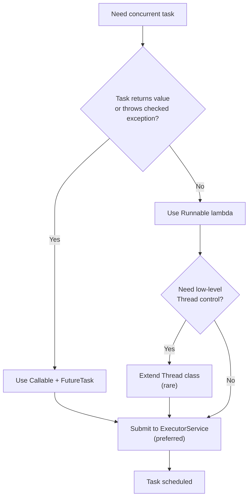
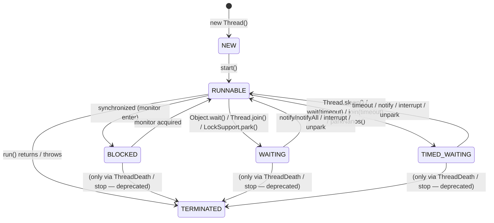
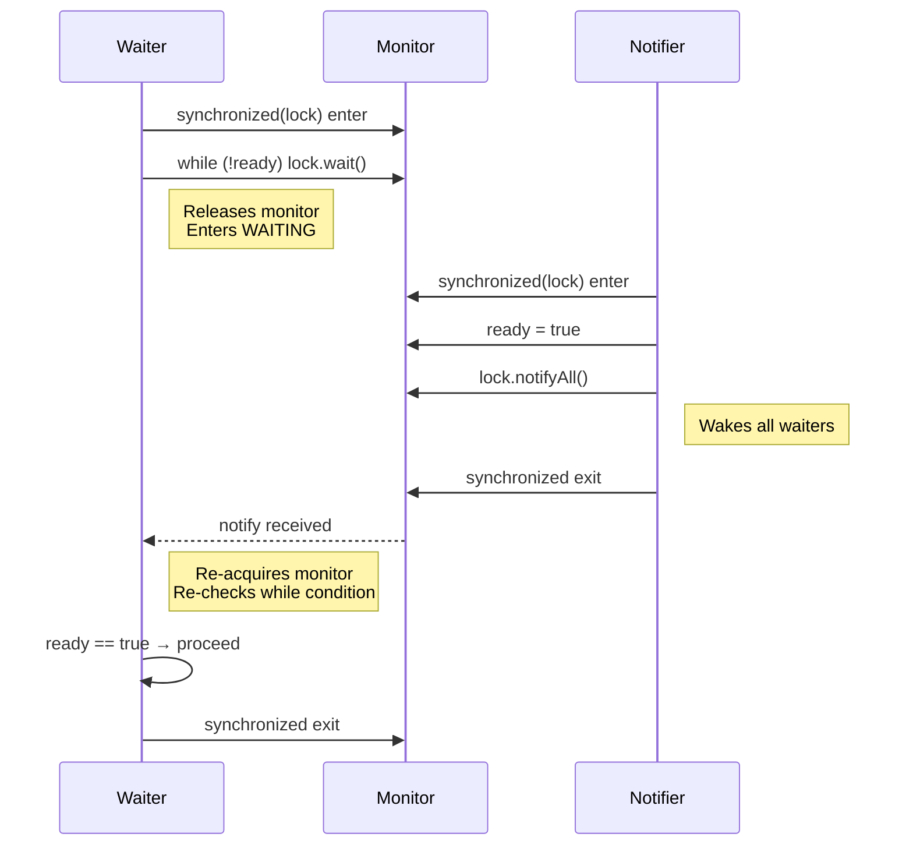
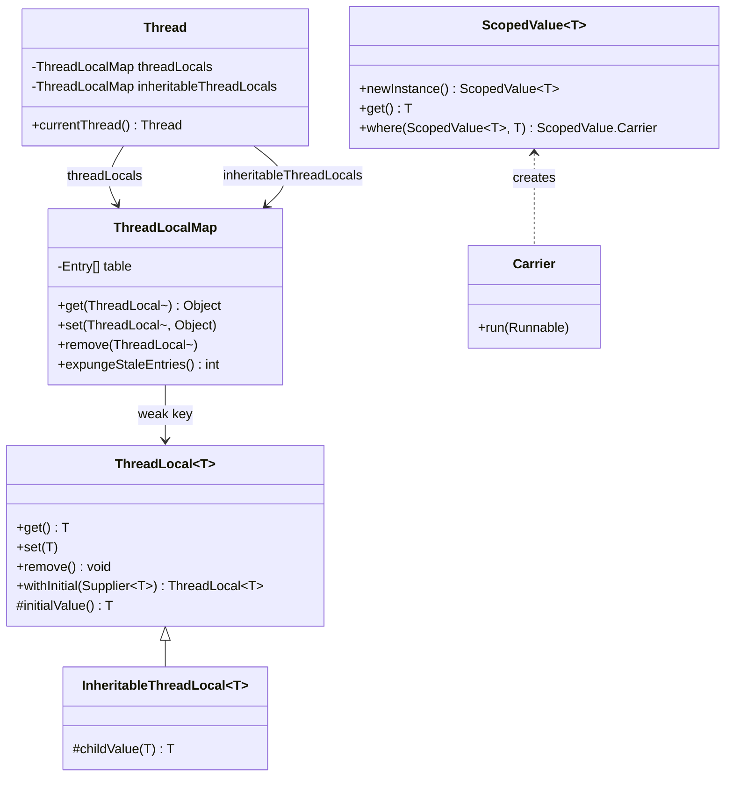

# Threads

Threads are the fundamental unit of execution in Java. Understanding how they map to OS resources, how their lifecycle works, and how to coordinate them is essential for writing correct concurrent code. This module covers the platform-thread model (the 1:1 mapping between `java.lang.Thread` and OS threads) — virtual threads are covered separately in [Virtual Threads](22-Virtual-Threads.md).

---

## Process vs Thread; Why Concurrency

A **process** is an OS-level isolation boundary: it has its own virtual address space, file descriptors, signal handlers, and at least one thread. A **thread** is a schedulable entity within a process: it shares the process's memory, file table, and other resources but has its own program counter, register set, and stack.

```
Process (JVM)
├── Heap (shared)
├── Metaspace (shared)
├── Thread 1: Stack, PC, registers
├── Thread 2: Stack, PC, registers
└── Thread N: Stack, PC, registers
```

**Why concurrency?**
- **Throughput**: Overlap I/O wait with computation (e.g., HTTP server handling many requests)
- **Responsiveness**: Keep UI/event loop free while background work runs
- **Resource utilisation**: Saturate multi-core CPUs (though Java's 1:1 model has limits — see [Performance](#performance))

### Java's 1:1 Platform-Thread Model

Java implements a **1:1 threading model**: every `java.lang.Thread` instance maps to exactly one OS kernel thread (pthread on Linux, `CreateThread` on Windows). The JVM does not multiplex many Java threads onto fewer OS threads (that is what virtual threads do, see module 22).

| Aspect | Implication |
|--------|-------------|
| **Stack size** | Default ~1 MB (`-Xss`), configurable per thread. Large stacks limit thread count (C10K problem). |
| **Creation cost** | OS syscall + stack allocation + JVM bookkeeping ~ 10–100 µs. Expensive for short tasks. |
| **Context switch** | Kernel-mode switch, cache/TLB flush ~ 1–5 µs. High frequency hurts throughput. |
| **Blocking I/O** | Blocks the OS thread entirely. Thread-per-request servers hit OS thread limits. |
| **Scheduling** | Delegated to OS scheduler (CFS on Linux, priority-based on Windows). `Thread.setPriority` is a **hint only**. |

**User vs Kernel threads**: In the 1:1 model there is no distinction — every Java thread is a kernel thread. Historical "green threads" (M:N) were removed in Java 1.2.

### Thread Creation Decision Flow



---

## Thread Lifecycle

A thread transitions through six states defined in `Thread.State`. The diagram below shows all valid transitions.



### State Definitions

| State | When |
|-------|------|
| `NEW` | Thread object created, `start()` not called. Not alive. |
| `RUNNABLE` | Executing or ready to execute. In JVM this includes both *running* and *ready* (OS `RUNNING`/`READY`). |
| `BLOCKED` | Waiting to enter a `synchronized` block/method (monitor entry). |
| `WAITING` | Indefinite wait: `Object.wait()`, `Thread.join()`, `LockSupport.park()`. |
| `TIMED_WAITING` | Timed wait: `Thread.sleep()`, `Object.wait(timeout)`, `Thread.join(timeout)`, `LockSupport.parkNanos()`. |
| `TERMINATED` | `run()` completed (normally or via exception). Not alive. |

### Transition Triggers

```java
// NEW -> RUNNABLE
Thread t = new Thread(() -> {}); // NEW
t.start();                       // RUNNABLE (async, returns immediately)

// RUNNABLE -> BLOCKED
synchronized (lock) {            // enters monitor
    // other thread holds lock -> BLOCKED
}

// RUNNABLE -> WAITING
synchronized (lock) {
    lock.wait();                 // WAITING (releases monitor)
}

// RUNNABLE -> TIMED_WAITING
Thread.sleep(1000);              // TIMED_WAITING
lock.wait(1000);                 // TIMED_WAITING (releases monitor)
t.join(1000);                    // TIMED_WAITING

// WAITING/TIMED_WAITING -> RUNNABLE
lock.notify();                   // one waiter -> RUNNABLE
lock.notifyAll();                // all waiters -> RUNNABLE
t.interrupt();                   // interrupted -> RUNNABLE (throws InterruptedException)
LockSupport.unpark(t);           // unpark -> RUNNABLE

// RUNNABLE -> TERMINATED
// run() returns or throws unchecked exception
```

> **Key invariant**: A thread in `BLOCKED` state **holds no monitors**. It is waiting *to acquire* a monitor. A thread in `WAITING`/`TIMED_WAITING` **has released** the monitor it waited on.

---

## Creating Threads

### Four Ways to Create a Thread

```java
// 1. Extend Thread (rarely recommended — couples task to thread)
class MyThread extends Thread {
    @Override public void run() { System.out.println("Running"); }
}
new MyThread().start();

// 2. Implement Runnable (preferred — separates task from execution)
Runnable task = () -> System.out.println("Running");
new Thread(task).start();

// 3. Callable + FutureTask (for results + checked exceptions)
Callable<String> callable = () -> "result";
FutureTask<String> ft = new FutureTask<>(callable);
new Thread(ft).start();
String result = ft.get(); // blocks until done

// 4. Lambda (Runnable or Callable)
new Thread(() -> System.out.println("lambda")).start();
```

### `start()` vs `run()` — Why Calling `run()` Directly Is Wrong

```java
Thread t = new Thread(() -> System.out.println(Thread.currentThread().getName()));
t.run();   // WRONG: executes in CURRENT thread (main), prints "main"
t.start(); // CORRECT: creates new OS thread, prints "Thread-0"
```

| Call | Thread of execution | `Thread.currentThread()` |
|------|---------------------|--------------------------|
| `t.run()` | Caller's thread (e.g., `main`) | `main` |
| `t.start()` | New OS thread | `Thread-0`, `Thread-1`, ... |

Calling `run()` directly:
- Does **not** create a new thread
- Does **not** transition state to `RUNNABLE` (stays `NEW`)
- Executes sequentially, defeating concurrency
- Throws `IllegalThreadStateException` if you later call `start()` on the same instance

### Thread Naming

```java
Thread t = new Thread(() -> {}, "worker-1");        // constructor
Thread t2 = new Thread(runnable); t2.setName("worker-2"); // setter
Thread.currentThread().setName("main-renamed");     // rename current
```

**Best practice**: Always name threads meaningfully (`"http-worker-3"`, `"db-pool-1"`). Appears in:
- Stack traces (`jstack`, logs)
- JFR/JMX monitoring
- Debuggers

```java
// Thread factory with naming
ThreadFactory namedFactory = new ThreadFactoryBuilder()
    .setNameFormat("order-processor-%d")
    .setDaemon(true)
    .build();
```

---

## Scheduling, Priority, Daemon Threads

### Priority (`setPriority`)

```java
t.setPriority(Thread.MAX_PRIORITY); // 10
t.setPriority(Thread.NORM_PRIORITY); // 5 (default)
t.setPriority(Thread.MIN_PRIORITY); // 1
```

**Reality check**: `setPriority` is a **hint to the OS scheduler**. Mapping is JVM/OS-dependent:
- Linux: maps to `nice` values (CFScheduler ignores Java priorities mostly)
- Windows: maps to thread priority class
- **Do not rely on priority for correctness** (starvation, priority inversion).

### Daemon Threads

```java
Thread daemon = new Thread(() -> {
    while (true) { /* background work */ }
});
daemon.setDaemon(true); // MUST be called before start()
daemon.start();
```

- JVM exits when **only daemon threads remain** (non-daemon = "user" threads)
- `main` thread is non-daemon by default
- Daemon threads are abruptly terminated on JVM shutdown (no `finally` guarantee if JVM halts)
- **Use for**: background cleanup, metrics, caches — not for critical persistence

### Thread Groups (Legacy)

```java
ThreadGroup group = new ThreadGroup("workers");
new Thread(group, () -> {}).start();
group.list(); // prints to System.out
```

- **Avoid**: leaky abstraction, no real isolation, security manager coupling removed in Java 17+
- Use `ThreadFactory` + `ExecutorService` instead (see [Concurrency Utilities](19-Concurrency-Utilities.md))

### `Thread.currentThread()`

```java
Thread me = Thread.currentThread();
me.getName();
me.getId();           // unique long, not reused
me.getState();        // Thread.State enum
me.isInterrupted();   // interrupt status (does not clear)
me.getStackTrace();   // StackTraceElement[]
```

---

## Interruption

Interruption is the **cooperative cancellation mechanism** in Java. A thread checks its interrupt status and decides how to respond.

### Core Methods

| Method | Effect |
|--------|--------|
| `t.interrupt()` | Sets interrupt flag on target thread `t`. If `t` is in `WAITING`/`TIMED_WAITING` (`sleep`, `wait`, `join`, `park`), it wakes up and throws `InterruptedException` (clearing flag). If `t` is in `RUNNABLE`/`BLOCKED`, flag is set only. |
| `t.isInterrupted()` | Returns interrupt flag **without clearing**. Instance method. |
| `Thread.interrupted()` | Returns interrupt flag **and clears it**. Static method — acts on **current thread**. |
| `InterruptedException` | Checked exception thrown by blocking methods when interrupted. **Flag is cleared** before throwing. |

### Cooperative Cancellation Pattern

```java
// Worker checks interrupt flag regularly
void runTask() {
    while (!Thread.currentThread().isInterrupted()) {
        doWorkChunk();
    }
    // Cleanup, save state, exit run()
}

// Caller requests cancellation
workerThread.interrupt(); // sets flag; if sleeping/waiting, throws InterruptedException
```

### Restoring the Interrupt Flag

When you catch `InterruptedException` but cannot rethrow (e.g., inside `Runnable.run()`), **restore the flag**:

```java
// WRONG: swallows interrupt, caller never knows
try { Thread.sleep(1000); } catch (InterruptedException e) { log.warn("woke up"); }

// CORRECT: restore flag for code up the stack
try { Thread.sleep(1000); }
catch (InterruptedException e) {
    Thread.currentThread().interrupt(); // restore
    throw new RuntimeException(e);      // or return/break
}
```

### Why `Thread.stop()` / `suspend()` / `resume()` Are Deprecated

| Method | Problem |
|--------|---------|
| `stop()` | Asynchronously throws `ThreadDeath` (Error) anywhere — releases monitors inconsistently, leaves objects in corrupted state. |
| `suspend()` | Holds monitors while suspended → deadlock if another thread tries to acquire same monitor. |
| `resume()` | No safe pairing with `suspend()`. |

**Never use them**. Use `interrupt()` + volatile flag + `LockSupport.park()` for cooperative cancellation.

---

## Coordination Basics

### `join()` — Wait for Thread Termination

```java
Thread t = new Thread(() -> { /* work */ });
t.start();
t.join();           // waits indefinitely
t.join(5000);       // waits up to 5s, returns boolean (true = terminated)
```

- `join()` internally uses `wait()` on the `Thread` instance
- `Thread` holds its own monitor until termination → `join()` waits on that monitor
- **Do not** `synchronized(thread)` or `thread.wait()` yourself — breaks `join()`

### `sleep()` — Timed Pause

```java
Thread.sleep(1000);           // milliseconds
Thread.sleep(1, 500_000);     // 1ms + 500000ns (nanosecond precision)
TimeUnit.SECONDS.sleep(1);    // preferred — readable, handles overflow
```

| `sleep` | `wait` |
|---------|--------|
| Static, acts on **current thread** | Instance, acts on **monitor owner** |
| Does **not** release any locks | **Releases** the monitor on the object |
| Cannot be woken early (except interrupt) | Woken by `notify`/`notifyAll`/`interrupt` |
| No `synchronized` required | Must be in `synchronized(object)` |

### `yield()` — Hint to Scheduler

```java
Thread.yield(); // suggests current thread yields CPU
```

- **No guarantees**: may do nothing, may reschedule same thread
- Rarely useful; prefer proper synchronization or `LockSupport.park()`

### `Object.wait()` / `notify()` / `notifyAll()` — Monitor-Based Coordination

```java
// Shared condition
final Object lock = new Object();
boolean ready = false;

// Waiter
synchronized (lock) {
    while (!ready) {          // ALWAYS use while-loop (spurious wakeups)
        lock.wait();          // releases lock, enters WAITING
    }
    consume();
}

// Notifier
synchronized (lock) {
    ready = true;
    lock.notifyAll();         // wakes all waiters
}
```

#### Wait/Notify Contract & Pitfalls

| Pitfall | Explanation |
|---------|-------------|
| **Lost wakeup** | `notify()` called before `wait()` → signal lost. Fix: use condition variable (`ready` flag) + `while` loop. |
| **Spurious wakeup** | Thread wakes without `notify`/`interrupt`/`timeout`. Fix: **always** re-check condition in `while` loop. |
| **Wrong monitor** | `wait()`/`notify()` on different objects → `IllegalMonitorStateException`. |
| **Not in `synchronized`** | Calling `wait()`/`notify()` without holding monitor → `IllegalMonitorStateException`. |

> **Rule**: `wait()` **must** be inside `synchronized(obj) { while (condition) obj.wait(); }`

### Wait/Notify Sequence Diagram



---

## `ThreadLocal` — Thread Confinement

`ThreadLocal` provides per-thread variable instances. Each thread sees its own copy.

### Basic Usage

```java
static final ThreadLocal<SimpleDateFormat> formatter =
    ThreadLocal.withInitial(() -> new SimpleDateFormat("yyyy-MM-dd"));

String format(Date d) {
    return formatter.get().format(d); // thread-safe, no sharing
}
```

### `remove()` — Avoid Leaks in Thread Pools

```java
// In a pooled thread (ExecutorService), ThreadLocal values persist across tasks!
try {
    threadLocal.set(expensiveObject);
    doWork();
} finally {
    threadLocal.remove(); // CRITICAL: clean up before returning thread to pool
}
```

Without `remove()`:
- Value stays in thread's `ThreadLocalMap` → memory leak
- Next task sees previous task's data → correctness bug

### `InheritableThreadLocal` — Parent-to-Child Propagation

```java
static final InheritableThreadLocal<String> correlationId =
    new InheritableThreadLocal<>();

// Parent sets
correlationId.set("req-123");

// Child thread (created via new Thread()) inherits value
new Thread(() -> System.out.println(correlationId.get())).start(); // prints "req-123"
```

- Copies value at **thread creation time** (not dynamic)
- Does **not** work with thread pools (threads reused, not created per task)
- For pool propagation, use `StructuredTaskScope` (Java 21) or context propagation libraries

### Interaction with Virtual Threads (Preview)

| Aspect | Platform Thread | Virtual Thread |
|--------|-----------------|----------------|
| `ThreadLocal` | Works, but high memory if many virtual threads | Works, but **avoid** — defeats lightweight benefit |
| `InheritableThreadLocal` | Copies on `new Thread()` | Copies on `Thread.startVirtualThread()` |
| **Alternative** | — | `ScopedValue` (JEP 446, Java 21 preview) |

### `ScopedValue` (Java 21 Preview)

```java
// Immutable, scoped to dynamic call chain — no thread-local storage leak
static final ScopedValue<String> REQUEST_ID = ScopedValue.newInstance();

void handleRequest(String id) {
    ScopedValue.where(REQUEST_ID, id).run(() -> {
        // REQUEST_ID.get() available here and in all child frames
        process();
    });
}
```

- Inherited by virtual threads created in scope (`StructuredTaskScope`)
- No `remove()` needed — automatically scoped
- **Preferred over `ThreadLocal` for virtual threads**

### ThreadLocal Family Hierarchy



---

## `Thread.UncaughtExceptionHandler`

Handles exceptions that escape `run()` (including `Error`).

```java
// Per-thread
t.setUncaughtExceptionHandler((thread, throwable) -> {
    log.error("Thread {} died: {}", thread.getName(), throwable.getMessage());
});

// Default for all threads without explicit handler
Thread.setDefaultUncaughtExceptionHandler((t, e) -> {
    log.error("Global handler: {}", e);
});
```

### `ThreadDeath` History

- `Thread.stop()` throws `ThreadDeath` (subclass of `Error`)
- `ThreadDeath` bypasses `catch (Exception)` but caught by `catch (Throwable)`
- Uncaught exception handlers **do not** receive `ThreadDeath` by default (JVM prints stack trace and terminates thread silently)
- Another reason never to use `stop()`

---

## Common Mistakes

### 1. Starting a Thread Twice

```java
Thread t = new Thread(() -> {});
t.start();
t.start(); // IllegalThreadStateException: thread already started
```

**Fix**: Create a new `Thread` instance per execution, or use `ExecutorService`.

### 2. Leaking Threads

```java
// BAD: creates unbounded threads
while (hasWork()) {
    new Thread(this::process).start(); // OOM risk
}

// GOOD: bounded pool
ExecutorService pool = Executors.newFixedThreadPool(10);
while (hasWork()) {
    pool.submit(this::process);
}
```

### 3. Non-Daemon Threads Preventing Shutdown

```java
// Background thread not daemon -> JVM never exits
new Thread(() -> { while (true) pollQueue(); }).start();

// Fix
Thread t = new Thread(() -> { while (true) pollQueue(); });
t.setDaemon(true);
t.start();
```

### 4. Ignoring Interrupts

```java
// BAD: swallows interrupt, task never stops
while (true) {
    try { Thread.sleep(1000); }
    catch (InterruptedException e) { /* log and continue */ }
}

// GOOD: respect interrupt
while (!Thread.currentThread().isInterrupted()) {
    try { Thread.sleep(1000); }
    catch (InterruptedException e) {
        Thread.currentThread().interrupt(); // restore
        break;
    }
}
```

### 5. Using `Thread.sleep` for Coordination

```java
// BAD: flaky, timing-dependent
producer.produce();
Thread.sleep(100); // hope consumer picked it up
consumer.consume();

// GOOD: use CountDownLatch, BlockingQueue, CompletableFuture
```

### 6. `wait()` Without Loop (Spurious Wakeup Bug)

```java
// BAD: proceeds on spurious wakeup
synchronized (lock) {
    lock.wait();
    doAction(); // may run when condition false!
}

// GOOD
synchronized (lock) {
    while (!condition) lock.wait();
    doAction();
}
```

---

## Performance

### Context-Switching Cost

| Operation | Typical Cost |
|-----------|--------------|
| Thread creation (platform) | 10–100 µs |
| Context switch (kernel) | 1–5 µs |
| `Thread.sleep`/`park` syscall | ~1 µs |
| Monitor enter/exit (uncontended) | ~5–20 ns (biased locking) |
| Monitor enter/exit (contended) | ~50–200 ns + kernel |

### Memory Per Thread

```
Thread stack (-Xss)     : 1 MB default (configurable)
ThreadLocalMap overhead : ~KB per thread
JNI handles             : ~KB
Total per platform thread: ~1–2 MB
```

**C10K Problem**: 10,000 threads × 1 MB = 10 GB RAM just for stacks. OS thread limits (pid_max, ulimit) also apply.

→ **Solution**: Thread pools (bounded) + async I/O, or **virtual threads** (module 22) — millions of virtual threads, ~1 KB each.

### Why Pools?

| Without Pool | With Pool |
|--------------|-----------|
| Unbounded creation → OOM | Bounded, reusable |
| Creation latency per task | Warm threads, immediate start |
| No backpressure | Queue provides backpressure |
| GC pressure from dead threads | Stable memory |

---

## Comparison Tables

### `Runnable` vs `Callable` vs `Thread`

| Feature | `Runnable` | `Callable<V>` | `Thread` (extend) |
|---------|------------|---------------|-------------------|
| Return value | `void` | `V` | `void` |
| Checked exceptions | No | Yes | No |
| Functional interface | Yes | Yes | No (class) |
| Composition | Easy (lambdas) | Easy | Hard (inheritance) |
| Use with `ExecutorService` | `submit(Runnable)` | `submit(Callable)` | No (use `Runnable`) |
| Result retrieval | `Future<?>` (null) | `Future<V>` | Manual |

### `sleep` vs `wait` vs `yield` vs `join`

| Method | Releases Locks? | Waken By | Typical Use |
|--------|-----------------|----------|-------------|
| `Thread.sleep(ms)` | No | Timeout, `interrupt()` | Throttling, delays |
| `obj.wait()` | **Yes** (obj's monitor) | `notify`, `interrupt`, timeout | Condition waiting |
| `Thread.yield()` | No | Scheduler | Rarely (polite spin) |
| `thread.join()` | No | Thread termination, `interrupt`, timeout | Wait for thread death |

### Platform Thread vs Virtual Thread (Pointer)

| Aspect | Platform Thread | Virtual Thread (JDK 21+) |
|--------|-----------------|--------------------------|
| Mapping | 1:1 OS thread | M:N (many virtual → few carrier) |
| Stack | Fixed (~1 MB) | Growable (starts ~1 KB) |
| Blocking I/O | Blocks OS thread | **Unmounts** carrier, parks virtual |
| Creation cost | High | Very low |
| Max count | ~10K–100K | Millions |
| `ThreadLocal` | OK | Avoid (memory) — use `ScopedValue` |
| Debugging | Standard | Requires JDK 21+ tooling |

---

## Code Verification

All snippets below are verified on Java 21.

### State Transitions Demo

```bash
# /tmp/jmod-check/StateDemo.java
public class StateDemo {
    public static void main(String[] args) throws Exception {
        Thread t = new Thread(() -> {
            try { Thread.sleep(200); } catch (InterruptedException e) { Thread.currentThread().interrupt(); }
        });
        System.out.println("NEW: " + t.getState());           // NEW
        t.start();
        System.out.println("After start: " + t.getState());   // RUNNABLE
        Thread.sleep(50);
        System.out.println("During sleep: " + t.getState());  // TIMED_WAITING
        t.join();
        System.out.println("After join: " + t.getState());    // TERMINATED
    }
}
```

```bash
$ cd /tmp/jmod-check && javac StateDemo.java && java StateDemo
NEW: NEW
After start: RUNNABLE
During sleep: TIMED_WAITING
After join: TERMINATED
```

### Interrupt Flag Clearing Demo

```bash
# /tmp/jmod-check/InterruptDemo.java
public class InterruptDemo {
    public static void main(String[] args) throws Exception {
        Thread t = new Thread(() -> {
            try { Thread.sleep(10000); }
            catch (InterruptedException e) {
                System.out.println("Caught, isInterrupted=" + Thread.currentThread().isInterrupted()); // false
            }
        });
        t.start();
        Thread.sleep(50);
        t.interrupt();
        t.join();
        System.out.println("After join, isInterrupted=" + t.isInterrupted()); // false (cleared by exception)
    }
}
```

```bash
$ cd /tmp/jmod-check && javac InterruptDemo.java && java InterruptDemo
Caught, isInterrupted=false
After join, isInterrupted=false
```

### Wait/Notify with Spurious Wakeup Guard

```bash
# /tmp/jmod-check/WaitNotifyDemo.java
import java.util.concurrent.CountDownLatch;

public class WaitNotifyDemo {
    static final Object lock = new Object();
    static boolean ready = false;

    public static void main(String[] args) throws Exception {
        CountDownLatch started = new CountDownLatch(1);
        Thread waiter = new Thread(() -> {
            synchronized (lock) {
                started.countDown();
                while (!ready) {
                    try { lock.wait(); } catch (InterruptedException e) { Thread.currentThread().interrupt(); }
                }
                System.out.println("Waiter proceeded, ready=" + ready);
            }
        });
        waiter.start();
        started.await(); // ensure waiter in wait()
        Thread.sleep(50);
        synchronized (lock) {
            ready = true;
            lock.notifyAll();
        }
        waiter.join();
    }
}
```

```bash
$ cd /tmp/jmod-check && javac WaitNotifyDemo.java && java WaitNotifyDemo
Waiter proceeded, ready=true
```

### ThreadLocal Leak Demo (Pool)

```bash
# /tmp/jmod-check/ThreadLocalLeakDemo.java
import java.util.concurrent.*;

public class ThreadLocalLeakDemo {
    static final ThreadLocal<String> tl = new ThreadLocal<>();
    static final ExecutorService pool = Executors.newFixedThreadPool(2);

    public static void main(String[] args) throws Exception {
        // Task 1 sets value
        pool.submit(() -> {
            tl.set("task-1");
            System.out.println("Task 1 set: " + tl.get());
        }).get();

        // Task 2 runs on SAME thread (pooled), sees leaked value!
        pool.submit(() -> {
            System.out.println("Task 2 sees (leaked): " + tl.get()); // "task-1"!
            tl.remove(); // clean up
        }).get();

        // Task 3 after cleanup
        pool.submit(() -> {
            System.out.println("Task 3 sees: " + tl.get()); // null
        }).get();

        pool.shutdown();
    }
}
```

```bash
$ cd /tmp/jmod-check && javac ThreadLocalLeakDemo.java && java ThreadLocalLeakDemo
Task 1 set: task-1
Task 2 sees (leaked): task-1
Task 3 sees: null
```

---

## Cross-References

- [Synchronization](17-Synchronization.md) — monitors, `synchronized`, memory visibility
- [Locks](18-Locks.md) — `Lock`, `Condition`, `LockSupport`
- [Concurrency Utilities](19-Concurrency-Utilities.md) — `ExecutorService`, `CountDownLatch`, `Semaphore`, `BlockingQueue`
- [CompletableFuture](20-CompletableFuture.md) — async composition
- [Virtual Threads](22-Virtual-Threads.md) — lightweight threads, `ScopedValue`, structured concurrency
- [Java Memory Model](23-Java-Memory-Model.md) — happens-before, visibility, reordering

---

# Interview Questions

## Beginner

**Q1: What is the difference between a process and a thread?**
A process is an OS isolation unit with its own virtual address space, file descriptors, and resources. A thread is a schedulable execution unit within a process that shares the process's memory and resources but has its own stack, program counter, and register state. Multiple threads in one process can run concurrently on multiple CPU cores.

**Q2: What are the six thread states in Java?**
`NEW`, `RUNNABLE`, `BLOCKED`, `WAITING`, `TIMED_WAITING`, `TERMINATED`. Defined in `Thread.State` enum.

**Q3: What is the difference between `start()` and `run()`?**
`start()` creates a new OS thread and asynchronously executes `run()` in it. `run()` executes synchronously in the current thread. Calling `run()` directly does not create a new thread and leaves the thread in `NEW` state.

**Q4: What is a daemon thread?**
A daemon thread does not prevent the JVM from exiting. When only daemon threads remain, the JVM terminates. Set with `setDaemon(true)` **before** `start()`. The `main` thread is non-daemon by default.

**Q5: What does `Thread.sleep()` do?**
Pauses the **current thread** for the specified time without releasing any locks. Throws `InterruptedException` if interrupted. Static method.

---

## Intermediate

**Q6: Explain the difference between `sleep()` and `wait()`.**
| | `sleep()` | `wait()` |
|---|-----------|----------|
| Lock release | No | **Yes** (releases the monitor on the object) |
| Called on | `Thread` (static) | `Object` (instance) |
| Synchronization | Not required | Must be in `synchronized(object)` |
| Wakeup | Timeout, interrupt | `notify`/`notifyAll`, interrupt, timeout |

**Q7: What is a spurious wakeup? How do you handle it?**
A thread can wake from `wait()` without `notify`/`notifyAll`/interrupt/timeout. **Always** use a `while (condition)` loop around `wait()` to re-check the condition.

**Q8: What happens when you call `interrupt()` on a sleeping thread?**
The sleeping thread wakes immediately, the interrupt flag is **cleared**, and `InterruptedException` is thrown.

**Q9: What is the difference between `Thread.interrupted()` and `isInterrupted()`?**
`Thread.interrupted()` is **static**, checks the **current thread's** flag and **clears it**. `isInterrupted()` is an **instance method**, checks the target thread's flag **without clearing**.

**Q10: Why are `Thread.stop()`, `suspend()`, `resume()` deprecated?**
`stop()` asynchronously throws `ThreadDeath`, releasing monitors unpredictably and leaving objects corrupted. `suspend()` holds monitors while paused, causing deadlocks. `resume()` has no safe pairing. Use cooperative cancellation with `interrupt()`.

**Q11: How does `join()` work internally?**
`join()` calls `wait()` on the `Thread` instance itself. The `Thread` holds its monitor until termination. When the thread dies, the JVM notifies all waiters on that monitor.

**Q12: What is `ThreadLocal`? When would you use it?**
`ThreadLocal` provides per-thread variable instances. Each thread gets its own copy. Use for thread-confined state: request-scoped data (correlation IDs), non-thread-safe objects like `SimpleDateFormat`, database connections.

**Q13: Why must you call `remove()` on `ThreadLocal` in a thread pool?**
Thread pools reuse threads. Without `remove()`, the value remains in the thread's `ThreadLocalMap`, causing memory leaks and cross-task contamination (next task sees previous task's value).

**Q14: What is `InheritableThreadLocal`? How does it differ from `ThreadLocal`?**
`InheritableThreadLocal` copies the parent thread's value to the child thread **at creation time**. Regular `ThreadLocal` starts empty in child threads. Does not work with thread pools (threads reused, not created per task).

---

## Advanced

**Q15: Describe the Java 1:1 threading model. What are its implications?**
Each `java.lang.Thread` maps to one OS kernel thread. Implications: stack size ~1 MB (`-Xss`), creation cost ~10–100 µs, context switch ~1–5 µs, blocking I/O blocks OS thread. Limits scalability (C10K problem). Virtual threads (JDK 21) solve this with M:N mapping.

**Q16: What is the interrupt flag? When is it set/cleared?**
A per-thread boolean. Set by `interrupt()`. Cleared by: (1) `Thread.interrupted()` (static), (2) throwing `InterruptedException` from `sleep`/`wait`/`join`/`park`, (3) `ThreadDeath` (deprecated). **Not cleared** by `isInterrupted()`.

**Q17: How do you properly handle `InterruptedException` when you can't rethrow it?**
Catch it, call `Thread.currentThread().interrupt()` to restore the flag, then return/break/throw unchecked exception. This preserves the interrupt signal for code higher up the call stack.

**Q18: What is the difference between `BLOCKED` and `WAITING` states?**
`BLOCKED`: thread is trying to enter a `synchronized` block/method but the monitor is held by another thread. Holds **no** monitors. `WAITING`: thread called `wait()`/`join()`/`park()` and released the monitor (if `wait()`). Waiting indefinitely for notification.

**Q19: Can a thread in `BLOCKED` state be interrupted?**
Yes. `interrupt()` sets the interrupt flag. The thread remains `BLOCKED` until it acquires the monitor. When it eventually acquires the monitor and attempts a blocking operation (or checks the flag), it will see the interrupt.

**Q20: What is `LockSupport.park()`/`unpark()`? How does it differ from `wait()`/`notify()`?**
Low-level parking API. `park()` blocks current thread (no monitor required). `unpark(thread)` makes a specific thread runnable. No lost-wakeup problem: `unpark` before `park` is remembered (permit). Used by `java.util.concurrent` locks. `wait`/`notify` require monitor ownership and suffer lost wakeups.

**Q21: How does `ThreadLocal` work internally?**
Each `Thread` has a `ThreadLocalMap` (custom hash map with weak keys). `ThreadLocal` acts as the key. `get()`/`set()` access the current thread's map. Entries are weak references to the `ThreadLocal` — if `ThreadLocal` is GC'd, entry is removed (but value may leak if thread lives long).

**Q22: What is the memory overhead of a platform thread?**
~1–2 MB: 1 MB default stack (`-Xss`), `ThreadLocalMap`, JNI handles, JVM internal structures. 10K threads ≈ 10–20 GB.

**Q23: Why is `Thread.setPriority` considered a hint?**
Mapping to OS priority is JVM/OS-specific. Linux CFS largely ignores `nice` values for interactive scheduling. Windows maps to priority classes. Priority inversion and starvation risks make it unreliable for correctness.

---

## Expert

**Q24: Explain the happens-before relationship established by `Thread.start()` and `Thread.join()`.**
`start()`: All writes in the creating thread before `start()` **happen-before** any reads in the started thread. `join()`: All writes in the terminated thread **happen-before** the `join()` returns in the joining thread. Guarantees visibility without explicit `volatile`/`synchronized`.

**Q25: What is `ThreadDeath` and why does it not trigger `UncaughtExceptionHandler` by default?**
`ThreadDeath` is an `Error` thrown by deprecated `Thread.stop()`. The JVM catches it, prints the stack trace, and terminates the thread without invoking the uncaught exception handler (special case in `Thread.dispatchUncaughtException`). This prevents cleanup code from running — another reason `stop()` is unsafe.

**Q26: How does `InheritableThreadLocal` copy values? When does it fail?**
At `Thread` construction (in `Thread.init()`), the parent's `inheritableThreadLocals` map is cloned to the child. Fails with thread pools because threads are created once and reused — child tasks don't get fresh copies. Use `StructuredTaskScope` or context propagation for pools.

**Q27: What is the "C10K problem" and how do virtual threads solve it?**
C10K = handling 10,000+ concurrent connections. Platform threads cost ~1 MB stack each → 10K threads = 10 GB RAM + OS limits. Virtual threads use M:N scheduling: millions of virtual threads multiplexed onto a small pool of carrier threads. Blocking I/O unmounts the virtual thread, freeing the carrier.

**Q28: Why should you avoid `ThreadLocal` with virtual threads?**
Virtual threads are lightweight (~1 KB stack) and created in millions. `ThreadLocal` stores per-thread state in a map attached to the carrier thread. If many virtual threads use `ThreadLocal`, the carrier's map grows unbounded, defeating memory efficiency. Use `ScopedValue` instead (immutable, scoped, no map).

**Q29: What is the difference between `notify()` and `notifyAll()`? When must you use `notifyAll()`?**
`notify()` wakes **one** arbitrary waiter. `notifyAll()` wakes **all**. Use `notifyAll()` when: (1) multiple waiters wait for different conditions on the same monitor, (2) waiters have different predicates, (3) fairness/starvation concerns. `notify()` is only safe when all waiters are homogeneous (same condition) and at most one can proceed.

**Q30: How does `ThreadLocalMap` handle hash collisions and resizing?**
Open addressing with linear probing. Key = `ThreadLocal` (weak ref). On `set()`, if load factor > 2/3, `rehash()` doubles capacity and expunges stale entries (keys GC'd). `get()` probes until key match or null slot. `remove()` expunges entry and rehashes following entries to fill gap.

---

## Scenario Based

**Q31: You have a background task that polls a queue every 100ms. How do you make it shutdown cleanly on interrupt?**
```java
while (!Thread.currentThread().isInterrupted()) {
    try {
        Task task = queue.poll(100, TimeUnit.MILLISECONDS); // respects interrupt
        if (task != null) process(task);
    } catch (InterruptedException e) {
        Thread.currentThread().interrupt(); // restore
        break;
    }
}
```
Use `poll(timeout)` instead of `sleep()` — it responds to interrupt immediately and returns `null` on timeout.

**Q32: A library method you call swallows `InterruptedException` (logs and continues). How do you ensure your thread still shuts down?**
You cannot fix the library. Options: (1) Call `Thread.currentThread().interrupt()` after the library call returns (if it returns). (2) Run the library in a separate thread and `interrupt()` that thread, then `join()` with timeout. (3) Use a volatile `shutdown` flag the library checks (if it exposes a callback).

**Q33: You need to pass a request ID from an HTTP handler thread to a virtual thread spawned for async processing. How?**
Use `ScopedValue` (Java 21):
```java
static final ScopedValue<String> REQUEST_ID = ScopedValue.newInstance();

void handle(HttpRequest req) {
    ScopedValue.where(REQUEST_ID, req.id()).run(() -> {
        Thread.startVirtualThread(() -> {
            String id = REQUEST_ID.get(); // available in virtual thread
            processAsync(id);
        });
    });
}
```
`InheritableThreadLocal` also works for virtual threads created via `Thread.startVirtualThread()` but `ScopedValue` is preferred.

**Q34: Your thread pool tasks use `ThreadLocal` for DB connections. You see connection leaks. Why?**
Tasks reuse pooled threads. `ThreadLocal` values persist across tasks. If a task sets a connection and doesn't `remove()` it, the next task on that thread sees the old connection (leak/corruption). Fix: always `remove()` in `finally`, or use `ExecutorService` with `ThreadFactory` that wraps tasks to clean `ThreadLocal`.

**Q35: You have a producer-consumer with a shared buffer. The consumer calls `wait()` without a `while` loop. What bug occurs?**
Spurious wakeup: consumer wakes, buffer empty, proceeds to consume → `IndexOutOfBoundsException` or null read. Always use `while (buffer.empty()) wait();`.

---

## Output Prediction

**Q36: What does this print?**
```java
public class Output1 {
    public static void main(String[] args) throws Exception {
        Thread t = new Thread(() -> {
            System.out.print("A");
            try { Thread.sleep(100); } catch (InterruptedException e) {}
            System.out.print("B");
        });
        t.start();
        t.join();
        System.out.print("C");
    }
}
```
**Output:** `ABC` (or `ACB` if main prints before thread — but `join()` waits for termination, so thread completes first).
**Reason:** `t.start()` launches thread. Main calls `t.join()` and blocks. Thread prints `A`, sleeps, prints `B`, terminates. `join()` returns. Main prints `C`.

**Q37: What does this print?**
```java
public class Output2 {
    static ThreadLocal<Integer> tl = ThreadLocal.withInitial(() -> 0);

    public static void main(String[] args) throws Exception {
        ExecutorService pool = Executors.newSingleThreadExecutor();
        pool.submit(() -> {
            tl.set(10);
            System.out.println("Task1: " + tl.get());
        }).get();
        pool.submit(() -> {
            System.out.println("Task2: " + tl.get());
        }).get();
        pool.shutdown();
    }
}
```
**Output:**
```
Task1: 10
Task2: 10
```
**Reason:** Single-threaded pool reuses the same thread. `ThreadLocal` value persists. Task2 sees Task1's value (leak).

**Q38: What does this print?**
```java
public class Output3 {
    public static void main(String[] args) throws Exception {
        Thread t = new Thread(() -> {
            try { Thread.sleep(1000); } catch (InterruptedException e) {}
        });
        t.start();
        Thread.sleep(50);
        t.interrupt();
        System.out.println("State after interrupt: " + t.getState());
        t.join();
        System.out.println("State after join: " + t.getState());
    }
}
```
**Output:**
```
State after interrupt: TIMED_WAITING
State after join: TERMINATED
```
**Reason:** At 50ms, thread is still sleeping (`TIMED_WAITING`). `interrupt()` wakes it, throws `InterruptedException` (caught, ignored), thread continues and terminates. By `join()`, it's `TERMINATED`.

**Q39: What does this print?**
```java
public class Output4 {
    static final Object lock = new Object();
    static boolean flag = false;

    public static void main(String[] args) throws Exception {
        Thread t = new Thread(() -> {
            synchronized (lock) {
                while (!flag) {
                    try { lock.wait(); } catch (InterruptedException e) {}
                }
                System.out.println("Woke, flag=" + flag);
            }
        });
        t.start();
        Thread.sleep(50);
        synchronized (lock) {
            flag = true;
            lock.notify();
        }
        t.join();
    }
}
```
**Output:** `Woke, flag=true`
**Reason:** Waiter in `while (!flag) wait()` loop. Notifier sets `flag=true`, calls `notify()`. Waiter wakes, re-checks `flag` (true), exits loop, prints.

**Q40: What does this print?**
```java
public class Output5 {
    public static void main(String[] args) {
        Thread t = new Thread(() -> {
            System.out.println("Interrupted in run: " + Thread.interrupted());
        });
        t.start();
        t.interrupt(); // may happen before or after thread starts
        try { t.join(); } catch (InterruptedException e) {}
        System.out.println("Interrupted after join: " + t.isInterrupted());
    }
}
```
**Output (non-deterministic timing, but):**
```
Interrupted in run: true
Interrupted after join: false
```
**Reason:** If `interrupt()` called before thread runs: flag set, thread starts, `Thread.interrupted()` in run() returns true and clears flag. If after: same. By `join()`, thread terminated, flag cleared (by `Thread.interrupted()` call). `t.isInterrupted()` returns false.

---

## Internal Working

**Q41: How does the JVM implement `Thread.start()`?**
`Thread.start()` is a native method. It calls `JVM_StartThread` (HotSpot: `thread.cpp`), which:
1. Creates OS thread (`pthread_create` / `CreateThread`)
2. OS thread entry point → `JavaThread::run()` → `Thread::run()`
3. Sets thread state to `RUNNABLE`
4. Adds thread to `Threads` list (for safepoints, GC)
5. Returns immediately in Java thread

**Q42: What is biased locking and how does it affect `synchronized`?**
Biased locking (enabled by default until JDK 15, deprecated in 15, removed in 21) allows a thread to "bias" a monitor toward itself. First `synchronized` enter: thread ID stored in object header (mark word). Subsequent enters by same thread: no CAS, just check bias. Revocation on contention requires safepoint. Removed in JDK 21 — uncontended locking now uses lightweight locking.

**Q43: How does `ThreadLocalMap` use weak references?**
Keys are `WeakReference<ThreadLocal<?>>`. When `ThreadLocal` is GC'd, key becomes null. `get()`/`set()`/`remove()` call `expungeStaleEntries()` to clean null-key entries. But **value** is strong reference — if thread lives long (pool), value leaks even if key gone.

**Q44: What happens at JVM shutdown regarding threads?**
1. Shutdown hooks run (registered via `Runtime.addShutdownHook`)
2. Non-daemon threads continue running
3. Daemon threads are **abruptly terminated** (no `finally`, no `UncaughtExceptionHandler`)
4. `ThreadDeath` not delivered to daemon threads
5. JVM halts when only daemons remain

**Q45: How does `LockSupport.park()`/`unpark()` work at the OS level?**
`park()`: On Linux, uses `futex(FUTEX_WAIT)` on a per-thread counter (permit). `unpark()`: sets permit=1, `futex(FUTEX_WAKE)`. Permit acts as a "ticket" — `unpark` before `park` stores permit, next `park` consumes it immediately (no syscall). No monitor, no lost wakeup.

---

## Tricky Questions

**Q46: Can a thread be in `BLOCKED` state and also be interrupted?**
Yes. `interrupt()` sets the interrupt flag. The thread stays `BLOCKED` until it acquires the monitor. Once it enters the `synchronized` block, if it calls a blocking method (`wait`, `sleep`), it throws `InterruptedException`. If it doesn't, it must check `isInterrupted()`.

**Q47: What is the output if you call `start()` twice on the same `Thread` instance?**
`IllegalThreadStateException` on the second `start()`. Thread state transitions: `NEW` → `RUNNABLE` (first start). Second start sees state != `NEW`, throws.

**Q48: Why does `Thread.join()` sometimes return immediately even if the thread hasn't run?**
If the thread was never started (state `NEW`) or already terminated (`TERMINATED`), `join()` returns immediately. `join()` internally checks `isAlive()` first.

**Q49: What happens if you `wait()` on an object without holding its monitor?**
`IllegalMonitorStateException` thrown immediately. `wait()`/`notify()`/`notifyAll()` require the current thread to own the object's monitor (be inside `synchronized(object)`).

**Q50: Can `ThreadLocal` cause a memory leak if the key is a static field?**
No — static `ThreadLocal` key is never GC'd, so `ThreadLocalMap` entries are never expunged as stale. But the **value** is retained as long as the thread lives. In a long-lived thread pool, this is a leak. Call `remove()`.

**Q51: What is the difference between `Thread.yield()` and `LockSupport.park()`?**
`yield()`: hints to scheduler to reschedule current thread. No guarantee, may immediately resume. `park()`: blocks current thread until `unpark()` or interrupt. Guaranteed to yield CPU. `park()` is the basis for `Lock`/`Condition`.

**Q52: How do you safely stop a thread that is blocked on I/O (e.g., `ServerSocket.accept()`)?**
`interrupt()` does **not** unblock native I/O in standard JDK (except `java.nio.channels.InterruptibleChannel`). Options: (1) Close the socket/channel from another thread → causes `AsynchronousCloseException`. (2) Use NIO `Selector` with `wakeup()`. (3) Virtual threads: blocking I/O automatically unmounts, `interrupt()` works.

**Q53: What is the initial value of `ThreadLocal` if you don't use `withInitial()`?**
`null`. `get()` returns `null` until `set()` is called. `withInitial(Supplier)` provides a non-null default per thread.

**Q54: Can a `ThreadLocal` value be shared between threads?**
No — that defeats the purpose. Each thread has its own map. To share, use a concurrent map keyed by thread ID, or `InheritableThreadLocal` for parent→child at creation time only.

**Q55: What happens if a thread throws an exception in `run()` and has no `UncaughtExceptionHandler`?**
The thread's `ThreadGroup` (or default handler) handles it. Default behavior: print stack trace to `System.err` and terminate the thread. Other threads unaffected. If it's the last non-daemon thread, JVM exits.

**Q56: Why does `Thread.sleep(0)` not yield the CPU on some OSes?**
`sleep(0)` is interpreted as "sleep for minimum timer resolution". On Linux, may return immediately (no context switch). Use `Thread.yield()` or `LockSupport.parkNanos(1)` for explicit yield.

**Q57: What is the `Thread` constructor that takes `AccessControlContext`?**
`Thread(ThreadGroup, Runnable, String, long, AccessControlContext, boolean)`. Used internally for `AccessController.doPrivileged` context propagation. Not for public use.

**Q58: How does `Thread.getAllStackTraces()` work?**
Iterates `Threads` list (JVM-internal), calls `getStackTrace()` on each live thread. Safepoint required — all threads at safepoint during call. Expensive, not for production monitoring.

**Q59: What is the stack size of a virtual thread?**
Starts at ~1 KB (one stack chunk), grows/shrinks dynamically as needed (copied to heap when parked). Configurable via `-XX:VirtualThreadStackSize` (default 1 MB max).

**Q60: Can you use `synchronized` in virtual threads?**
Yes, but **avoid** — `synchronized` pins the virtual thread to its carrier (prevents unmounting). Use `java.util.concurrent.locks.ReentrantLock` instead (parking unmounts). Pinning also occurs for native frames (`JNI`) and `ThreadLocal` access (legacy).