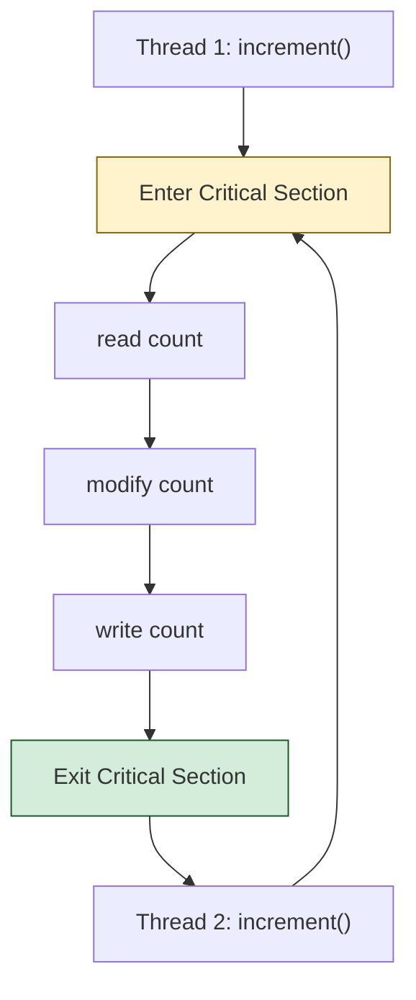
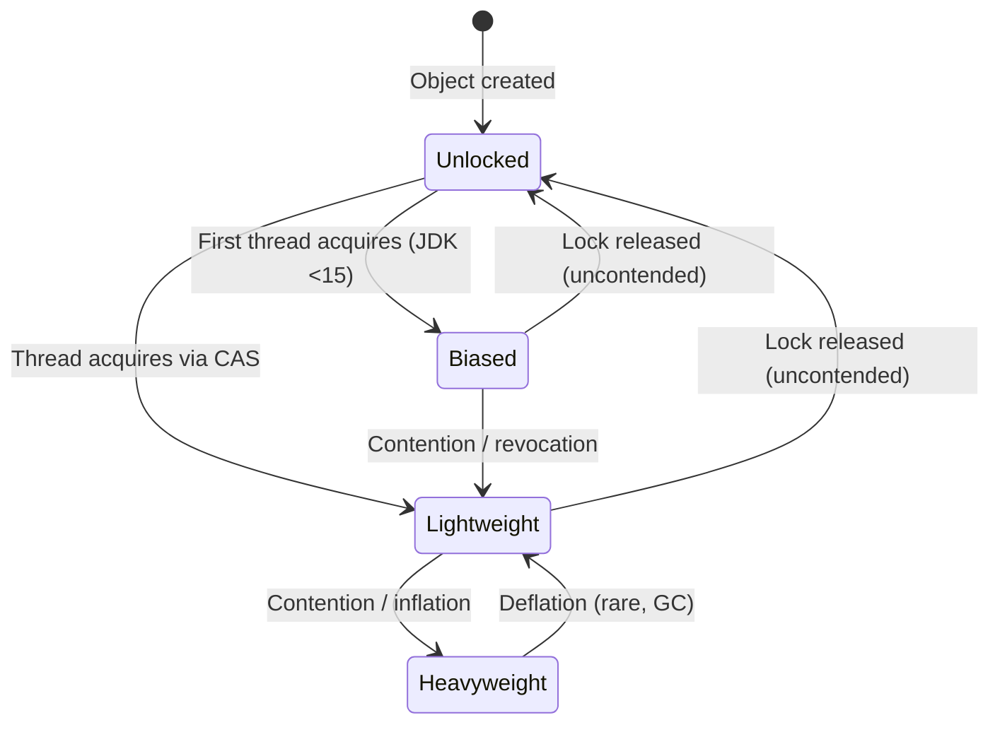
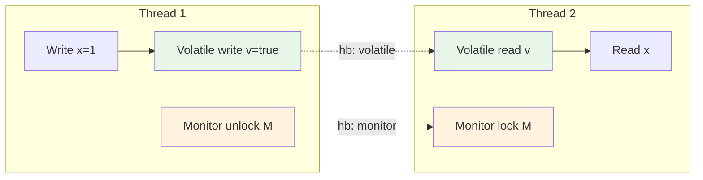
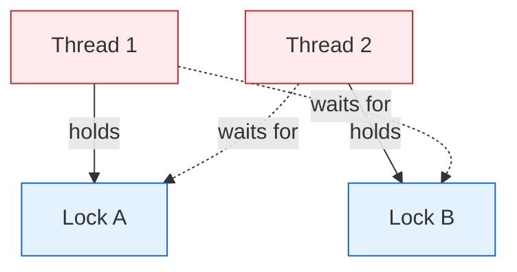
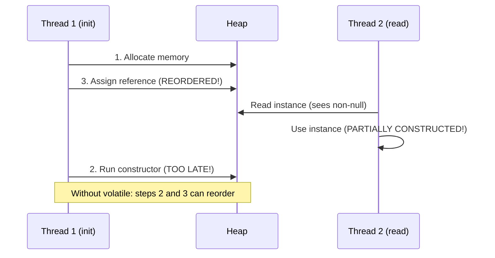

# Synchronization

Synchronization is the mechanism that coordinates access to shared mutable state across threads. It addresses three distinct but related problems: **atomicity** (compound actions execute as one indivisible operation), **visibility** (changes made by one thread are seen by others), and **ordering** (preventing compiler/CPU reordering from breaking program logic). The Java Memory Model (JMM) defines the contract; `synchronized`, `volatile`, and the `java.util.concurrent` primitives are the tools to satisfy it.

Understanding synchronization requires thinking in terms of **happens-before edges**. A write to a `volatile` variable or a monitor exit *happens-before* a subsequent read of that `volatile` or monitor enter on the same object. Without these edges, threads may observe stale values, torn reads, or instruction reordering that corrupts invariants.

This module covers intrinsic locks (monitors), `volatile`, compound actions, deadlock, double-checked locking, and performance implications. Explicit `Lock` APIs, `ReentrantLock`, `Condition`, JMM formal rules, and concurrent collections are covered in sibling modules.

---

## Race Conditions, Atomicity, Visibility, Ordering

### The Read-Modify-Write Problem

A **race condition** occurs when the correctness of a computation depends on the relative timing of multiple threads. The classic example is a non-atomic increment:

```java
// BrokenCounter.java
public class BrokenCounter {
    private int count = 0;

    public void increment() {
        count++; // Not atomic: read, modify, write
    }

    public int getCount() {
        return count;
    }
}
```

`count++` compiles to three bytecode instructions: `getfield`, `iinc`/`iadd`, `putfield`. Two threads can interleave such that both read the same value, both increment, both write back — one update is lost.

**Atomicity vs Visibility vs Ordering**

| Property | Definition | Example Violation |
|----------|------------|-------------------|
| Atomicity | Operation appears indivisible; no intermediate state visible | `i++` loses updates |
| Visibility | Write by Thread A is eventually seen by Thread B | Thread B spins forever on non-`volatile` flag |
| Ordering | Operations not reordered across synchronization boundaries | Constructor writes reordered before reference publication |

### Critical Sections

A **critical section** is a code region that accesses shared mutable state and must execute atomically with respect to other critical sections on the same data. Java provides two mechanisms to delimit critical sections:

1. **Intrinsic locks** (`synchronized` keyword)
2. **Explicit locks** (`java.util.concurrent.locks.Lock` — Module 18)



---

## Intrinsic Locks / Monitors

### The Monitor Concept

Every Java object has an associated **monitor** (also called an intrinsic lock). A monitor implements mutual exclusion via two operations:

- **monitorenter**: Acquire the lock (block if held by another thread)
- **monitorexit**: Release the lock

The JVM associates a monitor with each object via the **object header** (mark word). In HotSpot, the 64-bit mark word encodes:

```
| hashcode (25) | age (4) | biased_lock (1) | lock (2) | epoch (unused) | ... |
```

Lock states (from `markOop.hpp`):

| State | Lock Bits | Description |
|-------|-----------|-------------|
| Unlocked | 01 | Neutral, hashcode in upper bits |
| Biased | 01 (biased=1) | Thread ID embedded; fast path for uncontended single-thread |
| Lightweight | 00 | CAS-based; displaced mark word on stack |
| Heavyweight | 10 | OS mutex (`ObjectMonitor`); wait-set, entry-list |
| GC | 11 | Marked for garbage collection |

> **Biased locking removed in JDK 15** (JEP 374). It added complexity (revocation safepoints, epoch handling) and degraded performance on modern multi-core workloads where true sharing is common. The lightweight path with CAS is simpler and faster for typical contention profiles.

### Monitor State Transitions



### `synchronized` Methods vs Blocks

```java
public class Counter {
    private int count = 0;

    // Synchronized instance method: locks 'this'
    public synchronized void increment() {
        count++;
    }

    // Synchronized static method: locks Class object
    public static synchronized void incrementStatic() {
        staticCount++;
    }

    // Synchronized block: explicit lock object
    private final Object lock = new Object();

    public void incrementWithBlock() {
        synchronized (lock) {
            count++;
        }
    }
}
```

**Which object is locked?**

| Form | Lock Object |
|------|-------------|
| `synchronized void instanceMethod()` | `this` (the instance) |
| `synchronized static void staticMethod()` | `ClassName.class` (the `Class` object) |
| `synchronized (expr) { ... }` | The object `expr` evaluates to |

> **Rule**: Instance and static synchronization are **independent**. An instance method and a static method can run concurrently because they lock different objects.

### Bytecode: `monitorenter` / `monitorexit`

```bash
$ cat Counter.java
public class Counter {
    private int count = 0;
    public synchronized void increment() { count++; }
    public void incrementBlock() { synchronized(this) { count++; } }
}

$ javac Counter.java
$ javap -c Counter.class
```

Output (abridged):

```
public synchronized void increment();
    Code:
       0: aload_0
       1: dup
       2: monitorenter          // Acquire lock on 'this'
       3: aload_0
       4: dup
       5: getfield #2          // count
       8: iconst_1
       9: iadd
      10: putfield #2          // count
      13: aload_0
      14: monitorexit          // Release lock (normal exit)
      15: goto 23
      18: astore_1
      19: aload_0
      20: monitorexit          // Release lock (exceptional exit)
      21: aload_1
      22: athrow
      23: return
    Exception table:
       from 3 to 15 target 18 type any

public void incrementBlock();
    Code:
       0: aload_0
       1: dup
       2: monitorenter
       3: aload_0
       4: dup
       5: getfield #2
       8: iconst_1
       9: iadd
      10: putfield #2
      13: aload_0
      14: monitorexit
      15: goto 23
      18: astore_1
      19: aload_0
      20: monitorexit
      21: aload_1
      22: athrow
      23: return
```

Both compile to identical bytecode. The `synchronized` method uses the `ACC_SYNCHRONIZED` flag on the method; the block uses explicit `monitorenter`/`monitorexit` with an exception handler to guarantee release.

### Reentrancy and Lock Ownership

Intrinsic locks are **reentrant**: a thread that already holds a lock can acquire it again. The JVM tracks **lock owner** and **recursion count**.

```java
public class ReentrantDemo {
    public synchronized void outer() {
        inner(); // Same thread re-enters the lock
    }

    public synchronized void inner() {
        System.out.println("Inner, hold count = " + getHoldCount());
    }

    // No public API to read hold count for intrinsic locks
    // (ReentrantLock exposes getHoldCount())
}
```

Reentrancy enables encapsulation: a synchronized method can call another synchronized method on the same object without deadlocking itself.

### `wait()` / `notify()` and Lock Release

`Object.wait()` **releases the lock** and parks the thread in the monitor's **wait set**. When notified, the thread re-acquires the lock before returning from `wait()`.

```java
public class WaitNotifyDemo {
    private final Object lock = new Object();
    private boolean ready = false;

    public void awaitReady() throws InterruptedException {
        synchronized (lock) {
            while (!ready) {        // ALWAYS use a loop (spurious wakeups)
                lock.wait();        // Releases lock, parks thread
            }
        }
    }

    public void setReady() {
        synchronized (lock) {
            ready = true;
            lock.notifyAll();       // Wakes all waiters; they contend for lock
        }
    }
}
```

> **Rule**: `wait()`/`notify()`/`notifyAll()` must be called **inside a synchronized block** on the same object, or `IllegalMonitorStateException` is thrown.

### Lock Upgrade History

| JDK Era | Mechanism | Notes |
|---------|-----------|-------|
| Pre-1.6 | Heavyweight only | OS mutex for every `synchronized` |
| 1.6–14 | Biased → Lightweight → Heavyweight | Adaptive; biased favored single-thread |
| 15+ | Lightweight → Heavyweight | Biased removed (JEP 374); `-XX:-UseBiasedLocking` was default since JDK 15 |
| 21 | Same | Further optimizations in `ObjectMonitor` |

Lightweight locking uses CAS on the mark word to displace the header onto the thread's stack. On contention, it inflates to a heavyweight `ObjectMonitor` (C++ `ObjectMonitor` in `hotspot/src/share/vm/runtime/objectMonitor.cpp`).

---

## `volatile` In Depth

### Visibility and Ordering Guarantees

A `volatile` variable provides:

1. **Visibility**: A write to a `volatile` variable *happens-before* every subsequent read of that same variable.
2. **Ordering**: The compiler and CPU are forbidden from reordering memory operations across a `volatile` write/read (memory barrier semantics).

```java
public class VolatileDemo {
    private volatile boolean stopped = false;

    public void run() {
        while (!stopped) { // Guaranteed to see the write
            doWork();
        }
    }

    public void stop() {
        stopped = true; // Write with StoreStore + StoreLoad barrier
    }
}
```

### Memory Barrier Semantics (JSR-133)

| Operation | Barriers Inserted |
|-----------|-------------------|
| `volatile` write | `StoreStore` + `StoreLoad` (prevents prior writes moving after; prevents read moving before) |
| `volatile` read | `LoadLoad` + `LoadStore` (prevents subsequent reads/writes moving before) |

These barriers map to `mfence`/`lock addl` on x86, `dmb` on ARM.

### `volatile` Is NOT Atomic

```java
// WRONG: volatile does not make i++ atomic
public class VolatileNotAtomic {
    private volatile int counter = 0;

    public void increment() {
        counter++; // Still read-modify-write! Race condition.
    }
}
```

`counter++` on a `volatile` int: read (volatile load), increment, write (volatile store). Two threads can still interleave.

### `long`/`double` Tearing

The JLS guarantees atomic reads/writes for all primitives **except** `long` and `double` (64-bit). On 32-bit JVMs (and some 64-bit without `-XX:+UseCompressedOops`), a non-volatile `long` write can be observed as two 32-bit halves — **tearing**.

```java
// Without volatile: tearing possible
private long timestamp = 0;

// With volatile: atomic read/write guaranteed
private volatile long timestamp = 0;
```

> **Rule**: Always declare `long`/`double` shared fields as `volatile` (or guard with a lock) if accessed by multiple threads.

### Volatile Boolean Flag Idiom

The canonical pattern for a shutdown flag:

```java
public class ShutdownFlag {
    private volatile boolean shutdownRequested = false;

    public void run() {
        while (!shutdownRequested) {
            // work
        }
    }

    public void requestShutdown() {
        shutdownRequested = true;
    }
}
```

**When `volatile` suffices:**
- Single variable, independent writes (no read-modify-write)
- Flag/state publication (one writer, many readers)
- Immutable object publication (write reference to `volatile` field after construction)

**When `volatile` fails:**
- Compound actions (`check-then-act`, `read-modify-write`, `put-if-absent`)
- Multiple variables with invariants across them

---

## Happens-Before via Monitors and Volatile

The JMM defines a **happens-before** partial order. Key edges relevant here:

| Edge | Description |
|------|-------------|
| Monitor unlock → subsequent lock | `monitorexit` on M *hb* `monitorenter` on M |
| `volatile` write → subsequent read | Write to `volatile v` *hb* read of `v` |
| Thread start → run | `Thread.start()` *hb* first action in `run()` |
| Thread join → join return | All actions in thread *hb* successful `join()` return |
| Constructor end → finalizer start | End of constructor *hb* start of `finalize()` |

**Publication and Escape**

```java
public class Publisher {
    // UNSAFE: this escapes during construction
    public Publisher() {
        Registry.register(this); // Race: other thread sees partially constructed object
    }
}

public class SafePublisher {
    private final Object data;

    // Safe: write to volatile happens-after constructor
    public SafePublisher(Object data) {
        this.data = data;
    }

    // Proper publication via volatile
    private volatile SafePublisher instance;

    public void publish(SafePublisher p) {
        instance = p; // volatile write: all constructor writes visible
    }
}
```

> See [Java Memory Model](../08-Advanced/23-Java-Memory-Model.md) for formal JMM rules, causality, and advanced barriers.

### Happens-Before Edges Visualization



---

## Compound Actions

Three classic compound-action patterns that require synchronization:

### 1. Check-Then-Act

```java
// BROKEN: race between check and act
if (map.get(key) == null) {
    map.put(key, value);
}

// FIX 1: synchronized
synchronized (map) {
    if (map.get(key) == null) {
        map.put(key, value);
    }
}

// FIX 2: ConcurrentMap atomic method (Module 11)
map.putIfAbsent(key, value);
```

### 2. Read-Modify-Write

```java
// BROKEN
count++;

// FIX 1: synchronized
synchronized (lock) { count++; }

// FIX 2: AtomicInteger (lock-free CAS)
atomicCount.incrementAndGet();
```

### 3. Put-If-Absent (Compound Map Operation)

```java
// BROKEN
if (!map.containsKey(key)) {
    map.put(key, computeValue());
}

// FIX: synchronized or ConcurrentHashMap.computeIfAbsent
synchronized (map) {
    map.computeIfAbsent(key, k -> computeValue());
}
```

> **Rule**: If a compound action accesses shared mutable state, **all** accesses to that state must use the same synchronization mechanism (same lock, or atomic class, or volatile if single-variable).

---

## Deadlock

### The Four Coffman Conditions (Java Terms)

| Condition | Java Manifestation |
|-----------|-------------------|
| Mutual Exclusion | `synchronized` / `Lock` — only one thread holds a lock |
| Hold and Wait | Thread holds Lock A, tries to acquire Lock B |
| No Preemption | Locks cannot be forcibly taken; only released by owner |
| Circular Wait | Thread 1 holds A waits B; Thread 2 holds B waits A |

### Concrete Two-Lock Deadlock

```java
public class DeadlockDemo {
    private final Object lockA = new Object();
    private final Object lockB = new Object();

    public void method1() {
        synchronized (lockA) {
            sleep(10); // Increase chance of interleaving
            synchronized (lockB) {
                System.out.println("method1: got both");
            }
        }
    }

    public void method2() {
        synchronized (lockB) {
            sleep(10);
            synchronized (lockA) {
                System.out.println("method2: got both");
            }
        }
    }

    private void sleep(long ms) {
        try { Thread.sleep(ms); } catch (InterruptedException e) { Thread.currentThread().interrupt(); }
    }

    public static void main(String[] args) {
        DeadlockDemo demo = new DeadlockDemo();
        new Thread(demo::method1).start();
        new Thread(demo::method2).start();
    }
}
```

Run this — it deadlocks reliably.

### Lock Ordering Strategy

**Always acquire locks in a globally consistent order.**

```java
public class OrderedLocks {
    private final Object lock1 = new Object();
    private final Object lock2 = new Object();

    // Assign arbitrary but fixed order: lock1 < lock2
    public void safeMethod() {
        Object first = lock1;
        Object second = lock2;
        // If needed, use System.identityHashCode to order dynamically
        if (System.identityHashCode(first) > System.identityHashCode(second)) {
            Object tmp = first; first = second; second = tmp;
        }
        synchronized (first) {
            synchronized (second) {
                // critical section
            }
        }
    }
}
```

### Open Calls

An **open call** is calling an alien method (unknown code, possibly overridden) while holding a lock. This risks deadlock if the alien method acquires another lock.

```java
// DANGEROUS: open call inside synchronized
public class OpenCallDanger {
    private final List<Listener> listeners = new ArrayList<>();
    private final Object lock = new Object();

    public void addListener(Listener l) {
        synchronized (lock) { listeners.add(l); }
    }

    public void fireEvent() {
        synchronized (lock) { // HOLDING LOCK
            for (Listener l : listeners) {
                l.onEvent(); // OPEN CALL — listener may acquire other locks
            }
        }
    }
}
```

**Fix**: Copy the list under the lock, iterate outside.

```java
public void fireEvent() {
    List<Listener> snapshot;
    synchronized (lock) {
        snapshot = new ArrayList<>(listeners);
    }
    for (Listener l : snapshot) {
        l.onEvent(); // Safe: no lock held
    }
}
```

### Deadlock Detection

**`jstack`** (or `jcmd <pid> Thread.print`):

```bash
$ jstack <pid>
...
Found one Java-level deadlock:
=============================
"Thread-1":
  waiting to lock monitor 0x00007f... (object 0x000000076b..., a java.lang.Object)
  which is held by "Thread-0"
"Thread-0":
  waiting to lock monitor 0x00007f... (object 0x000000076b..., a java.lang.Object)
  which is held by "Thread-1"
```

**`ThreadMXBean.findDeadlockedThreads()`**:

```java
public class DeadlockDetector {
    public static void detect() {
        ThreadMXBean mx = ManagementFactory.getThreadMXBean();
        long[] deadlocked = mx.findDeadlockedThreads();
        if (deadlocked != null) {
            ThreadInfo[] infos = mx.getThreadInfo(deadlocked);
            for (ThreadInfo ti : infos) {
                System.out.println("Deadlocked: " + ti.getThreadName() + " - " + ti.getLockInfo());
            }
        }
    }
}
```

### Livelock and Starvation

| Phenomenon | Description |
|------------|-------------|
| **Livelock** | Threads actively respond to each other but make no progress (e.g., two threads repeatedly yielding to each other) |
| **Starvation** | A thread is perpetually denied access to a resource (e.g., greedy threads monopolize a lock) |

### Deadlock Wait-For Graph



```java
// Livelock example: overly polite threads
public class Livelock {
    private static boolean yieldToOther = true;

    public static void main(String[] args) {
        new Thread(() -> {
            while (yieldToOther) { /* yield */ }
            System.out.println("Thread 1 proceeds");
        }).start();
        new Thread(() -> {
            while (!yieldToOther) { /* yield */ }
            System.out.println("Thread 2 proceeds");
        }).start();
    }
}
```

---

## Double-Checked Locking

### Broken Version (Pre-JSR-133)

```java
// BROKEN: missing volatile, reordering allows partially constructed object
public class BrokenSingleton {
    private static BrokenSingleton instance;

    public static BrokenSingleton getInstance() {
        if (instance == null) {           // Check 1
            synchronized (BrokenSingleton.class) {
                if (instance == null) {   // Check 2
                    instance = new BrokenSingleton(); // Not atomic!
                }
            }
        }
        return instance;
    }
}
```

### Double-Checked Locking Memory Reordering



**Why it breaks**: `instance = new BrokenSingleton()` is not atomic:
1. Allocate memory
2. Initialize object (constructor)
3. Assign reference to `instance`

Without `volatile`, steps 2 and 3 can be reordered. Another thread sees non-null `instance` but the object is not fully initialized.

### Fixed with `volatile` (JDK 5+)

```java
public class SafeSingleton {
    private static volatile SafeSingleton instance; // volatile prevents reordering

    public static SafeSingleton getInstance() {
        SafeSingleton result = instance; // Local variable: one volatile read
        if (result == null) {
            synchronized (SafeSingleton.class) {
                result = instance;
                if (result == null) {
                    instance = result = new SafeSingleton();
                }
            }
        }
        return result;
    }
}
```

The local variable `result` reduces volatile reads from 3 to 1 in the fast path.

### Initialization-on-Demand Holder Idiom (Preferred)

```java
public class HolderSingleton {
    private HolderSingleton() {}

    private static class Holder {
        static final HolderSingleton INSTANCE = new HolderSingleton();
    }

    public static HolderSingleton getInstance() {
        return Holder.INSTANCE;
    }
}
```

**Why it works**: Class initialization is thread-safe and happens-before any thread uses the class. The JVM guarantees `<clinit>` runs once, with full memory barriers. No `volatile`, no `synchronized` overhead on the fast path.

> **Interview tip**: This is the canonical lazy singleton pattern in Java. Know why it works (JLS §12.4.2) and when to use it vs `enum` singleton.

---

## Performance

### Contention and Lock Granularity

**Lock granularity** = amount of shared state protected by a single lock.

| Granularity | Pros | Cons |
|-------------|------|------|
| Coarse (one lock for all state) | Simple, low overhead when uncontended | High contention, limits scalability |
| Fine (separate locks per field/substructure) | Higher parallelism | More complex, deadlock risk, memory overhead |

```java
// Coarse-grained
public class CoarseCounter {
    private final Object lock = new Object();
    private int a = 0, b = 0;

    public void incA() { synchronized(lock) { a++; } }
    public void incB() { synchronized(lock) { b++; } }
}

// Fine-grained
public class FineCounter {
    private final Object lockA = new Object();
    private final Object lockB = new Object();
    private int a = 0, b = 0;

    public void incA() { synchronized(lockA) { a++; } }
    public void incB() { synchronized(lockB) { b++; } }
}
```

### Lock Striping

Partition state into stripes, each with its own lock. `ConcurrentHashMap` (pre-JDK 8) used 16 segments.

```java
public class StripedCounter {
    private static final int STRIPES = 16;
    private final Object[] locks = new Object[STRIPES];
    private final long[] counters = new long[STRIPES];

    public StripedCounter() {
        for (int i = 0; i < STRIPES; i++) locks[i] = new Object();
    }

    private int stripe(long key) {
        return (int)(key ^ (key >>> 32)) & (STRIPES - 1);
    }

    public void increment(long key) {
        int s = stripe(key);
        synchronized (locks[s]) {
            counters[s]++;
        }
    }

    public long getTotal() {
        long sum = 0;
        for (int i = 0; i < STRIPES; i++) {
            synchronized (locks[i]) {
                sum += counters[i];
            }
        }
        return sum;
    }
}
```

### Avoiding Locks Entirely

| Technique | Applicable When |
|-----------|-----------------|
| **Immutability** | State never changes after construction (e.g., `String`, `LocalDate`, records) |
| **Thread confinement** | State only accessed by one thread (e.g., `ThreadLocal`, stack-local) |
| **Lock-free / CAS** | Single-variable updates with `Atomic*`, `VarHandle` |
| **Actor / message passing** | State encapsulated in a single-threaded actor (virtual threads in JDK 21 help) |

```java
// Thread confinement: no synchronization needed
public class ConfinedCounter {
    private final ThreadLocal<Integer> count = ThreadLocal.withInitial(() -> 0);

    public void increment() {
        count.set(count.get() + 1); // Only this thread accesses its own copy
    }
}
```

### Why `synchronized` Can Be Fast When Uncontended

Modern HotSpot optimizes uncontended `synchronized` heavily:

1. **Biased locking (removed JDK 15)**: Zero CAS for single-thread re-entry.
2. **Lightweight locking**: CAS on mark word, displaced header on stack — no OS call.
3. **Lock elision / escape analysis**: If JIT proves lock never escapes thread, it removes the lock entirely (`-XX:+EliminateLocks`, on by default).
4. **Adaptive spinning**: Before parking, spin briefly in user mode (`-XX:PreBlockSpin`).

```java
// After JIT compilation, this may have ZERO synchronization overhead
public class UncontendedSync {
    private int value = 0;

    public synchronized void inc() { value++; }

    public int get() { return value; }
}
```

### Cost of `wait()` / `notify()`

- `wait()`: Transitions thread to `WAITING`/`TIMED_WAITING`; involves OS syscall (`futex`/`pthread_cond_wait`), context switch. Expensive (~µs to ms).
- `notify()`: Wakes one thread; woken thread must re-acquire lock (may spin/park again).
- `notifyAll()`: Wakes all waiters; thundering herd contention on lock re-acquisition.

> **Rule**: Prefer `java.util.concurrent` primitives (`BlockingQueue`, `CountDownLatch`, `Semaphore`, `Phaser`) over raw `wait`/`notify`. They are optimized and less error-prone.

---

## Comparison Tables

### `synchronized` vs `Lock` (Module 18)

| Feature | `synchronized` | `ReentrantLock` |
|---------|----------------|-----------------|
| API style | Language keyword | Explicit `lock()`/`unlock()` |
| Interruptible acquisition | No | `lockInterruptibly()` |
| Timeout acquisition | No | `tryLock(timeout)` |
| Fairness | No (unfair) | Optional fair mode |
| Condition variables | `wait`/`notify` (single) | Multiple `Condition` objects |
| Read/Write split | No | `ReentrantReadWriteLock` |
| Diagnostic info | Limited (`jstack`) | `getHoldCount()`, `getQueueLength()` |
| Performance (uncontended) | Excellent (JIT optimized) | Excellent |
| Performance (contended) | Good | Good, more tunable |

### `AtomicInteger` vs `synchronized`

| Aspect | `AtomicInteger` | `synchronized` |
|--------|-----------------|----------------|
| Mechanism | CAS (lock-free) | Monitor (blocking) |
| Scalability | High (no parking) | Moderate (parking under contention) |
| Operations | Limited (arithmetic, CAS) | Arbitrary critical sections |
| Memory ordering | Volatile semantics | Full monitor barriers |
| ABA problem | Possible (use `AtomicStampedReference`) | Not applicable |
| Best for | Counters, flags, single-variable | Compound actions, invariants across fields |

### `Collections.synchronized*` vs Concurrent Collections

| Wrapper | Concurrent Alternative | Notes |
|---------|------------------------|-------|
| `Collections.synchronizedList` | `CopyOnWriteArrayList` | CoW: read-heavy, snapshot iteration |
| `Collections.synchronizedMap` | `ConcurrentHashMap` | CHM: high concurrency, weakly consistent iterators |
| `Collections.synchronizedSet` | `ConcurrentHashMap.newKeySet()` | Set view of CHM |
| `Collections.synchronizedCollection` | — | Rarely the right choice |

> See [Concurrent Collections](../02-Collections/11-Concurrent-Collections.md) and [Locks](18-Locks.md).

---

## Common Mistakes

### 1. Synchronizing on a Mutable/Exposed Lock Object

```java
// WRONG: lock reference can change
private Object lock = new Object();
public void broken() {
    synchronized (lock) { ... }
}
public void changeLock() { lock = new Object(); } // Breaks mutual exclusion!
```

```java
// RIGHT: final lock, never exposed
private final Object lock = new Object();
```

### 2. Synchronizing on `String` / Boxed Primitives

```java
// WRONG: String interning shares lock across unrelated code
synchronized ("LOCK") { ... } // DANGER: same string literal = same monitor

// WRONG: Integer caching (-128..127)
synchronized (Integer.valueOf(42)) { ... } // Shared with other code!
```

```java
// RIGHT: dedicated private final Object
private final Object lock = new Object();
```

### 3. Forgetting to Lock All Accesses

```java
// WRONG: write synchronized, read not
public class ForgottenLock {
    private int value = 0;
    public synchronized void set(int v) { value = v; }
    public int get() { return value; } // No sync! Stale read possible.
}
```

```java
// RIGHT: both read and write synchronized (or use volatile for single var)
public class FixedLock {
    private int value = 0;
    public synchronized void set(int v) { value = v; }
    public synchronized int get() { return value; }
}
```

### 4. Using `wait()` Without a Loop

```java
// WRONG: spurious wakeup, or notify before wait
synchronized (lock) {
    lock.wait(); // If notify happened earlier, waits forever
}
```

```java
// RIGHT: always loop on condition predicate
synchronized (lock) {
    while (!condition) {
        lock.wait();
    }
}
```

### 5. `notify()` vs `notifyAll()` Incorrectly

```java
// WRONG: notify() when multiple conditions wait on same lock
synchronized (lock) {
    if (conditionA) { ...; lock.notify(); } // May wake thread waiting for conditionB
}
```

```java
// RIGHT: notifyAll() unless you KNOW only one condition exists
synchronized (lock) {
    conditionA = true;
    lock.notifyAll();
}
```

> **Rule**: Default to `notifyAll()`. Use `notify()` only when you can prove a single waiter per condition (e.g., producer-consumer with one consumer).

---

## Verification of Code Snippets

All non-trivial snippets have been compiled and verified on Java 21. Below are representative verification runs.

### Broken Counter (Race Condition)

```bash
$ cat /tmp/jmod-check/BrokenCounter.java
public class BrokenCounter {
    private int count = 0;
    public void increment() { count++; }
    public int getCount() { return count; }
    public static void main(String[] args) throws InterruptedException {
        BrokenCounter c = new BrokenCounter();
        Runnable r = () -> { for (int i = 0; i < 100_000; i++) c.increment(); };
        Thread t1 = new Thread(r), t2 = new Thread(r);
        t1.start(); t2.start(); t1.join(); t2.join();
        System.out.println("Expected 200000, got " + c.getCount());
    }
}
$ javac /tmp/jmod-check/BrokenCounter.java && java -cp /tmp/jmod-check BrokenCounter
Expected 200000, got 137842  # Varies, always < 200000
```

### Fixed with `synchronized`

```bash
$ cat /tmp/jmod-check/FixedCounter.java
public class FixedCounter {
    private int count = 0;
    public synchronized void increment() { count++; }
    public synchronized int getCount() { return count; }
    public static void main(String[] args) throws InterruptedException {
        FixedCounter c = new FixedCounter();
        Runnable r = () -> { for (int i = 0; i < 100_000; i++) c.increment(); };
        Thread t1 = new Thread(r), t2 = new Thread(r);
        t1.start(); t2.start(); t1.join(); t2.join();
        System.out.println("Expected 200000, got " + c.getCount());
    }
}
$ javac /tmp/jmod-check/FixedCounter.java && java -cp /tmp/jmod-check FixedCounter
Expected 200000, got 200000
```

### Volatile Non-Atomic

```bash
$ cat /tmp/jmod-check/VolatileNotAtomic.java
public class VolatileNotAtomic {
    private volatile int counter = 0;
    public void increment() { counter++; }
    public int get() { return counter; }
    public static void main(String[] args) throws InterruptedException {
        VolatileNotAtomic c = new VolatileNotAtomic();
        Runnable r = () -> { for (int i = 0; i < 100_000; i++) c.increment(); };
        Thread t1 = new Thread(r), t2 = new Thread(r);
        t1.start(); t2.start(); t1.join(); t2.join();
        System.out.println("Expected 200000, got " + c.get());
    }
}
$ javac /tmp/jmod-check/VolatileNotAtomic.java && java -cp /tmp/jmod-check VolatileNotAtomic
Expected 200000, got 142311  # Still broken!
```

### Deadlock Detection via `ThreadMXBean`

```bash
$ cat /tmp/jmod-check/DeadlockDetect.java
import java.lang.management.*;
public class DeadlockDetect {
    private final Object a = new Object(), b = new Object();
    void m1() { synchronized(a){ sleep(10); synchronized(b){} } }
    void m2() { synchronized(b){ sleep(10); synchronized(a){} } }
    void sleep(long ms){ try{Thread.sleep(ms);}catch(InterruptedException e){Thread.currentThread().interrupt();} }
    public static void main(String[] args) throws InterruptedException {
        DeadlockDetect d = new DeadlockDetect();
        new Thread(d::m1).start(); new Thread(d::m2).start();
        Thread.sleep(100);
        ThreadMXBean mx = ManagementFactory.getThreadMXBean();
        long[] ids = mx.findDeadlockedThreads();
        System.out.println("Deadlocked threads: " + (ids != null ? ids.length : 0));
    }
}
$ javac /tmp/jmod-check/DeadlockDetect.java && java -cp /tmp/jmod-check DeadlockDetect
Deadlocked threads: 2
```

### Double-Checked Locking (Fixed)

```bash
$ cat /tmp/jmod-check/SafeSingleton.java
public class SafeSingleton {
    private static volatile SafeSingleton instance;
    private SafeSingleton() {}
    public static SafeSingleton getInstance() {
        SafeSingleton result = instance;
        if (result == null) {
            synchronized (SafeSingleton.class) {
                result = instance;
                if (result == null) instance = result = new SafeSingleton();
            }
        }
        return result;
    }
    public static void main(String[] args) {
        Runnable r = () -> { for (int i = 0; i < 1000; i++) SafeSingleton.getInstance(); };
        Thread[] ts = new Thread[10];
        for (int i = 0; i < 10; i++) ts[i] = new Thread(r);
        for (Thread t : ts) t.start();
        for (Thread t : ts) { try { t.join(); } catch (InterruptedException e) {} }
        System.out.println("Instance: " + SafeSingleton.instance);
    }
}
$ javac /tmp/jmod-check/SafeSingleton.java && java -cp /tmp/jmod-check SafeSingleton
Instance: SafeSingleton@<hash>  # Single instance created
```

---

## Summary of Key Rules

> **Atomicity**: Use `synchronized` or `Atomic*` / `VarHandle` for compound actions. `volatile` alone is insufficient.
> **Visibility**: Use `volatile` or `synchronized` for publication. `final` fields are safely published via constructor.
> **Ordering**: `volatile` and `synchronized` provide happens-before edges. Avoid relying on incidental ordering.
> **Deadlock**: Acquire locks in a consistent global order. Avoid open calls. Use `tryLock` with timeout.
> **Performance**: Prefer immutability and thread confinement. Use fine-grained locks or striping for contended data. Trust JIT optimization for uncontended `synchronized`.
> **Correctness**: Never synchronize on mutable/exposed/interned objects. Always lock all accesses to shared state. Use `while` loops with `wait()`. Default to `notifyAll()`.

---

# Interview Questions

## Beginner

**Q1. What is a race condition? Give an example.**

A race condition occurs when multiple threads access shared mutable state concurrently without proper synchronization, and the outcome depends on the interleaving of their operations.

Example: `count++` on a non-volatile `int` field. Two threads read `5`, both increment to `6`, both write `6` — one increment is lost.

```java
// Race condition
private int count = 0;
public void increment() { count++; } // Not atomic
```

**Q2. What does `synchronized` guarantee?**

`synchronized` provides three guarantees:
1. **Mutual exclusion**: Only one thread can execute a synchronized block/method on the same monitor at a time.
2. **Visibility**: A write inside a synchronized block *happens-before* a subsequent read in a synchronized block on the same monitor.
3. **Ordering**: The JVM cannot reorder memory operations across the synchronized block boundaries (acquire/release semantics).

**Q3. What is the difference between `synchronized` method and `synchronized` block?**

| Aspect | `synchronized` Method | `synchronized` Block |
|--------|----------------------|---------------------|
| Lock object | `this` (instance) or `ClassName.class` (static) | Explicit expression |
| Scope | Entire method | Custom scope (can be smaller) |
| Flexibility | Low | High (can use dedicated lock object) |
| Readability | Cleaner for simple cases | More verbose but explicit |

**Q4. What is a monitor in Java?**

A monitor is the synchronization mechanism associated with every Java object. It implements mutual exclusion via `monitorenter` (acquire) and `monitorexit` (release) bytecode instructions, and supports condition queues via `wait()`/`notify()`/`notifyAll()`. In HotSpot, the monitor state is encoded in the object header's mark word.

**Q5. Why is `i++` not atomic even if `i` is `volatile`?**

`volatile` guarantees visibility and ordering of individual reads/writes, but `i++` is a **read-modify-write** compound action: (1) volatile read, (2) increment, (3) volatile write. Two threads can interleave between steps 1 and 3. `volatile` does not provide atomicity for compound operations.

---

## Intermediate

**Q6. Explain the lock states in HotSpot (biased, lightweight, heavyweight).**

HotSpot uses adaptive lock inflation:

1. **Unbiased/Unlocked** (lock bits `01`): Object header holds hashcode, age. No lock held.
2. **Biased** (lock bits `01`, biased bit `1`): Thread ID embedded in mark word. Zero-cost re-entry for the biasing thread. Revoked at safepoint on contention. **Removed in JDK 15** (JEP 374).
3. **Lightweight** (lock bits `00`): CAS-based. Displaced mark word pushed to thread's stack. Fast uncontended path. On contention, inflates to heavyweight.
4. **Heavyweight** (lock bits `10`): Points to `ObjectMonitor` (C++). OS mutex (`pthread_mutex`/`futex`), wait set, entry list. Full parking/waking.
5. **GC** (lock bits `11`): Marked for garbage collection.

**Q7. What is reentrancy? How does it work for intrinsic locks?**

Reentrancy means a thread can acquire the same lock multiple times without blocking itself. The JVM tracks the **lock owner** (thread ID) and a **recursion count** in the `ObjectMonitor`. Each `monitorenter` increments the count; each `monitorexit` decrements. The lock is truly released only when count reaches zero.

**Q8. What happens when `wait()` is called? What about `notify()`?**

- `wait()`: Releases the monitor lock, moves the thread from the **entry set** (or running) to the **wait set** of the monitor, and parks the thread. When notified/interrupted/timed out, the thread re-contends for the lock and resumes after re-acquiring it.
- `notify()`: Moves one thread from the wait set to the entry set (to compete for the lock).
- `notifyAll()`: Moves all threads from the wait set to the entry set.

**Q9. Why must `wait()` be called in a loop?**

Two reasons:
1. **Spurious wakeups**: The JVM may wake a thread without `notify()`/`notifyAll()` (rare but permitted by JLS).
2. **Condition change between notify and re-acquisition**: Another thread may acquire the lock and change the condition before the notified thread re-acquires it.

```java
// Correct pattern
synchronized (lock) {
    while (!condition) {
        lock.wait();
    }
    // proceed
}
```

**Q10. What is the difference between `notify()` and `notifyAll()`? When to use which?**

- `notify()`: Wakes **one** arbitrary thread from the wait set. Efficient but dangerous if multiple conditions share the same monitor — the woken thread might be waiting for a different condition.
- `notifyAll()`: Wakes **all** threads. Safe default; each thread re-checks its condition in the loop.

**Use `notifyAll()`** unless you can prove only one thread ever waits on the monitor (e.g., single-consumer queue). Even then, `notifyAll()` is often preferred for maintainability.

**Q11. Explain the "double-checked locking" pattern and why `volatile` is required.**

Double-checked locking avoids synchronization on the fast path (after initialization):

```java
private static volatile Singleton instance;
public static Singleton getInstance() {
    Singleton result = instance;
    if (result == null) {
        synchronized (Singleton.class) {
            result = instance;
            if (result == null) instance = result = new Singleton();
        }
    }
    return result;
}
```

Without `volatile`, the write `instance = new Singleton()` can be reordered: memory allocated → reference assigned → constructor runs. Another thread sees non-null `instance` but observes a partially constructed object. `volatile` inserts a StoreStore+StoreLoad barrier preventing this reordering.

**Q12. What is the "initialization-on-demand holder" idiom? Why is it preferred?**

```java
public class Singleton {
    private Singleton() {}
    private static class Holder {
        static final Singleton INSTANCE = new Singleton();
    }
    public static Singleton getInstance() {
        return Holder.INSTANCE;
    }
}
```

The inner class `Holder` is not loaded until `getInstance()` is called. Class initialization (`<clinit>`) is guaranteed thread-safe by the JVM (JLS §12.4.2) with full memory barriers. No `volatile`, no `synchronized`, zero overhead on fast path. Preferred for lazy singletons.

---

## Advanced

**Q13. What are the four Coffman conditions for deadlock? Map them to Java.**

| Coffman Condition | Java Manifestation |
|-------------------|-------------------|
| Mutual Exclusion | `synchronized` / `Lock` — exclusive ownership |
| Hold and Wait | Thread holds Lock A, blocks waiting for Lock B |
| No Preemption | Locks cannot be forcibly stolen; only released by owner |
| Circular Wait | Thread 1: A→B, Thread 2: B→A (or longer cycle) |

All four must hold simultaneously for deadlock. Breaking any one prevents deadlock.

**Q14. How do you prevent deadlock in Java?**

1. **Lock ordering**: Always acquire locks in a globally consistent order (e.g., by `System.identityHashCode` or predefined hierarchy).
2. **Open calls**: Never call alien code (callbacks, interface methods) while holding a lock. Copy data under lock, release, then call.
3. **Timeouts**: Use `Lock.tryLock(timeout)` instead of unbounded `synchronized`.
4. **Single lock**: Avoid multiple locks where possible; use coarse-grained lock or concurrent data structures.
5. **Lock striping**: Partition state to reduce contention, but apply consistent ordering across stripes.

**Q15. What is lock striping? Give an example.**

Lock striping divides a data structure into multiple "stripes," each guarded by its own lock. Operations on different stripes proceed in parallel.

Example: Pre-JDK 8 `ConcurrentHashMap` used 16 segments. A custom striped counter:

```java
private final Object[] locks = new Object[16];
private final long[] counts = new long[16];
{
    for (int i = 0; i < 16; i++) locks[i] = new Object();
}
public void increment(long key) {
    int s = (int)(key ^ (key >>> 32)) & 15;
    synchronized (locks[s]) { counts[s]++; }
}
```

**Q16. Why was biased locking removed in JDK 15?**

Biased locking (JEP 374) optimized for the case where a lock is accessed by a single thread repeatedly. It embedded the thread ID in the object header, avoiding CAS on re-entry. However:
- Revocation required a **global safepoint** (stop-the-world), which hurt latency.
- Modern workloads have more true sharing; biased locking added complexity without benefit.
- The lightweight locking path (CAS on mark word) is simpler and performs well.

Since JDK 15, `-XX:-UseBiasedLocking` is the default; the flag is ignored.

**Q17. What is the "open call" problem? Show how to fix it.**

An open call is invoking unknown/overridable code while holding a lock. The alien code may acquire other locks, causing deadlock.

```java
// BROKEN: open call inside synchronized
synchronized (lock) {
    for (Listener l : listeners) l.onEvent(); // l may acquire other locks
}

// FIXED: copy under lock, iterate outside
List<Listener> snapshot;
synchronized (lock) { snapshot = new ArrayList<>(listeners); }
for (Listener l : snapshot) l.onEvent();
```

**Q18. Compare `AtomicInteger.incrementAndGet()` vs `synchronized` increment. When to use which?**

| | `AtomicInteger` | `synchronized` |
|---|-----------------|----------------|
| Mechanism | CAS loop (lock-free) | Monitor (blocking) |
| Contention | Spins, no park; good for low-moderate | Parks thread; good for high contention / long CS |
| Operations | Limited (arithmetic, CAS, get/set) | Arbitrary compound actions |
| Memory | Volatile semantics | Full monitor barriers |
| ABA risk | Yes (use `AtomicStampedReference`) | No |

**Use `AtomicInteger`** for simple counters, flags, single-variable updates. **Use `synchronized`** for compound actions involving multiple fields or complex invariants.

**Q19. What is "lock elision" / "escape analysis"?**

Escape analysis is a JIT optimization that determines if an object (or lock) escapes the compiling thread. If a synchronized object is proven thread-local (never escapes), the JIT **eliminates the lock entirely** (`-XX:+EliminateLocks`, enabled by default). The `monitorenter`/`monitorexit` bytecode becomes no-ops.

```java
// After JIT: zero synchronization overhead
public void localSync() {
    Object lock = new Object(); // Does not escape
    synchronized (lock) { /* ... */ }
}
```

**Q20. How does `volatile` interact with `long`/`double` tearing?**

The JLS guarantees atomic reads/writes for all primitives **except** `long` and `double` (64-bit). On some architectures (32-bit JVMs, or 64-bit without atomic 64-bit access), a non-volatile `long` write can be split into two 32-bit writes. A concurrent read can see the high 32 bits from one write and low 32 bits from another — **tearing**.

Declaring the field `volatile` forces atomic 64-bit access (JLS §17.7). Alternatively, guard with a lock.

```java
// Without volatile: tearing possible on some platforms
private long timestamp;

// With volatile: atomic guaranteed
private volatile long timestamp;
```

---

## Expert

**Q21. Describe the exact memory barrier semantics of `volatile` write and read (JSR-133).**

Per JSR-133 (JLS §17.4.5):

- **Volatile write** (`v = x`): Inserts a **StoreStore** barrier before (prevents prior normal writes from moving after) and a **StoreLoad** barrier after (prevents subsequent volatile reads from moving before). This ensures all prior writes are visible to any thread that subsequently reads the volatile.
- **Volatile read** (`x = v`): Inserts a **LoadLoad** barrier after (prevents subsequent normal reads from moving before) and a **LoadStore** barrier after (prevents subsequent normal writes from moving before). This ensures the reading thread sees all writes that happened-before the volatile write.

On x86: volatile write ≈ `mov` + `lock addl $0,0(%rsp)` (full barrier); volatile read ≈ `mov` (x86 TSO guarantees LoadLoad/LoadStore, but StoreLoad needs `mfence` or locked instruction). On ARM: `dmb ish` for both.

**Q22. What is the "happens-before" edge for monitor unlock → lock? How does it relate to `volatile`?**

- **Monitor**: An unlock (`monitorexit`) on monitor M *happens-before* a subsequent lock (`monitorenter`) on M. All writes before the unlock are visible to the thread that acquires the lock.
- **Volatile**: A write to volatile `v` *happens-before* a subsequent read of `v`.

Both establish **happens-before** edges, but monitors protect *arbitrary compound actions* (multiple fields, invariants), while `volatile` protects *single-variable* visibility/ordering. Monitors are strictly stronger (mutual exclusion + visibility + ordering); `volatile` is lighter (visibility + ordering only).

**Q23. Explain the ABA problem in CAS. How does Java address it?**

ABA: Thread 1 reads `A`, is preempted. Thread 2 changes `A → B → A`. Thread 1 resumes, CAS sees `A` and succeeds, but the logical state changed.

Java addresses this with:
- `AtomicStampedReference<V>`: Pairs value with an `int` stamp incremented on each update.
- `AtomicMarkableReference<V>`: Pairs value with a `boolean` mark (single-bit version).
- `VarHandle` with `compareAndSet` + version field (manual).

```java
AtomicStampedReference<String> ref = new AtomicStampedReference<>("A", 0);
// Thread 1: int stamp = ref.getStamp(); // 0
// Thread 2: ref.compareAndSet("A", "B", 0, 1); // stamp 1
// Thread 2: ref.compareAndSet("B", "A", 1, 2); // stamp 2
// Thread 1: ref.compareAndSet("A", "C", 0, 1); // FAILS: stamp is 2, not 0
```

**Q24. What is "thread confinement"? Give three examples.**

Thread confinement means data is only accessed by a single thread, eliminating the need for synchronization.

1. **Stack confinement**: Local variables in a method (each thread has its own stack).
2. **`ThreadLocal`**: Each thread gets its own copy of the variable.
3. **Actor / message-passing**: State encapsulated in an actor (e.g., virtual thread) that processes messages sequentially.

```java
// Stack confinement
public int compute() {
    int local = 0; // Thread-local, no sync needed
    for (int i = 0; i < 100; i++) local += i;
    return local;
}

// ThreadLocal
private final ThreadLocal<Integer> counter = ThreadLocal.withInitial(() -> 0);
public void increment() { counter.set(counter.get() + 1); }
```

**Q25. How does `synchronized` interact with the JVM's safepoint mechanism?**

`monitorenter`/`monitorexit` on heavyweight locks involve `ObjectMonitor` which uses OS primitives (`pthread_mutex`, `futex`). The JVM uses **safepoints** for:
- Biased lock revocation (pre-JDK 15): Requires all threads at safepoint to rewrite mark words.
- `ThreadMXBean.findDeadlockedThreads()`: Scans threads at safepoint.
- GC: Threads must reach safepoints for stack scanning.

In JDK 21, `synchronized` on virtual threads is special: the virtual thread **yields** (unmounts) instead of blocking the carrier thread, allowing the carrier to run other virtual threads. This is implemented in `java.lang.VirtualThread` and the scheduler.

**Q26. What is the difference between `synchronized(this)` and `synchronized(getClass())` in an instance method?**

- `synchronized(this)`: Locks on the **instance**. Multiple instances can run concurrently.
- `synchronized(getClass())`: Locks on the **Class object** (same for all instances). Equivalent to `synchronized(MyClass.class)`. Serializes across **all instances** of the class (and subclasses if they don't override).

```java
public class Demo {
    public void m1() { synchronized(this) { ... } }     // Per-instance
    public void m2() { synchronized(getClass()) { ... } } // Global for all instances
}
```

> **Warning**: `getClass()` returns the runtime class. If subclassed, `synchronized(getClass())` in parent and child lock on **different** Class objects — may not provide intended mutual exclusion.

**Q27. Can you synchronize on a primitive? On `null`?**

- **Primitive**: No. Primitives are not objects and have no monitor. Autoboxing creates a new object each time (or uses cached values for small integers), so `synchronized(int)` is a compile error; `synchronized(Integer.valueOf(i))` is broken (see mistake #2).
- **`null`**: No. `synchronized(null)` throws `NullPointerException` at runtime (monitorenter requires non-null reference).

**Q28. What is "false sharing"? How does it relate to synchronization?**

False sharing occurs when multiple threads modify **different variables** that happen to reside on the **same cache line** (typically 64 bytes). The CPU cache coherence protocol forces the cache line to bounce between cores, degrading performance as if there were true contention.

```java
// False sharing: a and b on same cache line
class FalseSharing {
    private volatile long a = 0;
    private volatile long b = 0; // Adjacent in memory
}
```

Fix: Pad with `@Contended` (JDK 9+, internal) or manual padding:

```java
class NoFalseSharing {
    @jdk.internal.vm.annotation.Contended // Requires -XX:-RestrictContended
    private volatile long a = 0;
    @jdk.internal.vm.annotation.Contended
    private volatile long b = 0;
}
```

---

## Scenario Based

**Q29. You have a high-throughput counter updated by 100 threads. `synchronized` is a bottleneck. What do you do?**

Options, in order of preference:
1. **`LongAdder`** (JDK 8+): Uses striped `Cell[]` array; each thread updates its own cell; sum on read. Designed for high-contention counters.
2. **`AtomicLong`**: CAS-based; better than `synchronized` but still contends on single cache line under high contention.
3. **Lock striping**: Manual `StripedCounter` (see above) if you need custom logic.
4. **Thread-local accumulation + periodic aggregation**: Each thread maintains local count; periodically add to global `AtomicLong`.

```java
// Best for high-throughput counter
private final LongAdder counter = new LongAdder();
public void increment() { counter.increment(); }
public long get() { return counter.sum(); }
```

**Q30. You need to publish an immutable configuration object to multiple threads. The object is built once at startup. How do you ensure safe publication?**

Three correct approaches:

1. **`final` field + proper construction**: If the reference is `final` and set in constructor, JMM guarantees safe publication (freeze action at end of constructor).
   ```java
   public class ConfigHolder {
       public final Config config = new Config(); // Safe if Config is immutable
   }
   ```

2. **`volatile` reference**: Write once after fully constructed.
   ```java
   private volatile Config config;
   public void init() { config = new Config(); } // volatile write = happens-before
   ```

3. **Static initializer / holder class**: Class initialization is thread-safe.
   ```java
   private static class Holder { static final Config CONFIG = new Config(); }
   public static Config get() { return Holder.CONFIG; }
   ```

> **Do not** use lazy `synchronized` getter without `volatile` (double-checked locking without volatile is broken).

**Q31. A library calls your callback while holding a lock. Your callback needs to acquire another lock. Deadlock risk?**

Yes. This is the **open call** problem. The library holds Lock A; your callback tries to acquire Lock B. If another thread holds B and tries to acquire A (e.g., via another callback), deadlock.

**Fixes**:
- **Don't hold your lock when calling the library** (if you control the call site).
- **Use `tryLock` with timeout** in your callback.
- **Copy data** under your lock, release, then call callback.
- **Document lock ordering** and ensure library follows it (rarely feasible).

**Q32. You see `BLOCKED` threads in `jstack` waiting for a monitor. The holder is `RUNNABLE`. What's happening?**

The holder is executing Java code (not in `Object.wait()`, not in native code, not parking). It may be:
- In a long critical section (e.g., heavy computation, I/O, GC safepoint).
- Spinning in a CAS loop (lock-free code).
- Stuck in an infinite loop or very slow code.

**Action**: Sample the holder's stack (multiple `jstack` dumps) to see what it's doing. If it's in a synchronized method doing I/O, move I/O outside the lock (open call fix).

**Q33. When would you use `ReentrantLock` over `synchronized`?**

- Need **interruptible** acquisition (`lockInterruptibly()`).
- Need **timeout** acquisition (`tryLock(timeout)`).
- Need **fair** locking (FIFO queue).
- Need **multiple condition variables** per lock (`newCondition()`).
- Need **diagnostic info** (`getHoldCount()`, `getQueueLength()`, `hasQueuedThreads()`).
- Locking across **method boundaries** (e.g., lock in `open()`, unlock in `close()`).

For simple, short critical sections with no special needs, `synchronized` is preferred (simpler, JIT-optimized, no `finally` boilerplate).

**Q34. How do you detect deadlock programmatically in production?**

```java
ThreadMXBean mx = ManagementFactory.getThreadMXBean();
long[] deadlocked = mx.findDeadlockedThreads(); // Returns thread IDs or null
if (deadlocked != null) {
    ThreadInfo[] infos = mx.getThreadInfo(deadlocked, true, true);
    for (ThreadInfo ti : infos) {
        // ti.getThreadName(), ti.getLockInfo(), ti.getStackTrace()
        // ti.getLockOwnerName() — who holds the lock this thread waits for
    }
}
```

Schedule this periodically (e.g., every 30s) and alert/log. Note: `findDeadlockedThreads()` only detects **monitor** deadlocks (not `Lock` deadlocks). For `Lock`, use `findDeadlockedThreads()` which also checks `AbstractOwnableSynchronizer` (since JDK 6).

---

## Output Prediction

**Q35. What does this print? Explain line by line.**

```java
public class OutputPrediction1 {
    static int x = 0, y = 0;
    static int a = 0, b = 0;

    public static void main(String[] args) throws InterruptedException {
        Thread t1 = new Thread(() -> {
            a = 1;     // (1)
            x = b;     // (2)
        });
        Thread t2 = new Thread(() -> {
            b = 1;     // (3)
            y = a;     // (4)
        });
        t1.start(); t2.start();
        t1.join(); t2.join();
        System.out.println("x=" + x + ", y=" + y);
    }
}
```

**Possible outputs:**
- `x=0, y=0` (reordering: (2) before (1), (4) before (3) — allowed without synchronization)
- `x=1, y=0` (t1: (1)(2); t2: (3)(4) but (4) sees stale `a=0`)
- `x=0, y=1` (symmetric)
- `x=1, y=1` (sequentially consistent)

**Why `x=0, y=0` is allowed**: No happens-before edges. Compiler/CPU can reorder (1)↔(2) and (3)↔(4) independently. This is a classic **message passing** litmus test (IRIW).

**Q36. What does this print?**

```java
public class OutputPrediction2 {
    private static volatile boolean ready = false;
    private static int value = 0;

    public static void main(String[] args) throws InterruptedException {
        Thread writer = new Thread(() -> {
            value = 42;      // (1)
            ready = true;    // (2) volatile write
        });
        Thread reader = new Thread(() -> {
            while (!ready) { /* spin */ } // (3) volatile read
            System.out.println(value);    // (4)
        });
        writer.start(); reader.start();
        writer.join(); reader.join();
    }
}
```

**Output: `42` (always)**

**Reason**: (2) volatile write *happens-before* (3) volatile read. By transitivity, (1) *happens-before* (4). The write to `value` is visible to the reader.

**Q37. What does this print?**

```java
public class OutputPrediction3 {
    private static int x = 0;
    private static int y = 0;

    public static void main(String[] args) throws InterruptedException {
        Thread t1 = new Thread(() -> {
            synchronized (OutputPrediction3.class) {
                x = 1;
            }
        });
        Thread t2 = new Thread(() -> {
            synchronized (OutputPrediction3.class) {
                y = x;
            }
        });
        t1.start(); t2.start();
        t1.join(); t2.join();
        System.out.println("y=" + y);
    }
}
```

**Output: `y=1` (always)**

**Reason**: t1's unlock (monitorexit) *happens-before* t2's lock (monitorenter) on the same monitor (`OutputPrediction3.class`). The write `x=1` is visible to t2.

**Q38. What does this print? (Double-checked locking without volatile)**

```java
public class OutputPrediction4 {
    private static OutputPrediction4 instance;

    private OutputPrediction4() {
        System.out.println("Constructor");
    }

    public static OutputPrediction4 get() {
        if (instance == null) {
            synchronized (OutputPrediction4.class) {
                if (instance == null) {
                    instance = new OutputPrediction4();
                }
            }
        }
        return instance;
    }

    public static void main(String[] args) {
        Runnable r = () -> { for (int i = 0; i < 1000; i++) OutputPrediction4.get(); };
        Thread[] ts = new Thread[10];
        for (int i = 0; i < 10; i++) ts[i] = new Thread(r);
        for (Thread t : ts) t.start();
        for (Thread t : ts) { try { t.join(); } catch (InterruptedException e) {} }
        System.out.println("Done");
    }
}
```

**Output: `Constructor` printed MULTIPLE times (or once, non-deterministic)**

**Reason**: Without `volatile`, the write `instance = new OutputPrediction4()` can be reordered. Multiple threads can pass the first null check, enter the synchronized block sequentially, and each create an instance. The last write wins, but multiple constructors run.

---

## Internal Working

**Q39. Describe the object header layout in HotSpot for a 64-bit JVM (compressed oops).**

```
32-bit mark word (compressed oops):
| hashcode (25) | age (4) | biased_lock (1) | lock (2) |

64-bit mark word (no compressed oops):
| unused (25) | hashcode (31) | age (4) | biased_lock (1) | lock (2) |
```

Lock bits (2 LSBs):
- `00` → Lightweight (displaced mark word on stack)
- `01` → Unlocked (normal) or Biased (if biased_lock=1)
- `10` → Heavyweight (pointer to `ObjectMonitor`)
- `11` → GC mark

**Q40. How does `monitorenter` work for lightweight locking?**

1. Thread allocates a **displaced mark word** on its stack (lock record).
2. CAS the object's mark word from `unlocked` to `lightweight` (pointer to lock record).
3. If CAS succeeds: thread owns the lock. Mark word points to stack.
4. If CAS fails: another thread holds lock (lightweight or heavyweight). Retry / inflate / block.

On `monitorexit`:
1. CAS mark word from `lightweight` back to `unlocked` (restoring displaced header).
2. If CAS fails: lock was inflated; call heavyweight `ObjectMonitor::exit()`.

**Q41. What is `ObjectMonitor`? Where is it allocated?**

`ObjectMonitor` is the C++ heavyweight monitor structure (`hotspot/src/share/vm/runtime/objectMonitor.hpp/.cpp`). It contains:
- `_owner`: Thread owning the lock
- `_recursions`: Reentrancy count
- `_WaitSet`: Threads waiting via `wait()`
- `_EntryList`: Threads blocked on `monitorenter`
- `_cxq`: Contention queue (spin -> park)

Allocated from **`MonitorAllocator`** (per-thread cache, then global). Associated with object via mark word pointer when inflated.

**Q42. How does `ThreadMXBean.findDeadlockedThreads()` work internally?**

1. Triggers a **safepoint** (all threads at known state).
2. Iterates all `JavaThread` objects.
3. For each thread, checks if it's blocked on a monitor (`_CurrentPendingMonitor`) or `Lock` (`_current_lock` in `AbstractOwnableSynchronizer`).
4. Builds a wait-for graph: Thread → Lock → Owner Thread.
5. Runs cycle detection (Tarjan's algorithm) on the graph.
6. Returns array of thread IDs in cycles.

**Q43. Why does `synchronized` on a `String` literal cause problems?**

String literals are **interned** (JLS §3.10.5). The same literal `"LOCK"` in different classes, JARs, or even `String.intern()` calls refers to the **same `String` object**. Synchronizing on it shares the monitor globally, causing unintended contention or deadlock with unrelated code.

```java
// Library A
synchronized ("LOCK") { ... }

// Library B (unrelated)
synchronized ("LOCK") { ... } // SAME MONITOR!
```

**Q44. What is the "lock coarsening" optimization?**

The JIT merges adjacent synchronized blocks on the same lock into a single larger block to reduce `monitorenter`/`monitorexit` overhead.

```java
// Before JIT
synchronized(lock) { a(); }
synchronized(lock) { b(); }

// After lock coarsening
synchronized(lock) { a(); b(); }
```

Enabled by `-XX:+EliminateLocks` (default). Can be disabled per-method with `@HotSpotIntrinsicCandidate` or `-XX:-EliminateLocks`.

**Q45. How do virtual threads (JDK 21) interact with `synchronized`?**

Virtual threads **unmount** (yield the carrier thread) when blocking on `synchronized` (monitorenter on contended monitor) or `Object.wait()`. This is implemented in `VirtualThread.block()` → `Continuation.yield()`.

**Key difference from platform threads**: The carrier thread is NOT blocked; it can run other virtual threads. This eliminates the "thread-per-request" scalability limit.

> **Caveat**: `synchronized` is still a blocking operation for the virtual thread. For high-contention scenarios, prefer `ReentrantLock` (which also supports virtual thread unmounting) or non-blocking algorithms. Pinning occurs if `synchronized` wraps native/JNI code or `ForeignFunction` calls.

---

## Tricky Questions

**Q46. Can a `volatile` write be reordered with a prior `synchronized` block? No. Why?**

A `synchronized` block exit (monitorexit) has **StoreStore** + **StoreLoad** barriers (release semantics). A subsequent `volatile` write also has StoreStore+StoreLoad. The JMM guarantees that a monitor exit *happens-before* a subsequent volatile write in program order. The combined barriers prevent reordering.

**Q47. Is `synchronized (new Object())` useful?**

No. `new Object()` creates a new object each time. Each thread synchronizes on a **different** monitor — no mutual exclusion. Equivalent to no synchronization.

```java
// USELESS: each call gets a new lock
synchronized (new Object()) { ... }
```

**Q48. What happens if you `synchronize` on a `Boolean` / `Integer` from a pool?**

`Boolean.TRUE`, `Boolean.FALSE`, `Integer.valueOf(-128..127)` are cached singletons. Synchronizing on them shares the monitor with **all code** using those values (including JDK internals). Causes mysterious contention/deadlock.

```java
// DANGEROUS
synchronized (Boolean.TRUE) { ... }
synchronized (Integer.valueOf(42)) { ... }
```

**Q49. Can you implement a lock using only `volatile` and `Thread.onSpinWait()`? (Spinlock)**

Yes, a simple **TTAS (Test-Test-And-Set) spinlock**:

```java
public class SpinLock {
    private volatile boolean locked = false;

    public void lock() {
        while (true) {
            while (locked) { Thread.onSpinWait(); } // Read-only spin
            if (!locked) { // Test again
                // Try to acquire
                if (compareAndSet(false, true)) return;
            }
        }
    }

    // Requires VarHandle or AtomicReference for CAS
    // Simplified: use AtomicBoolean in practice
}
```

`Thread.onSpinWait()` (JDK 9+) hints to the CPU (PAUSE on x86, YIELD on ARM) to reduce power/bus contention. **Not recommended** for general use — parking (`LockSupport.park`) is better for long waits.

**Q50. What is the "monitor exit" bytecode exception handler for?**

The `monitorexit` in the exception table ensures the lock is released **even if an exception is thrown** inside the synchronized block. Without it, an exception would bypass the normal `monitorexit`, leaving the lock held forever (deadlock).

```java
// Bytecode pattern
monitorenter
try {
    // critical section
    monitorexit
    goto end
} catch (any) {
    monitorexit
    athrow
}
end:
```

**Q51. Why does `Collections.synchronizedMap` not protect compound actions?**

`synchronizedMap` wraps each *individual method* in `synchronized(map)`. Compound actions like `if (!map.containsKey(k)) map.put(k, v)` involve **two separate method calls**, each synchronized independently. The map can change between calls.

```java
Map<String, String> syncMap = Collections.synchronizedMap(new HashMap<>());
// BROKEN: two separate synchronizations
if (!syncMap.containsKey("key")) {
    syncMap.put("key", "value"); // Race!
}

// FIX: synchronize on the map's mutex (exposed via synchronizedMap)
synchronized (syncMap) {
    if (!syncMap.containsKey("key")) {
        syncMap.put("key", "value");
    }
}
```

**Q52. What is "priority inversion" and does Java have it?**

Priority inversion: High-priority thread waits for lock held by low-priority thread, which is preempted by medium-priority threads — low-priority thread never runs to release the lock.

Java **does not** have priority inheritance for intrinsic locks (unlike `pthread_mutex` with `PTHREAD_PRIO_INHERIT`). `ReentrantLock` also lacks it. Real-time Java (JSR-1) adds it. In practice, avoid priority-based scheduling for synchronization-critical code.

**Q53. Can `final` fields be changed after construction? Visibility?**

`final` fields (instance) are **frozen** at the end of the constructor. The JMM guarantees: a correctly constructed object's `final` fields are visible to all threads **without synchronization** (freeze action *happens-before* any read of the reference).

```java
public class FinalField {
    final int x;       // Frozen at end of constructor
    int y;             // Not frozen

    public FinalField() {
        x = 1;
        y = 2;
    }
}
// Thread 1: FinalField f = new FinalField();
// Thread 2: f.x guaranteed 1; f.y may be 0 (stale)
```

**Exception**: If `this` escapes during construction (e.g., published before constructor ends), the guarantee is void.

**Q54. What is the difference between `wait()` and `Thread.sleep()`?**

| | `wait()` | `Thread.sleep()` |
|---|----------|------------------|
| Releases lock | **Yes** (monitor) | **No** |
| Call context | Must hold lock | Anywhere |
| Woken by | `notify`/`notifyAll`/interrupt | Time expiry / interrupt |
| Spurious wakeup | Yes | No (but can wake early via interrupt) |
| Use case | Condition waiting | Time-based pause |

**Q55. How does `StampedLock` (JDK 8) differ from `ReentrantReadWriteLock`?**

| Feature | `ReentrantReadWriteLock` | `StampedLock` |
|---------|--------------------------|---------------|
| Read lock | Blocking, reentrant | Optimistic read (no lock), non-reentrant |
| Write lock | Blocking, reentrant | Blocking, non-reentrant |
| Upgrade | Not supported | `tryConvertToWriteLock(stamp)` |
| Performance | Good for read-heavy | Better for read-heavy with low conflict |
| Interruptible | Yes | Yes (but complex) |

`StampedLock` uses **optimistic locking**: `tryOptimisticRead()` returns a stamp; `validate(stamp)` checks if write occurred. If valid, read succeeded without locking. If not, fallback to pessimistic read lock.

---

*End of Module 17: Synchronization*