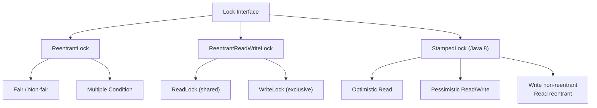
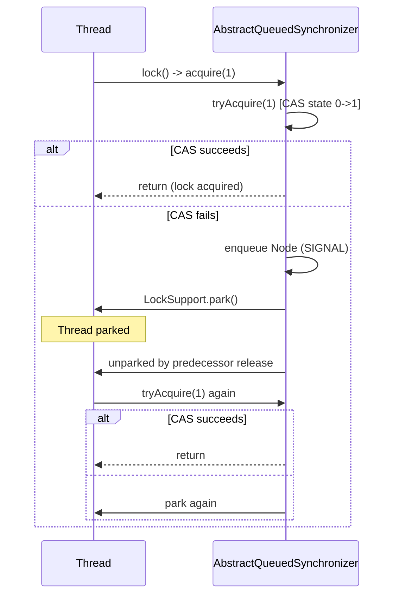
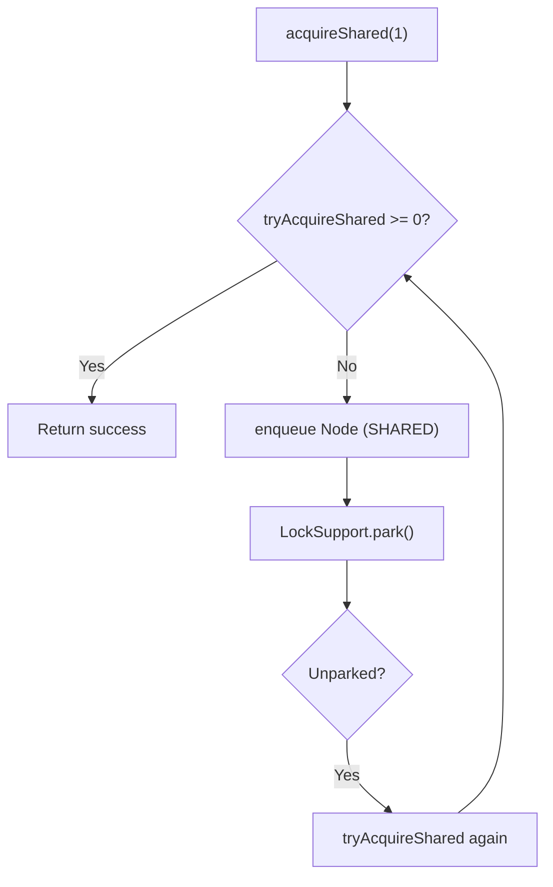

# Locks

Locks in `java.util.concurrent.locks` provide explicit, flexible synchronization primitives that overcome the limitations of intrinsic locks (`synchronized`). They expose the lock acquisition protocol as a first-class API: interruptible acquisition, timed waits, non-blocking attempts, fairness policies, multiple condition variables per lock, and separate read/write locks. Understanding their internals — especially AbstractQueuedSynchronizer (AQS) — is essential for diagnosing contention, deadlocks, and performance anomalies in production systems.

---

## `java.util.concurrent.locks` Overview

The `Lock` interface and its implementations decouple locking from block structure. Unlike `synchronized`, a `Lock` can be acquired in one method and released in another, supports `tryLock` for non-blocking attempts, `lockInterruptibly` for cancellation, and multiple `Condition` objects for fine-grained signalling.

| Capability | `synchronized` | `Lock` (`ReentrantLock`) |
|------------|----------------|--------------------------|
| Block-structured only | Yes | No (explicit `lock`/`unlock`) |
| `tryLock()` (non-blocking) | No | Yes |
| Timed `tryLock(timeout)` | No | Yes |
| Interruptible acquisition | No | Yes (`lockInterruptibly`) |
| Fairness policy | No (JVM-dependent) | Yes (constructor arg) |
| Multiple conditions | No (single wait set) | Yes (multiple `Condition`s) |
| Read/write separation | No | Via `ReentrantReadWriteLock` |
| Optimistic reads | No | Via `StampedLock` |
| Reentrancy | Yes | Yes (configurable) |
| Condition `await` in `finally` | N/A | Required (must hold lock) |
| Performance (uncontended) | Excellent (biased locking) | Slightly higher overhead |
| Performance (high contention) | Good | Better control, fair option |

> **Rule**: Always release a `Lock` in a `finally` block. Never call `unlock` without holding the lock — throws `IllegalMonitorStateException`.



---

## `ReentrantLock`: Reentrancy, Acquisition Modes, Fairness

`ReentrantLock` implements `Lock` with semantics similar to `synchronized` but with extended capabilities. It is **reentrant**: the same thread can acquire the lock multiple times; `getHoldCount()` returns the recursion depth.

### Basic Structure

```java
import java.util.concurrent.locks.ReentrantLock;

class Counter {
    private final ReentrantLock lock = new ReentrantLock();
    private int count = 0;

    void increment() {
        lock.lock();
        try {
            count++;
        } finally {
            lock.unlock();
        }
    }

    int get() {
        lock.lock();
        try {
            return count;
        } finally {
            lock.unlock();
        }
    }
}
```

### `lockInterruptibly()` — Cancellation Support

Acquires the lock unless the current thread is interrupted. Throws `InterruptedException` if interrupted while waiting. **Does not** clear the interrupted status on success — the exception is the signal.

```java
void interruptibleTask() throws InterruptedException {
    lock.lockInterruptibly();
    try {
        // critical section
    } finally {
        lock.unlock();
    }
}
```

### `tryLock()` and `tryLock(long, TimeUnit)` — Non-blocking & Timed

- `tryLock()`: returns `true` immediately if lock is free; `false` otherwise. Never blocks.
- `tryLock(timeout, unit)`: waits up to the timeout for the lock. Returns `true` on success, `false` on timeout. Throws `InterruptedException` if interrupted.

```java
boolean tryWithTimeout() throws InterruptedException {
    if (lock.tryLock(500, TimeUnit.MILLISECONDS)) {
        try {
            return doWork();
        } finally {
            lock.unlock();
        }
    }
    return false; // timeout
}
```

### Fairness: `new ReentrantLock(true)`

- **Fair** (`true`): threads acquire in FIFO order. A thread calling `lock()` queues behind existing waiters. Prevents starvation but reduces throughput (more context switches).
- **Non-fair** (`false`, default): barging allowed. A thread calling `lock()` can acquire even if others are queued, if the lock becomes free at the right moment. Higher throughput, possible starvation.

```java
ReentrantLock fairLock = new ReentrantLock(true);
ReentrantLock nonFairLock = new ReentrantLock(false); // default
```

**Trade-off**: Fair locks serialize contention, adding ~10-20% overhead under high contention. Use fair locks only when strict FIFO ordering is a correctness requirement (e.g., sequencing operations).

### Inspection Methods

| Method | Description |
|--------|-------------|
| `getHoldCount()` | Recursion depth for current thread (0 if not held) |
| `isHeldByCurrentThread()` | `true` if current thread holds the lock |
| `isLocked()` | `true` if any thread holds the lock |
| `hasQueuedThreads()` | `true` if threads are waiting |
| `getQueueLength()` | Estimated number of waiting threads |
| `hasQueuedThread(Thread)` | `true` if given thread is waiting |
| `isFair()` | `true` if fairness is enabled |

---

## `Condition`: Multiple Wait Sets, Precise Signalling

A `Condition` factors out the `Object` monitor methods (`wait`/`notify`/`notifyAll`) into a separate object bound to a `Lock`. One `Lock` can have **multiple `Condition` instances**, each with its own wait set.

### Core Methods

| Method | Behaviour |
|--------|-----------|
| `await()` | Releases lock, blocks until signal/interrupt. Re-acquires lock before return. |
| `awaitUninterruptibly()` | Like `await` but ignores interrupts (interrupt status preserved). |
| `awaitNanos(timeout)` | Timed wait; returns remaining nanoseconds (≤0 on timeout). |
| `awaitUntil(deadline)` | Absolute deadline wait. |
| `signal()` | Wakes **one** waiting thread. |
| `signalAll()` | Wakes **all** waiting threads. |

### Critical Rule: `await` in a `while` Loop

Spurious wakeups and missed signals mandate a condition predicate loop:

```java
class BoundedBuffer<T> {
    private final Object[] items = new Object[10];
    private int putIdx = 0, takeIdx = 0, count = 0;
    private final ReentrantLock lock = new ReentrantLock();
    private final Condition notFull = lock.newCondition();
    private final Condition notEmpty = lock.newCondition();

    public void put(T x) throws InterruptedException {
        lock.lock();
        try {
            while (count == items.length) notFull.await(); // while, not if
            items[putIdx] = x;
            if (++putIdx == items.length) putIdx = 0;
            ++count;
            notEmpty.signal(); // wake one consumer
        } finally {
            lock.unlock();
        }
    }

    @SuppressWarnings("unchecked")
    public T take() throws InterruptedException {
        lock.lock();
        try {
            while (count == 0) notEmpty.await();
            T x = (T) items[takeIdx];
            items[takeIdx] = null;
            if (++takeIdx == items.length) takeIdx = 0;
            --count;
            notFull.signal(); // wake one producer
            return x;
        } finally {
            lock.unlock();
        }
    }
}
```

### Missed Signal Pitfall

If you `signal()` when no thread is waiting, the signal is **lost**. With `synchronized`/`notify`, the same problem exists. The fix: always check the predicate in a `while` loop (as above). The predicate must be guarded by the lock.

### `awaitNanos` for Deadline-Driven Waits

```java
boolean awaitWithDeadline(Condition c, long deadlineNanos) throws InterruptedException {
    long remaining = deadlineNanos - System.nanoTime();
    while (remaining > 0) {
        remaining = c.awaitNanos(remaining);
    }
    return remaining > 0;
}
```

### Two Conditions vs `wait`/`notify`

| Aspect | `wait`/`notify` | `Condition` (two wait sets) |
|--------|-----------------|-----------------------------|
| Wait sets per lock | 1 | N (multiple `Condition`s) |
| Signal precision | `notifyAll` wakes all | `signal` wakes one per condition |
| Predicate clarity | Single condition variable | Separate `notFull` / `notEmpty` |
| Interrupted handling | `InterruptedException` | Same + `awaitUninterruptibly` |
| API | `Object` methods | Explicit `Condition` object |

---

## `ReentrantReadWriteLock`: Shared/Exclusive Locking

`ReentrantReadWriteLock` maintains a pair of locks: a **read lock** (shared, multiple holders) and a **write lock** (exclusive, single holder). Readers block writers; writers block readers and other writers.

### Lock Acquisition Rules

| Current Holders | Read Lock Request | Write Lock Request |
|-----------------|-------------------|---------------------|
| None | Granted (shared) | Granted (exclusive) |
| Readers (N) | Granted (shared) | Blocked |
| Writer | Blocked | Blocked |

### Key Characteristics

- **Read lock is reentrant**: a thread holding the read lock can re-acquire it.
- **Write lock is reentrant**: a thread holding the write lock can re-acquire it.
- **Read → Write upgrade is NOT supported**: attempting to acquire write lock while holding read lock **deadlocks** (the thread blocks on itself).
- **Write → Read downgrade IS supported**: a thread holding the write lock can acquire the read lock, then release the write lock.

```java
class Cache<K, V> {
    private final Map<K, V> map = new HashMap<>();
    private final ReentrantReadWriteLock rwLock = new ReentrantReadWriteLock();
    private final Lock r = rwLock.readLock();
    private final Lock w = rwLock.writeLock();

    V get(K key) {
        r.lock();
        try {
            return map.get(key);
        } finally {
            r.unlock();
        }
    }

    V put(K key, V value) {
        w.lock();
        try {
            return map.put(key, value);
        } finally {
            w.unlock();
        }
    }

    // Write-to-read downgrade: useful for "check-then-act" under write lock
    V computeIfAbsent(K key, Function<K, V> fn) {
        w.lock();
        try {
            V v = map.get(key);
            if (v != null) return v;
            // Downgrade: acquire read lock before releasing write lock
            r.lock();
            try {
                w.unlock(); // now hold read lock only
                v = map.get(key);
                if (v == null) {
                    v = fn.apply(key);
                    // Must re-acquire write lock to update
                    w.lock();
                    try {
                        map.put(key, v);
                    } finally {
                        w.unlock();
                    }
                }
            } finally {
                r.unlock();
            }
            return v;
        } finally {
            // Note: if we took the early return, we still hold write lock
            // This pattern is tricky — prefer compute() in ConcurrentHashMap
        }
    }
}
```

### Fairness

`new ReentrantReadWriteLock(true)` creates a fair instance. Fairness applies to **both** read and write locks: threads queue in FIFO order. A waiting writer blocks subsequent readers (no barging), preventing writer starvation but reducing read concurrency.

### Writer Starvation

In non-fair mode, a steady stream of readers can starve writers indefinitely. Fair mode prevents this but serializes readers. `StampedLock` (below) offers better throughput for read-heavy workloads.

---

## `StampedLock` (Java 8): Optimistic Reads, Write Non-Reentrant

`StampedLock` is a **capability-based** lock: every successful acquisition returns a `long` **stamp**. The stamp must be passed to `unlock*` methods. **Write lock is not reentrant** — calling `writeLock()` twice from the same thread blocks. **Read lock is reentrant** — a thread can acquire the read lock multiple times (tracked via hold count in state).

### Three Modes

| Mode | Method | Stamp | Exclusivity | Reentrant? |
|------|--------|-------|-------------|------------|
| Write | `writeLock()` | `long` (non-zero) | Exclusive | **No** |
| Read (pessimistic) | `readLock()` | `long` (non-zero) | Shared | **Yes** |
| Optimistic read | `tryOptimisticRead()` | `long` (non-zero) | None (validation later) | N/A |

### Optimistic Reads

Optimistic reads **do not block writers**. They read without a lock, then validate the stamp. If validation fails (a write occurred), fall back to a pessimistic read lock.

```java
class Point {
    private double x, y;
    private final StampedLock sl = new StampedLock();

    void move(double deltaX, double deltaY) {
        long stamp = sl.writeLock();
        try {
            x += deltaX;
            y += deltaY;
        } finally {
            sl.unlockWrite(stamp);
        }
    }

    double distanceFromOrigin() {
        long stamp = sl.tryOptimisticRead();
        double curX = x, curY = y;
        if (!sl.validate(stamp)) { // write occurred during read
            stamp = sl.readLock();
            try {
                curX = x;
                curY = y;
            } finally {
                sl.unlockRead(stamp);
            }
        }
        return Math.hypot(curX, curY);
    }
}
```

### Stamp Values

- `0`: invalid stamp (failed acquisition, or initial value).
- Non-zero: valid stamp. **Bits encode mode**: write stamps are odd; read stamps are even (except 0). Do not rely on bit patterns — use API methods.

### Converting Between Modes

```java
// Try optimistic, upgrade to read if needed
long stamp = sl.tryOptimisticRead();
readData();
if (!sl.validate(stamp)) {
    stamp = sl.readLock();
    try {
        readData();
    } finally {
        sl.unlockRead(stamp);
    }
}

// Read → Write upgrade (tryConvertToWriteLock)
stamp = sl.readLock();
try {
    if (needsWrite()) {
        long ws = sl.tryConvertToWriteLock(stamp);
        if (ws != 0) {
            stamp = ws;
            doWrite();
        } else {
            // Could not upgrade; release read, acquire write
            sl.unlockRead(stamp);
            stamp = sl.writeLock();
            try {
                doWrite();
            } finally {
                sl.unlockWrite(stamp);
            }
            return;
        }
    }
} finally {
    if (sl.isReadLockStamp(stamp)) sl.unlockRead(stamp);
    else if (sl.isWriteLockStamp(stamp)) sl.unlockWrite(stamp);
}
```

### When `StampedLock` Beats `ReentrantReadWriteLock`

- Read-heavy workloads with low write contention: optimistic reads scale nearly linearly.
- Low-latency reads: no cache-line bouncing on read lock acquisition.
- **Not** when: reentrancy needed, recursive read-lock acquisition, or write-heavy (pessimistic read/write similar to `ReentrantReadWriteLock`).

### Caveats

- **Write lock non-reentrant**: calling `writeLock()` twice from same thread **blocks** (deadlocks).
- **Read lock reentrant**: multiple `readLock()` calls succeed; each must be matched with `unlockRead()`.
- **No `Condition` support**: cannot wait/signal on `StampedLock`.
- **No fairness policy**: writers can starve readers and vice versa.
- **Stamp management**: losing a stamp leaks the lock (no automatic unlock).
- **Upgrade read→write**: use `tryConvertToWriteLock()` (returns 0 if other readers exist).
- **Downgrade write→read**: use `tryConvertToReadLock()`; `tryReadLock()` while holding write returns 0.

---

## Spin Locks, `LockSupport`, and AQS Mental Model

### `LockSupport.park` / `unpark`

`LockSupport` provides the low-level thread blocking/unblocking primitives that all higher-level locks (AQS-based) use.

```java
// Park current thread until unparked or interrupted
LockSupport.park(); // can pass a "blocker" object for diagnostics

// Unpark a specific thread (makes its next park() return immediately)
LockSupport.unpark(thread);
```

- `park()` returns if: thread is unparked, interrupted, or spuriously.
- `unpark()` is **idempotent**: calling it on an already-unparked thread sets a permit; next `park()` consumes it and returns immediately.
- No `IllegalMonitorStateException` — no lock ownership required.

### AbstractQueuedSynchronizer (AQS) Mental Model

All standard `Lock` implementations (`ReentrantLock`, `ReentrantReadWriteLock`, `Semaphore`, `CountDownLatch`, etc.) are built on **AQS**. Understanding AQS explains their behaviour.

#### Core AQS Components

| Component | Role |
|-----------|------|
| `state` (int/long) | Synchronization state (lock count, permits, latch count). Modified via `getState`/`setState`/`compareAndSetState`. |
| `head` / `tail` | FIFO queue of `Node`s representing waiting threads. |
| `Node` | Holds thread reference, wait status, prev/next links, mode (shared/exclusive). |
| `acquire(int)` | Exclusive acquisition: try `tryAcquire`; if fails, enqueue & park. |
| `release(int)` | Exclusive release: try `tryRelease`; if succeeds, unpark successor. |
| `acquireShared(int)` | Shared acquisition: try `tryAcquireShared`; if >=0, success; else enqueue. |
| `releaseShared(int)` | Shared release: try `tryReleaseShared`; if succeeds, propagate. |

#### AQS Queue Node Status

| Status | Meaning |
|--------|---------|
| `0` | Initial |
| `SIGNAL` (-1) | Successor must be unparked on release |
| `CANCELLED` (1) | Thread cancelled (timeout/interrupt) |
| `CONDITION` (-2) | Node is on a condition queue |
| `PROPAGATE` (-3) | Shared release should propagate |

#### Exclusive Acquisition Flow (`ReentrantLock.lock()`)



#### Shared Acquisition Flow (`ReentrantReadWriteLock.readLock()`)



### Custom Synchronizers with AQS

You can extend `AbstractQueuedSynchronizer` directly. Example: a **binary latch** (like `CountDownLatch` but reusable):

```java
import java.util.concurrent.locks.AbstractQueuedSynchronizer;

class BinaryLatch {
    private final Sync sync = new Sync();

    private static class Sync extends AbstractQueuedSynchronizer {
        @Override
        protected boolean tryAcquireShared(int ignored) {
            return getState() == 1 ? 1 : -1;
        }
        @Override
        protected boolean tryReleaseShared(int ignored) {
            setState(1);
            return true;
        }
    }

    void await() throws InterruptedException {
        sync.acquireSharedInterruptibly(0);
    }

    void open() {
        sync.releaseShared(0);
    }

    void close() {
        sync.getState(); // state=0 is closed; but we need to reset queue
        // Actually, AQS doesn't support easy reset. Use CountDownLatch instead.
    }
}
```

> **Note**: AQS is designed for **one-shot** or **monotonic** state transitions. Resetting state while threads are queued is error-prone. Prefer composing existing utilities.

---

## Deadlock with Multiple Locks

Deadlock arises when two threads each hold one lock and wait for the other's lock.

### Classic Deadlock Example

```java
class Account {
    private final ReentrantLock lock = new ReentrantLock();
    private int balance = 100;

    void transfer(Account to, int amount) throws InterruptedException {
        lock.lock();
        try {
            to.lock.lock(); // DEADLOCK if concurrent reverse transfer
            try {
                balance -= amount;
                to.balance += amount;
            } finally {
                to.lock.unlock();
            }
        } finally {
            lock.unlock();
        }
    }
}
```

### Lock Ordering (Prevention)

Always acquire locks in a **global fixed order** (e.g., by `System.identityHashCode` or a unique ID).

```java
void transfer(Account from, Account to, int amount) throws InterruptedException {
    Account first = from.id < to.id ? from : to;
    Account second = from.id < to.id ? to : from;
    first.lock.lock();
    try {
        second.lock.lock();
        try {
            from.balance -= amount;
            to.balance += amount;
        } finally {
            second.lock.unlock();
        }
    } finally {
        first.lock.unlock();
    }
}
```

### `tryLock`-Based Avoidance (Deadlock Detection + Backoff)

Attempt to acquire both with timeout; if either fails, release all and retry with backoff.

```java
boolean transferWithRetry(Account from, Account to, int amount, 
                          long timeout, TimeUnit unit) throws InterruptedException {
    long deadline = System.nanoTime() + unit.toNanos(timeout);
    long backoff = 1;
    while (System.nanoTime() < deadline) {
        if (from.lock.tryLock(backoff, TimeUnit.MILLISECONDS)) {
            try {
                if (to.lock.tryLock(deadline - System.nanoTime(), TimeUnit.NANOSECONDS)) {
                    try {
                        from.balance -= amount;
                        to.balance += amount;
                        return true;
                    } finally {
                        to.lock.unlock();
                    }
                }
            } finally {
                from.lock.unlock();
            }
        }
        // Exponential backoff with jitter
        backoff = Math.min(backoff * 2, 100);
        Thread.sleep(ThreadLocalRandom.current().nextLong(backoff));
    }
    return false;
}
```

### Detecting Deadlocks Programmatically

Use `ThreadMXBean.findDeadlockedThreads()`:

```java
ThreadMXBean mx = ManagementFactory.getThreadMXBean();
long[] deadlocked = mx.findDeadlockedThreads();
if (deadlocked != null) {
    ThreadInfo[] infos = mx.getThreadInfo(deadlocked);
    for (ThreadInfo ti : infos) {
        System.out.println("Deadlocked: " + ti.getThreadName() + 
                           " waiting for " + ti.getLockName());
    }
}
```

> **Tip**: This only detects **monitor** deadlocks (intrinsic locks) and **Lock** deadlocks where threads are blocked in `Lock.lock()` — not `tryLock` timeouts or livelocks.

---

## Performance: Contention, Context Switch, Fairness, `StampedLock`

### Contention Costs

| Scenario | Cost |
|----------|------|
| Uncontended `synchronized` | ~1-2 ns (biased locking, Java 8+) |
| Uncontended `ReentrantLock` | ~5-10 ns (CAS + volatile) |
| Contended (queue + park) | ~1-5 µs per context switch |
| Cache line bounce (lock word) | ~50-100 ns per hop (NUMA worse) |

### Fairness Overhead

Fair locks disable barging. Every acquisition checks the queue head. Under high contention:
- Non-fair: throughput ~2-3x higher (barging reduces queue management)
- Fair: strict FIFO, but each handoff requires `unpark`/`park` pair

### `StampedLock` Throughput

Optimistic reads avoid cache-line bouncing entirely. On read-heavy workloads (95%+ reads), `StampedLock` can achieve **5-10x throughput** over `ReentrantReadWriteLock`. Write-heavy: similar to `ReentrantReadWriteLock`.

### When to Prefer `synchronized`

- Simple, short critical sections.
- No need for interruptible/timed/multiple-condition features.
- JVM optimizations (biased locking, lock coarsening, escape analysis) apply automatically.
- Code clarity and maintainability.

> **Rule of thumb**: Default to `synchronized`. Use `ReentrantLock` when you need its specific features. Use `ReentrantReadWriteLock` for read-heavy maps/caches. Use `StampedLock` for latency-sensitive read-heavy hot paths (Java 8+).

---

## Comparison Table

| Feature | `synchronized` | `ReentrantLock` | `ReentrantReadWriteLock` | `StampedLock` |
|---------|----------------|-----------------|--------------------------|---------------|
| Reentrant | Yes | Yes | Yes (both) | **Read: Yes, Write: No** |
| Interruptible acquire | No | Yes (`lockInterruptibly`) | Yes | No |
| Timed acquire | No | Yes (`tryLock`) | Yes | No (spin only) |
| Non-blocking try | No | Yes (`tryLock()`) | Yes | No |
| Fairness option | No | Yes | Yes | No |
| Multiple conditions | No | Yes | Yes (per lock) | **No** |
| Read/write separation | No | No | Yes | Yes |
| Optimistic reads | No | No | No | **Yes** |
| Upgrade read→write | N/A | N/A | **Deadlocks** | `tryConvertToWriteLock` |
| Downgrade write→read | N/A | N/A | Supported | Supported |
| Condition support | `wait`/`notify` | `newCondition()` | `readLock`/`writeLock` each have | None |
| AQS-based | No (JVM intrinsic) | Yes | Yes | Yes (custom) |
| Performance (uncontended) | Best | Good | Good | Good |
| Performance (read-heavy) | Poor | Poor | Good | **Best** |
| Java version | 1.0 | 5 | 5 | 8 |

---

## Common Mistakes

### 1. Forgetting `unlock` in `finally`

```java
// WRONG
lock.lock();
doWork();
lock.unlock(); // If doWork throws, unlock never called

// RIGHT
lock.lock();
try {
    doWork();
} finally {
    lock.unlock();
}
```

### 2. Calling `await` Without Holding the Lock

```java
// WRONG - throws IllegalMonitorStateException
condition.await();

// RIGHT
lock.lock();
try {
    while (!predicate) condition.await();
} finally {
    lock.unlock();
}
```

### 3. Treating `StampedLock` Write Lock as Reentrant

```java
// WRONG - deadlocks (blocks on itself)
long stamp = sl.writeLock();
sl.writeLock(); // BLOCKS forever

// RIGHT - write lock is not reentrant; restructure to avoid reentrancy
// Read lock IS reentrant:
long r1 = sl.readLock();
long r2 = sl.readLock(); // OK
sl.unlockRead(r2);
sl.unlockRead(r1);
```

### 4. Broken `tryLock` Retry Loop (Livelock)

```java
// WRONG - busy spin, wastes CPU
while (!lock.tryLock()) {
    // no backoff, no yield
}

// RIGHT - with backoff and timeout
long deadline = System.nanoTime() + timeout;
while (System.nanoTime() < deadline) {
    if (lock.tryLock()) return true;
    LockSupport.parkNanos(1000); // or Thread.yield()
}
return false;
```

### 5. Read-to-Write Upgrade in `ReentrantReadWriteLock`

```java
// WRONG - DEADLOCKS
rwLock.readLock().lock();
rwLock.writeLock().lock(); // Blocks forever waiting for readers (self) to release

// RIGHT - release read lock first, then acquire write lock
rwLock.readLock().lock();
try {
    // read
} finally {
    rwLock.readLock().unlock();
}
rwLock.writeLock().lock();
try {
    // write
} finally {
    rwLock.writeLock().unlock();
}
```

### 6. Losing `StampedLock` Stamp

```java
// WRONG - stamp lost, lock leaked
long stamp = sl.writeLock();
if (condition) return; // stamp not unlocked!

// RIGHT
long stamp = sl.writeLock();
try {
    if (condition) return;
} finally {
    sl.unlockWrite(stamp);
}
```

---

## Best Practices

1. **Default to `synchronized`** unless you need `Lock` features.
2. **Always unlock in `finally`** — the standard pattern:
   ```java
   lock.lock();
   try {
       // critical section
   } finally {
       lock.unlock();
   }
   ```
3. **Use `tryLock` with timeout** for deadlock avoidance in multi-lock scenarios.
4. **Prefer `Condition` over `wait`/`notify`** for multiple wait sets.
5. **Never upgrade read→write** in `ReentrantReadWriteLock`; release read first.
6. **Use `StampedLock` optimistic reads** for read-heavy hot paths (Java 8+).
7. **Avoid fair locks** unless FIFO ordering is a correctness requirement.
8. **Document lock ordering** in multi-lock classes to prevent deadlocks.
9. **Use `@GuardedBy`** annotation (from `net.jcip:jcip-annotations` or custom) for static analysis.
10. **Profile before optimizing** — lock contention often stems from coarse granularity, not lock type.

---

## Cross-References

- [Synchronization](17-Synchronization.md) — intrinsic locks, `synchronized` basics
- [Concurrency Utilities](19-Concurrency-Utilities.md) — `Semaphore`, `CountDownLatch`, `CyclicBarrier`, `Phaser`
- [Java Memory Model](23-Java-Memory-Model.md) — happens-before, visibility, reordering
- [Virtual Threads](22-Virtual-Threads.md) — interaction with locks (pinning)
- [Concurrent Collections](../02-Collections/11-Concurrent-Collections.md) — `ConcurrentHashMap`, `ConcurrentLinkedQueue`

---

# Interview Questions

## Beginner

**Q1. What is the difference between `synchronized` and `ReentrantLock`?**

`synchronized` is a JVM intrinsic lock with block-structured acquisition/release. `ReentrantLock` is an explicit API with `lock()`/`unlock()`, supporting `tryLock()`, `lockInterruptibly()`, timed acquisition, fairness policies, and multiple `Condition` objects. `synchronized` has lower overhead when uncontended (biased locking); `ReentrantLock` provides more control under contention.

**Q2. Why must `lock.unlock()` be called in a `finally` block?**

If the critical section throws an exception, the `finally` block ensures the lock is released. Without it, the lock would remain held indefinitely, causing deadlock for all other threads. `synchronized` handles this automatically via the monitor exit bytecode.

**Q3. What does `tryLock()` return and when would you use it?**

`tryLock()` returns `true` if the lock was acquired immediately, `false` otherwise — it never blocks. Use it for non-blocking algorithms, deadlock avoidance (try multiple locks, back off if any fails), or when you want to do alternative work instead of waiting.

**Q4. What is a `Condition` and how does it differ from `Object.wait()`/`notify()`?**

A `Condition` is bound to a `Lock` and provides `await()`/`signal()`/`signalAll()`. One `Lock` can have multiple `Condition` instances (multiple wait sets), enabling precise signalling (e.g., `notEmpty` vs `notFull`). `Object.wait()`/`notify()` have a single wait set per monitor.

**Q5. What is reentrancy? Is `ReentrantLock` reentrant?**

Reentrancy means a thread can acquire the same lock multiple times; each `lock()` increments a hold count, each `unlock()` decrements it; the lock is released only when the count reaches zero. Yes, `ReentrantLock` is reentrant (like `synchronized`). `StampedLock` read lock is reentrant; write lock is **not** reentrant.

---

## Intermediate

**Q6. Explain the difference between fair and non-fair `ReentrantLock`. When would you use each?**

Fair lock (`new ReentrantLock(true)`) grants locks in FIFO queue order — a thread calling `lock()` waits behind already-queued threads. Non-fair (default) allows barging: a thread can acquire the lock immediately if it's free, even if others are queued. Non-fair has higher throughput; fair prevents starvation. Use fair only when strict ordering is a correctness requirement.

**Q7. How does `Condition.await()` interact with the associated `Lock`?**

`await()` atomically releases the lock and parks the thread. When signalled (or interrupted/spuriously woken), it re-acquires the lock before returning. The thread **must hold the lock** when calling `await()`, otherwise `IllegalMonitorStateException` is thrown.

**Q8. Why must `await()` be called in a `while` loop, not an `if` statement?**

Two reasons: (1) **Spurious wakeups** — the thread may wake without a signal. (2) **Missed signals** — between checking the predicate and calling `await()`, another thread could change the state and signal. The `while` loop re-checks the predicate after every wakeup.

**Q9. Can you upgrade a read lock to a write lock in `ReentrantReadWriteLock`? What about downgrade?**

**Upgrade (read→write): NO** — it deadlocks. The thread holds the read lock and waits for all readers (including itself) to release. **Downgrade (write→read): YES** — acquire the read lock while holding the write lock, then release the write lock. This is useful for "check-then-act" patterns.

**Q10. What is `StampedLock` and what is its key innovation?**

`StampedLock` (Java 8) is a capability-based lock returning a `long` stamp on acquisition. Its key innovation is **optimistic reads** (`tryOptimisticRead`/`validate`): reads proceed without locking, then validate the stamp; if a write occurred, fall back to a pessimistic read lock. This eliminates read-lock contention entirely for read-heavy workloads.

---

## Advanced

**Q11. How does AQS (AbstractQueuedSynchronizer) implement `ReentrantLock`?**

AQS maintains an `int state` (hold count for `ReentrantLock`) and a FIFO queue of `Node`s. `lock()` calls `acquire(1)` → `tryAcquire(1)` (CAS state 0→1). On failure, the thread is enqueued as a `Node` with `SIGNAL` status and parked via `LockSupport.park()`. `unlock()` calls `release(1)` → `tryRelease(1)` (sets state to 0), then unparks the successor node. The queue handles cancellation, interruption, and timeouts.

**Q12. Explain the `Node` status values in AQS and their purpose.**

- `0` (initial): fresh node.
- `SIGNAL` (-1): successor must be unparked on release.
- `CANCELLED` (1): thread timed out or was interrupted; skipped during traversal.
- `CONDITION` (-2): node is on a condition queue, not the sync queue.
- `PROPAGATE` (-3): for shared mode, indicates release should propagate to next node.

**Q13. How does `StampedLock` achieve optimistic reads without blocking writers?**

`tryOptimisticRead()` reads the current `state` (stamp) and returns it. No CAS, no queueing. Writers increment the state (write lock) via CAS. `validate(stamp)` checks if the state equals the stamp — if so, no write occurred since the optimistic read. This works because the stamp encodes the lock state version.

**Q14. What is lock striping and how does it relate to `ReentrantLock`?**

Lock striping partitions a data structure into multiple segments, each with its own lock (e.g., `ConcurrentHashMap` pre-Java 8 used 16 segments with `ReentrantLock`). This reduces contention by allowing concurrent access to different segments. `ReentrantLock` is the natural choice for each stripe because it supports `tryLock` for non-blocking operations like `ConcurrentHashMap.putIfAbsent`.

**Q15. How would you implement a read-write lock with write-preference using AQS?**

Extend `AbstractQueuedSynchronizer`. Use state bits: high 16 bits = read count, low 16 bits = write count (0 or 1). `tryAcquireShared` succeeds only if write count == 0. `tryAcquire` (exclusive/write) succeeds only if state == 0. Override `tryRelease`/`tryReleaseShared` to update state. The queue naturally enforces write-preference because exclusive acquisition has priority in `acquireQueued`.

---

## Expert

**Q16. Why does `ReentrantReadWriteLock` not support `Condition` on the read lock?**

The read lock is shared — multiple threads hold it simultaneously. A `Condition` requires exclusive ownership (the lock must be released atomically on `await` and re-acquired before return). With multiple readers, which thread "owns" the condition? The write lock (exclusive) supports `newCondition()`; the read lock throws `UnsupportedOperationException`.

**Q17. Explain the "stamp" encoding in `StampedLock`. How are read/write/optimistic modes distinguished?**

The stamp is a `long` where:
- Bit 0 (LSB): 1 = write lock, 0 = read lock or optimistic.
- Bits 1-6: write lock recursion count (max 126, always 0 since write lock is non-reentrant).
- Bits 7+: read lock count (shared, supports reentrancy).
- `0`: invalid stamp.
Optimistic reads return the current state value (which has bit 0 = 0). `validate(stamp)` checks `state == stamp`. Write stamps are odd; read stamps are even.

**Q18. What is the "park/unpark" mechanism and why is it better than `wait/notify`?**

`LockSupport.park()`/`unpark()` uses a per-thread **permit** (boolean). `unpark(thread)` sets the permit; `park()` consumes it and returns immediately if set, else blocks. No lock ownership required. No lost wakeups: `unpark` before `park` is remembered. No `IllegalMonitorStateException`. Underpins all AQS-based synchronizers.

**Q19. How does `ReentrantLock` handle interruption during `lockInterruptibly()` vs `lock()`?**

`lockInterruptibly()` throws `InterruptedException` if interrupted **while waiting** (parked). If interrupted **after** acquiring the lock, the exception is thrown but the lock is held (caller must unlock). `lock()` does **not** throw `InterruptedException`; it sets the interrupted flag and returns normally after acquisition. The interrupted status is preserved in both cases.

**Q20. Design a deadlock-free `transfer(from, to, amount)` using `tryLock` with a global timeout.**

See the `tryLock`-based avoidance example in the Deadlock section. Key points: consistent lock ordering is simpler; `tryLock` with backoff works when ordering is impractical; always release all acquired locks on failure; use exponential backoff with jitter to avoid livelock.

---

## Scenario Based

**Q21. You have a high-throughput cache with 99% reads, 1% writes. Latency is critical. Which lock do you choose?**

`StampedLock` with optimistic reads. Reads execute `tryOptimisticRead()` → read data → `validate(stamp)`. No cache-line contention, no park/unpark. Only on the rare write conflict does it fall back to `readLock()`. Throughput scales near-linearly with cores.

**Q22. You need to implement a bounded buffer with separate "not full" and "not empty" signals. Which synchronization primitive?**

`ReentrantLock` with two `Condition` objects (`notFull`, `notEmpty`). Each condition has its own wait set. `put()` waits on `notFull`, signals `notEmpty`. `take()` waits on `notEmpty`, signals `notFull`. Precise signalling avoids waking irrelevant threads (unlike `notifyAll`).

**Q23. A thread holds a `ReentrantReadWriteLock` read lock and calls a method that tries to acquire the write lock. What happens?**

**Deadlock**. The thread blocks waiting for all read locks to be released — including its own. The write lock cannot be granted until the read count drops to zero, which never happens because the waiting thread holds a read lock.

**Q24. You're debugging a production deadlock. `jstack` shows threads blocked in `LockSupport.park()`. How do you identify the locks involved?**

`jstack` output for AQS-based locks shows the `AbstractQueuedSynchronizer` queue. Look for:
- `waiting on <address> (a java.util.concurrent.locks.ReentrantLock$NonfairSync)`
- Thread state: `WAITING (parking)`
- The lock object reference in the stack frame.
Use `ThreadMXBean.findDeadlockedThreads()` programmatically for automatic detection.

**Q25. When would you choose `synchronized` over `ReentrantLock` in a modern Java 21 application?**

Default choice for simple critical sections. JVM optimizations: biased locking (though deprecated in Java 15, still relevant for some workloads), lock coarsening, escape analysis (lock elision). No `finally` boilerplate. Readable and familiar. Only reach for `ReentrantLock` when you need: interruptible/timed acquisition, multiple conditions, fair policy, or lock statistics.

---

## Output Prediction

**Q26. What is the output?**

```java
import java.util.concurrent.locks.ReentrantLock;

public class LockOutput {
    static ReentrantLock lock = new ReentrantLock();
    static int x = 0;

    public static void main(String[] args) throws InterruptedException {
        Thread t1 = new Thread(() -> {
            lock.lock();
            try {
                x = 10;
                System.out.println("T1: x = " + x);
            } finally {
                lock.unlock();
            }
        });

        Thread t2 = new Thread(() -> {
            lock.lock();
            try {
                x = 20;
                System.out.println("T2: x = " + x);
            } finally {
                lock.unlock();
            }
        });

        t1.start();
        t2.start();
        t1.join();
        t2.join();
        System.out.println("Final x = " + x);
    }
}
```

**Output (one of two possible orderings):**
```
T1: x = 10
T2: x = 20
Final x = 20
```
or
```
T2: x = 20
T1: x = 10
Final x = 20
```

**Reasoning**: Both threads synchronize on the same `ReentrantLock`. They execute sequentially (mutual exclusion). The final value is 20 because T2's write happens after T1's (or vice versa). The lock ensures visibility — no data race.

---

**Q27. What is the output?**

```java
import java.util.concurrent.locks.ReentrantLock;

public class ReentrancyDemo {
    static ReentrantLock lock = new ReentrantLock();
    static int count = 0;

    static void outer() {
        lock.lock();
        try {
            count++;
            inner();
        } finally {
            lock.unlock();
        }
    }

    static void inner() {
        lock.lock();
        try {
            count++;
        } finally {
            lock.unlock();
        }
    }

    public static void main(String[] args) {
        outer();
        System.out.println("count = " + count);
        System.out.println("holdCount = " + lock.getHoldCount());
        System.out.println("isHeldByCurrentThread = " + lock.isHeldByCurrentThread());
    }
}
```

**Output:**
```
count = 2
holdCount = 0
isHeldByCurrentThread = false
```

**Reasoning**: `outer()` acquires lock (holdCount=1), calls `inner()` which re-acquires (holdCount=2), increments count twice. `inner()` releases (holdCount=1), `outer()` releases (holdCount=0). After `outer()` returns, lock is free: `getHoldCount()`=0, `isHeldByCurrentThread()`=false.

---

**Q28. What is the output?**

```java
import java.util.concurrent.locks.StampedLock;

public class StampedLockDemo {
    static StampedLock sl = new StampedLock();
    static int value = 0;

    public static void main(String[] args) {
        // Thread 1: optimistic read
        long stamp1 = sl.tryOptimisticRead();
        System.out.println("T1 stamp: " + stamp1 + ", value: " + value);

        // Thread 2: write
        long stamp2 = sl.writeLock();
        try {
            value = 42;
        } finally {
            sl.unlockWrite(stamp2);
        }

        // Thread 1 validates
        System.out.println("T1 validate: " + sl.validate(stamp1));

        // Thread 1 reads again optimistically
        long stamp3 = sl.tryOptimisticRead();
        int v = value;
        System.out.println("T1 stamp3: " + stamp3 + ", value: " + v + ", validate: " + sl.validate(stamp3));
    }
}
```

**Output:**
```
T1 stamp: 256, value: 0
T1 validate: false
T1 stamp3: 512, value: 42, validate: true
```

**Reasoning**: 
- Initial state=0. `tryOptimisticRead()` returns current state (256 = read count encoded).
- Write lock acquires: state becomes odd (write stamp). `unlockWrite` increments read-count portion → state=512.
- `validate(256)` fails because state (512) != stamp (256) — write occurred.
- New optimistic read gets stamp=512 (current state). Reads value=42. `validate(512)` succeeds.

---

## Internal Working

**Q29. How does `ReentrantLock` implement fairness at the AQS level?**

Fair `tryAcquire(int acquires)` checks `hasQueuedPredecessors()` — returns `true` if the current thread is not the first in the queue. If so, it returns `false` (does not acquire), forcing the thread to enqueue. Non-fair `tryAcquire` skips this check and attempts CAS directly. The queue order is maintained by `enq(Node)` which CASes the `tail` pointer.

**Q30. Describe the AQS queue node structure and how `signal()` works on a `Condition`.**

A `Condition` has its own queue (separate from AQS sync queue). Each `ConditionObject` has `firstWaiter`/`lastWaiter` pointing to `Node`s with `waitStatus = CONDITION`. `signal()` transfers the first condition node to the AQS sync queue: sets its `waitStatus=0`, appends to sync queue tail, and if it was the head's successor, unparks it. `await()` moves the current thread's node from sync queue to condition queue, releases the lock fully (state=0), parks, then on wakeup re-acquires via `acquireQueued`.

**Q31. How does `StampedLock` validate an optimistic read stamp without a memory fence?**

`validate(long stamp)` reads the current `state` (volatile) and compares `state == stamp`. The `state` is a `volatile long` — reads/writes have acquire/release semantics (JMM). A write lock acquisition does `compareAndSetState` (full fence). If no write occurred, `state` unchanged; `validate` returns true. If a write occurred, `state` changed (odd→even transition); `validate` returns false. No explicit fence needed — volatile read provides the necessary visibility.

**Q32. Why does `ReentrantReadWriteLock` use a single AQS state int with bit packing?**

`ReentrantReadWriteLock` packs two counters into one `int` state: high 16 bits = read count (shared), low 16 bits = write count (exclusive, max 1). This allows atomic CAS on the combined state. `tryAcquireShared` checks low 16 bits == 0 (no writer). `tryAcquire` checks state == 0 (no readers, no writer). Bit packing avoids needing two separate atomic variables and ensures consistent snapshots.

**Q33. What happens in AQS when a thread is interrupted while parked in `acquireInterruptibly`?**

`acquireInterruptibly` checks `Thread.interrupted()` before parking and after unparking. If interrupted before park, throws `InterruptedException` immediately. If interrupted while parked, `LockSupport.park()` returns (interrupt clears the permit), then `acquireQueued` sees the interrupt status and throws `InterruptedException`. The node's `waitStatus` is set to `CANCELLED` and the node is cleaned up via `cancelAcquire`.

---

## Tricky Questions

**Q34. Can `ReentrantLock` be used as a `synchronized` replacement in a `try-with-resources` block in Java 21?**

No — `Lock` does **not** implement `AutoCloseable` in Java 21. You must use the explicit `lock()`/`unlock()` in `try`/`finally` pattern. (Project Loom explored `Lock` extending `AutoCloseable` but it was not standardized.) The standard pattern remains:
```java
lock.lock();
try {
    // critical section
} finally {
    lock.unlock();
}
```

**Q35. What is the difference between `lock.lockInterruptibly()` and `lock.lock()` followed by `Thread.interrupted()` check?**

`lockInterruptibly()` throws `InterruptedException` **if interrupted while waiting** — the lock is **not acquired**. `lock()` ignores interruption during wait (sets flag, continues waiting), acquires the lock, then returns normally. After `lock()`, the interrupted flag is set; you can check `Thread.interrupted()` to clear it. Use `lockInterruptibly()` when you want to abandon the operation on interrupt; use `lock()` when the critical section must run once started.

**Q36. Why does `StampedLock` not support `Condition`?**

`Condition` requires exclusive ownership semantics (the lock is released and re-acquired atomically around `await`). `StampedLock` has three modes (write, read, optimistic) with capability-based stamps. There's no single "lock ownership" concept that maps to `Condition`'s requirements. Optimistic reads don't hold any lock; read locks are shared. Implementing `Condition` would require a separate wait queue per mode, significantly increasing complexity.

**Q37. Can you create a deadlock with a single `ReentrantLock`?**

No — deadlock requires a cycle of at least two locks (or a lock + a condition wait). A single lock cannot deadlock by itself. However, you can **starve** threads (fair lock with continuous arrivals) or **livelock** with broken retry logic. A thread calling `lock()` twice without `unlock()` in between simply increments hold count — no deadlock.

**Q38. What is the "monitor pattern" and how does `ReentrantLock` + `Condition` implement it?**

The monitor pattern: a lock + condition variables + shared state guarded by the lock. `synchronized` + `wait`/`notify` is the built-in monitor. `ReentrantLock` + `Condition` is the explicit monitor: the `Lock` guards the state; `Condition` provides wait sets. Multiple conditions allow multiple predicates (e.g., `notFull`, `notEmpty`). The `while (predicate) await()` loop is the monitor invariant check.

**Q39. How does `LockSupport.park()` differ from `Thread.sleep()`?**

`park()` blocks until `unpark()` or interrupt; no timeout parameter (use `parkNanos`/`parkUntil`). `sleep()` blocks for a specified time; cannot be woken early (except interrupt). `park()` is for synchronization (condition wait); `sleep()` is for time-based delays. `park()` returns immediately if permit available; `sleep()` always sleeps at least the requested time.

**Q40. In `ReentrantReadWriteLock`, if a thread holds the write lock and calls `readLock().lock()`, then `writeLock().unlock()`, what lock does it hold?**

It holds the **read lock**. This is the write-to-read downgrade pattern. The write lock is released, but the read lock (acquired while holding write) remains held. The thread can continue reading safely. To fully release, it must call `readLock().unlock()`. The hold count for read lock is independent of write lock hold count.