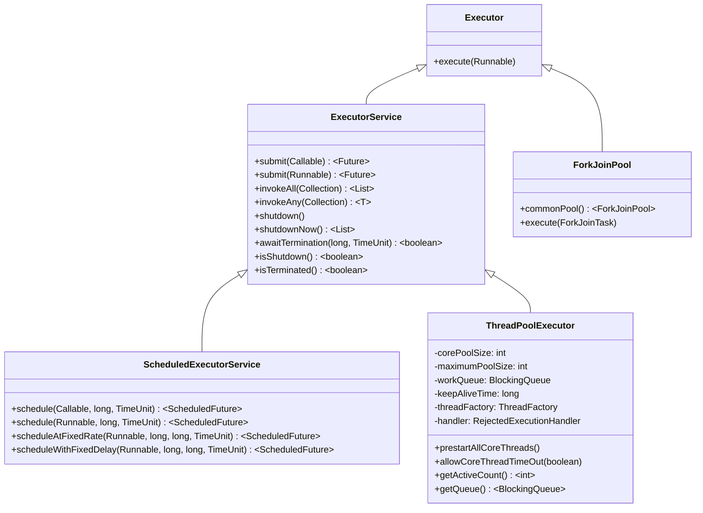
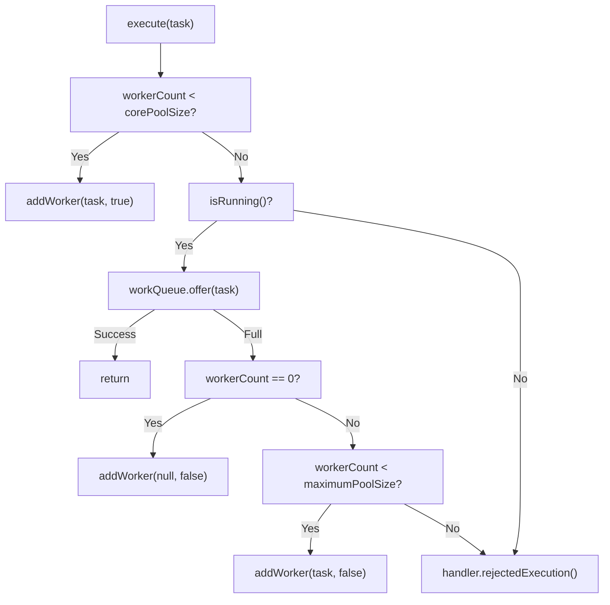
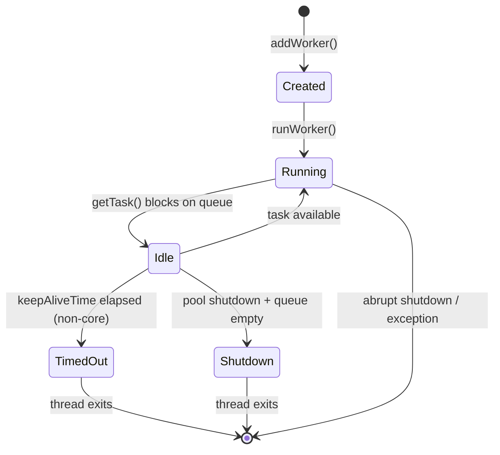
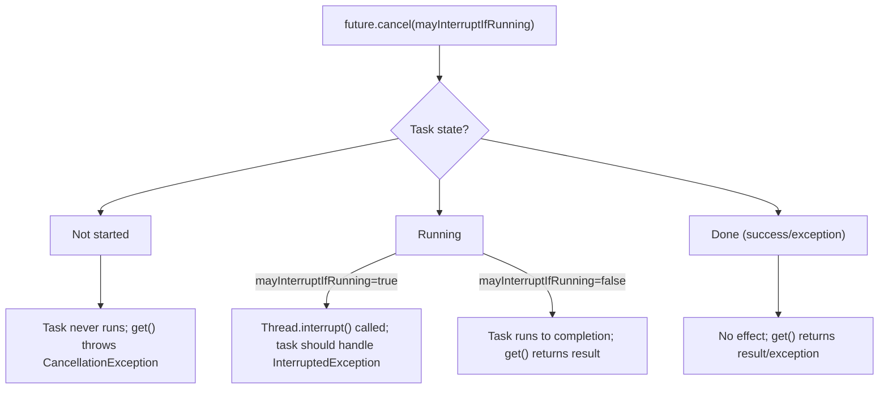
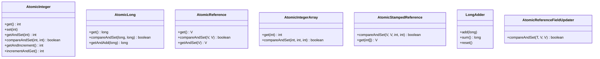

# Concurrency Utilities

The `java.util.concurrent` (JUC) package is the backbone of modern Java concurrency. It provides thread-safe, high-performance building blocks — executors, queues, synchronizers, atomics, and concurrent collections — that replace error-prone low-level `wait/notify` and `synchronized` patterns. Understanding JUC internals is essential for writing scalable services, debugging production deadlocks, and passing senior Java interviews.

This module covers the core utilities **excluding** `CompletableFuture` (module 20), Fork/Join (module 21), virtual threads (module 22), and the Java Memory Model (module 23). Cross-links: [Threads](../04-Multithreading/16-Threads.md), [Synchronization](../04-Multithreading/17-Synchronization.md), [Locks](../04-Multithreading/18-Locks.md), [Concurrent Collections](../02-Collections/11-Concurrent-Collections.md).

---

## JUC Package Map

```mermaid
flowchart TD
    JUC["java.util.concurrent"]
    Exec["Executors & Thread Pools"]
    Queues["Blocking Queues"]
    Sync["Synchronizers"]
    Atomics["Atomic Variables"]
    Collections["Concurrent Collections"]
    Futures["Future & Callable"]

    JUC --> Exec
    JUC --> Queues
    JUC --> Sync
    JUC --> Atomics
    JUC --> Collections
    JUC --> Futures

    Exec --> E1["Executor"]
    Exec --> E2["ExecutorService"]
    Exec --> E3["ScheduledExecutorService"]
    Exec --> E4["ThreadPoolExecutor"]
    Exec --> E5["ForkJoinPool"]
    Exec --> E6["Executors factory"]

    Queues --> Q1["BlockingQueue"]
    Queues --> Q2["ArrayBlockingQueue"]
    Queues --> Q3["LinkedBlockingQueue"]
    Queues --> Q4["SynchronousQueue"]
    Queues --> Q5["PriorityBlockingQueue"]
    Queues --> Q6["DelayQueue"]

    Sync --> S1["CountDownLatch"]
    Sync --> S2["CyclicBarrier"]
    Sync --> S3["Semaphore"]
    Sync --> S4["Phaser"]
    Sync --> S5["Exchanger"]

    Atomics --> A1["AtomicInteger/Long/Reference"]
    Atomics --> A2["Atomic*Array"]
    Atomics --> A3["AtomicStampedReference"]
    Atomics --> A4["LongAdder/DoubleAdder"]
    Atomics --> A5["AtomicReferenceFieldUpdater"]

    Futures --> F1["Future<V>"]
    Futures --> F2["Callable<V>"]
    Futures --> F3["FutureTask<V>"]
```



---

## Executors, ExecutorService, ScheduledExecutorService

### The Executor Hierarchy



### `Executors` Factory Methods — and Their Hidden Pitfalls

| Factory Method | Creates | Queue | Threads | Pitfall |
|----------------|---------|-------|---------|---------|
| `newFixedThreadPool(n)` | `ThreadPoolExecutor` | `LinkedBlockingQueue` (unbounded) | `core = max = n` | **Unbounded queue → OOM** under burst load |
| `newCachedThreadPool()` | `ThreadPoolExecutor` | `SynchronousQueue` | `core = 0, max = Integer.MAX_VALUE` | **Unbounded threads → OOM / thread explosion** |
| `newSingleThreadExecutor()` | `ThreadPoolExecutor` (wrapped) | `LinkedBlockingQueue` (unbounded) | `core = max = 1` | **Unbounded queue**; tasks run sequentially |
| `newScheduledThreadPool(n)` | `ScheduledThreadPoolExecutor` | `DelayedWorkQueue` | `core = n` | Same unbounded queue risk for non-periodic tasks |
| `newWorkStealingPool([parallelism])` | `ForkJoinPool` | Work-stealing deques | `parallelism` (default = cores) | Not for blocking I/O tasks |
| `newVirtualThreadPerTaskExecutor()` (Java 21+) | Custom `ExecutorService` | N/A (virtual threads) | Unbounded virtual threads | **Not for CPU-bound work**; see [Virtual Threads](../04-Multithreading/22-Virtual-Threads.md) |

> **Rule**: In production libraries/services, **avoid `Executors` factories**. Construct `ThreadPoolExecutor` directly with bounded queues and explicit `RejectedExecutionHandler`.

```java
// ✅ Production-grade explicit construction
ExecutorService executor = new ThreadPoolExecutor(
    4,                          // corePoolSize
    8,                          // maximumPoolSize
    60L, TimeUnit.SECONDS,      // keepAliveTime
    new ArrayBlockingQueue<>(100), // BOUNDED queue
    new ThreadFactoryBuilder().setNameFormat("worker-%d").build(),
    new ThreadPoolExecutor.CallerRunsPolicy() // backpressure
);
```

---

## ThreadPoolExecutor Internals

### Constructor Parameters

```java
public ThreadPoolExecutor(
    int corePoolSize,           // Minimum threads kept alive (even if idle)
    int maximumPoolSize,        // Max threads allowed
    long keepAliveTime,         // Idle non-core thread lifetime
    TimeUnit unit,              // Time unit for keepAliveTime
    BlockingQueue<Runnable> workQueue, // Task queue
    ThreadFactory threadFactory,       // Thread creation policy
    RejectedExecutionHandler handler   // Saturation policy
)
```

### Task Submission Flow (The Exact Algorithm)



**Key insight**: The flow is **core → queue → max → reject**. Queue choice fundamentally changes behavior:
- **Bounded queue** (e.g., `ArrayBlockingQueue`): Backpressure via rejection when full.
- **Unbounded queue** (`LinkedBlockingQueue`): `maximumPoolSize` is **ignored**; only `corePoolSize` threads ever created.
- **SynchronousQueue** (`newCachedThreadPool`): Direct handoff; threads created on demand up to `max`.

### Worker Thread Lifecycle



### `prestartAllCoreThreads()` vs `allowCoreThreadTimeOut(true)`

| Method | Effect |
|--------|--------|
| `prestartAllCoreThreads()` | Starts all `corePoolSize` threads immediately (warm-up), avoiding first-task latency. Returns number of threads started. |
| `allowCoreThreadTimeOut(true)` | Allows **core threads** to time out after `keepAliveTime` (default: core threads never time out). Useful for pools that should shrink to zero when idle. |

```java
// Warm-up example
ThreadPoolExecutor executor = new ThreadPoolExecutor(4, 8, 60, TimeUnit.SECONDS,
    new ArrayBlockingQueue<>(100));
executor.prestartAllCoreThreads(); // Starts 4 threads immediately
```

### Shutdown Sequences

```java
// Graceful shutdown: no new tasks, finishes queued + running
executor.shutdown();
try {
    if (!executor.awaitTermination(60, TimeUnit.SECONDS)) {
        // Forceful: interrupts running tasks, returns unprocessed queue
        List<Runnable> remaining = executor.shutdownNow();
        if (!executor.awaitTermination(60, TimeUnit.SECONDS)) {
            log.error("Pool did not terminate");
        }
    }
} catch (InterruptedException e) {
    executor.shutdownNow();
    Thread.currentThread().interrupt();
}
```

> **Critical**: Always call `shutdown()` before `awaitTermination()`. `shutdownNow()` interrupts workers via `Thread.interrupt()` — tasks **must** respect interruption.

### Pool Sizing Formulas

| Workload Type | Formula | Example (8 cores) |
|---------------|---------|-------------------|
| **CPU-bound** | `Runtime.getRuntime().availableProcessors()` | 8 |
| **IO-bound** | `cores × (1 + waitTime / computeTime)` | 8 × (1 + 100ms/10ms) = 88 |
| **Mixed (Little's Law)** | `throughput × latency` | 1000 req/s × 0.2s = 200 threads |

> **Rule of thumb**: For IO-bound, start with `2 × cores` and tune via load testing. Never use `CachedThreadPool` in production.

---

## Callable vs Runnable, Future API

### Core Differences

| Aspect | `Runnable` | `Callable<V>` |
|--------|------------|---------------|
| Return value | `void` | `V` |
| Exception | Cannot throw checked | Throws `Exception` |
| Functional interface | Yes (`run()`) | Yes (`call()`) |
| Usage | `execute(Runnable)` | `submit(Callable)` |

### Future<V> API

```java
ExecutorService executor = Executors.newSingleThreadExecutor();
Future<Integer> future = executor.submit(() -> {
    Thread.sleep(100);
    return 42;
});

// Blocking get with timeout (RECOMMENDED)
Integer result = future.get(500, TimeUnit.MILLISECONDS); // 42

// Non-blocking checks
boolean done = future.isDone();      // true if completed (normally, exceptionally, or cancelled)
boolean cancelled = future.isCancelled(); // true if cancelled before completion

// Cancellation
boolean mayInterruptIfRunning = true;
future.cancel(mayInterruptIfRunning); // interrupts thread if running
```

### Cancellation Semantics



### FutureTask — The Bridge

```java
// FutureTask implements both Runnable and Future
FutureTask<Integer> task = new FutureTask<>(() -> {
    Thread.sleep(200);
    return 100;
});

new Thread(task).start(); // Run in a thread
// Or submit to executor
executor.execute(task);

Integer result = task.get(); // Blocks until done
```

> **Pitfall**: `Future.get()` **blocks the caller**. In web servers, this ties up request threads. Use `CompletableFuture` (module 20) or virtual threads (module 22) for async pipelines.

---

## Synchronizers

### Comparison Table

| Synchronizer | Reusable? | Use Case | Key Method(s) | Fairness Option |
|--------------|-----------|----------|---------------|-----------------|
| `CountDownLatch` | ❌ One-shot | Wait for N events | `countDown()`, `await()` | N/A |
| `CyclicBarrier` | ✅ | N threads meet at barrier | `await()`, barrier action | N/A |
| `Semaphore` | ✅ | Resource pool / rate limiting | `acquire()`, `release()` | ✅ Constructor param |
| `Phaser` | ✅ | Dynamic phased computation | `arriveAndAwaitAdvance()` | N/A |
| `Exchanger` | ✅ | Pairwise data exchange | `exchange(V)` | N/A |

---

### CountDownLatch — One-Shot Countdown

```java
CountDownLatch latch = new CountDownLatch(3);

new Thread(() -> { doWork(); latch.countDown(); }).start();
new Thread(() -> { doWork(); latch.countDown(); }).start();
new Thread(() -> { doWork(); latch.countDown(); }).start();

latch.await(); // Blocks until count reaches 0
```

**Internals**: Uses `AbstractQueuedSynchronizer` (AQS) with shared state = count. `countDown()` does `releaseShared(1)`, `await()` does `acquireSharedInterruptibly(1)`.

> **Edge case**: If `countDown()` called more times than initial count, count goes negative — subsequent `await()` returns immediately. No exception.

---

### CyclicBarrier — Reusable Rendezvous

```java
// Barrier action runs once per cycle, by the last arriving thread
CyclicBarrier barrier = new CyclicBarrier(3, () -> System.out.println("All arrived!"));

for (int i = 0; i < 3; i++) {
    new Thread(() -> {
        doPhase1();
        barrier.await(); // Blocks until all 3 arrive
        doPhase2();
    }).start();
}
```

**Internals**: Uses `ReentrantLock` + `Condition`. Generation counter prevents "leaking" across cycles. `BrokenBarrierException` if interrupted/reset while waiting.

---

### Semaphore — Permit-Based Access Control

```java
// Binary semaphore = mutex (fair = true for FIFO)
Semaphore mutex = new Semaphore(1, true);

// Counting semaphore: connection pool of 10
Semaphore pool = new Semaphore(10);

pool.acquire(); // Blocks if no permits
try {
    useResource();
} finally {
    pool.release();
}

// Non-blocking tryAcquire
if (pool.tryAcquire(1, TimeUnit.SECONDS)) {
    try { useResource(); } finally { pool.release(); }
}
```

**Fairness**: `new Semaphore(permits, true)` uses fair `Sync` (FIFO queue). Default is non-fair (barging allowed, higher throughput).

---

### Phaser — Dynamic Phase Synchronization (Java 7+)

```java
Phaser phaser = new Phaser(1); // Register main thread

for (int i = 0; i < 3; i++) {
    phaser.register(); // Register each worker
    new Thread(() -> {
        phase1();
        phaser.arriveAndAwaitAdvance(); // Arrive + wait for phase
        phase2();
        phaser.arriveAndAwaitAdvance();
        phaser.arriveAndDeregister(); // Deregister on completion
    }).start();
}

phaser.arriveAndAwaitAdvance(); // Main waits for phase 1
phaser.arriveAndAwaitAdvance(); // Main waits for phase 2
phaser.arriveAndDeregister();   // Main deregisters
```

**Key features**: Dynamic registration/deregistration, phase number tracking, `getPhase()`, `getRegisteredParties()`.

---

### Exchanger — Pairwise Data Handoff

```java
Exchanger<String> exchanger = new Exchanger<>();

// Producer
new Thread(() -> {
    String data = produce();
    String received = exchanger.exchange(data); // Blocks until consumer arrives
    // received = consumer's data
}).start();

// Consumer
new Thread(() -> {
    String data = consume();
    String received = exchanger.exchange(data); // Blocks until producer arrives
    // received = producer's data
}).start();
```

**Use case**: Pipeline stages, double-buffering. Internally uses `ReentrantLock` + slot array with CAS.

---

## Atomics

### Core Atomic Classes



### CAS — Compare-And-Set

```java
AtomicInteger counter = new AtomicInteger(0);

// Atomic increment (lock-free)
int oldValue, newValue;
do {
    oldValue = counter.get();
    newValue = oldValue + 1;
} while (!counter.compareAndSet(oldValue, newValue));

// Equivalent built-in
counter.incrementAndGet();
counter.getAndIncrement();
```

**How CAS works**: `Unsafe.compareAndSwapInt(this, valueOffset, expected, update)` → CPU `LOCK CMPXCHG` instruction. Retries on contention.

---

### The ABA Problem & `AtomicStampedReference`

**ABA**: Thread 1 reads `A`, thread 2 changes `A→B→A`, thread 1 CAS succeeds but state changed.

```java
AtomicStampedReference<String> ref = new AtomicStampedReference<>("A", 0);

// Thread 1
int[] stampHolder = new int[1];
String current = ref.get(stampHolder); // "A", stamp=0
// ... thread 2 changes A->B->A, stamp becomes 2 ...
boolean success = ref.compareAndSet(current, "C", stampHolder[0], stampHolder[0] + 1);
// Fails because stamp changed (0 vs 2)
```

> **When to use**: Lock-free data structures where logical identity matters (e.g., stack nodes). For simple counters, not needed.

---

### LongAdder / DoubleAdder — High-Contention Counters (Java 8+)

```java
LongAdder adder = new LongAdder();

// High contention: threads update different cells, sum on read
adder.add(1);
adder.increment();
long total = adder.sum(); // Sums base + all cells
adder.reset();
```

**Internals**: `Striped64` base + `Cell[]` array (power-of-2 size). Threads hash to a cell via `ThreadLocalRandom`. On contention, array grows (doubles). Read sums all cells — **O(number of cells)**, not O(1).

| Metric | `AtomicLong` | `LongAdder` |
|--------|--------------|-------------|
| Low contention | ✅ Fast (single CAS) | Slightly slower (cell lookup) |
| High contention | ❌ CAS contention | ✅ Striped cells, no contention |
| Memory | 1 `volatile long` | Base + `Cell[]` (grows) |
| `sum()` cost | O(1) | O(cells) |
| Use case | Low contention, exact value needed | High contention, stats/metrics |

---

### AtomicReferenceFieldUpdater — Field-Level Atomic Updates

```java
class Node {
    volatile Node next; // Must be volatile
}

static final AtomicReferenceFieldUpdater<Node, Node> NEXT_UPDATER =
    AtomicReferenceFieldUpdater.newUpdater(Node.class, Node.class, "next");

Node head = new Node();
Node newNode = new Node();
NEXT_UPDATER.compareAndSet(head, null, newNode); // Atomic update of head.next
```

**Use case**: Lock-free linked structures without `AtomicReference` wrapper overhead. Requires `volatile` field.

---

## Common Mistakes

### 1. Unbounded Queue → OOM

```java
// ❌ WRONG: LinkedBlockingQueue unbounded
ExecutorService bad = Executors.newFixedThreadPool(10);
// Submitting 1M tasks → queue holds 1M references → OOM

// ✅ RIGHT: Bounded queue with rejection policy
ExecutorService good = new ThreadPoolExecutor(
    10, 10, 0, TimeUnit.SECONDS,
    new ArrayBlockingQueue<>(1000),
    new ThreadPoolExecutor.AbortPolicy()
);
```

### 2. Not Shutting Down Pools

```java
// ❌ WRONG: Pool leaks threads, JVM never exits
ExecutorService executor = Executors.newFixedThreadPool(4);
executor.submit(() -> {});

// ✅ RIGHT: Shutdown hook or try-with-resources (Java 19+)
try (ExecutorService executor = Executors.newFixedThreadPool(4)) {
    executor.submit(() -> {});
} // Auto-closes via shutdown()
```

### 3. Swallowing `ExecutionException`

```java
// ❌ WRONG: Loses original exception
Future<?> f = executor.submit(() -> { throw new RuntimeException("boom"); });
try { f.get(); } catch (Exception e) { log.error("failed", e); } // e is ExecutionException

// ✅ RIGHT: Unwrap cause
try { f.get(); }
catch (ExecutionException e) { throw new CompletionException(e.getCause()); }
catch (InterruptedException e) { Thread.currentThread().interrupt(); throw new RuntimeException(e); }
```

### 4. Using `Executors` in Libraries

```java
// ❌ WRONG: Library creates its own pool — user can't control it
class MyLibrary {
    private final ExecutorService executor = Executors.newFixedThreadPool(4);
    public void doWork() { executor.submit(...); }
}

// ✅ RIGHT: Accept executor from caller
class MyLibrary {
    public void doWork(Executor executor) { executor.execute(...); }
}
```

### 5. Thread Pool Deadlock with Blocking Tasks

```java
// ❌ WRONG: All threads blocked on downstream calls → deadlock
ExecutorService pool = Executors.newFixedThreadPool(4);
pool.submit(() -> {
    pool.submit(() -> downstreamCall()).get(); // Blocks worker thread
});

// ✅ RIGHT: Separate pools or use CompletableFuture (non-blocking)
ExecutorService cpuPool = Executors.newFixedThreadPool(4);
ExecutorService ioPool = Executors.newFixedThreadPool(20);
```

### 6. Missing `finally` Cleanup

```java
// ❌ WRONG: Permit leak on exception
semaphore.acquire();
doRisky();
semaphore.release();

// ✅ RIGHT: Always release
semaphore.acquire();
try {
    doRisky();
} finally {
    semaphore.release();
}
```

### 7. `Future.get()` Blocking Submitter

```java
// ❌ WRONG: Request thread blocks
@GetMapping("/slow")
public String slow() throws Exception {
    return executor.submit(this::heavyWork).get(); // Blocks Tomcat thread
}

// ✅ RIGHT: Async (CompletableFuture) or virtual threads
@GetMapping("/fast")
public CompletableFuture<String> fast() {
    return CompletableFuture.supplyAsync(this::heavyWork, executor);
}
```

---

## Performance Considerations

| Factor | Impact | Mitigation |
|--------|--------|------------|
| **Queue contention** | `LinkedBlockingQueue` single lock → bottleneck | Use `ArrayBlockingQueue` or segmented queues |
| **CAS vs Lock** | CAS: no context switch, but retry on contention | Low contention → CAS (`Atomic*`, `LongAdder`); High contention + complex ops → Lock |
| **LongAdder throughput** | Scales near-linearly with cores | Use for metrics/counters under load |
| **Context switching** | Too many threads → thrashing | Size pool correctly; use virtual threads for IO |
| **ThreadLocalRandom** | Per-thread RNG for `LongAdder` cell selection | Avoid `Math.random()` in hot paths |
| **False sharing** | Adjacent `AtomicLong` fields on same cache line | Use `@Contended` (JDK internal) or padding |

```java
// Avoid false sharing in custom counters
class PaddedAtomicLong extends AtomicLong {
    // Padding to separate cache lines (64 bytes typical)
    long p1, p2, p3, p4, p5, p6, p7;
}
```

---

## Comparison Tables

### Synchronizers

| Feature | CountDownLatch | CyclicBarrier | Phaser | Semaphore |
|---------|----------------|---------------|--------|-----------|
| Reusable | ❌ | ✅ | ✅ | ✅ |
| Dynamic parties | ❌ | ❌ | ✅ | N/A |
| Barrier action | ❌ | ✅ | ❌ | N/A |
| Phase tracking | ❌ | ❌ | ✅ | N/A |
| Interruptible wait | ✅ | ✅ | ✅ | ✅ |
| Timeout support | ✅ | ✅ | ✅ | ✅ |
| Typical use | Startup init, one-shot wait | Parallel phases, map-reduce | Dynamic phased tasks | Resource pooling, rate limiting |

### Counter Implementations

| Feature | AtomicLong | LongAdder | LongAccumulator |
|---------|------------|-----------|-----------------|
| Operation | CAS loop | Striped cells | Striped + custom function |
| Read cost | O(1) | O(cells) | O(cells) |
| Contention scaling | Poor | Excellent | Excellent |
| Use case | Low contention, exact value | High contention, sum | High contention, custom reduce |

### Thread Pool Types

| Pool Type | Core/Max | Queue | Best For | Avoid When |
|-----------|----------|-------|----------|------------|
| Fixed | n/n | Unbounded | Stable CPU-bound | Burst traffic (OOM) |
| Cached | 0/∞ | SynchronousQueue | Short-lived tasks | Long-running / burst (thread explosion) |
| Single | 1/1 | Unbounded | Sequential tasks | Throughput needs |
| Scheduled | n/n | DelayedWorkQueue | Periodic/delayed | High-throughput fire-and-forget |
| Work-stealing | p/p | Per-worker deques | ForkJoin, recursive | Blocking I/O |
| Custom | Configurable | **Bounded** | Production | — |

---

## Interview Questions

### Beginner

**Q1. What is the difference between `Runnable` and `Callable`?**

`Runnable` has `void run()` and cannot throw checked exceptions. `Callable<V>` has `V call() throws Exception` and returns a result. `ExecutorService.submit(Callable)` returns `Future<V>`; `submit(Runnable)` returns `Future<?>` (null result).

**Q2. What does `Future.get()` do? What exceptions can it throw?**

Blocks until the task completes, then returns the result or rethrows the task's exception wrapped in `ExecutionException`. Throws `InterruptedException` if the calling thread is interrupted, `CancellationException` if the task was cancelled, `TimeoutException` on timed `get()`.

**Q3. Explain `CountDownLatch` vs `CyclicBarrier`.**

`CountDownLatch` is one-shot: a counter initialized to N, `countDown()` decrements, `await()` blocks until zero. Not reusable. `CyclicBarrier` is reusable: N threads call `await()`, all block until the last arrives, then an optional barrier action runs, and the barrier resets for the next cycle.

**Q4. What is a `Semaphore` and when would you use it?**

A counting semaphore maintains a set of permits. `acquire()` blocks until a permit is available; `release()` returns one. Used for resource pooling (e.g., database connections), rate limiting, or as a mutex (binary semaphore with 1 permit).

**Q5. What is the difference between `ExecutorService.shutdown()` and `shutdownNow()`?**

`shutdown()`: initiates graceful shutdown — no new tasks accepted, previously submitted tasks run to completion. `shutdownNow()`: attempts to stop all actively executing tasks via `Thread.interrupt()`, halts queued tasks, returns list of never-started tasks.

---

### Intermediate

**Q6. Describe the exact task submission flow in `ThreadPoolExecutor`.**

1. If `workerCount < corePoolSize`, `addWorker(task, true)` creates a core thread.
2. Else if pool is running and `workQueue.offer(task)` succeeds, task is queued.
3. Else if `workerCount < maximumPoolSize`, `addWorker(task, false)` creates a non-core thread.
4. Else `RejectedExecutionHandler.rejectedExecution()` is invoked.

**Q7. Why does `newFixedThreadPool` with `LinkedBlockingQueue` ignore `maximumPoolSize`?**

Because `LinkedBlockingQueue.offer()` never returns `false` (unbounded). Step 2 always succeeds, so step 3 (create non-core threads up to `maximumPoolSize`) is never reached. Only `corePoolSize` threads are ever created.

**Q8. What is the ABA problem? How does `AtomicStampedReference` solve it?**

ABA: Thread 1 reads value A; thread 2 changes A→B→A; thread 1 CAS succeeds but state logically changed. `AtomicStampedReference` pairs the reference with an integer stamp. CAS requires both reference and stamp to match, so A(stamp=0) → A(stamp=2) fails.

**Q9. When would you use `LongAdder` over `AtomicLong`?**

Under high contention (many threads incrementing). `AtomicLong` uses a single CAS variable — contention causes cache-line ping-pong and retries. `LongAdder` uses striped `Cell[]` array; threads hash to different cells, eliminating contention. Read (`sum()`) aggregates all cells. Trade-off: higher memory, slower reads.

**Q10. What happens if you call `Future.get()` without a timeout on a task that never completes?**

The calling thread blocks indefinitely. This is a common production deadlock — e.g., a web request thread blocked on a downstream service that hangs. Always use `future.get(timeout, unit)`.

---

### Advanced

**Q11. Explain `ThreadPoolExecutor` worker thread lifecycle and the role of `getTask()`.**

Worker runs `runWorker(Worker w)`: loops calling `getTask()` which blocks on `workQueue.take()` (or `poll(keepAliveTime)` for non-core). Returns task or `null` (timeout/shutdown). If `null`, `processWorkerExit()` terminates the thread. Core threads block indefinitely on `take()` unless `allowCoreThreadTimeOut(true)`.

**Q12. How does `CyclicBarrier` handle the "generation" concept to prevent leaks across cycles?**

`CyclicBarrier` maintains a `generation` object. Each `await()` captures the current generation. When the last thread arrives, it runs the barrier action, increments the generation (creating a new `Generation` object), and notifies all waiters. Waiters check `generation == currentGeneration` — if the barrier was reset or broken, they throw `BrokenBarrierException`.

**Q13. What is `Phaser`'s advantage over `CyclicBarrier` for dynamic workloads?**

`Phaser` supports dynamic registration/deregistration (`register()`, `arriveAndDeregister()`), tracks phase number (`getPhase()`), and allows parties to arrive without waiting (`arrive()`). `CyclicBarrier` has fixed party count and no phase tracking.

**Q14. Describe `LongAdder`'s internal `Striped64` structure and contention handling.**

`Striped64` has a `base` (for low contention) and `Cell[]` array (power-of-2 size). On `add()`, thread hashes to a cell index via `ThreadLocalRandom`. If CAS on cell fails (contention), it retries; if repeated failures, `retryUpdate()` expands the array (doubles size) and rehashes. Reads sum `base + all cells`.

**Q15. What is `AtomicReferenceFieldUpdater` and why does the target field must be `volatile`?**

It provides atomic CAS updates on a `volatile` field of a class without wrapping it in `AtomicReference`. The `volatile` ensures visibility and happens-before semantics for the CAS operation (which uses `Unsafe.compareAndSwapObject` on the field offset). Without `volatile`, the JVM could reorder or cache the field, breaking atomicity guarantees.

---

### Expert

**Q16. How does `ThreadPoolExecutor`'s `CallerRunsPolicy` provide backpressure? What is the risk?**

When the queue is full and `maximumPoolSize` reached, `CallerRunsPolicy.rejectedExecution()` executes the task **on the caller's thread** (the thread calling `execute()`). This slows down the producer, providing natural backpressure. Risk: if the caller is a critical thread (e.g., Netty event loop, Tomcat request thread), it blocks that thread, potentially cascading latency or deadlock.

**Q17. Explain the interaction between `keepAliveTime` and `allowCoreThreadTimeOut(true)`.**

By default, core threads never time out (they block on `take()` forever). Non-core threads exit after `keepAliveTime` idle via `poll(keepAliveTime)`. With `allowCoreThreadTimeOut(true)`, **core threads also** use `poll(keepAliveTime)` and can exit, allowing the pool to shrink to zero. Useful for bursty workloads where you want no idle threads.

**Q18. What is the memory visibility guarantee of `AtomicInteger.get()` vs `volatile int`?**

Both provide the same happens-before guarantee: a write (via `set`/`lazySet` or volatile write) happens-before a subsequent read (via `get()` or volatile read). `AtomicInteger` uses `Unsafe.getIntVolatile` internally. `lazySet()` (via `Unsafe.putOrderedInt`) provides release semantics without full volatile store fence — faster but not immediately visible to other threads.

**Q19. How would you implement a bounded buffer with `Semaphore`?**

```java
class BoundedBuffer<T> {
    private final Queue<T> queue = new ArrayDeque<>();
    private final Semaphore slots, items;
    private final int capacity;

    BoundedBuffer(int capacity) {
        this.capacity = capacity;
        this.slots = new Semaphore(capacity);
        this.items = new Semaphore(0);
    }

    void put(T item) throws InterruptedException {
        slots.acquire();
        synchronized (queue) { queue.add(item); }
        items.release();
    }

    T take() throws InterruptedException {
        items.acquire();
        T item;
        synchronized (queue) { item = queue.remove(); }
        slots.release();
        return item;
    }
}
```
`slots` tracks empty space, `items` tracks available elements. Mutex via `synchronized(queue)` protects the `ArrayDeque` (non-thread-safe).

**Q20. What is the difference between `scheduleAtFixedRate` and `scheduleWithFixedDelay`?**

`scheduleAtFixedRate(task, initialDelay, period, unit)`: starts next execution `period` after **previous start time**. If task overruns, subsequent executions may run concurrently (if pool allows) or queue up. `scheduleWithFixedDelay(task, initialDelay, delay, unit)`: starts next execution `delay` after **previous completion**. Guarantees no overlap; safer for long-running tasks.

---

### Scenario Based

**Q21. You need to process 10,000 independent HTTP requests with a max of 50 concurrent connections. How do you configure the executor?**

Use a fixed pool of 50 with a bounded queue and `CallerRunsPolicy`:

```java
ExecutorService httpPool = new ThreadPoolExecutor(
    50, 50, 0, TimeUnit.SECONDS,
    new ArrayBlockingQueue<>(200), // bounded buffer
    new ThreadFactoryBuilder().setNameFormat("http-%d").build(),
    new ThreadPoolExecutor.CallerRunsPolicy() // backpressure on submitter
);
```
Alternatively, use `Semaphore(50)` directly around the HTTP client if using async client.

**Q22. A scheduled task runs every 100ms but occasionally takes 200ms. Which scheduler method do you use and why?**

`scheduleWithFixedDelay(..., 100, TimeUnit.MILLISECONDS)`. This ensures 100ms gap between **end of one run** and **start of next**. `scheduleAtFixedRate` would try to start every 100ms from the original start time, causing overlapping executions or queue buildup.

**Q23. You have a metrics counter updated by 200 threads. `AtomicLong` shows high CPU in profiler. What do you change?**

Switch to `LongAdder`. It uses striped cells to eliminate CAS contention. `sum()` is called infrequently (e.g., for reporting), so the O(cells) read cost is acceptable.

**Q24. Your library must execute callbacks but must not create its own thread pool. How do you design the API?**

Accept an `Executor` (or `ExecutorService`) parameter:

```java
public interface CallbackExecutor {
    void execute(Runnable callback, Executor executor);
}

// Caller decides: virtual threads, shared pool, etc.
library.doWork(Executors.newVirtualThreadPerTaskExecutor());
```

**Q25. A `CyclicBarrier` with 4 parties throws `BrokenBarrierException` in one thread. What happened?**

One of: (a) another thread was interrupted while waiting, (b) another thread timed out, (c) `barrier.reset()` was called. All waiting threads receive `BrokenBarrierException`. The barrier is now in broken state — must call `reset()` to reuse.

---

### Output Prediction

**Q26. What is the output?**

```java
ExecutorService es = Executors.newSingleThreadExecutor();
Future<?> f = es.submit(() -> {
    System.out.print("A");
    throw new RuntimeException("boom");
});
try { f.get(); } catch (ExecutionException e) { System.out.print("B"); }
es.shutdown();
```

**Output:** `AB`

**Reason:** Task prints "A", throws exception. `Future.get()` wraps it in `ExecutionException`, caught and prints "B".

---

**Q27. What is the output?**

```java
CountDownLatch latch = new CountDownLatch(2);
new Thread(() -> { latch.countDown(); System.out.print("1"); }).start();
new Thread(() -> { latch.countDown(); System.out.print("2"); }).start();
latch.await();
System.out.print("3");
```

**Output:** `123` or `213` (order of 1/2 non-deterministic), **always ends with 3**.

**Reason:** Two threads count down in parallel. Main blocks on `await()` until both `countDown()` complete. "3" prints after both threads finish.

---

**Q28. What is the output?**

```java
AtomicInteger ai = new AtomicInteger(0);
Runnable r = () -> {
    for (int i = 0; i < 1000; i++) ai.incrementAndGet();
};
Thread t1 = new Thread(r), t2 = new Thread(r);
t1.start(); t2.start();
t1.join(); t2.join();
System.out.println(ai.get());
```

**Output:** `2000`

**Reason:** `incrementAndGet()` is atomic (CAS loop). 1000 × 2 = 2000 guaranteed.

---

**Q29. What is the output?**

```java
Semaphore sem = new Semaphore(1);
sem.acquire();
new Thread(() -> {
    sem.acquire();
    System.out.print("A");
    sem.release();
}).start();
Thread.sleep(100);
System.out.print("B");
sem.release();
Thread.sleep(100);
```

**Output:** `BA`

**Reason:** Main acquires permit (count=0). Child blocks on `acquire()`. Main sleeps, prints "B", releases (count=1). Child acquires, prints "A", releases.

---

**Q30. What is the output?**

```java
CyclicBarrier cb = new CyclicBarrier(2, () -> System.out.print("B"));
new Thread(() -> { System.out.print("1"); try { cb.await(); } catch (Exception e) {} }).start();
new Thread(() -> { System.out.print("2"); try { cb.await(); } catch (Exception e) {} }).start();
```

**Output:** `12B` or `21B` (barrier action runs after both arrive, by last arriving thread)

**Reason:** Both threads print their number, call `await()`. Last one to arrive runs barrier action "B" before both proceed.

---

### Internal Working

**Q31. How does `ThreadPoolExecutor` implement `getTask()` and what are the two queue poll strategies?**

`getTask()` loops: if `allowCoreThreadTimeOut` or `workerCount > corePoolSize`, uses `workQueue.poll(keepAliveTime, unit)` (timed poll, returns `null` on timeout). Else uses `workQueue.take()` (blocks indefinitely). Returns `Runnable` or `null` (triggering worker exit).

**Q32. What AQS state does `CountDownLatch` use and how do `countDown`/`await` map to AQS methods?**

State = count (int). `countDown()` → `releaseShared(1)` (decrements state, signals if zero). `await()` → `acquireSharedInterruptibly(1)` (blocks if state > 0). Shared mode because multiple waiters can succeed simultaneously when count reaches zero.

**Q33. How does `LongAdder` avoid false sharing between `Cell` objects?**

`Cell` is annotated with `@Contended` (JDK 8+), which instructs the JVM to pad the object to occupy a full cache line (typically 64 or 128 bytes). This prevents adjacent `Cell` instances from sharing a cache line, eliminating false sharing when threads update different cells.

**Q34. Explain the `RejectedExecutionHandler` policies and when each is appropriate.**

| Policy | Behavior | Use Case |
|--------|----------|----------|
| `AbortPolicy` (default) | Throws `RejectedExecutionException` | Fail-fast; caller must handle |
| `CallerRunsPolicy` | Runs task in caller's thread | Backpressure; slows producer |
| `DiscardPolicy` | Silently discards task | Non-critical, fire-and-forget |
| `DiscardOldestPolicy` | Drops oldest queued task, retries | Priority to newer tasks; cache-like |

**Q35. How does `AtomicReferenceFieldUpdater` achieve atomicity without wrapper objects?**

It uses `Unsafe.compareAndSwapObject` with the field's memory offset (computed via reflection on first use). The target field must be `volatile` to ensure visibility and prevent reordering. The updater holds the `Class` and field name, resolving the offset once.

---

### Tricky Questions

**Q36. Can `ThreadPoolExecutor` with `corePoolSize=0` and `maximumPoolSize=10` ever have 10 threads simultaneously if using `LinkedBlockingQueue`?**

No. `LinkedBlockingQueue` is unbounded → `offer()` always succeeds → step 3 (create non-core threads) never reached. Max threads = `corePoolSize` = 0 (but at least 1 thread created on first submit because `workerCount < corePoolSize` is 0 < 0 false, then queue offer succeeds... wait).

Actually: first task → `workerCount (0) < corePoolSize (0)` is false → queue offer succeeds. But `workerCount` is 0, so `recheck: workerCount == 0` is true → `addWorker(null, false)` creates a thread. So **one thread** is created. Additional tasks queue up. Max threads = 1.

**Q37. What happens if you call `CountDownLatch.countDown()` more times than the initial count?**

The internal count goes negative. Subsequent `await()` calls return immediately (since state ≤ 0). No exception is thrown. This is by design — AQS shared state can go negative.

**Q38. Why does `LongAdder.sum()` not reflect the exact value at the instant of call?**

`sum()` iterates the `Cell[]` array and adds `base`. While summing, other threads may be updating cells. The result is a **consistent snapshot** of the sum at some point during the iteration, but not necessarily at the exact call start. It's eventually consistent, not linearizable.

**Q39. Can `Semaphore` with fairness=true guarantee FIFO ordering of thread acquisition?**

Yes, fair mode uses AQS fair sync: threads enqueue in a CLH queue. However, **barging** can still occur if a thread calls `tryAcquire()` (non-queueing) while others wait. Only `acquire()`/`acquireInterruptibly()` respect FIFO.

**Q40. What is the difference between `Future.cancel(true)` and `Thread.interrupt()` on the worker thread?**

`Future.cancel(true)` calls `Thread.interrupt()` on the thread **executing the task** (if running). If the task hasn't started, it's removed from queue. `Thread.interrupt()` directly interrupts a specific thread. `Future.cancel()` is higher-level: it handles the "not started yet" case and sets the future's state to cancelled.

**Q41. Why does `newSingleThreadExecutor()` wrap the returned `ExecutorService` in `FinalizableDelegatedExecutorService`?**

To prevent direct access to `ThreadPoolExecutor` methods like `setCorePoolSize()` or `getQueue()`, which would break the single-threaded guarantee. The wrapper only delegates `ExecutorService` methods.

**Q42. What happens if a `Phaser` phase wraps around (exceeds `Integer.MAX_VALUE`)?**

`Phaser` phase is an `int`. On `Integer.MAX_VALUE` arrival, it wraps to negative values (continues as `Integer.MIN_VALUE`). The API doesn't prevent this. In practice, `Long.MAX_VALUE` arrivals are unrealistic.

**Q43. How does `Exchanger` achieve high throughput for pairwise exchange?**

Uses a slot array (`Node[]`) with CAS. Threads spin briefly trying to pair with a waiting thread in a slot. If no partner, they park via `LockSupport.park()`. On match, both exchange data and unpark. The slot array size grows on contention (power of 2). This avoids a single global lock.

**Q44. Why is `AtomicInteger.getAndIncrement()` not equivalent to `i++` on a volatile int?**

`volatile int i; i++` is **not atomic**: it reads, increments, writes — three bytecode operations. Another thread can interleave. `AtomicInteger.getAndIncrement()` uses a single CAS loop (hardware `LOCK CMPXCHG`), guaranteeing atomicity.

**Q45. What is the "monitor inflation" risk with `synchronized` vs `ReentrantLock` in high contention, and does it apply to JUC atomics?**

`Atomic*` classes use CAS (Unsafe) → no monitors, no inflation. `ReentrantLock` uses AQS with CLH queue → no monitor inflation (uses `LockSupport.park`). `synchronized` can inflate thin locks to heavyweight monitors under contention. JUC atomics/locks avoid this entirely.

---

## Summary

- **Prefer explicit `ThreadPoolExecutor`** over `Executors` factories; always use bounded queues.
- **Size pools by workload**: CPU-bound = cores; IO-bound = cores × (1 + wait/compute).
- **Synchronizers**: `CountDownLatch` (one-shot), `CyclicBarrier` (reusable phases), `Semaphore` (permits), `Phaser` (dynamic), `Exchanger` (pairwise).
- **Atomics**: `Atomic*` for low contention; `LongAdder`/`DoubleAdder` for high-contention counters; `AtomicStampedReference` for ABA.
- **Always** use timeouts on `Future.get()`, handle `ExecutionException` cause, shut down pools in `finally`.
- **Avoid** `Future.get()` blocking request threads — use `CompletableFuture` or virtual threads.