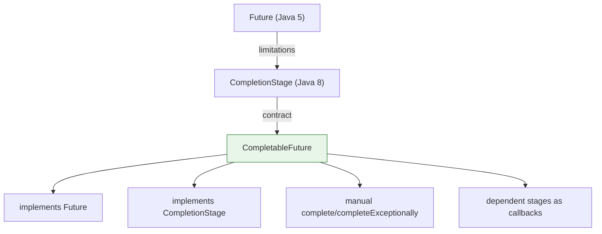
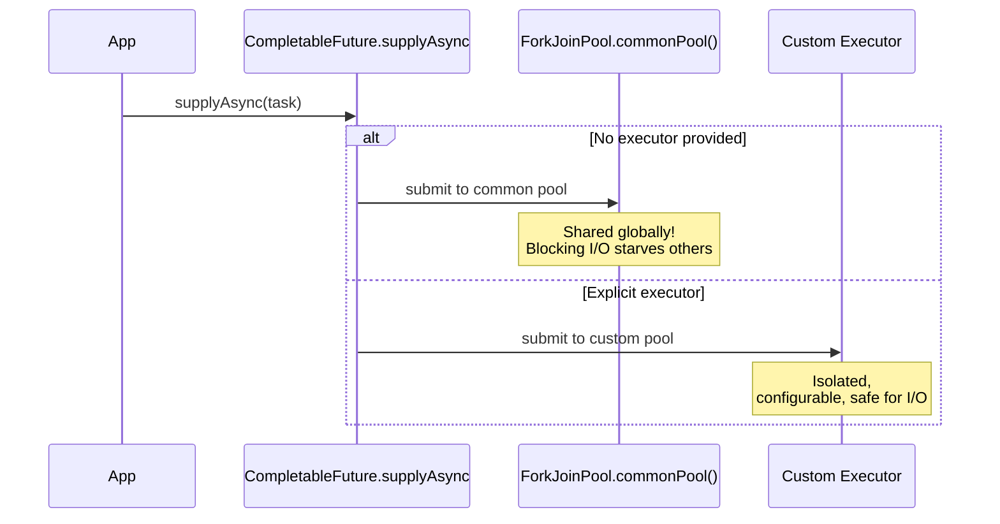
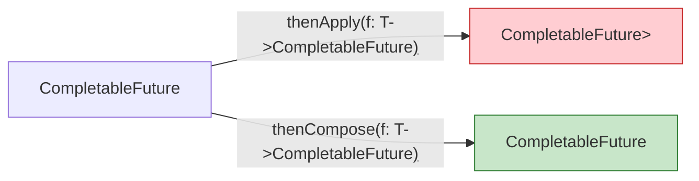
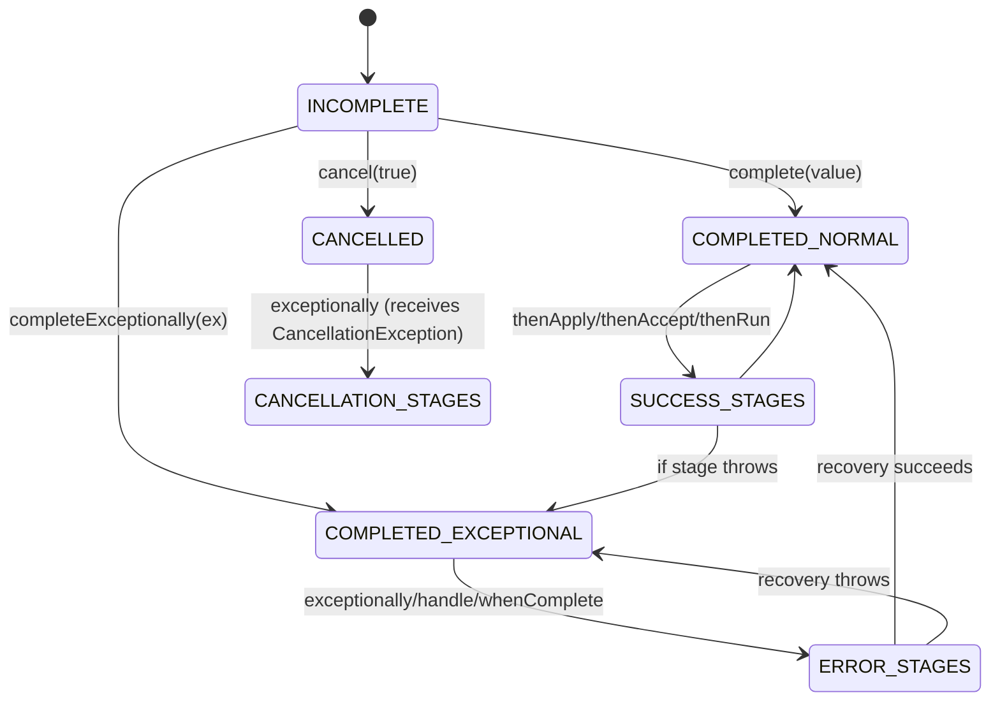

# CompletableFuture

`CompletableFuture<T>` (Java 8+) implements both `Future<T>` and `CompletionStage<T>`, providing a **promise-style** API for asynchronous composition. Unlike `Future`, it supports non-blocking chaining, combining, and error recovery without thread blocking. Think of it as a **write-once container** that transitions through states: *incomplete* → *completed normally* | *completed exceptionally* | *cancelled*. Every dependent stage attaches as a callback to the completion event, forming a **directed acyclic graph (DAG)** of tasks.

---

## Limitations of `Future` and the `CompletionStage` Contract

`java.util.concurrent.Future<V>` (Java 5) has three critical limitations:

| Limitation | Impact |
|------------|--------|
| **No composition** | Cannot chain `Future` → `Future` without blocking on `get()` |
| **Blocking `get()`** | Caller thread parks; no callback registration |
| **No error callbacks** | Exceptions only surface on `get()`, no recovery pipeline |

`CompletionStage<T>` (Java 8) defines the **contract for dependent actions**: `thenApply`, `thenAccept`, `thenRun`, `thenCompose`, `thenCombine`, `exceptionally`, `handle`, `whenComplete`, and their `*Async` variants. `CompletableFuture<T>` is the **concrete implementation** — a `Future` you can **complete manually** (`complete`, `completeExceptionally`) and a `CompletionStage` you can **chain off**.



---

## Creating `CompletableFuture` Instances

### Factory Methods (Recommended)

| Method | Use Case | Returns |
|--------|----------|---------|
| `supplyAsync(Supplier<U>)` | Async computation with result | `CompletableFuture<U>` |
| `runAsync(Runnable)` | Async side-effect, no result | `CompletableFuture<Void>` |
| `completedFuture(U value)` | Already-resolved success | `CompletableFuture<U>` |
| `failedFuture(Throwable ex)` | Already-resolved failure (Java 9) | `CompletableFuture<U>` |

```java
// CompletableFutureCreation.java
import java.util.concurrent.*;

public class CompletableFutureCreation {
    public static void main(String[] args) throws Exception {
        ExecutorService es = Executors.newFixedThreadPool(2);

        // supplyAsync — uses ForkJoinPool.commonPool() by default
        CompletableFuture<String> f1 = CompletableFuture.supplyAsync(() -> {
            try { Thread.sleep(100); } catch (InterruptedException ignored) {}
            return "hello";
        });

        // supplyAsync with explicit executor (PREFERRED for blocking I/O)
        CompletableFuture<String> f2 = CompletableFuture.supplyAsync(() -> {
            try { Thread.sleep(100); } catch (InterruptedException ignored) {}
            return "world";
        }, es);

        // runAsync — no result
        CompletableFuture<Void> f3 = CompletableFuture.runAsync(() -> {
            System.out.println("side effect on " + Thread.currentThread().getName());
        }, es);

        // completedFuture / failedFuture (Java 9+)
        CompletableFuture<Integer> ready = CompletableFuture.completedFuture(42);
        CompletableFuture<Integer> failed = CompletableFuture.failedFuture(new IllegalStateException("boom"));

        System.out.println("f1: " + f1.join());
        System.out.println("f2: " + f2.join());
        f3.join();
        System.out.println("ready: " + ready.join());
        try { failed.join(); } catch (CompletionException e) { System.out.println("failed: " + e.getCause().getMessage()); }

        es.shutdown();
    }
}
```

**Output (order may vary):**
```
side effect on pool-1-thread-1
f1: hello
f2: world
ready: 42
failed: boom
```

### Manual Construction (Advanced)

```java
// ManualCompletableFuture.java
import java.util.concurrent.*;

public class ManualCompletableFuture {
    public static void main(String[] args) {
        CompletableFuture<String> future = new CompletableFuture<>();

        // Producer thread
        new Thread(() -> {
            try { Thread.sleep(200); } catch (InterruptedException ignored) {}
            future.complete("produced");
        }).start();

        // Consumer — attaches callback
        future.thenAccept(System.out::println).join(); // prints "produced"

        // Completing exceptionally
        CompletableFuture<Integer> fail = new CompletableFuture<>();
        fail.completeExceptionally(new RuntimeException("oops"));
        fail.exceptionally(ex -> { System.out.println("caught: " + ex.getMessage()); return -1; }).join();
    }
}
```

### Default Executor: `ForkJoinPool.commonPool()` vs Explicit Executor

- **Default**: `supplyAsync`/`runAsync` without executor use `ForkJoinPool.commonPool()`. This pool is **shared globally** (parallelism = CPU cores - 1).
- **Problem**: Blocking I/O (DB, HTTP, sleep) in common pool **starves all other tasks** using it (parallel streams, other `CompletableFuture`s).
- **Best Practice**: **Always pass an explicit `Executor`** for I/O-bound work. Use `Executors.newVirtualThreadPerTaskExecutor()` (Java 21) or a bounded pool for blocking code.



---

## Chaining Dependent Stages

### `thenApply`, `thenAccept`, `thenRun`

| Method | Input | Output | Use Case |
|--------|-------|--------|----------|
| `thenApply(Function<T,U>)` | `T` | `U` | Transform result |
| `thenAccept(Consumer<T>)` | `T` | `Void` | Consume result (side-effect) |
| `thenRun(Runnable)` | none | `Void` | Run after completion, ignore result |

```java
// ChainingBasics.java
import java.util.concurrent.*;

public class ChainingBasics {
    public static void main(String[] args) {
        ExecutorService es = Executors.newFixedThreadPool(2);

        CompletableFuture<String> f = CompletableFuture.supplyAsync(() -> "hello", es)
            .thenApply(s -> s + " world")      // String -> String
            .thenApply(String::toUpperCase)    // String -> String
            .thenAccept(System.out::println);  // String -> Void (side-effect)

        f.join(); // wait for chain
        es.shutdown();
    }
}
```

**Output:**
```
HELLO WORLD
```

### `*Async` Variants and Executor Semantics

| Variant | Executor Behavior |
|---------|-------------------|
| `thenApplyAsync(fn)` | Uses **default executor** (`ForkJoinPool.commonPool()`) |
| `thenApplyAsync(fn, executor)` | Uses **provided executor** |

> **Important**: There is **no executor inheritance** in `CompletableFuture`. Each `*Async` call without an explicit executor uses the default executor (common pool), regardless of what executor the previous stage used. To run a pipeline on a specific executor, pass it to every `*Async` call or use a custom `Executor` wrapper.

```java
// AsyncVariants.java
import java.util.concurrent.*;

public class AsyncVariants {
    public static void main(String[] args) {
        ExecutorService es1 = Executors.newSingleThreadExecutor(r -> {
            Thread t = new Thread(r, "pool-1");
            return t;
        });
        ExecutorService es2 = Executors.newSingleThreadExecutor(r -> {
            Thread t = new Thread(r, "pool-2");
            return t;
        });

        CompletableFuture.supplyAsync(() -> {
            System.out.println("stage1: " + Thread.currentThread().getName());
            return 1;
        }, es1)
        .thenApplyAsync(i -> {
            System.out.println("stage2 (async, no executor): " + Thread.currentThread().getName());
            return i + 1;
        }) // uses common pool (default executor)
        .thenApplyAsync(i -> {
            System.out.println("stage3 (async, explicit pool): " + Thread.currentThread().getName());
            return i + 1;
        }, es2) // uses es2
        .join();

        es1.shutdown();
        es2.shutdown();
    }
}
```

**Output:**
```
stage1: pool-1
stage2 (async, no executor): ForkJoinPool.commonPool-worker-1
stage3 (async, explicit pool): pool-2
```

### `thenCompose` (FlatMap for Async) vs `thenApply` Returning Nested Future

- **`thenApply`**: If function returns `CompletableFuture<U>`, result is `CompletableFuture<CompletableFuture<U>>` — **nested future**, rarely desired.
- **`thenCompose`**: Function returns `CompletableFuture<U>`; result is **flattened** `CompletableFuture<U>`.



```java
// ThenComposeVsThenApply.java
import java.util.concurrent.*;

public class ThenComposeVsThenApply {
    static CompletableFuture<String> fetchUser(int id) {
        return CompletableFuture.completedFuture("user-" + id);
    }
    static CompletableFuture<String> fetchOrders(String user) {
        return CompletableFuture.completedFuture("orders-for-" + user);
    }
    static CompletableFuture<String> fetchOrdersFromFuture(CompletableFuture<String> userFuture) {
        return userFuture.thenCompose(user -> fetchOrders(user));
    }

    public static void main(String[] args) {
        // WRONG: nested future - thenApply returns CompletableFuture
        CompletableFuture<CompletableFuture<String>> nested =
            CompletableFuture.supplyAsync(() -> 1)
                .thenApply(id -> fetchUser(id))              // returns CompletableFuture<String>
                .thenApply(userFuture -> fetchOrdersFromFuture(userFuture)); // returns CompletableFuture<CompletableFuture<String>>

        // RIGHT: flattened - thenCompose unwraps
        CompletableFuture<String> flat =
            CompletableFuture.supplyAsync(() -> 1)
                .thenCompose(id -> fetchUser(id))
                .thenCompose(user -> fetchOrders(user));

        System.out.println("nested type: " + nested.join().getClass().getSimpleName());
        System.out.println("flat result: " + flat.join());
    }
}
```

**Output:**
```
nested type: CompletableFuture
flat result: orders-for-user-1
```

---

## Combining Independent Stages

### Two-Future Combinators

| Method | Combines | Returns | Use Case |
|--------|----------|---------|----------|
| `thenCombine(other, BiFunction)` | Two results → one result | `CompletableFuture<V>` | Merge results |
| `thenAcceptBoth(other, BiConsumer)` | Two results → side-effect | `CompletableFuture<Void>` | Consume both |
| `runAfterBoth(other, Runnable)` | Ignore results → side-effect | `CompletableFuture<Void>` | Run after both done |
| `applyToEither(other, Function)` | First completed → result | `CompletableFuture<U>` | Race, take winner's result |
| `acceptEither(other, Consumer)` | First completed → consume | `CompletableFuture<Void>` | Race, consume winner |
| `runAfterEither(other, Runnable)` | First completed → run | `CompletableFuture<Void>` | Race, run after first |

```java
// CombiningTwoFutures.java
import java.util.concurrent.*;

public class CombiningTwoFutures {
    public static void main(String[] args) {
        ExecutorService es = Executors.newFixedThreadPool(4);

        CompletableFuture<String> user = CompletableFuture.supplyAsync(() -> {
            sleep(100); return "Alice";
        }, es);
        CompletableFuture<String> posts = CompletableFuture.supplyAsync(() -> {
            sleep(150); return "[post1, post2]";
        }, es);

        // thenCombine — wait for BOTH, merge results
        CompletableFuture<String> profile = user.thenCombine(posts, (u, p) -> u + " -> " + p);
        System.out.println("thenCombine: " + profile.join());

        // applyToEither — race, use first completed
        CompletableFuture<String> fast = CompletableFuture.supplyAsync(() -> { sleep(50); return "fast"; }, es);
        CompletableFuture<String> slow = CompletableFuture.supplyAsync(() -> { sleep(200); return "slow"; }, es);
        CompletableFuture<String> winner = fast.applyToEither(slow, Function.identity());
        System.out.println("applyToEither: " + winner.join()); // "fast"

        es.shutdown();
    }
    static void sleep(long ms) { try { Thread.sleep(ms); } catch (InterruptedException ignored) {} }
}
```

**Output:**
```
thenCombine: Alice -> [post1, post2]
applyToEither: fast
```

### `thenCompose` with Two Futures (Sequential Dependency)

`thenCompose` chains **sequentially** (second depends on first's result). For **parallel then merge**, use `thenCombine`.

```java
// ThenComposeTwoFutures.java
import java.util.concurrent.*;

public class ThenComposeTwoFutures {
    static CompletableFuture<String> fetchUser(int id) {
        return CompletableFuture.supplyAsync(() -> { sleep(100); return "user-" + id; });
    }
    static CompletableFuture<String> fetchOrders(String user) {
        return CompletableFuture.supplyAsync(() -> { sleep(100); return "orders-for-" + user; });
    }

    public static void main(String[] args) {
        // Sequential: fetchUser → then fetchOrders (total ~200ms)
        long start = System.currentTimeMillis();
        String result = fetchUser(1)
            .thenCompose(user -> fetchOrders(user))
            .join();
        System.out.println("sequential: " + result + " (" + (System.currentTimeMillis() - start) + "ms)");

        // Parallel: fetchUser + fetchOrders independently would need separate sources
        // This example shows sequential composition only
        start = System.currentTimeMillis();
        CompletableFuture<String> userF = fetchUser(1);
        CompletableFuture<String> ordersF = userF.thenCompose(u -> fetchOrders(u)); // still sequential
        System.out.println("sequential (again): " + ordersF.join() + " (" + (System.currentTimeMillis() - start) + "ms)");
    }
    static void sleep(long ms) { try { Thread.sleep(ms); } catch (InterruptedException ignored) {} }
}
```

---

## N-Way Combination: `allOf` and `anyOf`

### `allOf` — Wait for All

Returns `CompletableFuture<Void>`. **Type erasure**: individual results lost. Collect via streams.

```java
// AllOfExample.java
import java.util.concurrent.*;
import java.util.*;

public class AllOfExample {
    public static void main(String[] args) {
        ExecutorService es = Executors.newFixedThreadPool(4);

        List<CompletableFuture<String>> futures = List.of(
            CompletableFuture.supplyAsync(() -> { sleep(100); return "A"; }, es),
            CompletableFuture.supplyAsync(() -> { sleep(200); return "B"; }, es),
            CompletableFuture.supplyAsync(() -> { sleep(50);  return "C"; }, es)
        );

        // allOf returns Void — join it, then extract results
        CompletableFuture<Void> all = CompletableFuture.allOf(futures.toArray(CompletableFuture[]::new));
        all.join();

        List<String> results = futures.stream()
            .map(CompletableFuture::join)
            .toList();

        System.out.println("allOf results: " + results); // [A, B, C] (order preserved)

        es.shutdown();
    }
    static void sleep(long ms) { try { Thread.sleep(ms); } catch (InterruptedException ignored) {} }
}
```

**Output:**
```
allOf results: [A, B, C]
```

### `anyOf` — First Completed Wins

Returns `CompletableFuture<Object>` (raw type). Cast required.

```java
// AnyOfExample.java
import java.util.concurrent.*;

public class AnyOfExample {
    public static void main(String[] args) {
        ExecutorService es = Executors.newFixedThreadPool(4);

        CompletableFuture<String> fast = CompletableFuture.supplyAsync(() -> { sleep(50); return "fast"; }, es);
        CompletableFuture<String> slow = CompletableFuture.supplyAsync(() -> { sleep(200); return "slow"; }, es);

        CompletableFuture<Object> any = CompletableFuture.anyOf(fast, slow);
        String winner = (String) any.join(); // cast from Object
        System.out.println("anyOf winner: " + winner); // "fast"

        // Note: other futures still run to completion! Not cancelled.
        slow.join(); // wait for slow to finish
        System.out.println("slow also done: " + slow.join());

        es.shutdown();
    }
    static void sleep(long ms) { try { Thread.sleep(ms); } catch (InterruptedException ignored) {} }
}
```

**Output:**
```
anyOf winner: fast
slow also done: slow
```

> **Pitfall**: `anyOf` does **not cancel** losers. They continue running. If you need cancellation, wrap in a custom structure.

---

## Error Handling

### Three Primary Methods

| Method | Signature | Can Recover? | Sees Exception? | Use Case |
|--------|-----------|--------------|-----------------|----------|
| `exceptionally(Function<Throwable,T>)` | `Throwable` → `T` | Yes (returns fallback) | Yes | Simple fallback |
| `handle(BiFunction<T,Throwable,U>)` | `(T, Throwable)` → `U` | Yes (returns fallback or transformed result) | Yes | Transform success OR recover |
| `whenComplete(BiConsumer<T,Throwable>)` | `(T, Throwable)` → `void` | **No** (cannot change result) | Yes | Logging, cleanup, metrics |



### Detailed Examples

```java
// ErrorHandling.java
import java.util.concurrent.*;

public class ErrorHandling {
    public static void main(String[] args) {
        ExecutorService es = Executors.newFixedThreadPool(2);

        // exceptionally — simple fallback
        CompletableFuture<String> f1 = CompletableFuture.<String>supplyAsync(() -> {
            throw new RuntimeException("boom");
        }, es).exceptionally(ex -> "fallback");
        System.out.println("exceptionally: " + f1.join()); // "fallback"

        // handle — transform success OR recover
        CompletableFuture<Integer> f2 = CompletableFuture.supplyAsync(() -> 10, es)
            .handle((val, ex) -> ex != null ? -1 : val * 2);
        System.out.println("handle (success): " + f2.join()); // 20

        CompletableFuture<Integer> f3 = CompletableFuture.<Integer>supplyAsync(() -> { throw new RuntimeException("x"); }, es)
            .handle((val, ex) -> ex != null ? -1 : val * 2);
        System.out.println("handle (failure): " + f3.join()); // -1

        // whenComplete — side-effect only, CANNOT change result
        CompletableFuture<String> f4 = CompletableFuture.supplyAsync(() -> "ok", es)
            .whenComplete((val, ex) -> System.out.println("whenComplete: val=" + val + ", ex=" + ex));
        System.out.println("whenComplete result: " + f4.join()); // "ok" (unchanged)

        // exceptionallyCompose (Java 12) — async recovery returning CompletableFuture
        CompletableFuture<String> f5 = CompletableFuture.<String>supplyAsync(() -> { throw new RuntimeException("fail"); }, es)
            .exceptionallyCompose(ex -> CompletableFuture.completedFuture("recovered-async"));
        System.out.println("exceptionallyCompose: " + f5.join());

        es.shutdown();
    }
}
```

**Output:**
```
exceptionally: fallback
handle (success): 20
handle (failure): -1
whenComplete: val=ok, ex=null
whenComplete result: ok
exceptionallyCompose: recovered-async
```

### Error Propagation Rules

1. **Exception in stage** → downstream `exceptionally`/`handle`/`whenComplete` see it.
2. **`exceptionally` returns value** → chain continues **normally** (success).
3. **`exceptionally` throws** → new exception propagates downstream.
4. **`whenComplete` throws** → exception wraps in `CompletionException`, propagates.
5. **Unrecovered exception** → surfaces on `join()`/`get()` as `CompletionException`.

```java
// ErrorPropagation.java
import java.util.concurrent.*;

public class ErrorPropagation {
    public static void main(String[] args) {
        // Recovery succeeds → chain continues normally
        CompletableFuture<String> recovered = CompletableFuture.supplyAsync(() -> { throw new RuntimeException("e1"); })
            .exceptionally(ex -> "recovered")
            .thenApply(s -> s + "-done");
        System.out.println("recovered chain: " + recovered.join()); // "recovered-done"

        // Recovery throws → new exception propagates
        CompletableFuture<String> recoveryFails = CompletableFuture.supplyAsync(() -> { throw new RuntimeException("e1"); })
            .exceptionally(ex -> { throw new IllegalStateException("recovery failed"); })
            .thenApply(s -> s + "-done");
        try { recoveryFails.join(); } catch (CompletionException e) { System.out.println("recovery fails: " + e.getCause().getMessage()); }

        // whenComplete throws → wraps in CompletionException
        CompletableFuture<String> whenCompleteThrows = CompletableFuture.completedFuture("ok")
            .whenComplete((v, ex) -> { throw new RuntimeException("cleanup failed"); });
        try { whenCompleteThrows.join(); } catch (CompletionException e) { System.out.println("whenComplete throws: " + e.getCause().getMessage()); }
    }
}
```

**Output:**
```
recovered chain: recovered-done
recovery fails: recovery failed
whenComplete throws: cleanup failed
```

### The "Swallow the Exception" Pitfall

```java
// SwallowPitfall.java
import java.util.concurrent.*;

public class SwallowPitfall {
    public static void main(String[] args) {
        // WRONG: exceptionally returns null, downstream sees SUCCESS with null
        CompletableFuture<String> bad = CompletableFuture.<String>supplyAsync(() -> { throw new RuntimeException("boom"); })
            .exceptionally(ex -> null) // swallows, returns null
            .thenApply(s -> s.toUpperCase()); // NPE here!
        try { bad.join(); } catch (CompletionException e) { System.out.println("NPE: " + e.getCause().getMessage()); }

        // RIGHT: handle lets you distinguish, or throw a meaningful exception
        CompletableFuture<String> good = CompletableFuture.<String>supplyAsync(() -> { throw new RuntimeException("boom"); })
            .handle((String val, Throwable ex) -> {
                if (ex != null) throw new CompletionException(new IllegalStateException("failed: " + ex.getMessage(), ex));
                return val;
            });
        try { good.join(); } catch (CompletionException e) { System.out.println("proper: " + e.getCause().getMessage()); }
    }
}
```

**Output:**
```
NPE: Cannot invoke "String.toUpperCase()" because "<local1>" is null
proper: failed: boom
```

### Wrapping Checked Exceptions

`CompletionStage` methods accept functional interfaces that **don't declare checked exceptions**. Wrap in `CompletionException` or custom unchecked.

```java
// CheckedExceptions.java
import java.util.concurrent.*;
import java.io.*;

public class CheckedExceptions {
    static String readFile(String path) throws IOException {
        throw new IOException("disk error");
    }

    public static void main(String[] args) {
        CompletableFuture<String> f = CompletableFuture.supplyAsync(() -> {
            try { return readFile("x.txt"); }
            catch (IOException e) { throw new CompletionException(e); } // wrap
        }).exceptionally(ex -> {
            if (ex.getCause() instanceof IOException) return "io-fallback";
            throw new CompletionException(ex);
        });
        System.out.println(f.join()); // "io-fallback"
    }
}
```

---

## Timeouts and Cancellation

### `orTimeout` (Java 9) vs `completeOnTimeout` (Java 9)

| Method | Behavior on Timeout | Result |
|--------|---------------------|--------|
| `orTimeout(duration, unit)` | Completes exceptionally with `TimeoutException` | `CompletionException(TimeoutException)` |
| `completeOnTimeout(value, duration, unit)` | Completes **normally** with fallback value | `value` |

```java
// Timeouts.java
import java.util.concurrent.*;
import java.util.concurrent.atomic.AtomicInteger;

public class Timeouts {
    public static void main(String[] args) {
        ExecutorService es = Executors.newFixedThreadPool(2);

        // orTimeout — fails with TimeoutException
        CompletableFuture<String> f1 = CompletableFuture.supplyAsync(() -> { sleep(500); return "slow"; }, es)
            .orTimeout(100, TimeUnit.MILLISECONDS);
        try { f1.join(); } catch (CompletionException e) { System.out.println("orTimeout: " + e.getCause().getClass().getSimpleName()); }

        // completeOnTimeout — succeeds with fallback
        CompletableFuture<String> f2 = CompletableFuture.supplyAsync(() -> { sleep(500); return "slow"; }, es)
            .completeOnTimeout("fallback", 100, TimeUnit.MILLISECONDS);
        System.out.println("completeOnTimeout: " + f2.join()); // "fallback"

        es.shutdown();
    }
    static void sleep(long ms) { try { Thread.sleep(ms); } catch (InterruptedException ignored) {} }
}
```

**Output:**
```
orTimeout: TimeoutException
completeOnTimeout: fallback
```

### `cancel(boolean mayInterruptIfRunning)`

- Returns `true` if cancelled, `false` if already done.
- **Does NOT propagate upstream** — parent futures are **not** cancelled.
- `mayInterruptIfRunning=true` → calls `Thread.interrupt()` on running task.
- Cancelled future completes exceptionally with `CancellationException`.

```java
// Cancellation.java
import java.util.concurrent.*;

public class Cancellation {
    public static void main(String[] args) {
        ExecutorService es = Executors.newFixedThreadPool(2);

        CompletableFuture<String> parent = CompletableFuture.supplyAsync(() -> {
            try { Thread.sleep(200); } catch (InterruptedException e) { Thread.currentThread().interrupt(); return "interrupted"; }
            return "done";
        }, es);

        CompletableFuture<String> child = parent.thenApply(s -> s + "-child");

        // Cancel child — parent keeps running!
        boolean cancelled = child.cancel(true);
        System.out.println("child cancelled: " + cancelled);
        try { child.join(); } catch (CancellationException e) { System.out.println("child exception: CancellationException"); }

        // Parent still completes
        System.out.println("parent result: " + parent.join()); // "done" (after ~200ms)

        es.shutdown();
    }
}
```

**Output:**
```
child cancelled: true
child exception: CancellationException
parent result: done
```

> **Key Insight**: Cancellation is **one-way downstream only**. No upstream propagation. This differs from reactive streams (e.g., `Reactor`/`RxJava` cancellation signals).

### `isCompletedExceptionally()` and `isCancelled()`

```java
// StatusChecks.java
import java.util.concurrent.*;

public class StatusChecks {
    public static void main(String[] args) {
        CompletableFuture<String> success = CompletableFuture.completedFuture("ok");
        CompletableFuture<String> failed = CompletableFuture.failedFuture(new RuntimeException("x"));
        CompletableFuture<String> cancelled = new CompletableFuture<>();
        cancelled.cancel(false);

        System.out.println("success: exceptionally=" + success.isCompletedExceptionally() + ", cancelled=" + success.isCancelled());
        System.out.println("failed: exceptionally=" + failed.isCompletedExceptionally() + ", cancelled=" + failed.isCancelled());
        System.out.println("cancelled: exceptionally=" + cancelled.isCompletedExceptionally() + ", cancelled=" + cancelled.isCancelled());
    }
}
```

**Output:**
```
success: exceptionally=false, cancelled=false
failed: exceptionally=true, cancelled=false
cancelled: exceptionally=true, cancelled=true
```

> **Note**: `isCompletedExceptionally()` returns `true` for **both** exception and cancellation (since `CancellationException` extends `Exception`).

---

## `get()` vs `join()` vs `getNow()`

| Method | Throws | Blocks | Use Case |
|--------|--------|--------|----------|
| `get()` | `InterruptedException`, `ExecutionException` (checked) | Yes | Legacy code, need checked exceptions |
| `join()` | `CompletionException` (unchecked) | Yes | Modern code, cleaner stack traces |
| `getNow(defaultValue)` | Never | **No** (returns immediately) | Non-blocking peek, fallback if not done |

```java
// GetVsJoin.java
import java.util.concurrent.*;

public class GetVsJoin {
    public static void main(String[] args) throws Exception {
        CompletableFuture<String> f = CompletableFuture.supplyAsync(() -> { sleep(200); return "done"; });

        // getNow — non-blocking, returns default if not done
        System.out.println("getNow (before): " + f.getNow("not-ready")); // "not-ready"

        // join — blocks, unchecked exception
        System.out.println("join: " + f.join()); // "done"

        // getNow — now done, returns actual value
        System.out.println("getNow (after): " + f.getNow("not-ready")); // "done"

        // Exception difference
        CompletableFuture<String> fail = CompletableFuture.failedFuture(new RuntimeException("boom"));
        try { fail.get(); } catch (ExecutionException e) { System.out.println("get throws ExecutionException: " + e.getCause().getMessage()); }
        try { fail.join(); } catch (CompletionException e) { System.out.println("join throws CompletionException: " + e.getCause().getMessage()); }
    }
    static void sleep(long ms) { try { Thread.sleep(ms); } catch (InterruptedException ignored) {} }
}
```

**Output:**
```
getNow (before): not-ready
join: done
getNow (after): done
get throws ExecutionException: boom
join throws CompletionException: boom
```

### Blocking the Common Pool — Danger Zone

```java
// BlockingCommonPool.java
import java.util.concurrent.*;

public class BlockingCommonPool {
    public static void main(String[] args) {
        // DANGER: blocking get() inside a common-pool task deadlocks the pool!
        CompletableFuture<Void> deadlock = CompletableFuture.supplyAsync(() -> {
            // This task runs on common pool
            CompletableFuture<String> inner = CompletableFuture.supplyAsync(() -> "inner"); // also common pool
            return inner.join(); // BLOCKS common pool thread waiting for another common pool task!
        });
        // deadlock.join(); // Would hang forever — common pool exhausted

        // SAFE: use explicit executor for blocking work
        ExecutorService es = Executors.newFixedThreadPool(2);
        CompletableFuture<String> safe = CompletableFuture.supplyAsync(() -> {
            CompletableFuture<String> inner = CompletableFuture.supplyAsync(() -> "inner", es);
            return inner.join(); // OK — inner runs on different pool
        }, es);
        System.out.println("safe: " + safe.join());
        es.shutdown();
    }
}
```

### `Thread.currentThread()` Inside Stages

- **Non-async stages** (`thenApply`, `thenAccept`, `thenRun`): execute on **same thread** that completed the predecessor (caller thread if already complete).
- **Async stages** (`*Async`): execute on the **provided executor** (or common pool).

```java
// ThreadCurrentThread.java
import java.util.concurrent.*;

public class ThreadCurrentThread {
    public static void main(String[] args) {
        ExecutorService es = Executors.newSingleThreadExecutor(r -> new Thread(r, "my-pool"));

        CompletableFuture.supplyAsync(() -> {
            System.out.println("supplyAsync: " + Thread.currentThread().getName());
            return 1;
        }, es)
        .thenApply(i -> { // NON-async: runs on same thread as supplier
            System.out.println("thenApply: " + Thread.currentThread().getName());
            return i + 1;
        })
        .thenApplyAsync(i -> { // ASYNC: runs on executor (es)
            System.out.println("thenApplyAsync: " + Thread.currentThread().getName());
            return i + 1;
        }, es)
        .thenRun(() -> { // NON-async: runs on same thread as previous async stage
            System.out.println("thenRun: " + Thread.currentThread().getName());
        })
        .join();

        es.shutdown();
    }
}
```

**Output:**
```
supplyAsync: my-pool
thenApply: my-pool
thenApplyAsync: my-pool
thenRun: my-pool
```

> **Rule**: Non-async stages **inherit the thread** of the completing stage. Async stages **submit to executor**.

---

## Composition Patterns

### Pattern 1: Fan-Out / Fan-In (Parallel Independent Calls)

```java
// FanOutFanIn.java
import java.util.concurrent.*;
import java.util.*;

public class FanOutFanIn {
    record User(String name, List<String> posts, List<String> friends) {}

    static CompletableFuture<String> fetchUser() { return CompletableFuture.completedFuture("Alice"); }
    static CompletableFuture<List<String>> fetchPosts(String user) { return CompletableFuture.completedFuture(List.of("p1", "p2")); }
    static CompletableFuture<List<String>> fetchFriends(String user) { return CompletableFuture.completedFuture(List.of("Bob", "Carol")); }

    public static void main(String[] args) {
        ExecutorService es = Executors.newVirtualThreadPerTaskExecutor(); // Java 21

        // Fan-out: start all independent fetches in parallel
        CompletableFuture<String> userF = fetchUser();
        CompletableFuture<List<String>> postsF = userF.thenCompose(FanOutFanIn::fetchPosts);
        CompletableFuture<List<String>> friendsF = userF.thenCompose(FanOutFanIn::fetchFriends);

        // Fan-in: combine when all ready
        CompletableFuture<User> profile = CompletableFuture.allOf(userF, postsF, friendsF)
            .thenApply(v -> new User(userF.join(), postsF.join(), friendsF.join()));

        System.out.println(profile.join());
        es.shutdown();
    }
}
```

**Output:**
```
User[name=Alice, posts=[p1, p2], friends=[Bob, Carol]]
```

### Pattern 2: Fallback Chain (Primary → Cache → DB → Default)

```java
// FallbackChain.java
import java.util.concurrent.*;

public class FallbackChain {
    static CompletableFuture<String> primary() { return CompletableFuture.failedFuture(new RuntimeException("primary down")); }
    static CompletableFuture<String> cache() { return CompletableFuture.failedFuture(new RuntimeException("cache miss")); }
    static CompletableFuture<String> db() { return CompletableFuture.completedFuture("from-db"); }
    static CompletableFuture<String> defaultVal() { return CompletableFuture.completedFuture("default"); }

    public static void main(String[] args) {
        CompletableFuture<String> result = primary()
            .exceptionallyCompose(ex -> cache())
            .exceptionallyCompose(ex -> db())
            .exceptionallyCompose(ex -> defaultVal());

        System.out.println("fallback chain: " + result.join()); // "from-db"
    }
}
```

**Output:**
```
fallback chain: from-db
```

### Pattern 3: Retry with Backoff

```java
// RetryWithBackoff.java
import java.util.concurrent.*;
import java.util.function.*;

public class RetryWithBackoff {
    static <T> CompletableFuture<T> retry(Supplier<CompletableFuture<T>> action, int maxRetries, long baseDelayMs) {
        return action.get()
            .exceptionallyCompose(ex -> {
                if (maxRetries <= 0) throw new CompletionException(ex);
                try { Thread.sleep(baseDelayMs); } catch (InterruptedException e) { Thread.currentThread().interrupt(); throw new CompletionException(e); }
                return retry(action, maxRetries - 1, baseDelayMs * 2);
            });
    }

    static int attempts = 0;
    static CompletableFuture<String> flaky() {
        attempts++;
        if (attempts < 3) return CompletableFuture.failedFuture(new RuntimeException("fail " + attempts));
        return CompletableFuture.completedFuture("success on attempt " + attempts);
    }

    public static void main(String[] args) {
        System.out.println(retry(RetryWithBackoff::flaky, 3, 10).join());
    }
}
```

**Output:**
```
success on attempt 3
```

### Pattern 4: Timeout-as-Failure (Fail Fast)

```java
// TimeoutAsFailure.java
import java.util.concurrent.*;

public class TimeoutAsFailure {
    public static void main(String[] args) {
        ExecutorService es = Executors.newVirtualThreadPerTaskExecutor();

        CompletableFuture<String> withTimeout = CompletableFuture.supplyAsync(() -> { sleep(500); return "slow"; }, es)
            .orTimeout(100, TimeUnit.MILLISECONDS); // fails fast

        try { withTimeout.join(); } catch (CompletionException e) { System.out.println("timeout: " + e.getCause().getClass().getSimpleName()); }

        es.shutdown();
    }
    static void sleep(long ms) { try { Thread.sleep(ms); } catch (InterruptedException ignored) {} }
}
```

**Output:**
```
timeout: TimeoutException
```

### Pattern 5: Combining Results into DTO (Avoiding `allOf` Type Erasure)

```java
// CombineIntoDTO.java
import java.util.concurrent.*;
import java.util.*;

public class CombineIntoDTO {
    record Order(String id, String customer, List<String> items, String shipping) {}

    static CompletableFuture<String> fetchOrderId() { return CompletableFuture.completedFuture("ORD-123"); }
    static CompletableFuture<String> fetchCustomer(String id) { return CompletableFuture.completedFuture("Alice"); }
    static CompletableFuture<List<String>> fetchItems(String id) { return CompletableFuture.completedFuture(List.of("item1", "item2")); }
    static CompletableFuture<String> fetchShipping(String id) { return CompletableFuture.completedFuture("express"); }

    public static void main(String[] args) {
        // Start all in parallel
        CompletableFuture<String> idF = fetchOrderId();
        CompletableFuture<String> customerF = idF.thenCompose(CombineIntoDTO::fetchCustomer);
        CompletableFuture<List<String>> itemsF = idF.thenCompose(CombineIntoDTO::fetchItems);
        CompletableFuture<String> shippingF = idF.thenCompose(CombineIntoDTO::fetchShipping);

        // Combine into DTO — type-safe, no allOf erasure
        CompletableFuture<Order> order = customerF.thenCombine(itemsF, (c, i) -> new Order(idF.join(), c, i, null))
            .thenCombine(shippingF, (o, s) -> new Order(o.id(), o.customer(), o.items(), s));

        System.out.println(order.join());
    }
}
```

**Output:**
```
Order[id=ORD-123, customer=Alice, items=[item1, item2], shipping=express]
```

---

## Common Mistakes

| # | Mistake | Wrong | Right |
|---|---------|-------|-------|
| 1 | Forgetting `*Async` for blocking work | `.thenApply(this::blockingCall)` | `.thenApplyAsync(this::blockingCall, ioExecutor)` |
| 2 | Using common pool for blocking I/O | `supplyAsync(() -> httpCall())` | `supplyAsync(() -> httpCall(), ioExecutor)` |
| 3 | Ignoring exceptions (no `exceptionally`) | `supplyAsync(...).thenApply(...)` | `supplyAsync(...).exceptionally(...).thenApply(...)` |
| 4 | `thenApply` vs `thenCompose` confusion | `.thenApply(x -> asyncCall(x))` → nested future | `.thenCompose(x -> asyncCall(x))` → flattened |
| 5 | `allOf` type erasure — losing results | `allOf(f1, f2).join(); // results lost` | `allOf(f1, f2).join(); f1.join(); f2.join()` or stream |
| 6 | Nesting futures | `.thenApply(x -> CompletableFuture.completedFuture(x))` | `.thenCompose(x -> CompletableFuture.completedFuture(x))` |
| 7 | Blocking `get`/`join` inside a stage on common pool | `supplyAsync(() -> otherFuture.get())` | Use explicit executor or `thenCompose` |
| 8 | `anyOf` doesn't cancel losers | Assuming losers stop | Explicitly cancel or use structured concurrency (JEP 453) |
| 9 | `whenComplete` swallowing exceptions | `.whenComplete((v,ex) -> log(ex))` — ex not rethrown | Use `handle` or rethrow in `whenComplete` |
| 10 | Forgetting `join()`/`get()` — future never executes | `supplyAsync(() -> doWork());` | `supplyAsync(() -> doWork()).join();` |

### Mistake 4 Deep Dive: `thenApply` vs `thenCompose`

```java
// MistakeThenApplyVsCompose.java
import java.util.concurrent.*;

public class MistakeThenApplyVsCompose {
    static CompletableFuture<String> asyncTransform(String s) {
        return CompletableFuture.completedFuture(s.toUpperCase());
    }

    public static void main(String[] args) {
        // WRONG: returns CompletableFuture<CompletableFuture<String>>
        CompletableFuture<CompletableFuture<String>> nested = CompletableFuture.completedFuture("hello")
            .thenApply(MistakeThenApplyVsCompose::asyncTransform);
        System.out.println("nested type: " + nested.join().getClass().getSimpleName()); // CompletableFuture

        // RIGHT: returns CompletableFuture<String>
        CompletableFuture<String> flat = CompletableFuture.completedFuture("hello")
            .thenCompose(MistakeThenApplyVsCompose::asyncTransform);
        System.out.println("flat result: " + flat.join()); // HELLO
    }
}
```

---

## Performance Considerations

| Factor | Impact | Guidance |
|--------|--------|----------|
| **Thread pool selection** | Common pool = shared, starved by blocking | Use dedicated executor for I/O; virtual threads (Java 21) for high concurrency |
| **Unnecessary async hops** | Each `*Async` submits task, context switch | Prefer non-async (`thenApply`) when already on correct thread; chain sync stages |
| **Common pool parallelism** | Fixed at `Runtime.getRuntime().availableProcessors() - 1` | Don't saturate with long-running tasks |
| **Many tiny stages** | Allocation overhead (stage objects, lambdas) | Fuse small sync operations; avoid `thenApply(x -> x + 1)` chains |
| **Completion ordering** | `whenComplete`/`exceptionally` run on completer thread | For logging/metrics, use async variants to avoid blocking completer |
| **Virtual threads (Java 21)** | Cheap blocking, millions possible | `Executors.newVirtualThreadPerTaskExecutor()` for I/O; no pool sizing needed |

### Microbenchmark: Async Hop Overhead

```java
// AsyncOverhead.java
import java.util.concurrent.*;

public class AsyncOverhead {
    public static void main(String[] args) {
        int n = 100_000;
        ExecutorService es = Executors.newFixedThreadPool(4);

        // Sync chain (no async hops)
        long start = System.nanoTime();
        CompletableFuture<Integer> sync = CompletableFuture.completedFuture(0);
        for (int i = 0; i < n; i++) {
            final int j = i;
            sync = sync.thenApply(x -> x + j);
        }
        sync.join();
        System.out.println("Sync chain: " + (System.nanoTime() - start) / 1_000_000 + "ms");

        // Async chain (100k submissions!)
        start = System.nanoTime();
        CompletableFuture<Integer> async = CompletableFuture.completedFuture(0);
        for (int i = 0; i < n; i++) {
            final int j = i;
            async = async.thenApplyAsync(x -> x + j, es);
        }
        async.join();
        System.out.println("Async chain: " + (System.nanoTime() - start) / 1_000_000 + "ms");

        es.shutdown();
    }
}
```

Typical output (varies by machine):
```
Sync chain: 20ms
Async chain: 80ms
```

> **Lesson**: Avoid `*Async` in tight loops. Batch work or use sync chaining. The overhead is significant due to task submission and context switching.

---

## Comparison Tables

### `thenApply` vs `thenCompose` vs `thenCombine`

| Axis | `thenApply` | `thenCompose` | `thenCombine` |
|------|-------------|---------------|---------------|
| **Arity** | Unary (1 input) | Unary (1 input) | Binary (2 inputs) |
| **Dependency** | Sequential, sync transform | Sequential, async dependency | Parallel, independent |
| **Function returns** | `U` (value) | `CompletableFuture<U>` | `BiFunction<T,U,V>` |
| **Result** | `CompletableFuture<U>` | `CompletableFuture<U>` (flattened) | `CompletableFuture<V>` |
| **Typical use** | Map/sync transform | FlatMap: call another async API | Merge two independent results |

### `handle` vs `exceptionally` vs `whenComplete`

| Axis | `exceptionally` | `handle` | `whenComplete` |
|------|-----------------|----------|----------------|
| **Sees** | Only exception | Both value and exception | Both value and exception |
| **Can recover** | Yes (returns fallback) | Yes (returns fallback or transformed) | **No** (void return) |
| **Can transform success** | No | Yes | No |
| **Typical use** | Simple fallback | Transform OR recover | Logging, metrics, cleanup |
| **Exception in handler** | Propagates as new cause | Propagates as new cause | Wraps in `CompletionException` |

### `get` vs `join` vs `getNow`

| Axis | `get()` | `join()` | `getNow(default)` |
|------|---------|----------|-------------------|
| **Blocking** | Yes | Yes | **No** |
| **Throws (checked)** | `InterruptedException`, `ExecutionException` | No | No |
| **Throws (unchecked)** | No | `CompletionException` | No |
| **Returns if done** | Value | Value | Value |
| **Returns if not done** | Blocks | Blocks | `default` |
| **Use case** | Legacy, need checked | Modern default | Non-blocking peek, timeout fallback |

---

## Cross-References

- **Executors & Thread Pools**: [Concurrency Utilities](../04-Multithreading/19-Concurrency-Utilities.md)
- **ForkJoinPool Internals**: [Fork/Join Framework](../04-Multithreading/21-ForkJoin.md)
- **Virtual Threads**: [Virtual Threads](../04-Multithreading/22-Virtual-Threads.md)
- **Java Memory Model**: [JMM](../04-Multithreading/23-Java-Memory-Model.md)
- **Streams (parallel)**: [Streams](../03-Functional/13-Streams.md)

---

# Interview Questions

## Beginner

**Q1: What is `CompletableFuture` and how does it differ from `Future`?**

`CompletableFuture<T>` implements both `Future<T>` and `CompletionStage<T>`. Unlike `Future`, it supports:
- **Non-blocking composition**: `thenApply`, `thenCompose`, `thenCombine` attach callbacks instead of blocking on `get()`
- **Manual completion**: `complete(value)` / `completeExceptionally(ex)` — enables promise pattern
- **Error handling pipeline**: `exceptionally`, `handle`, `whenComplete` for declarative recovery
- **Combining**: `allOf`, `anyOf`, `thenCombine` for parallel coordination

`Future` only offers blocking `get()` and `cancel()` — no chaining, no callbacks.

**Q2: What are the three main factory methods for creating a `CompletableFuture`?**

1. `supplyAsync(Supplier<U>)` — async computation returning `U`
2. `runAsync(Runnable)` — async action returning `Void`
3. `completedFuture(U value)` — immediately completed with value
4. (Java 9+) `failedFuture(Throwable ex)` — immediately completed exceptionally

**Q3: What is the difference between `thenApply` and `thenApplyAsync`?**

- `thenApply(fn)`: executes `fn` on **the same thread** that completes the prior stage (caller thread if already done). No task submission overhead.
- `thenApplyAsync(fn)`: submits `fn` to an **executor** (common pool by default, or explicit). Adds async boundary.
- `thenApplyAsync(fn, executor)`: uses the provided executor.

Use `thenApply` for cheap sync transforms; `thenApplyAsync` when the next stage should run on a specific thread pool (e.g., I/O pool).

**Q4: What does `thenCompose` do and when would you use it over `thenApply`?**

`thenCompose(Function<T, CompletableFuture<U>>)` **flattens** a dependent async call. If your function returns a `CompletableFuture`, `thenApply` gives you `CompletableFuture<CompletableFuture<U>>` (nested), while `thenCompose` gives `CompletableFuture<U>`. Use `thenCompose` for **sequential async dependencies** (e.g., fetch user → fetch orders for user).

**Q5: How do you handle exceptions in a `CompletableFuture` chain?**

Three main methods:
- `exceptionally(Function<Throwable, T>)`: catches exception, returns fallback value. Chain continues **normally**.
- `handle(BiFunction<T, Throwable, U>)`: receives both value and exception; can transform success OR return fallback. Most flexible.
- `whenComplete(BiConsumer<T, Throwable>)`: side-effect only (logging, cleanup); **cannot change result**. Throws wrapped in `CompletionException`.

---

## Intermediate

**Q6: Explain the difference between `allOf` and `anyOf`. What are their return types and pitfalls?**

| Aspect | `allOf(CompletableFuture<?>...)` | `anyOf(CompletableFuture<?>...)` |
|--------|----------------------------------|----------------------------------|
| **Waits for** | All to complete | First to complete |
| **Returns** | `CompletableFuture<Void>` | `CompletableFuture<Object>` |
| **Results** | Lost (type erasure) — must re-join originals | Winner's result as `Object` — cast needed |
| **Losers** | N/A | Continue running (not cancelled!) |

**Pitfalls**: 
- `allOf` loses type info; collect via `futures.stream().map(CompletableFuture::join).toList()`
- `anyOf` doesn't cancel losers — they waste resources. For true cancellation, use structured concurrency (Java 21+) or manual tracking.

**Q7: What happens when you call `cancel(true)` on a `CompletableFuture`? Does it cancel upstream dependencies?**

`cancel(true)`:
- Completes the future exceptionally with `CancellationException`
- If `mayInterruptIfRunning=true`, calls `Thread.interrupt()` on the thread executing the task
- **Does NOT propagate upstream** — parent/upstream futures continue running. Cancellation is **downstream-only**. This differs from reactive streams where cancellation signals flow upstream.

**Q8: What is the difference between `orTimeout` and `completeOnTimeout` (both Java 9)?**

- `orTimeout(duration, unit)`: on timeout, completes **exceptionally** with `TimeoutException`. Downstream `exceptionally`/`handle` sees it.
- `completeOnTimeout(value, duration, unit)`: on timeout, completes **normally** with the provided fallback `value`. Downstream sees success.

**Q9: Why is blocking `get()` or `join()` inside a `CompletableFuture` stage running on the common pool dangerous?**

The common pool has **fixed parallelism** (CPU cores - 1). If a task on the common pool blocks on another task that also needs the common pool, you get **thread starvation deadlock**. All pool threads wait, no thread can make progress.

Fix: Use explicit executor for blocking work, or use `thenCompose` to chain without blocking.

**Q10: How does `exceptionally` differ from `handle` in terms of what they see and what they can do?**

| | `exceptionally` | `handle` |
|--|----------------|----------|
| **Params** | `Throwable` only | `(T value, Throwable ex)` |
| **Sees success?** | No | Yes |
| **Sees failure?** | Yes | Yes |
| **Can transform success?** | No | Yes |
| **Returns** | Fallback `T` | Transformed `U` or fallback |
| **Chain continues** | Normally (success) | Normally (success) |

Use `exceptionally` for simple fallbacks. Use `handle` when you need to inspect both or transform the success value too.

---

## Advanced

**Q11: Describe the internal state machine of `CompletableFuture`. What are the possible states and transitions?**

`CompletableFuture` has a **state field** (`result`) that holds:
- `null` → **INCOMPLETE**
- `AltResult` with `ex != null` → **COMPLETED_EXCEPTIONALLY** (includes `CancellationException`)
- `AltResult` with `ex == null` → **COMPLETED_NORMALLY** (value in `value` field, or `NIL` for `Void`)
- Special `SIGN` bit for cancellation

Transitions (via `internalComplete` / `completeValue` / `completeThrowable`):
- INCOMPLETE → COMPLETED_NORMALLY (via `complete(value)`)
- INCOMPLETE → COMPLETED_EXCEPTIONALLY (via `completeExceptionally(ex)` or `cancel(true)`)
- Once complete, **immutable** — further `complete`/`completeExceptionally`/`cancel` return `false`

Dependent stages are stored as a **linked list of `Completion` objects** (internal class). On completion, `postComplete()` iterates and fires each dependent (via `tryFire` → `run` or executor submit).

**Q12: How does `CompletableFuture` achieve non-blocking callback execution without parking threads?**

It uses **continuation-passing style**: when you call `thenApply(fn)`, a `UniApply` (or similar `Completion` subclass) is created and **appended to the dependent list** of the source future. If the source is already complete, `postComplete()` immediately invokes `tryFire()` which executes `fn` (or submits to executor for `*Async`). No thread parks waiting — the callback is **pushed** when the result arrives.

**Q13: What is the "swallow the exception" pitfall with `exceptionally`? Show code.**

```java
// Pitfall: returning null from exceptionally
CompletableFuture<String> f = CompletableFuture.supplyAsync(() -> { throw new RuntimeException("boom"); })
    .exceptionally(ex -> null) // Swallows! Returns null as "success"
    .thenApply(s -> s.toUpperCase()); // NPE here, wrapped in CompletionException
```

The chain continues **normally** with `null`. Downstream stages see success. Fix: either throw from `exceptionally`, or use `handle` to rethrow wrapped.

**Q14: Explain the executor inheritance semantics for `*Async` methods without explicit executor.**

- First `supplyAsync`/`runAsync` without executor → uses `ForkJoinPool.commonPool()`
- Subsequent `thenApplyAsync`/`thenAcceptAsync`/`thenRunAsync` **without executor** → use **the same executor** as the **previous stage's execution** (not necessarily common pool if an explicit executor was used earlier)
- Explicit `thenApplyAsync(fn, executor)` **overrides** and uses that executor for that stage only; next async stage without executor inherits this new executor

This allows pipeline-wide executor configuration by setting it once at the first async stage.

**Q15: How would you implement a retry-with-backoff pattern using `CompletableFuture`?**

```java
<T> CompletableFuture<T> retry(Supplier<CompletableFuture<T>> action, int maxRetries, long delayMs) {
    return action.get()
        .exceptionallyCompose(ex -> {
            if (maxRetries <= 0) throw new CompletionException(ex);
            try { Thread.sleep(delayMs); } catch (InterruptedException e) { throw new CompletionException(e); }
            return retry(action, maxRetries - 1, delayMs * 2);
        });
}
```
Key: `exceptionallyCompose` (Java 12) returns a new `CompletableFuture` for the retry attempt, enabling async recursion. For Java <12, use `exceptionally` + `thenCompose`.

---

## Expert

**Q16: What is the memory layout of a `CompletableFuture` with a chain of 5 dependent stages? Describe the object graph.**

```
CompletableFuture (head)
  ├─ result: Object (value or AltResult)
  ├─ stack: Completion (linked list head)
  │    ├─ UniApply (thenApply stage 1)
  │    │    ├─ fn: Function
  │    │    ├─ next: UniApply (stage 2)
  │    │    │    ├─ fn: Function
  │    │    │    ├─ next: UniCompose (stage 3)
  │    │    │    │    ├─ fn: Function
  │    │    │    │    ├─ next: UniAccept (stage 4)
  │    │    │    │    │    ├─ fn: Consumer
  │    │    │    │    │    ├─ next: UniRelay (stage 5, from thenCompose)
  │    │    │    │    │    │    ├─ next: null
  │    │    │    │    │    │    └─ ...
```

Each `Completion` node holds the **function/consumer**, a reference to the **next dependent**, and the **target future** (for `thenCompose`/`thenCombine`). On completion, `postComplete()` walks this list, calling `tryFire()` on each. Memory overhead: ~64 bytes per stage (object header + refs).

**Q17: How does `CompletableFuture` handle the "fast path" when the source is already complete?**

In `uniApplyStage` / `thenApply` etc.:
```java
public CompletableFuture<U> thenApply(Function<? super T, ? extends U> fn) {
    return uniApplyStage(null, fn); // null = no explicit executor
}
```
`uniApplyStage` creates the `UniApply` completion node. If `this.result != null` (already complete), it calls `c.tryFire(SYNC)` immediately — **synchronous execution on caller thread**, no executor submission. This avoids allocation of a task for the executor.

**Q18: Why does `CompletableFuture` use `AltResult` wrapper instead of storing value/exception directly?**

`AltResult` (static nested class) boxes the outcome:
```java
static final class AltResult {
    final Throwable ex;
    AltResult(Throwable x) { ex = x; }
    AltResult() { ex = null; } // for null value (since result field can't distinguish null value from incomplete)
}
```
This solves the **null value ambiguity**: `result == null` means INCOMPLETE; `result instanceof AltResult` with `ex == null` means completed with `null` value; `ex != null` means completed exceptionally. Single `volatile Object result` field serves all states.

**Q19: What happens when a `thenCompose` function returns `null`?**

`thenCompose` expects a **non-null** `CompletableFuture`. If the function returns `null`, `NullPointerException` is thrown **inside the completion logic**, completing the resulting future exceptionally with `CompletionException(NullPointerException)`. This is per spec: "The function must not return null."

**Q20: How would you implement a "scatter-gather with timeout per sub-task" pattern?**

```java
<T> CompletableFuture<List<T>> scatterGather(List<Supplier<CompletableFuture<T>>> tasks, long timeout, TimeUnit unit) {
    ExecutorService es = Executors.newVirtualThreadPerTaskExecutor();
    List<CompletableFuture<T>> futures = tasks.stream()
        .map(s -> s.get().orTimeout(timeout, unit).exceptionallyCompose(ex -> CompletableFuture.failedFuture(ex)))
        .toList();
    return CompletableFuture.allOf(futures.toArray(CompletableFuture[]::new))
        .thenApply(v -> futures.stream().map(CompletableFuture::join).toList());
}
```
Each sub-task gets individual timeout via `orTimeout`. `allOf` waits for all (or first timeout failure). On timeout, that sub-task fails exceptionally, propagating to `allOf`.

---

## Scenario Based

**Q21: You have three independent microservice calls (User, Orders, Recommendations). Each takes 100-300ms. You need all three to build a dashboard. How do you structure the `CompletableFuture` code for minimum latency?**

```java
CompletableFuture<User> userF = CompletableFuture.supplyAsync(() -> userClient.get(userId), ioExecutor);
CompletableFuture<List<Order>> ordersF = CompletableFuture.supplyAsync(() -> orderClient.get(userId), ioExecutor);
CompletableFuture<List<Rec>> recsF = CompletableFuture.supplyAsync(() -> recClient.get(userId), ioExecutor);

CompletableFuture<Dashboard> dashboard = CompletableFuture.allOf(userF, ordersF, recsF)
    .thenApply(v -> new Dashboard(userF.join(), ordersF.join(), recsF.join()));
```
**Why**: All three start **in parallel** on the I/O executor. `allOf` waits for the slowest (~300ms). Total latency ≈ max(latencies), not sum. Using virtual threads (Java 21) allows thousands of such concurrent requests without pool sizing.

**Q22: A downstream service is flaky. You want to try primary, then fallback to cache, then default — but each attempt has a 200ms timeout. Show the pattern.**

```java
CompletableFuture<String> result = CompletableFuture.supplyAsync(() -> primaryCall(), ioExecutor)
    .orTimeout(200, TimeUnit.MILLISECONDS)
    .exceptionallyCompose(ex -> CompletableFuture.supplyAsync(() -> cacheCall(), ioExecutor)
        .orTimeout(200, TimeUnit.MILLISECONDS))
    .exceptionallyCompose(ex -> CompletableFuture.completedFuture("default"));
```
Each attempt has its own timeout. `exceptionallyCompose` chains the next attempt only on failure. The final `exceptionallyCompose` (or `exceptionally`) provides the default.

**Q23: You're processing a stream of 10,000 items. Each item requires an async DB lookup. You want max 50 concurrent lookups. How do you do this with `CompletableFuture`?**

```java
ExecutorService bounded = Executors.newFixedThreadPool(50); // or virtual threads with semaphore
List<CompletableFuture<Result>> futures = items.stream()
    .map(item -> CompletableFuture.supplyAsync(() -> db.lookup(item), bounded))
    .toList();
List<Result> results = futures.stream().map(CompletableFuture::join).toList();
```
With virtual threads (Java 21), use `Executors.newVirtualThreadPerTaskExecutor()` + `Semaphore(50)` inside the task for lighter-weight concurrency control.

**Q24: Your `CompletableFuture` chain uses `whenComplete` for logging. You notice the logs show the wrong thread name. Why?**

`whenComplete` (non-async) runs on **the thread that completes the prior stage**. If the prior stage completed asynchronously on a pool thread, `whenComplete` runs on that pool thread. If the prior stage was already complete when `whenComplete` was attached, it runs on **the caller's thread**. For consistent logging thread, use `whenCompleteAsync` with an explicit executor.

**Q25: You have a chain: `supplyAsync` → `thenApply` → `thenCompose` → `thenAccept`. The `thenCompose` function throws an exception. Which error handlers see it?**

The exception from `thenCompose`'s function propagates to:
1. Downstream `exceptionally` / `handle` / `whenComplete` on the **result of `thenCompose`**
2. Ultimately to `join()`/`get()` on the final future

The `thenApply` stage's error handlers **do not see it** — they only see exceptions from `thenApply` itself. Error propagation flows **forward** along the chain.

---

## Output Prediction

**Q26: What is the output? Explain line by line.**

```java
CompletableFuture.supplyAsync(() -> {
    System.out.println("1: " + Thread.currentThread().getName());
    return "A";
})
.thenApply(s -> {
    System.out.println("2: " + Thread.currentThread().getName());
    return s + "B";
})
.thenApplyAsync(s -> {
    System.out.println("3: " + Thread.currentThread().getName());
    return s + "C";
})
.thenRun(() -> {
    System.out.println("4: " + Thread.currentThread().getName());
})
.join();
```

**Output (using common pool):**
```
1: ForkJoinPool.commonPool-worker-1
2: ForkJoinPool.commonPool-worker-1
3: ForkJoinPool.commonPool-worker-1
4: ForkJoinPool.commonPool-worker-1
```

**Reasoning:**
- `supplyAsync` submits to common pool → worker-1 prints line 1
- `thenApply` (non-async) runs on **same thread** that completed stage 1 → worker-1 prints line 2
- `thenApplyAsync` (no explicit executor) uses **same executor** as previous stage (common pool). Since worker-1 is free, it may run on same thread → worker-1 prints line 3
- `thenRun` (non-async) runs on **same thread** that completed stage 3 → worker-1 prints line 4

All on same thread because common pool reuses the worker.

**Q27: What is the output? Explain.**

```java
ExecutorService es = Executors.newSingleThreadExecutor(r -> new Thread(r, "my-thread"));

CompletableFuture.supplyAsync(() -> "start", es)
    .thenApplyAsync(s -> s + "-mid", es)
    .thenApply(s -> s + "-end")
    .thenAccept(System.out::println)
    .join();

es.shutdown();
```

**Output:**
```
start-mid-end
```

**Reasoning:**
- `supplyAsync` runs on "my-thread"
- `thenApplyAsync` with same executor `es` → submits to "my-thread" (same thread, since single-threaded)
- `thenApply` (non-async) runs on **completer thread** of previous stage → "my-thread"
- `thenAccept` (non-async) runs on same thread → "my-thread"
All stages execute on the single thread of `es`.

**Q28: What does this print? Why?**

```java
CompletableFuture<String> f = CompletableFuture.supplyAsync(() -> {
    throw new RuntimeException("boom");
})
.exceptionally(ex -> "recovered")
.thenApply(s -> s + "-done")
.exceptionally(ex -> "failed")
.join();

System.out.println(f);
```

**Output:**
```
recovered-done
```

**Reasoning:**
1. `supplyAsync` throws → completes exceptionally
2. `exceptionally(ex -> "recovered")` catches it, returns "recovered" → chain continues **normally**
3. `thenApply(s -> s + "-done")` receives "recovered", returns "recovered-done" → normal
4. Second `exceptionally` **never triggers** (no exception) → ignored
5. `join()` returns "recovered-done"

**Q29: Predict the output.**

```java
CompletableFuture<Integer> f = CompletableFuture.supplyAsync(() -> 10)
    .thenApply(i -> { throw new RuntimeException("x"); })
    .handle((val, ex) -> ex != null ? -1 : val * 2)
    .thenApply(i -> i + 1)
    .exceptionally(ex -> 999);

System.out.println(f.join());
```

**Output:**
```
0
```

**Reasoning:**
1. `supplyAsync` → 10
2. `thenApply` throws → completes exceptionally
3. `handle` sees `ex != null`, returns `-1` → chain continues normally with -1
4. `thenApply(i -> i + 1)` → 0
5. Final `exceptionally` never triggers
Result: 0

**Q30: What is printed?**

```java
CompletableFuture<String> f = new CompletableFuture<>();
f.complete("hello");
String result = f.thenApply(s -> s + " world").join();
System.out.println(result);
```

**Output:**
```
hello world
```

**Reasoning:** `new CompletableFuture<>()` starts incomplete. `complete("hello")` transitions to COMPLETED_NORMALLY. `thenApply` sees already-complete source, executes **synchronously on caller thread** (fast path), returns new future already complete with "hello world". `join()` returns immediately.

---

## Internal Working

**Q31: How does `CompletableFuture` store and trigger dependent stages? Describe the `Completion` hierarchy.**

Dependent stages are stored as a **linked list of `Completion` objects** attached to the source future's `stack` field. Key subclasses (in `java.util.concurrent.CompletableFuture`):

| Class | Stage Method | Function Type |
|-------|--------------|---------------|
| `UniApply` | `thenApply` | `Function<T,U>` |
| `UniAccept` | `thenAccept` | `Consumer<T>` |
| `UniRun` | `thenRun` | `Runnable` |
| `UniCompose` | `thenCompose` | `Function<T, CompletableFuture<U>>` |
| `BiApply` | `thenCombine` | `BiFunction<T,U,V>` |
| `BiAccept` | `thenAcceptBoth` | `BiConsumer<T,U>` |
| `BiRun` | `runAfterBoth` | `Runnable` |
| `OrApply` | `applyToEither` | `Function<T,U>` |
| `UniExceptionally` | `exceptionally` | `Function<Throwable,T>` |
| `UniHandle` | `handle` | `BiFunction<T,Throwable,U>` |
| `UniWhenComplete` | `whenComplete` | `BiConsumer<T,Throwable>` |

Each has `tryFire(int mode)` — `SYNC` (direct call), `ASYNC` (executor submit), `NESTED` (for `thenCompose` inner future).

**Q32: What is the `SYNC` vs `ASYNC` vs `NESTED` mode in `tryFire`?**

- `SYNC`: Execute callback **directly on caller thread** (used when source already complete, or for non-async stages on completer thread)
- `ASYNC`: Submit callback to **executor** (used for `*Async` stages)
- `NESTED`: Special mode for `thenCompose` — when inner future completes, fire outer continuation **on inner's completer thread** to avoid extra hop

**Q33: How does `postComplete()` work and why is it called from multiple places?**

`postComplete()` is called after the future's result is set (in `completeValue`, `completeThrowable`, `internalComplete`). It:
1. Sets `stack = null` (clears dependent list to allow GC)
2. Iterates through `Completion` list, calling `c.tryFire(mode)` for each

Called from:
- `complete()` / `completeExceptionally()` / `cancel()` — manual completion
- `uniApply`/`uniCompose` etc. — when a dependent stage completes and triggers its own dependents
- `postFire` — after a `Completion` fires, it calls `postComplete()` on its **target** future

This ensures **cascading completion** through the DAG.

**Q34: Why does `CompletableFuture` use `volatile Object result` instead of separate fields for value/exception/state?**

Single `volatile Object result` provides:
- **Atomic state transitions** via CAS (`compareAndSet` in `completeValue`/`completeThrowable`)
- **Memory visibility**: `volatile` guarantees happens-before for all dependent actions
- **Space efficiency**: One field vs three (value, exception, state enum)
- **Null encoding**: `null` = incomplete; `AltResult` with `ex==null` = null value; `AltResult` with `ex!=null` = exception; other = value

**Q35: How does `thenCompose` avoid creating a nested future? Walk through `UniCompose.tryFire`.**

`UniCompose` holds `Function<T, CompletableFuture<U>> fn`. In `tryFire`:
```java
CompletableFuture<U> inner = fn.apply(sourceResult);
if (inner == null) throw new NullPointerException();
inner.uniWhenComplete((v, ex) -> { // attach to inner
    if (ex != null) completeThrowable(ex);
    else completeValue(v);
});
```
It **attaches a `whenComplete` to the inner future** that completes the outer future. The outer future is a fresh `CompletableFuture<U>` created by `thenCompose`. No nesting — the outer is completed *by* the inner's completion callback.

---

## Tricky Questions

**Q36: Can a `CompletableFuture` be completed twice? What happens?**

No. `complete()`, `completeExceptionally()`, `cancel()` all return `boolean` — `true` if *this call* completed it, `false` if already complete. Subsequent calls are no-ops. The first completion wins. This is enforced by `internalComplete` using `RESULT.compareAndSet(this, null, encodedResult)`.

**Q37: What happens if you call `join()` on a `CompletableFuture` that was cancelled?**

`join()` throws `CompletionException` wrapping `CancellationException`. `isCancelled()` returns `true`, `isCompletedExceptionally()` also returns `true` (since `CancellationException` extends `Exception`).

**Q38: Is `CompletableFuture` thread-safe for multiple threads calling `complete()` simultaneously?**

Yes. Only **one** thread wins the CAS in `internalComplete`. Others return `false`. However, **dependent stages attached after completion** still fire (via `postComplete` check in `uniApplyStage` etc.) — the completion is **visible** to late attachers due to `volatile result`.

**Q39: What is the difference between `CompletionException` and `ExecutionException`?**

| | `CompletionException` | `ExecutionException` |
|--|----------------------|---------------------|
| **Thrown by** | `join()`, `getNow()` (never), `*Async` internal | `Future.get()` |
| **Checked?** | No (extends `RuntimeException`) | Yes |
| **Cause** | The actual exception from the stage | The actual exception from the task |
| **Introduced** | Java 8 | Java 5 |

`CompletableFuture.get()` wraps cause in `ExecutionException` (for `Future` compatibility). `join()` wraps in `CompletionException`.

**Q40: You have `CompletableFuture<A> a = ...; CompletableFuture<B> b = a.thenCompose(...);`. If you cancel `a`, what happens to `b`?**

Cancelling `a` completes `a` exceptionally with `CancellationException`. `b` (the `thenCompose` result) **also completes exceptionally** with `CancellationException` — the dependent stage receives the exception via `whenComplete` on the inner future (see `UniCompose`). However, **cancelling `b` does NOT cancel `a`** (upstream).

**Q41: Why does `allOf` return `CompletableFuture<Void>` instead of `CompletableFuture<List<T>>`?**

Type erasure: `allOf` accepts `CompletableFuture<?>...` (varargs of wildcard). Java generics cannot express "list of the parameter types" for heterogeneous varargs. Returning `Void` avoids false type safety. You must collect results manually: `allOf(f1, f2).thenApply(v -> List.of(f1.join(), f2.join()))`.

**Q42: Can you use `CompletableFuture` with primitive-specialized functions (e.g., `IntFunction`) to avoid boxing?**

No. `CompletionStage` methods use `Function<T,U>`, `Consumer<T>`, etc. — all object types. Primitive specialization would require separate APIs (like `IntStream`). For high-performance primitive pipelines, consider `CompletableFuture<int[]>` or third-party libraries.

**Q43: What happens if a `thenCompose` function returns a future that is already complete?**

`UniCompose.tryFire` calls `fn.apply(value)` getting the inner future. If inner is **already complete**, the attached `whenComplete` callback fires **immediately (SYNC)** on the current thread, completing the outer future. No extra async hop.

**Q44: How does `completeOnTimeout` differ from manually scheduling a timeout task?**

`completeOnTimeout(value, timeout, unit)` is implemented via `Delayer` (internal class) that schedules a `ScheduledFuture` on `ForkJoinPool.commonPool()`'s **delayed queue** (or `DelayedTask` in JDK 21+). It's more efficient than `ScheduledExecutorService` because it uses the common pool's built-in timer wheel. Manual scheduling creates extra threads/timers.

**Q45: What is the "completion stack" and why does it matter for stack traces?**

The `stack` field holds the linked list of `Completion` nodes. When an exception occurs in a stage, the stack trace shows **only that stage's frame** — not the full chain. This is because each stage runs independently (especially async ones). Debugging async chains requires correlating logs or using `CompletableFuture`'s `toString()` (shows result state) or profiling tools. This is a known observability limitation vs synchronous code.

---

*End of Module*