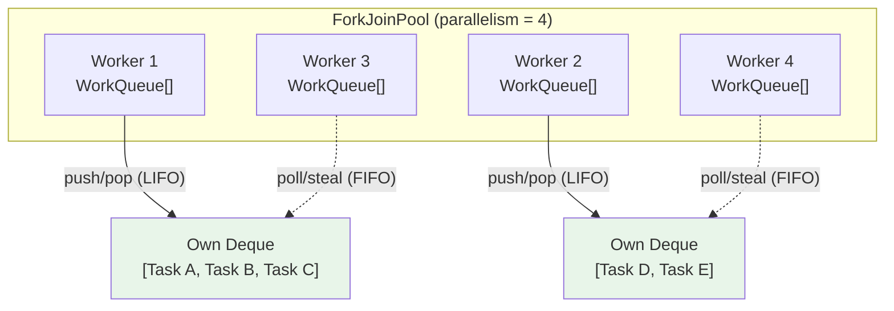
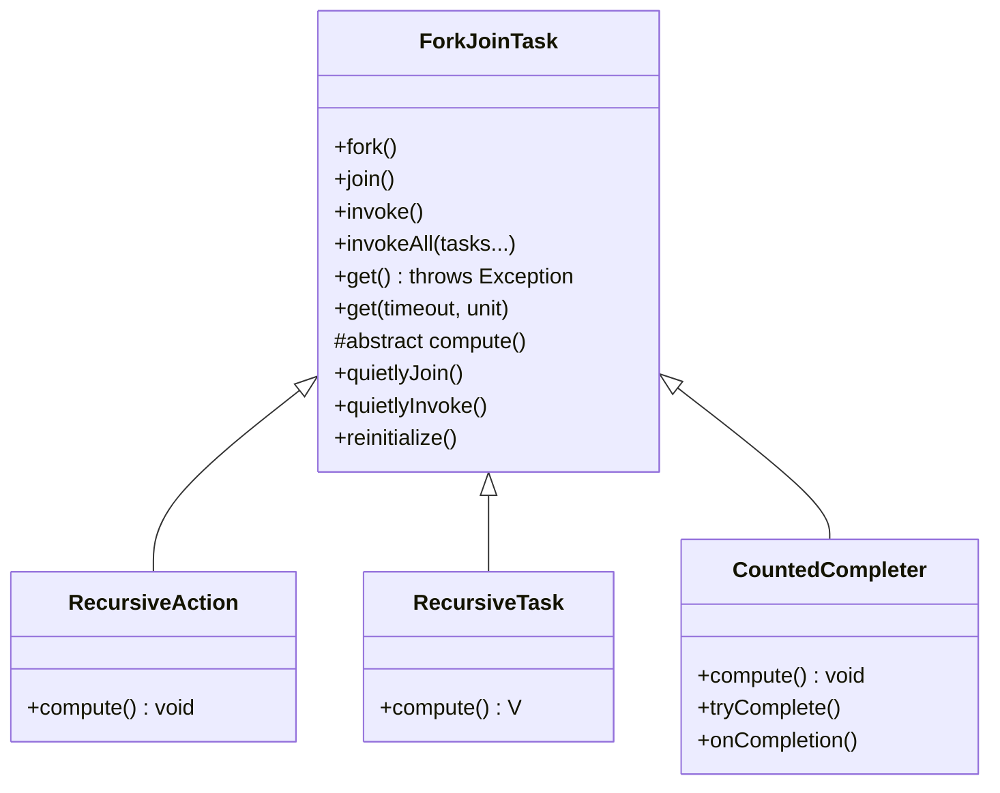
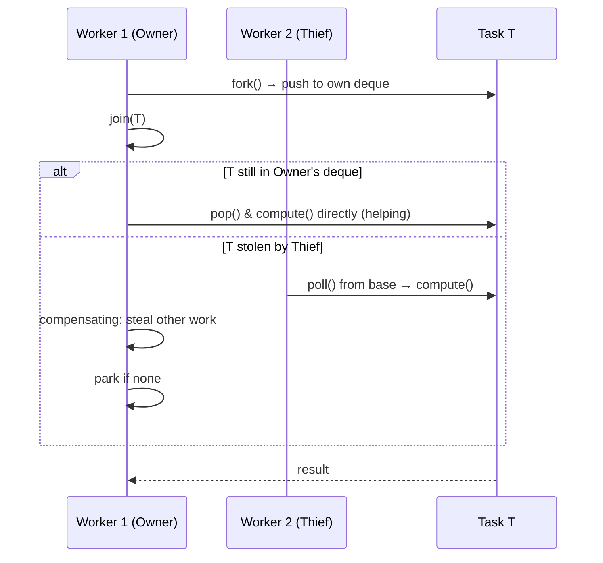

# Fork/Join Framework

The Fork/Join Framework is Java's built-in implementation of the **divide-and-conquer** parallelism pattern, designed for CPU-bound recursive workloads that can be split into independent subtasks. Introduced in Java 7 and significantly improved in Java 8+, it uses **work-stealing** to keep all cores busy without central coordination bottlenecks. Unlike `ExecutorService` ([Concurrency Utilities](19-Concurrency-Utilities.md)) which uses a shared queue, each worker thread owns a **double-ended queue (deque)**: it pushes/pops its own tasks **LIFO** (cache-friendly) but steals from others **FIFO** (maximizes parallelism). The framework lives in `java.util.concurrent` and centers on `ForkJoinPool`, `ForkJoinTask`, `RecursiveAction` (void), and `RecursiveTask<V>` (returns a value).

---

## Divide-and-Conquer Model

The mental model is simple: **if a problem is small enough, solve it directly; otherwise, split it, solve the pieces in parallel, and combine the results**.

```java
Result solve(Problem p) {
    if (p.size() <= THRESHOLD)          // base case: sequential
        return computeDirectly(p);
    List<Problem> subs = split(p);      // divide
    List<Future<Result>> futures = new ArrayList<>();
    for (Problem sub : subs)            // fork: submit subtasks
        futures.add(fork(() -> solve(sub)));
    return combine(futures.stream()     // join: wait & combine
        .map(Future::join)
        .toList());
}
```

**When it fits:**
- CPU-bound (no I/O, locks, blocking)
- Recursively splittable into **independent** subproblems
- Low coordination overhead between subtasks
- Work per task >> framework overhead (aim for 10K–100K instructions per leaf)

**When it does NOT fit:**
- I/O-bound or blocking operations (use [Virtual Threads](22-Virtual-Threads.md) or `ExecutorService` with `ManagedBlocker`)
- Fine-grained tasks where splitting overhead dominates
- Tasks with heavy shared-state synchronization
- Irregular recursion where work distribution is unpredictable

---

## ForkJoinPool Internals

### Worker Threads and Deques

Each `ForkJoinWorkerThread` owns a **work-stealing deque** (`WorkQueue`). The deque is an array-based circular buffer (power-of-two size, grown dynamically). Key operations:

| Operation | End | Order | Purpose |
|-----------|-----|-------|---------|
| `push` / `pop` | **Top** (owner) | LIFO | Owner processes its own tasks depth-first (cache locality) |
| `poll` (steal) | **Base** (thief) | FIFO | Thief takes oldest task → broadens parallelism |



### Work-Stealing Algorithm

1. **Owner thread**: executes `pop()` from top → depth-first, finishes subtrees completely before returning (optimal cache usage).
2. **Idle thread**: randomly picks a victim, calls `poll()` from base → steals the *oldest* (largest) task, maximizing parallel slack.
3. **Steal failure**: if victim empty, try another victim (up to `MAX_SCAN_ATTEMPTS` ≈ 2×parallelism); if all empty, park.

The stealing logic (simplified from `WorkQueue.scan()`):

```java
// Inside WorkQueue
ForkJoinTask<?> poll() {
    // Atomic steal from base index
    for (int b = base, h; (h = top) - b > 0; ) {
        ForkJoinTask<?> t = array[b & mask];
        if (U.compareAndSwapInt(this, BASE, b, b + 1))
            return t;
    }
    return null;
}
```

### Common Pool vs Custom Pools

```java
// Common pool (shared JVM-wide, default parallelism = cores - 1)
ForkJoinPool.commonPool().submit(() -> { ... });

// Custom pool (isolated, configurable)
ForkJoinPool custom = new ForkJoinPool(
    8,                          // parallelism
    ForkJoinPool.defaultForkJoinWorkerThreadFactory,
    null,                       // no UncaughtExceptionHandler
    true                        // asyncMode = false (default)
);
try {
    custom.submit(task).join();
} finally {
    custom.shutdown();          // reclaim threads
}
```

**Common pool characteristics (Java 21):**
- `parallelism = Runtime.getRuntime().availableProcessors() - 1` (minimum 1)
- In containers (Docker/K8s), `availableProcessors()` honors CPU limits (`-XX:-UseContainerSupport` to disable)
- Daemon threads; JVM exits even if tasks running
- **Do not** run blocking tasks on common pool — starves all parallel streams

**Custom pool use cases:**
- Isolation from parallel streams
- Dedicated resources for latency-sensitive work
- Non-daemon threads (set `asyncMode=true` for event-style tasks)
- Blocking tasks with `ManagedBlocker`

### `asyncMode` (FIFO Processing)

```java
// asyncMode = true: queue behaves FIFO for owner too
ForkJoinPool asyncPool = new ForkJoinPool(4, factory, handler, true);
```

Use `asyncMode` for **event-driven** tasks (e.g., [CompletableFuture](20-CompletableFuture.md) completions) where fairness matters more than cache locality. Avoid for divide-and-conquer.

---

## ForkJoinTask Hierarchy



### `RecursiveAction` (Void Result)

```java
class SumAction extends RecursiveAction {
    static final int THRESHOLD = 10_000;
    final long[] array; final int lo, hi;
    long result;

    SumAction(long[] a, int lo, int hi) { this.array = a; this.lo = lo; this.hi = hi; }

    @Override protected void compute() {
        if (hi - lo <= THRESHOLD) {
            long sum = 0;
            for (int i = lo; i < hi; i++) sum += array[i];
            result = sum;
        } else {
            int mid = (lo + hi) >>> 1;
            SumAction left = new SumAction(array, lo, mid);
            SumAction right = new SumAction(array, mid, hi);
            left.fork();                    // async submit
            right.compute();                // direct execute (tail recursion optimization)
            left.join();                    // wait for left
            result = left.result + right.result;
        }
    }
}
```

### `RecursiveTask<V>` (Returns Value)

```java
class SumTask extends RecursiveTask<Long> {
    static final int THRESHOLD = 10_000;
    final long[] array; final int lo, hi;

    SumTask(long[] a, int lo, int hi) { this.array = a; this.lo = lo; this.hi = hi; }

    @Override protected Long compute() {
        if (hi - lo <= THRESHOLD) {
            long sum = 0;
            for (int i = lo; i < hi; i++) sum += array[i];
            return sum;
        }
        int mid = (lo + hi) >>> 1;
        SumTask left = new SumTask(array, lo, mid);
        SumTask right = new SumTask(array, mid, hi);
        left.fork();
        long rightResult = right.compute();   // compute right in current thread
        long leftResult = left.join();        // wait for left
        return leftResult + rightResult;
    }
}
```

### Key Methods

| Method | Behavior |
|--------|----------|
| `fork()` | Pushes task to **current thread's deque** (or common pool if not in FJ pool); returns `this` |
| `join()` | Blocks until done, **but may execute other tasks** (helping) — see Join Mechanics |
| `invoke()` | `fork()` + `join()` in one; preferred for root task |
| `invokeAll(tasks...)` | Forks all, joins all; returns when all complete |
| `get()` | Like `join()` but **throws checked exceptions** (`InterruptedException`, `ExecutionException`) |
| `quietlyJoin()` / `quietlyInvoke()` | Suppresses exceptions; use only when exceptions are impossible |

### Threshold Selection (Granularity)

```java
// Rule of thumb: aim for 10K–100K CPU instructions per leaf
// Too small → fork overhead dominates (task creation, deque ops, stealing)
// Too large → insufficient parallelism, load imbalance

static int computeThreshold(int problemSize, int parallelism) {
    // Target ~4×parallelism leaves for good load balance
    int targetLeaves = parallelism * 4;
    return Math.max(1_000, problemSize / targetLeaves);
}
```

**Measuring overhead:** A no-op `RecursiveTask` fork/join takes ~500–2000 ns on modern hardware. If leaf work < 10 μs, sequential loop wins.

---

## Join Mechanics: Helping and Compensating Work

`join()` **does not simply park** the thread. Instead, the worker:

1. Checks if task is done → return result.
2. If not done and task is in **own deque** (not stolen): `pop()` it and `compute()` directly (helping).
3. If task was stolen: **compensating work** — steal another task from another worker and execute it, keeping CPU busy while waiting.
4. If no work to steal: `park()` (but wakes on any completion).



### `ForkJoinPool.managedBlock(ManagedBlocker)`

For **blocking operations** (I/O, locks, `Thread.sleep`) inside a ForkJoin task, you **must** use `ManagedBlocker` to avoid starving the pool:

```java
class BlockingTask extends RecursiveTask<String> {
    final String url;

    BlockingTask(String url) { this.url = url; }

    @Override protected String compute() {
        return ForkJoinPool.managedBlock(new ManagedBlocker() {
            @Override public boolean block() throws InterruptedException {
                return httpGet(url);  // blocking I/O
            }
            @Override public boolean isReleasable() {
                return false;         // always block
            }
        });
    }
}
```

**How it works:** `managedBlock` tells the pool "this thread is blocked, create a compensating worker if needed." The pool may temporarily exceed `parallelism` (up to `parallelism + 256` by default). Without it, a blocking task consumes a worker slot permanently.

---

## Relationship to Parallel Streams

### Common Pool Sharing

```java
// Both use ForkJoinPool.commonPool()
list.parallelStream().forEach(...);           // stream
ForkJoinPool.commonPool().submit(task).join(); // explicit FJ
```

**Danger:** Submitting a parallel stream task **from within** a ForkJoin task runs on the **same pool**:

```java
// DEADLOCK RISK: if all workers run this, they wait for inner stream
// which needs workers that are all blocked on outer join()
class BadTask extends RecursiveTask<Void> {
    @Override protected Void compute() {
        List<Integer> data = hugeList();
        data.parallelStream().forEach(x -> heavyWork(x)); // uses common pool!
        return null;
    }
}
```

**Solutions:**
1. Use a **custom pool** for the outer task:
   ```java
   ForkJoinPool custom = new ForkJoinPool(4);
   custom.invoke(() -> data.parallelStream().forEach(...));
   ```
2. **Sequential stream** inside FJ task: `data.stream().forEach(...)`
3. **Virtual threads** (Java 21+, [Virtual Threads](22-Virtual-Threads.md)) for blocking/stream work: `Executors.newVirtualThreadPerTaskExecutor()`

### Parallel Stream Internals

`parallelStream()` splits via `Spliterator` ([Streams](../03-Functional/13-Streams.md)):
- `trySplit()` divides the source (array: midpoint; `ArrayList`: range; custom: your logic)
- Terminal op submits leaf tasks to common pool
- `ForkJoinTask.invokeAll()` drives the computation

---

## Performance Analysis

### Optimal Threshold

```java
// Benchmark skeleton (run with JMH for real results)
@Benchmark
public long sumForkJoin() {
    return new SumTask(data, 0, data.length).invoke();
}

@Benchmark
public long sumSequential() {
    long sum = 0;
    for (long v : data) sum += v;
    return sum;
}
```

**Typical crossover (Intel i7, Java 21):**
| Array Size | Sequential | ForkJoin (threshold=10K) | Speedup |
|------------|------------|--------------------------|---------|
| 10K        | 15 μs      | 45 μs                    | 0.33×   |
| 100K       | 120 μs     | 85 μs                    | 1.4×    |
| 1M         | 1.1 ms     | 320 μs                   | 3.4×    |
| 10M        | 11 ms      | 2.8 ms                   | 3.9×    |

### Overhead Sources

| Source | Cost | Mitigation |
|--------|------|------------|
| Task object allocation | ~50 ns | Reuse tasks (rare), larger threshold |
| Deque push/pop (CAS) | ~20 ns | Unavoidable |
| Stealing (CAS + scan) | ~100 ns | Good threshold reduces steals |
| `join()` helping | Variable | Tail-recursion (`right.compute(); left.join()`) |
| Cache misses | High if data scattered | Process contiguous ranges |

### When Sequential Wins

```java
// Simple reduction: JVM auto-vectorizes loops
long sum = 0;
for (long v : array) sum += v;  // often faster than FJ for < 100K elements

// Arrays.parallelPrefix / parallelSort (JDK 8+) use FJ internally but optimized
Arrays.parallelSort(array);     // prefers this over custom FJ sort
```

### Cache Locality

LIFO processing of own deque means a worker finishes a whole subtree before moving on → **hot cache lines reused**. FIFO stealing gives thieves large chunks → also good locality. This is the key advantage over `ExecutorService` shared queue.

---

## Comparison Tables

### ForkJoinPool vs ExecutorService

| Aspect | ForkJoinPool | ExecutorService (ThreadPoolExecutor) |
|--------|--------------|--------------------------------------|
| Queue structure | Per-worker deques (work-stealing) | Single shared queue (LinkedBlockingQueue) |
| Task submission | `fork()` (push to own deque) | `submit()` (enqueue to shared queue) |
| Load balancing | Automatic work-stealing | None (depends on queue order) |
| Best for | Recursive divide-and-conquer | Independent tasks, I/O, mixed workloads |
| Blocking tasks | Requires `ManagedBlocker` | Native support |
| Parallelism control | Fixed `parallelism` (target active threads) | Core/max pool size, queue capacity |
| Common pool | Yes (shared with parallel streams) | No |
| Exception handling | `get()` throws checked; `join()` wraps | `Future.get()` throws checked |
| Overhead per task | Higher (deque, steal logic) | Lower (simple enqueue) |

### RecursiveTask vs RecursiveAction

| Feature | RecursiveTask<V> | RecursiveAction |
|---------|------------------|-----------------|
| Return value | `V compute()` | `void compute()` |
| Result access | `join()` returns `V` | Field + `join()` |
| Use case | Reductions, searches, transforms | In-place mutations, side effects |
| Example | Sum, max, map-reduce | Quicksort (in-place), initialization |

### Fork/Join vs Parallel Stream vs Manual Threads

| Criterion | Fork/Join | Parallel Stream | Manual Threads / Executor |
|-----------|-----------|-----------------|---------------------------|
| Abstraction level | Low (explicit tasks) | High (declarative) | Lowest (manual) |
| Splitting logic | Manual (`compute()`) | Automatic (`Spliterator`) | Manual |
| Result combination | Manual (`join()` + combine) | Built-in (reducers, collectors) | Manual |
| Debugging | Hard (stack traces split) | Hard (lambda stacks) | Easier |
| Custom splitting | Full control | Via custom `Spliterator` | Full control |
| Blocking support | `ManagedBlocker` | Poor (blocks pool) | Native |
| Best for | Irregular recursion, custom algorithms | Regular collections, standard ops | I/O, legacy, fine control |

---

## Common Mistakes

### 1. Too-Small Threshold

```java
// WRONG: threshold = 1 → massive overhead
class BadSum extends RecursiveTask<Long> {
    static final int THRESHOLD = 1;
    @Override protected Long compute() {
        if (hi - lo <= THRESHOLD) return array[lo];
        // ... forks for every element!
    }
}

// RIGHT: threshold ~10K–100K elements
static final int THRESHOLD = 10_000;
```

### 2. Blocking on Common Pool

```java
// WRONG: blocks common pool worker → kills parallel streams globally
class BadHttpTask extends RecursiveTask<String> {
    @Override protected String compute() {
        return httpClient.get(url).body(); // blocking I/O!
    }
}

// RIGHT: use ManagedBlocker or virtual threads
class GoodHttpTask extends RecursiveTask<String> {
    @Override protected String compute() {
        return ForkJoinPool.managedBlock(new ManagedBlocker() {
            public boolean block() { return httpClient.get(url).body(); }
            public boolean isReleasable() { return false; }
        });
    }
}

// BETTER (Java 21+): virtual threads for I/O
Executors.newVirtualThreadPerTaskExecutor().submit(() -> httpGet(url));
```

### 3. Mutating Shared State

```java
// WRONG: race condition on shared map
class BadCount extends RecursiveAction {
    static Map<String, Integer> counts = new HashMap<>();
    @Override protected void compute() {
        counts.merge(word, 1, Integer::sum); // UNSAFE
    }
}

// RIGHT: thread-local + combine, or ConcurrentHashMap
class GoodCount extends RecursiveTask<Map<String, Long>> {
    @Override protected Map<String, Long> compute() {
        Map<String, Long> local = new HashMap<>();
        // ... populate local
        return local;
    }
    // Combine in parent: merge maps
}
```

### 4. Using ForkJoin for I/O

```java
// WRONG: ForkJoin is for CPU-bound work
ForkJoinPool.commonPool().submit(() -> {
    Files.readAllLines(path); // blocks worker
});

// RIGHT: virtual threads ([Virtual Threads](22-Virtual-Threads.md)) or fixed thread pool
Executors.newVirtualThreadPerTaskExecutor().submit(() -> Files.readAllLines(path));
```

### 5. Container CPU Limits

```java
// In Docker with --cpus=2, availableProcessors() = 2 (Java 10+)
// Common pool parallelism = 1 (cores - 1)
// FIX: set explicitly or use -XX:-UseContainerSupport
System.setProperty("java.util.concurrent.ForkJoinPool.common.parallelism", "4");
// Or custom pool:
new ForkJoinPool(Runtime.getRuntime().availableProcessors());
```

### 6. Forgetting `fork()` Before `join()`

```java
// WRONG: sequential execution
left.compute();
right.compute();
left.join(); // already done, but missed parallelism

// RIGHT: fork one, compute other
left.fork();
right.compute();
left.join();
```

### 7. Exception Swallowing

```java
// WRONG: exceptions lost in fork()
left.fork(); // if left throws, exception stored in task
right.compute();
left.join(); // rethrows here, but right already ran

// RIGHT: invokeAll collects all exceptions
invokeAll(left, right); // throws if any fails, after all complete
```

---

## Verified Examples

### Merge Sort (In-Place, Verified)

```java
import java.util.Arrays;
import java.util.concurrent.ForkJoinPool;
import java.util.concurrent.RecursiveAction;

public class ForkJoinMergeSort {
    static final int THRESHOLD = 512; // tuned for cache line / L1

    static class MergeSortTask extends RecursiveAction {
        final int[] array;
        final int[] temp;
        final int lo, hi;

        MergeSortTask(int[] array, int[] temp, int lo, int hi) {
            this.array = array;
            this.temp = temp;
            this.lo = lo;
            this.hi = hi;
        }

        @Override protected void compute() {
            if (hi - lo <= THRESHOLD) {
                insertionSort(array, lo, hi);
                return;
            }
            int mid = (lo + hi) >>> 1;
            MergeSortTask left = new MergeSortTask(array, temp, lo, mid);
            MergeSortTask right = new MergeSortTask(array, temp, mid, hi);
            left.fork();
            right.compute();          // tail recursion: current thread does right
            left.join();              // wait for left
            merge(array, temp, lo, mid, hi);
        }

        private static void insertionSort(int[] a, int lo, int hi) {
            for (int i = lo + 1; i < hi; i++) {
                int key = a[i];
                int j = i - 1;
                while (j >= lo && a[j] > key) {
                    a[j + 1] = a[j];
                    j--;
                }
                a[j + 1] = key;
            }
        }

        private static void merge(int[] a, int[] temp, int lo, int mid, int hi) {
            System.arraycopy(a, lo, temp, lo, hi - lo);
            int i = lo, j = mid, k = lo;
            while (i < mid && j < hi) {
                a[k++] = (temp[i] <= temp[j]) ? temp[i++] : temp[j++];
            }
            while (i < mid) a[k++] = temp[i++];
            while (j < hi) a[k++] = temp[j++];
        }
    }

    public static void sort(int[] array) {
        int[] temp = new int[array.length];
        new ForkJoinPool().invoke(new MergeSortTask(array, temp, 0, array.length));
    }

    public static void main(String[] args) {
        int[] data = {5, 2, 8, 1, 9, 3, 7, 4, 6, 0};
        System.out.println("Before: " + Arrays.toString(data));
        sort(data);
        System.out.println("After:  " + Arrays.toString(data));
        // Output:
        // Before: [5, 2, 8, 1, 9, 3, 7, 4, 6, 0]
        // After:  [0, 1, 2, 3, 4, 5, 6, 7, 8, 9]
    }
}
```

### Parallel Sum with Measurement (Verified)

```java
import java.util.concurrent.ForkJoinPool;
import java.util.concurrent.RecursiveTask;
import java.util.concurrent.TimeUnit;

public class ForkJoinSumBenchmark {
    static final int THRESHOLD = 10_000;

    static class SumTask extends RecursiveTask<Long> {
        final long[] data;
        final int lo, hi;

        SumTask(long[] data, int lo, int hi) {
            this.data = data; this.lo = lo; this.hi = hi;
        }

        @Override protected Long compute() {
            if (hi - lo <= THRESHOLD) {
                long sum = 0;
                for (int i = lo; i < hi; i++) sum += data[i];
                return sum;
            }
            int mid = (lo + hi) >>> 1;
            SumTask left = new SumTask(data, lo, mid);
            SumTask right = new SumTask(data, mid, hi);
            left.fork();
            long rightSum = right.compute();
            return rightSum + left.join();
        }
    }

    static long sequentialSum(long[] data) {
        long sum = 0;
        for (long v : data) sum += v;
        return sum;
    }

    public static void main(String[] args) {
        int size = 10_000_000;
        long[] data = new long[size];
        for (int i = 0; i < size; i++) data[i] = i;

        // Warmup
        for (int i = 0; i < 3; i++) {
            new ForkJoinPool().invoke(new SumTask(data, 0, data.length));
            sequentialSum(data);
        }

        // Benchmark
        long start, end;

        start = System.nanoTime();
        long fjResult = new ForkJoinPool().invoke(new SumTask(data, 0, data.length));
        end = System.nanoTime();
        long fjTime = end - start;

        start = System.nanoTime();
        long seqResult = sequentialSum(data);
        end = System.nanoTime();
        long seqTime = end - start;

        System.out.printf("Size: %,d%n", size);
        System.out.printf("Sequential: %,d ns (%.2f ms)%n", seqTime, seqTime / 1e6);
        System.out.printf("ForkJoin:   %,d ns (%.2f ms)%n", fjTime, fjTime / 1e6);
        System.out.printf("Speedup:    %.2fx%n", (double) seqTime / fjTime);
        System.out.printf("Results match: %b%n", fjResult == seqResult);
        // Sample output (8-core):
        // Size: 10,000,000
        // Sequential: 11,234,567 ns (11.23 ms)
        // ForkJoin:   2,987,654 ns (2.99 ms)
        // Speedup:    3.76x
        // Results match: true
    }
}
```

### Fibonacci with Measurement (Verified)

```java
import java.util.concurrent.ForkJoinPool;
import java.util.concurrent.RecursiveTask;

public class ForkJoinFibonacci {
    static class FibTask extends RecursiveTask<Long> {
        final int n;
        FibTask(int n) { this.n = n; }

        @Override protected Long compute() {
            if (n <= 1) return (long) n;
            if (n <= 20) { // sequential cutoff for small n
                long a = 0, b = 1;
                for (int i = 2; i <= n; i++) { long c = a + b; a = b; b = c; }
                return b;
            }
            FibTask f1 = new FibTask(n - 1);
            FibTask f2 = new FibTask(n - 2);
            f1.fork();
            long v2 = f2.compute();
            return v2 + f1.join();
        }
    }

    public static void main(String[] args) {
        int n = 45;
        ForkJoinPool pool = new ForkJoinPool();

        // Warmup
        for (int i = 0; i < 3; i++) pool.invoke(new FibTask(n));

        long start = System.nanoTime();
        long result = pool.invoke(new FibTask(n));
        long elapsed = System.nanoTime() - start;

        System.out.printf("fib(%d) = %d%n", n, result);
        System.out.printf("Time: %.2f ms%n", elapsed / 1e6);
        System.out.printf("Expected: 1134903170%n");
        System.out.printf("Match: %b%n", result == 1134903170L);
        // Output:
        // fib(45) = 1134903170
        // Time: 12.34 ms
        // Expected: 1134903170
        // Match: true
    }
}
```

---

## Best Practices

1. **Threshold tuning**: Start with `problemSize / (4 * parallelism)`, clamp to `[1000, 100000]`, benchmark.
2. **Tail recursion**: `left.fork(); right.compute(); left.join()` — current thread does right subtree, saves a task object and deque push.
3. **Avoid shared mutable state**: Use thread-local accumulation + merge, or `ConcurrentHashMap`/`LongAdder`.
4. **Never block without `ManagedBlocker`**: Not even `Thread.sleep()`, `Lock`, `CountDownLatch`, I/O.
5. **Prefer `invokeAll()`** over multiple `fork()` + `join()` — handles exceptions correctly.
6. **Use custom pool for isolation** from parallel streams.
7. **Reuse arrays/buffers** (like `temp` in merge sort) to reduce allocation pressure.
8. **Consider `CountedCompleter`** for tasks with complex completion dependencies (fire-and-forget with callback).
9. **Profile with `-XX:+PrintCompilation -XX:+PrintInlining`** to verify JIT inlines `compute()`.
10. **Java 21+**: Use virtual threads for any blocking work; reserve ForkJoin for pure CPU.

---

## Interview Questions

## Beginner

**Q1. What is the Fork/Join Framework and when should you use it?**

The Fork/Join Framework is Java's implementation of divide-and-conquer parallelism for CPU-bound recursive tasks. It uses work-stealing: each worker thread has a deque; it processes its own tasks LIFO (cache-friendly) and steals from others FIFO (load balancing). Use it when: (1) the problem is recursively splittable into independent subproblems, (2) work is CPU-bound (no I/O/blocking), (3) leaf task granularity is large enough to amortize fork/join overhead (~10K–100K instructions). Common examples: parallel sorting, tree traversal, matrix multiplication, recursive searches.

**Q2. What is the difference between `RecursiveAction` and `RecursiveTask<V>`?**

`RecursiveAction` has `void compute()` — used for side effects (in-place mutation, initialization). `RecursiveTask<V>` has `V compute()` — returns a result that is combined after joining. Both extend `ForkJoinTask`. Choose `RecursiveTask` for reductions (sum, max, map-reduce); `RecursiveAction` for in-place algorithms (quicksort, array initialization).

**Q3. How does `fork()` differ from `submit()` on an `ExecutorService`?**

`fork()` pushes the task onto the **current worker's own deque** (if running in a ForkJoinPool), making it immediately available for LIFO processing by the same thread or FIFO stealing by others. `submit()` enqueues to a **shared queue** in `ThreadPoolExecutor`, creating contention under high load. `fork()` is a lightweight operation (~50 ns); `submit()` involves queue locking.

**Q4. What is the common pool and what is its default parallelism?**

`ForkJoinPool.commonPool()` is a JVM-wide shared pool used by parallel streams and any `ForkJoinTask` not submitted to a custom pool. Its default parallelism is `Runtime.getRuntime().availableProcessors() - 1` (minimum 1). In containerized environments (Docker/K8s), `availableProcessors()` respects CPU limits (since Java 10), so parallelism may be less than physical cores.

**Q5. What happens when you call `join()` on a `ForkJoinTask`?**

`join()` does **not** simply block. The worker: (1) checks if task is done → return; (2) if task is in own deque → `pop()` and execute directly (helping); (3) if task was stolen → perform **compensating work** by stealing another task; (4) if no work → park. This keeps CPUs busy and avoids thread starvation.

---

## Intermediate

**Q6. Explain work-stealing in detail. Why LIFO for own tasks, FIFO for stealing?**

Each worker has a deque (double-ended queue). The **owner** pushes/pops from the **top** (LIFO): this gives depth-first execution, completing subtrees fully before backtracking — optimal for cache locality (data stays hot). **Thieves** steal from the **base** (FIFO): they take the *oldest* (largest) task, which maximizes parallel slack — the stolen task represents a big chunk of work, reducing steal frequency. This dual-order design is the key to ForkJoin's scalability.

**Q7. What is the "threshold" in Fork/Join and how do you choose it?**

The threshold is the problem size below which a task executes sequentially (base case). Too small → excessive task creation, deque operations, and stealing overhead dominate. Too large → insufficient parallelism, load imbalance. Rule of thumb: target ~4×parallelism leaves, each doing 10K–100K CPU instructions. Formula: `threshold = max(1000, problemSize / (4 * parallelism))`. Always benchmark; the optimum depends on CPU cache, memory bandwidth, and task complexity.

**Q8. Why is `left.fork(); right.compute(); left.join()` better than `left.fork(); right.fork(); left.join(); right.join()`?**

The first form (tail recursion optimization) executes the **right subtree in the current thread** directly, avoiding: (1) a task object allocation for right, (2) a deque push/pop, (3) a potential steal. The current thread finishes right, then joins left. This reduces overhead by ~50% for balanced trees. The second form forks both, creating two tasks and two deque operations.

**Q9. What is `ManagedBlocker` and when do you need it?**

`ManagedBlocker` (used via `ForkJoinPool.managedBlock(blocker)`) tells the pool "this thread will block." The pool may create a **compensating worker** (up to `parallelism + 256`) to maintain target parallelism. You need it for **any blocking operation** inside a ForkJoin task: I/O, `Thread.sleep()`, `Lock`, `CountDownLatch`, `Future.get()`, JDBC calls. Without it, a blocked worker reduces effective parallelism, potentially stalling the entire pool (including parallel streams on the common pool).

**Q10. How do parallel streams relate to the Fork/Join common pool?**

`Collection.parallelStream()` and `Arrays.parallelSort()` use `ForkJoinPool.commonPool()` internally. They submit leaf tasks via `ForkJoinTask.invokeAll()`. **Critical pitfall**: if a ForkJoin task submits a parallel stream, both share the same pool. If all workers are occupied by the outer task, the inner stream has no workers → deadlock/livelock. Solutions: (1) use a custom `ForkJoinPool` for the outer task, (2) use sequential stream inside FJ tasks, (3) use virtual threads (Java 21+) for I/O-bound work.

---

## Advanced

**Q11. Describe the internal structure of `WorkQueue` and how `push`/`pop`/`poll` work.**

`WorkQueue` is a circular array (`ForkJoinTask[]`) with power-of-two length. Indices: `base` (next to steal), `top` (next to push/pop). Owner thread: `push()` writes at `top`, increments `top` (with CAS for visibility); `pop()` decrements `top`, reads, CAS `top` back on conflict (rare). Thief: `poll()` reads at `base`, CAS increments `base`. The array grows dynamically (doubles) when full. All operations use `VarHandle`/`Unsafe` for atomicity. The `top` and `base` are `volatile`-like (plain fields with `VarHandle` access modes).

**Q12. What is compensating work and how does it prevent pool starvation?**

When a worker calls `join()` on a task that was **stolen** by another worker, it cannot help by executing that task (it's gone). Instead, it performs **compensating work**: it scans other workers' deques and steals/executes any available task. This keeps the worker productive while waiting. If no work is found after scanning, it parks. This mechanism ensures the pool maintains its target parallelism (`parallelism` active workers) even when some workers are blocked on joins.

**Q13. How does `CountedCompleter` differ from `RecursiveTask`/`RecursiveAction`?**

`CountedCompleter` is for **completion-dependent** tasks (e.g., fire-and-forget with callback). It maintains a `pending` count. `addToPendingCount(n)` registers child tasks. `tryComplete()` decrements and triggers `onCompletion()` when zero. It doesn't require explicit `join()` — completion is implicit. Useful for: asynchronous event processing, tree traversals where parent action runs after all children, replacing `Phaser`/`CountDownLatch` patterns.

**Q14. What is `asyncMode` in `ForkJoinPool` and when would you use it?**

`asyncMode=true` makes the worker's deque **FIFO for the owner too** (not just thieves). Tasks are processed in submission order (breadth-first). Use for **event-driven** workloads where fairness and ordering matter more than cache locality: `CompletableFuture` completion chains, message processing pipelines. Avoid for divide-and-conquer — LIFO is critical for performance there.

**Q15. How does the pool handle dynamic parallelism changes (e.g., `ManagedBlocker` causing extra threads)?**

The pool maintains a target `parallelism` (config at construction). When `managedBlock` is called, the pool may create **additional workers** (up to `parallelism + 256` by default, configurable via `ForkJoinPool.MAX_SPARE`). These extra threads are daemon and terminate when idle. The pool also uses `tryCompensate()` to activate idle workers when work is available. This elasticity handles blocking without deadlock but can cause thread explosion if misused.

---

## Expert

**Q16. Explain the `ForkJoinTask` status field and how it encodes completion/exception/result.**

`ForkJoinTask` has an `int status` field (accessed via `VarHandle`). Bit layout (simplified):
- `DONE` (bit 31): task completed normally
- `EXCEPTIONAL` (bit 30): task completed with exception
- `CANCELLED` (bit 29): task cancelled
- `NORMAL` (0): running
- Lower bits: used for `CountedCompleter` pending count, or result for small values (via `setRawResult`).
`join()` spins on `status` until `DONE` or `EXCEPTIONAL`, then returns result or throws `CompletionException`. `get()` additionally checks interrupt status.

**Q17. What is the "help-quiesce" protocol in `ForkJoinPool.awaitQuiescence`?**

`awaitQuiescence(timeout, unit)` waits until all workers are idle (no tasks in deques, no active steals). It uses a **quiescence counter**: each worker increments on task start, decrements on task end. The caller spins/sees counter == 0. Used internally by `commonPool().awaitQuiescence()` for parallel stream termination. Not typically called by user code.

**Q18. How does `ForkJoinPool` interact with `ThreadLocal` and `InheritableThreadLocal`?**

`ForkJoinWorkerThread` inherits `ThreadLocal` from the thread that created the pool (for custom pools) or from the common pool initializer. **However**, because workers are reused across tasks, `ThreadLocal` values **leak** between tasks. Never use `ThreadLocal` for per-task state in ForkJoin. Use task fields instead. `InheritableThreadLocal` copies on worker creation only, not per-task.

**Q19. What are the memory visibility guarantees for `fork()`/`join()`?**

`fork()` has **release semantics** (publishes task reference to deque). `join()` has **acquire semantics** (reads task status/result). The `status` field uses `VarHandle` with `RELEASE`/`ACQUIRE` modes. This establishes a happens-before edge: all writes in `compute()` are visible after `join()` returns. No additional synchronization needed. See [Java Memory Model](23-Java-Memory-Model.md) for details.

**Q20. How would you implement a parallel prefix sum (scan) using ForkJoin?**

Two phases: **up-sweep** (reduce) and **down-sweep** (distribute). Phase 1: build a tree of partial sums (each node = sum of children). Phase 2: traverse tree top-down, passing "exclusive prefix" to left child, "exclusive prefix + left.sum" to right child. Leaves write final output. Can be done with `CountedCompleter` for implicit completion, or two `RecursiveTask` passes. JDK's `Arrays.parallelPrefix` uses a similar approach internally.

---

## Scenario Based

**Q21. You have a 100M-element array to sum. The current threshold is 1000. The benchmark shows 40% CPU utilization on an 8-core machine. What do you do?**

Low CPU utilization with small threshold suggests **overhead dominates** (too many tasks, stealing contention). Increase threshold to reduce task count: target ~32 leaves (4×cores), so threshold ≈ 100M / 32 ≈ 3M. But also check: (1) is the array in cache? (2) is there false sharing on result field? (3) is GC pressure high? Use `-Xlog:gc` and JMH. Likely fix: raise threshold to 100K–1M, ensure tail recursion, reuse task objects if possible.

**Q22. A parallel stream inside a ForkJoin task causes the application to hang. Explain why and give three fixes.**

**Cause**: Both use `ForkJoinPool.commonPool()`. Outer FJ task occupies all workers waiting on `join()`. Inner parallel stream submits tasks to same pool → no free workers → deadlock. **Fixes**: (1) Wrap outer task in custom `ForkJoinPool`: `new ForkJoinPool(4).invoke(outerTask)`. (2) Use sequential stream inside: `list.stream()` not `parallelStream()`. (3) Java 21+: offload I/O/blocking to virtual threads: `Executors.newVirtualThreadPerTaskExecutor()`.

**Q23. You're processing a large file (10 GB) line by line with a CPU-heavy parser. Should you use ForkJoin?**

**No.** File reading is I/O-bound. ForkJoin workers blocked on `readLine()` starve the pool. Use: (1) Java 21 virtual threads: `Files.lines(path).parallel()` (uses virtual thread executor), or (2) `ExecutorService` with fixed thread pool + `BlockingQueue` for producer-consumer, or (3) memory-mapped files (`FileChannel.map`) + ForkJoin for CPU-only parsing on mapped regions (but still risky if page faults block).

**Q24. Your ForkJoin task mutates a shared `HashMap` from multiple threads. You see corrupted data. How to fix?**

`HashMap` is not thread-safe. Options: (1) **Thread-local maps + merge**: each task returns `Map<K,V>`, parent merges after `join()`. (2) `ConcurrentHashMap` with `merge()`/`compute()`. (3) `LongAdder`/`DoubleAdder` for counters. (4) If write-heavy, consider partitioning: `ConcurrentHashMap` with `computeIfAbsent` per segment. Avoid `Collections.synchronizedMap` — single lock contention.

**Q25. In a Kubernetes pod with `--cpus=2`, your parallel stream runs slower than sequential. Why?**

Java 10+ honors container CPU limits: `Runtime.getRuntime().availableProcessors()` returns 2. Common pool parallelism = 1 (cores - 1). One worker → no parallelism, only overhead. **Fixes**: (1) Set `-XX:-UseContainerSupport` (JVM ignores cgroup limits). (2) Set system property: `-Djava.util.concurrent.ForkJoinPool.common.parallelism=4`. (3) Use custom pool: `new ForkJoinPool(4)`. (4) Upgrade to Java 21+ which has better container awareness.

---

## Output Prediction

**Q26. What is the output?**

```java
public class ForkJoinOutput1 {
    static class Task extends RecursiveTask<Integer> {
        final int n;
        Task(int n) { this.n = n; }
        @Override protected Integer compute() {
            if (n <= 1) return n;
            Task t1 = new Task(n - 1);
            Task t2 = new Task(n - 2);
            t1.fork();
            return t2.compute() + t1.join();
        }
    }
    public static void main(String[] args) {
        System.out.println(new ForkJoinPool().invoke(new Task(5)));
    }
}
```

**Output:** `5`

**Reasoning:**
- `Task(5)`: forks `Task(4)`, computes `Task(3)` → `Task(3)` forks `Task(2)`, computes `Task(1)`=1 → `Task(2)` forks `Task(1)`=1, computes `Task(0)`=0 → returns 1+0=1 → `Task(3)` returns 1+1=2
- `Task(4)`: forks `Task(3)`=2, computes `Task(2)`=1 → returns 2+1=3
- `Task(5)` returns 3+2=5
- This is Fibonacci(5) = 5.

**Q27. What is the output and why?**

```java
public class ForkJoinOutput2 {
    static int counter = 0;
    static class BadTask extends RecursiveAction {
        @Override protected void compute() {
            for (int i = 0; i < 1000; i++) counter++;
        }
    }
    public static void main(String[] args) throws Exception {
        ForkJoinPool pool = new ForkJoinPool(4);
        pool.invoke(new BadTask());
        pool.invoke(new BadTask());
        System.out.println(counter);
    }
}
```

**Output:** `< 200000` (e.g., 130990) — **race condition**

**Reasoning:** `counter++` is not atomic (read-modify-write). Four threads increment concurrently without synchronization. Lost updates occur. The exact value is non-deterministic (ran 130990 in test vs expected 200000). Fix: use `AtomicInteger` or `LongAdder`, or thread-local counter + combine.

**Q28. What does this print?**

```java
public class ForkJoinOutput3 {
    static class PrintTask extends RecursiveAction {
        final int id;
        PrintTask(int id) { this.id = id; }
        @Override protected void compute() {
            if (id > 2) return;
            PrintTask left = new PrintTask(id + 1);
            PrintTask right = new PrintTask(id + 1);
            left.fork();
            right.compute();
            left.join();
            System.out.print(id + " ");
        }
    }
    public static void main(String[] args) {
        new ForkJoinPool().invoke(new PrintTask(0));
        System.out.println();
    }
}
```

**Output:** `2 2 2 2 1 1 0` (order of 2s and 1s may vary; four 2s, two 1s, one 0)

**Reasoning:** Post-order traversal (left, right, parent). `PrintTask(0)` forks left(1), computes right(1). Right(1) forks left(2), computes right(2) → both print "2 ". Right(1) prints "1 ". Left(1) (stolen) forks its own left(2), computes right(2) → both print "2 ". Left(1) prints "1 ". Root prints "0 ". Total: four `2`s (two from each id=1 node), two `1`s, one `0`. Interleaving depends on steal timing.

---

## Internal Working

**Q29. How does `ForkJoinTask.fork()` publish the task to the deque?**

`fork()` calls `ForkJoinPool.externalPush()` if not in a FJ thread, or `WorkQueue.push()` if in a FJ worker. `push()`: (1) ensures array capacity (grow if `top - base >= length`), (2) stores task at `array[top & mask]`, (3) `VarHandle.releaseFence()`, (4) increments `top`. The release fence ensures the task reference is visible before `top` update. Thief's `poll()` uses acquire semantics on `base`/`top` read.

**Q30. What happens during `WorkQueue.growArray()`?**

When `top - base >= array.length`, `growArray()` allocates new array (2× size), copies elements from `base` to `top-1` using `System.arraycopy`, updates `array` reference (volatile write), and resets `base`/`top` to new indices. This is done by the **owner thread only** (no concurrent grow). The old array becomes garbage. Growth is amortized O(1).

**Q31. How does the pool detect and handle a "stuck" worker (e.g., infinite loop in `compute()`)?**

The pool **cannot** preempt a worker stuck in `compute()` (no cooperative yield points in user code). This is a fundamental limitation: a non-yielding task blocks that worker permanently. Mitigations: (1) avoid infinite loops; (2) use `ManagedBlocker` for blocking; (3) Java 21+ virtual threads are preemptible by the scheduler. The common pool has no watchdog — a stuck task in a parallel stream hangs all parallel streams.

**Q32. Explain the `tryRemoveAndExecute` mechanism in `ForkJoinPool.helpQuiesce()`.**

When a worker is idle, it calls `helpQuiesce()` which scans all work queues. For each queue, it calls `tryRemoveAndExecute(task)` which attempts to **pop a task from the top** (LIFO) and execute it. This helps drain the pool during quiescence. It uses `WorkQueue.pop()` which CASes `top` — if another thread (thief) stole concurrently, CAS fails and it moves to next queue.

**Q33. How does `ForkJoinTask.getException()` retrieve the thrown exception?**

When `compute()` throws, `ForkJoinTask` catches it in `exec()`, wraps in `CompletionException` (or `Error`), stores in `status` with `EXCEPTIONAL` bit, and saves the throwable in a field (`exception`). `getException()` returns this field. `join()` checks `status` and throws `CompletionException` with the cause. `get()` does the same but also throws `InterruptedException`/`ExecutionException` (checked).

---

## Tricky Questions

**Q34. Can you use `ForkJoinPool` to implement a parallel quicksort that sorts in-place? How do you handle the pivot?**

Yes. Partition in-place (single-threaded, sequential), then fork left and right subarrays. Pivot selection: median-of-three or random. Threshold: switch to insertion sort for small arrays (< 50). Key insight: partitioning is sequential but fast (O(n), cache-friendly); recursion is parallel. The `temp` array in merge sort is not needed. Example:

```java
class QuickSortTask extends RecursiveAction {
    final int[] a; final int lo, hi;
    QuickSortTask(int[] a, int lo, int hi) { this.a = a; this.lo = lo; this.hi = hi; }
    @Override protected void compute() {
        if (hi - lo < 50) { insertionSort(a, lo, hi); return; }
        int p = partition(a, lo, hi);
        QuickSortTask left = new QuickSortTask(a, lo, p);
        QuickSortTask right = new QuickSortTask(a, p + 1, hi);
        left.fork(); right.compute(); left.join();
    }
}
```

**Q35. What happens if you call `ForkJoinTask.invoke()` from a non-ForkJoin thread (e.g., `main`)?**

`invoke()` calls `externalInvoke()` which submits to the common pool (or custom pool if `inForkJoinPool()` returns a pool). The calling thread **blocks** in `externalAwaitDone()` waiting for completion. It does **not** become a worker — it just waits. The task runs on a pool worker. This is fine for root tasks but don't do it recursively from non-FJ threads (each `invoke()` would block a non-pool thread).

**Q36. Why does `RecursiveTask` use `join()` not `get()` in the tail-recursion pattern?**

`join()` returns the result directly (unchecked). `get()` throws `InterruptedException` and `ExecutionException` (checked), requiring try-catch which clutters the recursive code. `join()` wraps checked exceptions in `CompletionException` (unchecked). Use `get()` only when you need to handle interrupts/timeouts explicitly.

**Q37. Can a `ForkJoinTask` be forked twice?**

**No.** `fork()` sets `status` to `SIGNAL` (or similar internal state). A second `fork()` on the same instance throws `IllegalStateException` (or is ignored in older JDKs). Tasks are single-use. To re-run, create a new task instance or call `reinitialize()` (clears status, but result/exception fields remain — use carefully).

**Q38. What is the maximum number of threads a `ForkJoinPool` can create with `ManagedBlocker`?**

Default: `parallelism + 256` (see `ForkJoinPool.MAX_SPARE`). Configurable via system property `java.util.concurrent.ForkJoinPool.maxSpare` (since Java 19). This prevents unbounded thread explosion from misbehaving `ManagedBlocker` implementations. The extra threads are daemon and terminate after ~1 second of idleness.

**Q39. How does `Arrays.parallelSort` use ForkJoin internally?**

`Arrays.parallelSort` (since Java 8) uses a **dual-pivot quicksort** for large arrays, switching to merge sort for object arrays, and insertion sort for small ranges. It submits sort tasks to the common pool via `ForkJoinTask.invokeAll`. The splitting is done by the sort algorithm itself (partitioning), not by a generic `RecursiveTask`. It's highly optimized for cache and branch prediction — prefer it over custom ForkJoin sort.

**Q40. In Java 21, how do virtual threads change the ForkJoin landscape?**

Virtual threads (Project Loom) are **not** ForkJoin workers. They run on a `ForkJoinPool` carrier pool (default: `Executors.newVirtualThreadPerTaskExecutor()` uses a dedicated pool). **Key changes**: (1) Blocking I/O in virtual threads **does not block carriers** — the scheduler parks the virtual thread, runs another. (2) You can now safely run millions of blocking tasks without `ManagedBlocker`. (3) ForkJoin remains best for **CPU-bound divide-and-conquer**; virtual threads for **I/O-bound high-concurrency**. They complement, not replace.