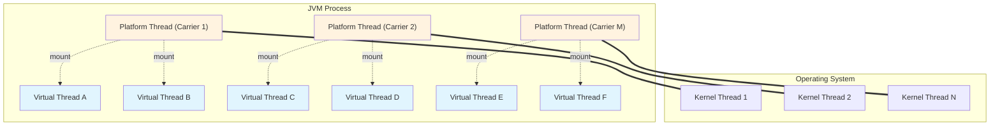
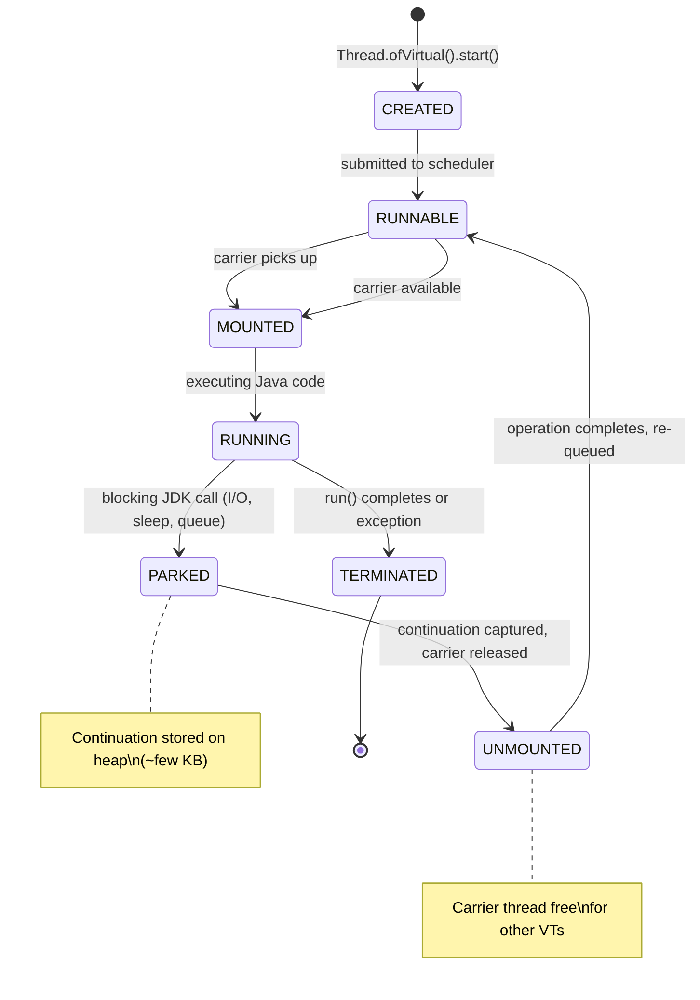
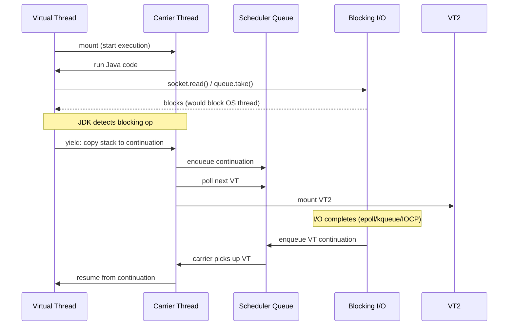
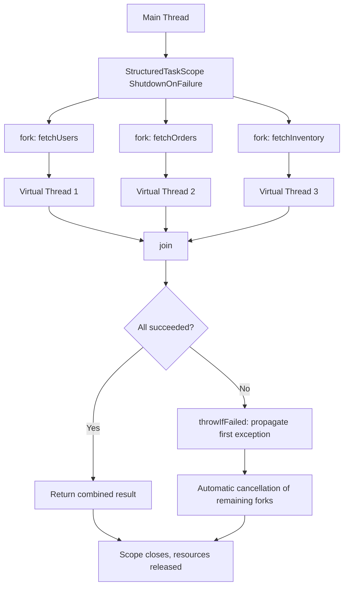

# Virtual Threads

Virtual threads are lightweight JVM-managed threads that decouple Java-level concurrency from OS-thread limits. They enable the thread-per-request style at massive scale (millions of concurrent tasks) by multiplexing many virtual threads onto a small pool of carrier (platform) threads. Introduced as preview in JEP 425 (Java 19), refined in JEP 436 (Java 20), and finalized in JEP 444 (Java 21 LTS).

## Motivation: The C10K Problem and Platform Thread Limits

Platform threads (kernel threads) are 1:1 wrappers around OS threads. Each consumes ~1–2 MB stack (reserved, not committed), requires a kernel context switch, and the OS scheduler caps practical concurrency at thousands. High-throughput servers hit the "C10K" wall: 10,000+ concurrent connections exhaust the thread pool, forcing reactive/async APIs (`CompletableFuture`, Project Reactor, RxJava) that invert control flow and complicate debugging.

Virtual threads solve this by making threads **cheap** (~1 KB initial stack, grows on demand) and **plentiful** (millions per JVM). The JVM schedules them onto a carrier pool (default size = CPU cores) using **M:N scheduling**. Blocking JDK operations (socket I/O, `BlockingQueue`, `Future.get`, `Thread.sleep`) unmount the virtual thread, freeing its carrier for other work. No API rewrite needed — existing `Thread`, `ExecutorService`, `synchronized`, `java.io`, `java.net` code runs on virtual threads unchanged.



## Architecture: Continuations, Mount/Unmount, and the Scheduler

### Continuations

A **continuation** (`jdk.internal.vm.Continuation`) captures the execution state of a virtual thread: its stack frames, local variables, operand stack, and program counter. When a virtual thread blocks on a JDK operation, the JVM:

1. **Yields** — copies the current stack frames to a heap-allocated continuation object
2. **Unmounts** — detaches the virtual thread from its carrier thread
3. **Parks** — the carrier picks another runnable virtual thread from the scheduler queue

When the blocking operation completes (e.g., socket data arrives), the continuation is **resumed**: the virtual thread is re-mounted onto any available carrier and execution continues from the yield point. This is transparent to Java code — `Thread.currentThread()` returns the same `Thread` object.



### The Scheduler: `ForkJoinPool` in LIFO Mode

Virtual threads are scheduled by a dedicated `ForkJoinPool` (the **carrier pool**) running in **FIFO** mode for fairness (unlike the common pool's LIFO). The pool size defaults to `Runtime.getRuntime().availableProcessors()` and can be tuned via:

- `-Djdk.virtualThreadScheduler.parallelism=N`
- `-Djdk.virtualThreadScheduler.maxPoolSize=N` (max carriers, default 256)
- `-Djdk.virtualThreadScheduler.minPoolSize=N` (min carriers)

The scheduler queue is a `ConcurrentLinkedQueue`-like structure. When a virtual thread unmounts, its continuation is enqueued. Carrier threads poll the queue in a tight loop (`ForkJoinWorkerThread.run()`).

**Key internal classes** (for JVM internals interviews):
- `jdk.internal.vm.Thread` — `Thread` subclass with `continuation` field
- `jdk.internal.vm.Continuation` — heap-allocated stack snapshot
- `jdk.internal.vm.VirtualThreadScheduler` — the carrier pool
- `java.lang.VirtualThread` — public API (Java 21+)

### Pinning: When a Virtual Thread Keeps Its Carrier

**Pinning** occurs when a virtual thread blocks inside:
1. A `synchronized` block/method (monitor enter)
2. A native method (JNI call, `FileChannel` operations on some platforms)
3. `Object.wait()` (legacy, prefer `LockSupport.park`)

While pinned, the virtual thread **holds its carrier** — no unmount, no scheduling of other VTs on that carrier. This defeats the purpose. JDK 21: `synchronized` pins. **JDK 24 (JEP 491) removes `synchronized` pinning** — monitors become virtual-thread-aware (use `java.util.concurrent.locks` internally). Until JDK 24, replace `synchronized` with `ReentrantLock` in high-contention virtual-thread code.

**Diagnose pinning:**
- JFR event: `jdk.VirtualThreadPinned` (enabled by default in `default.jfc`)
- `jcmd <pid> Thread.dump_to_file -format=json` — look for `"pinned": true`
- System property: `-Djdk.tracePinnedThreads=full` (prints stack at pin point)



## Creating Virtual Threads

### Factory Methods

```java
// Unstarted virtual thread
Thread vt1 = Thread.ofVirtual().unstarted(() -> System.out.println("VT1"));

// Started immediately
Thread vt2 = Thread.ofVirtual().start(() -> System.out.println("VT2"));

// Named virtual thread
Thread vt3 = Thread.ofVirtual().name("worker-").unstarted(() -> {});

// Thread factory for executor
ThreadFactory factory = Thread.ofVirtual().name("vt-", 0).factory();

// ExecutorService with virtual threads (one per task, unbounded)
ExecutorService exec = Executors.newVirtualThreadPerTaskExecutor();

// Bounded concurrency: semaphore + virtual threads
Semaphore sem = new Semaphore(100); // max 100 concurrent
ExecutorService bounded = Executors.newVirtualThreadPerTaskExecutor();
bounded.submit(() -> {
    sem.acquire();
    try { /* work */ } finally { sem.release(); }
});
```

### `Thread.startVirtualThread` (Java 21+)

```java
Thread vt = Thread.startVirtualTask(() -> {
    // runs on virtual thread
    return "result";
});
// Returns Thread, not Future. Use join() or structured concurrency.
```

### ❌ Never Pool Virtual Threads for Reuse

```java
// WRONG: pooling virtual threads defeats their purpose
ExecutorService bad = Executors.newFixedThreadPool(100, Thread.ofVirtual().factory());

// RIGHT: unbounded virtual thread executor (one per task)
ExecutorService good = Executors.newVirtualThreadPerTaskExecutor();

// RIGHT: bound concurrency with semaphore (not thread pool)
ExecutorService bounded = Executors.newVirtualThreadPerTaskExecutor();
Semaphore limit = new Semaphore(500);
bounded.submit(() -> {
    limit.acquire();
    try { doWork(); } finally { limit.release(); }
});
```

**Why?** Virtual threads are created/destroyed per task (~microseconds, ~KB). Pooling adds queue contention, defeats structured concurrency, and wastes memory holding idle continuations. Use a `Semaphore` to bound *concurrency*, not a thread pool to reuse threads.

## Blocking Operations That Unmount

The following JDK operations **cooperatively yield** (unmount the virtual thread):

| Operation | Class/Method | Since |
|-----------|--------------|-------|
| Socket I/O | `Socket`, `ServerSocket`, `SocketChannel`, `DatagramChannel` | Java 21 |
| File I/O (NIO) | `FileChannel.read/write`, `AsynchronousFileChannel` | Java 21 |
| `Thread.sleep` / `Thread.yield` | `Thread.sleep`, `Thread.yield` | Java 21 |
| `LockSupport.park` / `parkNanos` / `parkUntil` | `LockSupport` | Java 21 |
| `BlockingQueue` | `put`, `take`, `offer(timeout)`, `poll(timeout)` | Java 21 |
| `Future.get` / `get(timeout)` | `Future`, `CompletableFuture` | Java 21 |
| `Semaphore.acquire` / `acquireUninterruptibly` | `Semaphore` | Java 21 |
| `CountDownLatch.await` | `CountDownLatch` | Java 21 |
| `CyclicBarrier.await` | `CyclicBarrier` | Java 21 |
| `Phaser.awaitAdvance` | `Phaser` | Java 21 |
| `Selectors` | `Selector.select`, `selectNow`, `select(timeout)` | Java 21 |

**Custom blocking code** — use `LockSupport.park()` / `unpark()` to make your own blocking points virtual-thread-friendly.

```java
// Virtual-thread-friendly blocking wait
class VirtualCondition {
    private final Lock lock = new ReentrantLock();
    private final java.util.concurrent.locks.Condition notEmpty = lock.newCondition();
    private final Queue<Integer> queue = new ArrayDeque<>();

    public void put(int v) {
        lock.lock();
        try {
            queue.add(v);
            notEmpty.signal();
        } finally { lock.unlock(); }
    }

    public int take() throws InterruptedException {
        lock.lockInterruptibly();
        try {
            while (queue.isEmpty()) {
                notEmpty.await(); // unmounts VT
            }
            return queue.remove();
        } finally { lock.unlock(); }
    }
}
```

## ThreadLocal Concerns: Memory Leaks at Scale

`ThreadLocal` with millions of virtual threads = memory pressure. Each virtual thread gets its own `ThreadLocalMap`. If you store large objects or fail to `remove()`, the map retains entries until the virtual thread terminates (which may be never in a long-running server).

```java
// DANGEROUS: ThreadLocal in virtual-thread server
static final ThreadLocal<Connection> DB_CONN = ThreadLocal.withInitial(() -> createConnection());

// Each request gets a VT, stores a Connection — if not removed, leaks forever
// Even with remove(), millions of ThreadLocalMaps = GC pressure
```

### Solutions

1. **Prefer `ScopedValue` (Preview, JEP 446 / Java 21)** — immutable, inheritance-safe, no map per thread.
2. **Pass context explicitly** — method parameters, not thread-locals.
3. **If ThreadLocal is mandatory** — always `remove()` in `finally`, and consider `WeakReference` values.

```java
// ScopedValue (preview) — preferred for context propagation
static final ScopedValue<UserContext> USER_CTX = ScopedValue.newInstance();

void handleRequest(Request req) {
    UserContext ctx = authenticate(req);
    ScopedValue.where(USER_CTX, ctx).run(() -> {
        // ctx visible to all child virtual threads (structured concurrency)
        process(ctx);
    });
}

// ThreadLocal with strict cleanup (if unavoidable)
static final ThreadLocal<ByteBuffer> BUFFER = ThreadLocal.withInitial(() -> ByteBuffer.allocateDirect(64 * 1024));

void handle(Request req) {
    ByteBuffer buf = BUFFER.get();
    try {
        buf.clear();
        readInto(buf);
    } finally {
        BUFFER.remove(); // CRITICAL: remove to allow GC of map entry
    }
}
```

## Structured Concurrency (`StructuredTaskScope`, Preview)

`StructuredTaskScope` (JEP 453, preview in Java 21) treats a group of virtual threads as a **single unit of work** with automatic error handling and shutdown. Compile/run with `--enable-preview --source 21`.

```java
// Requires: javac --release 21 --enable-preview *.java
//          java --enable-preview Main
import java.util.concurrent.StructuredTaskScope;
import java.util.concurrent.StructuredTaskScope.Subtask;

record Result(String service, String data) {}

String aggregate() throws InterruptedException {
    try (var scope = new StructuredTaskScope.ShutdownOnFailure()) {
        Subtask<Result> users = scope.fork(() -> fetchUsers());
        Subtask<Result> orders = scope.fork(() -> fetchOrders());
        Subtask<Result> inventory = scope.fork(() -> fetchInventory());

        scope.join();           // wait for all
        scope.throwIfFailed();  // propagate first exception

        return users.get().data() + orders.get().data() + inventory.get().data();
    }
}

// Shutdown policies
// ShutdownOnFailure: cancel all on first exception
// ShutdownOnSuccess: cancel all on first success (race)
// Custom: extend StructuredTaskScope and override handleComplete(Subtask)
```

**vs `CompletableFuture`:**
| Aspect | `CompletableFuture` | `StructuredTaskScope` |
|--------|---------------------|----------------------|
| Error handling | Manual `exceptionally`/`handle` | Automatic: first failure cancels siblings |
| Cancellation | Manual `cancel(true)` | Automatic on scope exit/failure |
| Thread ownership | Unclear (common pool) | Explicit: scope owns forks |
| Debugging | Stack traces fragmented | Unified scope in thread dump |
| Preview status | Stable since Java 8 | Preview in Java 21 |



## When to Use (and When Not To)

### ✅ Use Virtual Threads For

- High-concurrency **I/O-bound** workloads: HTTP servers, gRPC, database clients, HTTP clients, message consumers
- Thread-per-request style with blocking JDK APIs (`java.net`, `java.io`, `jdbc`, `HttpClient`)
- Migrating existing synchronous code to scale without rewriting to reactive
- Workloads with many short-lived tasks that block frequently

### ❌ Avoid Virtual Threads For

| Scenario | Reason |
|----------|--------|
| **CPU-bound** compute (crypto, image processing, ML inference) | No benefit — carrier threads still saturate CPU; use platform threads or ForkJoin |
| **Heavy `synchronized` / native blocking** (pre-JDK 24) | Pinning defeats concurrency; use `ReentrantLock` or upgrade |
| **Thread-local caching** (large per-thread state) | Memory explosion; use `ScopedValue` or explicit context |
| **Real-time / ultra-low latency** | Scheduler adds indirection; platform threads more predictable |
| **Legacy code with `Thread.stop()` / `suspend()`** | Unsupported on virtual threads |

## Migration Guide: Platform → Virtual Threads

### 1. ExecutorService Swap

```java
// Before: fixed platform thread pool
ExecutorService exec = Executors.newFixedThreadPool(200);

// After: virtual threads per task
ExecutorService exec = Executors.newVirtualThreadPerTaskExecutor();

// If you need bounded concurrency (e.g., DB pool size 50)
ExecutorService exec = Executors.newVirtualThreadPerTaskExecutor();
Semaphore dbLimit = new Semaphore(50);

exec.submit(() -> {
    dbLimit.acquire();
    try { jdbcTemplate.query(...); } finally { dbLimit.release(); }
});
```

### 2. Tomcat / Jetty / Spring Boot

Spring Boot 3.2+ / Tomcat 10.1+ / Jetty 12+ support virtual threads via config:

```yaml
# application.yml (Spring Boot 3.2+)
server:
  tomcat:
    threads:
      virtual: true
# Or programmatically:
@Bean
TomcatProtocolHandlerCustomizer<?> virtualThreads() {
    return p -> p.setVirtualThreads(true);
}
```

### 3. Connection Pools (HikariCP, etc.)

Virtual threads **do not** reduce connection pool needs. Each VT doing JDBC work still needs a DB connection. Size your pool for DB capacity, not thread count. Use a `Semaphore` to bound VT concurrency to pool size.

```java
// HikariCP: maxPoolSize = 50
// Virtual threads: 10,000 concurrent requests
// Semaphore bounds JDBC work to 50 concurrent
Semaphore jdbcLimit = new Semaphore(50);

virtualExecutor.submit(() -> {
    jdbcLimit.acquire();
    try (Connection c = dataSource.getConnection()) {
        // blocking JDBC call — VT unmounts, carrier free
        return c.prepareStatement(sql).executeQuery();
    } finally {
        jdbcLimit.release();
    }
});
```

### 4. `ThreadLocal` Migration

```java
// Before: Request-scoped ThreadLocal
static ThreadLocal<RequestContext> CTX = new ThreadLocal<>();

// After: ScopedValue (preview) or explicit parameter
static ScopedValue<RequestContext> CTX = ScopedValue.newInstance();

void handle(Request req) {
    ScopedValue.where(CTX, new RequestContext(req)).run(this::process);
}

void process() {
    RequestContext ctx = CTX.get(); // available in child VTs too
}
```

## Performance Characteristics

| Metric | Platform Thread | Virtual Thread |
|--------|-----------------|----------------|
| **Stack memory (initial)** | ~1–2 MB (reserved) | ~1 KB (committed on demand) |
| **Creation time** | ~10–50 μs (OS call) | ~1–5 μs (JVM only) |
| **Context switch** | Kernel mode (~1–5 μs) | User mode (~50–200 ns) |
| **Max practical count** | ~10K–50K | Millions (heap-limited) |
| **Scheduler** | OS (preemptive, time-sliced) | JVM (cooperative, FIFO) |
| **Blocking cost** | Blocks OS thread | Unmounts, carrier reused |

### Benchmarking Caveats

1. **Warm-up** — JIT compiles continuation copy/resume paths after ~10K iterations
2. **GC pressure** — millions of continuations = young-gen churn; tune `-Xmn` or use ZGC/Generational ZGC
3. **Pinning** — `synchronized` in hot path kills throughput; profile with JFR
4. **Fairness** — FIFO scheduler may increase tail latency vs OS preemptive; test your SLOs
5. **Memory** — each VT ~few KB; 1M VTs = ~2–5 GB heap for continuations alone

```bash
# Run with JFR to detect pinning
java -XX:StartFlightRecording=filename=vt.jfr,duration=60s \
     -Djdk.tracePinnedThreads=short \
     -jar app.jar

# Analyze
jfr print --events jdk.VirtualThreadPinned vt.jfr
```

## Comparison Tables

### Platform vs Virtual Threads

| Dimension | Platform Thread | Virtual Thread |
|-----------|-----------------|----------------|
| **Java type** | `Thread` (always) | `Thread` (since Java 21) |
| **OS mapping** | 1:1 kernel thread | M:N on carrier pool |
| **Stack** | Fixed ~1–2 MB reserved | Dynamic, starts ~1 KB |
| **Creation cost** | High (syscall) | Low (heap allocation) |
| **Blocking** | Blocks carrier | Unmounts, yields carrier |
| **Pinning** | N/A | `synchronized`, native, `Object.wait` |
| **ThreadLocal** | One map per thread | One map per VT (memory risk) |
| **Debugging** | Standard thread dumps | JSON dump shows VT state |
| **Best for** | CPU-bound, low concurrency | I/O-bound, high concurrency |
| **Scheduler** | OS (preemptive) | JVM `ForkJoinPool` (FIFO) |

### Virtual Threads vs Reactive vs CompletableFuture

| Aspect | Virtual Threads | Project Reactor / RxJava | CompletableFuture |
|--------|-----------------|--------------------------|-------------------|
| **Programming model** | Synchronous, imperative | Declarative, reactive streams | Callback/chain |
| **Learning curve** | Low (existing code works) | High (operators, backpressure) | Medium |
| **Debugging** | Normal stack traces | Broken stacks, async boundaries | Chained stacks |
| **Backpressure** | Implicit (blocking) | Explicit (request(n)) | Manual |
| **Blocking I/O** | Native support | Must use schedulers | `supplyAsync` + blocking pool |
| **CPU-bound** | No advantage | Use `subscribeOn` | Use custom executor |
| **Ecosystem** | All blocking JDK libs | Reactive drivers needed | Universal |
| **Migration** | Drop-in for sync code | Full rewrite | Incremental |

## Edge Cases and Corner Cases

### 1. `Thread.currentThread()` Identity

```java
// Virtual thread identity is preserved across mount/unmount
Thread vt = Thread.ofVirtual().start(() -> {
    Thread t1 = Thread.currentThread();
    // blocking call
    LockSupport.parkNanos(1_000_000);
    Thread t2 = Thread.currentThread();
    System.out.println(t1 == t2); // true — same Thread object
});
vt.join();
```

### 2. `ThreadLocal` Inheritance

```java
// ThreadLocal values are NOT inherited by child virtual threads
ThreadLocal<String> tl = new ThreadLocal<>();
tl.set("parent");

Thread vt = Thread.ofVirtual().start(() -> {
    System.out.println(tl.get()); // null — no inheritance
});
vt.join();

// ScopedValue IS inherited (preview)
ScopedValue<String> sv = ScopedValue.newInstance();
ScopedValue.where(sv, "parent").run(() -> {
    Thread.startVirtualThread(() -> {
        System.out.println(sv.get()); // "parent" — inherited!
    }).join();
});
```

### 3. InterruptedException Handling

```java
// Virtual threads respect interruption during unmount
Thread vt = Thread.ofVirtual().start(() -> {
    try {
        queue.take(); // unmounts here
    } catch (InterruptedException e) {
        Thread.currentThread().interrupt(); // restore flag
        throw new RuntimeException(e);
    }
});
vt.interrupt(); // wakes VT from park, throws InterruptedException
vt.join();
```

### 4. `ThreadGroup` and `Thread.setDefaultUncaughtExceptionHandler`

```java
// Virtual threads ignore ThreadGroup (deprecated)
// They use the default uncaught exception handler
Thread.setDefaultUncaughtExceptionHandler((t, e) -> {
    System.err.println("VT crashed: " + t.getName() + " - " + e);
});
```

### 5. `ThreadLocal` with `InheritableThreadLocal`

```java
// InheritableThreadLocal DOES copy to child VTs (unlike ThreadLocal)
// But: copies at fork time, not dynamic — avoid for request scope
InheritableThreadLocal<String> itl = new InheritableThreadLocal<>();
itl.set("value");

Thread.startVirtualThread(() -> {
    System.out.println(itl.get()); // "value" — copied at start
}).join();
```

## Common Mistakes: Wrong vs Right

### ❌ Mistake 1: Pooling Virtual Threads

```java
// WRONG: Fixed pool of virtual threads
ExecutorService pool = Executors.newFixedThreadPool(100, Thread.ofVirtual().factory());

// RIGHT: Unbounded virtual thread executor + semaphore for limits
ExecutorService exec = Executors.newVirtualThreadPerTaskExecutor();
Semaphore limit = new Semaphore(100);
exec.submit(() -> { limit.acquire(); try { work(); } finally { limit.release(); } });
```

### ❌ Mistake 2: `synchronized` in Hot Path (Pre-JDK 24)

```java
// WRONG: synchronized pins carrier
synchronized (lock) {
    blockingCall(); // carrier stuck until return
}

// RIGHT: ReentrantLock (unmounts on park)
Lock lock = new ReentrantLock();
lock.lock();
try {
    blockingCall(); // VT unmounts, carrier free
} finally { lock.unlock(); }
```

### ❌ Mistake 3: Forgetting `ThreadLocal.remove()`

```java
// WRONG: Leaks ThreadLocalMap entry forever
ThreadLocal<Connection> TL = ThreadLocal.withInitial(DB::connect);
void handle() { TL.get().query(sql); }

// RIGHT: Always remove
void handle() {
    Connection c = TL.get();
    try { c.query(sql); } finally { TL.remove(); }
}

// BETTER: ScopedValue (preview) or explicit parameter
```

### ❌ Mistake 4: Blocking in Static Initializer

```java
// WRONG: Class init runs on platform thread, blocks carrier
static {
    Thread.startVirtualThread(() -> blockingInit()).join(); // deadlock risk
}

// RIGHT: Lazy init or run on platform thread explicitly
static final AtomicReference<Data> DATA = new AtomicReference<>();
static Data get() {
    Data d = DATA.get();
    if (d == null) {
        synchronized (DATA) {
            d = DATA.get();
            if (d == null) {
                d = blockingInit(); // platform thread OK here
                DATA.set(d);
            }
        }
    }
    return d;
}
```

### ❌ Mistake 5: Assuming Virtual Threads Are Faster for CPU Work

```java
// WRONG: CPU-bound work on virtual threads
ExecutorService exec = Executors.newVirtualThreadPerTaskExecutor();
for (int i = 0; i < 1000; i++) {
    exec.submit(() -> heavyCrypto()); // saturates carriers, no gain
}

// RIGHT: CPU work on platform thread pool
ExecutorService cpuPool = Executors.newFixedThreadPool(Runtime.getRuntime().availableProcessors());
cpuPool.submit(() -> heavyCrypto());
```

## Best Practices

1. **Default to virtual threads** for I/O-bound server workloads (Spring Boot 3.2+, Tomcat 10.1+, Jetty 12+)
2. **Bound concurrency with `Semaphore`**, not thread pools — matches resource limits (DB connections, HTTP client pools)
3. **Replace `synchronized` with `ReentrantLock`** in library code used by virtual threads (until JDK 24)
4. **Use `ScopedValue` (preview)** for context propagation instead of `ThreadLocal`
5. **Enable JFR `jdk.VirtualThreadPinned`** in production to detect pinning
6. **Tune carrier pool** only if needed: `-Djdk.virtualThreadScheduler.parallelism=X`
7. **Test with realistic load** — synthetic benchmarks miss pinning, GC, scheduler contention
8. **Don't mix** virtual and platform threads in the same `ExecutorService` — use separate executors
9. **Prefer `StructuredTaskScope`** for fan-out/fan-in patterns (when preview graduates)
10. **Monitor heap** — millions of VTs = millions of continuation objects; size young gen accordingly

## Interview Tips

- **JEP numbers**: 425 (preview 19), 436 (preview 20), 444 (final 21), 491 (unpin synchronized in 24)
- **Continuation** is the key internal abstraction — heap-allocated stack snapshot
- **Pinning** is the #1 production issue — know `jdk.VirtualThreadPinned` JFR event
- **Never pool VTs** — explain why (cheap creation, defeats structured concurrency, memory)
- **`ThreadLocal` vs `ScopedValue`** — inheritance, memory, mutability differences
- **Migration** — `Executors.newVirtualThreadPerTaskExecutor()` + `Semaphore` for bounds
- **Reactive vs VT** — VT = imperative style preserved; reactive = explicit backpressure, non-blocking all the way
- **JDK 24 change** — `synchronized` no longer pins (monitor enters are virtual-thread-aware)

---

# Interview Questions

## Beginner

**Q1. What is a virtual thread and how does it differ from a platform thread?**

A virtual thread is a lightweight JVM-managed thread that runs on a pool of carrier (platform) threads. Key differences:
- **Stack**: Virtual threads start at ~1 KB and grow dynamically; platform threads reserve ~1–2 MB upfront.
- **Scheduling**: M:N — many virtual threads multiplexed onto few carriers via a `ForkJoinPool`; platform threads are 1:1 with OS threads.
- **Blocking**: When a virtual thread blocks on JDK I/O/sleep/queue, it **unmounts** (yields carrier); platform threads block the OS thread.
- **Cost**: Creation ~1–5 μs vs ~10–50 μs; millions vs thousands practical max.

**Q2. How do you create a virtual thread in Java 21?**

```java
// Method 1: Thread.ofVirtual()
Thread vt = Thread.ofVirtual().start(() -> System.out.println("Hello"));

// Method 2: Thread.startVirtualThread() — returns Thread
Thread vt = Thread.startVirtualThread(() -> System.out.println("Hello"));

// Method 3: ExecutorService with virtual threads
ExecutorService exec = Executors.newVirtualThreadPerTaskExecutor();
exec.submit(() -> System.out.println("Hello"));

// Method 4: ThreadFactory
ThreadFactory factory = Thread.ofVirtual().name("vt-", 0).factory();
```

**Q3. Why should you not pool virtual threads?**

Virtual threads are **cheap to create and destroy** (~microseconds, ~KB). Pooling them:
- Adds queue contention (task queue vs direct scheduling)
- Defeats **structured concurrency** (scope can't own lifecycles)
- Wastes memory holding idle continuations
- The purpose of a thread pool is *resource reuse* for expensive threads; virtual threads are not expensive. Use a `Semaphore` to bound concurrency instead.

**Q4. What happens when a virtual thread calls `Thread.sleep(1000)`?**

The virtual thread **yields**: its stack is copied to a heap-allocated `Continuation` object, it **unmounts** from its carrier thread, and the carrier picks up another runnable virtual thread. After ~1 second, the scheduler re-queues the continuation; when a carrier is available, the virtual thread **remounts** and resumes after the `sleep` call. The OS thread is free during the sleep.

**Q5. What is pinning and why is it bad?**

Pinning occurs when a virtual thread blocks inside a `synchronized` block/method or a native (JNI) frame. The virtual thread **cannot unmount** — it holds its carrier thread hostage. This defeats the M:N scheduling benefit: the carrier cannot run other virtual threads. In JDK 21, `synchronized` pins. **JDK 24 (JEP 491) removes `synchronized` pinning**. Diagnose with JFR event `jdk.VirtualThreadPinned` or `-Djdk.tracePinnedThreads=full`.

---

## Intermediate

**Q6. Explain the mount/unmount mechanism with a sequence diagram.**

See the **Architecture** section's sequence diagram. Key steps:
1. Carrier mounts VT → executes Java code
2. VT calls blocking JDK operation (e.g., `Socket.read()`)
3. JDK runtime detects blocking → copies stack frames to `Continuation` (heap)
4. VT unmounts → carrier thread released
5. Carrier polls scheduler queue → mounts next VT
6. I/O completes → continuation enqueued
7. Carrier picks up VT → restores stack from continuation → resumes execution

**Q7. How does `ThreadLocal` behave with virtual threads, and what are the risks?**

Each virtual thread gets its own `ThreadLocalMap` (lazily created on first `get`/`set`). Risks:
- **Memory**: Millions of VTs × ThreadLocal entries = massive heap pressure. Maps are retained until VT terminates.
- **No inheritance**: Child VTs don't inherit parent's `ThreadLocal` values (unlike `InheritableThreadLocal` which copies at fork).
- **Leaks**: Forgetting `remove()` in a long-lived server leaks entries forever.

Solutions: `ScopedValue` (preview, immutable, inherited), explicit parameters, or strict `try/finally remove()`.

**Q8. What is `StructuredTaskScope` and how does it differ from `CompletableFuture`?**

`StructuredTaskScope` (preview in Java 21) groups subtasks as a single unit with automatic lifecycle:
- `fork()` starts a virtual thread; `join()` waits for all; `throwIfFailed()` propagates first exception.
- **Shutdown policies**: `ShutdownOnFailure` (cancel all on first error), `ShutdownOnSuccess` (cancel on first success).
- **vs CompletableFuture**: Automatic cancellation/error handling, explicit ownership, unified debugging, but preview API.

```java
try (var scope = new StructuredTaskScope.ShutdownOnFailure()) {
    var users = scope.fork(() -> fetchUsers());
    var orders = scope.fork(() -> fetchOrders());
    scope.join();
    scope.throwIfFailed();
    return combine(users.get(), orders.get());
}
```

**Q9. How do you migrate a `FixedThreadPool` server to virtual threads?**

```java
// Before
ExecutorService exec = Executors.newFixedThreadPool(200);

// After: virtual threads per task
ExecutorService exec = Executors.newVirtualThreadPerTaskExecutor();

// If bounded concurrency needed (e.g., DB pool = 50)
ExecutorService exec = Executors.newVirtualThreadPerTaskExecutor();
Semaphore dbLimit = new Semaphore(50);

exec.submit(() -> {
    dbLimit.acquire();
    try { jdbcTemplate.query(...); } finally { dbLimit.release(); }
});
```
Also: enable virtual threads in Tomcat/Jetty (`server.tomcat.threads.virtual=true`), replace `synchronized` with `ReentrantLock`, migrate `ThreadLocal` to `ScopedValue`.

**Q10. What JDK operations unmount a virtual thread? Name at least 8.**

Socket I/O (`Socket`, `SocketChannel`), `Thread.sleep`/`yield`, `LockSupport.park*`, `BlockingQueue.take`/`put`, `Future.get`, `Semaphore.acquire`, `CountDownLatch.await`, `CyclicBarrier.await`, `Phaser.awaitAdvance`, `Selector.select`, `FileChannel` read/write. Custom code: use `LockSupport.park()`/`unpark()`.

---

## Advanced

**Q11. Describe the internal `Continuation` mechanism. What is stored, where, and how is it restored?**

`jdk.internal.vm.Continuation` is a heap-allocated object capturing:
- **Stack frames**: Java method frames (locals, operand stack, PC)
- **Execution state**: Current bytecode index, monitor locks held (for `synchronized` — causes pinning)
- **No native frames**: Native stacks are not captured (pinning)

On yield: `Continuation.yield()` copies frames from C stack to Java heap (via `Continuation.yieldContinuation()` intrinsic). On resume: `Continuation.run()` restores frames to C stack and jumps to saved PC. The `Thread` object holds a reference to its `Continuation` when parked.

**Q12. How does the virtual thread scheduler work? What pool does it use?**

Virtual threads are scheduled by a dedicated `ForkJoinPool` (not the common pool) in **FIFO mode** (fairness). Default parallelism = CPU cores. Configurable via:
- `-Djdk.virtualThreadScheduler.parallelism=N` (target parallelism)
- `-Djdk.virtualThreadScheduler.maxPoolSize=N` (max carriers, default 256)
- `-Djdk.virtualThreadScheduler.minPoolSize=N`

Carrier threads are `ForkJoinWorkerThread` instances running `runWorker()` loop: poll queue → mount VT → execute → on yield, enqueue continuation → repeat.

**Q13. What is the memory footprint of 1 million virtual threads vs 1 million platform threads?**

| Component | Platform Thread (1M) | Virtual Thread (1M) |
|-----------|---------------------|---------------------|
| Stack (reserved) | ~1–2 TB (1–2 MB × 1M) | ~1–2 GB (1–2 KB × 1M, committed on demand) |
| Stack (committed) | ~1–2 TB | ~few GB (actual usage) |
| Thread object | ~1 KB | ~1 KB |
| Continuation | N/A | ~few KB each (when parked) |
| **Total (idle)** | **Impossible (OOM)** | **~5–10 GB heap** |

Virtual threads are heap-limited; platform threads are OS-limited.

**Q14. How do you diagnose and fix pinning in production?**

**Diagnose:**
```bash
# JFR recording
java -XX:StartFlightRecording=filename=vt.jfr,duration=60s -jar app.jar
jfr print --events jdk.VirtualThreadPinned vt.jfr

# Thread dump (JSON)
jcmd <pid> Thread.dump_to_file -format=json output.json
# Look for "pinned": true
```

**Fix (pre-JDK 24):**
- Replace `synchronized` with `ReentrantLock` in hot paths
- Avoid native calls in virtual threads (use pure Java libraries)
- Use `-Djdk.tracePinnedThreads=short` to log pinning stacks

**Q15. Explain the interaction between virtual threads and connection pools (HikariCP).**

Virtual threads **do not reduce** database connection needs. Each concurrent JDBC operation still needs a physical connection. With 10,000 virtual threads and a 50-connection pool:
- Without bounding: 10,000 VTs compete for 50 connections → queue contention, timeouts
- With `Semaphore(50)`: Only 50 VTs enter JDBC code concurrently; others park at semaphore (unmounted, cheap)
- The semaphore bounds *concurrency*, not thread count — matches the resource limit.

---

## Expert

**Q16. Why does `synchronized` cause pinning in JDK 21, and how does JDK 24 fix it?**

In JDK 21, `monitorenter`/`monitorexit` bytecodes are JVM intrinsics that acquire a heavyweight OS monitor (via `ObjectMonitor`). The VM marks the virtual thread as **pinned** because:
- The monitor is tied to the carrier thread's OS identity
- `Object.wait()`/`notify()` require the carrier to be the waiter
- No continuation capture across monitor boundaries

**JDK 24 (JEP 491)** reimplements `synchronized` for virtual threads using `java.util.concurrent.locks` primitives internally. The monitor becomes a virtual-thread-aware lock that can be released on yield and reacquired on resume. `Object.wait()`/`notify()` are also virtualized. Pinning only remains for native frames.

**Q17. How does `ScopedValue` differ from `ThreadLocal` and `InheritableThreadLocal`?**

| Feature | `ThreadLocal` | `InheritableThreadLocal` | `ScopedValue` (Preview) |
|---------|---------------|--------------------------|------------------------|
| **Inheritance** | No | Yes (copy at thread start) | Yes (dynamic, structural) |
| **Mutability** | Mutable (`set`/`get`) | Mutable | **Immutable** (bound per scope) |
| **Memory** | Map per thread (leak risk) | Map per thread | No per-thread map; stored in carrier frame |
| **Lifetime** | Until `remove()` or thread death | Until `remove()` or thread death | Scope-bound (auto-cleanup) |
| **Virtual threads** | Separate map per VT (expensive) | Copied at VT start | Shared across VTs in scope |

`ScopedValue.where(key, value).run(() -> ...)` binds the value for the dynamic extent of the runnable, visible to all child virtual threads forked via `StructuredTaskScope`.

**Q18. What are the GC implications of millions of virtual threads?**

Each parked virtual thread holds a `Continuation` object referencing its stack frames (objects, arrays, locals). This creates:
- **Young-gen pressure**: Continuations allocated on yield, collected on resume/termination
- **Reference chains**: Deep stacks = long reference chains → longer GC pauses
- **Humongous allocations**: Large stack frames may go directly to old gen

**Mitigations:**
- Use ZGC or Generational ZGC (`-XX:+UseZGC -XX:+ZGenerational`) for low pause times
- Increase young gen: `-Xmn4g` (or appropriate fraction)
- Avoid deep recursion in virtual threads
- Profile with `-Xlog:gc+heap=debug` or JFR `jdk.GCPhasePause`

**Q19. Can virtual threads deadlock? How?**

Yes, two ways:
1. **Carrier starvation**: All carriers pinned (e.g., many VTs in `synchronized` blocking calls). No carrier free to run unparked VTs → deadlock.
2. **Resource deadlock**: VT A holds `Lock X`, waits for `Lock Y`; VT B holds `Lock Y`, waits for `Lock X`. Standard lock ordering issue — virtual threads don't change lock semantics.

**Q20. How does `Thread.interrupt()` work with a parked virtual thread?**

When `vt.interrupt()` is called on a parked virtual thread:
1. The scheduler marks the continuation as interrupted
2. On next mount, the virtual thread throws `InterruptedException` at the yield point (`LockSupport.park`, `queue.take`, etc.)
3. If the VT is **running** (not parked), the interrupt flag is set; next blocking call throws `InterruptedException` immediately
4. `Thread.interrupted()` / `isInterrupted()` work identically to platform threads

---

## Scenario Based

**Q21. You have a Spring Boot 3.1 app on Java 21 with Tomcat, 500 concurrent users, each request calls a slow external REST API (2s latency). Current config: `server.tomcat.threads.max=200`. Users report timeouts. How do you fix it?**

**Analysis**: 200 platform threads × 2s = 100 req/s max. 500 concurrent users exceed capacity. Platform threads block on HTTP client I/O.

**Fix**:
1. Upgrade to Spring Boot 3.2+ / Tomcat 10.1+
2. Enable virtual threads: `server.tomcat.threads.virtual=true`
3. Configure HTTP client (WebClient/RestClient) with virtual-thread-friendly settings
4. No code changes needed — blocking `RestTemplate`/`WebClient.block()` unmounts VTs
5. Carrier pool (default CPU cores) handles thousands of concurrent I/O waits

Result: 500 concurrent requests → 500 virtual threads, ~8 carriers, all unmounted during 2s I/O wait. Throughput scales to connection/bandwidth limits.

**Q22. A library you depend on uses `synchronized` heavily in its hot path. You're on Java 21. Can you use virtual threads?**

**Short answer**: Not effectively. `synchronized` pins carriers in JDK 21. If the library's hot path blocks (I/O, sleep, queue), carriers are stuck.

**Options**:
1. **Wait for JDK 24** (JEP 491 removes `synchronized` pinning)
2. **Fork/shade the library** and replace `synchronized` with `ReentrantLock`
3. **Run library code on platform threads**: dedicated `ExecutorService` (fixed pool) for that library; virtual threads for your code
4. **Use `-Djdk.tracePinnedThreads=full`** to confirm pinning locations, then decide

**Q23. You're building a high-frequency trading gateway: 100K messages/sec, each message does minimal CPU work (parsing, routing) then sends to a message broker via blocking client. Virtual threads or platform threads?**

**Platform threads** (or a small fixed pool). Why:
- Work is **CPU-bound** (parsing, routing) — no blocking I/O in the hot path
- Virtual threads add scheduler overhead (continuation copy, queue poll) for no gain
- 100K msg/sec on 16 cores = 6K msg/core/sec — easily handled by platform threads
- Message broker send: if truly blocking, use a separate bounded executor with platform threads

Virtual threads shine when **blocking dominates** (I/O wait >> CPU). Here CPU ≈ I/O.

**Q24. Your team wants to replace `CompletableFuture` chains with virtual threads for readability. What do you lose?**

You lose:
- **Explicit backpressure**: `CompletableFuture` chains can be combined with `Semaphore`/`Flow` for backpressure; virtual threads block implicitly (caller waits)
- **Composability**: `thenCompose`, `thenCombine`, `allOf`/`anyOf` are fluent; virtual threads require `StructuredTaskScope` (preview) or manual `join()`/`get()`
- **Cancellation granularity**: `CompletableFuture.cancel(true)` interrupts the task; virtual threads need structured scope or manual interruption
- **Non-blocking composition**: `CompletableFuture` can chain without blocking a thread; virtual threads block a carrier (though unmounted during I/O)

**Gain**: Stack traces, debugging, imperative style, existing blocking libraries work unchanged.

**Q25. A service uses `ThreadLocal` for request-scoped MDC (logging context). Migrating to virtual threads breaks logging. Fix it.**

**Problem**: `ThreadLocal` not inherited by child VTs; MDC context lost in `StructuredTaskScope` forks or async handoffs.

**Fix (Java 21 preview)**:
```java
// Replace ThreadLocal with ScopedValue
static final ScopedValue<String> REQUEST_ID = ScopedValue.newInstance();

Filter doFilter(Request req, Response res, Chain chain) {
    String id = req.header("X-Request-ID") ?? UUID.randomUUID().toString();
    ScopedValue.where(REQUEST_ID, id).run(() -> chain.doFilter(req, res));
}

// In log appender / MDC adapter
String requestId = REQUEST_ID.get(); // available in all child VTs
```

**Alternative (stable)**: Pass context explicitly through method parameters or use a `Context` object propagated manually.

---

## Output Prediction

**Q26. Predict the output and explain.**

```java
public class VTDemo {
    static final ThreadLocal<String> TL = new ThreadLocal<>();
    static final ScopedValue<String> SV = ScopedValue.newInstance();

    public static void main(String[] args) throws Exception {
        TL.set("main-TL");
        ScopedValue.where(SV, "main-SV").run(() -> {
            Thread vt = Thread.ofVirtual().start(() -> {
                System.out.println("VT: TL=" + TL.get() + ", SV=" + SV.get());
                TL.set("vt-TL");
                // ScopedValue is immutable — no set()
            });
            vt.join();
            System.out.println("Main after VT: TL=" + TL.get() + ", SV=" + SV.get());
        });
    }
}
```

**Output:**
```
VT: TL=null, SV=main-SV
Main after VT: TL=main-TL, SV=main-SV
```

**Reasoning:**
- `ThreadLocal`: No inheritance. VT sees `null`. VT's `set` affects only its own map. Main's `TL` unchanged.
- `ScopedValue`: Immutable, structural inheritance. VT sees `"main-SV"` (bound in parent scope). Main's binding unaffected.

**Q27. Predict the output.**

```java
public class PinningDemo {
    static final Object lock = new Object();

    public static void main(String[] args) throws Exception {
        Thread vt = Thread.ofVirtual().start(() -> {
            System.out.println("1. VT started");
            synchronized (lock) {
                System.out.println("2. In synchronized");
                try { Thread.sleep(100); } catch (InterruptedException e) {}
                System.out.println("3. After sleep");
            }
            System.out.println("4. VT done");
        });
        vt.join();
        System.out.println("5. Main done");
    }
}
```

**Output (JDK 21):**
```
1. VT started
2. In synchronized
3. After sleep
4. VT done
5. Main done
```
**But**: During `Thread.sleep(100)`, the virtual thread is **pinned** — carrier not released. JFR shows `jdk.VirtualThreadPinned`. No other VT can run on that carrier during the sleep.

**Output (JDK 24+):** Same visible output, but **no pinning** — `Thread.sleep` unmounts even inside `synchronized`. Carrier free for other VTs.

**Q28. Predict the output.**

```java
public class StructuredScopeDemo {
    public static void main(String[] args) throws Exception {
        // Requires: javac --release 21 --enable-preview && java --enable-preview
        try (var scope = new StructuredTaskScope.ShutdownOnFailure()) {
            var t1 = scope.fork(() -> {
                Thread.sleep(100);
                return "fast";
            });
            var t2 = scope.fork(() -> {
                Thread.sleep(200);
                throw new RuntimeException("slow fails");
            });
            var t3 = scope.fork(() -> {
                Thread.sleep(300);
                return "slowest";
            });

            scope.join();
            scope.throwIfFailed();

            System.out.println("t1: " + t1.get());
            System.out.println("t2: " + t2.get());
            System.out.println("t3: " + t3.get());
        }
    }
}
```

**Output:**
```
Exception in thread "main" java.lang.RuntimeException: slow fails
    at StructuredScopeDemo.lambda$main$1(StructuredScopeDemo.java:15)
    ...
```
`throwIfFailed()` throws the first exception (`t2`). `t3` is **automatically cancelled** (interrupted) by `ShutdownOnFailure` policy. `t1` completes but its result is not retrieved because exception propagates. `t3`'s `Thread.sleep(300)` throws `InterruptedException` due to cancellation.

---

## Internal Working

**Q29. What is the `Continuation` class and how does it enable virtual threads?**

`jdk.internal.vm.Continuation` (package-private, internal) is the heap representation of a virtual thread's execution state. It contains:
- An array of **stack frames** (each frame: method, bytecode index, locals, operand stack)
- **Program counter** (resume point)
- **Monitor info** for `synchronized` (causes pinning in JDK 21)

**Yield** (`Continuation.yield()`):
1. VM copies C-stack frames to Java heap (via intrinsic)
2. Creates/updates `Continuation` object
3. Virtual thread's `Thread` object references this continuation
4. Carrier thread returns to scheduler loop

**Resume** (`Continuation.run()`):
1. Carrier thread restores frames from continuation to C stack
2. Jumps to saved bytecode index
3. Execution continues as if `yield` returned

This is **user-mode context switching** — no kernel involvement.

**Q30. How does the JVM detect that a blocking call should unmount a virtual thread?**

The JDK runtime marks certain methods as **"blocking"** via `@ForceInline` intrinsics and VM hooks. Key mechanisms:
- **`Thread.sleep`/`park`**: `LockSupport.parkNanos` checks `Thread.currentThread().isVirtual()` → calls `VirtualThread.yieldContinuation()`
- **`java.net` I/O**: `SocketDispatcher` / `Channel` implementations detect virtual thread → call `yieldContinuation()` before blocking syscall
- **`java.util.concurrent`**: `AbstractQueuedSynchronizer` (AQS) `parkAndCheckInterrupt` checks for virtual thread → yields
- **`FileChannel`**: Uses `Thread.blockingCall()` which yields

Custom code: wrap blocking native calls in `Thread.blockingCall(() -> ...)` to enable yield.

**Q31. Explain the carrier thread pool sizing and how to tune it.**

The carrier pool is a `ForkJoinPool` with:
- **Parallelism** (`-Djdk.virtualThreadScheduler.parallelism`): Target number of active carriers = CPU cores (default). Carriers can exceed this temporarily.
- **Max pool size** (`-Djdk.virtualThreadScheduler.maxPoolSize`): Hard cap (default 256). Prevents carrier explosion if many VTs pin.
- **Min pool size** (`-Djdk.virtualThreadScheduler.minPoolSize`): Minimum carriers to keep alive.

**Tuning guidelines:**
- I/O-heavy: Default parallelism (CPU cores) usually fine — carriers spend most time unmounted
- Pinning-heavy: Increase `maxPoolSize` to absorb pinned carriers (but fix pinning instead)
- CPU-heavy: Don't use virtual threads; use platform thread pool
- Latency-sensitive: Slightly higher parallelism may reduce queueing delay

**Q32. How do virtual threads interact with the Java Memory Model (JMM)?**

Virtual threads **fully respect JMM**. Happens-before edges:
- `vt.start()` → `vt.run()` (same as platform threads)
- `vt.join()` ← `vt.run()` completion
- `LockSupport.unpark(vt)` → `LockSupport.park()` in VT
- `queue.put()` → `queue.take()` (via AQS happens-before)
- `Semaphore.release()` → `Semaphore.acquire()`

**No new JMM rules**. The continuation capture/restore preserves memory visibility because:
- Yield/resume occurs at safe points (blocking calls) with full memory barrier
- Carrier thread switch acts like a context switch — JMM guarantees apply across carriers

**Q33. What happens to `ThreadLocal` values when a virtual thread is unmounted and remounted on a different carrier?**

**Nothing special**. `ThreadLocal` values are stored in the virtual thread's `ThreadLocalMap` (a field of the `Thread` object). The `Thread` object **never changes** — only the carrier thread changes. The map travels with the `Thread` object. Carrier identity is irrelevant to `ThreadLocal`.

This is why `ThreadLocal` doesn't work for carrier-scoped resources (e.g., DB connection per carrier) — use `ScopedValue` or explicit pooling.

---

## Tricky Questions

**Q34. Can a virtual thread hold a `ReentrantLock` across a blocking call? What about `synchronized`?**

- **`ReentrantLock`**: YES. `lock.lock()` → blocking call → `lock.unlock()`. The lock is released on unmount (AQS yields). On remount, the VT still holds the lock (AQS state preserved in continuation). **No pinning.**
- **`synchronized` (JDK 21)**: NO (pins). The monitor is tied to the carrier. `Object.wait()` inside `synchronized` pins. **JDK 24: YES (no pinning).**

**Q35. If you create 10 million virtual threads in a loop without joining, what happens?**

```java
for (int i = 0; i < 10_000_000; i++) {
    Thread.startVirtualThread(() -> { /* do nothing */ });
}
```

**Result**: **OOM or extreme GC pressure**. Each `startVirtualThread` creates a `Thread` object + scheduler queue entry. Even if the task is empty, the VT must be scheduled, mounted, run, and terminated. The termination rate is limited by carrier throughput. The queue grows unbounded → heap fills with `Thread` objects and continuations → `OutOfMemoryError` or GC thrashing.

**Fix**: Use `StructuredTaskScope` (auto-joins) or a bounded executor + `Semaphore` to limit in-flight tasks.

**Q36. Why does `Thread.activeCount()` not count virtual threads?**

`Thread.activeCount()` returns the number of **live platform threads** in the current thread group. Virtual threads are not in any `ThreadGroup` (thread groups are deprecated). They are tracked by the scheduler, not `ThreadGroup`. Use `jcmd <pid> Thread.dump_to_file -format=json` to see all VTs.

**Q37. Can you use `ThreadLocalRandom` with virtual threads? Is it efficient?**

Yes, `ThreadLocalRandom.current()` works — it uses a `ThreadLocal` internally. Each virtual thread gets its own `ThreadLocalRandom` instance (lazily initialized). **Efficient**: no contention, no pinning. But if you create millions of VTs that each use `ThreadLocalRandom`, you get millions of `ThreadLocalRandom` instances (small but non-zero overhead). For high-throughput, consider passing a `Random` instance or using `SplittableRandom`.

**Q38. What is the difference between `Executors.newVirtualThreadPerTaskExecutor()` and `Thread.ofVirtual().factory()` with `newFixedThreadPool`?**

```java
// Unbounded: one VT per task, no queue (tasks submitted directly to scheduler)
ExecutorService unbounded = Executors.newVirtualThreadPerTaskExecutor();

// Bounded pool of VTs: task queue + fixed number of VTs (REUSES VTs!)
ExecutorService boundedVT = Executors.newFixedThreadPool(100, Thread.ofVirtual().factory());
```

The second **reuses virtual threads** — a task runs, VT returns to pool, next task uses same VT. This:
- Defeats structured concurrency (VT lifetime ≠ task lifetime)
- Retains `ThreadLocal` values between tasks (leaks unless cleaned)
- Limits concurrency to pool size (100) — but you could just use a `Semaphore(100)` with unbounded executor

**Never use `newFixedThreadPool` with virtual threads.**

**Q39. How does `Thread.dump_to_file` show virtual threads differently?**

JSON thread dump (`jcmd PID Thread.dump_to_file -format=json output.json`) includes:
```json
{
  "threads": [
    {
      "name": "vt-1",
      "state": "RUNNABLE",
      "threadId": 42,
      "virtual": true,
      "carrierThreadId": 12,
      "pinned": false,
      "stackTrace": [...]
    },
    {
      "name": "carrier-1",
      "state": "RUNNABLE",
      "threadId": 12,
      "virtual": false,
      "stackTrace": [...]
    }
  ]
}
```
Key fields: `"virtual": true`, `"carrierThreadId"` (which carrier it's mounted on, or -1 if parked), `"pinned": true/false`.

**Q40. A virtual thread calls a native method that blocks for 10 seconds. What happens?**

The virtual thread **pins** its carrier for the entire 10 seconds. The carrier cannot run any other virtual thread. This is because:
- Native frames cannot be captured in a continuation
- The JVM cannot safely unmount while in JNI code
- The monitor (if any) is held by the carrier's OS thread

**Fix**: Move blocking native calls to a dedicated platform thread pool (`Executors.newFixedThreadPool`) and call via `CompletableFuture.supplyAsync()`. Or rewrite the native library to be non-blocking / async.