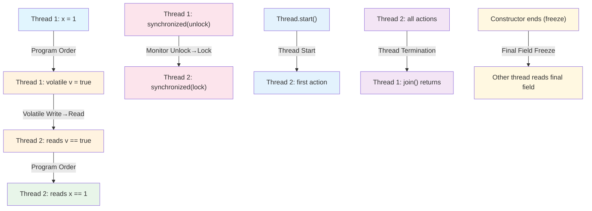
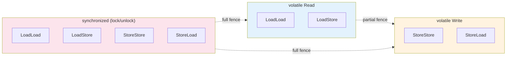
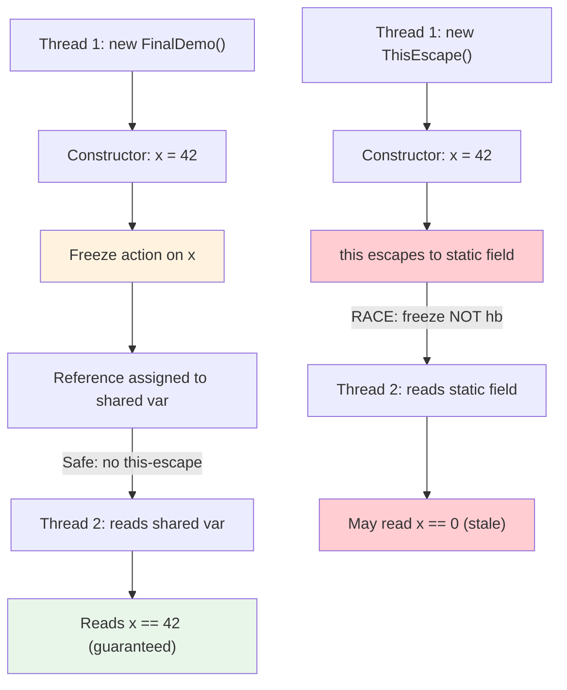
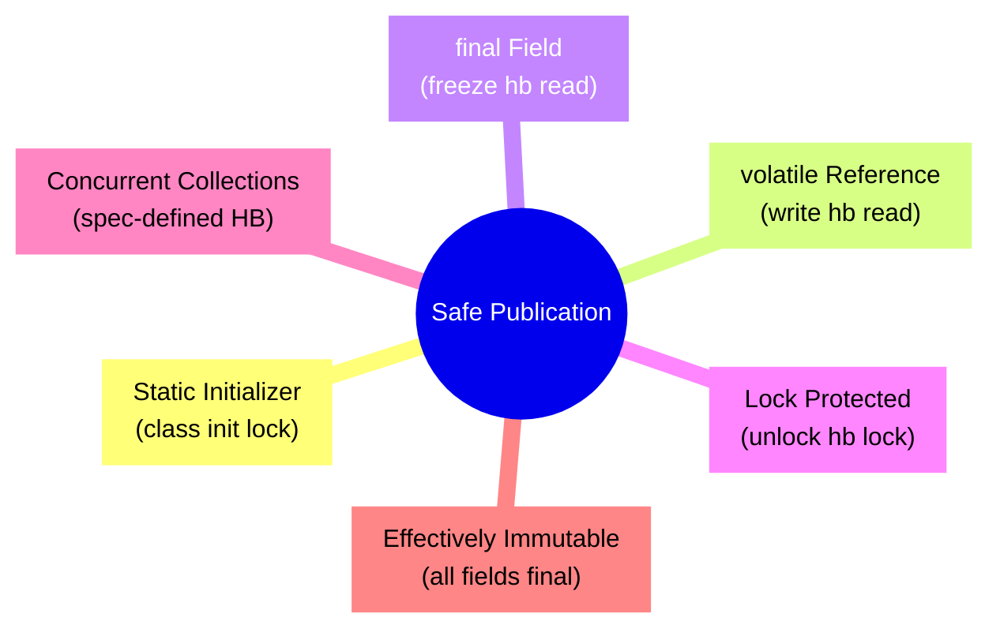

# Java Memory Model (JMM)

The Java Memory Model (JMM), specified in JLS Chapter 17, is the **contract between Java threads and main memory**. It defines *when* writes by one thread become visible to another, *which* operations are atomic, and *what* reorderings compilers and CPUs may perform. Without the JMM, Java could not offer portability across architectures (x86-TSO, ARM/Power weak ordering) while still allowing aggressive compiler and hardware optimizations.

**Why the JMM exists:**
- **Compiler reordering**: `javac` and the JIT may reorder independent instructions for throughput.
- **CPU reordering**: Modern CPUs execute instructions out-of-order, use store buffers, and speculative loads.
- **Caches**: Each core has private L1/L2 caches; writes propagate asynchronously via cache-coherency protocols (MESI).
- **Registers**: Thread-local variables may live only in registers, invisible to other threads.

The JMM abstracts all of this into a single **happens-before** partial order. If action A *happens-before* action B, the effects of A are guaranteed visible to B. If there is no happens-before edge between two conflicting accesses (same variable, at least one write), the program has a **data race** and its behaviour is undefined (but still type-safe — no out-of-thin-air values).

---

## Three Fundamental Concerns

| Concern | What it means | JMM mechanism |
|---------|---------------|---------------|
| **Atomicity** | An operation executes indivisibly; no thread sees a partial result. | Only specific operations are atomic (see below). `long`/`double` are *not* atomic on 32-bit JVMs. |
| **Visibility** | A write by one thread is eventually seen by another. | `volatile`, `synchronized`, `final` (freeze), happens-before edges. |
| **Ordering** | The perceived order of operations across threads. | Happens-before rules, memory barriers, `volatile`/`synchronized` semantics. |

### Atomicity Details

```java
// Atomic operations guaranteed by JMM (JLS 17.7):
// - Reads/writes of reference variables (any object reference)
// - Reads/writes of primitive variables EXCEPT long and double
// - Reads/writes of volatile variables (including volatile long/double)
// - All operations in java.util.concurrent.atomic.*
// - All operations on locks (monitorenter/monitorexit)

// NON-ATOMIC on 32-bit JVMs (or when not volatile):
long x = 0L;           // May be two 32-bit writes
double d = 0.0;        // May be two 32-bit writes

// Fix: use volatile or AtomicLong/AtomicReference
volatile long vLong = 0L;  // Atomic read/write
AtomicLong aLong = new AtomicLong(0); // Atomic RMW (CAS)
```

> **JLS 17.7**: "Writes to and reads of references are always atomic... Writes to and reads of volatile long and double are always atomic."

---

## Happens-Before Relation — Complete Enumeration

The happens-before (HB) relation is a **partial order** over actions. It is transitive: if A hb B and B hb C, then A hb C.

| # | Rule | Source → Destination | Notes |
|---|------|---------------------|-------|
| 1 | **Program Order** | Each action in a thread hb subsequent actions in that thread | Intra-thread semantics (as-if-serial) |
| 2 | **Monitor Lock** | `unlock(m)` hb subsequent `lock(m)` | `synchronized` blocks/methods |
| 3 | **Volatile Variable** | `write(v)` hb subsequent `read(v)` | `volatile` fields only |
| 4 | **Thread Start** | `Thread.start()` hb first action in started thread | |
| 5 | **Thread Termination** | All actions in thread hb `Thread.join()` return | Also `Thread.isAlive() == false` |
| 6 | **Transitivity** | If A hb B and B hb C, then A hb C | Derives many edges |
| 7 | **Final Field Freeze** | Constructor end (freeze) hb first read of `final` field | Requires safe publication (no `this` escape) |
| 8 | **Concurrent Collections / Atomics** | As specified per class (e.g., `ConcurrentHashMap.put` hb `get`) | See module 11 and 43 |
| 9 | **Executor Submission** | `Executor.submit(task)` hb task's first action | Includes `Executors`, `ForkJoinPool` |
| 10 | **Future/Collaboration** | `CountDownLatch.countDown()` hb `await()` return | Also `CyclicBarrier`, `Phaser`, `CompletableFuture` completion |
| 11 | **Thread.interrupt()** | `interrupt()` hb interrupted thread detects it | Via `InterruptedException` or `Thread.interrupted()` |
| 12 | **VarHandle Modes** | `setRelease` hb `getAcquire` on same variable | Plain, opaque, acquire, release, volatile modes |

### Mermaid: Happens-Before Graph Example



---

## `synchronized` and `volatile` — Guarantees and Limits

### `synchronized`

```java
// Guarantees:
// 1. Mutual exclusion (only one thread holds the monitor)
// 2. Happens-before: unlock hb subsequent lock on SAME monitor
// 3. Visibility: all writes before unlock visible after subsequent lock
// 4. Ordering: no reordering of memory ops across lock/unlock boundaries

class Counter {
    private int count = 0;
    public synchronized void inc() { count++; }
    public synchronized int get() { return count; }
}
```

**What `synchronized` does NOT guarantee:**
- Atomicity of compound actions *outside* the synchronized block (check-then-act still racy)
- Fairness (JVM may grant lock to any waiting thread)
- Performance (contention causes park/unpark, context switches)

### `volatile`

```java
// Guarantees:
// 1. Atomic read/write (including long/double)
// 2. Happens-before: write hb subsequent read of SAME variable
// 3. Visibility: write flushed to main memory; read fetches from main memory
// 4. Ordering: StoreStore + LoadLoad barriers (see memory barriers section)

class Flag {
    volatile boolean stop = false; // Visibility + ordering
    void requestStop() { stop = true; }
    boolean isStopped() { return stop; }
}
```

**What `volatile` does NOT guarantee:**
- Atomicity of read-modify-write (`volatile int i; i++` is **not** atomic)
- Mutual exclusion
- Ordering with *non-volatile* variables (only orders around the volatile itself)

### Data Race Definition

> **JLS 17.4.5**: Two accesses **conflict** if they access the same variable, at least one is a write. A **data race** exists if two conflicting accesses are not ordered by happens-before. A correctly synchronized program has no data races.

```java
// DATA RACE: no happens-before between write and read
class Race {
    int x = 0;           // non-volatile
    boolean ready = false; // non-volatile
    
    void writer() { x = 42; ready = true; }
    void reader() { if (ready) System.out.println(x); } // May print 0!
}
```

### No Out-of-Thin-Air Guarantee

Even with data races, the JMM guarantees **type safety**: a read never returns a value that was never written. No "out-of-thin-air" values (e.g., reading `42` when only `0` and `1` were ever written). This prevents causal loops that could break security.

---

## Reordering and As-If-Serial Semantics

### As-If-Serial Semantics

Within a **single thread**, the JMM guarantees **as-if-serial** semantics: the observable behaviour (including exceptions, I/O, volatile accesses) matches some sequential execution of that thread's actions. The compiler/CPU may reorder freely *as long as* the single-threaded result is preserved.

### Reordering Sources

| Source | Example | Prevented by |
|--------|---------|--------------|
| **Compiler** | `a = 1; b = 2;` → `b = 2; a = 1;` | `volatile`, `synchronized`, data dependencies |
| **CPU Store Buffer** | Store to `x` sits in buffer; other core sees stale value | `volatile` (StoreStore/StoreLoad barriers), `synchronized` |
| **CPU Instruction Reorder** | Load `y` before load `x` (speculative) | `volatile` (LoadLoad/LoadStore), `synchronized` |
| **Speculative Execution** | Branch prediction executes both paths | Hardware fences, `synchronized` |

### Memory Barriers (Fences)

| Barrier | Name | Effect | `volatile` mapping | `synchronized` mapping |
|---------|------|--------|-------------------|------------------------|
| `LoadLoad` | Load-Load | Loads before barrier complete before loads after | Read: `LoadLoad` + `LoadStore` | Lock: full fence; Unlock: full fence |
| `StoreStore` | Store-Store | Stores before barrier visible before stores after | Write: `StoreStore` | Lock/Unlock: full fence |
| `LoadStore` | Load-Store | Loads before barrier complete before stores after | Read: `LoadLoad` + `LoadStore` | Lock/Unlock: full fence |
| `StoreLoad` | Store-Load | Stores before barrier visible before loads after | Write: `StoreLoad` (expensive!) | Lock/Unlock: full fence |

> **Key insight**: `volatile` write = `StoreStore` + `StoreLoad`; `volatile` read = `LoadLoad` + `LoadStore`. The `StoreLoad` barrier (preventing store buffer forwarding) is the most expensive — on x86 it's `mfence` or `lock addl $0,0(%rsp)`.

### Mermaid: Memory Barrier Mapping



### x86-TSO vs ARM/Power

| Architecture | Memory Model | Reordering Allowed | `volatile` write cost | `volatile` read cost |
|--------------|--------------|-------------------|----------------------|---------------------|
| **x86 (TSO)** | Total Store Order | Store→Load only (store buffer) | `lock add` / `mfence` (StoreLoad) | Almost free (LoadLoad/LoadStore implicit) |
| **ARM/Power** | Weak (RCpc/RCsc) | All 4 reorderings | `dmb ish` (full barrier) | `dmb ish` (full barrier) |
| **RISC-V** | RVWMO (weak) | All 4 reorderings | `fence w, rw` | `fence r, rw` |

```bash
# Verify barriers with javap -c -v (Java 21)
# Compile: javac VolatileDemo.java
# Run: javap -c -v VolatileDemo | grep -A2 -B2 "volatile"
```

### Verified Example: Reordering Demonstration

```java
// /tmp/jmod-check/ReorderingDemo.java
import java.util.concurrent.CountDownLatch;

public class ReorderingDemo {
    static int x = 0, y = 0;
    static int a = 0, b = 0;

    public static void main(String[] args) throws InterruptedException {
        for (int iter = 0; iter < 100000; iter++) {
            x = 0; y = 0; a = 0; b = 0;
            CountDownLatch latch = new CountDownLatch(2);
            
            Thread t1 = new Thread(() -> {
                a = 1;
                x = b;  // May see b=0 if reordered
                latch.countDown();
            });
            
            Thread t2 = new Thread(() -> {
                b = 1;
                y = a;  // May see a=0 if reordered
                latch.countDown();
            });
            
            t1.start(); t2.start();
            latch.await();
            
            // On weak memory models (or with JIT reordering), a=0 && b=0 is possible
            if (x == 0 && y == 0) {
                System.out.println("Reordering observed at iteration " + iter);
                return;
            }
        }
        System.out.println("No reordering observed in 100k iterations (may still happen)");
    }
}
```

```bash
# Compile and run
cd /tmp/jmod-check && javac ReorderingDemo.java && java ReorderingDemo
# Output varies: may print "Reordering observed..." or complete silently
```

---

## `final` Field Semantics

### Freeze Action and Safe Initialization

When a constructor completes, a **freeze action** occurs on all `final` fields. This freeze hb the first read of that `final` field by another thread — *provided the reference (`this`) does not escape during construction*.

```java
class FinalFieldDemo {
    final int x;           // Guaranteed visible after constructor
    final int[] arr;       // Reference is final; array contents NOT frozen
    String nonFinal;       // No guarantee
    
    FinalFieldDemo() {
        x = 42;
        arr = new int[] {1, 2, 3};
        nonFinal = "hello";
    }
}

// Safe publication: reference stored after constructor completes
FinalFieldDemo safe = new FinalFieldDemo(); // Freeze hb any read of safe.x
```

### `this` Escape — Unsafe Publication

```java
class ThisEscape {
    final int x;
    static ThisEscape instance; // Unsafe publication!
    
    ThisEscape() {
        x = 42;
        instance = this; // THIS ESCAPES! Freeze may not hb other thread's read
        // If another thread reads instance.x here, it may see 0
    }
}

// Fix: use a factory or static initializer
class SafePublication {
    final int x;
    private SafePublication() { x = 42; }
    static SafePublication create() { return new SafePublication(); }
}
```

### Mermaid: Final Field Freeze and Publication



---

## Safe Publication Idioms

### Mermaid: Safe Publication Hierarchy



| Idiom | Mechanism | Example |
|-------|-----------|---------|
| **Static initializer** | Class initialization lock hb all threads | `static final Holder INSTANCE = new Holder();` |
| **`volatile` reference** | Volatile write hb volatile read | `volatile Holder holder = new Holder();` |
| **`final` field** | Freeze hb read (if no escape) | `final Holder holder = new Holder();` |
| **Lock-protected** | Unlock hb subsequent lock | `synchronized(map) { map.put(k, v); }` |
| **Concurrent collection** | Spec-defined HB (e.g., `ConcurrentHashMap`) | `map.put(k, v);` hb `map.get(k)` |
| **Effectively immutable** | All fields final or written once before publication | `String`, `Integer`, custom immutable classes |

### Unsafe Publication Examples

```java
// UNSAFE: non-final, non-volatile, no lock
public Holder holder = new Holder(); // Other thread may see partially constructed object

// UNSAFE: this escapes in constructor
public class EventSource {
    public EventSource() {
        listeners.add(this); // Leaks this before construction complete
    }
}

// UNSAFE: double-checked locking without volatile (pre-Java 5 / broken)
class BrokenSingleton {
    private static BrokenSingleton instance;
    public static BrokenSingleton get() {
        if (instance == null) {           // Read 1
            synchronized (BrokenSingleton.class) {
                if (instance == null) {   // Read 2
                    instance = new BrokenSingleton(); // Write may reorder!
                }
            }
        }
        return instance;                  // Read 3 may see partially constructed
    }
}
```

---

## Double-Checked Locking and Initialization-on-Demand Holder

### Broken Double-Checked Locking (Pre-Java 5)

The write `instance = new Singleton()` can be reordered as:
1. Allocate memory
2. Assign reference to `instance` (visible to other threads!)
3. Run constructor

Another thread sees non-null `instance` but uninitialized fields.

### Fixed with `volatile` (Java 5+)

```java
class VolatileSingleton {
    private static volatile VolatileSingleton instance;
    
    public static VolatileSingleton get() {
        VolatileSingleton local = instance; // First read (volatile)
        if (local == null) {
            synchronized (VolatileSingleton.class) {
                local = instance;           // Second read (volatile)
                if (local == null) {
                    instance = local = new VolatileSingleton(); // Volatile write
                }
            }
        }
        return local;
    }
}
```

The `volatile` write includes a `StoreLoad` barrier, preventing the constructor reordering.

### Initialization-on-Demand Holder (Preferred)

```java
class HolderSingleton {
    private HolderSingleton() {}
    
    private static class Holder {
        static final HolderSingleton INSTANCE = new HolderSingleton();
    }
    
    public static HolderSingleton get() {
        return Holder.INSTANCE; // Class initialization is thread-safe (JLS 12.4)
    }
}
```

**Why it works**: Class initialization acquires the initialization lock (JLS 12.4.2), which hb all subsequent uses. No `volatile` needed, no double-check, lazy, and fast.

---

## Piggybacking on Happens-Before Edges

You can "piggyback" visibility on existing HB edges without additional synchronization.

```java
class Piggyback {
    volatile boolean ready = false;
    int data = 0;           // Non-volatile!
    int[] array = new int[100];
    
    void writer() {
        data = 42;
        for (int i = 0; i < array.length; i++) array[i] = i;
        ready = true;       // Volatile write: hb subsequent read of ready
    }
    
    void reader() {
        if (ready) {        // Volatile read: hb subsequent reads
            // Guaranteed to see data=42 and array fully initialized
            assert data == 42;
            assert array[99] == 99;
        }
    }
}
```

### Benign Data Races

Reading a `volatile` variable multiple times (e.g., in a spin loop) creates benign races on the *read* side — all reads see the same or later value, no corruption.

```java
// Benign: multiple reads of volatile, no writes
while (!flag) { /* spin */ } // Each read is volatile; no data race on reads
```

---

## `VarHandle` / `Atomic*` Memory Modes

`VarHandle` (Java 9+) and `Atomic*` classes expose fine-grained memory ordering modes. See [VarHandle](../08-Advanced/43-VarHandle.md) and [Unsafe](../08-Advanced/42-Unsafe.md) for API details.

| Mode | Ordering | Use Case | Barrier Equivalent |
|------|----------|----------|-------------------|
| `PLAIN` / `get`/`set` | None (only atomicity) | Counters, stats | None |
| `OPAQUE` / `getOpaque`/`setOpaque` | Coherent per-location | Bitmasks, flags | `LoadLoad`/`StoreStore` (no cross-variable ordering) |
| `ACQUIRE` / `getAcquire` | LoadLoad + LoadLoad | Reading a flag before data | `volatile` read |
| `RELEASE` / `setRelease` | StoreStore + StoreStore | Writing data before flag | `volatile` write |
| `VOLATILE` / `getVolatile`/`setVolatile` | Full (acq+rel+StoreLoad) | Full JMM volatile | `volatile` read/write |
| `compareAndSet` (CAS) | Volatile (full) | Lock-free algorithms | Full fence |

### Example: Acquire/Release Pattern

```java
import java.lang.invoke.VarHandle;
import java.lang.invoke.MethodHandles;

class AcquireReleaseDemo {
    private static final VarHandle DATA;
    private static final VarHandle FLAG;
    private int data = 0;
    private boolean flag = false;
    
    static {
        try {
            var lookup = MethodHandles.lookup();
            DATA = lookup.findVarHandle(AcquireReleaseDemo.class, "data", int.class);
            FLAG = lookup.findVarHandle(AcquireReleaseDemo.class, "flag", boolean.class);
        } catch (ReflectiveOperationException e) { throw new ExceptionInInitializerError(e); }
    }
    
    void writer() {
        DATA.set(this, 42);                    // Plain write
        FLAG.setRelease(this, true);           // Release: data hb flag
    }
    
    void reader() {
        if (FLAG.getAcquire(this)) {           // Acquire: flag hb data
            int d = (int) DATA.get(this);      // Guaranteed to see 42
        }
    }
}
```

---

## Common Mistakes

| Mistake | Why It's Wrong | Correct Approach |
|---------|----------------|------------------|
| **`volatile` gives atomicity** | `volatile int i; i++;` is read-modify-write, not atomic | Use `AtomicInteger` or `synchronized` |
| **Non-volatile boolean stop flag** | JIT may hoist read out of loop; thread never sees `true` | `volatile boolean stop` or `AtomicBoolean` |
| **Publishing mutable object without sync** | Other thread sees partially initialized object | Use safe publication (volatile, final, lock, concurrent map) |
| **Relying on `System.out.println` sync** | `println` is synchronized but only orders *around that call* | Use explicit synchronization |
| **`this` escape in constructor** | Breaks final field guarantees | Factory method, static initializer, or complete construction first |
| **Double-checked locking without `volatile`** | Constructor reordering exposes half-built object | Use `volatile` or initialization-on-demand holder |
| **Assuming `final` makes object immutable** | `final` reference ≠ immutable contents | Make all fields `final` and deeply immutable |
| **`volatile` array elements** | `volatile int[] arr` makes reference volatile, not elements | Use `AtomicIntegerArray` or `VarHandle` |

### Verified Example: Non-Volatile Stop Flag

```java
// /tmp/jmod-check/StopFlagDemo.java
public class StopFlagDemo {
    // static boolean stop = false; // BAD: JIT may cache in register forever
    static volatile boolean stop = false; // GOOD
    
    public static void main(String[] args) throws InterruptedException {
        Thread t = new Thread(() -> {
            int i = 0;
            while (!stop) { i++; } // Without volatile, may loop forever
            System.out.println("Stopped after " + i + " iterations");
        });
        t.start();
        Thread.sleep(100);
        stop = true;
        t.join();
    }
}
```

```bash
cd /tmp/jmod-check && javac StopFlagDemo.java && java StopFlagDemo
# With volatile: prints "Stopped after ..."
# Without volatile: may hang indefinitely (JIT optimization)
```

---

## Performance Implications

### Barrier/Fence Costs

| Operation | x86 Cost | ARM Cost | Notes |
|-----------|----------|----------|-------|
| `volatile` read | ~1-3 cycles (implicit LoadLoad) | ~20-40 cycles (`dmb ish`) | |
| `volatile` write | ~10-40 cycles (`lock add`/`mfence`) | ~20-40 cycles (`dmb ish`) | StoreLoad is expensive |
| `synchronized` (uncontended) | ~5-10 ns (biased locking) | ~20-50 ns | Fast-path in HotSpot |
| `synchronized` (contended) | ~100-1000+ ns | Similar | Park/unpark, context switch |
| `AtomicInteger.getAndIncrement()` | ~20-50 ns (CAS loop) | ~50-100 ns | Cache line bouncing |

### False Sharing

Adjacent `volatile` or `Atomic*` fields on the same cache line (64 bytes) cause **cache line ping-ponging**.

```java
// BAD: false sharing
class Counter {
    volatile long a = 0;
    volatile long b = 0; // Same cache line as 'a'!
}

// GOOD: padding or @Contended (Java 8+)
class PaddedCounter {
    @jdk.internal.vm.annotation.Contended // Requires -XX:-RestrictContended
    volatile long a = 0;
    @jdk.internal.vm.annotation.Contended
    volatile long b = 0;
}

// Alternative: manual padding (pre-Java 8 or without @Contended)
class ManualPadded {
    volatile long a = 0;
    long p1, p2, p3, p4, p5, p6, p7; // 56 bytes padding
    volatile long b = 0;
}
```

### Lock-Free vs Locked

| Aspect | Lock-Free (CAS/VarHandle) | Locked (`synchronized`) |
|--------|---------------------------|------------------------|
| **Contention** | Scales better (no parking) | Threads park, context switch |
| **Latency** | Predictable (no OS involvement) | Variable (park/unpark) |
| **Throughput** | High at low contention | High at low contention |
| **Complexity** | High (ABA, retries) | Low |
| **Fairness** | None (starvation possible) | None by default (fair lock available) |
| **Debugging** | Harder | Easier (stack traces) |

### When JMM Forces Synchronization

- Publishing immutable objects (final fields, static initializers) — **free** after construction
- `volatile` read/write — cheaper than locks for single variables
- Compound actions — require `synchronized` or `Lock`/`Atomic*`
- High contention — consider `LongAdder`, `Striped64` (reduce cache contention)

---

## Comparison Tables

### `volatile` vs `synchronized` vs `Atomic*` vs `VarHandle`

| Feature | `volatile` | `synchronized` | `Atomic*` | `VarHandle` |
|---------|------------|----------------|-----------|-------------|
| **Atomicity** | Single read/write | Compound (block) | RMW (CAS) | Configurable |
| **Visibility** | Yes (hb) | Yes (hb) | Yes (volatile mode) | Configurable |
| **Ordering** | Around variable | Full barrier | Volatile mode | Configurable |
| **Mutual Exclusion** | No | Yes | No | No |
| **Deadlock Risk** | None | Yes | None | None |
| **Fairness** | N/A | No (default) | N/A | N/A |
| **API Complexity** | Low | Low | Medium | High |
| **Performance (uncontended)** | Fast | Fast (biased) | Fast (CAS) | Fast |
| **Performance (contended)** | N/A (no contention) | Slow (park) | CAS retry | CAS retry |
| **Use Case** | Flags, simple state | Critical sections | Counters, accumulators | Low-level, off-heap, fine-grained |

### x86 vs ARM Memory Model Comparison

| Property | x86 (TSO) | ARMv8 (RCpc) | POWER |
|----------|-----------|--------------|-------|
| **Store→Load reorder** | Yes (store buffer) | Yes | Yes |
| **Load→Load reorder** | No | Yes | Yes |
| **Load→Store reorder** | No | Yes | Yes |
| **Store→Store reorder** | No | Yes | Yes |
| **`volatile` read barrier** | Implicit (LoadLoad) | `dmb ish` | `sync`/`lwsync` |
| **`volatile` write barrier** | `lock add` / `mfence` | `dmb ish` | `sync`/`lwsync` |
| **`synchronized` barrier** | `lock` prefix (full) | `dmb ish` + `ldar`/`stlr` | `sync` + `lwarx`/`stwcx` |
| **CAS (Atomic*)** | `lock cmpxchg` | `ldaxr`/`stlxr` loop | `lwarx`/`stwcx` loop |

---

## Interview Tips

- **Know the HB rules cold**: Be able to list all 12+ rules and draw a graph.
- **Distinguish atomicity vs visibility vs ordering**: Interviewers love asking "does `volatile` make `i++` atomic?" (No).
- **Explain `final` freeze**: Why `this` escape breaks it; how holder idiom avoids it.
- **Double-checked locking**: Why it was broken pre-Java 5, how `volatile` fixes it.
- **Memory barriers**: Map `volatile`/`synchronized` to `LoadLoad`, `StoreStore`, `LoadStore`, `StoreLoad`.
- **x86 vs ARM**: x86 is stronger (TSO); `volatile` read is nearly free on x86, expensive on ARM.
- **False sharing**: Recognize the pattern; know `@Contended` and padding.
- **VarHandle modes**: Plain/Opaque/Acquire/Release/Volatile — when to use each.
- **Benign races**: Reading `volatile` multiple times is fine; writing concurrently is not.

---

# Interview Questions

## Beginner

**Q1. What is the Java Memory Model (JMM)?**  
The JMM (JLS Chapter 17) defines the contract between threads and memory in Java. It specifies when writes by one thread become visible to another (visibility), which operations are indivisible (atomicity), and what reorderings of instructions are permitted (ordering). It abstracts away hardware differences (x86 TSO, ARM/Power weak ordering) and compiler optimizations to provide a portable concurrency model. The core abstraction is the **happens-before** partial order: if action A happens-before action B, the effects of A are guaranteed visible to B.

**Q2. What are the three main concerns of the JMM?**  
1. **Atomicity**: Which operations execute indivisibly. In Java, reads/writes of references and all primitives *except* `long`/`double` are atomic. `volatile long`/`double` are also atomic. Compound actions (e.g., `i++`) are not atomic.
2. **Visibility**: Whether a write by one thread is seen by another. Achieved via `volatile`, `synchronized`, `final` freeze, and other happens-before edges.
3. **Ordering**: The perceived order of memory operations across threads. The JMM allows reordering unless constrained by happens-before rules (program order, monitor, volatile, etc.).

**Q3. Is `volatile` atomic for `i++`?**  
No. `volatile` guarantees atomic *read* and atomic *write* of the variable, but `i++` is a **read-modify-write** (RMW) compound action: read, increment, write. Two threads can both read the same value, increment, and write back, losing an update. Use `AtomicInteger` or `synchronized` for atomic RMW.

**Q4. What is a data race?**  
A data race occurs when two threads access the same variable (at least one is a write), and the accesses are **not ordered by happens-before**. A program with data races has undefined behaviour (but still type-safe — no out-of-thin-air values). Correctly synchronized programs have no data races.

**Q5. What does `synchronized` guarantee?**  
1. **Mutual exclusion**: Only one thread holds the monitor at a time.
2. **Happens-before**: `unlock` hb subsequent `lock` on the *same* monitor.
3. **Visibility**: All writes before `unlock` are visible to the thread that subsequently `lock`s.
4. **Ordering**: No memory operations reorder across the lock/unlock boundaries (full fence).

---

## Intermediate

**Q6. List all happens-before rules in the JMM.**  
1. **Program Order**: Each action in a thread hb later actions in that thread.
2. **Monitor Lock**: `unlock(m)` hb subsequent `lock(m)`.
3. **Volatile Variable**: `write(v)` hb subsequent `read(v)`.
4. **Thread Start**: `Thread.start()` hb first action in started thread.
5. **Thread Termination**: All actions in thread hb `join()` return (or `isAlive()==false`).
6. **Transitivity**: If A hb B and B hb C, then A hb C.
7. **Final Field Freeze**: Constructor end (freeze) hb first read of `final` field (if safe publication).
8. **Concurrent Collections/Atomics**: As specified (e.g., `ConcurrentHashMap.put` hb `get`).
9. **Executor Submission**: `submit(task)` hb task's first action.
10. **Collaboration Tools**: `CountDownLatch.countDown()` hb `await()` return; `Future.get()` hb completion.
11. **Thread.interrupt()**: `interrupt()` hb detection via `InterruptedException` or `interrupted()`.
12. **VarHandle Modes**: `setRelease` hb `getAcquire` on same variable.

**Q7. Explain the `final` field freeze action. Why does `this` escape break it?**  
When a constructor completes, a **freeze action** occurs on all `final` fields of the constructed object. This freeze happens-before any read of that `final` field by another thread — *but only if the reference (`this`) does not escape during construction*. If `this` is published (e.g., stored in a static field, passed to another thread) before the constructor finishes, another thread may read the `final` field *before* the freeze, seeing the default value (0, null). The JMM only guarantees the freeze hb reads that occur *after* the reference is safely published.

**Q8. Why is double-checked locking broken without `volatile`?**  
The statement `instance = new Singleton()` compiles to roughly:
1. Allocate memory for `Singleton`
2. Assign reference to `instance` (publish)
3. Run constructor (initialize fields)

Without `volatile`, the JIT/CPU may reorder steps 2 and 3. Another thread sees non-null `instance` (step 2) but reads uninitialized fields (step 3 not yet visible). `volatile` adds a `StoreLoad` barrier after the write, preventing this reordering.

**Q9. What is the initialization-on-demand holder idiom? Why is it preferred?**  
```java
class Singleton {
    private Singleton() {}
    private static class Holder {
        static final Singleton INSTANCE = new Singleton();
    }
    public static Singleton get() { return Holder.INSTANCE; }
}
```
Class initialization is thread-safe (JLS 12.4): the JVM acquires the initialization lock, runs `<clinit>`, then releases it. The lock release hb all subsequent accesses. It's lazy, fast (no synchronization after init), and requires no `volatile`.

**Q10. What is piggybacking on happens-before?**  
Using an existing HB edge (e.g., a `volatile` write) to make *other* non-volatile writes visible. If thread A writes `data=42` then `volatile flag=true`, and thread B reads `flag` (seeing `true`) then reads `data`, the HB edge `write(flag)` hb `read(flag)` transitively orders `data=42` before the read of `data`. No extra synchronization needed for `data`.

**Q11. What are benign data races?**  
Races that don't violate correctness. Example: multiple threads reading a `volatile` variable (all reads, no concurrent writes) — all see the same or a later value. Another: a "racy" read of a `volatile` flag in a spin loop (`while (!flag) {}`) — each read is a volatile read, ordered by program order; no corruption possible.

---

## Advanced

**Q12. Map `volatile` and `synchronized` to the four memory barrier types.**  
| Barrier | `volatile` read | `volatile` write | `synchronized` (lock/unlock) |
|---------|-----------------|------------------|------------------------------|
| LoadLoad | Yes | No | Yes (both) |
| LoadStore | Yes | No | Yes (both) |
| StoreStore | No | Yes | Yes (both) |
| StoreLoad | No | Yes | Yes (both) |

`volatile` read = LoadLoad + LoadStore. `volatile` write = StoreStore + StoreLoad. `synchronized` = full fence (all four) on both lock and unlock.

**Q13. Why is `StoreLoad` the most expensive barrier?**  
`StoreLoad` prevents a load from executing before a preceding store is globally visible (draining the store buffer). On x86, this requires `mfence` or `lock addl $0,0(%rsp)` (~10-40 cycles). On ARM/Power, `dmb ish` (~20-40 cycles). The other barriers are cheaper or implicit on x86 (TSO guarantees LoadLoad, LoadStore, StoreStore).

**Q14. Explain false sharing. How do you fix it?**  
False sharing occurs when multiple threads write to *different* variables that happen to share the same CPU cache line (typically 64 bytes). Each write invalidates the line in other cores' caches, causing "ping-ponging" and severe slowdown.  
Fixes:
- **Padding**: Add unused fields to separate variables by ≥64 bytes.
- **`@Contended`** (Java 8+, `jdk.internal.vm.annotation.Contended`): JVM pads automatically. Requires `-XX:-RestrictContended`.
- **`Striped64`/`LongAdder`**: Distribute updates across multiple cells (used internally by `LongAdder`).

**Q15. Compare `VarHandle` memory modes: Plain, Opaque, Acquire, Release, Volatile.**  
| Mode | Ordering Guarantees | Typical Use |
|------|---------------------|-------------|
| `PLAIN` | Atomicity only; no ordering | Counters, statistics (racy but atomic) |
| `OPAQUE` | Coherent per-location; no cross-variable ordering | Bitmasks, flags where ordering not needed |
| `ACQUIRE` (`getAcquire`) | LoadLoad + LoadStore; pairs with Release | Reading a flag before dependent data |
| `RELEASE` (`setRelease`) | StoreStore + StoreStore; pairs with Acquire | Writing data before publishing flag |
| `VOLATILE` (`getVolatile`/`setVolatile`) | Full (Acquire + Release + StoreLoad) | Full JMM volatile semantics |

**Q16. How does `Unsafe` relate to `VarHandle`?**  
`Unsafe` (internal, `sun.misc.Unsafe`) provided low-level memory operations (`putOrderedObject`, `getAndAddInt`, `loadFence`, `storeFence`, `fullFence`) before `VarHandle`. `VarHandle` (Java 9+) is the supported, standardized replacement with defined memory modes. `Unsafe` fences map roughly: `loadFence`→LoadLoad+LoadStore, `storeFence`→StoreStore, `fullFence`→all four. `VarHandle` should be used in new code; `Unsafe` is restricted/removed in modules.

---

## Expert

**Q17. Prove that the following program can print `0 0` on a weak memory model (ARM/Power) but not on x86 without compiler reordering.**  
```java
int x = 0, y = 0;
int a = 0, b = 0;

// Thread 1          // Thread 2
a = 1;               b = 1;
x = b;               y = a;
```
**Answer**: On ARM/Power, both threads can reorder the store before the load (StoreLoad reordering). Thread 1 stores `a=1` (sits in store buffer), loads `b` (sees 0), then store buffer drains. Thread 2 does symmetric. Result: `x=0, y=0`. On x86 TSO, StoreLoad is the *only* allowed reordering, but the loads (`x=b`, `y=a`) cannot pass their own prior stores (`a=1`, `b=1`) due to program order + TSO. However, the *JIT compiler* may still reorder independently of hardware — so `0 0` is possible on x86 too if the compiler reorders. The JMM permits this outcome because there is no happens-before edge.

**Q18. Why does `final` not guarantee immutability of referenced objects?**  
`final` only makes the *reference* immutable (cannot be reassigned). The object's *contents* can still be mutated. Example:
```java
final int[] arr = new int[10];
arr[0] = 42; // Legal! The array object is mutable.
```
For true immutability, the object must be deeply immutable (all fields final, no mutable state reachable).

**Q19. What is the "out-of-thin-air" problem? How does JMM prevent it?**  
Out-of-thin-air (OOTA) values are values that appear without any write producing them (e.g., reading `42` when only `0` and `1` were ever written). The JMM prevents OOTA by requiring **causality**: every read must observe a write that *could* have happened in some valid execution. This is enforced by the formal JMM semantics (JLS 17.4.8) which disallows self-justifying executions. In practice, this means you never see a value that wasn't explicitly written — even in racy code.

**Q20. Explain the difference between `Acquire/Release` and `Volatile` modes in `VarHandle`.**  
- **Acquire/Release**: Provides one-way ordering. `setRelease` ensures prior stores are visible before the release store. `getAcquire` ensures subsequent loads see stores that happened-before the release. **No `StoreLoad` barrier** — cheaper than volatile on x86 (no `mfence`).
- **Volatile**: Full two-way ordering + `StoreLoad`. Equivalent to `volatile` field semantics. More expensive.
Use Acquire/Release for **message passing** (publish data, then flag). Use Volatile when you need full sequential consistency for that variable.

**Q21. Why does `LongAdder` outperform `AtomicLong` under high contention?**  
`AtomicLong` uses a single CAS on one cache line. Under contention, all threads hammer the same line → cache coherency traffic, CAS retries, exponential backoff. `LongAdder` (extends `Striped64`) maintains an array of `Cell` objects, each on a separate cache line. Threads hash to different cells, reducing contention. Sum is computed on read. Throughput scales with cores.

---

## Scenario Based

**Q22. You have a `HashMap` published via a `volatile` reference. Thread A puts entries; Thread B reads. Is this safe?**  
**No.** `volatile` only makes the *reference* assignment visible. The `HashMap` itself is not thread-safe. Thread B may see a partially updated map (corrupted internal state, infinite loop in `get`).  
**Fix**: Use `ConcurrentHashMap` (thread-safe, HB guarantees), or protect all accesses with `synchronized`, or use an immutable map (`Map.of`, `Collections.unmodifiableMap`) published via `volatile`.

**Q23. A library uses a `volatile boolean initialized = false` and `Object config`. Thread A: `config = load(); initialized = true;`. Thread B: `if (initialized) use(config);`. Is `config` safely published?**  
**Yes.** The write to `initialized` (volatile) happens-before the read of `initialized` in Thread B. By transitivity, the write to `config` (program order before `initialized=true`) happens-before the read of `config` in Thread B. This is piggybacking.

**Q24. You see a `volatile long` field updated via `field++` in a hot path. The profiler shows high CPU. What's wrong and how to fix?**  
`volatile long` read/write is atomic, but `field++` is **not atomic** (read-modify-write). Under contention, lost updates occur. Even without contention, each `volatile` write incurs a `StoreLoad` barrier.  
**Fix**: Replace with `AtomicLong` (uses CAS, single `volatile` write per successful update) or `LongAdder` (high contention). If updates are rare, `synchronized` is fine.

**Q25. A class has `final List<String> list = new ArrayList<>();`. The list is populated in the constructor. Is it safe to publish this object via a `volatile` reference?**  
**Yes, for the reference.** The `final` field `list` is frozen at constructor end. The `volatile` write of the reference hb the `volatile` read. Thread B sees the fully constructed `ArrayList` *reference*. **However**, `ArrayList` is mutable. If any thread (including the constructor) mutates the list *after* publication without synchronization, there is a data race on the list's internal state. For safety, use an immutable list (`List.of`, `Collections.unmodifiableList`) or confine mutations to the constructor.

---

## Output Prediction

**Q26. What does this program print? Explain.**
```java
public class OutputPrediction1 {
    static int x = 0;
    static boolean ready = false;
    
    public static void main(String[] args) throws InterruptedException {
        Thread t = new Thread(() -> {
            while (!ready) { /* spin */ }
            System.out.println(x);
        });
        t.start();
        Thread.sleep(50);
        x = 42;
        ready = true;
        t.join();
    }
}
```
**Output**: May print `42`, `0`, or hang forever.  
**Reason**: `ready` is **not volatile**. The JIT may hoist the read of `ready` out of the loop (`while (!ready) → if (!ready) while(true)`), so the thread never sees `true`. Even without hoisting, no HB edge orders `x=42` before the read of `x`. Data race on both variables.

**Q27. What does this print?**
```java
public class OutputPrediction2 {
    static volatile boolean ready = false;
    static int x = 0;
    
    public static void main(String[] args) throws InterruptedException {
        Thread t = new Thread(() -> {
            while (!ready) { /* spin */ }
            System.out.println(x);
        });
        t.start();
        Thread.sleep(50);
        x = 42;
        ready = true;
        t.join();
    }
}
```
**Output**: Always prints `42`.  
**Reason**: `ready` is `volatile`. Write `ready=true` hb read `ready` in thread. By program order, `x=42` hb `ready=true`. By transitivity, `x=42` hb read of `x`. Piggybacking works.

**Q28. Predict the output (may be nondeterministic):**
```java
public class OutputPrediction3 {
    static int x = 0, y = 0;
    static int a = 0, b = 0;
    
    public static void main(String[] args) throws InterruptedException {
        for (int i = 0; i < 100000; i++) {
            x = y = a = b = 0;
            Thread t1 = new Thread(() -> { a = 1; x = b; });
            Thread t2 = new Thread(() -> { b = 1; y = a; });
            t1.start(); t2.start();
            t1.join(); t2.join();
            if (x == 0 && y == 0) {
                System.out.println("Reordering observed: x=0, y=0 at iter " + i);
                return;
            }
        }
        System.out.println("No reordering observed");
    }
}
```
**Output**: On most JVMs (especially with JIT), eventually prints "Reordering observed: x=0, y=0 at iter N".  
**Reason**: No happens-before edges between threads. The JIT/CPU may reorder `a=1` after `x=b` (and symmetric), allowing both threads to read the initial `0`. This is a legal JMM execution.

---

## Internal Working

**Q29. How does HotSpot implement `synchronized` (biased locking, lightweight, heavyweight)?**  
1. **Biased Locking** (enabled by default): First thread to lock "biases" the object to itself (stores thread ID in mark word). Subsequent locks/unlocks by same thread are nearly free (no CAS). Revoked on contention.
2. **Lightweight Locking**: On contention, thread attempts CAS to displace mark word into stack (displaced header). Spins briefly.
3. **Heavyweight Locking**: Spinning fails → inflate to `ObjectMonitor` (OS mutex). Threads park (`pthread_cond_wait`). Unlock signals waiters.

**Q30. What bytecode instructions implement `volatile` read/write? Show `javap` output.**  
```java
class VolatileDemo {
    volatile int v;
    void write() { v = 1; }
    int read() { return v; }
}
```
```bash
$ javap -c VolatileDemo
  void write();
    Code:
       0: aload_0
       1: iconst_1
       2: putfield #2 // Field v:I  // volatile write
       5: return

  int read();
    Code:
       0: aload_0
       1: getfield #2 // Field v:I  // volatile read
       4: ireturn
```
The `putfield`/`getfield` on a `volatile` field emit memory barriers. On x86, `putfield` volatile → `lock addl $0,0(%rsp)` (StoreLoad); `getfield` volatile → plain load (LoadLoad/LoadStore implicit in TSO).

**Q31. How does the JIT optimize `volatile` access on x86 vs ARM?**  
- **x86**: `volatile` read = plain `mov` (TSO guarantees LoadLoad/LoadStore). `volatile` write = `mov` + `lock addl $0,0(%rsp)` (StoreLoad barrier). The `lock` prefix acts as a full fence.
- **ARM**: Both read and write emit `dmb ish` (full barrier) or `ldar`/`stlr` (acquire/release) instructions. No free rides.

**Q32. What is the `Striped64` / `LongAdder` internal structure?**  
`Striped64` maintains:
- `base` (long): fallback for low contention
- `cells[]` (Cell[]): array of padded `Cell` objects (each `volatile long value`), size power of 2
- `cellsBusy` (volatile int): spinlock for resizing `cells`

`LongAdder.add(x)`:
1. Try CAS on `base` (if `cells == null`).
2. On CAS failure, hash thread ID to `cells` index.
3. If cell empty, create under `cellsBusy` lock.
4. CAS on `cell.value`.
5. On repeated failure, expand `cells` (double size).

`sum()` reads `base` + all `cells[i].value`. No global lock.

---

## Tricky Questions

**Q33. Can a `final` field change value after construction?**  
**Yes, via reflection or JNI.** `Field.setAccessible(true); field.set(obj, newValue);` bypasses the JMM freeze guarantee. Also, native code (JNI) can write directly to memory. The JMM only guarantees freeze for *normal* Java code.

**Q34. Is `volatile` transitive? If A writes `volatile x`, B reads `x` and writes `volatile y`, C reads `y` — does A hb C?**  
**Yes.** A's write to `x` hb B's read of `x` (volatile). B's write to `y` is program-order after read of `x`, so A hb B's write to `y`. B's write to `y` hb C's read of `y` (volatile). By transitivity, A hb C. This is **volatile transitivity** (not automatic for non-volatile).

**Q35. Why is `volatile` not enough for "check-then-act" on a `volatile` reference to a mutable object?**  
```java
volatile List<String> list = new ArrayList<>();
// Thread A:
if (list.isEmpty()) list.add("x"); // RACE!
```
The `volatile` read of `list` gets the current reference. But `isEmpty()` and `add()` are **not atomic** with respect to the reference. Another thread may replace `list` between the check and act. The `volatile` only protects the *reference*, not the *object's state*.

**Q36. What happens if you write to a `final` field after construction (via Unsafe/Reflection)?**  
The JMM makes no guarantees. Other threads may or may not see the new value. The freeze action happened at constructor end; subsequent writes are not ordered. The VM may have optimized based on finality (e.g., constant folding, scalar replacement). Behavior is undefined.

**Q37. Explain the "causality" requirement in JMM (JLS 17.4.8) with an example.**  
Causality forbids executions where a read's value is justified *only* by a write that happens because of that read (circular causality). Example:
```java
// Initially x=0, y=0
// Thread 1:          // Thread 2:
r1 = x;              r2 = y;
y = r1;              x = r2;
```
Without causality, `r1=42, r2=42` is allowed (each read sees the other's write). JMM causality rules forbid this — values must come from actual writes in a well-founded execution. In practice, you'll never see this; the JMM ensures a "happens-before" consistent execution exists.

**Q38. When does the JMM guarantee sequential consistency?**  
A program is **sequentially consistent (SC)** if it has no data races (correctly synchronized). For such programs, the JMM guarantees **SC for data-race-free (DRF)** programs: the execution appears as if all threads interleaved in some global order respecting each thread's program order. This is the **DRF-SC guarantee** (JLS 17.4.5). If you use `synchronized`, `volatile`, `final` (safely), or concurrent utilities correctly everywhere, you get SC semantics.

**Q39. What is the difference between `AtomicReference.getAndSet()` and `VarHandle.getAndSet()` with `VOLATILE` mode?**  
Both provide the same memory semantics (volatile/full fence). `AtomicReference` is a higher-level class with a simpler API; `VarHandle` is lower-level, supports more modes (Acquire/Release/Opaque/Plain), works on fields/array elements/off-heap, and can be used with `MemorySegment` (foreign memory). Performance is similar for volatile mode.

**Q40. How do you prove a program is correctly synchronized (data-race-free)?**  
Show that for every pair of conflicting accesses (same variable, at least one write), there exists a happens-before edge in at least one direction. Use the HB rules: program order, monitor, volatile, thread start/join, final freeze, concurrent utilities, transitivity. If all conflicts are ordered, the program is DRF and enjoys SC semantics.

---