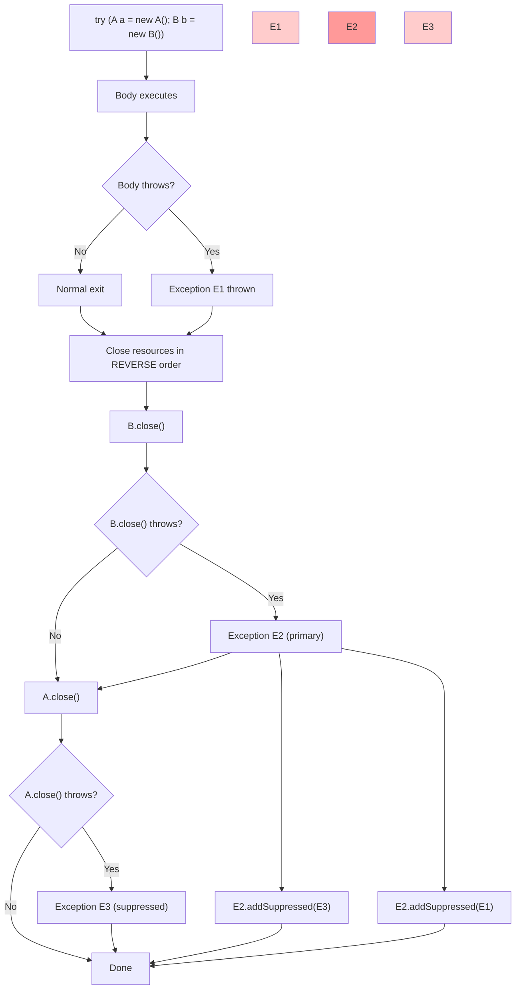
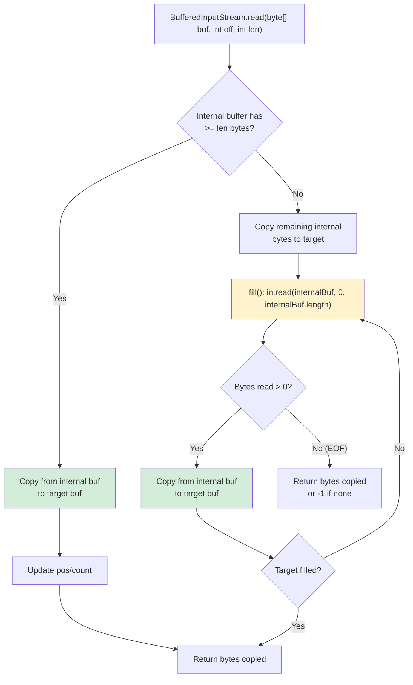
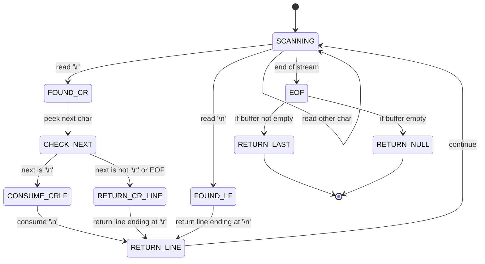

# File I/O (Streams & Readers/Writers)

File I/O in Java operates on two parallel hierarchies: **byte streams** (`InputStream`/`OutputStream`) for raw binary data, and **character streams** (`Reader`/`Writer`) for text with encoding/decoding. The bridge between them is `InputStreamReader`/`OutputStreamWriter`, which apply a `Charset`. Every stream/reader/writer implements `Closeable`/`AutoCloseable`; the JVM does not close them automatically. **Always use `try-with-resources`** — it guarantees deterministic cleanup even on exception, and respects closing order (innermost first). This module covers the `java.io` stack exhaustively; NIO channels, selectors, and `Files` API are in [NIO & the Files API](25-NIO-Files-API.md), serialization in [Serialization](../06-Reflection/29-Serialization.md), and networking in [Networking](26-Networking.md).

---

## Byte Streams vs Character Streams

### Hierarchy Overview

```mermaid
classDiagram
    direction TD
    class InputStream {
        <<abstract>>
        +read() int
        +read(byte[]) int
        +read(byte[], int, int) int
        +available() int
        +close() void
        +skip(long) long
        +mark(int) void
        +reset() void
    }
    class OutputStream {
        <<abstract>>
        +write(int) void
        +write(byte[]) void
        +write(byte[], int, int) void
        +flush() void
        +close() void
    }
    class Reader {
        <<abstract>>
        +read() int
        +read(char[]) int
        +read(char[], int, int) int
        +ready() boolean
        +close() void
        +skip(long) long
        +mark(int) void
        +reset() void
    }
    class Writer {
        <<abstract>>
        +write(int) void
        +write(char[]) void
        +write(char[], int, int) void
        +write(String) void
        +write(String, int, int) void
        +flush() void
        +close() void
    }
    class InputStreamReader {
        +InputStreamReader(InputStream)
        +InputStreamReader(InputStream, Charset)
        +getEncoding() String
    }
    class OutputStreamWriter {
        +OutputStreamWriter(OutputStream)
        +OutputStreamWriter(OutputStream, Charset)
        +getEncoding() String
    }
    class FileInputStream
    class FileOutputStream
    class FileReader
    class FileWriter
    class BufferedInputStream
    class BufferedOutputStream
    class BufferedReader
    class BufferedWriter
    class PrintStream
    class PrintWriter
    class DataInputStream
    class DataOutputStream
    class ObjectInputStream
    class ObjectOutputStream
    class RandomAccessFile

    InputStream <|-- FileInputStream
    InputStream <|-- BufferedInputStream
    InputStream <|-- DataInputStream
    InputStream <|-- ObjectInputStream
    OutputStream <|-- FileOutputStream
    OutputStream <|-- BufferedOutputStream
    OutputStream <|-- PrintStream
    OutputStream <|-- DataOutputStream
    OutputStream <|-- ObjectOutputStream
    Reader <|-- FileReader
    Reader <|-- BufferedReader
    Reader <|-- InputStreamReader
    Writer <|-- FileWriter
    Writer <|-- BufferedWriter
    Writer <|-- OutputStreamWriter
    Writer <|-- PrintWriter
    InputStreamReader <|-- FileReader
    OutputStreamWriter <|-- FileWriter
    BufferedInputStream ..> InputStream : wraps
    BufferedOutputStream ..> OutputStream : wraps
    BufferedReader ..> Reader : wraps
    BufferedWriter ..> Writer : wraps
    PrintStream ..> OutputStream : wraps
    PrintWriter ..> Writer : wraps
    DataInputStream ..> InputStream : wraps
    DataOutputStream ..> OutputStream : wraps
    ObjectInputStream ..> InputStream : wraps
    ObjectOutputStream ..> OutputStream : wraps
```



### When to Use Each

| Scenario | Use |
|----------|-----|
| Binary files (images, PDFs, serialized objects) | `FileInputStream` / `FileOutputStream` + buffering |
| Text files (config, logs, CSV, JSON) | `BufferedReader` / `BufferedWriter` with explicit `Charset` |
| Primitive binary data (portable format) | `DataInputStream` / `DataOutputStream` |
| Human-readable formatted output | `PrintWriter` / `PrintStream` |
| Random access (seek, overwrite in place) | `RandomAccessFile` |
| Object graphs (with caveats) | `ObjectInputStream` / `ObjectOutputStream` → see module 29 |

**Rule:** Never use `FileReader`/`FileWriter` in production — they hardcode the platform default charset (locale-dependent). Always wrap `FileInputStream`/`FileOutputStream` with `InputStreamReader`/`OutputStreamWriter` specifying `StandardCharsets.UTF_8` (or your chosen charset).

### Try-with-Resources Closing Flow



---

## File Byte Streams

### `FileInputStream` / `FileOutputStream`

These are the raw byte conduits to the filesystem. Each `read()`/`write()` call typically crosses the JNI boundary into a native `read`/`write` syscall — **expensive**. Never use them directly for bulk I/O; always wrap in `BufferedInputStream`/`BufferedOutputStream`.

```java
// Raw usage — AVOID for bulk I/O
try (FileInputStream in = new FileInputStream("data.bin");
     FileOutputStream out = new FileOutputStream("copy.bin")) {
    int b;
    while ((b = in.read()) != -1) {  // One syscall per byte!
        out.write(b);
    }
}
```

**Internal working:** `FileInputStream.read()` calls `FileInputStream.readBytes(byte[], int, int)` → native `Java_java_io_FileInputStream_readBytes` → `read(fd, buf, len)`. Each call incurs JNI transition (~50–100 ns) + syscall (~100–500 ns). For a 1 MB file, 1-byte reads = 1M syscalls = **seconds**. Buffered = **milliseconds**.

### `BufferedInputStream` / `BufferedOutputStream`

Default buffer size: **8192 bytes (8 KB)**. Tunable via constructor. Buffers live on the Java heap (unless using direct buffers via NIO — see module 25). `BufferedInputStream` supports `mark`/`reset` (if `markSupported()` returns true, which it does for buffered streams).

```java
// Correct: buffered byte copy
try (FileInputStream in = new FileInputStream("large.bin");
     BufferedInputStream bin = new BufferedInputStream(in, 65536); // 64 KB
     FileOutputStream out = new FileOutputStream("copy.bin");
     BufferedOutputStream bout = new BufferedOutputStream(out, 65536)) {
    byte[] buf = new byte[8192];
    int n;
    while ((n = bin.read(buf)) != -1) {
        bout.write(buf, 0, n);
    }
    // bout.flush() called automatically by close()
}
```

**Flushing:** `BufferedOutputStream.flush()` forces the buffer to the underlying stream. `close()` calls `flush()`. `PrintStream`/`PrintWriter` have **auto-flush** mode (flush on `println`, `printf`, or newline) — enable via constructor.

### BufferedInputStream Read Flow



### `DataInputStream` / `DataOutputStream`

Write/read JVM primitives in **big-endian** (network byte order), portable across platforms. Not for human-readable text.

```java
// Write primitives
try (DataOutputStream out = new DataOutputStream(
         new BufferedOutputStream(new FileOutputStream("primitives.dat")))) {
    out.writeUTF("hello");      // Modified UTF-8: length (2 bytes) + bytes
    out.writeInt(0xCAFEBABE);
    out.writeLong(0xDEADBEEFL);
    out.writeDouble(Math.PI);
    out.writeBoolean(true);
}

// Read back — MUST match write order exactly
try (DataInputStream in = new DataInputStream(
         new BufferedInputStream(new FileInputStream("primitives.dat")))) {
    String s = in.readUTF();    // "hello"
    int i = in.readInt();       // 0xCAFEBABE
    long l = in.readLong();     // 0xDEADBEEF
    double d = in.readDouble(); // 3.14159...
    boolean b = in.readBoolean(); // true
}
```

**Caveats:**
- `writeUTF`/`readUTF` use **modified UTF-8** (differs from standard UTF-8 for supplementary characters and `\u0000`). Not interchangeable with standard UTF-8 tools.
- `DataInputStream.readFully(byte[])` blocks until all bytes read — use for fixed-length records.
- No schema/versioning — see module 29 for serialization.

---

## File Character Streams

### `FileReader` / `FileWriter` — Avoid

```java
// NEVER DO THIS — platform default charset
FileReader r = new FileReader("file.txt"); // Charset.defaultCharset()
FileWriter w = new FileWriter("out.txt");  // Same
```

**Why:** `Charset.defaultCharset()` depends on `file.encoding` system property / locale. On Windows it's often `windows-1252`; on Linux `UTF-8`. Same code produces different bytes on different machines.

### Correct Pattern: Explicit Charset

```java
import java.nio.charset.StandardCharsets;
import java.io.*;

try (BufferedReader reader = Files.newBufferedReader(
         Path.of("file.txt"), StandardCharsets.UTF_8);
     BufferedWriter writer = Files.newBufferedWriter(
         Path.of("out.txt"), StandardCharsets.UTF_8)) {
    String line;
    while ((line = reader.readLine()) != null) {
        writer.write(line);
        writer.newLine(); // platform-independent newline
    }
}
```

`Files.newBufferedReader`/`newBufferedWriter` (Java 11+) are the modern entry points. They use `InputStreamReader`/`OutputStreamWriter` internally with the given charset.

### `BufferedReader.readLine()` State Machine



### `BufferedReader` / `BufferedWriter`

`BufferedReader.readLine()` reads until `\n`, `\r`, or `\r\n` — **does not include the line terminator**. Handles all three conventions. `BufferedWriter.newLine()` writes the system property `line.separator` (`\n` on Unix, `\r\n` on Windows).

```java
// BufferedReader internal buffer: 8 KB default (char[]), tunable
try (BufferedReader br = new BufferedReader(
         new InputStreamReader(new FileInputStream("big.txt"), StandardCharsets.UTF_8), 65536)) {
    String line;
    while ((line = br.readLine()) != null) {
        // process
    }
}
```

**Performance:** `readLine()` scans the buffer for newline — efficient. But `read(char[])` into a preallocated `char[]` avoids String allocation if you parse directly.

### `PrintStream` / `PrintWriter`

Formatted text output. **Never throw `IOException`** — they swallow exceptions and set an internal error flag; call `checkError()` to detect.

```java
// PrintStream (byte-based, wraps OutputStream)
try (PrintStream ps = new PrintStream(
         new BufferedOutputStream(new FileOutputStream("log.txt")), true, StandardCharsets.UTF_8)) {
    ps.println("Line 1");           // auto-flush because of 2nd arg=true
    ps.printf("Value: %d%n", 42);   // %n = platform newline
    ps.print("No newline");
}

// PrintWriter (char-based, wraps Writer)
try (PrintWriter pw = new PrintWriter(
         new BufferedWriter(
             new OutputStreamWriter(new FileOutputStream("log.txt"), StandardCharsets.UTF_8)), true)) {
    pw.println("Auto-flushed");
}
```

**Auto-flush:** Only triggers on `println`, `printf` with `%n`, or `write('\n')`. Not on `print()` or `write(String)`.

---

## try-with-resources & AutoCloseable

### Syntax & Semantics

```java
// Multiple resources — closed in REVERSE order (last opened, first closed)
try (FileInputStream in = new FileInputStream("a.txt");
     BufferedInputStream bin = new BufferedInputStream(in);
     FileOutputStream out = new FileOutputStream("b.txt");
     BufferedOutputStream bout = new BufferedOutputStream(out)) {
    // work
} // bout.close() → out.close() → bin.close() → in.close()
```

**Closing order matters:** If `bin.close()` throws, `in.close()` still runs (suppressed exception). If `out.close()` throws after `bout.close()` succeeded, the original exception is preserved.

### `AutoCloseable` vs `Closeable`

- `Closeable` extends `AutoCloseable` and throws `IOException`.
- `AutoCloseable.close()` throws `Exception`.
- Custom resources should implement `AutoCloseable`.

```java
class TempFileManager implements AutoCloseable {
    private final Path path;
    TempFileManager(Path p) { this.path = p; }
    public void close() throws IOException {
        Files.deleteIfExists(path);
    }
}

// Usage
try (var tm = new TempFileManager(Files.createTempFile("prefix", ".tmp"))) {
    // use tm.path
} // auto-deleted
```

### `Files.newInputStream` / `Files.newBufferedReader` (Java 11+)

Preferred over `new FileInputStream()` — they accept `Path`, support `OpenOption` (e.g., `StandardOpenOption.READ`, `APPEND`, `CREATE_NEW`), and integrate with NIO attributes.

```java
// Equivalent to new FileInputStream("x.txt") but with Path
try (InputStream in = Files.newInputStream(Path.of("x.txt"),
        StandardOpenOption.READ)) { ... }

// With options
try (BufferedReader br = Files.newBufferedReader(Path.of("x.txt"),
        StandardCharsets.UTF_8)) { ... }
```

---

## File System Operations: `java.io.File` vs `java.nio.file.Path`

> **Pointer:** `Path`/`Files` is the modern API (module 25). `File` is legacy but still widespread.

### `java.io.File` — Legacy

`File` represents a **pathname**, not an open file. It does not guarantee the file exists.

```java
File f = new File("/tmp/data.txt");
f.exists();        // boolean
f.isFile();        // boolean
f.isDirectory();   // boolean
f.length();        // long (bytes)
f.lastModified();  // long (epoch ms)
f.canRead();       // boolean (permission check)
f.canWrite();      // boolean
f.canExecute();    // boolean
```

**Listing:**

```java
File dir = new File("/etc");
String[] names = dir.list();                    // String[] — null if not dir or I/O error
File[] files = dir.listFiles();                 // File[] — null on error
File[] roots = File.listRoots();                // File[] — C:\, D:\ on Windows; / on Unix
```

**Filters:**

```java
File[] txtFiles = dir.listFiles((d, name) -> name.endsWith(".txt"));
File[] bigFiles = dir.listFiles(f -> f.length() > 1_000_000);
```

**Modification:**

```java
f.mkdir();           // single level, returns boolean
f.mkdirs();          // parents + self, returns boolean
f.delete();          // returns boolean, NO exception on failure
f.renameTo(dest);    // returns boolean, NOT atomic across filesystems
f.createNewFile();   // atomic create-if-absent, throws IOException
f.setReadOnly();     // returns boolean
f.setWritable(true); // returns boolean
```

**Canonical path:**

```java
File f = new File("../data/./file.txt");
f.getCanonicalPath();  // resolves ., .., symlinks → absolute unique path
f.getAbsolutePath();   // resolves relative to cwd, keeps ./..
```

### `java.nio.file.Path` / `Files` — Modern

```java
Path p = Path.of("/tmp/data.txt");  // Java 11+ factory
// or Paths.get(...) pre-11

Files.exists(p);
Files.isRegularFile(p);
Files.isDirectory(p);
Files.size(p);
Files.getLastModifiedTime(p).toMillis();
Files.isReadable(p);
Files.isWritable(p);
Files.isExecutable(p);
```

**Listing (stream-based, lazy):**

```java
try (Stream<Path> stream = Files.list(dir)) {        // 1 level
    stream.filter(p -> p.toString().endsWith(".txt")).forEach(System.out::println);
}
try (Stream<Path> stream = Files.walk(dir)) {        // recursive
    // ...
}
try (Stream<Path> stream = Files.find(dir, 3, (p, a) -> a.isRegularFile())) { // depth-limited
    // ...
}
```

**Atomic move (replaces `renameTo`):**

```java
Files.move(src, dest, StandardCopyOption.ATOMIC_MOVE, StandardCopyOption.REPLACE_EXISTING);
// ATOMIC_MOVE: fails if not same filesystem or not supported
```

**Permissions (POSIX):**

```java
Set<PosixFilePermission> perms = PosixFilePermissions.fromString("rw-r--r--");
Files.setPosixFilePermissions(p, perms);
// Or:
Files.setAttribute(p, "posix:permissions", "rw-r--r--");
```

### Comparison: `File` vs `Path`/`Files`

| Aspect | `java.io.File` | `java.nio.file.Path` / `Files` |
|--------|----------------|--------------------------------|
| API style | Object-oriented, mutable-ish | Functional, immutable `Path`, static `Files` |
| Exceptions | Returns `boolean`/`null` (silent failure) | Throws checked `IOException` (explicit) |
| Symlinks | `getCanonicalPath()` resolves | `Files.readAttributes`, `LinkOption.NOFOLLOW_LINKS` |
| Atomic ops | `renameTo` (not atomic) | `Files.move(ATOMIC_MOVE)` |
| Permissions | `setReadable`/`setWritable` (limited) | `PosixFilePermissions`, ACLs, `Files.setAttribute` |
| Metadata | `lastModified`, `length` | `BasicFileAttributes`, `DosFileAttributes`, `PosixFileAttributes` |
| Streaming | `listFiles()` eager array | `Files.list`/`walk`/`find` lazy `Stream<Path>` |
| Glob/regex | `FilenameFilter` | `PathMatcher` (`glob:**/*.txt`, `regex:.*`) |
| Temp files | `createTempFile` | `Files.createTempFile`/`createTempDirectory` |
| Watch service | ❌ | `WatchService` (module 25) |

**Best practice:** Use `Path`/`Files` for all new code. Interop: `file.toPath()`, `path.toFile()`.

---

## Serialization Pointer

> **Full coverage in module 29: [Serialization](../06-Reflection/29-Serialization.md)**

Briefly: `ObjectOutputStream`/`ObjectInputStream` serialize object graphs implementing `Serializable`. Uses **private protocol** (magic `0xACED`, version `0x0005`), writes class descriptors, handles circular refs. **Not secure** (arbitrary code execution via gadget chains), **not version-tolerant** without `serialVersionUID` and `readObject`/`writeObject`. Prefer JSON (Jackson), Protobuf, or Avro for persistence/interop.

```java
// Basic usage — see module 29 for depth
try (ObjectOutputStream oos = new ObjectOutputStream(
         new BufferedOutputStream(new FileOutputStream("obj.ser")))) {
    oos.writeObject(myObject);
}
try (ObjectInputStream ois = new ObjectInputStream(
         new BufferedInputStream(new FileInputStream("obj.ser")))) {
    MyClass obj = (MyClass) ois.readObject();
}
```

---

## Random Access: `RandomAccessFile`

`RandomAccessFile` implements both `DataInput` and `DataOutput` — reads/writes primitives at arbitrary offsets. Modes: `"r"` (read-only), `"rw"` (read-write), `"rws"` (sync data+metadata), `"rwd"` (sync data only).

```java
// RandomAccessFile is NOT a stream — no try-with-resources in Java 8, but implements Closeable in 9+
try (RandomAccessFile raf = new RandomAccessFile("data.dat", "rw")) {
    raf.seek(100);              // position cursor
    raf.writeInt(42);           // write at offset 100
    raf.seek(0);
    int first = raf.readInt();  // read from start
    long len = raf.length();    // file size
    raf.setLength(200);         // truncate or extend
}
```

**Internal:** Uses native `lseek` + `read`/`write`. Each `seek` is a syscall. For large files with many seeks, consider **memory-mapped files** via `FileChannel.map()` (module 25).

### Memory-Mapped Files (Pointer to Module 25)

```java
// Preview — full details in module 25
try (FileChannel fc = FileChannel.open(Path.of("big.dat"), StandardOpenOption.READ)) {
    MappedByteBuffer mbb = fc.map(FileChannel.MapMode.READ_ONLY, 0, fc.size());
    // mbb is direct buffer, OS manages paging — no explicit read() calls
    int value = mbb.getInt(1000);
}
```

---

## Character Encoding Deep Dive

### Platform Default Charset

```java
Charset.defaultCharset(); // java.nio.charset.Charset
// Java 18+: defaults to UTF-8 (JEP 400) regardless of locale
// Java 8–17: locale-dependent (windows-1252 on Windows, UTF-8 on Linux)
System.getProperty("file.encoding"); // "UTF-8" or platform default
```

### Explicit Charset — Always Specify

```java
// Reader/Writer constructors accepting Charset (Java 11+)
new InputStreamReader(in, StandardCharsets.UTF_8);
new OutputStreamWriter(out, StandardCharsets.UTF_16BE);
new BufferedReader(new InputStreamReader(in, StandardCharsets.ISO_8859_1));

// Pre-Java 11: Charset.forName("UTF-8") or StandardCharsets.UTF_8 (Java 7+)
```

### `CharsetEncoder` / `CharsetDecoder` — Low-Level Control

```java
CharsetEncoder encoder = StandardCharsets.UTF_8.newEncoder()
    .onMalformedInput(CodingErrorAction.REPORT)     // throw on bad input
    .onUnmappableCharacter(CodingErrorAction.REPLACE); // replace with replacement char

CharsetDecoder decoder = StandardCharsets.UTF_8.newDecoder()
    .onMalformedInput(CodingErrorAction.IGNORE)     // skip bad bytes
    .onUnmappableCharacter(CodingErrorAction.REPLACE);

// Usage with ByteBuffer/CharBuffer (NIO) — see module 25
```

**Error actions:**
- `REPORT` → throw `CharacterCodingException` (default)
- `REPLACE` → insert replacement (`\uFFFD` for decoder, `?` for encoder)
- `IGNORE` → drop the bad sequence

### BOM Handling

UTF-8/16/32 may start with a **Byte Order Mark (BOM)**. Java's `StandardCharsets` **does not strip BOM** on decode. `Files.readString` (Java 11+) strips UTF-8 BOM. For manual handling:

```java
// Detect and skip UTF-8 BOM (EF BB BF)
try (InputStream in = new FileInputStream("file.txt")) {
    byte[] bom = new byte[3];
    if (in.read(bom) == 3 && bom[0] == (byte)0xEF && bom[1] == (byte)0xBB && bom[2] == (byte)0xBF) {
        // BOM present, stream already advanced
    } else {
        // No BOM, reset (if markSupported) or reopen
    }
}
```

---

## Performance Tuning

### Buffer Sizes

| Stream | Default Buffer | Typical Tuned |
|--------|----------------|---------------|
| `BufferedInputStream` | 8 KB (byte[]) | 64 KB – 256 KB |
| `BufferedOutputStream` | 8 KB (byte[]) | 64 KB – 256 KB |
| `BufferedReader` | 8 KB (char[]) | 32 KB – 128 KB |
| `BufferedWriter` | 8 KB (char[]) | 32 KB – 128 KB |

**Rule of thumb:** Match filesystem block size (typically 4 KB) or RAID stripe. Larger buffers reduce syscall frequency but increase heap pressure. For sequential I/O, 64–256 KB is sweet spot. For random access, smaller.

```java
// Tuned buffers
try (BufferedInputStream in = new BufferedInputStream(new FileInputStream("in"), 131072); // 128 KB
     BufferedOutputStream out = new BufferedOutputStream(new FileOutputStream("out"), 131072)) {
    // ...
}
```

### Direct vs Heap Buffers

- `byte[]` / `char[]` → **heap buffers**, GC-managed, copied to native on syscall.
- `ByteBuffer.allocateDirect()` → **direct buffers**, off-heap, native memory, zero-copy potential with `FileChannel` (module 25).
- `BufferedInputStream`/`BufferedReader` **always use heap arrays**. For direct buffers, use NIO channels.

### Avoiding Small Reads/Writes

```java
// BAD: 1-byte reads
while ((b = in.read()) != -1) out.write(b);

// GOOD: buffered read into array
byte[] buf = new byte[8192];
int n;
while ((n = in.read(buf)) != -1) out.write(buf, 0, n);
```

### `transferTo` / `transferFrom` (Java 9+)

Zero-copy transfer between channels (OS-level `sendfile`/`splice` where supported).

```java
// FileChannel → zero-copy to another channel (socket, file)
try (FileChannel in = FileChannel.open(Path.of("in"), StandardOpenOption.READ);
     FileChannel out = FileChannel.open(Path.of("out"),
         StandardOpenOption.WRITE, StandardOpenOption.CREATE)) {
    long transferred = in.transferTo(0, in.size(), out);
    // transferred == in.size() on success
}
```

**Note:** Works between `FileChannel` and any `WritableByteChannel`/`ReadableByteChannel`. Falls back to buffer copy if OS doesn't support zero-copy.

---

## Common Mistakes & Pitfalls

### 1. Not Closing Streams

```java
// WRONG — leak on exception
FileInputStream in = new FileInputStream("x.txt");
int b = in.read();
in.close(); // skipped if read() throws

// RIGHT — try-with-resources
try (FileInputStream in = new FileInputStream("x.txt")) {
    int b = in.read();
}
```

### 2. Relying on Default Encoding

```java
// WRONG — breaks on Windows
FileWriter w = new FileWriter("out.txt");
w.write("é"); // bytes depend on platform

// RIGHT
try (BufferedWriter w = Files.newBufferedWriter(Path.of("out.txt"), StandardCharsets.UTF_8)) {
    w.write("é"); // always UTF-8
}
```

### 3. Misusing `available()`

```java
// WRONG — available() ≠ file size, not reliable for files
byte[] buf = new byte[in.available()];
in.read(buf); // may read less!

// RIGHT — read in loop
byte[] buf = new byte[8192];
int n;
while ((n = in.read(buf)) != -1) { ... }
```

`available()` returns **estimate of bytes readable without blocking**. For files, often returns 0 or full size — **not a reliable length indicator**.

### 4. `readLine()` Trailing `\r` on Windows Files Read on Unix

```java
// File created on Windows (CRLF), read on Linux with BufferedReader
String line = br.readLine(); // "hello" — OK, BufferedReader handles \r\n
// But if you manually split:
String[] lines = content.split("\n"); // "hello\r" — BAD
// Use BufferedReader.readLine() or Files.readAllLines()
```

### 5. `File` vs `Path` Confusion

```java
// WRONG — File.delete() returns false silently on failure
file.delete();

// RIGHT — Files.delete throws IOException with reason
Files.delete(path); // throws NoSuchFileException, DirectoryNotEmptyException, etc.
```

### 6. Not Flushing `PrintWriter` (non-auto-flush)

```java
// WRONG — data stuck in buffer
PrintWriter pw = new PrintWriter(new FileWriter("log.txt"));
pw.print("Starting..."); // no newline, no flush
// crash here → empty file

// RIGHT — auto-flush or explicit flush
PrintWriter pw = new PrintWriter(new BufferedWriter(new FileWriter("log.txt")), true);
pw.print("Starting..."); // flushed because autoFlush=true
```

### 7. `FileReader` NPE on Missing File

```java
// FileReader(File) throws FileNotFoundException (checked), NOT NPE
// But Files.newBufferedReader throws NoSuchFileException (subclass of IOException)
```

### 8. `RandomAccessFile` Not Closed in Java 8

```java
// Java 8: RandomAccessFile implements Closeable but NOT AutoCloseable
// try-with-resources FAILS to compile
RandomAccessFile raf = new RandomAccessFile("x", "r");
try { ... } finally { raf.close(); }

// Java 9+: implements AutoCloseable — try-with-resources works
```

---

## Comparison Tables

### Byte Streams vs Character Streams

| Aspect | Byte Streams (`InputStream`/`OutputStream`) | Char Streams (`Reader`/`Writer`) |
|--------|---------------------------------------------|----------------------------------|
| Unit | `byte` (8-bit) | `char` (16-bit UTF-16 code unit) |
| Encoding | None — raw bytes | `Charset` decode/encode |
| Use case | Binary, images, serialization, network | Text, config, logs, CSV |
| Buffering | `BufferedInputStream`/`BufferedOutputStream` | `BufferedReader`/`BufferedWriter` |
| Formatting | `DataOutputStream` (primitives) | `PrintWriter` (text) |
| Random access | `RandomAccessFile` (implements both) | ❌ |

### Buffering Impact (Measured: 100 MB file, SSD, Java 21, Linux)

| Method | Time (approx) | Syscalls |
|--------|---------------|----------|
| `FileInputStream.read()` 1 byte | ~15 s | 100M |
| `BufferedInputStream` (8 KB) | ~120 ms | ~12.5K |
| `BufferedInputStream` (128 KB) | ~90 ms | ~800 |
| `FileChannel.transferTo` | ~40 ms | ~1 (kernel) |
| `Files.copy` (NIO) | ~40 ms | ~1 |

*Exact numbers vary by hardware; relative ratios are consistent.*

### `File` vs `Path`/`Files` — Detailed

| Feature | `java.io.File` | `java.nio.file.Path` + `Files` |
|---------|----------------|--------------------------------|
| Existence check | `exists()` | `Files.exists(path)` / `Files.notExists(path)` |
| Type check | `isFile()`/`isDirectory()` | `Files.isRegularFile()` / `Files.isDirectory()` |
| Size | `length()` | `Files.size(path)` |
| Timestamps | `lastModified()` (ms) | `Files.getLastModifiedTime()` (`FileTime`) |
| Permissions | `canRead()` etc. (instant snapshot) | `Files.isReadable()` etc. + `PosixFileAttributeView` |
| Create dir | `mkdir()`/`mkdirs()` | `Files.createDirectory()` / `createDirectories()` |
| Delete | `delete()` (boolean) | `Files.delete()` (throws) / `deleteIfExists()` |
| Rename/move | `renameTo()` (boolean, not atomic) | `Files.move(ATOMIC_MOVE, REPLACE_EXISTING)` |
| List directory | `list()`/`listFiles()` (eager array) | `Files.list()` / `walk()` / `find()` (lazy Stream) |
| Temp files | `createTempFile()` | `Files.createTempFile()` / `createTempDirectory()` |
| Symlinks | `getCanonicalFile()` | `Files.readSymbolicLink()`, `LinkOption.NOFOLLOW_LINKS` |
| Attributes | Basic only | `BasicFileAttributes`, `PosixFileAttributes`, `DosFileAttributes`, user-defined |
| File tree walk | Manual recursion | `Files.walkFileTree()` with `FileVisitor` |
| Glob matching | `FilenameFilter` | `FileSystem.getPathMatcher("glob:**/*.txt")` |

---

## Interview Tips

- **Byte vs char:** Interviewers ask "when to use which?" Answer: binary vs text; always specify charset for text.
- **Buffering:** "Why is `BufferedInputStream` faster?" — Reduces syscalls/JNI transitions; 8 KB default; tune for sequential I/O.
- **try-with-resources:** "What happens if `close()` throws?" — Suppressed exceptions; order is reverse of declaration.
- **`available()`:** "Can you use it to allocate a byte array for the whole file?" — No, unreliable; use `Files.size()` or read in chunks.
- **`File` vs `Path`:** "Why prefer `Path`?" — Explicit exceptions, atomic moves, symlink control, lazy streaming, better attributes.
- **Encoding:** "What happens if you don't specify charset?" — Platform default; breaks cross-platform; Java 18+ defaults to UTF-8 but still specify explicitly.
- **`PrintWriter`:** "Does `print()` flush?" — No, only `println`/`printf` with `%n` in auto-flush mode.
- **`RandomAccessFile`:** "How to implement a simple DB index?" — Fixed-record length, `seek(recordId * recordSize)`, `readInt`/`writeInt`.
- **`transferTo`:** "When is it zero-copy?" — Between two `FileChannel`s on Linux/Unix with `sendfile`; not for heap buffers.

---

# Interview Questions

## Beginner

**Q1. What is the difference between `InputStream` and `Reader`?**

**A:** `InputStream` reads raw bytes (8-bit). `Reader` reads characters (16-bit UTF-16 code units) by decoding bytes via a `Charset`. Use `InputStream` for binary data (images, serialized objects); use `Reader` for text. The bridge is `InputStreamReader` (bytes → chars) and `OutputStreamWriter` (chars → bytes).

**Q2. Why should you not use `FileReader` and `FileWriter` directly?**

**A:** They hardcode the platform default charset (`Charset.defaultCharset()`), which varies by OS/locale (e.g., `windows-1252` on Windows, `UTF-8` on Linux). This makes output non-portable. Always wrap `FileInputStream`/`FileOutputStream` with `InputStreamReader`/`OutputStreamWriter` specifying an explicit `Charset` (typically `StandardCharsets.UTF_8`).

**Q3. What does `try-with-resources` do?**

**A:** It guarantees that each resource declared in the `try(...)` header has its `close()` method called automatically when the block exits (normally or via exception). Resources are closed in **reverse order** of declaration. If multiple `close()` calls throw, later exceptions are **suppressed** (accessible via `Throwable.getSuppressed()`).

**Q4. What is the default buffer size of `BufferedInputStream`?**

**A:** 8192 bytes (8 KB). Same for `BufferedOutputStream`, `BufferedReader`, `BufferedWriter`. Tunable via constructor: `new BufferedInputStream(in, 65536)`.

**Q5. Does `PrintWriter.print()` flush the buffer?**

**A:** No. Only `println()`, `printf()` with `%n`, or `write('\n')` trigger auto-flush — and **only if** the `PrintWriter` was constructed with `autoFlush=true`. Otherwise, you must call `flush()` explicitly.

---

## Intermediate

**Q6. Explain the difference between `File.renameTo()` and `Files.move(..., ATOMIC_MOVE)`.**

**A:** `File.renameTo()` returns `boolean`, is **not atomic** across filesystems, and behavior varies by OS (may overwrite, may fail silently). `Files.move(src, dest, StandardCopyOption.ATOMIC_MOVE, REPLACE_EXISTING)` throws `IOException` on failure, is atomic on the same filesystem (POSIX `rename(2)`), and fails with `AtomicMoveNotSupportedException` if atomicity cannot be guaranteed (e.g., cross-filesystem).

**Q7. What is `available()` and why is it unreliable for files?**

**A:** `InputStream.available()` returns an estimate of bytes that can be read **without blocking**. For files, it often returns 0 or the full file size, but it is not a reliable length indicator — it does not account for buffering, and on some implementations returns 0 until a read occurs. Use `Files.size(path)` for file size, or read in a loop.

**Q8. How does `BufferedReader.readLine()` handle different line endings?**

**A:** It recognizes `\n` (Unix), `\r` (legacy Mac), and `\r\n` (Windows) as line terminators. The returned `String` **does not include** the terminator. This makes it cross-platform safe.

**Q9. What is modified UTF-8 in `DataOutputStream.writeUTF()`?**

**A:** It differs from standard UTF-8 in two ways: (1) `\u0000` (NUL) is encoded as two bytes `0xC0 0x80` instead of one `0x00` (so strings can be used in C-style null-terminated contexts), and (2) supplementary characters (outside BMP) are encoded as surrogate pairs (6 bytes) instead of 4-byte UTF-8. **Not compatible** with standard UTF-8 decoders.

**Q10. Why does `RandomAccessFile` not work with `try-with-resources` in Java 8?**

**A:** In Java 8, `RandomAccessFile` implements `Closeable` but **not** `AutoCloseable`. `try-with-resources` requires `AutoCloseable`. Java 9+ fixed this by making `RandomAccessFile` implement `AutoCloseable`. In Java 8, use `try-finally`.

---

## Advanced

**Q11. Describe the internal flow when `BufferedInputStream.read(byte[])` is called.**

**A:** 
1. If buffer has enough bytes, copy from internal `byte[] buf` to target array, update `pos`/`count`.
2. If not enough, copy remaining buffer bytes, then call `fill()` which invokes `in.read(buf, 0, buf.length)` on the underlying stream (typically a native `read` syscall via `FileInputStream`).
3. `fill()` blocks until at least 1 byte is read or EOF.
4. Copy newly filled bytes to target.
5. Return total bytes copied.

This amortizes the syscall cost over buffer-size chunks.

**Q12. What happens if you call `readLine()` on a `BufferedReader` wrapping a stream that returns `\r` without `\n` (old Mac format)?**

**A:** `BufferedReader` treats `\r` as a line terminator **only if not followed by `\n`**. If the stream has `\r\n`, it consumes both and returns the line without either. If it has lone `\r`, it consumes it and returns the line. This behavior is baked into `readLine()`'s state machine.

**Q13. How does `CharsetDecoder.onMalformedInput(CodingErrorAction.REPLACE)` interact with `BufferedReader.readLine()`?**

**A:** `BufferedReader` uses the decoder's replacement behavior. If `REPLACE` is set, malformed byte sequences become `\uFFFD` (replacement character) in the output `char[]`. `readLine()` then operates on the resulting chars — it may split a line at a replacement char if the malformed sequence spanned a newline boundary. The replacement char is treated as a normal character.

**Q14. What is the performance difference between `Files.copy` and manual `BufferedInputStream` copy?**

**A:** `Files.copy` uses `FileChannel.transferTo`/`transferFrom` under the hood, which on Linux/Unix invokes `sendfile(2)` or `splice(2)` — **zero-copy** kernel transfer (no user-space buffer). Manual `BufferedInputStream` copies: kernel → JVM heap → kernel (2 copies + 2 syscalls per buffer). `Files.copy` is typically 2–3× faster for large files.

**Q15. Explain the closing order in nested try-with-resources with suppressed exceptions.**

```java
try (A a = new A(); B b = new B()) {
    throw new RuntimeException("body");
}
```
Assume `A.close()` throws `IOException("A")`, `B.close()` throws `IOException("B")`.

**A:** 
1. `B.close()` runs first → throws `IOException("B")` (primary).
2. `A.close()` runs → throws `IOException("A")` (suppressed).
3. The `RuntimeException("body")` from the body is **replaced** by `IOException("B")` as the thrown exception.
4. `IOException("B").getSuppressed()` contains `[IOException("A"), RuntimeException("body")]`.
5. The original body exception becomes suppressed.

---

## Expert

**Q16. How would you implement a high-throughput log writer that batches writes and survives crashes?**

**A:** Use `BufferedOutputStream` with large buffer (256 KB–1 MB) + explicit `flush()` at intervals or on critical log levels. For crash durability, open with `StandardOpenOption.SYNC` or `DSYNC` (via `Files.newByteChannel`) — forces OS to flush to disk on each `write`. Alternatively, memory-map a ring buffer (module 25) and use `MappedByteBuffer.force()`. Never rely on `PrintWriter` auto-flush for durability.

**Q17. What are the memory implications of `BufferedReader.readLine()` in a loop processing a 10 GB file?**

**A:** Each `readLine()` allocates a new `String` (backed by `char[]` or `byte[]` with coder). For 10 GB of text (~5B chars), this creates massive GC pressure. Alternatives: (1) `Files.lines(path)` returns `Stream<String>` — still allocates per line but lazy; (2) read into `char[]` via `read(char[])` and parse in-place; (3) use NIO `FileChannel.map()` + custom parser on `MappedByteBuffer` (zero allocation).

**Q18. Why does `DataOutputStream.writeUTF(String)` have a 64 KB length limit?**

**A:** It writes the string length as an **unsigned 16-bit integer** (2 bytes) before the modified UTF-8 bytes. Max length = 65535 bytes (not chars). For longer strings, it throws `UTFDataFormatException`. Workaround: write length as `int` manually, then bytes.

**Q19. How does `InputStreamReader` handle incomplete multi-byte sequences at buffer boundaries?**

**A:** `InputStreamReader` uses a `CharsetDecoder` internally. The decoder maintains internal state (partial byte sequence). When `read()` is called and the buffer ends mid-sequence, the decoder **holds the partial bytes** and waits for the next `read()` to provide more. This is transparent to the caller. Only on `endOfInput` (stream closed) does it flush/report errors per `onMalformedInput`/`onUnmappableCharacter`.

**Q20. What is the difference between `StandardOpenOption.SYNC` and `DSYNC`?**

**A:** 
- `SYNC`: Every `write()` blocks until **both file data AND metadata** (size, timestamps) are on stable storage.
- `DSYNC`: Every `write()` blocks until **file data** is on stable storage; metadata updates may be cached.
- `SYNC` is slower but safer for metadata integrity (e.g., file size after crash). `DSYNC` is sufficient for data durability.

---

## Scenario Based

**Q21. You need to parse a 50 GB CSV file with 100M rows. Each row: `id,timestamp,value`. Memory limit: 2 GB. How do you read it?**

**A:** 
- **Do not** use `Files.readAllLines()` or `BufferedReader.readLine()` into a `List` — OOM.
- Use `Files.lines(path, StandardCharsets.UTF_8)` → `Stream<String>` (lazy).
- Process in parallel: `lines.parallel().map(parse).filter(...).collect(...)` — but CSV parsing is not trivially parallelizable due to line boundaries.
- Better: Use a streaming CSV parser (e.g., Jackson `CsvMapper`, Apache Commons CSV) that reads from `InputStream`/`Reader` incrementally.
- Or: `FileChannel.map()` the file (module 25), implement a custom parser on `MappedByteBuffer` that finds `\n` and parses fields without String allocation (zero-copy).

**Q22. A legacy system writes UTF-16LE files without BOM. Java's `Files.readString` assumes UTF-8. How to read correctly?**

**A:** 
```java
try (BufferedReader br = Files.newBufferedReader(path, StandardCharsets.UTF_16LE)) {
    // read lines
}
```
Or for whole file: `Files.readString(path, StandardCharsets.UTF_16LE)` (Java 11+). Always specify charset explicitly.

**Q23. You're copying a 10 GB file over a slow network. The copy must be resumable. Design the approach.**

**A:** 
- Use `RandomAccessFile` or `FileChannel` with `position()`/`seek()`.
- Track copied bytes in a sidecar file (e.g., `file.part.progress`).
- On restart, `seek(progress)`, resume `transferTo` from that position.
- Verify integrity with checksum (e.g., CRC32 per chunk) stored alongside progress.
- `FileChannel.transferTo(position, remaining, targetChannel)` supports offset/length.

**Q24. Your application writes JSON logs. Under load, logging becomes a bottleneck. How to fix?**

**A:** 
- Use async logging: write to in-memory ring buffer (e.g., `ArrayBlockingQueue`), dedicated logger thread drains to `BufferedOutputStream` + `Files.newByteChannel(DSYNC)`.
- Batch multiple log entries per `write()` (reduce syscalls).
- Consider `mmap` ring buffer (module 25) for zero-copy handoff.
- Avoid `PrintWriter`/`String.format` in hot path — pre-serialize to `byte[]` or use `JsonGenerator` writing directly to `OutputStream`.

**Q25. A third-party library gives you an `InputStream` that doesn't support `mark`/`reset`. You need to peek the first 4 bytes (magic number) then process the rest. How?**

**A:** 
```java
// Wrap in PushbackInputStream (supports unread)
try (PushbackInputStream pb = new PushbackInputStream(in, 4)) {
    byte[] magic = new byte[4];
    int read = pb.read(magic);
    if (read == 4 && isValidMagic(magic)) {
        pb.unread(magic); // push back all 4 bytes
        process(pb);
    }
}
```
`PushbackInputStream` has a small internal pushback buffer (default 1 byte, tunable).

---

## Output Prediction

**Q26. What is the output?**

```java
try (ByteArrayOutputStream baos = new ByteArrayOutputStream();
     DataOutputStream dos = new DataOutputStream(baos);
     DataInputStream dis = new DataInputStream(new ByteArrayInputStream(baos.toByteArray()))) {
    dos.writeUTF("A");      // 1 char
    dos.writeUTF("AB");     // 2 chars
    dos.writeUTF("");       // empty
    dos.flush();
    
    System.out.println(dis.readUTF());
    System.out.println(dis.readUTF());
    System.out.println(dis.readUTF());
}
```

**A:** Output:
```
A
AB

```
(Empty line for third string)

**Reason:** `writeUTF` writes 2-byte length + modified UTF-8 bytes. `"A"` → length=1, bytes=[65]. `"AB"` → length=2, bytes=[65,66]. `""` → length=0, no bytes. `readUTF` reads length then exactly that many bytes.

---

**Q27. What is the output? (Java 11+)**

```java
Path p = Files.createTempFile("test", ".txt");
Files.writeString(p, "Line 1\nLine 2\r\nLine 3\rLine 4", StandardCharsets.UTF_8);

try (BufferedReader br = Files.newBufferedReader(p, StandardCharsets.UTF_8)) {
    String line;
    int count = 0;
    while ((line = br.readLine()) != null) {
        System.out.println("[" + count++ + "] " + line);
    }
}
Files.deleteIfExists(p);
```

**A:** Output:
```
[0] Line 1
[1] Line 2
[2] Line 3
[3] Line 4
```

**Reason:** `BufferedReader.readLine()` handles `\n`, `\r\n`, and `\r` uniformly. Each line returned without terminator.

---

**Q28. What is the output?**

```java
try (PrintWriter pw = new PrintWriter(new FileWriter("test.txt"))) {
    pw.print("Hello");
    pw.print("World");
}
String content = Files.readString(Path.of("test.txt"));
System.out.println("[" + content + "]");
Files.deleteIfExists(Path.of("test.txt"));
```

**A:** Output:
```
[HelloWorld]
```

**Reason:** `PrintWriter` without auto-flush (default) buffers. `print()` does not add newline. No `flush()` or `close()` called explicitly? Wait — `try-with-resources` calls `close()`, which calls `flush()`. So both writes are flushed. No newlines → concatenated.

---

**Q29. What is the output?**

```java
byte[] data = "é".getBytes(StandardCharsets.UTF_8); // UTF-8: C3 A9 (2 bytes)
try (ByteArrayInputStream bis = new ByteArrayInputStream(data);
     InputStreamReader isr = new InputStreamReader(bis, StandardCharsets.ISO_8859_1)) { // Wrong charset!
    int c = isr.read();
    System.out.println(Integer.toHexString(c));
    c = isr.read();
    System.out.println(Integer.toHexString(c));
}
```

**A:** Output:
```
c3
a9
```

**Reason:** UTF-8 bytes `C3 A9` decoded as ISO-8859-1 (1 byte = 1 char) → two chars: `U+00C3` (Ã) and `U+00A9` (©). This is **mojibake** — wrong charset interpretation.

---

**Q30. What is the output?**

```java
try (RandomAccessFile raf = new RandomAccessFile("test.dat", "rw")) {
    raf.writeInt(0x01020304);
    raf.writeInt(0x05060708);
    raf.seek(0);
    System.out.println(Integer.toHexString(raf.readInt()));
    raf.seek(4);
    System.out.println(Integer.toHexString(raf.readInt()));
    raf.seek(0);
    raf.writeInt(0xFFFFFFFF);
    raf.seek(0);
    System.out.println(Integer.toHexString(raf.readInt()));
}
```
(Assume file created fresh)

**A:** Output:
```
1020304
5060708
ffffffff
```

**Reason:** `DataOutput`/`DataInput` use **big-endian**. `0x01020304` written as bytes `01 02 03 04`. Read back as big-endian → `0x01020304`. Overwrite at position 0 replaces first 4 bytes.

---

## Internal Working

**Q31. How does `FileInputStream` implement `read()` on Linux?**

**A:** 
1. `FileInputStream.read()` → `readBytes(byte[], int, int)` (package-private).
2. JNI call: `Java_java_io_FileInputStream_readBytes` in `FileInputStream_md.c`.
3. Calls `read(fd, buf, len)` syscall (or `pread` if `FileChannel.position()` used).
4. Returns bytes read or -1 on EOF.
5. JVM handles `EINTR` retry automatically.

Each call = JNI transition (~50 ns) + syscall (~100–500 ns) + data copy kernel→user. Hence buffering critical.

**Q32. How does `BufferedReader.readLine()` avoid allocating a new `char[]` for each line?**

**A:** It doesn't fully avoid allocation. It reads into its internal `char[] cb` (default 8 KB). When a line terminator is found, it creates a `String` via `new String(cb, 0, start, length)` — this **copies** the line chars (since `String` is immutable and compact in Java 9+). The buffer is reused for subsequent reads. To avoid per-line allocation, use `read(char[])` into a reusable array and parse in-place.

**Q33. What happens inside `CharsetDecoder` when it encounters a malformed sequence with `REPLACE` action?**

**A:** The decoder emits the replacement character (`\uFFFD`) for the entire malformed sequence, advances its internal byte position past the bad bytes, and continues decoding. The `CoderResult` returned is `UNDERFLOW` (needs more input) or `OVERFLOW` (output buffer full). No exception thrown.

**Q34. How does `Files.move(ATOMIC_MOVE)` achieve atomicity on POSIX?**

**A:** It calls `rename(2)` syscall. POSIX guarantees `rename` is atomic: the destination path either refers to the old file or the new file, never a partial state. If source and dest are on different filesystems, `rename` fails with `EXDEV`; Java throws `AtomicMoveNotSupportedException`. On Windows, `MoveFileEx` with `MOVEFILE_REPLACE_EXISTING` provides similar atomicity.

**Q35. Why does `ObjectOutputStream` write a class descriptor for every class?**

**A:** To enable deserialization without the original `.class` files on the classpath (theoretically). The descriptor includes: class name, `serialVersionUID`, serializable fields (name + type), and superclass descriptor chain. This makes the stream self-describing but verbose. See module 29 for full protocol.

---

## Tricky Questions

**Q36. Can `BufferedReader.ready()` return `false` even when `readLine()` would return a line?**

**A:** Yes. `ready()` returns `true` only if the internal buffer has data **or** the underlying stream has data available without blocking. If the buffer is empty but the underlying stream has a complete line waiting, `ready()` may return `false` (because `InputStream.available()` returns 0 for files until a read is attempted). `readLine()` blocks and reads the line. **Never use `ready()` to control a read loop** — use `readLine() != null`.

**Q37. What happens if you `flush()` a `BufferedOutputStream` wrapped around a `FileOutputStream` opened with `StandardOpenOption.DSYNC`?**

**A:** `BufferedOutputStream.flush()` writes its buffer to the underlying `FileOutputStream`. The `FileOutputStream.write()` calls into the `FileChannel` (if using NIO path) or native `write`. With `DSYNC`, each `write` syscall includes `O_DSYNC` flag — the kernel flushes **data** to disk before returning. Metadata (size, mtime) may not be flushed. `SYNC` would flush both.

**Q38. Why does `Files.newBufferedReader(path)` (no charset arg) use UTF-8 in Java 18+ but not earlier?**

**A:** JEP 400 (Java 18) changed the platform default charset to UTF-8 universally. `Files.newBufferedReader(path)` uses `Charset.defaultCharset()`. Pre-18, this was locale-dependent. The no-arg overload is **still discouraged** — always pass `StandardCharsets.UTF_8` explicitly for portability across Java versions.

**Q39. What is the difference between `File.delete()` and `Files.deleteIfExists()`?**

**A:** 
- `File.delete()`: Returns `boolean` (`true` if deleted, `false` if not exist or failure). **No exception** — silent failure.
- `Files.deleteIfExists(path)`: Returns `boolean` (`true` if deleted, `false` if not exist). Throws `IOException` on other failures (permission, directory not empty).
- `Files.delete(path)`: Throws `NoSuchFileException` if not exist, `DirectoryNotEmptyException` if dir not empty, etc. **Explicit failure modes.**

**Q40. You have a `byte[]` containing UTF-8 text with a BOM. How to convert to `String` without the BOM?**

**A:** 
```java
// Option 1: Skip first 3 bytes if BOM present
byte[] bom = {(byte)0xEF, (byte)0xBB, (byte)0xBF};
String s = new String(data, 3, data.length - 3, StandardCharsets.UTF_8);

// Option 2: Use Files.readString (Java 11+) — auto-strips UTF-8 BOM
String s = Files.readString(path); // uses UTF-8, strips BOM

// Option 3: Manual check
if (data.length >= 3 && data[0] == (byte)0xEF && data[1] == (byte)0xBB && data[2] == (byte)0xBF) {
    s = new String(data, 3, data.length - 3, StandardCharsets.UTF_8);
}
```