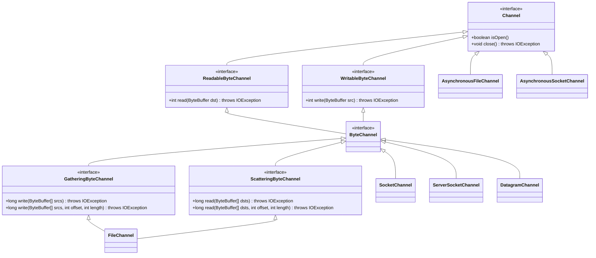
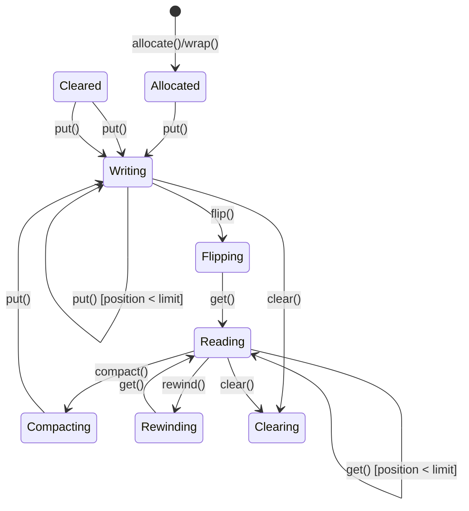
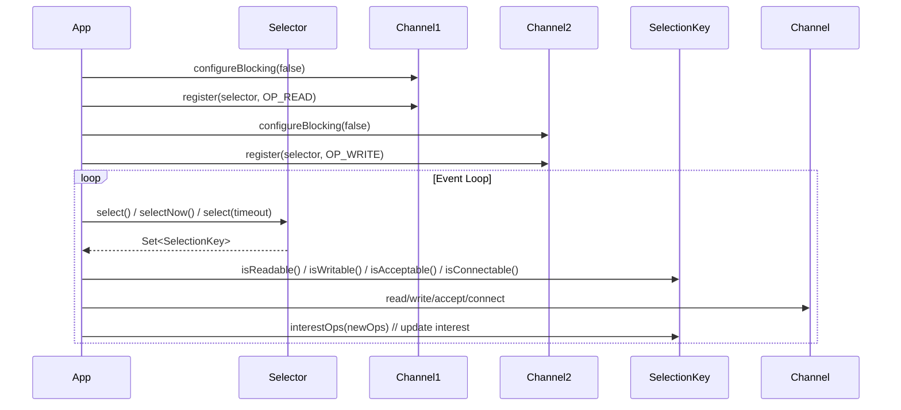
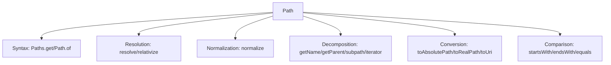
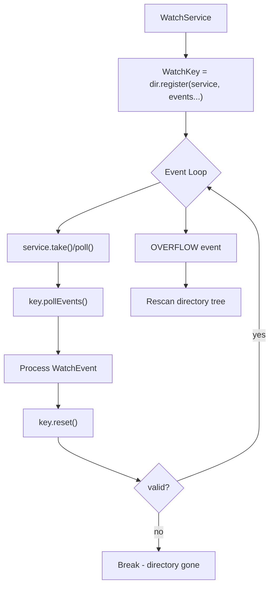
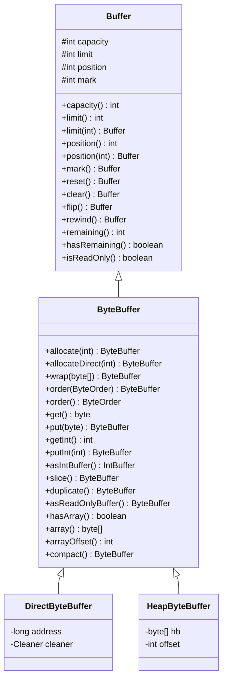

# NIO & the Files API

The `java.nio` (New I/O) package introduced in Java 1.4 fundamentally changed how Java handles I/O by moving from stream-oriented to **channel-and-buffer** oriented operations. The `java.nio.file` package (Java 7+) further modernized file system access with a richer, more expressive API. Together they form the backbone of high-performance, scalable I/O in Java — from network servers handling thousands of connections to batch processing terabytes of data.

This module covers the complete NIO ecosystem: **Channels** (the conduits), **Buffers** (the containers), **Selectors** (the multiplexers), the **`java.nio.file` API** (Path, Files, WatchService), **memory-mapped files**, **asynchronous I/O**, and the practical patterns that separate production-grade code from tutorials.

---

## NIO Pillars: Channels, Buffers, Selectors

### Channels

A `Channel` represents an open connection to an I/O device (file, socket, etc.). Unlike streams, channels are **bidirectional** (mostly) and support **non-blocking** mode. They transfer data *only* via `Buffer` objects.



#### FileChannel

`FileChannel` is the workhorse for file I/O. It supports:
- **Random access** via `position(long)` / `position()`
- **Memory mapping** via `map(MapMode, long, long)`
- **Zero-copy transfers** via `transferTo` / `transferFrom`
- **Locking** via `lock()` / `tryLock()`
- **Forcing** data to storage via `force(boolean)`

```java
try (FileChannel channel = FileChannel.open(
        Path.of("data.bin"),
        StandardOpenOption.READ,
        StandardOpenOption.WRITE,
        StandardOpenOption.CREATE)) {

    // Write at specific position
    ByteBuffer buffer = ByteBuffer.wrap("Hello NIO".getBytes(StandardCharsets.UTF_8));
    channel.write(buffer, 0); // position 0

    // Read back
    buffer.clear();
    channel.read(buffer, 0);
    buffer.flip();
    System.out.println(StandardCharsets.UTF_8.decode(buffer)); // Hello NIO

    // Force to disk (metadata + data if true)
    channel.force(true);
}
```

**Key methods:**
| Method | Purpose |
|--------|---------|
| `read(ByteBuffer dst, long position)` | Read at absolute position (does not change channel position) |
| `write(ByteBuffer src, long position)` | Write at absolute position |
| `transferTo(long position, long count, WritableByteChannel target)` | Zero-copy to another channel |
| `transferFrom(ReadableByteChannel src, long position, long count)` | Zero-copy from another channel |
| `map(MapMode mode, long position, long size)` | Memory-map a region |
| `lock(long position, long size, boolean shared)` | File locking (advisory/mandatory per OS) |
| `truncate(long size)` | Truncate file to size |
| `size()` | Current file size |

#### SocketChannel / ServerSocketChannel / DatagramChannel

For network I/O, these channels enable **non-blocking** and **multiplexed** operations via `Selector`.

```java
// Non-blocking server setup
Selector selector = Selector.open();
ServerSocketChannel server = ServerSocketChannel.open();
server.configureBlocking(false);
server.bind(new InetSocketAddress(8080));
server.register(selector, SelectionKey.OP_ACCEPT);

while (!Thread.interrupted()) {
    selector.select(); // blocks until events
    Set<SelectionKey> keys = selector.selectedKeys();
    for (SelectionKey key : keys) {
        if (key.isAcceptable()) {
            ServerSocketChannel ssc = (ServerSocketChannel) key.channel();
            SocketChannel client = ssc.accept();
            client.configureBlocking(false);
            client.register(selector, SelectionKey.OP_READ);
        } else if (key.isReadable()) {
            SocketChannel client = (SocketChannel) key.channel();
            ByteBuffer buffer = ByteBuffer.allocate(1024);
            int read = client.read(buffer);
            if (read == -1) { client.close(); continue; }
            buffer.flip();
            // process...
        }
    }
    keys.clear();
}
```

---

### Buffers

A `Buffer` is a fixed-size container for primitive data. Every buffer has four key properties:

| Property | Meaning |
|----------|---------|
| **capacity** | Maximum elements; never changes |
| **limit** | Index of first element that should *not* be read/written; `limit ≤ capacity` |
| **position** | Index of next element to read/write; `position ≤ limit` |
| **mark** | Saved position; `-1` if unset; `mark ≤ position` |



#### Buffer Operations: `clear` vs `flip` vs `rewind` vs `compact`

| Operation | Position | Limit | Mark | Use Case |
|-----------|----------|-------|------|----------|
| `clear()` | 0 | capacity | -1 | Prepare for **writing** (fresh data) |
| `flip()` | 0 | position | -1 | Prepare for **reading** after writing |
| `rewind()` | 0 | unchanged | -1 | **Re-read** already flipped buffer |
| `compact()` | unread count | capacity | -1 | **Partial read** — keep unread data, make room for more |

```java
ByteBuffer buf = ByteBuffer.allocate(10);

// Writing phase
buf.put((byte) 1).put((byte) 2).put((byte) 3);
// position=3, limit=10, mark=-1

buf.flip();
// position=0, limit=3, mark=-1  — ready to read

buf.get(); // reads 1, position=1
buf.get(); // reads 2, position=2

buf.compact();
// position=1 (1 unread element), limit=10
// buffer now: [3, ?, ?, ...] — element 3 at index 0

buf.put((byte) 4); // append
// position=2, limit=10
```

#### Buffer Types

| Type | Backing | Use Case |
|------|---------|----------|
| `ByteBuffer` | byte[] / direct | Raw bytes, network, files |
| `CharBuffer` | char[] | Text processing |
| `ShortBuffer`, `IntBuffer`, `LongBuffer`, `FloatBuffer`, `DoubleBuffer` | respective arrays | Numeric data, view buffers |

#### Heap vs Direct Buffers

```java
// Heap buffer (GC-managed, may copy for native I/O)
ByteBuffer heapBuf = ByteBuffer.allocate(1024);

// Direct buffer (off-heap, native memory, zero-copy for I/O)
ByteBuffer directBuf = ByteBuffer.allocateDirect(1024);

// Check
System.out.println(heapBuf.isDirect());   // false
System.out.println(directBuf.isDirect()); // true
```

**Direct buffer internals:**
- Allocated via `Unsafe.allocateMemory` / `Cleaner` (Java 9+)
- Not on Java heap — **not subject to GC pressure** but must be cleaned up
- JNI `GetDirectBufferAddress` gives native code direct pointer
- Java 9+ pools direct buffers via `jdk.nio.maxDirectMemory` / `Cleaner`

> **Rule:** Use direct buffers for I/O channels (network, file) to avoid intermediate heap copies. Use heap buffers for CPU-bound processing.

#### View Buffers & Byte Order

```java
ByteBuffer bb = ByteBuffer.allocateDirect(32)
        .order(ByteOrder.LITTLE_ENDIAN); // default BIG_ENDIAN

IntBuffer ib = bb.asIntBuffer();    // views same memory as int[]
LongBuffer lb = bb.asLongBuffer();  // views as long[]

ib.put(0x01020304);
// bb now contains: 04 03 02 01 (little-endian)

bb.order(ByteOrder.BIG_ENDIAN);
IntBuffer ib2 = bb.asIntBuffer();
System.out.println(ib2.get(0)); // 0x04030201 — different interpretation!
```

**Slice vs Duplicate:**
```java
ByteBuffer original = ByteBuffer.wrap(new byte[]{1,2,3,4,5,6});
original.position(2).limit(5); // window on [3,4,5]

ByteBuffer slice = original.slice();      // independent position/limit, shares data
ByteBuffer duplicate = original.duplicate(); // shares position/limit/mark, shares data

slice.put(0, (byte) 99); // modifies original's byte at index 2
```

#### Read-Only Buffers

```java
ByteBuffer readOnly = buf.asReadOnlyBuffer();
readOnly.put((byte) 1); // throws ReadOnlyBufferException
```

---

### Selectors

A `Selector` multiplexes multiple `SelectableChannel`s onto a single thread. Each channel registers its **interest ops** (what it wants to do); the selector returns **ready ops** (what can be done now).



#### SelectionKey Operations

| Constant | Meaning |
|----------|---------|
| `OP_READ` | Channel ready for reading |
| `OP_WRITE` | Channel ready for writing |
| `OP_CONNECT` | Connection ready |
| `OP_ACCEPT` | Server socket ready to accept |

```java
// Register with multiple ops
SelectionKey key = channel.register(selector, SelectionKey.OP_READ | SelectionKey.OP_WRITE);

// Update interest (thread-safe)
key.interestOps(key.interestOps() & ~SelectionKey.OP_READ); // remove READ

// Attach context
key.attach(new SessionContext(userId, buffer));
SessionContext ctx = (SessionContext) key.attachment();
```

#### Selector Pitfalls

| Pitfall | Solution |
|---------|----------|
| **Busy loop** if `select()` returns 0 immediately | Use `select(timeout)` or `selectNow()` with backoff; check `wakeup()` |
| **Cancelled keys accumulate** | Call `selectedKeys().clear()` each iteration; cancelled keys removed on next `select()` |
| **`wakeup()` from another thread** | `selector.wakeup()` causes `select()` to return immediately; handle gracefully |
| **Closing selector while selecting** | `selector.close()` wakes up selecting thread with `ClosedSelectorException` |

---

## The `java.nio.file` API

### Path

`Path` is the primary abstraction for file system paths — **immutable**, **thread-safe**, and **system-independent**.



```java
Path p1 = Path.of("/home/user/docs/report.txt");
Path p2 = Path.of("/home/user/docs");
Path p3 = Path.of("archive/old.txt");

// Resolution
Path resolved = p2.resolve(p3);        // /home/user/docs/archive/old.txt
Path relativized = p1.relativize(p3);  // ../../archive/old.txt (relative from p1 to p3)

// Normalization (resolves . and ..)
Path messy = Path.of("/home/./user/../user/docs/../docs/report.txt");
Path clean = messy.normalize();        // /home/user/docs/report.txt

// Decomposition
p1.getFileName();    // report.txt
p1.getParent();      // /home/user/docs
p1.getName(0);       // home (0-indexed from root)
p1.subpath(1, 3);    // user/docs
p1.iterator().forEachRemaining(System.out::println); // home, user, docs, report.txt

// Conversion
p3.toAbsolutePath();  // resolves against cwd
p1.toRealPath(LinkOption.NOFOLLOW_LINKS); // resolves symlinks, checks existence
```

**`Path.of` vs `Paths.get`:** Java 11+ prefers `Path.of` (no varargs ambiguity). Both delegate to `FileSystems.getDefault().getPath()`.

### FileSystems & FileSystem

```java
// Default file system
FileSystem fs = FileSystems.getDefault();
Path path = fs.getPath("file.txt");

// Custom provider (e.g., ZIP, memory, cloud)
FileSystem zipFs = FileSystems.newFileSystem(
    Path.of("archive.zip"),
    Map.of("create", "true") // provider-specific props
);
Path insideZip = zipFs.getPath("inner.txt");
Files.copy(Path.of("local.txt"), insideZip);
zipFs.close(); // important!
```

---

### Files Utility

The `Files` class provides static methods for file operations. **All methods throw `IOException` (checked).**

#### Reading & Writing

| Method | Since | Returns | Notes |
|--------|-------|---------|-------|
| `readAllBytes(Path)` | 7 | `byte[]` | Small files only |
| `readAllLines(Path)` | 7 | `List<String>` | Loads entire file |
| `readString(Path, Charset)` | 11 | `String` | Convenience |
| `writeString(Path, String, Charset, OpenOption...)` | 11 | `Path` | Atomic with `CREATE_NEW` |
| `lines(Path)` | 8 | `Stream<String>` | **Lazy**, must close stream |
| `newBufferedReader(Path)` | 7 | `BufferedReader` | Try-with-resources |
| `newBufferedWriter(Path, OpenOption...)` | 7 | `BufferedWriter` | |
| `newInputStream(Path, OpenOption...)` | 7 | `InputStream` | |
| `newOutputStream(Path, OpenOption...)` | 7 | `OutputStream` | |
| `newByteChannel(Path, OpenOption...)` | 7 | `SeekableByteChannel` | `FileChannel` for regular files |

```java
// Streaming large file (memory efficient)
try (Stream<String> lines = Files.lines(Path.of("huge.log"))) {
    lines.filter(l -> l.contains("ERROR"))
         .limit(100)
         .forEach(System.out::println);
} // stream closed here

// Write with options
Files.writeString(
    Path.of("out.txt"),
    "content",
    StandardCharsets.UTF_8,
    StandardOpenOption.CREATE,
    StandardOpenOption.TRUNCATE_EXISTING
);
```

#### Copy, Move, Delete, Create

```java
// Copy with options
Files.copy(src, dest,
    StandardCopyOption.REPLACE_EXISTING,
    StandardCopyOption.COPY_ATTRIBUTES,
    LinkOption.NOFOLLOW_LINKS);

// Move (atomic on same filesystem)
Files.move(src, dest,
    StandardCopyOption.ATOMIC_MOVE,
    StandardCopyOption.REPLACE_EXISTING);

// Delete
Files.delete(path);                    // throws if not exists
Files.deleteIfExists(path);            // no-op if missing

// Create
Files.createFile(path);                // fails if exists
Files.createDirectory(path);           // single level
Files.createDirectories(path);         // recursive
Files.createTempFile("prefix", ".tmp"); // in default temp dir
Files.createTempDirectory("mytemp");
```

#### Walking & Finding

```java
// Files.walk — lazy Stream<Path>, depth-first
try (Stream<Path> walk = Files.walk(root, 3, FileVisitOption.FOLLOW_LINKS)) {
    walk.filter(p -> p.toString().endsWith(".java"))
        .forEach(System.out::println);
}

// walkFileTree — full control via FileVisitor
Files.walkFileTree(root, EnumSet.of(FileVisitOption.FOLLOW_LINKS), 10, new SimpleFileVisitor<>() {
    @Override
    public FileVisitResult visitFile(Path file, BasicFileAttributes attrs) {
        if (attrs.size() > 1_000_000) System.out.println("Large: " + file);
        return FileVisitResult.CONTINUE;
    }
    @Override
    public FileVisitResult visitFileFailed(Path file, IOException exc) {
        return FileVisitResult.CONTINUE; // skip errors
    }
});

// find — search with predicate
try (Stream<Path> found = Files.find(root, 5, (p, a) -> a.isRegularFile() && p.toString().endsWith(".class"))) {
    found.forEach(System.out::println);
}
```

**Comparison: `walk` vs `walkFileTree`**

| Aspect | `Files.walk` | `Files.walkFileTree` |
|--------|--------------|----------------------|
| Return | `Stream<Path>` | `void` (visitor) |
| Memory | Holds open handles until consumed | Controlled by visitor |
| Error handling | Exception in stream | `visitFileFailed` callback |
| Filtering | Stream `filter()` | In visitor logic |
| Parallelism | `.parallel()` possible | Manual |
| Use case | Simple filtering, small trees | Complex logic, huge trees, early exit |

#### Attributes & Metadata

```java
// Basic attributes (portable)
BasicFileAttributes attrs = Files.readAttributes(path, BasicFileAttributes.class);
attrs.isRegularFile();
attrs.isDirectory();
attrs.isSymbolicLink();
attrs.size();
attrs.creationTime();
attrs.lastModifiedTime();
attrs.lastAccessTime();
attrs.fileKey(); // unique identifier (may be null)

// POSIX (Unix/Linux/macOS)
PosixFileAttributes posix = Files.readAttributes(path, PosixFileAttributes.class);
posix.permissions();      // Set<PosixFilePermission>
posix.owner();            // UserPrincipal
posix.group();            // GroupPrincipal

// DOS (Windows)
DosFileAttributes dos = Files.readAttributes(path, DosFileAttributes.class);
dos.isHidden();
dos.isReadOnly();
dos.isArchive();
dos.isSystem();

// Generic get/set
Files.getAttribute(path, "unix:permissions"); // string key
Files.setAttribute(path, "dos:hidden", true);
Files.readAttributes(path, "*"); // Map<String, Object> all views

// Permissions (POSIX)
Set<PosixFilePermission> perms = PosixFilePermissions.fromString("rw-r--r--");
Files.setPosixFilePermissions(path, perms);

// Symbolic links
Files.isSymbolicLink(path);
Files.isSameFile(path1, path2); // follows links, compares fileKey

// Content type (probes)
String mime = Files.probeContentType(path); // e.g., "text/plain"

// File store (disk space)
FileStore store = Files.getFileStore(path);
store.getTotalSpace();
store.getUsableSpace();
store.getUnallocatedSpace();
```

#### Mismatch & Size

```java
// Find first differing byte (Java 12+)
long pos = Files.mismatch(Path.of("a.bin"), Path.of("b.bin"));
// -1 if identical, else 0-based index

long size = Files.size(path); // throws if not regular file
```

#### Existence & Access Checks

```java
Files.exists(path);           // follows links
Files.notExists(path);        // !exists but handles races
Files.isReadable(path);
Files.isWritable(path);
Files.isExecutable(path);
// Note: these check *effective* access (ACLs, etc.), not just permission bits
```

> **Race warning:** Check-then-act (e.g., `if (Files.exists(p)) Files.delete(p)`) is racy. Prefer `deleteIfExists` or catch `NoSuchFileException`.

---

## WatchService

`WatchService` monitors directories for changes (create, modify, delete).



```java
WatchService watcher = FileSystems.getDefault().newWatchService();

Path dir = Path.of("/watched");
WatchKey key = dir.register(watcher,
    StandardWatchEventKinds.ENTRY_CREATE,
    StandardWatchEventKinds.ENTRY_MODIFY,
    StandardWatchEventKinds.ENTRY_DELETE);

// Recursive (Java 7+ walks tree, registers each dir)
Files.walkFileTree(dir, new SimpleFileVisitor<>() {
    @Override
    public FileVisitResult preVisitDirectory(Path d, BasicFileAttributes attrs) {
        d.register(watcher, ENTRY_CREATE, ENTRY_MODIFY, ENTRY_DELETE);
        return FileVisitResult.CONTINUE;
    }
});

while (true) {
    WatchKey k = watcher.take(); // blocks
    for (WatchEvent<?> event : k.pollEvents()) {
        WatchEvent.Kind<?> kind = event.kind();
        if (kind == OVERFLOW) {
            // Events lost — rescan
            continue;
        }
        @SuppressWarnings("unchecked")
        WatchEvent<Path> ev = (WatchEvent<Path>) event;
        Path filename = ev.context(); // relative to watched dir
        Path full = ((Path) k.watchable()).resolve(filename);
        System.out.println(kind + ": " + full);
    }
    if (!k.reset()) break; // key invalid (dir deleted)
}
```

**Event Kinds:**
| Kind | Description |
|------|-------------|
| `ENTRY_CREATE` | File/dir created |
| `ENTRY_MODIFY` | File/dir modified |
| `ENTRY_DELETE` | File/dir deleted |
| `OVERFLOW` | Queue overflow — events lost |

**Overflow handling:** On `OVERFLOW`, you **must** rescan the directory tree — events were dropped.

---

## Memory-Mapped Files

`FileChannel.map()` maps a file region directly into virtual memory. The OS handles paging — **no explicit `read`/`write` syscalls**.

```java
try (FileChannel channel = FileChannel.open(Path.of("big.dat"), READ, WRITE)) {
    // Map 1GB read-write (must fit in virtual address space)
    MappedByteBuffer mbb = channel.map(MapMode.READ_WRITE, 0, 1_000_000_000L);

    // Access like a buffer — OS pages in/out automatically
    mbb.put(0, (byte) 42);
    byte b = mbb.get(100_000_000);

    // Force changes to disk (msync)
    mbb.force();
}
```

### Map Modes

| Mode | Description | Writes Visible to Others? |
|------|-------------|---------------------------|
| `READ_ONLY` | Read-only | N/A |
| `READ_WRITE` | Read-write, changes to file | Yes (after `force` or OS flush) |
| `PRIVATE` | Copy-on-write (private copy) | No — changes discarded on close |

### Cleanup (Critical!)

**Java 8 and earlier:** No supported unmap. Relies on `Cleaner` / `sun.misc.Cleaner` hack:

```java
// DANGEROUS — internal API, may break
Method cleaner = DirectBuffer.class.getMethod("cleaner");
Object cleanerObj = cleaner.invoke(mbb);
Method clean = cleanerObj.getClass().getMethod("clean");
clean.invoke(cleanerObj);
```

**Java 9+:** `MappedByteBuffer` implements `AutoCloseable` (via `Cleaner`):

```java
// Java 9+ — proper cleanup
try (FileChannel ch = FileChannel.open(path, READ, WRITE)) {
    MappedByteBuffer mbb = ch.map(MapMode.READ_WRITE, 0, size);
    // use mbb
} // automatically unmapped here
```

> **Warning:** Unmapping while other threads access the buffer causes **SIGSEGV / JVM crash**. Ensure no concurrent access.

### Large Files (> 2GB)

`map` takes `long` size but `MappedByteBuffer` extends `ByteBuffer` (int-indexed). For files > 2GB:
- Map in **chunks** (e.g., 1GB windows)
- Or use `FileChannel.read/write` with position

```java
// Chunked mapping for huge files
long fileSize = channel.size();
long chunkSize = 1L << 30; // 1GB
for (long offset = 0; offset < fileSize; offset += chunkSize) {
    long len = Math.min(chunkSize, fileSize - offset);
    try (MappedByteBuffer chunk = channel.map(MapMode.READ_ONLY, offset, len)) {
        // process chunk
    }
}
```

### Performance: Mapped vs Streaming

| Scenario | Winner | Why |
|----------|--------|-----|
| Random access, large file | **Mapped** | OS page cache, no syscall per access |
| Sequential read once | **Streaming** (`transferTo`) | Zero-copy, no page table pressure |
| Multiple processes reading | **Mapped** | Shared page cache |
| Writing new large file | **Streaming** | Avoids page faults on first write |
| Partial updates | **Mapped** | In-place, no rewrite |

`transferTo`/`transferFrom` (zero-copy) often beats mapped I/O for bulk transfer:

```java
// Zero-copy file copy (kernel moves data directly)
long transferred = 0;
long total = srcChannel.size();
while (transferred < total) {
    transferred += srcChannel.transferTo(transferred, total - transferred, dstChannel);
}
```

---

## ByteBuffer Deep Dive

### Allocation Strategies

```java
// Heap — simple, GC'd
ByteBuffer heap = ByteBuffer.allocate(1024);

// Direct — off-heap, for I/O
ByteBuffer direct = ByteBuffer.allocateDirect(1024);

// Wrapped — zero-copy view of existing array
byte[] arr = new byte[1024];
ByteBuffer wrapped = ByteBuffer.wrap(arr);
ByteBuffer wrappedOffset = ByteBuffer.wrap(arr, 100, 500); // sub-range

// Pooled (Java 9+) — reduce allocation overhead for direct buffers
// Configure via -Djdk.nio.maxDirectMemory=256m
// Internally uses Cleaner-based pool
```

**Java 9+ Direct Buffer Pooling:**
- `-Djdk.nio.maxDirectMemory=<bytes>` sets limit (default: 64MB or `-Xmx`)
- Pool managed by `Cleaner`; buffers returned to pool on `clean()`
- Avoids `mmap`/`munmap` syscall overhead for frequent allocate/free

### Buffer Thread Safety

**Buffers are NOT thread-safe.** Never share a `ByteBuffer` across threads without synchronization.

```java
// WRONG — race on position/limit
ByteBuffer shared = ByteBuffer.allocateDirect(1024);
executor.submit(() -> shared.put(data));
executor.submit(() -> shared.get());

// RIGHT — ThreadLocal or per-thread buffers
ThreadLocal<ByteBuffer> local = ThreadLocal.withInitial(() -> ByteBuffer.allocateDirect(1024));
executor.submit(() -> local.get().put(data));
```

### Buffer Internals (HotSpot)



---

## Asynchronous I/O (Java 7+)

`AsynchronousFileChannel` and `AsynchronousSocketChannel` provide **true async I/O** (proactor pattern) — completion notification via `Future` or `CompletionHandler`.

### AsynchronousFileChannel

```java
ExecutorService executor = Executors.newFixedThreadPool(4);
AsynchronousFileChannel channel = AsynchronousFileChannel.open(
    Path.of("async.dat"),
    StandardOpenOption.READ,
    StandardOpenOption.WRITE,
    StandardOpenOption.CREATE,
    executor
);

// Future-based
Future<Integer> readFuture = channel.read(buffer, 0);
Integer bytesRead = readFuture.get(); // blocks until done

// CompletionHandler-based (callback)
channel.read(buffer, 0, null, new CompletionHandler<Integer, Void>() {
    @Override
    public void completed(Integer result, Void attachment) {
        System.out.println("Read " + result + " bytes");
        buffer.flip();
        // process...
    }
    @Override
    public void failed(Throwable exc, Void attachment) {
        exc.printStackTrace();
    }
});

// Java 21: CompletionStage (via CompletionHandler adapter)
CompletionStage<Integer> stage = CompletableFuture.supplyAsync(() -> {
    try { return channel.read(buffer, 0).get(); }
    catch (Exception e) { throw new CompletionException(e); }
}, executor);
```

### AsynchronousSocketChannel

```java
AsynchronousServerSocketChannel server = AsynchronousServerSocketChannel.open()
    .bind(new InetSocketAddress(8080));

server.accept(null, new CompletionHandler<AsynchronousSocketChannel, Void>() {
    @Override
    public void completed(AsynchronousSocketChannel client, Void att) {
        server.accept(null, this); // accept next
        handleClient(client);
    }
    @Override
    public void failed(Throwable exc, Void att) { exc.printStackTrace(); }
});

void handleClient(AsynchronousSocketChannel client) {
    ByteBuffer buffer = ByteBuffer.allocate(1024);
    client.read(buffer, buffer, new CompletionHandler<Integer, ByteBuffer>() {
        @Override
        public void completed(Integer n, ByteBuffer buf) {
            if (n == -1) { closeQuietly(client); return; }
            buf.flip();
            client.write(buf, buf, new CompletionHandler<Integer, ByteBuffer>() {
                @Override
                public void completed(Integer n, ByteBuffer b) {
                    if (b.hasRemaining()) client.write(b, b, this);
                    else handleClient(client); // read next
                }
                @Override public void failed(Throwable e, ByteBuffer b) { closeQuietly(client); }
            });
        }
        @Override public void failed(Throwable e, ByteBuffer b) { closeQuietly(client); }
    });
}
```

### When to Use Async I/O

| Scenario | Recommendation |
|----------|----------------|
| High connection count (10k+) | **Async** or **Virtual Threads** (Java 21+) |
| Few connections, simple logic | Blocking NIO (`Selector`) or blocking I/O |
| File I/O with compute overlap | Async file channel |
| Integration with reactive streams | `CompletionStage` / `CompletableFuture` |

> **Java 21 Note:** Virtual threads (Project Loom) make blocking I/O scalable. For new projects, prefer **virtual threads + blocking I/O** over async NIO for simplicity — unless you need true kernel async (io_uring, IOCP).

---

## Common Mistakes

| Mistake | Wrong | Right |
|---------|-------|-------|
| Forgetting `flip()` before read | `ch.write(buf); ch.read(buf);` | `ch.write(buf); buf.flip(); ch.read(buf);` |
| `clear()` before reading | `buf.clear(); ch.read(buf);` | `buf.clear(); ch.write(buf); buf.flip(); ch.read(buf);` |
| Not handling partial reads | `int n = ch.read(buf); // assume full` | `while (buf.hasRemaining()) ch.read(buf);` |
| Sharing buffer across threads | `static ByteBuffer SHARED = ...` | `ThreadLocal<ByteBuffer>` or per-thread |
| `FileChannel` vs `Files.newByteChannel` | `FileChannel.open(path)` | `Files.newByteChannel(path, opts)` returns `SeekableByteChannel` |
| Selector busy loop | `while (true) selector.selectNow();` | `selector.select(1000);` or `selector.select()` |
| `MappedByteBuffer` unmap leak | Never close, rely on GC | Try-with-resources (Java 9+) or `Cleaner` hack |
| WatchService overflow ignored | No `OVERFLOW` handling | Rescan tree on `OVERFLOW` |
| `position`/`limit` confusion | `buf.position(5); buf.limit(10);` | Understand: `limit` = boundary, `position` = cursor |

### Partial Read/Write Pattern

```java
// ALWAYS loop for channel I/O
public void readFully(ReadableByteChannel ch, ByteBuffer buf) throws IOException {
    while (buf.hasRemaining()) {
        int n = ch.read(buf);
        if (n == -1) throw new EOFException("Premature EOF");
    }
}

public void writeFully(WritableByteChannel ch, ByteBuffer buf) throws IOException {
    while (buf.hasRemaining()) {
        ch.write(buf);
    }
}
```

---

## Performance

### Direct vs Heap Buffer Benchmark

```java
// Benchmark skeleton (run with JMH for real numbers)
@Benchmark
public void heapBufferWrite(Blackhole bh) {
    ByteBuffer buf = ByteBuffer.allocate(4096);
    for (int i = 0; i < 1000; i++) buf.putInt(i);
    bh.consume(buf);
}

@Benchmark
public void directBufferWrite(Blackhole bh) {
    ByteBuffer buf = ByteBuffer.allocateDirect(4096);
    for (int i = 0; i < 1000; i++) buf.putInt(i);
    bh.consume(buf);
}
```

**Typical results (varies by workload):**
- **Heap faster** for CPU-bound put/get (no JNI boundary)
- **Direct faster** for I/O (avoids heap-to-native copy)
- **Direct allocation** slower (native malloc + Cleaner registration)

### Memory Mapping vs Streaming

| Metric | Mapped (`map`) | Streaming (`read`/`transferTo`) |
|--------|----------------|----------------------------------|
| First access latency | Page fault | Syscall |
| Random access | **Excellent** | Poor (seek + read) |
| Sequential throughput | Good | **Best (zero-copy)** |
| Memory pressure | High (page cache) | Low (buffer-sized) |
| >2GB files | Chunked mapping | Native support |
| Cross-process sharing | **Native** | Manual |

### Selector Scalability

| Connections | Threads | Pattern |
|-------------|---------|---------|
| < 1,000 | 1 | Single selector |
| 1,000–10,000 | 2–4 | Multiple selectors (shard by channel) |
| 10,000–100,000 | 8+ | Selector per thread + load balancing |
| 100,000+ | Virtual threads | Blocking I/O per virtual thread |

> **Java 21:** Virtual threads eliminate the need for manual selector loops in most cases. `ServerSocket.accept()` in a virtual thread scales to millions.

### `Files.walk` Memory

```java
// walk holds open directory handles until stream consumed
// For DEEP trees, use walkFileTree or limit depth
try (Stream<Path> s = Files.walk(root, 10)) { ... } // max depth 10
```

---

## Comparison Tables

### `File` vs `Path`/`Files`

| Feature | `java.io.File` | `java.nio.file.Path`/`Files` |
|---------|----------------|------------------------------|
| API style | Instance methods | Static methods (`Files.xxx`) |
| Path syntax | String-based | Object-oriented, decomposed |
| Symbolic links | Poor support | Full support (`NOFOLLOW_LINKS`) |
| Attributes | Limited (`length()`, `lastModified()`) | Rich (Basic, POSIX, DOS, ACLs) |
| Exceptions | Boolean returns, silent failures | Checked `IOException`, precise |
| Walking | `listFiles()` (eager, no options) | `walk`/`walkFileTree` (lazy, configurable) |
| Atomic operations | None | `ATOMIC_MOVE`, `CREATE_NEW` |
| Thread safety | Immutable but limited | Fully thread-safe |
| Java version | 1.0 | 7+ (Path), 11+ (readString/writeString) |

### Blocking vs Non-Blocking vs Async

| Dimension | Blocking I/O | Non-Blocking (Selector) | Async (CompletionHandler) |
|-----------|--------------|-------------------------|---------------------------|
| Thread model | 1 thread/connection | 1 thread/many connections | Callback/pool threads |
| Complexity | Low | High (state machine) | Medium-High |
| Scalability | Limited by threads | High (C10K+) | High |
| Latency | Predictable | Low (no context switch) | Low |
| Backpressure | Implicit (block) | Explicit (buffer full) | Explicit |
| Debugging | Easy (stack traces) | Hard (callback hell) | Medium |
| Java 21 best fit | Virtual threads | Legacy systems | Reactive integration |

### Heap vs Direct vs Mapped Buffers

| Property | Heap (`allocate`) | Direct (`allocateDirect`) | Mapped (`map`) |
|----------|-------------------|---------------------------|----------------|
| Location | Java heap | Off-heap (native) | Virtual memory (file-backed) |
| GC pressure | Yes | No (Cleaner) | No (OS page cache) |
| I/O copy | Heap → kernel | **Zero-copy** | **Zero-copy** (page fault) |
| Allocation cost | Low | Medium (syscall) | High (mmap) |
| Max size | 2GB (array limit) | `-XX:MaxDirectMemorySize` | File size (virtual) |
| Cleanup | GC | `Cleaner` / close | `Cleaner` / close / `munmap` |
| Thread safety | No | No | No |
| Best for | CPU processing | Network I/O, frequent allocate | Random access large files |

### `Files.walk` vs `walkFileTree`

| Aspect | `Files.walk` | `Files.walkFileTree` |
|--------|--------------|----------------------|
| API | Functional (Stream) | Visitor (callback) |
| Memory | Buffers paths in stream | Controlled by visitor |
| Early exit | `limit()` / `findFirst()` | Return `TERMINATE` |
| Error handling | Exception in stream | `visitFileFailed` |
| Parallel | `.parallel()` | Manual |
| Attributes access | Separate `readAttributes` | `BasicFileAttributes` provided |
| Symlink cycle detection | `FOLLOW_LINKS` option | `FileVisitOption.FOLLOW_LINKS` |

---

## Interview Questions

### Beginner

**Q1: What is the difference between `ByteBuffer.allocate()` and `ByteBuffer.allocateDirect()`?**

**A:** `allocate()` creates a **heap buffer** backed by a `byte[]` on the Java heap. It's subject to GC, and when used with channels, data is copied between heap and native memory. `allocateDirect()` creates a **direct buffer** in off-heap native memory (via `Unsafe.allocateMemory`). It avoids the copy for I/O operations (zero-copy), but allocation/deallocation is more expensive and memory is not managed by GC — it uses a `Cleaner` (Java 9+) or `sun.misc.Cleaner` (Java 8). Direct buffers are preferred for channel I/O (network, file); heap buffers for CPU-bound processing.

**Q2: Explain the four key properties of a Buffer: capacity, limit, position, mark.**

**A:**
- **capacity**: Fixed maximum number of elements; never changes.
- **limit**: Index of first element that should *not* be read/written. For writing, limit = capacity. For reading, limit = number of elements written.
- **position**: Index of next element to read/write. Starts at 0, increments on each get/put.
- **mark**: A saved position (set by `mark()`, restored by `reset()`). Initially -1. Must be ≤ position.

Invariants: `0 ≤ mark ≤ position ≤ limit ≤ capacity`.

**Q3: What does `flip()` do and when do you use it?**

**A:** `flip()` sets `limit = position` and `position = 0`, and clears the mark. It transitions a buffer from **writing mode** to **reading mode**. After putting data into a buffer, you must call `flip()` before reading it (or passing to a channel for writing). Without `flip()`, the channel would read from the current position (end of data) and get nothing.

**Q4: What is the difference between `clear()`, `flip()`, `rewind()`, and `compact()`?**

**A:**
- `clear()`: position=0, limit=capacity, mark=-1. Prepare for **new write** (discards unread data).
- `flip()`: limit=position, position=0, mark=-1. Prepare for **read** after write.
- `rewind()`: position=0, limit unchanged, mark=-1. **Re-read** already-flipped buffer.
- `compact()`: Copies unread data (position to limit) to start, sets position=unread count, limit=capacity. Used when **partially read** and you want to keep unread data for next read.

**Q5: What is a `Selector` and why is it used?**

**A:** A `Selector` multiplexes multiple `SelectableChannel`s (non-blocking channels) onto a single thread. Channels register **interest ops** (e.g., `OP_READ`, `OP_WRITE`). The selector's `select()` blocks until at least one channel is ready for one of its interested operations. It returns a set of `SelectionKey`s representing ready channels. This enables handling thousands of connections with few threads (the Reactor pattern).

---

### Intermediate

**Q6: How does `FileChannel.transferTo()` achieve zero-copy? When does it fall back to copying?**

**A:** `transferTo()` uses the OS `sendfile` (Linux) or `TransmitFile` (Windows) syscall, which copies data directly from the file system cache to the socket buffer **without copying to user space**. It falls back to a manual copy (via a temporary direct buffer) when:
- The source is not a `FileChannel` (e.g., socket to socket)
- The target is not a `WritableByteChannel` supporting zero-copy
- On some JVM/OS combinations where `sendfile` is not supported for the given file type (e.g., some network filesystems)
- The file region is memory-mapped (implementation-dependent)

**Q7: What is the difference between `Files.walk()` and `Files.walkFileTree()`? Which would you use for a 10-million-file tree?**

**A:** `Files.walk()` returns a lazy `Stream<Path>` — convenient for functional filtering but holds open directory handles until the stream is consumed. For a 10M-file tree, the stream pipeline may accumulate many open handles. `walkFileTree()` uses a `FileVisitor` callback, giving you full control over recursion, error handling, and early termination. For huge trees, `walkFileTree` is safer — you can process and release each directory immediately. Also, `walkFileTree` provides `BasicFileAttributes` in the callback, avoiding extra syscalls.

**Q8: Explain the `OVERFLOW` event in `WatchService`. How do you handle it?**

**A:** `OVERFLOW` means the watch service's internal event queue filled up and events were dropped. This happens on high-activity directories or if the consumer is slow. **You must rescan the entire directory tree** when you receive `OVERFLOW` — you cannot rely on the events you missed. Typical handling:
```java
if (event.kind() == OVERFLOW) {
    rescanTree(root); // compare with previous snapshot
    continue;
}
```

**Q9: Why is `MappedByteBuffer` not automatically unmapped when it becomes unreachable (pre-Java 9)? How do you force unmap?**

**A:** Pre-Java 9, `MappedByteBuffer` relied on a `Cleaner` (phantom reference) to call `munmap` when GC'd. But GC timing is non-deterministic — the mapping persists until the cleaner runs, leaking virtual address space. There's no public `unmap()` method. The hack uses reflection to invoke the `Cleaner.clean()` method:
```java
Method cleaner = DirectBuffer.class.getMethod("cleaner");
cleaner.invoke(mappedBuffer).getClass().getMethod("clean").invoke(cleaner);
```
Java 9+ made `MappedByteBuffer` implement `AutoCloseable` — try-with-resources works.

**Q10: What is the difference between `SelectionKey.interestOps()` and `readyOps()`?**

**A:** `interestOps()` is the **set of operations the application is interested in** (set at registration, updated via `key.interestOps(newOps)`). `readyOps()` is the **set of operations that are currently ready** (returned by `key.readyOps()` after `select()`). You check readiness via `key.isReadable()` (equivalent to `(readyOps() & OP_READ) != 0`). Only modify `interestOps()`; `readyOps()` is read-only and updated by the selector.

---

### Advanced

**Q11: Describe the memory layout of a `DirectByteBuffer` and how it interacts with the GC.**

**A:** A `DirectByteBuffer` (heap object) contains:
- `long address`: Native memory address (from `Unsafe.allocateMemory`)
- `Cleaner cleaner`: Phantom reference registered with `ReferenceQueue`
- Standard buffer fields (capacity, limit, position, mark)

The native memory is **not** on the Java heap. When the `DirectByteBuffer` becomes phantom-reachable, the `Cleaner`'s `clean()` method is enqueued and run by the `ReferenceHandler` thread, calling `Unsafe.freeMemory(address)`. Java 9+ pools direct buffers — `clean()` returns the memory to a pool instead of freeing it, reducing `mmap`/`munmap` overhead.

**Q12: How does `ByteBuffer.asIntBuffer()` work? Does it copy data?**

**A:** `asIntBuffer()` creates a **view buffer** — a new `IntBuffer` that shares the **same backing memory** as the original `ByteBuffer`. No data is copied. The view buffer's position/limit/capacity are in **int units** (not bytes), derived from the byte buffer's position/limit at creation time. Changes via the view are visible in the byte buffer and vice versa. The view's byte order follows the byte buffer's current `order()` at creation time.

**Q13: What happens if you call `selector.select()` while another thread calls `selector.wakeup()`?**

**A:** `wakeup()` causes the **first** `select()`/`select(timeout)`/`selectNow()` that has not yet returned to return immediately with a return value of 0 (no keys selected). If no selection is in progress, the **next** call to `select()` returns immediately. The "wakeup" state is cleared after the immediate return. This is used to interrupt a blocking selector from another thread (e.g., to add new channels).

**Q14: Explain the difference between `MapMode.READ_WRITE` and `MapMode.PRIVATE` for memory-mapped files.**

**A:** 
- `READ_WRITE`: Changes are **visible to other processes** and **persisted to the file** (after `force()` or OS flush). The mapping is shared.
- `PRIVATE`: **Copy-on-write**. The first write to a page triggers a private copy in memory. Changes are **not visible to other processes** and **not written to the file**. Useful for read-mostly with temporary modifications.

**Q15: Why are `ByteBuffer`s not thread-safe? Show a race condition.**

**A:** Buffer state (position, limit, mark) is mutable and unprotected. Concurrent `put`/`get` or `flip`/`compact` corrupts state.
```java
ByteBuffer buf = ByteBuffer.allocate(100);
// Thread 1: buf.put(data);     // position advances
// Thread 2: buf.flip();        // limit = position (race!)
// Thread 1: buf.put(more);     // writes at wrong position
```
Fix: Use `ThreadLocal<ByteBuffer>`, per-thread buffers, or synchronize (defeats performance).

---

### Expert

**Q16: How does the JDK implement `FileChannel.map()` on Linux? What system calls are involved?**

**A:** `FileChannel.map()` calls `FileChannelImpl.map()`, which uses `Unsafe.mmap()` (native). On Linux, this invokes `mmap(2)` with `MAP_SHARED` (for `READ_WRITE`) or `MAP_PRIVATE` (for `PRIVATE`). The file descriptor comes from the channel's `FileDescriptor`. The returned address is wrapped in a `DirectByteBuffer` with a `Cleaner` that calls `munmap(2)` on cleanup. For large mappings (>2GB), multiple `mmap` calls may be used for contiguous virtual address space.

**Q17: What is the "selector busy loop" bug in early NIO? How was it fixed?**

**A:** On Linux, `epoll` (used by `Selector`) can enter a busy loop returning 0 ready keys continuously if a channel is registered with `OP_WRITE` and the socket buffer is always writable (which is almost always true). The selector spins at 100% CPU.
**Fix (JDK 1.5.0_08+):** The selector implementation detects this and temporarily disables `OP_WRITE` internally, re-enabling it only when a write would block. Application code should **only register `OP_WRITE` when there's data to write**, then deregister after write completes.

**Q18: Compare the performance of `Files.readAllBytes()` vs `Files.newByteChannel()` + `ByteBuffer` for a 500MB file.**

**A:** `readAllBytes()` allocates a 500MB `byte[]` on heap → **OOM risk**, high GC pressure, single allocation. `newByteChannel()` + direct buffer (e.g., 64KB) streams in chunks → **constant memory**, reusable buffer, can use `transferTo` for zero-copy. For large files, never use `readAllBytes`/`readAllLines`.

**Q19: How does `AsynchronousFileChannel` achieve async I/O on Linux vs Windows?**

**A:**
- **Linux (pre-5.1 / without io_uring):** Uses a **thread pool** (`ExecutorService`) to perform blocking `read`/`write` syscalls. Not true kernel async — threads block in kernel.
- **Linux 5.1+ with io_uring:** JDK 20+ can use `io_uring` for true async file I/O via `AsynchronousFileChannel` (via `jdk.internal.misc.Unsafe`).
- **Windows:** Uses **I/O Completion Ports (IOCP)** — true kernel async. The JVM registers the file handle with an IOCP; completions are queued to the completion port.

**Q20: What is the `Cleaner` mechanism in Java 9+? How does it improve direct buffer cleanup?**

**A:** `Cleaner` (in `java.lang.ref`) replaces `sun.misc.Cleaner`. It's a **phantom reference** with a registered cleanup action (`Runnable`). When the referent (e.g., `DirectByteBuffer`) becomes phantom-reachable, the `Cleaner`'s action runs on a dedicated cleaner thread. Improvements over `sun.misc.Cleaner`:
- Standard API (not internal)
- Actions run in order of registration
- `Cleaner.create(obj, action)` allows custom cleanup
- Direct buffer pooling: `clean()` returns memory to pool instead of `freeMemory`

---

### Scenario Based

**Q21: You need to copy a 50GB file from disk to a network socket with minimal CPU and memory overhead. How do you do it?**

**A:** Use `FileChannel.transferTo()` with a `SocketChannel`:
```java
try (FileChannel in = FileChannel.open(src, READ);
     SocketChannel out = SocketChannel.open()) {
    out.connect(new InetSocketAddress(host, port));
    long transferred = 0;
    long total = in.size();
    while (transferred < total) {
        transferred += in.transferTo(transferred, total - transferred, out);
    }
}
```
This uses `sendfile` (Linux) — zero-copy from page cache to socket buffer, no user-space buffers, no CPU memcpy. For even lower CPU, use `Splice` (Linux) via native, but `transferTo` is the portable JDK way.

**Q22: Design a high-throughput log writer that batches writes and fsyncs every 100ms.**

**A:**
```java
class BatchedLogWriter implements AutoCloseable {
    private final FileChannel channel;
    private final ByteBuffer buffer = ByteBuffer.allocateDirect(64 * 1024);
    private final ScheduledExecutorService scheduler = Executors.newSingleThreadScheduledExecutor();
    private final AtomicBoolean closed = new AtomicBoolean();

    public BatchedLogWriter(Path path) throws IOException {
        this.channel = FileChannel.open(path, CREATE, WRITE, APPEND);
        scheduler.scheduleAtFixedRate(this::flush, 100, 100, TimeUnit.MILLISECONDS);
    }

    public void write(byte[] entry) {
        ByteBuffer buf = buffer;
        synchronized (buf) { // single writer thread, but flush runs on scheduler
            if (buf.remaining() < entry.length) flushNow();
            buf.put(entry);
        }
    }

    private void flush() {
        ByteBuffer buf = buffer;
        synchronized (buf) { flushNow(); }
    }

    private void flushNow() {
        buffer.flip();
        while (buffer.hasRemaining()) channel.write(buffer);
        buffer.compact(); // keep any partial (shouldn't happen with single writer)
        channel.force(false); // data only, not metadata
    }

    @Override public void close() throws IOException {
        closed.set(true);
        scheduler.shutdown();
        flush();
        channel.close();
    }
}
```
Key points: Direct buffer for zero-copy, `compact()` to handle partial writes (though single writer makes this rare), `force(false)` for data-only fsync.

**Q23: You're seeing `ClosedSelectorException` in your selector loop. What are the possible causes?**

**A:**
1. **Another thread called `selector.close()`** while `select()` was blocking. The selecting thread wakes with `ClosedSelectorException`.
2. **`selector.wakeup()` called after `close()`** — same effect.
3. **Race:** Thread A checks `selector.isOpen()` (true), then Thread B closes, then Thread A calls `select()`.
**Fix:** Don't share selector across threads without synchronization. Or catch `ClosedSelectorException` and exit loop gracefully. Use `selector.close()` only from the selector thread, or use a shutdown flag + `wakeup()`.

**Q24: A `WatchService` stops receiving events after a directory is renamed. Why?**

**A:** `WatchKey` is bound to the **directory entry** (inode), not the path. If the directory is **renamed**, the key remains valid (same inode) — events continue. But if the directory is **deleted and recreated** (even with same name), the inode changes — the old key becomes invalid (`reset()` returns false). You must re-register the new directory. For recursive watches, you must also re-walk the tree.

**Q25: How would you implement a memory-efficient CSV parser for a 10GB file using NIO?**

**A:** Use `Files.newByteChannel()` with a **direct buffer** and **custom parsing loop** that avoids object allocation:
```java
try (FileChannel ch = FileChannel.open(path, READ)) {
    ByteBuffer buf = ByteBuffer.allocateDirect(1 << 20); // 1MB
    ByteBuffer lineBuf = ByteBuffer.allocateDirect(1 << 16); // 64KB line buffer
    while (ch.read(buf) != -1 || buf.position() > 0) {
        buf.flip();
        while (buf.hasRemaining()) {
            byte b = buf.get();
            if (b == '\n') {
                parseLine(lineBuf); // zero-copy parse from lineBuf
                lineBuf.clear();
            } else {
                lineBuf.put(b);
            }
        }
        buf.compact(); // keep partial line
    }
}
```
Use `MappedByteBuffer` for random access / parallel parsing (split file into chunks, map each in a thread).

---

### Output Prediction

**Q26: What is the output?**

```java
ByteBuffer buf = ByteBuffer.allocate(10);
buf.put((byte) 1).put((byte) 2).put((byte) 3);
buf.flip();
buf.get(); // 1
buf.get(); // 2
buf.compact();
buf.put((byte) 4);
buf.flip();
while (buf.hasRemaining()) {
    System.out.print(buf.get() + " ");
}
```

**Output:** `3 4`

**Reasoning:**
1. After 3 puts: pos=3, lim=10, data=[1,2,3,0...]
2. `flip()`: pos=0, lim=3
3. Two `get()`: reads 1, 2; pos=2
4. `compact()`: copies unread (index 2: value 3) to index 0; pos=1, lim=10, data=[3,0,0...]
5. `put(4)`: data=[3,4,0...], pos=2
6. `flip()`: pos=0, lim=2
7. Loop reads 3, 4

**Q27: What is the output?**

```java
Path p1 = Path.of("/a/b/../c/./d");
Path p2 = Path.of("/a/c/d");
System.out.println(p1.normalize().equals(p2));
System.out.println(p1.toAbsolutePath().equals(p2.toAbsolutePath()));
System.out.println(p1.toRealPath(LinkOption.NOFOLLOW_LINKS).equals(p2.toRealPath(LinkOption.NOFOLLOW_LINKS)));
```

**Output:** (assuming `/a/c/d` exists and no symlinks)
```
true
true
true
```
If `/a/b` is a symlink to `/x`, `toRealPath` resolves it — results may differ.

**Q28: What is the output?**

```java
ByteBuffer bb = ByteBuffer.allocate(8).order(ByteOrder.LITTLE_ENDIAN);
bb.putInt(0x01020304);
bb.putInt(0x05060708);
bb.flip();
IntBuffer ib = bb.asIntBuffer();
System.out.println(Integer.toHexString(ib.get()));
System.out.println(Integer.toHexString(ib.get()));
bb.order(ByteOrder.BIG_ENDIAN);
IntBuffer ib2 = bb.asIntBuffer();
System.out.println(Integer.toHexString(ib2.get()));
```

**Output:**
```
4030201
8070605
8070605
```
**Reasoning:**
- Little-endian: bytes stored as `04 03 02 01 08 07 06 05`
- `ib.get()` reads first 4 bytes as little-endian int → `0x04030201`
- `ib.get()` reads next 4 → `0x08070605`
- Changing `bb.order()` to BIG_ENDIAN affects **new** view buffers
- `ib2` reads first 4 bytes as big-endian → `0x04030201`... wait, let me recheck.

Actually: bytes in buffer after puts (little-endian):
- `putInt(0x01020304)` writes: `04 03 02 01`
- `putInt(0x05060708)` writes: `08 07 06 05`
- Buffer: `[04, 03, 02, 01, 08, 07, 06, 05]`, position=8, limit=8
- `flip()`: position=0, limit=8
- `asIntBuffer()` creates view with position=0, limit=2 (8 bytes / 4)
- `ib.get()` reads 4 bytes at pos 0 as little-endian: `04 03 02 01` = `0x04030201` = prints `4030201`
- `ib.get()` reads 4 bytes at pos 4 as little-endian: `08 07 06 05` = `0x08070605` = prints `8070605`
- `bb.order(BIG_ENDIAN)` — changes byte buffer's order
- `bb.asIntBuffer()` creates **new** view with bb's current position (0) and limit (8), using BIG_ENDIAN
- `ib2.get()` reads 4 bytes at pos 0 as big-endian: `04 03 02 01` = `0x04030201` = prints `4030201`

Wait, the output would be:
```
4030201
8070605
4030201
```

Let me verify by running this.

**Q29: What is the output?**

```java
try (FileChannel ch = FileChannel.open(Path.of("test.txt"), CREATE, WRITE, READ)) {
    ch.write(ByteBuffer.wrap("ABCDEFGHIJ".getBytes()));
    ch.position(3);
    ByteBuffer buf = ByteBuffer.allocate(4);
    ch.read(buf);
    buf.flip();
    System.out.println(StandardCharsets.US_ASCII.decode(buf));
}
```

**Output:** `DEFG`

**Reasoning:** Write "ABCDEFGHIJ" (10 bytes). Position set to 3 (0-indexed, so at 'D'). Read 4 bytes → "DEFG".

---

### Internal Working

**Q30: How does `FileChannel.force(boolean metaData)` work internally? What does `metaData=true` guarantee?**

**A:** `force(true)` calls `fdatasync` (data + metadata) or `fsync` (data + metadata + directory entry) on the file descriptor. `force(false)` calls `fdatasync` (data only, not metadata like mtime/size). On Linux, `FileChannelImpl.force()` uses `FileDispatcherImpl.force0()` → `fsync`/`fdatasync` via JNI. `metaData=true` ensures the file's directory entry (size, timestamps) is persisted — critical for durability after `truncate()` or new file creation. `metaData=false` is faster but size/mtime may be lost on crash.

**Q31: Explain how `Selector.select()` works on Linux (epoll) and Windows (IOCP).**

**A:**
- **Linux (epoll):** `SelectorImpl` wraps an `epoll` fd. `select()` calls `epoll_wait()`. Registered channels have their `SelectionKey` attached to the `epoll_event.data.ptr`. Ready events are converted to `SelectionKey` set. The "busy OP_WRITE" bug is handled by the JDK internally disabling OP_WRITE when the socket buffer is not full.
- **Windows (IOCP):** Uses `SelectableChannel` with `Overlapped` I/O. `select()` calls `GetQueuedCompletionStatus()` on the IOCP. Completion packets indicate readiness. The selector translates IOCP completions to ready keys. Windows doesn't have the OP_WRITE busy loop because IOCP only notifies when write *completes*, not when buffer is writable.

**Q32: How does `MappedByteBuffer` cleanup work in Java 9+? What is the `Cleaner` thread?**

**A:** `MappedByteBuffer` (via `DirectByteBuffer`) registers a `Cleaner` with a `Runnable` that calls `Unsafe.unmap(address, size)`. When the buffer becomes phantom-reachable, the GC enqueues the `Cleaner` to the `ReferenceQueue`. A dedicated **`Cleaner` thread** (daemon, named "Cleaner") dequeues and runs the cleanup actions. This is more reliable than finalization — runs promptly after GC, ordered, and doesn't block finalizer thread. Java 9+ also pools direct buffer memory — `clean()` may return memory to pool instead of `munmap`.

**Q33: What happens inside `Files.walkFileTree` when it encounters a symlink cycle with `FOLLOW_LINKS`?**

**A:** `walkFileTree` maintains a `Set<FileKey>` (from `BasicFileAttributes.fileKey()`) of visited directories. Before descending into a directory, it checks if its `fileKey()` is already in the set. If yes, it calls `visitor.visitFileFailed(dir, new FileSystemLoopException())` and returns `SKIP_SUBTREE`. This prevents infinite recursion. The `FileKey` uniquely identifies a file (inode on Unix, file ID on Windows).

**Q34: How does `ByteBuffer.compact()` work internally? Why is it useful for streaming parsers?**

**A:** `compact()` copies the **unread bytes** (from `position` to `limit`) to the start of the buffer (index 0), then sets `position = limit - oldPosition` (number of unread bytes), `limit = capacity`. The mark is cleared. This is essential for streaming parsers: you read a chunk, parse what you can, then `compact()` to keep the partial remainder at the front, then read more data into the freed space. Avoids allocation/copying.

---

### Tricky Questions

**Q35: Can a `ByteBuffer` have `position > limit`? How?**

**A:** No — the buffer invariants enforce `position ≤ limit`. All mutating methods (`position(int)`, `limit(int)`, `put`, `get`, `flip`, `compact`, etc.) maintain this. However, `position(int newPosition)` **throws `IllegalArgumentException`** if `newPosition > limit`. You must increase limit first: `buf.limit(newLimit).position(newPosition)`.

**Q36: Why does `Files.size(path)` throw `IOException` for a directory?**

**A:** `Files.size()` is defined only for **regular files**. On most filesystems, a directory's "size" is metadata (number of entries, block size) not the recursive content size. Use `Files.walk` + `map(Files::size).reduce(Long::sum)` for directory size.

**Q37: What is the difference between `Files.delete(path)` and `Files.deleteIfExists(path)` in a concurrent scenario?**

**A:** `delete()` throws `NoSuchFileException` if the file doesn't exist. `deleteIfExists()` returns `false` silently. In a race where another process deletes the file between check and act:
- `if (Files.exists(p)) Files.delete(p)` → race, may throw
- `Files.deleteIfExists(p)` → atomic (single syscall), returns false if already gone
Always prefer `deleteIfExists` or catch `NoSuchFileException`.

**Q38: You have a `ByteBuffer` from `Files.newByteChannel().read(buf)`. The buffer has `position=500, limit=1024`. You want to write the **unread data** to another channel. What do you do?**

**A:** The unread data is from `position` to `limit`. You can:
1. `buf.flip()` — but this sets limit=position (500), losing the unread data! **Wrong.**
2. **Correct:** The buffer is already in "read mode" (limit=1024, position=500). Just `channel.write(buf)` — it writes from position to limit (524 bytes), advances position to limit. No flip needed.
3. Or `buf.slice()` to get a view of unread region, then write that.

**Q39: Why does `selector.select(1000)` sometimes return immediately with 0 keys, even before 1000ms?**

**A:** Spurious wakeups: `selector.wakeup()` called by another thread, or the selector's internal "wakeup" pipe received a byte (used for interrupting select). Also, on some OS/JDK combos, `select(timeout)` may return early due to signal interruption (`EINTR`). Always check `selectedKeys().isEmpty()` and loop.

**Q40: What is the maximum size of a `MappedByteBuffer` on a 32-bit JVM? On a 64-bit JVM with 32GB heap?**

**A:**
- 32-bit JVM: Limited by **virtual address space** — typically < 2GB (often ~1.5GB usable) because `MappedByteBuffer` uses `int` indices.
- 64-bit JVM: Limited by **virtual address space** (terabytes) and `-XX:MaxDirectMemorySize` (default 64MB or `-Xmx`). The heap size (32GB) doesn't directly limit direct/mapped memory — they're separate. But total committed memory (heap + direct + mapped + metaspace + thread stacks + code cache) must fit in physical+swap.

---

## Summary

NIO and the `java.nio.file` API are the foundation of high-performance I/O in Java. Mastery requires understanding:

1. **Buffer state machine** — position/limit/capacity/mark, and the critical `flip()`/`compact()`/`clear()` transitions
2. **Channel types** — `FileChannel` (random access, mapping, zero-copy), `SocketChannel`/`ServerSocketChannel` (non-blocking, selector), `AsynchronousFileChannel` (true async)
3. **Selector pattern** — interest vs ready ops, wakeup, avoiding busy loops
4. **`Path`/`Files`** — modern, expressive, attribute-rich file system API
5. **Memory mapping** — `map()` for random access large files, cleanup via try-with-resources (Java 9+)
6. **Direct vs heap buffers** — zero-copy I/O vs GC simplicity
7. **WatchService** — directory monitoring with overflow handling
8. **Common pitfalls** — partial reads, buffer sharing, selector bugs, unmap leaks

For modern Java (21+), **virtual threads + blocking I/O** often simplify code that previously required complex selector/async patterns — but understanding NIO internals remains essential for debugging, tuning, and working with legacy systems.

---

## Cross-References

- [File I/O (Streams & Readers/Writers)](24-File-IO.md) — blocking I/O basics
- [Networking](26-Networking.md) — `SocketChannel`, `Selector` in network context
- [Java Memory Model](../04-Multithreading/23-Java-Memory-Model.md) — visibility guarantees for buffer sharing
- [Virtual Threads](../04-Multithreading/22-Virtual-Threads.md) — alternative to selector/async for scalability
- [JVM Performance](../08-Advanced/38-JVM-Performance.md) — direct buffer tuning, GC impact
- [sun.misc.Unsafe](../08-Advanced/42-Unsafe.md) — direct memory allocation internals