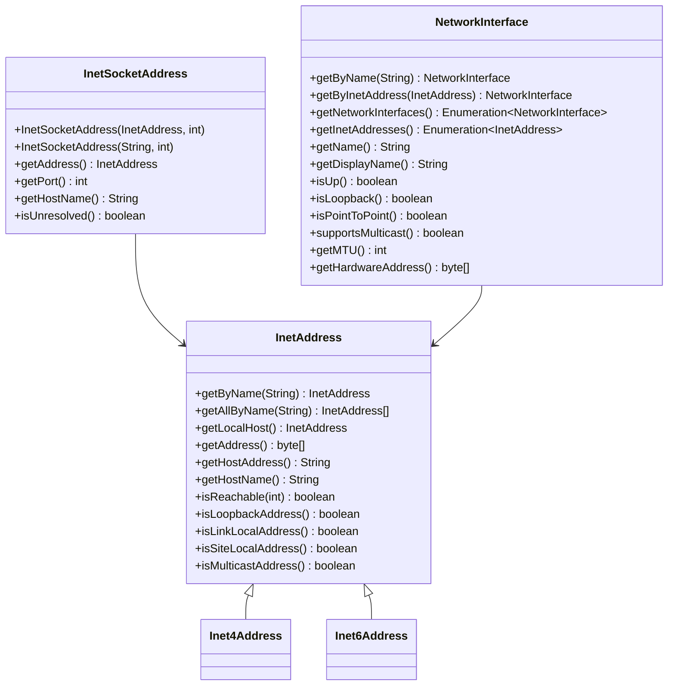
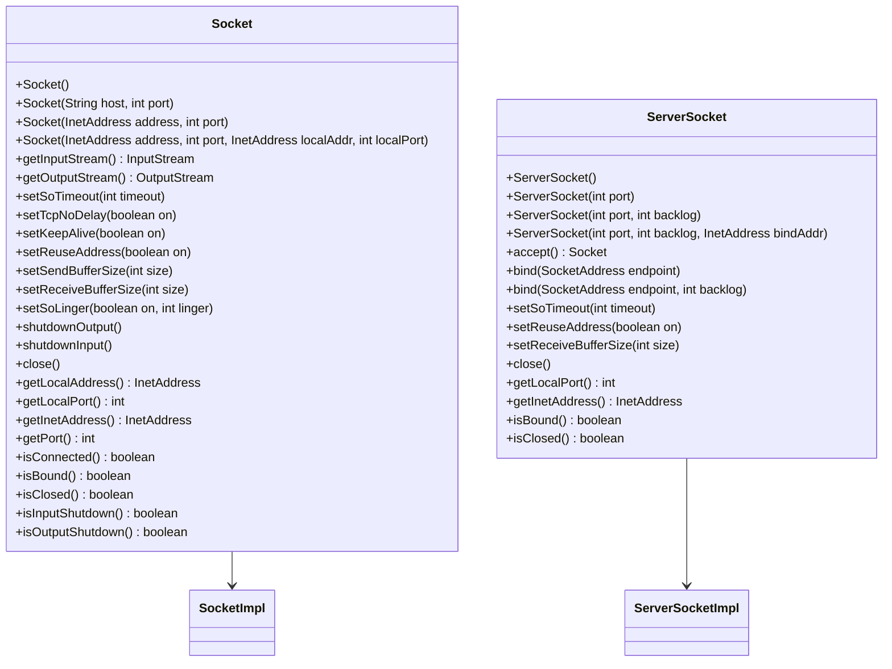
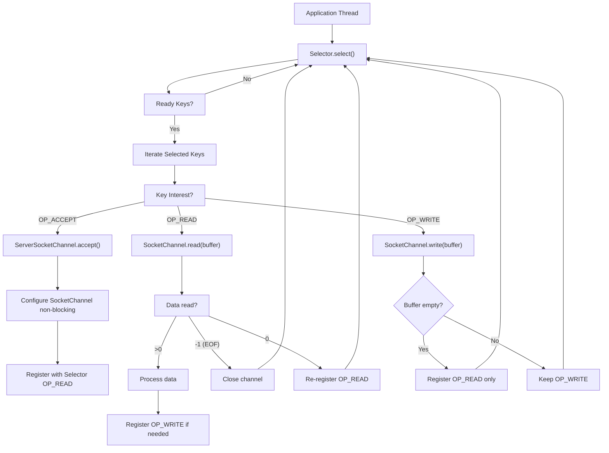
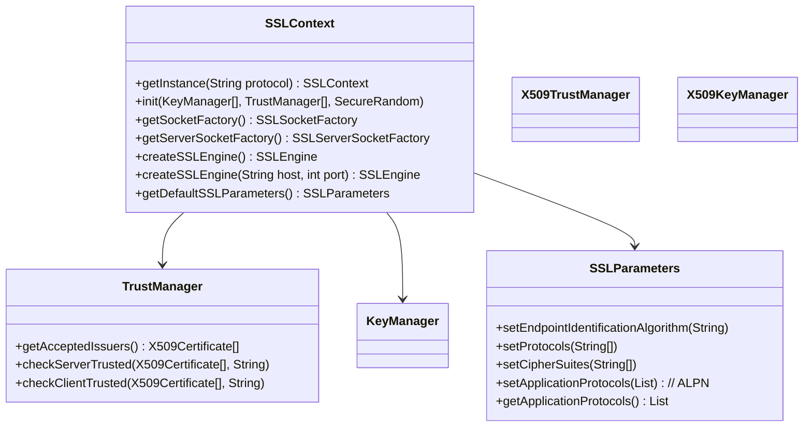
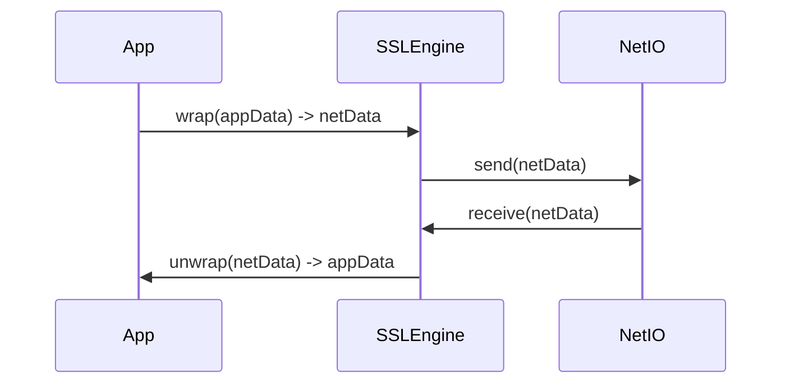

# Networking

Networking in Java spans from low-level socket manipulation to high-level HTTP clients. The mental model is a **layered stack**: application protocols (HTTP, custom) sit on transport (TCP/UDP), which sits on IP addressing and routing. Java exposes each layer — `InetAddress` for naming, `Socket`/`ServerSocket` for blocking TCP, `SocketChannel`/`Selector` for non-blocking I/O, `HttpClient` for modern HTTP/2, and `DatagramSocket` for UDP. Understanding the *internal mechanics* (kernel buffers, selector wakeups, TLS handshake state machines) separates seniors from juniors.

---

## TCP/IP Basics: Addressing & Naming

### InetAddress Hierarchy

`InetAddress` is the abstract base for IP addresses. It has two concrete subclasses:

- `Inet4Address` — IPv4 (32-bit, dotted decimal: `192.168.1.1`)
- `Inet6Address` — IPv6 (128-bit, hex colon: `2001:db8::1`)



### DNS Resolution

```java
// java.net.InetAddress examples
InetAddress localhost = InetAddress.getByName("localhost");      // 127.0.0.1
InetAddress google = InetAddress.getByName("google.com");        // IPv4 or IPv6
InetAddress[] all = InetAddress.getAllByName("google.com");      // All resolved IPs

// Reachability (ICMP echo or TCP port 7)
boolean reachable = google.isReachable(5000); // 5s timeout

// Loopback check
localhost.isLoopbackAddress(); // true

// IPv4 vs IPv6
InetAddress ipv4 = InetAddress.getByName("192.168.1.1");
InetAddress ipv6 = InetAddress.getByName("::1");
ipv4 instanceof Inet4Address; // true
ipv6 instanceof Inet6Address; // true
```

**Edge case**: `getAllByName` returns addresses in *resolver order* (typically IPv4 first on Linux, IPv6 first on macOS/Windows with Happy Eyeballs). Do not assume order.

### InetSocketAddress

```java
// Unresolved (hostname not yet resolved) — useful for deferred DNS
InetSocketAddress unresolved = InetSocketAddress.createUnresolved("api.example.com", 443);
unresolved.isUnresolved(); // true

// Resolved
InetSocketAddress resolved = new InetSocketAddress("127.0.0.1", 8080);
resolved.getAddress();      // InetAddress
resolved.getPort();         // 8080
resolved.getHostName();     // "127.0.0.1" (not reverse-resolved)
```

### NetworkInterface

```java
// Enumerate all interfaces
for (NetworkInterface ni : Collections.list(NetworkInterface.getNetworkInterfaces())) {
    System.out.println(ni.getName() + " " + ni.getDisplayName() + " up=" + ni.isUp());
    for (InetAddress addr : Collections.list(ni.getInetAddresses())) {
        System.out.println("  " + addr.getHostAddress());
    }
}

// Bind to specific interface for multicast
NetworkInterface ni = NetworkInterface.getByName("eth0");
```

**Mistake**: Calling `getByName("eth0")` on Windows fails (names differ: `Ethernet`, `Wi-Fi`). Use `getNetworkInterfaces()` and match by display name or IP.

---

## TCP Blocking Sockets: Socket & ServerSocket

### Core Classes



### Socket Options Deep Dive

| Option | Method | Default | Purpose |
|--------|--------|---------|---------|
| `SO_TIMEOUT` | `setSoTimeout(ms)` | 0 (infinite) | Read timeout on `InputStream.read()` |
| `TCP_NODELAY` | `setTcpNoDelay(true)` | false | Disable Nagle's algorithm (send immediately) |
| `SO_KEEPALIVE` | `setKeepAlive(true)` | false | Send keep-alive probes on idle connections (2h default) |
| `SO_REUSEADDR` | `setReuseAddress(true)` | false | Allow bind to `TIME_WAIT` address |
| `SO_SNDBUF` | `setSendBufferSize(bytes)` | OS default (≈64–256KB) | Kernel send buffer |
| `SO_RCVBUF` | `setReceiveBufferSize(bytes)` | OS default (≈64–256KB) | Kernel receive buffer |
| `SO_LINGER` | `setSoLinger(true, secs)` | off | Block on close until data sent or timeout |

**Nagle's Algorithm**: Buffers small writes until ACK received or buffer full. Disable (`setTcpNoDelay(true)`) for request/response protocols (HTTP, RPC) where latency matters. Enable for streaming bulk data.

**SO_LINGER Behavior**:
- `setSoLinger(false, 0)` (default): `close()` returns immediately, kernel sends pending data in background.
- `setSoLinger(true, 0)`: **Hard close** — sends RST, discards unsent data, peer gets `Connection reset`.
- `setSoLinger(true, >0)`: Blocks `close()` up to `secs` waiting for ACK; then RST if timeout.

### Half-Close (shutdownOutput)

```java
try (Socket socket = new Socket("localhost", 8080);
     OutputStream out = socket.getOutputStream();
     InputStream in = socket.getInputStream()) {

    out.write("request".getBytes());
    out.flush();

    // Signal end of request — client done sending, but still reading
    socket.shutdownOutput(); // Sends FIN

    // Read response until EOF (peer's FIN)
    String response = new String(in.readAllBytes());
}
```

**Use case**: HTTP/1.1 pipelining, custom protocols where client signals request completion.

### ServerSocket Backlog

```java
// backlog = max queue length for pending connections (SYN_RCVD + ESTABLISHED waiting for accept)
// Linux: actual queue = min(backlog, /proc/sys/net/core/somaxconn) typically 128
ServerSocket server = new ServerSocket(8080, 100); // backlog=100
```

**Internal**: Kernel maintains two queues: *incomplete* (SYN_RCVD) and *complete* (ESTABLISHED, waiting for `accept()`). `backlog` historically applied to complete queue only; Linux 2.2+ uses it for sum of both.

### Complete Echo Server (Blocking)

```java
// BlockingEchoServer.java
import java.io.*;
import java.net.*;

public class BlockingEchoServer {
    public static void main(String[] args) throws IOException {
        try (ServerSocket server = new ServerSocket(0)) { // ephemeral port
            server.setReuseAddress(true);
            int port = server.getLocalPort();
            System.out.println("Server listening on port " + port);

            // Run client in same process for verification
            new Thread(() -> {
                try (Socket client = new Socket("127.0.0.1", port);
                     PrintWriter out = new PrintWriter(client.getOutputStream(), true);
                     BufferedReader in = new BufferedReader(new InputStreamReader(client.getInputStream()))) {
                    out.println("hello");
                    System.out.println("Client received: " + in.readLine());
                } catch (IOException e) {
                    e.printStackTrace();
                }
            }).start();

            // Accept one connection
            try (Socket client = server.accept();
                 BufferedReader in = new BufferedReader(new InputStreamReader(client.getInputStream()));
                 PrintWriter out = new PrintWriter(client.getOutputStream(), true)) {

                String line = in.readLine();
                out.println("ECHO: " + line);
            }
        }
    }
}
```

```bash
$ javac /tmp/jmod-check/BlockingEchoServer.java -d /tmp/jmod-check
$ java -cp /tmp/jmod-check BlockingEchoServer
Server listening on port 54321
Client received: ECHO: hello
```

---

## NIO Non-Blocking: SocketChannel, Selector, SelectionKey

### Architecture



### Selector Loop Pattern

```java
// NioEchoServer.java
import java.io.IOException;
import java.net.InetSocketAddress;
import java.nio.ByteBuffer;
import java.nio.channels.*;
import java.util.Iterator;
import java.util.Set;

public class NioEchoServer {
    public static void main(String[] args) throws IOException {
        try (Selector selector = Selector.open();
             ServerSocketChannel server = ServerSocketChannel.open()) {

            server.bind(new InetSocketAddress("127.0.0.1", 0));
            server.configureBlocking(false);
            server.register(selector, SelectionKey.OP_ACCEPT);

            int port = ((InetSocketAddress) server.getLocalAddress()).getPort();
            System.out.println("NIO Server on port " + port);

            // Client thread
            new Thread(() -> {
                try (SocketChannel client = SocketChannel.open()) {
                    client.configureBlocking(false);
                    client.connect(new InetSocketAddress("127.0.0.1", port));
                    while (!client.finishConnect()) {
                        Thread.sleep(10);
                    }
                    client.write(ByteBuffer.wrap("nio hello\n".getBytes()));
                    ByteBuffer buf = ByteBuffer.allocate(1024);
                    int n = client.read(buf);
                    buf.flip();
                    System.out.println("Client received: " + new String(buf.array(), 0, n).trim());
                } catch (Exception e) {
                    e.printStackTrace();
                }
            }).start();

            // Selector loop
            ByteBuffer buffer = ByteBuffer.allocate(1024);
            while (selector.select() > 0) {
                Set<SelectionKey> keys = selector.selectedKeys();
                Iterator<SelectionKey> it = keys.iterator();

                while (it.hasNext()) {
                    SelectionKey key = it.next();
                    it.remove();

                    if (!key.isValid()) continue;

                    if (key.isAcceptable()) {
                        ServerSocketChannel ssc = (ServerSocketChannel) key.channel();
                        SocketChannel client = ssc.accept();
                        client.configureBlocking(false);
                        client.register(selector, SelectionKey.OP_READ);
                        System.out.println("Accepted: " + client.getRemoteAddress());
                    } else if (key.isReadable()) {
                        SocketChannel client = (SocketChannel) key.channel();
                        buffer.clear();
                        int read = client.read(buffer);
                        if (read == -1) {
                            client.close();
                            continue;
                        }
                        buffer.flip();
                        // Echo back
                        client.write(buffer);
                        // If partial write, register OP_WRITE
                        if (buffer.hasRemaining()) {
                            key.interestOps(SelectionKey.OP_READ | SelectionKey.OP_WRITE);
                            // Attach buffer for continuation
                            key.attach(buffer.slice());
                        }
                    } else if (key.isWritable()) {
                        SocketChannel client = (SocketChannel) key.channel();
                        ByteBuffer pending = (ByteBuffer) key.attachment();
                        client.write(pending);
                        if (!pending.hasRemaining()) {
                            key.interestOps(SelectionKey.OP_READ);
                            key.attach(null);
                        }
                    }
                }
            }
        } catch (IOException e) {
            e.printStackTrace();
        }
    }
}
```

```bash
$ javac /tmp/jmod-check/NioEchoServer.java -d /tmp/jmod-check
$ java -cp /tmp/jmod-check NioEchoServer
NIO Server on port 54322
Accepted: /127.0.0.1:54323
Client received: nio hello
```

### Critical Selector Details

| Concept | Detail |
|---------|--------|
| `configureBlocking(false)` | Must be called *before* `register()` or `connect()` |
| `finishConnect()` | Required after non-blocking `connect()`; returns `true` when connection established |
| `SelectionKey.interestOps()` | Bitmask: `OP_READ \| OP_WRITE \| OP_CONNECT \| OP_ACCEPT` |
| `key.attach(obj)` | Attach per-connection state (buffers, protocol parsers) |
| `selector.wakeup()` | Causes blocking `select()` to return immediately; used for cross-thread registration |
| `selector.close()` | Wakes up selector, cancels all keys, closes underlying resources |

**Wakeup Pattern** (register from another thread):

```java
// In worker thread
selector.wakeup(); // Ensure select() returns
// In selector thread, after select() returns:
SelectionKey key = channel.register(selector, SelectionKey.OP_READ);
```

**Common Mistake**: Forgetting to call `key.interestOps()` after partial write leads to busy loop (OP_WRITE always ready). **Fix**: Remove OP_WRITE when buffer empty.

---

## java.net.http.HttpClient (Java 11+)

### Building Requests

```java
HttpClient client = HttpClient.newBuilder()
    .version(HttpClient.Version.HTTP_2)        // Prefer HTTP/2
    .followRedirects(HttpClient.Redirect.NORMAL)
    .connectTimeout(Duration.ofSeconds(10))
    .build();

// GET
HttpRequest get = HttpRequest.newBuilder()
    .uri(URI.create("https://api.example.com/users"))
    .header("Accept", "application/json")
    .GET()
    .build();

// POST with JSON body
HttpRequest post = HttpRequest.newBuilder()
    .uri(URI.create("https://api.example.com/users"))
    .header("Content-Type", "application/json")
    .header("Authorization", "Bearer token")
    .POST(HttpRequest.BodyPublishers.ofString("{\"name\":\"John\"}"))
    .build();

// PUT with byte array
HttpRequest put = HttpRequest.newBuilder()
    .uri(URI.create("https://api.example.com/users/1"))
    .PUT(HttpRequest.BodyPublishers.ofByteArray(new byte[]{1,2,3}))
    .build();

// DELETE
HttpRequest delete = HttpRequest.newBuilder()
    .uri(URI.create("https://api.example.com/users/1"))
    .DELETE()
    .build();

// Streaming body from InputStream
HttpRequest stream = HttpRequest.newBuilder()
    .uri(URI.create("https://api.example.com/upload"))
    .POST(HttpRequest.BodyPublishers.ofInputStream(() -> new FileInputStream("large.dat")))
    .build();
```

### Body Publishers

| Publisher | Use Case |
|-----------|----------|
| `ofString(String)` | Small text/JSON |
| `ofByteArray(byte[])` | Binary data in memory |
| `ofInputStream(Supplier<InputStream>)` | Large files, lazy streaming |
| `ofFile(Path)` | File upload (Java 11+) |
| `ofLines(Iterable<String>)` | Line-delimited (NDJSON) |
| `noBody()` | GET/DELETE without body |

### Response Handling

```java
// String body
HttpResponse<String> resp = client.send(request, HttpResponse.BodyHandlers.ofString());
resp.statusCode();        // 200
resp.headers();           // HttpHeaders (multi-map)
resp.body();              // Response body as String

// Byte array
HttpResponse<byte[]> resp = client.send(request, HttpResponse.BodyHandlers.ofByteArray());

// Stream lines (memory efficient)
HttpResponse<Stream<String>> resp = client.send(request, HttpResponse.BodyHandlers.ofLines());
try (Stream<String> lines = resp.body()) {
    lines.forEach(System.out::println);
}

// Discard body (HEAD, or ignore response)
HttpResponse<Void> resp = client.send(request, HttpResponse.BodyHandlers.discarding());

// Async (CompletableFuture)
CompletableFuture<HttpResponse<String>> future = client.sendAsync(request, BodyHandlers.ofString());
future.thenAccept(r -> System.out.println(r.statusCode()));
```

### Timeouts & Redirects

```java
HttpClient client = HttpClient.newBuilder()
    .connectTimeout(Duration.ofSeconds(5))      // TCP connect timeout
    .build();

// Request-level timeout (read + idle)
HttpRequest req = HttpRequest.newBuilder()
    .uri(URI.create("https://slow.example.com"))
    .timeout(Duration.ofSeconds(30))            // Total request timeout
    .build();

// Redirect policy
// NEVER (default), NORMAL (follow 3xx), ALWAYS (follow even on POST)
.followRedirects(HttpClient.Redirect.NORMAL)
```

### HTTP/1.1 vs HTTP/2

| Feature | HTTP/1.1 | HTTP/2 |
|---------|----------|--------|
| Multiplexing | No (pipelining broken) | Yes (streams over single TCP) |
| Header compression | No | HPACK |
| Server push | No | Yes |
| Prioritization | No | Yes |
| TLS required | No | Practically yes (ALPN) |
| Java support | Default | Opt-in: `.version(HTTP_2)` |

**ALPN**: Application-Layer Protocol Negotiation (TLS extension). Client sends supported protocols (h2, http/1.1) in ClientHello. Server picks one. `HttpClient` uses ALPN automatically when TLS + HTTP/2.

### WebSocket (Java 11+)

```java
HttpClient client = HttpClient.newHttpClient();

WebSocket ws = client.newWebSocketBuilder()
    .buildAsync(URI.create("wss://echo.websocket.org"), new WebSocket.Listener() {
        private ByteBuffer buffer = ByteBuffer.allocate(1024);

        @Override
        public void onOpen(WebSocket webSocket) {
            webSocket.sendText("Hello", true);
            webSocket.request(1); // Request 1 message
        }

        @Override
        public CompletionStage<?> onText(WebSocket webSocket, CharSequence data, boolean last) {
            System.out.println("Received: " + data);
            webSocket.request(1);
            return null;
        }

        @Override
        public void onError(WebSocket webSocket, Throwable error) {
            error.printStackTrace();
        }

        @Override
        public CompletionStage<?> onClose(WebSocket webSocket, int statusCode, String reason) {
            System.out.println("Closed: " + statusCode + " " + reason);
            return null;
        }
    }).join();

// Send binary
ws.sendBinary(ByteBuffer.wrap(new byte[]{1,2,3}), true);

// Close gracefully
ws.sendClose(WebSocket.NORMAL_CLOSURE, "Done").join();
```

---

## Legacy: URLConnection & HttpURLConnection

### Basic Usage

```java
URL url = new URL("https://api.example.com/data");
HttpURLConnection conn = (HttpURLConnection) url.openConnection();
conn.setRequestMethod("POST");
conn.setDoOutput(true);
conn.setRequestProperty("Content-Type", "application/json");
conn.setConnectTimeout(5000);
conn.setReadTimeout(10000);

try (OutputStream os = conn.getOutputStream()) {
    os.write("{\"key\":\"value\"}".getBytes());
}

int status = conn.getResponseCode();
InputStream is = (status >= 400) ? conn.getErrorStream() : conn.getInputStream();
String body = new String(is.readAllBytes());
```

### Connection Pooling

`HttpURLConnection` uses a **global connection pool** per destination (host:port). Controlled by system properties:

| Property | Default | Description |
|----------|---------|-------------|
| `http.keepAlive` | true | Enable keep-alive |
| `http.maxConnections` | 5 | Max idle connections per destination |
| `http.keepAlive.duration` | varies | Idle timeout (ms) |

```java
// Disable pooling for a connection
conn.setRequestProperty("Connection", "close");
```

### Proxy & Authenticator

```java
// Proxy
Proxy proxy = new Proxy(Proxy.Type.HTTP, new InetSocketAddress("proxy.corp", 8080));
HttpURLConnection conn = (HttpURLConnection) url.openConnection(proxy);

// Authenticator (global)
Authenticator.setDefault(new Authenticator() {
    @Override
    protected PasswordAuthentication getPasswordAuthentication() {
        return new PasswordAuthentication("user", "pass".toCharArray());
    }
});
```

**Mistake**: `Authenticator` is JVM-global. In multi-tenant apps, use `HttpClient` with per-request credentials instead.

---

## UDP: DatagramSocket & DatagramChannel

### DatagramSocket (Blocking)

```java
// Server
try (DatagramSocket socket = new DatagramSocket(9876)) {
    byte[] buf = new byte[1024];
    DatagramPacket packet = new DatagramPacket(buf, buf.length);
    socket.receive(packet); // Blocks
    String msg = new String(packet.getData(), 0, packet.getLength());
    System.out.println("From " + packet.getAddress() + ":" + packet.getPort() + " -> " + msg);

    // Reply
    byte[] reply = "ACK".getBytes();
    DatagramPacket replyPacket = new DatagramPacket(reply, reply.length,
                                                    packet.getAddress(), packet.getPort());
    socket.send(replyPacket);
}

// Client
try (DatagramSocket socket = new DatagramSocket()) {
    socket.setSoTimeout(5000);
    InetAddress addr = InetAddress.getByName("127.0.0.1");
    byte[] data = "hello".getBytes();
    DatagramPacket packet = new DatagramPacket(data, data.length, addr, 9876);
    socket.send(packet);

    byte[] buf = new byte[1024];
    DatagramPacket reply = new DatagramPacket(buf, buf.length);
    socket.receive(reply);
    System.out.println("Reply: " + new String(reply.getData(), 0, reply.getLength()));
}
```

### DatagramChannel (Non-Blocking)

```java
try (DatagramChannel channel = DatagramChannel.open()) {
    channel.configureBlocking(false);
    channel.bind(new InetSocketAddress(9876));

    Selector selector = Selector.open();
    channel.register(selector, SelectionKey.OP_READ);

    ByteBuffer buffer = ByteBuffer.allocate(1024);
    while (selector.select() > 0) {
        for (SelectionKey key : selector.selectedKeys()) {
            if (key.isReadable()) {
                buffer.clear();
                SocketAddress sender = channel.receive(buffer);
                buffer.flip();
                System.out.println("From " + sender + ": " + new String(buffer.array(), 0, buffer.limit()));
            }
        }
        selector.selectedKeys().clear();
    }
}
```

### Broadcast & Multicast

```java
// Broadcast (IPv4 only, limited to subnet)
try (DatagramSocket socket = new DatagramSocket()) {
    socket.setBroadcast(true);
    InetAddress broadcast = InetAddress.getByName("255.255.255.255");
    byte[] data = "broadcast".getBytes();
    socket.send(new DatagramPacket(data, data.length, broadcast, 9999));
}

// Multicast (IPv4)
try (MulticastSocket socket = new MulticastSocket(9999)) {
    InetAddress group = InetAddress.getByName("239.255.0.1");
    NetworkInterface ni = NetworkInterface.getByInetAddress(InetAddress.getLocalHost());
    socket.joinGroup(new InetSocketAddress(group, 9999), ni);

    byte[] buf = new byte[1024];
    DatagramPacket packet = new DatagramPacket(buf, buf.length);
    socket.receive(packet);
    System.out.println("Multicast: " + new String(packet.getData(), 0, packet.getLength()));
}
```

**IPv6 Multicast**: Use `DatagramChannel` + `MembershipKey`:

```java
DatagramChannel channel = DatagramChannel.open(StandardProtocolFamily.INET6);
channel.bind(new InetSocketAddress(9999));
NetworkInterface ni = NetworkInterface.getByName("eth0");
InetAddress group = InetAddress.getByName("ff02::1");
MembershipKey key = channel.join(InetAddress.getByName("ff02::1"), ni);
```

---

## TLS/SSL: SSLSocket, SSLEngine, SSLContext

### SSLContext & Trust/Key Managers



### Custom TrustManager (Dangerous — for Testing Only)

```java
// NEVER use in production — disables certificate validation
TrustManager[] trustAll = new TrustManager[] {
    new X509TrustManager() {
        public X509Certificate[] getAcceptedIssuers() { return new X509Certificate[0]; }
        public void checkServerTrusted(X509Certificate[] chain, String authType) {}
        public void checkClientTrusted(X509Certificate[] chain, String authType) {}
    }
};

SSLContext ctx = SSLContext.getInstance("TLS");
ctx.init(null, trustAll, new SecureRandom());
SSLSocketFactory factory = ctx.getSocketFactory();
```

### Proper TrustManager (Pinning / Custom CA)

```java
// Load custom CA
KeyStore trustStore = KeyStore.getInstance("JKS");
try (InputStream is = Files.newInputStream(Path.of("truststore.jks"))) {
    trustStore.load(is, "changeit".toCharArray());
}

TrustManagerFactory tmf = TrustManagerFactory.getInstance(TrustManagerFactory.getDefaultAlgorithm());
tmf.init(trustStore);

SSLContext ctx = SSLContext.getInstance("TLS");
ctx.init(null, tmf.getTrustManagers(), null);
```

### Hostname Verification

```java
// Default: verifies CN/SAN against hostname
// Custom:
SSLParameters params = ctx.getDefaultSSLParameters();
params.setEndpointIdentificationAlgorithm("HTTPS"); // Standard HTTPS verification
// Or disable (DANGEROUS):
params.setEndpointIdentificationAlgorithm("");

// Apply to SSLSocket
SSLSocket socket = (SSLSocket) factory.createSocket("host", 443);
socket.setSSLParameters(params);
```

### SSLEngine (Non-Blocking TLS)

`SSLEngine` is the **non-blocking, transport-agnostic** TLS engine. It operates on `ByteBuffer`s — you feed it network data, it produces application data, and vice versa.



**States**: `NEED_UNWRAP`, `NEED_WRAP`, `NEED_TASK` (delegated tasks like certificate verification), `FINISHED`, `CLOSED`.

```java
SSLEngine engine = ctx.createSSLEngine();
engine.setUseClientMode(true);
engine.beginHandshake();

ByteBuffer netIn = ByteBuffer.allocate(16384);
ByteBuffer netOut = ByteBuffer.allocate(16384);
ByteBuffer appIn = ByteBuffer.allocate(16384);
ByteBuffer appOut = ByteBuffer.allocate(16384);

while (true) {
    SSLEngineResult result = engine.wrap(appOut, netOut);
    if (result.getStatus() == SSLEngineResult.Status.OK && netOut.position() > 0) {
        netOut.flip();
        // Send netOut to network
        netOut.compact();
    }
    if (result.getHandshakeStatus() == SSLEngineResult.HandshakeStatus.FINISHED) break;
    if (result.getHandshakeStatus() == SSLEngineResult.HandshakeStatus.NEED_TASK) {
        Runnable task;
        while ((task = engine.getDelegatedTask()) != null) task.run();
    }
    // Read from network into netIn, then:
    result = engine.unwrap(netIn, appIn);
    // Process appIn...
}
```

**Use with Selector**: Register `OP_READ`/`OP_WRITE` based on `HandshakeStatus`. Complex — prefer `SocketChannel` + `SSLContext.createSSLEngine()` + manual state machine, or use Netty.

### ALPN with HttpClient

```java
HttpClient client = HttpClient.newBuilder()
    .sslContext(sslContext)
    .sslParameters(params -> params.setApplicationProtocols(List.of("h2", "http/1.1")))
    .build();
```

---

## Serialization Over Sockets

```java
// Sending
try (Socket socket = new Socket("localhost", 8080);
     ObjectOutputStream out = new ObjectOutputStream(socket.getOutputStream())) {
    out.writeObject(new User("John", 30));
    out.flush();
}

// Receiving
try (ServerSocket server = new ServerSocket(8080);
     Socket client = server.accept();
     ObjectInputStream in = new ObjectInputStream(client.getInputStream())) {
    User user = (User) in.readObject();
}
```

**Security Risks** (see [Serialization](../06-Reflection/29-Serialization.md)):
- Arbitrary code execution via gadget chains (Commons Collections, etc.)
- **Never** deserialize untrusted data
- Use `ObjectInputFilter` (Java 9+) to whitelist classes:

```java
ObjectInputFilter filter = info -> {
    if (info.serialClass() != null && info.serialClass().getName().startsWith("com.myapp.")) {
        return ObjectInputFilter.Status.ALLOWED;
    }
    return ObjectInputFilter.Status.REJECTED;
};
ObjectInputStream in = new ObjectInputStream(socket.getInputStream());
in.setObjectInputFilter(filter);
```

**Versioning**: Implement `serialVersionUID` explicitly. Use `Externalizable` or protobuf/JSON for cross-version compatibility.

---

## URL vs URI

| Aspect | `java.net.URL` | `java.net.URI` |
|--------|----------------|----------------|
| Parsing | Lenient (accepts spaces, etc.) | Strict (RFC 3986) |
| Resolution | `url.openConnection()` | `uri.resolve(relative)` |
| Encoding | `URLEncoder.encode()` | Manual / `URI.toString()` |
| Equality | Host resolution (DNS!) | String comparison |
| Immutability | Yes | Yes |

```java
URL url = new URL("https://example.com/path?query=value#frag");
URI uri = url.toURI(); // May throw URISyntaxException

// Resolution
URI base = new URI("https://api.example.com/v1/");
URI relative = new URI("users/123");
URI resolved = base.resolve(relative); // https://api.example.com/v1/users/123

// Percent encoding
String encoded = URLEncoder.encode("hello world!", StandardCharsets.UTF_8); // hello+world%21
String decoded = URLDecoder.decode(encoded, StandardCharsets.UTF_8);
```

**Key Difference**: `URL.equals()` performs **DNS resolution** — two URLs with different hostnames that resolve to same IP are equal. `URI.equals()` is purely syntactic.

---

## Performance

### Connection Pooling

| Client | Pooling Mechanism |
|--------|-------------------|
| `HttpURLConnection` | Global, per destination, fixed size (5) |
| `HttpClient` | Per-client, configurable (`HttpClient.Builder`) |
| `OkHttp` (3rd party) | Per-client, sophisticated (connection reuse, HTTP/2) |

```java
HttpClient client = HttpClient.newBuilder()
    .version(HttpClient.Version.HTTP_2)
    .build(); // Internal pool: max connections per route, idle timeout
```

### HTTP/2 Multiplexing

Single TCP connection carries multiple **streams** (request/response pairs). No head-of-line blocking at HTTP level (though TCP HOLB remains). `HttpClient` automatically multiplexes concurrent requests to same origin.

### Keep-Alive

- **HTTP/1.1**: `Connection: keep-alive` (default). Reuses TCP connection for multiple requests.
- **HTTP/2**: Always keep-alive; streams multiplexed.

```java
// HttpClient: configure idle timeout
HttpClient client = HttpClient.newBuilder()
    .connectTimeout(Duration.ofSeconds(10))
    .build(); // Idle timeout managed internally
```

### Buffer Sizes

```java
// Socket
socket.setSendBufferSize(256 * 1024);   // 256KB
socket.setReceiveBufferSize(256 * 1024);

// NIO
socketChannel.socket().setSendBufferSize(256 * 1024);

// HttpClient: not directly tunable; uses internal 8KB buffers
```

**Tuning**: For high-throughput LAN, increase to 1-2MB. For WAN, default often optimal (BDP = bandwidth × RTT).

### Virtual Threads + Socket (Java 21)

```java
// Per-request virtual thread — scales to millions
ExecutorService executor = Executors.newVirtualThreadPerTaskExecutor();

try (ServerSocket server = new ServerSocket(8080)) {
    while (true) {
        Socket client = server.accept();
        executor.submit(() -> handle(client));
    }
}

void handle(Socket client) {
    try (client;
         var in = new BufferedReader(new InputStreamReader(client.getInputStream()));
         var out = new PrintWriter(client.getOutputStream(), true)) {
        String line = in.readLine();
        out.println("ECHO: " + line);
    } catch (IOException e) { /* log */ }
}
```

**Why it works**: Virtual threads park on blocking I/O (`read()`, `accept()`) without blocking platform threads. No selector complexity needed for high concurrency.

### Selector Throughput

| Pattern | Throughput | Complexity |
|---------|------------|------------|
| Single selector, single thread | ~50K conn/s | Low |
| Multiple selectors (boss/worker) | ~200K conn/s | Medium |
| `Selector.wakeup()` + thread-local buffers | Highest | High |

**Tip**: For >10K concurrent connections, consider Netty (optimized native transport, zero-copy).

---

## Comparison Tables

### Transport Comparison

| Feature | Blocking `Socket` | NIO `SocketChannel` | `HttpClient` | UDP `DatagramSocket` |
|---------|-------------------|---------------------|--------------|----------------------|
| I/O Model | Blocking per thread | Non-blocking, selector | Async (CF) + sync | Blocking / NIO |
| Concurrency | Thread per connection | 1 thread → 10K+ conn | Virtual threads / pool | Thread per request |
| Protocol | Raw TCP | Raw TCP | HTTP/1.1, HTTP/2 | UDP |
| Reliability | TCP (ordered, retry) | TCP | TCP + HTTP semantics | None (fire & forget) |
| Latency | Low (no user-space copy) | Low (direct buffers) | Higher (HTTP framing) | Lowest |
| Backpressure | Implicit (blocked thread) | Explicit (buffer full) | `BodyPublisher` flow | None |
| TLS | `SSLSocket` | `SSLEngine` | Built-in | DTLS (`SSLEngine`) |
| Use Case | Simple clients, legacy | High-concurrency servers | Modern HTTP APIs | Gaming, streaming, DNS |

### Sync vs Async HTTP

| Aspect | `client.send()` (Sync) | `client.sendAsync()` (Async) |
|--------|------------------------|------------------------------|
| Thread | Blocks caller | Returns immediately |
| Stack Trace | Preserved | Split across completions |
| Backpressure | Natural (caller waits) | Must manage (queue CFs) |
| Virtual Threads | Excellent (park cheaply) | Redundant (VT already async) |
| Error Handling | try-catch | `.exceptionally()` / `.handle()` |

**Recommendation (Java 21+)**: Use **virtual threads + sync `send()`** — simple code, massive scalability. Reserve `sendAsync()` for reactive pipelines or when integrating with `CompletableFuture` chains.

---

## Common Mistakes & Pitfalls

| Mistake | Wrong | Right |
|---------|-------|-------|
| Not closing resources | `Socket s = new Socket(...);` | `try (Socket s = ...) {}` |
| Ignoring partial writes | `out.write(buf);` | `while (buf.hasRemaining()) ch.write(buf);` |
| Busy selector loop | `key.interestOps(OP_READ \| OP_WRITE)` always | Remove `OP_WRITE` when buffer empty |
| `HttpURLConnection` pooling leak | `conn.getInputStream()` not fully read | `EntityUtils.consume()` or read fully |
| `InetAddress.getByName` in hot path | Called per request | Cache resolved addresses |
| `SO_LINGER` with 0 | `setSoLinger(true, 0)` → RST | Use default or `setSoLinger(true, 30)` |
| Nagle + delayed ACK | `setTcpNoDelay(false)` for RPC | `setTcpNoDelay(true)` for request/response |
| Trusting all certs in prod | `TrustManager` that accepts all | Proper PKI, pinning, or system trust store |
| `URL.equals()` for deduplication | `set.add(url1); set.add(url2);` | Use `URI` or normalize host/IP manually |

---

## Best Practices

1. **Prefer `HttpClient`** for HTTP — handles pooling, HTTP/2, timeouts, redirects correctly.
2. **Use virtual threads + blocking sockets** (Java 21) for high-concurrency servers — simpler than NIO.
3. **Set `TCP_NODELAY`** for request/response protocols; disable for bulk transfer.
4. **Always set timeouts** — `connectTimeout`, `readTimeout` (`SO_TIMEOUT`), request timeout.
5. **Close resources in `finally` / try-with-resources** — sockets, channels, streams, selectors.
6. **Handle partial reads/writes** — `read()`/`write()` may process fewer bytes than requested.
7. **Validate certificates** — never disable hostname verification or trust all in production.
8. **Use `InetSocketAddress.createUnresolved()`** for deferred DNS (avoids blocking on resolution).
9. **Monitor connection pools** — track leaked connections, idle timeouts.
10. **Prefer `URI` over `URL`** for parsing/comparison; only use `URL` for `openConnection()`.

---

## Interview Tips

- **`Socket` vs `SocketChannel`**: Thread-per-connection vs event-loop. Virtual threads blur this.
- **`SO_TIMEOUT` vs `HttpClient` timeout**: Former is socket read timeout; latter is total request timeout.
- **Nagle + Delayed ACK = 40ms latency spikes**: Classic interview trap. Disable Nagle for RPC.
- **`Selector.wakeup()`**: Needed when registering from another thread; otherwise `select()` blocks indefinitely.
- **`SSLEngine` vs `SSLSocket`**: Engine is non-blocking, transport-agnostic; Socket is blocking wrapper.
- **HTTP/2 multiplexing**: Single connection, multiple streams. Solves HOLB at HTTP layer, not TCP layer.
- **`URL.equals()` does DNS**: Can cause subtle bugs in caches/sets. Use `URI`.
- **DatagramPacket reuse**: Must reset `setLength()` before each `receive()`.
- **`SO_LINGER` with 0 = hard reset**: Not graceful close. Use for "abort" semantics only.

---

# Interview Questions

## Beginner

**Q1. What is the difference between `InetAddress.getByName()` and `InetAddress.getAllByName()`?**

`getByName()` returns a single `InetAddress` (first resolved). `getAllByName()` returns all resolved addresses for the hostname (both IPv4 and IPv6). The order is resolver-dependent — typically IPv4 first on Linux, IPv6 first on macOS/Windows with Happy Eyeballs.

**Q2. What does `Socket.setSoTimeout(5000)` do?**

Sets a **read timeout** of 5000ms on the socket's `InputStream`. If `read()` blocks longer than this, a `SocketTimeoutException` (subclass of `InterruptedIOException`) is thrown. The socket remains open. Does not affect `connect()` or `write()`.

**Q3. What is Nagle's algorithm and when should you disable it?**

Nagle's algorithm buffers small writes until either an ACK is received for previous data or the buffer fills (MSS). Reduces packet overhead for streaming. **Disable with `setTcpNoDelay(true)` for request/response protocols (HTTP, RPC, gaming)** where latency matters more than bandwidth efficiency.

**Q4. How does `ServerSocket.accept()` work?**

Blocks until a client completes the TCP three-way handshake. Returns a new `Socket` for the accepted connection. The `backlog` parameter in `ServerSocket(port, backlog)` hints the kernel queue size for pending connections (both SYN_RCVD and ESTABLISHED waiting for `accept()`).

**Q5. What is the difference between `URL` and `URI`?**

`URL` is for locating resources and opening connections; `equals()` does **DNS resolution**. `URI` is purely syntactic (RFC 3986); `equals()` is string-based. `URL.toURI()` converts. Use `URI` for parsing/comparison, `URL` only for `openConnection()`.

## Intermediate

**Q6. Explain the difference between `SO_LINGER` with (true, 0), (true, 30), and (false, 0).**

- `(false, 0)` (default): `close()` returns immediately; kernel sends pending data in background (graceful).
- `(true, 0)`: **Hard close** — sends RST immediately, discards unsent send buffer. Peer gets "Connection reset".
- `(true, 30)`: `close()` blocks up to 30s waiting for peer ACK of pending data; then sends RST if timeout.

**Q7. How does a non-blocking `SocketChannel.connect()` work? What is `finishConnect()`?**

`connect()` initiates connection and returns immediately (may return `false` if not connected yet). You must call `finishConnect()` repeatedly (or via selector `OP_CONNECT`) until it returns `true`, meaning handshake complete. If it throws `IOException`, connection failed.

**Q8. What is the purpose of `Selector.wakeup()`?**

Causes a blocking `selector.select()` or `select(timeout)` to return immediately (with 0 keys). Used when another thread registers a new channel with the selector — without `wakeup()`, the selector thread wouldn't see the new channel until next select cycle or timeout.

**Q9. Why must you remove `OP_WRITE` from interestOps when the write buffer is empty?**

`OP_WRITE` means "channel is ready for writing" — which is **almost always true** for a healthy TCP socket. If you leave it set, `selector.select()` returns immediately in a busy loop (100% CPU). Only register `OP_WRITE` when you have data to flush; remove it when buffer drains.

**Q10. How does `HttpClient` connection pooling work?**

`HttpClient` maintains a per-client connection pool keyed by destination (host:port:scheme). HTTP/1.1 connections are pooled with keep-alive. HTTP/2 uses a single multiplexed connection per origin. Pool size is internal; configure via `HttpClient.Builder` (not directly exposed). Idle connections are evicted after a timeout.

## Advanced

**Q11. Describe the `SSLEngine` state machine. What are the five handshake statuses?**

`SSLEngine` operates on `ByteBuffer`s (netIn/netOut, appIn/appOut). Handshake statuses:
1. `NEED_UNWRAP` — needs network data to process handshake
2. `NEED_WRAP` — needs to produce handshake data to send
3. `NEED_TASK` — needs to run delegated tasks (e.g., certificate verification) via `getDelegatedTask().run()`
4. `FINISHED` — handshake complete, application data can flow
5. `NOT_HANDSHAKING` — renegotiation or post-handshake

**Q12. What is ALPN and how does it relate to HTTP/2?**

ALPN (Application-Layer Protocol Negotiation) is a TLS extension where client sends supported protocols (e.g., `h2`, `http/1.1`) in ClientHello. Server selects one. Enables HTTP/2 over TLS without extra round-trip. `HttpClient` uses ALPN automatically when TLS + `Version.HTTP_2`.

**Q13. How do virtual threads (Java 21) change socket server architecture?**

Virtual threads park on blocking I/O (`read()`, `accept()`) without blocking platform threads. You can use **blocking `ServerSocket.accept()` + `ExecutorService.newVirtualThreadPerTaskExecutor()`** to handle 100K+ concurrent connections with simple synchronous code — no selector loop needed. Scales better than thread-per-connection (platform threads) and simpler than NIO.

**Q14. What is the "head-of-line blocking" problem? How does HTTP/2 address it? What remains?**

- **HTTP/1.1**: Request B queued behind Request A on same connection.
- **HTTP/1.1 Pipelining**: Broken (responses must be in order).
- **HTTP/2**: Multiplexes streams over one TCP connection — solves HTTP-level HOLB.
- **Remaining**: TCP-level HOLB — a lost packet blocks *all* streams until retransmission. QUIC/HTTP/3 solves this with UDP + streams.

**Q15. Explain the difference between `DatagramSocket` and `DatagramChannel` for multicast.**

`MulticastSocket` (legacy) joins groups via `joinGroup(InetAddress)` — binds to wildcard interface. `DatagramChannel` (NIO) uses `MembershipKey = channel.join(group, networkInterface)` — explicit interface binding, supports source-specific multicast (SSM), works with selector. IPv6 multicast requires `DatagramChannel` + `StandardProtocolFamily.INET6`.

## Expert

**Q16. What happens internally when you call `Socket.getInputStream().read()` on a blocking socket?**

1. JVM calls `SocketInputStream.read()` → native `socketRead0()`
2. If kernel receive buffer has data: copies to Java byte[]/direct buffer, returns count.
3. If empty: thread parks in kernel (`epoll_wait`/`select`/`poll`), added to wait queue.
4. NIC receives packet → interrupt → kernel copies to socket receive buffer → wakes thread.
5. Thread resumes, copies data to Java buffer, returns.

**Q17. How does `HttpURLConnection` connection pooling interact with `Authenticator`?**

`Authenticator` is **JVM-global** (`Authenticator.setDefault()`). When a pooled connection receives 401, the authenticator is challenged. If credentials differ per request, pooling breaks — wrong credentials sent on reused connection. **Fix**: Disable pooling (`Connection: close`) or use `HttpClient` with per-request credentials.

**Q18. What is the `TCP_NOTSENT_LOWAT` socket option (Linux) and why does it matter for HTTP/2?**

Controls the "not-sent" queue threshold. When unsent bytes in kernel TCP send buffer drops below this, `epoll` reports `EPOLLOUT`. For HTTP/2, prevents application from queueing excessive DATA frames in kernel (bufferbloat), improving prioritization and fairness. Java 21+ exposes via `ExtendedSocketOptions.TCP_NOTSENT_LOWAT`.

**Q19. Describe the memory layout of a `SelectionKey` and its attachment.**

`SelectionKey` (in `sun.nio.ch.SelectionKeyImpl`) holds:
- `channel` — `SelectableChannel` reference
- `selector` — `SelectorImpl` reference
- `interestOps` — `int` bitmask (volatile)
- `readyOps` — `int` bitmask
- `attachment` — `Object` (user state, e.g., `ByteBuffer`, protocol parser)
- `cancelled` — `boolean`
All accessed under selector's `lock` (except `interestOps` which uses CAS). Attachment enables per-connection state without external map.

**Q20. What are the security implications of Java serialization over sockets? How to mitigate?**

Deserialization of untrusted data → arbitrary code execution via gadget chains (Apache Commons Collections, Spring, etc.). **Mitigations**:
- Never deserialize untrusted data (use JSON/protobuf).
- `ObjectInputFilter` (Java 9+) to whitelist classes: `in.setObjectInputFilter(info -> info.serialClass().getName().startsWith("com.myapp.") ? ALLOWED : REJECTED)`.
- `-Djdk.serialFilter=...` system property for global filter.
- Use `Externalizable` with explicit `readExternal`/`writeExternal`.

## Scenario Based

**Q21. You need to build a high-throughput HTTP proxy (10K+ concurrent connections) on Java 21. What architecture do you choose?**

**Choice**: Virtual threads + `HttpClient` (sync) or `Socket` + virtual threads.
- **Why not NIO selector?** Virtual threads make blocking I/O scale; selector adds complexity for marginal gain.
- **Architecture**: `ServerSocket.accept()` in loop → submit each client to `Executors.newVirtualThreadPerTaskExecutor()` → each VT uses blocking `Socket` + `HttpClient` to upstream.
- **HttpClient**: Shared instance, HTTP/2 to upstream, connection pooling.
- **Backpressure**: Virtual threads park on read/write; no explicit backpressure needed unless upstream saturates (then apply semaphore).

**Q22. A client reports intermittent "Connection reset" errors. The server logs show no errors. What do you investigate?**

1. **`SO_LINGER` with 0** on server/client — causes RST on close.
2. **Idle timeout** on load balancer/firewall — sends RST after idle period. Enable `SO_KEEPALIVE` or application-level heartbeat.
3. **Server thread pool exhaustion** — `accept()` queue full, kernel drops SYN (not RST though).
4. **Client `close()` before reading response** — sends RST.
5. **MTU/PMTU black hole** — large packets dropped, ICMP blocked. Check `tcp_mtu_probing`.

**Q23. You must implement a custom binary protocol over TCP with request/response semantics. Compare three approaches: (a) blocking `Socket` per thread, (b) NIO `Selector`, (c) virtual threads + blocking `Socket`. Which do you choose and why?**

- **(a) Blocking + platform threads**: Simple but scales to ~1K threads (memory/stack). Context switch overhead high.
- **(b) NIO Selector**: Scales to 50K+ connections, but complex state machine, partial read/write handling, `OP_WRITE` busy-loop bugs.
- **(c) Virtual threads + blocking (Java 21)**: **Best choice**. Same simple code as (a), scales to millions. Parking on I/O is cheap. No selector bugs. Use `setSoTimeout` for timeouts.

**Q24. Design a system to stream large files (10GB+) from clients to server with resume capability. What protocol, Java APIs, and considerations?**

- **Protocol**: HTTP/1.1 with `Range` headers (standard, resumable) or custom protocol over TCP.
- **Java**: `HttpClient` with `BodyPublishers.ofInputStream(() -> fileChannel)` for upload; `FileChannel.transferTo()` for zero-copy download.
- **Resume**: Client sends `Range: bytes=X-`; server responds `206 Partial Content` with `Content-Range`.
- **Considerations**: Checksum verification (MD5/SHA256 per chunk), temp file + atomic rename, backpressure via flow control (HTTP/2 window), disk I/O bottleneck (async file I/O or `FileChannel`).

**Q25. Your microservice calls a downstream API. Latency spikes to 30s during GC pauses on the downstream. How do you configure timeouts to fail fast?**

- **Connect timeout**: 2s (TCP handshake)
- **Request timeout (total)**: 5s (HttpClient `.timeout()`)
- **Socket read timeout**: 3s (`SO_TIMEOUT` equivalent)
- **Idle timeout**: Not directly exposed in `HttpClient`; rely on request timeout.
- **Circuit breaker**: Use Resilience4j / `CompletableFuture` timeout wrapper to trip after N failures.
- **Key**: Total request timeout must be **less than** downstream GC pause + recovery, so you fail fast and don't pile up threads.

## Output Prediction

**Q26. What is the output?**

```java
import java.net.*;

public class Test {
    public static void main(String[] args) throws Exception {
        URL url1 = new URL("http://example.com:80/");
        URL url2 = new URL("http://example.com/");
        System.out.println("url1.equals(url2): " + url1.equals(url2));

        URI uri1 = new URI("http://example.com:80/");
        URI uri2 = new URI("http://example.com/");
        System.out.println("uri1.equals(uri2): " + uri1.equals(uri2));
    }
}
```

**Output:**
```
url1.equals(url2): true
uri1.equals(uri2): false
```

**Reason**: `URL.equals()` resolves hostnames and compares IP + port (default 80 for HTTP). Both resolve to same IP, port 80 explicit vs default → equal. `URI.equals()` is purely syntactic — port 80 vs no port → different strings → false.

---

**Q27. What is the output? (Assume server sends "HELLO\n" then closes)**

```java
try (Socket s = new Socket("127.0.0.1", 8080);
     BufferedReader in = new BufferedReader(new InputStreamReader(s.getInputStream()))) {
    s.setSoTimeout(1000);
    String line = in.readLine();
    System.out.println("Line: " + line);
    line = in.readLine();
    System.out.println("Line2: " + line);
} catch (SocketTimeoutException e) {
    System.out.println("Timeout");
}
```

**Output:**
```
Line: HELLO
Line2: null
```

**Reason**: First `readLine()` reads "HELLO\n". Second `readLine()` returns `null` on EOF (server closed, FIN received). No timeout because `readLine()` returns immediately on EOF. `SocketTimeoutException` only on blocking read with no data.

---

**Q28. What does this print? (Server binds port 0, client connects)**

```java
ServerSocket server = new ServerSocket(0);
int port = server.getLocalPort();
System.out.println("Port: " + port);

new Thread(() -> {
    try (Socket client = new Socket("127.0.0.1", port)) {
        client.getOutputStream().write("x".getBytes());
    } catch (IOException e) { e.printStackTrace(); }
}).start();

try (Socket client = server.accept()) {
    System.out.println("Accepted: " + client.getPort());
}
server.close();
```

**Output (example):**
```
Port: 54321
Accepted: 54322
```

**Reason**: `ServerSocket(0)` binds to ephemeral port (e.g., 54321). `client.getPort()` returns the **client's local port** (ephemeral, e.g., 54322), not the server port. `client.getLocalPort()` would also return 54322. Server port is `server.getLocalPort()` (54321).

## Internal Working

**Q29. How does `Selector.select()` work internally on Linux?**

1. Java `SelectorImpl.select()` → JNI `Java_sun_nio_ch_SelectorImpl_doSelect()`
2. Creates `epoll_event` array, calls `epoll_wait(epfd, events, maxevents, timeout)`
3. Kernel blocks thread until:
   - FD ready (read/write/error)
   - Timeout expires
   - `epoll_ctl(EPOLL_CTL_MOD)` with `EPOLLONESHOT` or `wakeup()` via eventfd
4. Returns ready count; Java populates `selectedKeys` set from `event.data.ptr` (points to `SelectionKeyImpl`).
5. **Wakeup**: `SelectorImpl.wakeup()` writes to a dedicated `eventfd` (or pipe pre-Linux 2.6.27) registered with epoll — causes `epoll_wait` to return.

**Q30. What is the difference between `SSLSocket` and `SSLEngine` in terms of threading and I/O?**

- **`SSLSocket`**: Wraps a `Socket`; blocking I/O; handshake happens in `startHandshake()` (blocking). Internal `SSLInputStream`/`SSLOutputStream` handle record encryption/decryption. One thread per connection.
- **`SSLEngine`**: **No I/O** — operates on `ByteBuffer`s. Application must drive handshake (`wrap`/`unwrap`), manage network I/O separately (selector, async). Thread-agnostic — can be used in event loop. Used by Netty, Undertow, `HttpClient` internals.

**Q31. How does `HttpClient` achieve HTTP/2 multiplexing over a single TCP connection?**

1. ALPN negotiates `h2` during TLS handshake.
2. Client sends `SETTINGS` frame; server responds `SETTINGS` + `ACK`.
3. Each request = **stream** (odd stream IDs for client).
4. `HEADERS` frame opens stream; `DATA` frames carry body; `HEADERS` + `END_STREAM` closes.
5. Frames from multiple streams interleaved on wire.
6. Flow control: `WINDOW_UPDATE` frames per stream + connection.
7. `HttpClient` maps each `HttpRequest` to a stream ID, uses internal `CompletableFuture` per response.

**Q32. What happens when you call `DatagramChannel.receive(buffer)` and the packet is larger than the buffer?**

The datagram is **silently truncated** to buffer capacity. `receive()` returns the sender's `SocketAddress`, but `buffer.limit()` = buffer capacity. No exception, no indication of truncation. **Fix**: Allocate buffer ≥ max packet size (65507 for IPv4 UDP payload) or use `DatagramSocket.getReceiveBufferSize()` as hint.

**Q33. Explain the kernel socket buffer flow for `SocketChannel.write(ByteBuffer)`.**

1. `SocketChannel.write()` → `IOUtil.write()` → `writev()` syscall (scatter-gather).
2. If kernel send buffer has space: copies data from direct buffer (or pins heap buffer), returns bytes written.
3. If kernel send buffer full: returns 0 (non-blocking) or blocks (blocking mode).
4. NIC drains send buffer → packets on wire → peer ACK → kernel frees space → `epoll` reports `EPOLLOUT` → selector wakes → `OP_WRITE` ready.

## Tricky Questions

**Q34. Can `Socket.setSoTimeout()` interrupt a `connect()` call?**

**No.** `SO_TIMEOUT` only affects `InputStream.read()` and `ServerSocket.accept()`. `connect()` has its own timeout: `Socket.connect(endpoint, timeout)` or `Socket()` + `connect()` with timeout arg. `HttpClient` uses `.connectTimeout()` for this.

**Q35. Why does `HttpURLConnection.getInputStream()` throw `FileNotFoundException` on 404?**

`HttpURLConnection` treats 4xx/5xx as "error" and **does not** return the error body via `getInputStream()`. You must call `getErrorStream()` to read the error response body. This is a legacy design quirk.

**Q36. What happens if you call `selector.select()` with no registered channels?**

Returns 0 immediately (does not block). The selector has no keys to monitor. Common bug: register channel *after* starting selector loop — first `select()` returns 0, loop spins. **Fix**: Register before loop, or use `select(timeout)`.

**Q37. Can you use `HttpClient` to send a request with a custom `SSLContext` but default system trust store for other hosts?**

Yes. Build custom `SSLContext` with your `TrustManager`, then:
```java
HttpClient client = HttpClient.newBuilder()
    .sslContext(customSslContext)
    .build();
```
But this applies to **all** requests. For per-host trust, implement a `TrustManager` that delegates to system trust store for unknown hosts, or use a custom `SSLContext` per host (expensive).

**Q38. Why does `InetAddress.isReachable()` sometimes return false for a reachable host?**

1. **ICMP blocked** by firewall (default on many clouds).
2. **TCP fallback** (port 7 Echo) fails — port 7 rarely open.
3. **Source interface** — uses default route; may not reach target if multi-homed.
4. **Privilege** — raw ICMP socket requires root/capabilities; falls back to TCP.
5. **Timeout too short** — default varies; pass explicit timeout.

**Q39. What is the difference between `socket.shutdownOutput()` and `socket.close()`?**

- `shutdownOutput()`: Sends FIN (half-close). Socket still open for reading. Peer receives EOF on read. You can still `read()`.
- `close()`: Sends FIN (if linger ≠ 0) or RST (if linger=0), releases fd, **both directions closed**. Further read/write throws `SocketException`.

**Q40. In NIO, why is `ByteBuffer.flip()` required between write and read?**

`ByteBuffer` has `position`, `limit`, `capacity`.
- **Write mode** (channel.read into buffer): `position` = 0, `limit` = capacity. After read, `position` = bytes read.
- **Flip**: `limit` = `position`, `position` = 0. Now buffer ready for **read mode** (channel.write from buffer).
- Without flip: `limit` = capacity, `position` > 0 → channel writes garbage (old data) or 0 bytes.

---

*End of module. Cross-references: [File I/O](24-File-IO.md), [NIO & Files API](25-NIO-Files-API.md), [Serialization](../06-Reflection/29-Serialization.md), [Virtual Threads](../04-Multithreading/22-Virtual-Threads.md)*