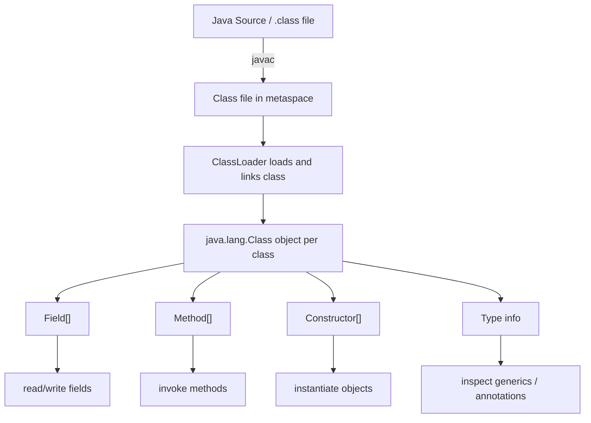
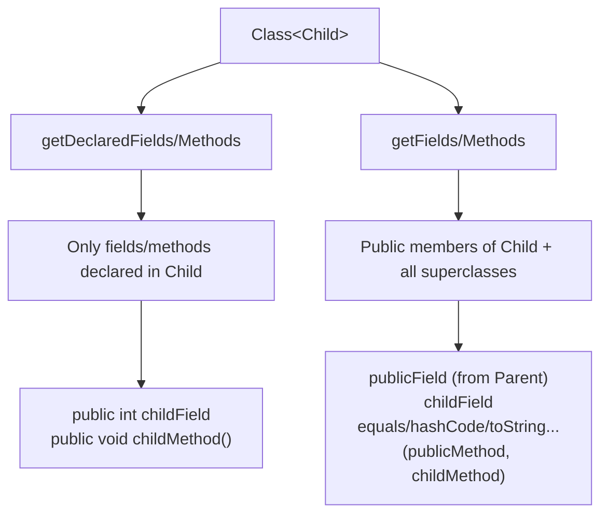
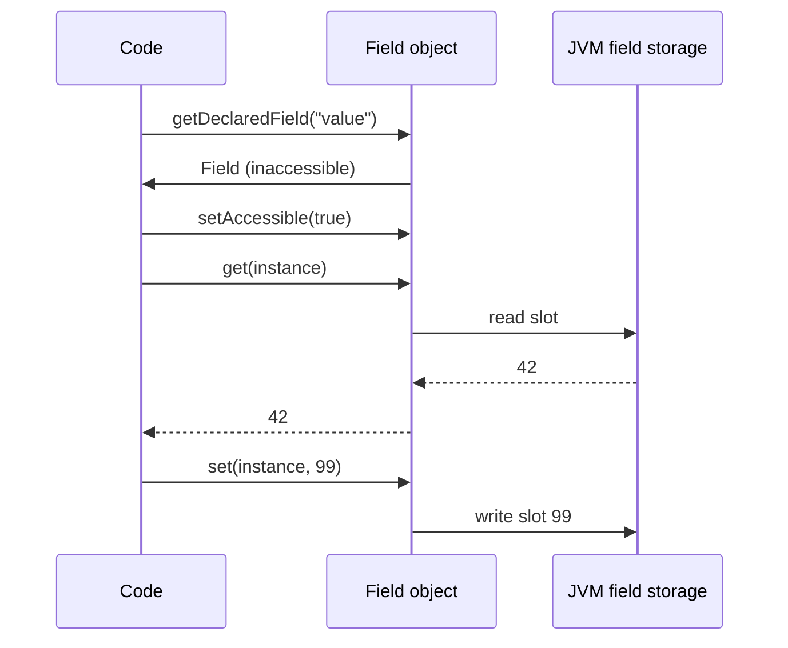
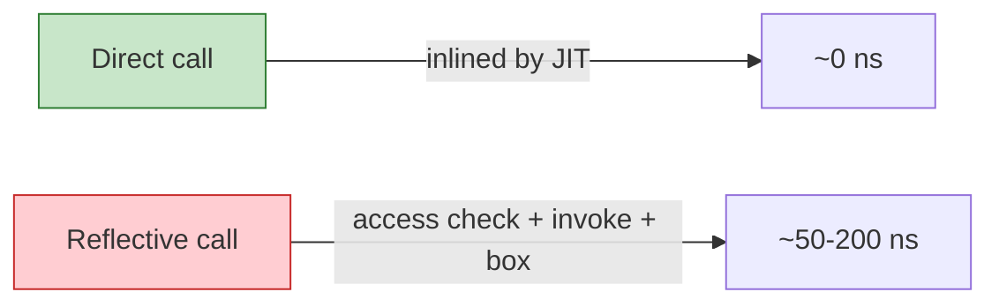

# Reflection

Reflection lets a running Java program inspect and manipulate classes, fields, methods, constructors,
and types at runtime. It is the foundation behind object-relational mappers, serialization frameworks,
dependency-injection containers, JSON parsers, proxy generators, and testing libraries. Reflection
trades type safety and performance for dynamism; this module explains how to use it, when to avoid it,
and how to use it safely.

## The reflection model

Java stores class metadata in the JVM's method area (metaspace). Every loaded class is represented at
runtime by an instance of `java.lang.Class`. When you write `String.class`, call `"foo".getClass()`,
or invoke `Class.forName("java.util.ArrayList")`, you obtain this meta-object. From a `Class` object
you can introspect members, instantiate objects, read and write fields, invoke methods, and inspect
generic type information.

```java
// Obtaining Class objects three ways
Class<String> c1 = String.class;          // compile-time class literal (no initialization)
Class<?> c2 = "foo".getClass();           // runtime instance
Class<?> c3 = Class.forName("java.util.ArrayList"); // by name (triggers initialization)
```

### Mermaid: reflection entry points



## Obtaining Class objects

| Source | Code | Initializes class? |
|--------|------|-------------------|
| Class literal | `String.class` | No |
| Instance | `obj.getClass()` | Already initialized |
| By name | `Class.forName(name)` | Yes (runs static initializers) |
| By name + init control | `Class.forName(name, false, loader)` | No |
| Wrapper classes | `Integer.TYPE` (`int.class`) | No |

```java
import java.lang.reflect.*;

public class ClassDemo {
    public static void main(String[] args) throws Exception {
        // Class literal — does NOT run static initializer
        Class<Integer> a = Integer.class;
        System.out.println("class literal name: " + a.getName());

        // ForName — DOES run static initializer by default
        Class<?> b = Class.forName("java.util.ArrayList");
        System.out.println("forName name: " + b.getName());

        // Obtain Class<?> from instance
        String s = "hello";
        System.out.println("instance class: " + s.getClass().getName());

        // Primitives and void
        System.out.println("int.class: " + int.class);
        System.out.println("void.class: " + void.class);

        // Array class
        Class<int[]> arr = int[].class;
        System.out.println("array class: " + arr.getComponentType());
    }
}
```

Output (run on Java 21):

```
class literal name: java.lang.Integer
forName name: java.util.ArrayList
instance class: java.lang.String
int.class: int
void.class: void
array class: int
```

## Member introspection

From a `Class` object you can enumerate fields, methods, constructors, and parameters. The JDK splits
reflection into two families:

- `get*` methods (`getDeclaredFields`, `getMethods`, etc.) return **public** members, including inherited ones.
- `getDeclared*` methods return members **declared in that class** (public, protected, package-private, private),
  but **not** inherited members.

| Method family | Visibility | Includes inherited? |
|---------------|------------|---------------------|
| `getFields()`/`getMethods()`/`getConstructors()` | public only | Yes |
| `getDeclaredFields()`/`getDeclaredMethods()` | all declared | No |

```java
import java.lang.reflect.*;

class Parent {
    public int publicField;
    private int privateField;
    public void publicMethod() {}
    private void privateMethod() {}
}

class Child extends Parent {
    public int childField;
    public void childMethod() {}
}

public class MemberIntrospection {
    public static void main(String[] args) {
        Class<Child> c = Child.class;

        System.out.println("--- Declared fields (this class only) ---");
        for (Field f : c.getDeclaredFields()) {
            System.out.println(f.getModifiers() + " " + f.getType().getSimpleName() + " " + f.getName());
        }

        System.out.println("--- Public fields (incl. inherited) ---");
        for (Field f : c.getFields()) {
            System.out.println(f.getType().getSimpleName() + " " + f.getName());
        }

        System.out.println("--- Declared methods (this class only) ---");
        for (Method m : c.getDeclaredMethods()) {
            System.out.println(Modifier.toString(m.getModifiers()) + " " + m.getName());
        }

        System.out.println("--- Public methods (incl. inherited / java.lang.Object) ---");
        for (Method m : c.getMethods()) {
            System.out.println(m.getName());
        }
    }
}
```

Sample output:

```
--- Declared fields (this class only) ---
1 public int childField
--- Public fields (incl. inherited) ---
1 public int publicField
1 public int childField
--- Declared methods (this class only) ---
1 public void childMethod
--- Public methods (incl. inherited / java.lang.Object) ---
publicMethod
childMethod
equals
hashCode
toString
getClass
...
```

### Mermaid: declared vs public introspection



## Reading and writing fields

To access a field reflectively:

1. Obtain a `Field` object (`getDeclaredField`/`getField`).
2. Call `setAccessible(true)` if you need to access non-public members (and you have module access via `--add-opens`).
3. Use `get(obj)` / `set(obj, value)` for instance fields, or `get(null)` / `set(null, value)` for static fields.
4. Primitives are auto-boxed/unboxed; use `getInt`/`setInt` etc. to avoid boxing.

```java
import java.lang.reflect.*;

class Widget {
    private int value = 42;
    static String tag = "default";
}

public class FieldAccess {
    public static void main(String[] args) throws Exception {
        Widget w = new Widget();

        Field f = Widget.class.getDeclaredField("value");
        f.setAccessible(true);
        System.out.println("before: " + f.get(w));          // 42
        f.set(w, 99);
        System.out.println("after:  " + f.get(w));          // 99

        // Static field via null target
        Field t = Widget.class.getDeclaredField("tag");
        t.setAccessible(true);
        System.out.println("static before: " + t.get(null)); // default
        t.set(null, "changed");
        System.out.println("static after:  " + t.get(null)); // changed

        // Primitive field — avoid boxing with typed accessors
        Field i = Widget.class.getDeclaredField("value");
        i.setAccessible(true);
        System.out.println("int accessor: " + i.getInt(w)); // 99
    }
}
```

Output:

```
before: 42
after: 99
static before: default
static after: changed
int accessor: 99
```

**Important:** `final` fields can be written reflectively, but if the field is a compile-time constant (`static final` of primitive/String type), `javac` inlines it at call sites, so reflective writes may not be observed by already-compiled code. Non-constant `final` instance fields can usually be mutated, but this is fragile and discouraged.

### Mermaid: field read/write flow



## Invoking methods

```java
import java.lang.reflect.*;

class Calculator {
    public int add(int a, int b) { return a + b; }
    private String secret(String s) { return "hidden:" + s; }
}

public class MethodInvoke {
    public static void main(String[] args) throws Exception {
        Calculator c = new Calculator();

        // Public method
        Method m = Calculator.class.getMethod("add", int.class, int.class);
        Object result = m.invoke(c, 2, 3);
        System.out.println("add(2,3) = " + result); // 5

        // Private method
        Method privateM = Calculator.class.getDeclaredMethod("secret", String.class);
        privateM.setAccessible(true);
        Object secret = privateM.invoke(c, "payload");
        System.out.println("secret = " + secret); // hidden:payload

        // Varargs method
        Method varargs = Calculator.class.getMethod("varargs", String[].class);
        // invoke with varargs: pass the array directly
        Object vr = varargs.invoke(c, (Object) new String[]{"a", "b"});
        System.out.println("varargs length via reflection: " + vr);
    }
}
```

`Method.invoke` wraps any exception thrown by the target method in `InvocationTargetException`. You must unwrap the cause to handle the real exception:

```java
try {
    method.invoke(target, args);
} catch (InvocationTargetException e) {
    Throwable cause = e.getCause();   // the real exception thrown by the target
    throw new RuntimeException(cause);
}
```

## Constructors and instantiation

```java
import java.lang.reflect.*;

class Person {
    private final String name;
    Person(String name) { this.name = name; }
    Person() { this.name = "unknown"; }
}

public class ConstructorDemo {
    public static void main(String[] args) throws Exception {
        Constructor<Person> ctor = Person.class.getDeclaredConstructor(String.class);
        ctor.setAccessible(true);
        Person p = ctor.newInstance("Ada");
        System.out.println(p.getClass().getSimpleName() + " name=" + p.getClass().getDeclaredField("name").get(p));
    }
}
```

Use `Constructor.newInstance(...)` rather than the deprecated `Class.newInstance()`. Reflectively constructed objects bypass normal constructor visibility rules when `setAccessible(true)` is used.

## Arrays via reflection

```java
import java.lang.reflect.*;

public class ArrayReflection {
    public static void main(String[] args) {
        // Create an int[3] reflectively
        int[] arr = (int[]) Array.newInstance(int.class, 3);
        Array.setInt(arr, 0, 10);
        Array.setInt(arr, 1, 20);
        Array.setInt(arr, 2, 30);
        System.out.println("length=" + Array.getLength(arr));
        System.out.println("element[1]=" + Array.getInt(arr, 1));
        System.out.println("componentType=" + arr.getClass().getComponentType());
    }
}
```

Output:

```
length=3
element[1]=20
componentType=int
```

## Generic type information at runtime

Java generics are erased, but `Type` objects preserve generic signatures where the compiler emits them
(`Signature` attribute in the class file). Use `getGenericReturnType`, `getGenericParameterTypes`,
`getGenericExceptionTypes`, and `getActualTypeArguments`.

```java
import java.lang.reflect.*;
import java.util.*;

class Box<T> {
    private T value;
    public T getValue() { return value; }
    public void setValue(T value) { this.value = value; }
}

class StringBox extends Box<String> {}

public class GenericReflection {
    public static void main(String[] args) throws Exception {
        // Box<T> — T is a TypeVariable
        Method getValue = Box.class.getDeclaredMethod("getValue");
        Type returnType = getValue.getGenericReturnType();
        System.out.println("Box.getValue generic return: " + returnType); // T

        // StringBox extends Box<String> — actual type argument preserved
        Method sbGetValue = StringBox.class.getMethod("getValue");
        Type sbReturn = sbGetValue.getGenericReturnType();
        System.out.println("StringBox.getValue generic return: " + sbReturn); // java.lang.String

        if (sbReturn instanceof ParameterizedType pt) {
            System.out.println("raw type: " + pt.getRawType()); // Box
            System.out.println("actual type args: " + java.util.Arrays.toString(pt.getActualTypeArguments())); // [java.lang.String]
        }
    }
}
```

Output:

```
Box.getValue generic return: T
StringBox.getValue generic return: java.lang.String
raw type: class java.util.Box
actual type args: [class java.lang.String]
```

## Module access and `--add-opens`

Since Java 9, reflective access to JDK internal packages (`java.base`, etc.) requires `--add-opens`.
Without it, `setAccessible(true)` on JDK-internal classes throws `InaccessibleObjectException`.

```bash
# Reflectively access a JDK-internal field
java --add-opens java.base/java.lang=ALL-UNNAMED MyApp
```

Your own modules must `open` packages to reflective access:

```java
module com.example.app {
    opens com.example.internal to java.reflect;   // or to ALL-UNNAMED
}
```

Key module commands:

| Flag | Purpose |
|------|---------|
| `--add-opens <pkg>/<mod>=<target>` | Open a package to a module for reflection |
| `--add-reads <mod1> <mod2>` | Readability edge |
| `--add-exports <pkg>/<mod>=<target>` | Export package for compile/runtime use |
| `--patch-module <mod>=<path>` | Overlay classes onto a module |

Use `Module::canRead` and `Module::isOpen` to check accessibility programmatically.

```java
import java.lang.reflect.*;

public class ModuleAccess {
    public static void main(String[] args) {
        Module m = ModuleLayer.boot().findModule("java.base").orElseThrow();
        System.out.println("java.base reads java.logging: " + m.canRead(ModuleLayer.boot().findModule("java.logging").orElseThrow()));
        System.out.println("java.base is open to ALL-UNNAMED for java.lang.reflect: " +
            m.isOpen("java.lang.reflect", ModuleLayer.boot().configuration().module("ALL-UNNAMED").orElse(null)));
    }
}
```

## Performance considerations

Reflection is significantly slower than direct access:

- **No JIT inlining**: reflective calls (`Field.get`, `Method.invoke`) are not inlined by the C2 compiler.
- **Access checks**: `setAccessible(true)` triggers security/module checks on first access; subsequent accesses are cached but still slower.
- **Boxing overhead**: `Field.get`/`set` operate on `Object`, causing boxing/unboxing for primitives.
- **Object allocation**: `InvocationTargetException`, `Method`/`Field` wrapper objects.

**Best practice:** Cache `Method`/`Field`/`Constructor` objects after the first lookup; avoid reflection in hot loops. If you need fast reflective-style access, consider `MethodHandle`/`VarHandle` (module 43), which the JIT can optimize more aggressively.

### Mermaid: direct vs reflective call



## Security

Reflection is a powerful attack surface:

- It can bypass encapsulation and mutate `final` fields, private state, and JDK internals.
- Malicious code can use reflection to escape sandboxes, which is why `SecurityManager` existed (removed in Java 17).
- Modern mitigation: `--add-opens` minimal grants, module `opens` directives, and never exposing untrusted reflective invocation.

**Rule of thumb:** Use reflection only when the dynamism is genuinely required (frameworks, proxies, serialization). Prefer compile-time code generation, method handles, or explicit interfaces where possible.

## Comparison table

| Technique | Type safety | Performance | Use case |
|-----------|-------------|-------------|----------|
| Direct method/field access | Compile-time checked | Fastest (JIT-inlined) | Normal application code |
| Reflection (`Method`/`Field`) | Runtime-checked | Slow | Frameworks, proxies, serialization |
| `MethodHandle`/`VarHandle` | Runtime-checked | Faster than reflection | Low-level JVM access, JIT-friendly |
| Code generation (annotation processor) | Compile-time checked | Fastest | Boilerplate elimination |

## Common mistakes

- **`Class.forName` initializes the class**: it runs static initializers; use the three-arg form with `initialize=false` if you only want the `Class` object.
- **Forgetting `setAccessible(true)`**: accessing private members throws `IllegalAccessException`.
- **Not unwrapping `InvocationTargetException`**: the real target exception is the `getCause()`.
- **Assuming `final` fields cannot change**: they can via reflection (except compile-time constants), but it's unreliable.
- **Using `.getName()` instead of `.getTypeName()`**: `getTypeName()` includes type parameters and array brackets.
- **Reflecting across module boundaries without `--add-opens`**: throws `InaccessibleObjectException`.

# Interview Questions

## Beginner

**Q1. What is reflection in Java, and when would you use it?**

Reflection is the ability of a running program to inspect and modify its own structure — classes, fields, methods, constructors — at runtime via the `java.lang.reflect` package. Use it when you need dynamism that static typing cannot provide: dependency injection containers, ORMs, JSON serializers, mocking frameworks, and test runners. The trade-off is lost compile-time type checking and slower performance.

**Q2. How do you obtain a `Class` object?**

Three common ways: `SomeClass.class` (class literal, no initialization), `instance.getClass()` (runtime instance), and `Class.forName("fully.qualified.Name")` (by name, initializes the class by default).

**Q3. What is the difference between `getDeclaredMethods()` and `getMethods()`?**

`getDeclaredMethods()` returns all methods declared in that class (public, protected, package-private, private) but not inherited ones. `getMethods()` returns all public methods, including inherited public methods from superclasses and implemented interfaces.

**Q4. What does `setAccessible(true)` do?**

It suppresses Java language access checks, allowing reflective read/write of private, protected, and package-private members. Cross-module reflective access additionally requires `--add-opens`.

**Q5. What exception does `Method.invoke` wrap the target's exception in?**

`InvocationTargetException`. The actual exception thrown by the target method is available via `getCause()`.

## Intermediate

**Q6. What is the difference between `Class.forName(name)` and `Class.forName(name, initialize, classLoader)`?**

The two-arg form always initializes the class (runs static initializers). The three-arg form lets you control initialization; pass `false` to obtain the `Class` object without running static initializers, and specify the class loader explicitly.

**Q7. Can reflection access private fields? How?**

Yes. Obtain the `Field` via `getDeclaredField`, call `setAccessible(true)`, then use `get`/`set`. Cross-module access additionally requires `--add-opens` on the owning module.

**Q8. How do you create an instance of a class reflectively when its constructor is private?**

Get the `Constructor` via `getDeclaredConstructor`, call `setAccessible(true)`, then invoke `newInstance(args)`. This bypasses normal visibility checks.

**Q9. What happens if a method invoked via reflection throws an exception?**

`Method.invoke` wraps it in `InvocationTargetException`. Call `getCause()` to retrieve the original exception thrown by the target method.

**Q10. Are `final` fields mutable via reflection?**

Usually yes for non-constant instance fields, but it is fragile and discouraged. Compile-time constants (`static final` primitives/String) are inlined by `javac` at call sites, so reflective changes may not be observed by already-compiled code.

## Advanced

**Q11. How does Java preserve generic type information at runtime despite erasure?**

Generic signatures are stored in the `Signature` attribute of the class file. The reflection API exposes `Type` objects (`ParameterizedType`, `TypeVariable`, `WildcardType`, `GenericArrayType`) via methods like `getGenericReturnType()` and `getGenericParameterTypes()`, letting you recover actual type arguments where the compiler recorded them.

**Q12. What is `--add-opens`, and why is it needed for reflection?**

Since Java 9, the module system encapsulates JDK packages. Reflectively accessing non-public members of JDK-internal classes requires `--add-opens <package>/<module>=<target>` (e.g., `--add-opens java.base/java.lang=ALL-UNNAMED`). Your own modules `open` packages explicitly via module-info directives.

**Q13. Why is reflection slower than direct access?**

Reflective calls are not JIT-inlined, incur access/security checks, and `Field.get`/`set` box primitives into `Object`. Cache `Method`/`Field`/`Constructor` objects and avoid reflection in hot paths; consider `MethodHandle`/`VarHandle` for performance-sensitive reflective-style access.

**Q14. How do you read generic type arguments of a subclass at runtime?**

Use `getGenericSuperclass()` or inspect `Method.getGenericReturnType()`. If the result is a `ParameterizedType`, call `getActualTypeArguments()` to recover e.g. `String` from `StringBox extends Box<String>`.

**Q15. What is the `SecurityManager` and why was it removed?**

The `SecurityManager` sandboxed reflective and other dangerous operations. It was removed in Java 17 because it was complex, rarely used correctly, and imposed performance overhead; modern encapsulation is handled by the module system (`--add-opens`).

## Expert

**Q16. Can reflection mutate a `static final` field?**

Reflectively, yes via `Field.set(null, value)` after `setAccessible(true)`, but compile-time constant `static final` fields are inlined by `javac` at every use site, so the change may be invisible to compiled callers. Non-constant `static final` fields can be changed, but this breaks encapsulation and can cause subtle bugs.

**Q17. How does reflection interact with Java modules?**

Modules encapsulate packages. A module must `open` a package (via `opens` in module-info) for another module to reflectively access its non-public members. Use `--add-opens` at launch for quick access, or `Module::canRead`/`isOpen` to check programmatically.

**Q18. What is a `TypeVariable`, and when do you see one?**

A `TypeVariable` represents an unresolved generic parameter (e.g., `T` in `Box<T>`). You encounter it when inspecting generic declarations whose type arguments are not fixed — for example, `Box.class.getMethod("getValue").getGenericReturnType()` returns the `TypeVariable` `T`, not `String`.

**Q19. How do `Field.get`/`set` handle primitives?**

They accept and return `Object`, so primitives are auto-boxed/unboxed. To avoid boxing, use typed accessors such as `getInt`, `setInt`, `getLong`, `setLong`, etc., which operate on primitive values directly.

**Q20. When should you prefer `MethodHandle` over `Method.invoke`?**

`MethodHandle` (and `VarHandle`) are lower-level, JIT-friendly alternatives to reflection. Use them when you need reflective-style access with near-direct-call performance, such as in language runtimes, serialization frameworks, or property-based accessors.

## Scenario Based

**Q21. You are building a JSON serializer that must serialize any object's fields, including private ones. How do you use reflection, and what safeguards do you add?**

I would traverse the object graph using `getDeclaredFields` + `setAccessible(true)`, handle cycles with a visited-set, respect `transient` fields, handle `null`, and invoke only whitelisted getters. Safeguards: limit recursion depth, catch `InvocationTargetException`, avoid serializing sensitive fields (passwords, tokens), and configure `--add-opens` minimally for the framework's own modules rather than opening everything.

**Q22. A framework fails with `InaccessibleObjectException` when reflecting on a JDK class at startup. How do you fix it?**

Add `--add-opens <package>/<module>=ALL-UNNAMED` to the JVM launch args for the specific package the framework needs (e.g., `java.base/java.lang`). Prefer upgrading the framework to a module-aware version that uses public APIs rather than opening all JDK packages indiscriminately.

**Q23. You need to invoke a method whose name and parameter types are known only at runtime (e.g., from a configuration file). How do you implement this safely?**

Look up the `Method` via `getMethod`/`getDeclaredMethod` using the runtime name and `Class<?>[]` parameter types, validate parameter count/types against the supplied arguments, call `setAccessible(true)` if needed, wrap the invocation in try/catch for `IllegalAccessException`, `InvocationTargetException`, and `IllegalArgumentException`, and unwrap `InvocationTargetException.getCause()`.

**Q24. A teammate proposes using reflection to set `final` fields for test setup. What do you advise?**

Advise against it: it's fragile, breaks encapsulation, can fail for compile-time constants (inlined), and produces non-portable behavior across JVMs. Prefer constructors, factory methods, dependency injection, or test doubles/mocks instead.

**Q25. You need to determine at runtime whether a field's type is a generic collection (e.g., `List<String>` vs `List<Integer>`). What can and cannot you know?**

You can know the raw type (`List`) and whether it is parameterized. Because of erasure, you generally cannot determine `String` vs `Integer` from a field's declared type alone at runtime; you need the `Signature` attribute / `Type` information from a method return or supertype, or you must inspect actual instances.

## Output Prediction

**Q26. What does this print?**

```java
import java.lang.reflect.Field;

public class Q26 {
    private int x = 10;
    public static void main(String[] args) throws Exception {
        Q26 obj = new Q26();
        Field f = Q26.class.getDeclaredField("x");
        f.setAccessible(true);
        System.out.println(f.get(obj));
        f.setInt(obj, 99);
        System.out.println(obj.x);
    }
}
```

**Output:**
```
10
99
```

**Reason:** `getDeclaredField("x")` finds the private field; `setAccessible(true)` permits access; `f.get(obj)` reads 10; `setInt(obj, 99)` writes 99 directly (no boxing); `obj.x` reads the mutated field.

**Q27. What does this print?**

```java
public class Q27 {
    static { System.out.println("static init"); }
    public static void main(String[] args) throws Exception {
        Class<?> c = Class.forName("Q27");
    }
}
```

**Output:**
```
static init
```

**Reason:** The two-arg `Class.forName` initializes the class by default, running its static initializer.

**Q28. What does this print?**

```java
public class Q28 {
    public static final int CONST = 42;
    public static void main(String[] args) throws Exception {
        java.lang.reflect.Field f = Q28.class.getDeclaredField("CONST");
        f.setAccessible(true);
        f.setInt(null, 99);
        System.out.println(Q28.CONST);
    }
}
```

**Output:**
```
42
```

**Reason:** `CONST` is a compile-time constant; `javac` inlines `42` at every use site (`System.out.println(Q28.CONST)` becomes `println(42)`), so the reflective write to the field is not observed.

**Q29. What does this print?**

```java
public class Q29 {
    public static void main(String[] args) throws Exception {
        Method m = Q29.class.getMethod("thrower");
        try { m.invoke(null); } catch (InvocationTargetException e) {
            System.out.println(e.getCause().getClass().getSimpleName());
        }
    }
    public static void thrower() { throw new IllegalStateException("boom"); }
}
```

**Output:**
```
IllegalStateException
```

**Reason:** `Method.invoke` wraps the target's `IllegalStateException` in `InvocationTargetException`; `getCause()` recovers the original.

**Q30. What does this print?**

```java
public class Q30 {
    public static void main(String[] args) {
        System.out.println(String.class.getName());
        System.out.println(String[].class.getName());
        System.out.println(int[].class.getComponentType().getName());
    }
}
```

**Output:**
```
java.lang.String
[Ljava.lang.String;
int
```

**Reason:** `getName()` returns the internal binary name; array classes are named `[L<classname>;` for objects and `[I` for `int[]`; `getComponentType()` of `int[].class` is `int.class`.

## Internal Working

**Q31. How does the JVM represent a class at runtime, and what does `java.lang.Class` point to?**

Each loaded class has an instance of `java.lang.Class` in the method area (metaspace). The `Class` object holds a pointer to the `Klass` (JVM internal class metadata), constant pool, method table (vtable/itable), fields, modifiers, superclass, interfaces, class loader, and protection domain. Reflection reads this metadata through accessor methods.

**Q32. What bytecode instructions implement reflective field access?**

Reflective `Field.get`/`set` are implemented in native code (`java.lang.reflect.Field` delegates to `sun.reflect.Reflection`/`jdk.internal.reflect`). They do not generate `getfield`/`putfield` at the reflective call site; instead the JVM performs access checks and reads/writes the field slot directly, with the access check cached after the first successful `setAccessible` call.

**Q33. What is the `Signature` attribute, and how does it relate to generic reflection?**

The `Signature` attribute in a class file records generic type information (type variables, parameterized types, bounds) that erasure removes from bytecode signatures. The reflection `Type` API (`ParameterizedType`, `TypeVariable`, etc.) reads this attribute, which is why generic type arguments survive for methods/fields but not for local variables.

**Q34. How does `--add-opens` differ from `--add-exports`?**

`--add-exports` makes a package's **public** types accessible to other modules at compile and runtime. `--add-opens` additionally allows **deep reflection** (non-public members) into that package. Opening `java.base/java.lang` to `ALL-UNNAMED` lets any code reflect on `java.lang` internals.

**Q35. Why can't reflection access a `private` method in a class from another module without `--add-opens`?**

The module system enforces strong encapsulation. Even if `setAccessible(true)` is called, the JVM checks whether the caller's module reads the target module and whether the target package is `open` to the caller. Without `--add-opens`/`opens`, `InaccessibleObjectException` is thrown.

## Tricky Questions

**Q36. Can `Class.forName` load a class without running its static initializer?**

Yes — use the three-arg form `Class.forName(name, false, classLoader)`. The two-arg form always initializes.

**Q37. Can reflection create an instance of a class with no public constructor?**

Yes — `getDeclaredConstructor(...)` + `setAccessible(true)` + `newInstance(...)`. This works even for private constructors, subject to module access rules.

**Q38. Does `getDeclaredField` find fields declared in superclasses?**

No. `getDeclaredField` only searches the class it is called on, not its superclasses. Use `getField` (public, inherited included) or walk the superclass chain manually with `getSuperclass()`.

**Q39. Can you call a private constructor from outside the class via reflection?**

Yes, with `setAccessible(true)` and module access. This is how frameworks like Mockito and serialization libraries instantiate objects without invoking public constructors.

**Q40. Is `Field.getInt` equivalent to `(Integer) field.get(obj)` for an int field?**

Functionally yes for reading, but `getInt` avoids boxing/unboxing and is faster. `field.get(obj)` returns an `Integer` (boxed), while `getInt` returns a primitive `int`. Use the typed accessors in performance-sensitive code.