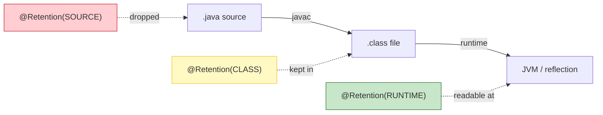
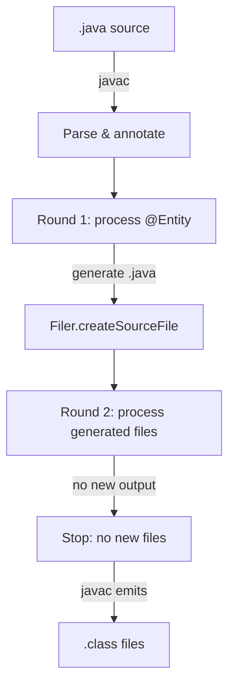

# Annotations

Annotations are metadata attached to Java program elements. They do not change program semantics directly; instead, tools read them at compile time (annotation processing), at runtime (reflection), or never (source-only hints). This module covers defining annotations, retention and targets, meta-annotations, runtime reading, compile-time annotation processing, and the frameworks built on them.

## Core concepts

An annotation is an interface that extends `java.lang.annotation.Annotation`. Its methods are elements with restricted return types (primitives, `String`, `Class`, `enum`, annotation, arrays) and default values. You cannot declare `null` defaults or arbitrary methods.

```java
import java.lang.annotation.*;

@Target(ElementType.TYPE, ElementType.METHOD)
@Retention(RetentionPolicy.RUNTIME)
public @interface Audit {
    String value() default "";
    boolean logArgs() default false;
    String[] tags() default {};
}
```

Usage:

```java
@Audit(value = "payment", logArgs = true, tags = {"finance", "pii"})
public void charge(Order order, Money amount) { ... }
```

## Meta-annotations

Meta-annotations annotate other annotations. They control where, how long, and how an annotation behaves.

| Meta-annotation | Purpose | Values |
|-----------------|---------|--------|
| `@Target` | Where the annotation may appear | `TYPE`, `FIELD`, `METHOD`, `PARAMETER`, `CONSTRUCTOR`, `LOCAL_VARIABLE`, `ANNOTATION_TYPE`, `PACKAGE`, `TYPE_PARAMETER`, `TYPE_USE` |
| `@Retention` | How long it is kept | `SOURCE` (source only), `CLASS` (class file, not runtime), `RUNTIME` (runtime via reflection) |
| `@Documented` | Include in Javadoc | marker |
| `@Inherited` | Inherited by subclasses | Only works on `TYPE` annotations |
| `@Repeatable` | Allow multiple instances | Requires a container annotation |
| `@Native` | Hint that value may be referenced from native code | marker |
| `@Generated` | Marks code generated by a tool | marker |

## Built-in annotations

- `@Override` — compile-time check that a method overrides a supertype method. Catches misspelled overrides.
- `@Deprecated(forRemoval = ..., since = ...)` — marks API as deprecated; `forRemoval = true` signals planned removal.
- `@SuppressWarnings` — tells the compiler to suppress specific warnings (e.g., `"unchecked"`, `"deprecation"`, `"rawtypes"`).
- `@SafeVarargs` — asserts that a varargs method does not perform potentially unsafe operations on its varargs parameter.
- `@FunctionalInterface` — ensures the interface has exactly one abstract method (useful documentation and compile-time check).
- `@Native` — indicates a `int`/`long` constant may be used from native code.
- `@Generated` — marks source generated by annotation processors or tools.

## Retention and target rules

```java
// SOURCE: dropped by the compiler; useful for lint/style checkers
@Retention(RetentionPolicy.SOURCE)
@Target(ElementType.METHOD)
public @interface Todo {}

// CLASS: retained in .class, not visible at runtime (default if @Retention omitted)
@Retention(RetentionPolicy.CLASS)
@Target(ElementType.FIELD)
public @interface Internal {}

// RUNTIME: retained in .class and readable via reflection
@Retention(RetentionPolicy.RUNTIME)
@Target(ElementType.TYPE)
public @interface Entity {}
```

### Mermaid: retention lifecycle



## Defining custom annotations

```java
import java.lang.annotation.*;

@Target(ElementType.METHOD)
@Retention(RetentionPolicy.RUNTIME)
@Repeatable(Permissions.class)
public @interface Permission {
    String value();
    String[] roles() default {"USER"};
}

@Target(ElementType.METHOD)
@Retention(RetentionPolicy.RUNTIME)
public @interface Permissions {
    Permission[] value();
}
```

Rules for annotation element types:

- Allowed: primitives, `String`, `Class<?>`, `enum`, annotations, arrays of the above, and `void` (for marker-style).
- Not allowed: `null` defaults, arbitrary return types, `throws`, `default` with non-constant expressions (must be compile-time constant).

## Reading annotations at runtime

Only `RUNTIME` annotations are visible via `AnnotatedElement` (`Class`, `Method`, `Field`, `Constructor`, `Package`, `Parameter`).

```java
import java.lang.annotation.*;
import java.lang.reflect.*;

@Target(ElementType.METHOD)
@Retention(RetentionPolicy.RUNTIME)
public @interface Benchmark { long iterations() default 1; }

public class RuntimeRead {
    @Benchmark(iterations = 1000)
    public void work() {}

    public static void main(String[] args) throws Exception {
        Method m = RuntimeRead.class.getMethod("work");
        Benchmark b = m.getAnnotation(Benchmark.class);
        if (b != null) {
            System.out.println("iterations=" + b.iterations());
        }
        // Repeatable annotations use getAnnotationsByType
        Permission[] perms = m.getAnnotationsByType(Permission.class);
        for (Permission p : perms) {
            System.out.println("perm=" + p.value() + " roles=" + java.util.Arrays.toString(p.roles()));
        }
    }
}
```

For **type-use** annotations (e.g., on `List<String>`), use `AnnotatedType`:

```java
import java.lang.reflect.*;

AnnotatedType at = method.getAnnotatedReturnType();
Annotation[] anns = at.getAnnotations();
```

## Annotation processing (compile time)

Compile-time annotation processing runs during `javac` via the `javax.annotation.processing` API. A processor implements `Processor`, is discovered through `META-INF/services/javax.annotation.processing.Processor`, and receives `RoundEnvironment` plus `ProcessingEnvironment` (providing `Elements`, `Types`, `Filer`, `Messager`, options).

Minimal processor skeleton:

```java
import javax.annotation.processing.*;
import javax.lang.model.element.*;
import javax.lang.model.util.*;
import javax.tools.*;
import java.util.*;
import java.util.stream.*;

@SupportedAnnotationTypes("com.example.Entity")
@SupportedSourceVersion(SourceVersion.RELEASE_21)
public class EntityProcessor extends AbstractProcessor {
    private Filer filer;
    private Elements elements;
    private Types types;

    @Override
    public synchronized void init(ProcessingEnvironment env) {
        super.init(env);
        filer = env.getFiler();
        elements = env.getElementUtils();
        types = env.getTypeUtils();
    }

    @Override
    public boolean process(Set<? extends TypeElement> annotations, RoundEnvironment roundEnv) {
        for (TypeElement annotation : annotations) {
            for (Element elem : roundEnv.getElementsAnnotatedWith(annotation)) {
                processingEnv.getMessager().printMessage(
                    Diagnostic.Kind.NOTE, "Found @Entity on " + elem, elem);
                // Generate source via filer.createSourceFile(...)
            }
        }
        return false; // true = claim annotations, no further processing
    }
}
```

Register in `META-INF/services/javax.annotation.processing.Processor`:

```
com.example.EntityProcessor
```

Compile and run:

```bash
javac --processor-path processor.jar -processor com.example.EntityProcessor MyApp.java
```

or with modules:

```bash
javac --processor-module-path processor.jar --processor-module com.example.processor MyApp.java
```

### Mermaid: annotation processing flow



## Common processors and frameworks

- **Lombok** — generates getters/setters/equals/hashCode/`@Data` via annotation processing (`delombok` to inspect output).
- **MapStruct** — generates type-safe bean mappers at compile time.
- **Error Prone / NullAway** — Google's compile-time bug-finding and nullness analysis.
- **Dagger / Hilt** — compile-time dependency injection graph generation.
- **AutoValue** — generates immutable value classes.
- **JPA/Hibernate** — `@Entity` mapping metadata (runtime + compile-time enhancement).
- **Spring** — Spring 6+ uses AOT processing (`@RuntimeHints`, `RegisterRuntimeHints`) to reduce reflection.

## Common mistakes

- **Wrong retention**: A `SOURCE` annotation is invisible at runtime; a `CLASS` annotation is invisible to `getAnnotation`.
- **Missing `@Target`**: the annotation may be misapplied; always declare `@Target`.
- **`@Inherited` only works on `TYPE`**: it does not apply to methods or fields, and inheritance is single-parent.
- **Repeatable annotation without container**: `@Repeatable` requires a container annotation whose `value()` element returns an array of the repeatable type.
- **Processor not registered**: missing `META-INF/services` entry means `javac` never invokes your processor.
- **`--processor-path` vs `--processor-module-path`**: use the former for classpath processors, the latter for module-path processors.
- **Returning `true` from `process`**: claims all matched annotations, preventing other processors from seeing them; return `false` unless you intend to claim.
- **Annotation on local variable**: `LOCAL_VARIABLE` targets are not retained even with `RUNTIME` for local variable declarations in most cases; type-use (`TYPE_USE`) is different.

## Comparison table

| Retention | Visible to | Typical use |
|-----------|-----------|-------------|
| `SOURCE` | Compiler / source tools only | Lint, style checks (`@SuppressWarnings`, `@Todo`) |
| `CLASS` | `.class` file, not runtime | Bytecode tools, compile-time processors |
| `RUNTIME` | Reflection at runtime | Frameworks (`@Entity`, `@Benchmark`, `@Permission`) |

| Processing | Timing | Strength |
|------------|--------|----------|
| Compile-time APT | During `javac` | Generate code, fail fast, no runtime cost |
| Runtime reflection | Application startup/call | Dynamic behavior, but slower |

## Performance

- Compile-time processing has **zero runtime cost**; generated code runs as fast as hand-written code.
- Runtime annotation lookup via `getAnnotation` is reflective and not JIT-inlined; cache results if called frequently.
- Frameworks that scan the classpath for annotations at startup increase startup time; prefer compile-time generation (e.g., Spring AOT) for fast startup.

# Interview Questions

## Beginner

**Q1. What is an annotation in Java?**

An annotation is metadata attached to a program element (class, method, field, parameter, etc.). It does not change semantics by itself; tools read it at compile time or runtime.

**Q2. What is the difference between `@Retention(SOURCE)`, `@Retention(CLASS)`, and `@Retention(RUNTIME)`?**

`SOURCE` is dropped by the compiler; `CLASS` is kept in the `.class` file but not visible at runtime; `RUNTIME` is kept and readable via reflection.

**Q3. Name three built-in Java annotations and their purpose.**

`@Override` (verifies a method overrides), `@Deprecated` (marks API as outdated), `@SuppressWarnings` (tells the compiler to ignore specific warnings).

**Q4. What is `@Target` used for?**

It restricts where an annotation may appear (e.g., `METHOD`, `FIELD`, `TYPE`, `PARAMETER`).

**Q5. What interface must a custom annotation extend implicitly?**

Every annotation implicitly extends `java.lang.annotation.Annotation`.

## Intermediate

**Q6. How do you read a `RUNTIME` annotation reflectively?**

Use `AnnotatedElement.getAnnotation(AnnotationClass.class)` on a `Class`, `Method`, `Field`, or `Constructor`. For repeatable annotations, use `getAnnotationsByType`.

**Q7. What is `@Repeatable`, and what is required to use it?**

`@Repeatable` allows an annotation to appear multiple times on the same element. It requires a container annotation whose `value()` element returns an array of the repeatable annotation type.

**Q8. What does `@Inherited` do, and what is its limitation?**

`@Inherited` lets a `TYPE` annotation be inherited by subclasses. It only works on type annotations, not methods or fields, and only for direct single inheritance.

**Q9. How do you register an annotation processor so `javac` discovers it?**

Create `META-INF/services/javax.annotation.processing.Processor` containing the fully qualified processor class name, and place it on the processor path/module path.

**Q10. What is the difference between `@SuppressWarnings("unchecked")` and `@SafeVarargs`?**

`@SuppressWarnings` tells the compiler to ignore a warning; `@SafeVarargs` asserts that a varargs method is type-safe with respect to its varargs parameter (allowed only on static/final/private methods or constructors).

## Advanced

**Q11. What is the difference between an annotation on a local variable and a type-use annotation?**

`@Target(ElementType.LOCAL_VARIABLE)` annotates the variable declaration itself; `TYPE_USE` annotates any use of a type (e.g., `List<@NonNull String>`) and is retained with the type in the `Signature` attribute, readable via `AnnotatedType`.

**Q12. How does an annotation processor generate new source files?**

Via `ProcessingEnvironment.getFiler().createSourceFile(...)` / `createClassFile(...)`. Generated files may trigger additional processing rounds until no new files are produced.

**Q13. What does `process` returning `true` vs `false` mean?**

`true` claims the annotations so no other processor processes them in later rounds; `false` allows other processors to handle them too. Return `false` unless you intend to claim.

**Q14. Can annotations have `null` default values or non-constant defaults?**

No. Annotation element defaults must be compile-time constant expressions; `null` is not allowed.

**Q15. How does Lombok generate code without runtime reflection?**

Lombok is an annotation processor that hooks into `javac`'s AST and modifies/augments it during compilation, generating bytecode directly rather than relying on runtime reflection.

## Expert

**Q16. What is `AnnotationFormatError`?**

Thrown when the annotation parser encounters a malformed annotation (e.g., missing required element, invalid element value) while reading annotations from a class file.

**Q17. How does `ElementType.TYPE_USE` differ from `ElementType.TYPE`?**

`TYPE` annotates declarations (class, interface, enum, annotation type). `TYPE_USE` annotates any use of a type (generics, casts, `instanceof`, `new`, throws, etc.) and is read via `AnnotatedType`.

**Q18. How do you pass options to an annotation processor?**

Use `-Akey=value` on the `javac` command line; read them via `ProcessingEnvironment.getOptions().get("key")`.

**Q19. What is a "round" in annotation processing, and when does processing stop?**

A round is one invocation of all processors over the current set of source files. Processing stops when a round generates no new source or class files.

**Q20. How do Spring and Hibernate use annotations differently?**

Hibernate reads `@Entity`/`@Id` mostly at runtime via reflection (plus optional bytecode enhancement). Spring 6+ combines runtime scanning with compile-time AOT hint generation (`@RuntimeHints`) to reduce reflective classpath scanning and improve startup and native-image support.

## Scenario Based

**Q21. You need a custom `@LogExecution` annotation that logs method entry/exit. Should you use compile-time processing or runtime reflection?**

Use **compile-time processing** to generate logging bytecode around the method (zero runtime reflection cost, fast startup), or use a bytecode/agent approach. Runtime reflection would work but adds per-call overhead and startup scanning cost.

**Q22. A team creates a custom `@Required` annotation but it is not visible at runtime via `getAnnotation`. What is wrong?**

Most likely `@Retention` is `SOURCE` or `CLASS` (not `RUNTIME`), or `@Target` does not include `METHOD`/`FIELD`. Fix: `@Retention(RetentionPolicy.RUNTIME)` and appropriate `@Target`.

**Q23. You need to apply the same annotation twice to a method with different values. How?**

Use `@Repeatable` with a container annotation holding an array of the repeatable annotation, then read with `getAnnotationsByType`.

**Q24. Your annotation processor generates a `.java` file, but `javac` complains it cannot find it in later rounds. What did you miss?**

Ensure you called `filer.createSourceFile(...)` and that the generated file is on the source/path being compiled; generated files are picked up in the next round automatically by `javac`.

**Q25. You want a compile-time error when a method overrides another but forgets `@Override`. How?**

Write an annotation processor that inspects overridden methods and emits a `Diagnostic` via `Messager` when an overriding method lacks `@Override`.

## Output Prediction

**Q26. What does this print?**

```java
import java.lang.annotation.*;
import java.lang.reflect.*;

@Target(ElementType.METHOD)
@Retention(RetentionPolicy.RUNTIME)
@interface Tag { String value(); }

public class Q26 {
    @Tag("alpha")
    @Tag("beta")
    public void run() {}
    public static void main(String[] args) throws Exception {
        Method m = Q26.class.getMethod("run");
        Tag[] tags = m.getAnnotationsByType(Tag.class);
        System.out.println(tags.length);
        for (Tag t : tags) System.out.println(t.value());
    }
}
```

**Output:**
```
2
alpha
beta
```

**Reason:** `@Tag` must be `@Repeatable` with a container; `getAnnotationsByType` returns both instances.

**Q27. What does this print?**

```java
import java.lang.annotation.*;
import java.lang.reflect.*;

@Target(ElementType.TYPE)
@Retention(RetentionPolicy.RUNTIME)
@interface Version { int value(); }

@Version(1)
class Base {}
class Child extends Base {}

public class Q27 {
    public static void main(String[] args) {
        System.out.println(Base.class.isAnnotationPresent(Version.class));
        System.out.println(Child.class.isAnnotationPresent(Version.class));
    }
}
```

**Output:**
```
true
false
```

**Reason:** `@Version` lacks `@Inherited`, so `Child` does not inherit it from `Base`.

**Q28. What does this print?**

```java
import java.lang.annotation.*;
import java.lang.reflect.*;

@Target(ElementType.METHOD)
@Retention(RetentionPolicy.SOURCE)
@interface Lint {}

public class Q28 {
    @Lint
    public void run() {}
    public static void main(String[] args) throws Exception {
        Method m = Q28.class.getMethod("run");
        System.out.println(m.isAnnotationPresent(Lint.class));
    }
}
```

**Output:**
```
false
```

**Reason:** `SOURCE` retention is dropped by `javac`; the annotation is not in the `.class` file and not visible at runtime.

**Q29. What does this print?**

```java
public class Q29 {
    @SuppressWarnings("unchecked")
    public static void main(String[] args) {
        List raw = new ArrayList();
        List<String> list = (List<String>) (List) raw;
        System.out.println(list.getClass().getSimpleName());
    }
}
```

**Output:**
```
ArrayList
```

**Reason:** `@SuppressWarnings("unchecked")` silences the unchecked cast warning; the cast succeeds at runtime because generics are erased, and the actual object is an `ArrayList`.

**Q30. What does this print?**

```java
import java.lang.annotation.*;
import java.lang.reflect.*;

@Target(ElementType.TYPE_USE)
@Retention(RetentionPolicy.RUNTIME)
@interface NonNull {}

public class Q30 {
    public static void main(String[] args) throws Exception {
        Method m = Q30.class.getMethod("getList");
        AnnotatedType at = m.getAnnotatedReturnType();
        System.out.println(at.isAnnotationPresent(NonNull.class));
    }
    @NonNull List<String> getList() { return null; }
}
```

**Output:**
```
true
```

**Reason:** The `TYPE_USE` annotation on the return type is captured in `AnnotatedReturnType` and readable at runtime via `getAnnotatedReturnType()`.

## Internal Working

**Q31. How does `javac` store annotations in a `.class` file?**

`RUNTIME` and `CLASS` retention annotations are stored in the `RuntimeVisibleAnnotations` / `RuntimeInvisibleAnnotations` attributes (and `RuntimeVisibleParameterAnnotations`, etc.) of the relevant class/field/method structure. Type-use annotations go in `RuntimeVisibleTypeAnnotations`.

**Q32. How does `getAnnotation` avoid scanning all annotations every call?**

The JVM caches parsed annotation data per `AnnotatedElement` after the first reflective read; subsequent calls return the cached annotation instances (or proxies).

**Q33. What is the `Signature` attribute, and how do type-use annotations relate to it?**

The `Signature` attribute records generic type signatures; `TYPE_USE` annotations are recorded alongside in type annotation structures and exposed through `AnnotatedType.getAnnotations()`.

**Q34. Can an annotation have methods with arbitrary return types?**

No. Annotation elements may only return primitives, `String`, `Class<?>`, `enum` types, annotation types, or arrays of these.

**Q35. Why must `@Repeatable` reference a container annotation?**

The compiler needs a single container to hold multiple instances when more than one is present; `getAnnotationsByType` unwraps the container at runtime.

## Tricky Questions

**Q36. Can a `SOURCE`-retained annotation affect compiled bytecode?**

No — it is discarded during parsing and emits nothing into the `.class` file. It only influences tools that run during compilation (e.g., lint checkers).

**Q37. Does `@Deprecated` generate a warning or an error?**

A warning (unless `-Werror` is used). `forRemoval = true` signals stronger deprecation but is still a warning by default.

**Q38. Can you annotate a local variable and read it via reflection?**

Local variables are generally not retained in class files in a way reflection can query; `LOCAL_VARIABLE` target annotations are mostly for source tools. Use `TYPE_USE` for type annotations on variable declarations that need runtime type information.

**Q39. Is annotation processing part of the JVM runtime?**

No. Annotation processing runs in `javac` at compile time, not in the JVM at runtime.

**Q40. Can an annotation element have a `void` return type?**

Only in the sense that marker annotations have no elements; individual element methods cannot return `void`. Allowed return types are primitives, `String`, `Class`, enums, annotations, and arrays thereof.