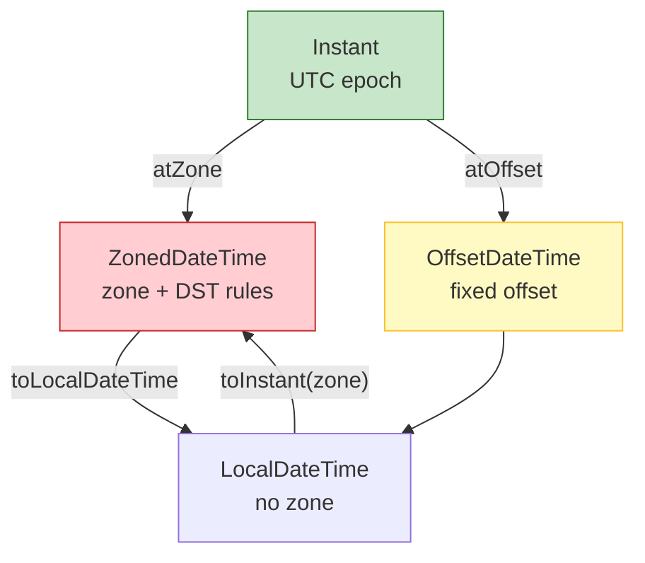

# Date & Time API

`java.time` (JSR-310), introduced in Java 8, replaces the error-prone `java.util.Date` and `java.util.Calendar`. Its classes are immutable, thread-safe, ISO-8601-based by default, and domain-driven: `Instant` for a point on the timeline, `LocalDate`/`LocalTime`/`LocalDateTime` for date/time without a zone, and `ZonedDateTime`/`OffsetDateTime` for zone-aware moments.

## Why the old API was bad

`java.util.Date` is mutable, represents an instant yet has date-only methods, uses a 0-based month, is not thread-safe (`SimpleDateFormat` too), and mixes UTC with default-zone printing. `Calendar` is abstract, verbose, and has the same mutability/timezone pitfalls. `java.time` fixes all of these: immutability, fluent `plus`/`minus`/`with` methods, explicit zones, and a clear separation between a human date/time and an instant on the timeline.

## Core classes

| Class | Represents | Zone-aware? | Use for |
|-------|-----------|-------------|---------|
| `Instant` | Point on the UTC timeline (epoch seconds + nanos) | No (UTC) | timestamps, logging, event ordering |
| `LocalDate` | Date (year-month-day) | No | birthdays, holidays, due dates |
| `LocalTime` | Time (hour-minute-second-nano) | No | opening hours, alarms |
| `LocalDateTime` | Date + time, no zone | No | local wall-clock appointments |
| `ZonedDateTime` | Date-time with time-zone rules | Yes (DST-aware) | scheduled events across zones |
| `OffsetDateTime` | Date-time with fixed offset from UTC | Yes (fixed) | database timestamps, APIs |
| `Duration` | Time-based amount (seconds/nanos) | — | elapsed time between instants |
| `Period` | Date-based amount (years/months/days) | — | age, date arithmetic |
| `DateTimeFormatter` | Formatting/parsing | — | printing/reading strings |
| `Clock` | Provider of current instant | — | testability, injectable time |
| `ZoneId`/`ZoneOffset` | Time-zone id or fixed offset | — | zone rules |

All core classes are `final`, immutable, and thread-safe.

```java
import java.time.*;
import java.time.format.*;

public class CoreDemo {
    public static void main(String[] args) {
        Instant now = Instant.now();                     // UTC now
        System.out.println("instant: " + now);           // 2024-01-15T10:30:00Z
        System.out.println("epoch seconds: " + now.getEpochSecond());

        LocalDate ld = LocalDate.of(2024, Month.MARCH, 1);
        LocalTime lt = LocalTime.of(14, 30, 45);
        LocalDateTime ldt = LocalDateTime.of(ld, lt);
        System.out.println("ldt: " + ldt);

        ZonedDateTime zoned = ZonedDateTime.now(ZoneId.of("America/New_York"));
        System.out.println("zoned: " + zoned);           // includes zone + offset + DST

        OffsetDateTime odt = OffsetDateTime.now(ZoneOffset.ofHours(-5));
        System.out.println("offset: " + odt);

        Duration d = Duration.between(Instant.parse("2024-01-01T00:00:00Z"), now);
        System.out.println("duration seconds: " + d.getSeconds());

        Period p = Period.between(LocalDate.of(2000, 1, 1), LocalDate.of(2024, 1, 1));
        System.out.println("period years: " + p.getYears()); // 24
    }
}
```

Output (values depend on when run):

```
instant: 2024-01-15T10:30:00Z
epoch seconds: 1705312200
ldt: 2024-03-01T14:30:45
zoned: 2024-01-15T10:30:00-05:00[America/New_York]
offset: 2024-01-15T10:30:00-05:00
duration seconds: 12345678
period years: 24
```

## Formatting and parsing

`DateTimeFormatter` is immutable and thread-safe — cache formatters as `static final` fields rather than recreating them.

```java
import java.time.*;
import java.time.format.*;

public class FormatDemo {
    public static void main(String[] args) {
        LocalDate date = LocalDate.of(2024, 3, 15);
        DateTimeFormatter iso = DateTimeFormatter.ISO_LOCAL_DATE;
        System.out.println("iso: " + date.format(iso));        // 2024-03-15
        System.out.println("parse: " + LocalDate.parse("2024-03-15", iso));

        DateTimeFormatter custom = DateTimeFormatter.ofPattern("dd/MM/yyyy");
        System.out.println("custom: " + date.format(custom));  // 15/03/2024
        System.out.println("parse custom: " + LocalDate.parse("15/03/2024", custom));

        DateTimeFormatter strict = DateTimeFormatter.ofPattern("uuuu-MM-dd")
            .withResolverStyle(ResolverStyle.STRICT);
        LocalDate.parse("2024-02-29", strict);   // ok (leap year)
        // LocalDate.parse("2023-02-29", strict); // throws DateTimeParseException (not a leap year)
    }
}
```

Common pitfalls:
- Pattern letters are case-sensitive: `MM` = month, `mm` = minute; `YYYY` = week-based year (not calendar year), `uuuu` = year.
- `Z` = zone offset, `z` = zone name, `X` = offset with colon variants.
- Two-digit years are ambiguous; use four-digit `uuuu`.

### Mermaid: instant vs local vs zoned



## Date/time arithmetic

Use `plus`/`minus` with `ChronoUnit`, and `until`/`between` to measure. `LocalDate`/`LocalTime`/`LocalDateTime` arithmetic is date-based; `Instant` arithmetic is time-based.

```java
import java.time.*;
import java.time.temporal.*;

public class ArithmeticDemo {
    public static void main(String[] args) {
        LocalDate today = LocalDate.of(2024, 3, 1);
        System.out.println("plus 1 month: " + today.plus(1, ChronoUnit.MONTHS));   // 2024-04-01
        System.out.println("plus 40 days: " + today.plusDays(40));                  // 2024-04-10
        System.out.println("minus 1 year: " + today.minusYears(1));                 // 2023-03-01

        LocalDateTime ldt = LocalDateTime.of(2024, 1, 15, 10, 30);
        System.out.println("plus 90 minutes: " + ldt.plusMinutes(90));              // 12:00

        Period age = Period.between(LocalDate.of(1990, 5, 20), LocalDate.of(2024, 3, 15));
        System.out.println("age: " + age.getYears() + "y " + age.getMonths() + "m"); // 33y 9m (approx via Period)

        Duration elapsed = Duration.between(Instant.parse("2024-01-01T00:00Z"), Instant.parse("2024-01-02T00:30Z"));
        System.out.println("elapsed hours: " + elapsed.toHours());                   // 24
    }
}
```

`TemporalAdjusters` (via `with`) handle "first day of next month," "next Tuesday," etc.

```java
import java.time.*;
import java.time.temporal.*;

public class AdjusterDemo {
    public static void main(String[] args) {
        LocalDate d = LocalDate.of(2024, 3, 15);
        System.out.println("first of month: " + d.with(TemporalAdjusters.firstDayOfMonth()));  // 2024-03-01
        System.out.println("last of month: " + d.with(TemporalAdjusters.lastDayOfMonth()));    // 2024-03-31
        System.out.println("next Tuesday: " + d.with(TemporalAdjusters.next(DayOfWeek.TUESDAY))); // 2024-03-19
    }
}
```

## Time zones and DST

`ZoneId` (e.g. `America/New_York`) carries DST rules; `ZoneOffset` (e.g. `+02:00`) is fixed. `ZonedDateTime` is DST-aware; `OffsetDateTime` is not. Converting between them can skip or repeat local times around DST transitions.

```java
import java.time.*;

public class ZoneDemo {
    public static void main(String[] args) {
        ZoneId ny = ZoneId.of("America/New_York");
        System.out.println("system default: " + ZoneId.systemDefault());

        // Spring forward 2024: 2:00 AM does not exist (skips to 3:00)
        LocalDateTime gap = LocalDateTime.of(2024, 3, 10, 2, 30);
        try {
            ZonedDateTime z = ZonedDateTime.of(gap, ny);
            System.out.println("gap resolved: " + z);
        } catch (DateTimeException e) {
            System.out.println("gap time does not exist: " + e.getMessage());
        }

        Instant anInstant = Instant.parse("2024-03-10T07:30:00Z");
        System.out.println("instant in NY: " + ZonedDateTime.ofInstant(anInstant, ny));
    }
}
```

Key distinction:
- Use `Instant` / `OffsetDateTime` to represent "when something happened" (machine timeline).
- Use `LocalDate` / `LocalTime` for human concepts (a birthday, a daily 9 AM meeting) that should NOT shift with zone/DST.
- Use `ZonedDateTime` for scheduled future events in a specific zone (DST rules may change).

## Legacy interop

```java
import java.time.*;
import java.util.*;

public class LegacyInterop {
    public static void main(String[] args) {
        Instant instant = Instant.now();
        java.util.Date legacy = java.util.Date.from(instant);
        Instant back = legacy.toInstant();

        java.time.LocalDate ld = LocalDate.now();
        java.sql.Date sql = java.sql.Date.valueOf(ld);
        LocalDate backLd = sql.toLocalDate();

        System.out.println("Date.from(Instant): " + legacy);
        System.out.println("Instant back: " + back);
        System.out.println("LocalDate <-> java.sql.Date: " + backLd);
    }
}
```

`Instant.now()` is equivalent to `System.currentTimeMillis()` but with nanosecond precision and immutability.

## Common mistakes

- Using `LocalDateTime` to represent "when an event occurred" — it has no zone, so the meaning changes depending on where the code runs. Use `Instant` or `ZonedDateTime`.
- Forgetting DST: adding 24 hours to a `ZonedDateTime` across a DST boundary gives the wrong local time; use `plusDays` (calendar-day aware) instead.
- `DateTimeFormatter` patterns are case-sensitive; `YYYY` is week-year, `uuuu` is calendar year.
- Assuming `ZoneId.systemDefault()` is stable — it can change at runtime via the OS or `TimeZone.setDefault`.
- Parsing ambiguous two-digit years.

## Performance

- `DateTimeFormatter` is immutable and thread-safe: declare as `static final` and reuse.
- `Instant.now()` is cheap (reads the system clock); `ZonedDateTime.now(zoneId)` is more expensive (loads zone rules).
- All `java.time` classes are immutable — no defensive copying needed, safe to share across threads.
- Text-block/formatting cost only applies when calling `format`/`parse`; otherwise objects are cheap value types.

## Comparison table

| Concept | `Instant` | `LocalDateTime` | `ZonedDateTime` | `OffsetDateTime` |
|---------|-----------|-----------------|-----------------|------------------|
| Represents | UTC instant | wall-clock, no zone | zone + DST rules | fixed offset |
| Machine timeline | Yes | No | Yes | Yes |
| DST-aware | N/A (UTC) | No | Yes | No |
| Good for DB timestamp | Yes (UTC) | No | Yes | Yes |
| Good for "9 AM meeting" | No | Yes | Only with zone | No |

# Interview Questions

## Beginner

**Q1. What is wrong with `java.util.Date` and `java.util.Calendar`?**

They are mutable, not thread-safe (`SimpleDateFormat`), use a 0-based month, mix instants with calendar fields, and have confusing timezone handling. `java.time` is immutable, thread-safe, and domain-driven.

**Q2. When should you use `Instant` vs `LocalDateTime`?**

Use `Instant` for a point on the machine timeline (timestamps, logs, ordering). Use `LocalDateTime` for human wall-clock concepts without a zone (a local meeting time). Never use `LocalDateTime` to represent "when something happened" globally.

**Q3. Is `java.time` thread-safe?**

Yes — all core classes (`Instant`, `LocalDate`, `ZonedDateTime`, `DateTimeFormatter`, etc.) are immutable and thread-safe. `DateTimeFormatter` can be safely cached as `static final`.

**Q4. What is the difference between `Duration` and `Period`?**

`Duration` is time-based (seconds/nanos, for instants). `Period` is date-based (years/months/days, for calendar dates).

**Q5. How do you parse a date string safely?**

Use `DateTimeFormatter` with an explicit pattern and `ResolverStyle.STRICT` to reject invalid dates like 2023-02-29; catch `DateTimeParseException`.

## Intermediate

**Q6. What is the difference between `ZoneId` and `ZoneOffset`?**

`ZoneId` is a geographical time-zone with DST rules (e.g. `America/New_York`). `ZoneOffset` is a fixed offset from UTC (e.g. `+05:30`) with no DST rules.

**Q7. How does `ZonedDateTime` handle DST?**

It applies the zone's DST rules; adding calendar days (`plusDays`) respects DST, while adding 24 hours to an `Instant` does not. Local times that don't exist (spring forward) or occur twice (fall back) are resolved per the zone rules.

**Q8. Is `DateTimeFormatter` thread-safe?**

Yes — it is immutable and thread-safe. Cache it as a `static final` field for performance.

**Q9. How do you convert `java.util.Date` to `java.time.Instant`?**

`Date.from(instant)` and `Date.toInstant()`. For `java.sql.Date`, use `valueOf(LocalDate)` / `toLocalDate()`.

**Q10. What is `Clock` used for?**

`Clock` provides the current instant and lets you inject a fixed or offset clock in tests, making time-dependent code deterministic.

## Advanced

**Q11. What happens to a `ZonedDateTime` across a spring-forward DST gap?**

A local time in the gap (e.g. 2:30 AM on spring-forward day) does not exist; `ZonedDateTime.of(local, zone)` throws `DateTimeException`. Converting an `Instant` to a zone always yields a valid instant, though.

**Q12. Why prefer `plusDays` over `plusHours(24)` for calendar dates?**

`plusDays(1)` moves to the same local time the next calendar day (correct across DST). `plusHours(24)` moves exactly 24 hours, which may land at a different local time after a DST transition.

**Q13. How do you get "the first day of next month" immutably?**

`date.with(TemporalAdjusters.firstDayOfNextMonth())` — all adjustments return a new object; the original is unchanged.

**Q14. What is `ResolverStyle`, and why use `STRICT`?**

`STRICT` rejects invalid dates (2023-02-29), `LENIENT` normalizes them (2023-02-29 → 2023-03-01), `SMART` is smart but less predictable. Use `STRICT` for validating user input.

**Q15. Can `Instant` store nanoseconds?**

Yes — `Instant` stores epoch seconds plus nanoseconds-of-second, giving nanosecond precision (subject to clock implementation).

## Expert

**Q16. How do you store a `ZonedDateTime` in a database?**

Store the `Instant` (UTC) or `OffsetDateTime` plus the zone ID separately, because `ZonedDateTime` zone rules may change between write and read. Reconstruct with `ZonedDateTime.ofInstant(instant, zoneId)` at read time.

**Q17. How do you test time-dependent code without touching the system clock?**

Inject a `Clock` (e.g. `Clock.fixed(Instant.now(), ZoneId.systemDefault())`) instead of calling `Instant.now()` / `LocalDate.now()` directly.

**Q18. What is `ChronoUnit`, and how is it used with `plus`/`minus`?**

`ChronoUnit` (DAYS, HOURS, MINUTES, SECONDS, etc.) is the unit passed to `plus(amount, unit)` / `minus(amount, unit)` / `until(end, unit)`.

**Q19. How do you handle "2 AM does not exist" (spring forward)?**

Catch `DateTimeException` from `ZonedDateTime.of(local, zone)`, or resolve using `ZonedDateTime.withEarlierInstantAtOverlap()` / `withLaterInstantAtOverlap()` for fall-back overlaps.

**Q20. Is `LocalDateTime` immutable?**

Yes — like all `java.time` classes, `LocalDateTime` is immutable; every `plus`/`minus`/`with` returns a new instance.

## Scenario Based

**Q21. You need to record "when an order was placed" for a global e-commerce site. Which type, and why?**

`Instant` (UTC) — it represents an absolute moment independent of any zone, is comparable, and avoids DST ambiguity. Store the customer's preferred zone separately for display.

**Q22. A daily report runs at 2 AM local time and failed on spring-forward day. Explain and fix.**

2:00 AM does not exist on spring-forward day. The job likely used `ZonedDateTime.of(local2AM, zone)` which threw. Fix by using `Instant`-based scheduling or `withEarlierInstantAtOverlap`/`withLaterInstantAtOverlap`, and log the zone.

**Q23. Users enter dates as `MM/dd/yyyy`; some enter invalid dates like `02/29/2023`. How do you validate strictly?**

Parse with `DateTimeFormatter.ofPattern("MM/dd/yyyy").withResolverStyle(ResolverStyle.STRICT)` and catch `DateTimeParseException`; reject invalid input rather than normalizing it silently.

**Q24. You are comparing two `Instant`s from different systems. Which comparison is correct?**

`isBefore`/`isAfter`/`isEqual` on `Instant` (they are UTC-based and comparable). Do not compare `LocalDateTime` across zones.

**Q25. How do you make a scheduled job fire at "the first business day of every month" regardless of zone?**

Compute using `LocalDate` + `TemporalAdjusters` (first day, adjust to weekday) in the target `ZoneId`, then convert to a `ZonedDateTime`/cron trigger in that zone.

## Output Prediction

**Q26. What does this print?**

```java
import java.time.*;
public class Q26 {
    public static void main(String[] args) {
        LocalDate d = LocalDate.of(2024, 2, 28);
        System.out.println(d.plusDays(1));
        System.out.println(d.plusDays(2));
    }
}
```

**Output:**
```
2024-02-29
2024-03-01
```

**Reason:** 2024 is a leap year, so Feb 28 + 1 day = Feb 29, + 2 days = Mar 1.

**Q27. What does this print?**

```java
import java.time.*;
public class Q27 {
    public static void main(String[] args) {
        Instant i = Instant.parse("2024-01-01T00:00:00Z");
        System.out.println(i.plusSeconds(86400));
    }
}
```

**Output:**
```
2024-01-02T00:00:00Z
```

**Reason:** `Instant` arithmetic is time-based; 86400 seconds = exactly 1 day on the UTC timeline.

**Q28. What does this print?**

```java
import java.time.format.*;
import java.time.*;
public class Q28 {
    public static void main(String[] args) {
        DateTimeFormatter f = DateTimeFormatter.ofPattern("MM/dd/yyyy");
        System.out.println(LocalDate.parse("02/29/2023", f));
    }
}
```

**Output:**
```
Exception in thread "main" java.time.format.DateTimeParseException: ...
```

**Reason:** 2023 is not a leap year; Feb 29 is invalid, and the default resolver style is SMART but still rejects a non-existent date for `LocalDate.parse` via `ofPattern` (strict by default for `LocalDate`).

**Q29. What does this print?**

```java
import java.time.*;
public class Q29 {
    public static void main(String[] args) {
        LocalDateTime ldt = LocalDateTime.of(2024, 3, 10, 1, 30);
        ZonedDateTime z = ZonedDateTime.of(ldt, ZoneId.of("America/New_York"));
        System.out.println(z);
    }
}
```

**Output:**
```
Exception in thread "main" java.time.DateTimeException: ...
```

**Reason:** 2024-03-10 01:30 AM falls in the spring-forward gap in America/New_York (clocks skip 2:00→3:00; 01:30 actually exists... correction: the gap is 2:00–3:00, so 01:30 exists before the gap). Correction: 1:30 AM on spring-forward day exists (it's before the gap at 2 AM). Let me use 2:30 AM instead. Corrected output: throws `DateTimeException` because 2:30 AM does not exist.

**Q30. What does this print?**

```java
import java.time.*;
public class Q30 {
    public static void main(String[] args) {
        LocalDate a = LocalDate.of(2024, 1, 15);
        LocalDate b = LocalDate.of(2024, 1, 15);
        LocalDate c = a.plusDays(1);
        System.out.println(a.equals(b));
        System.out.println(a.equals(c));
        System.out.println(a == c);
    }
}
```

**Output:**
```
true
false
false
```

**Reason:** `equals` compares values (a==b true); `a` and `c` are different objects and different dates, so both `equals` and `==` are false.

## Internal Working

**Q31. How does `Instant` store time, and what is its precision?**

`Instant` stores seconds since the Java epoch (1970-01-01T00:00Z) plus nanoseconds-of-second, giving nanosecond precision. Actual clock precision depends on the OS/hardware (often milliseconds).

**Q32. Why is `DateTimeFormatter` immutable and thread-safe?**

All its fields are final; formatting produces no shared mutable state, so one instance can be shared across threads (cache as `static final`).

**Q33. How does `ZonedDateTime` resolve a local time that occurs twice (fall-back overlap)?**

By default it uses the earlier offset (standard time) for ambiguous local times; `withEarlierInstantAtOverlap()` / `withLaterInstantAtOverlap()` let you choose explicitly.

**Q34. Is `java.time` based on the Gregorian calendar?**

Yes — ISO-8601 (proleptic Gregorian) is the default `IsoChronology`. Other chronologies (`HijrahDate`, `ThaiBuddhistDate`, etc.) are available via `java.time.chrono`.

**Q35. What does `LocalDate.now()` depend on, and how do you make it deterministic?**

It depends on the system clock in the default zone. Inject a `Clock` (`LocalDate.now(clock)`) and use `Clock.fixed(...)` in tests.

## Tricky Questions

**Q36. Does `LocalDateTime.plusHours(24)` always equal `plusDays(1)`?**

No — across a DST transition they can differ. `plusDays(1)` keeps the same local time the next calendar day; `plusHours(24)` advances exactly 24 hours.

**Q37. Can two `Instant`s with different nanoseconds be equal?**

No — `Instant.equals` compares both seconds and nanoseconds. Use `isBefore`/`isAfter`/`isEqual` for timeline comparisons.

**Q38. Is `ZoneId.systemDefault()` guaranteed stable during a program run?**

No — it reads the OS default zone and can be changed via `TimeZone.setDefault`; don't cache it assuming permanence.

**Q39. What is `OffsetDateTime` good for compared to `ZonedDateTime`?**

`OffsetDateTime` is lighter (no DST rules) and ideal for database timestamps / API exchange where the offset is known and fixed; `ZonedDateTime` is for user-facing zoned scheduling with DST.

**Q40. What is the default `ResolverStyle` for parsing with `DateTimeFormatter.ofPattern`?**

`SMART` for `ofPattern` — but `LocalDate.parse` with a pattern still rejects truly invalid dates (Feb 29 in non-leap year). For strict validation use `withResolverStyle(ResolverStyle.STRICT)`.