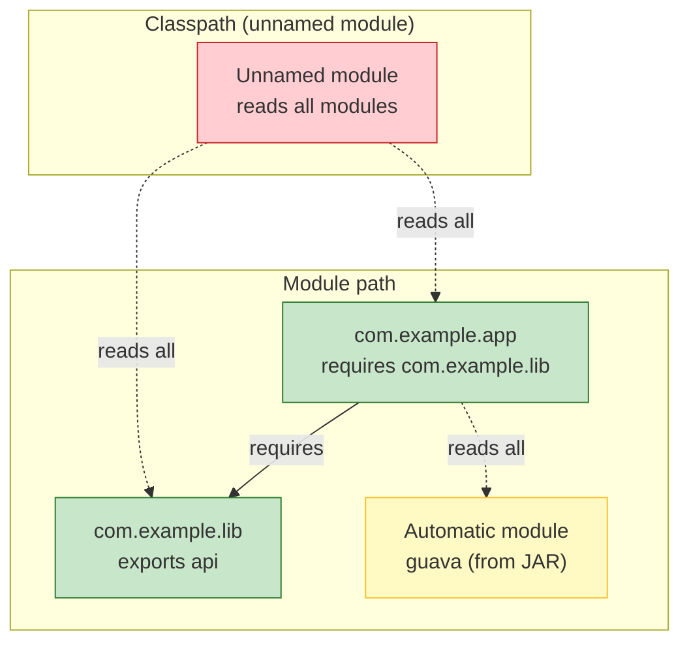

# Java Modules (JPMS)

The Java Platform Module System (JPMS, JSR 376, Java 9) introduces strong encapsulation and reliable configuration to the JDK and to applications. It replaces the fragile classpath with a module path, where each module declares its dependencies (`requires`) and its public API (`exports`). This module covers module descriptors, module path vs classpath, the unnamed and automatic modules, services, `jlink`/`jmod`/`jdeps`, and strong encapsulation.

## Why modules

The classpath has well-known problems:
- No reliable configuration: missing JARs surface as `NoClassDefFoundError` at runtime, not compile time.
- No strong encapsulation: any code can use `sun.*` / `jdk.internal.*` via reflection, coupling applications to JDK internals that change or are removed.
- Split packages: the same package in multiple JARs causes unpredictable class loading.
- Large runtime: you must ship the entire JDK even if you use a small subset.

JPMS addresses these with explicit module descriptors, readability edges, and strong encapsulation.

## module-info.java

A module is declared in `module-info.java` at the root of its sources:

```java
module com.example.inventory {
    requires java.sql;
    requires java.logging;
    requires transitive com.example.common;   // implied readability
    requires static com.example.optional;     // optional, not present at compile/link
    exports com.example.inventory.api;
    exports com.example.inventory.spi to com.example.inventory.impl; // qualified export
    opens com.example.inventory.internal to com.fasterxml.jackson.databind; // reflection for a specific module
    uses com.example.inventory.spi.ReportProvider;
    provides com.example.inventory.spi.ReportProvider
        with com.example.inventory.impl.PdfReportProvider,
             com.example.inventory.impl.CsvReportProvider;
}
```

Key clauses:

| Clause | Meaning |
|--------|---------|
| `requires m` | This module reads module `m`; its public types are usable at compile and runtime. |
| `requires transitive m` | Any module reading this module also reads `m` (implied readability; for API that exposes `m`'s types). |
| `requires static m` | Dependency needed at compile time but not required at runtime (optional). |
| `exports p` | Package `p` is public API; other modules can compile against and access its public types. |
| `exports p to m` | Qualified export: only module `m` may access `p`'s public types. |
| `opens p` | Package `p` is open to **all** modules for deep reflection. |
| `opens p to m` | Qualified open: only module `m` may reflectively access `p`'s non-public members. |
| `uses s` | This module consumes service interface `s` (looked up via `ServiceLoader`). |
| `provides s with i...` | This module provides implementations `i` of service interface `s`. |

## Module path vs classpath

| | Classpath | Module path |
|---|-----------|-------------|
| Unit | JAR / class files | Modules (JARs with `module-info`) or exploded module dirs |
| Configuration | None (resolve at runtime) | Explicit `requires`; missing deps are link-time errors |
| Encapsulation | Everything public is accessible | Strong encapsulation (`exports`/`opens` gate access) |
| Split packages | Allowed (unpredictable) | Detected and rejected across modules |
| Default module | Unnamed module | Unnamed module (classpath code) or named/automatic |

When you put classpath JARs on the module path, they become **automatic modules**: their package becomes the module name (derived from the JAR filename), they read all other modules, and all their packages are exported. Code on the classpath becomes the **unnamed module**, which reads every module and exports nothing (but its public types are accessible via the classpath).

### Mermaid: module path vs classpath



## Compiling and running modules

```bash
# Compile multiple modules
javac --module-source-path src \
  -d mods \
  $(find src -name "*.java")

# Run the application module
java --module-path mods \
  -m com.example.inventory/com.example.inventory.Main

# Common flags
# --add-modules m        add root modules (e.g., java.se.ee, or custom)
# --limit-modules m      restrict observable modules
# --patch-module m=path  overlay classes onto module m
# --list-modules         list observable modules
# --describe-module m    show module details
```

The unnamed module (code on the classpath) can be mixed with modules: `--class-path` and `--module-path` can both be passed, but modular code is preferred.

## Strong encapsulation and `--add-opens`

JDK internal packages (`java.base/java.lang`, `jdk.internal.*`, `sun.*`) are strongly encapsulated: code outside the JDK cannot reflectively access their non-public members without `--add-opens`.

```bash
# Allow reflective access to java.lang internals for ALL modules
java --add-opens java.base/java.lang=ALL-UNNAMED MyApp

# Allow only your module
java --add-opens java.base/java.lang=com.example.app MyApp
```

Your own modules control this via `opens` directives. Prefer `opens p to m` (qualified) over `opens p` (all modules) to minimize exposure.

## Services

`ServiceLoader` lets modules provide and consume implementations without compile-time coupling:

```java
// Consumer module
module com.example.app {
    requires com.example.spi;
    uses com.example.spi.ReportProvider;
}

// Provider module
module com.example.pdf {
    requires com.example.spi;
    provides com.example.spi.ReportProvider
        with com.example.pdf.PdfReportProvider;
}

// Usage
ServiceLoader<ReportProvider> loader = ServiceLoader.load(ReportProvider.class);
for (ReportProvider p : loader) {
    p.generate();
}
```

`ServiceConfigurationError` is thrown if a provider class is missing or malformed. Providers are discovered from `META-INF/services/<service-interface>` files in provider JARs.

## jlink, jmod, jdeps

- **`jlink`** — assemble a custom runtime image containing only the modules you need (`--add-modules`, `--output`), reducing image size and attack surface.
- **`jmod`** — create/inspect JMOD files (a richer packaging format that can include native code, config files, and multiple `module-info` variants).
- **`jdeps`** — analyze class/JAR dependencies; `--jdk-internals` flags use of JDK internal APIs.

## Common mistakes

- Circular `requires` between modules (link error).
- Forgetting `exports` for a package other modules need (`Package com.example.api is not visible`).
- Split packages: the same package name in two different modules → link error.
- Assuming automatic modules are stable: their names are derived from JAR filenames and may change.
- Overusing `requires transitive` (leaks dependencies to consumers) and `opens p` (opens to everyone).
- Using `--add-opens ...=ALL-UNNAMED` in production as a blanket fix — it weakens encapsulation broadly.

## Comparison table

| | Classpath | Module path |
|---|-----------|-------------|
| Configuration | Implicit, runtime failures | Explicit `requires`, link-time validation |
| Encapsulation | None (public is public) | Strong (`exports`/`opens` gate access) |
| Split packages | Allowed, unpredictable | Rejected across modules |
| JDK internals | Accessible (discouraged) | Encapsulated (`--add-opens` to opt in) |
| Runtime image | Full JDK | Custom via `jlink` |

# Interview Questions

## Beginner

**Q1. What is JPMS, and what problem does it solve?**

JPMS (Java Platform Module System, Java 9) introduces modules with explicit dependencies and strong encapsulation. It solves classpath fragility (missing deps surface at runtime), split packages, and unrestricted access to JDK internals.

**Q2. What is `module-info.java`?**

The module descriptor that declares the module's name, its dependencies (`requires`), exported packages (`exports`), opened packages (`opens`), and services (`uses`/`provides`).

**Q3. What is the difference between the classpath and the module path?**

The classpath has no explicit configuration and no encapsulation; the module path uses `module-info` for declared dependencies, strong encapsulation, and link-time validation of missing modules.

**Q4. What is an automatic module?**

A JAR without `module-info` placed on the module path; it gets an automatic module name (from the JAR filename), reads all modules, and exports all its packages.

**Q5. What is the unnamed module?**

Code on the classpath when running in a modular world; it reads every module but exports nothing (its public types are still accessible via the classpath).

## Intermediate

**Q6. What does `requires transitive` do?**

It declares implied readability: any module that reads this module also reads the transitive dependency, without declaring it themselves. Use it when your API exposes types from the dependency.

**Q7. What does `exports` vs `opens` control?**

`exports` controls compile-time and runtime access to public types (API visibility). `opens` controls deep reflective access to non-public members (reflection, serialization frameworks).

**Q8. What does `opens p to m` do vs `opens p`?**

`opens p to m` is a qualified open: only module `m` may reflect on `p`'s non-public members. `opens p` opens to all modules.

**Q9. How does `ServiceLoader` find implementations?**

Via `META-INF/services/<interface>` files listing provider class names, declared with `provides ... with` in provider modules and `uses` in consumer modules.

**Q10. What is `jlink` used for?**

To create a custom JRE image containing only the modules your application needs, producing a smaller, faster-starting, reduced-attack-surface runtime.

## Advanced

**Q11. What is a split package, and why is it a problem in JPMS?**

The same package name appearing in two different modules. JPMS rejects split packages across modules because it would break encapsulation and make package-private access ambiguous.

**Q12. Can a module on the module path reflectively access another module's non-public members?**

Only if the target module `opens` the package (to all or to this module), or the launcher passes `--add-opens`. Otherwise `InaccessibleObjectException` is thrown.

**Q13. What is `requires static` used for?**

An optional dependency needed at compile time but not required to be present at runtime (e.g., an annotation processor or optional library).

**Q14. How do automatic modules get their names?**

From the JAR filename (e.g., `guava-31.1.jar` → module name `guava`), stripping version numbers where possible. This makes them fragile across version upgrades.

**Q15. What is `--patch-module`?**

It overlays additional classes/resources onto an existing module at launch, useful for patching or adding resources without rebuilding the module.

## Expert

**Q16. Can you split one logical package across two modules intentionally?**

No — not across different modules (split package error). Within one module it's fine. To share code across module boundaries, use a common package exported from one module.

**Q17. How do `requires transitive` and `exports` interact in an API module?**

If module A's API exposes types from module B, A should `requires transitive B` and `export` its own packages so consumers can name the exposed B types without adding B themselves.

**Q18. What is a root module vs an automatic module in a `jlink` image?**

Root modules are the entry points you specify with `--add-modules`; `jlink` follows `requires` transitively to include all needed modules. Automatic modules can be included if they are roots or required by roots.

**Q19. What is `--limit-modules` for?**

It restricts the set of observable modules at launch, useful for testing minimal deployments or reproducing missing-module scenarios without changing code.

**Q20. How does JPMS affect reflection on JDK internals (`sun.*`, `jdk.internal.*`)?**

They are strongly encapsulated; reflective access requires `--add-opens <pkg>/<module>=<target>`. Many libraries broke on Java 9+ because they relied on `sun.misc.Unsafe` or `sun.reflect` without declaring opens.

## Scenario Based

**Q21. You are modularizing a legacy application that uses `sun.misc.Unsafe` reflectively. What do you do?**

Add `--add-opens java.base/java.lang=ALL-UNNAMED` as a short-term fix, but preferably replace `Unsafe` usage with `VarHandle`/`MethodHandle` (Java 9+) and properly `open` only the packages that need reflection.

**Q22. Two JARs on your module path both contain package `com.legacy.util`. The app fails to link. Why?**

Split package across modules — JPMS rejects it. Resolve by shading/relocating one JAR's package, or keeping both JARs on the classpath (unnamed module) where split packages are tolerated.

**Q23. Your modular app needs to load implementations from JARs dropped in a `plugins/` folder at runtime. How?**

Use `ServiceLoader` with `provides ... with` in each plugin module, placed on the module path; the consumer declares `uses <service-interface>`. Plugin JARs need `module-info` with `provides`; otherwise they become automatic modules and service discovery still works via `META-INF/services`.

**Q24. You want a minimal Docker image for your Java app. How does JPMS help?**

Use `jlink --add-modules <your-module> --output custom-jre` to build a runtime with only your module and its transitive JDK dependencies, then `COPY` that custom JRE (no full JDK) into the image.

**Q25. A library on the classpath (unnamed module) needs reflective access to your module's internal package. How do you grant it?**

Your module must `opens <pkg> to UNNAMED` (or `opens <pkg>` for everyone). Classpath code corresponds to the unnamed module for open/qualify purposes.

## Output Prediction

**Q26. Module `app` has `requires lib;` and `exports com.app.api;`. Module `lib` exports `com.lib.impl`. Code in `app` references `com.lib.impl.Foo`. Compiles?**

No — `app` only reads `lib`, but `lib` does not `export com.lib.impl`, so `Foo` is not visible. `lib` must `export com.lib.impl` (or `app` must not reference it directly).

**Q27. Module `api` has `requires transitive json;` and `exports com.api;` where a method returns `json.JsonObject`. Module `app` requires `api` but not `json`. Can `app` name `json.JsonObject`?**

Yes — `requires transitive json` gives `app` implied readability of `json`, so it can reference `json.JsonObject` without its own `requires json`.

**Q28. Module `m` opens package `p` to module `n` only. Module `x` (not `n`) reflects on `p`'s private field. Result?**

`InaccessibleObjectException` — qualified opens restrict deep reflection to `n` only.

**Q29. You run `java --module-path mods -m com.example.app/com.example.app.Main` and get `Error: Located assembly... module not found`. Likely cause?**

A required module is missing from the module path, or the module name/main class in `-m` does not match `module-info.java` / the compiled `module-info.class`.

**Q30. What does `jdeps --jdk-internals` report?**

It flags classes/packages that use JDK internal APIs (`sun.*`, `jdk.internal.*`), which are strongly encapsulated and may break on future releases.

## Internal Working

**Q31. What is a "readability edge" in JPMS?**

The relationship `module A reads module B`, declared by `requires B` in `A`'s descriptor. The JVM enforces readability at link time: code in A may only reference public types in modules it reads (transitively).

**Q32. How does the module system differ from OSGi?**

JPMS is simpler and built into the JVM/linker; it lacks OSGi's dynamic install/start/stop, version ranges, and bundle lifecycle. JPMS focuses on reliable configuration and strong encapsulation, not hot-deployment.

**Q33. What does `javac --module-source-path` do?**

It tells the compiler where to find module sources (each in a package-rooted directory tree under the source path) so it can compile multiple modules together and resolve `requires` between them.

**Q34. What is `META-INF/versions/` (multi-release JAR) vs modules?**

Multi-release JARs let one JAR contain class versions for different Java releases (e.g., `META-INF/versions/9/`). It is orthogonal to JPMS: a modular JAR has `module-info`; a multi-release JAR targets version-specific bytecode. They can combine.

**Q35. Can `module-info` declare `requires java.se`?**

Yes — `java.se` is the aggregator root module that requires all `java.*` modules; using it pulls in the full standard SE module set.

## Tricky Questions

**Q36. If module A `requires transitive B`, and C `requires A`, does C need to `requires B` explicitly?**

No — implied readability means C reads B transitively through A and can reference B's public types (that A exposes) without its own `requires B`.

**Q37. Does an automatic module read all other modules, and is it read by all?**

Automatic modules read all other modules (including the unnamed module). They are readable by all modules too (all their packages are exported), so they are highly coupled — treat them as transitional.

**Q38. Can a module `require` itself?**

No — a module cannot require itself; that would be a circular dependency of one.

**Q39. Is `java.lang` always available?**

`java.base` (which contains `java.lang`) is the root module; every module implicitly reads `java.base` unless it declares otherwise. You do not need `requires java.base`.

**Q40. What happens if you omit `module-info.java` but compile with `--module-source-path`?**

The sources are treated as being in the unnamed module only if on the classpath; with `--module-source-path`, each directory is expected to be a module, so missing `module-info` is a compile error for modular sources.