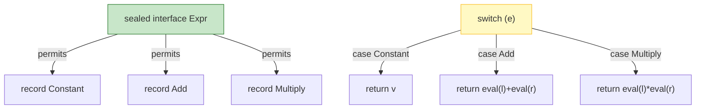

# Sealed Classes

Sealed classes and interfaces (JEP 409, final in Java 17) let you restrict which classes or interfaces may extend or implement them. They create closed hierarchies — a fixed, known set of subtypes — which enables exhaustive reasoning by the compiler, especially in `switch` expressions (module 35). Sealed types are the foundation for modeling algebraic data types in Java.

## Syntax and rules

```java
package com.example.shape;

public sealed interface Shape
    permits Circle, Rectangle, Square {}

public final class Circle implements Shape {
    private final double radius;
    public Circle(double radius) { this.radius = radius; }
    public double radius() { return radius; }
}

public final class Rectangle implements Shape {
    private final double width, height;
    public Rectangle(double width, double height) { this.width = width; this.height = height; }
}

public sealed class Square implements Shape
    permits ColoredSquare, OutlineSquare {}   // Square is sealed: only these two may extend it

public final class ColoredSquare extends Square {
    private final String color;
    public ColoredSquare(double side, String color) { ... }
}

public non-sealed class OutlineSquare extends Square { ... } // re-opens: anyone may extend
```

Key rules:

| Rule | Detail |
|------|--------|
| Sealed + permits | A `sealed` class/interface must list every permitted direct subclass/implementor. |
| Same module/package | Sealed type and its permitted subclasses must be compiled in the same module (or same package for the unnamed module). |
| Direct extension | Every permitted subclass must directly extend the sealed class (no skipping a level). |
| Modifier on subclasses | Each permitted subclass must be declared `final`, `sealed`, or `non-sealed`. |
| `final` subclass | Closes that branch — no further subclassing. |
| `non-sealed` subclass | Re-opens the hierarchy — arbitrary subclasses may extend it. |
| `sealed` interface | Permits classes and/or interfaces; a `non-sealed` class may implement it and be extended freely. |

```java
// Record cannot be sealed (it is implicitly final)
public sealed interface Expr
    permits Constant, Add, Multiply {}
public record Constant(double value) implements Expr {}
public record Add(Expr left, Expr right) implements Expr {}
public record Multiply(Expr left, Expr right) implements Expr {}
```

## Exhaustive switch

The compiler verifies that a `switch` over a sealed type covers all permitted subtypes (or includes `default`). With `switch` expressions (Java 21), exhaustiveness is required:

```java
public double eval(Expr e) {
    return switch (e) {
        case Constant(double v) -> v;
        case Add(Expr l, Expr r) -> eval(l) + eval(r);
        case Multiply(Expr l, Expr r) -> eval(l) * eval(r);
        // no default needed: all permitted subtypes covered
    };
}
```

If `Expr` were not sealed, a `default` would be required. Adding a new permitted subtype to `Expr` then causes compile errors in every non-exhaustive switch — a useful signal to update all consumers.

### Mermaid: sealed hierarchy and exhaustive switch



## Sealed vs alternatives

| | `final` | `sealed` | `abstract` | `enum` | `non-sealed` |
|---|---------|----------|------------|--------|--------------|
| Who can extend | Nobody | Listed in `permits` | Any subclass | Nobody (constants only) | Anybody |
| Closed hierarchy | Yes | Yes | No | Yes | No |
| Exhaustive switch | N/A (single) | Yes (compiler-checked) | No | Yes | No |
| Can hold state/data | Yes | Yes | Yes | Yes (fields) | Yes |
| Typical use | Utility classes | Closed domain variants | Base behavior | Fixed constants | Re-open a sealed branch |

## When to use sealed

Use sealed classes for:
- Domain models with a fixed set of variants (AST nodes, expression trees, message types, state machines).
- APIs where you want to restrict extension (e.g., a library defining result types).
- Exhaustive `switch` where the compiler should remind you to handle new variants.

Do NOT use sealed for:
- Plugin/extension points where third parties must subclass.
- Simple single-implementation cases.
- When you don't need exhaustiveness (over-engineering).

## Common mistakes

- Permitted subclass not in the same module/package as the sealed type.
- Permitted subclass not declared `final`, `sealed`, or `non-sealed`.
- Sealed type and subclass in different modules without proper `opens`/`exports`.
- Forgetting `default` in a switch over a non-sealed type.
- Trying to `seal` a `record` (records are implicitly final; they can implement sealed interfaces but cannot themselves be sealed).
- Adding a new permitted subtype and forgetting to update switches (the compiler catches this only if switches are exhaustive).

## Performance

Sealed classes have no runtime cost beyond normal inheritance. The exhaustiveness check is a compile-time feature. Use sealed for design safety, not performance.

# Interview Questions

## Beginner

**Q1. What is a sealed class?**

A sealed class (Java 17+) restricts which classes may extend it, via a `permits` clause listing the allowed direct subclasses.

**Q2. What modifiers can a permitted subclass have?**

`final`, `sealed`, or `non-sealed`.

**Q3. What does `non-sealed` do?**

It re-opens the hierarchy: a `non-sealed` subclass of a sealed class may be extended by arbitrary subclasses.

**Q4. Can a record be sealed?**

No — records are implicitly `final`, so they cannot be sealed. A record can implement a sealed interface.

**Q5. Where must a sealed class and its permitted subclasses live?**

In the same module (or same package if using the unnamed module).

## Intermediate

**Q6. How does `switch` over a sealed type differ from a regular `switch`?**

The compiler checks exhaustiveness: all permitted subtypes must be covered (or `default` present). Adding a new subtype breaks compilation of non-exhaustive switches until updated.

**Q7. Can a sealed interface permit both classes and interfaces?**

Yes — a sealed interface may permit classes and/or other interfaces.

**Q8. What is the difference between `sealed` and `final`?**

`final` prevents all extension; `sealed` allows only the listed subclasses to extend.

**Q9. Do sealed classes require `switch` to be exhaustive?**

Only when used in a `switch` expression or when the compiler can determine the sealed type; for switch statements over sealed types, `default` is still permitted but exhaustiveness checking applies to expressions.

**Q10. Can you add a new permitted subtype to a sealed class without breaking clients?**

Adding a subtype breaks any exhaustive `switch` that lacks a `default` (compile error). This is intentional — it forces clients to handle the new variant.

## Advanced

**Q11. Can a sealed class be in a different module from its permitted subclasses?**

No — they must be in the same module (or same package in the unnamed module).

**Q12. Can a sealed interface be implemented by a class in another module?**

Only if that class is listed in `permits`, which requires same-module. So no — implementors must be in the same module.

**Q13. How does `non-sealed` interact with `sealed`?**

`non-sealed` on a subclass of a sealed class re-opens that branch: any class may extend the `non-sealed` subclass, defeating closure for that branch.

**Q14. Can a sealed class extend another sealed class?**

Yes — a sealed class may extend a sealed (or non-sealed) superclass, subject to the same-module rule and `permits`.

**Q15. What reflection support exists for sealed classes?**

`Class.isSealed()` and `Class.getPermittedSubclasses()` (Class[]).

## Expert

**Q16. Can a sealed class extend a non-sealed class?**

Yes — but then the sealed class itself closes its own hierarchy via `permits`; the superclass being non-sealed doesn't force the subclass to be open.

**Q17. Can a `record` implement a sealed interface?**

Yes — records are final and may implement sealed interfaces (e.g., `record Constant(double v) implements Expr`).

**Q18. Is there a runtime cost to sealed classes?**

No — sealed is compile-time enforcement; runtime behavior is normal inheritance.

**Q19. How does sealed interact with `switch` pattern matching?**

Pattern matching for switch over sealed types benefits from exhaustiveness checking: the compiler knows all permitted subtypes and can verify all are handled (or `default`).

**Q20. What is the relationship between sealed classes and algebraic data types (ADTs)?**

Sealed classes + records + pattern matching approximate ADTs: sealed = sum type (fixed variants), records = product type (fields), pattern matching = deconstruction.

## Scenario Based

**Q21. You are building an expression evaluator with variants `Literal`, `Add`, `Multiply`. How do you model it?**

A sealed interface `Expr` permitting `Literal`, `Add`, `Multiply` records, with exhaustive `switch` for evaluation — new variants force updates to all switches.

**Q22. A library defines a sealed `Result` type (`Success`, `Failure`). A consumer wants to add a third variant (`Timeout`). Can they?**

No — only the library can add permitted subtypes (same module). The consumer must use `default` or ask the library to add it (breaking exhaustive switches).

**Q23. You want a plugin system where third parties extend your base class. Use sealed?**

No — sealed prevents arbitrary extension. Use an open `abstract` class or interface instead; sealed is for closed hierarchies you control.

**Q24. Your exhaustive `switch` over a sealed type stopped compiling after adding a new variant. Is this a bug?**

No — it's the intended exhaustiveness check. Update all switches to handle the new variant (or add `default` if appropriate).

**Q25. You need a fixed set of error codes with associated data. Sealed class or enum?**

Sealed class with records (each variant carries different data). Enums are for fixed constants with little/no per-constant data; sealed lets each variant have its own fields.

## Output Prediction

**Q26. What does this print/compile?**

```java
public sealed interface Shape permits Circle, Rectangle {}
public final class Circle implements Shape {}
public final class Rectangle implements Shape {}

public class Q26 {
    static double area(Shape s) {
        return switch (s) {
            case Circle c -> Math.PI * c.radius() * c.radius();
            case Rectangle r -> r.width() * r.height();
        };
    }
}
```

**Output:** Compiles and runs correctly — no `default` needed because `Shape` is sealed and all variants are covered.

**Q27. What happens if you add `Square` to `Shape`'s `permits` but forget the `case Square`?**

Compile error: the switch is no longer exhaustive (missing `Square` or `default`).

**Q28. What does this print?**

```java
public sealed class Node permits Leaf, Internal {}
public final class Leaf extends Node {}
public final class Internal extends Node {}
public non-sealed class Open extends Node {}
```

**Output:** Compiles — `Open` is `non-sealed`, so it re-opens the hierarchy; anyone may extend `Open`.

**Q29. What does this print?**

```java
public sealed interface Result permits Success, Failure {}
public final class Success implements Result {}
public final class Failure implements Result {}

public class Q29 {
    static String describe(Result r) {
        return switch (r) {
            case Success s -> "ok";
            // missing Failure + no default
        };
    }
}
```

**Output:** Compile error — switch over sealed `Result` is not exhaustive (`Failure` missing, no `default`).

**Q30. What does this print?**

```java
public sealed interface Shape permits Circle, Rectangle {}
public final class Circle implements Shape {}
public class Q30 {
    public static void main(String[] args) {
        System.out.println(Shape.class.isSealed());
    }
}
```

**Output:**
```
true
```

**Reason:** `Class.isSealed()` returns true for sealed interfaces/classes.

## Internal Working

**Q31. How does the compiler enforce sealed permits at compile time?**

It reads the `PermittedSubclasses` class-file attribute (Java 17+) listing allowed direct subclasses and checks each is declared `final`/`sealed`/`non-sealed` and in the same module/package.

**Q32. What class-file attribute supports sealed classes?**

`PermittedSubclasses` — lists the classes/interfaces permitted to extend the sealed type.

**Q33. Is sealed enforced at runtime too?**

The JVM permits the verifier and reflective APIs to consult `PermittedSubclasses`; `Class.isSealed()` and `getPermittedSubclasses()` expose it. Extension beyond the list is blocked where the JVM enforces it (e.g., certain reflective subclassing).

**Q34. Can `Class.forName` instantiate a subclass of a sealed class from another module?**

Only if the subclass is in the `permits` list (same module). Otherwise access is restricted by encapsulation.

**Q35. Does `sealed` affect `instanceof`?**

No — `instanceof` works normally; sealed only restricts *declaration* of subclasses and switch exhaustiveness.

## Tricky Questions

**Q36. Can a sealed class extend a non-sealed class and still be sealed?**

Yes — the subclass can close its own hierarchy via `permits` regardless of whether its superclass is sealed or non-sealed.

**Q37. Can you `seal` an `enum`?**

No — enums are already a fixed set of constants and cannot be sealed (and `enum` implicitly has fixed instances).

**Q38. Does `non-sealed` allow subclasses in other modules?**

It allows arbitrary subclasses, but they must still respect module readability/exports to compile against the sealed type's package.

**Q39. Is `default` required in a switch statement (not expression) over a sealed type?**

No — `default` is optional for switch statements over sealed types if all variants are covered; required if not exhaustive or for non-sealed types.

**Q40. Can a sealed type have zero permitted subclasses?**

`sealed interface X {}` with no `permits` means nothing may implement it (effectively final-like but declared sealed); unusual but legal. For classes, `permits` with no classes similarly prevents extension.