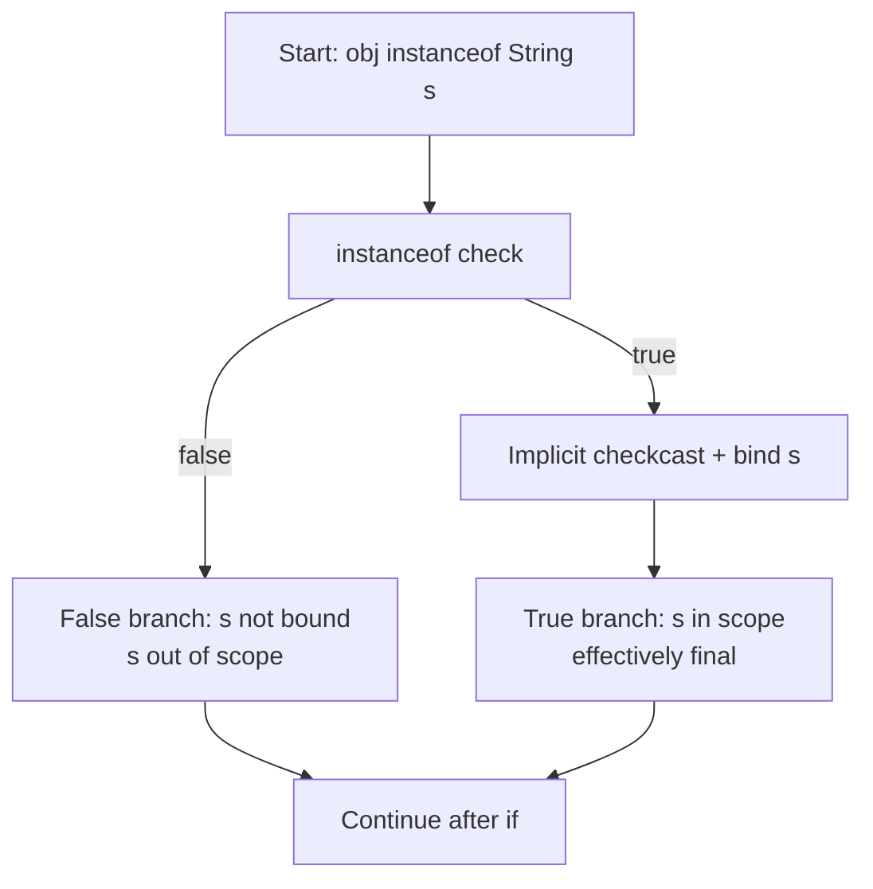
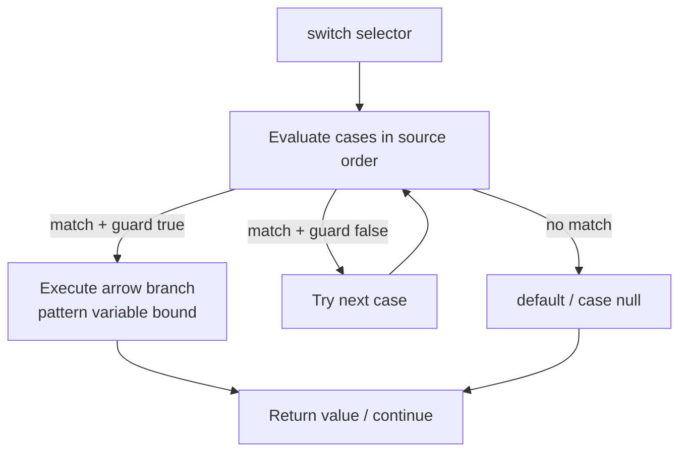
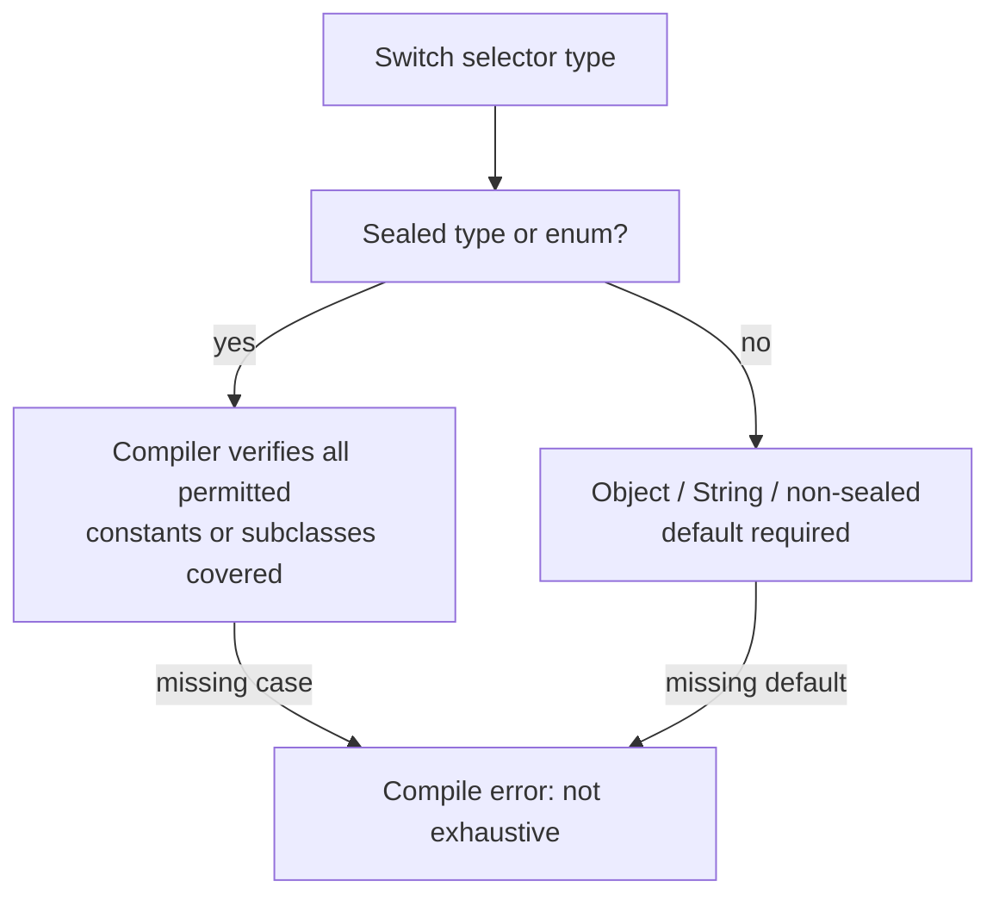

# Pattern Matching

Pattern matching lets the JVM test an object's type and bind it to a variable in a single expression, eliminating the `instanceof` check followed by an explicit cast. Historically Java forced a two-step ritual: `if (obj instanceof String) { String s = (String) obj; ... }`. Pattern matching collapses this to `if (obj instanceof String s) { ... }`, where `s` is bound automatically only on the successful branch.

This module covers type patterns (`instanceof`), pattern matching for `switch` (JEP 441, final in Java 21), guard expressions, `case null`, exhaustiveness for `sealed` types and `enum`s, definite-assignment flow analysis, and the boundary with records and sealed classes (covered in modules 32 and 33).

## 1 Motivation: from instanceof-plus-cast to patterns

### The pre-pattern idiom

Before Java 16, every type test required three pieces: the `instanceof` check, the cast, and a fresh variable declaration. The cast is unchecked at the source level until the check passes, and the variable leaks into the enclosing scope.

```java
// Pre-Java 16 boilerplate (still legal, still common in legacy code)
Object obj = "hello";
if (obj instanceof String) {
    String s = (String) obj;        // explicit cast
    System.out.println(s.length()); // use s
}
```

Problems with this idiom:
- Verbose: check, cast, declaration are three separate concerns.
- Error-prone: forgetting the cast or casting to the wrong type throws `ClassCastException` at runtime.
- Scope pollution: `s` exists beyond the `if` block even though it is only meaningful inside it.
- Null-unsafe by convention: developers must remember to guard `obj != null` because `null instanceof String` is false but careless code can NPE after an unguarded cast.

### The pattern idiom (JEP 394, final Java 21)

```java
Object obj = "hello";
if (obj instanceof String s) {
    System.out.println(s.length()); // s bound, no cast, scoped to true branch
}
```

A **type pattern** consists of a type (`String`) and a single pattern variable (`s`). The JVM performs the `instanceof` check and, on success, casts and assigns to `s` implicitly. `s` is in scope only where the pattern is guaranteed to have matched.

JEP history:
- JEP 394 Pattern Matching for `instanceof`: preview in Java 16 and 17, final in Java 21.
- JEP 441 Pattern Matching for `switch`: preview in Java 17–20, final in Java 21 (includes `when` guards, `case null`, `case var`).

## 2 Internal working: what the compiler and JVM actually do

### instanceof type pattern compilation

For `if (obj instanceof String s)`, `javac` emits essentially the same bytecode shape as the old idiom but handles the binding and scoping:

1. `instanceof` check against `java/lang/String` (via `instanceof` instruction; the JVM performs an instanceof check on the object's class metadata / klass pointer in the metaspace).
2. On success, an implicit `checkcast` to `String` and store into the pattern-variable local slot.
3. On false, control jumps past the true branch; the pattern variable slot is considered unassigned.

The pattern variable is **effectively final**: it is assigned exactly once on the successful path and cannot be reassigned within its scope.

Representative bytecode (conceptual, `javap -c` output):

```
 0: aload_1                        // load obj
 1: instanceof java/lang/String   // instanceof check
 4: ifeq Lfalse                    // jump if not a String
 7: aload_1
 8: checkcast java/lang/String     // implicit cast
11: astore_2                       // store into pattern variable s
12: ... use s ...
 Lfalse: ...
```

HotSpot performs the `instanceof` by comparing the object's klass against the target class and its superclasses/interfaces (an instanceof check walks the klass hierarchy; for arrays it checks component type compatibility). No reflection is involved and no `Class.isInstance` call is made at runtime.

A real `javap -c` of a type-pattern method confirms the shape is identical to the manual idiom, with the compiler handling the binding slot:

```java
static void m(Object obj) {
    if (obj instanceof String s) {
        System.out.println(s.length());
    }
}
```

```
  public static void m(java.lang.Object);
    Code:
       0: aload_0
       1: instanceof #2                  // class java/lang/String
       4: ifeq          13
       7: aload_0
       8: checkcast     #2                  // class java/lang/String
      11: astore_1
      12: aload_1
      13: ... println(s.length()) ...
```

The pattern variable `s` lives in local variable slot 1 and is marked in the `LocalVariableTable` with `synthetic`/`effective final` attributes where applicable. The JIT can inline the `instanceof` check and, when the selector's type is proven (e.g. after a prior check), eliminate the redundant `checkcast`, making pattern matching as fast as — and sometimes faster than — hand-written casts because the compiler can prove the cast is redundant.

### Pattern matching for switch compilation

For a pattern `switch`, `javac` can emit either a lookupswitch/tiptable-based dispatch or a chain of `instanceof` checks depending on the number and density of cases. For type patterns over `Object`, the compiler typically emits a cascade of `instanceof` checks in source order, with the first matching branch winning. Arrow branches (`->`) prevent fall-through by construction; each branch ends with an implicit break/return.

For `sealed` type switches, the compiler performs **exhaustiveness analysis** at compile time using the sealed hierarchy (permits list) and can omit `default`. For non-sealed types such as `Object` or `String`, `default` is mandatory for switch expressions and statements.

## 3 Type patterns in depth

### Basic usage

```java
public static void inspect(Object obj) {
    if (obj instanceof String s) {
        System.out.println("String of length " + s.length());
    } else if (obj instanceof Integer i) {
        System.out.println("Integer: " + i);
    } else {
        System.out.println("other: " + obj);
    }
}
```

`String s` binds `s` only inside the first true branch; `Integer i` binds `i` only inside the second. Neither leaks into the `else` block.



### Null safety

`null instanceof String s` is `false`; no `NullPointerException` is thrown and `s` is never bound.

```java
Object nothing = null;
if (nothing instanceof String s) {          // false, s not bound
    System.out.println(s.length());         // compile error: s not in scope here
}
```

### Pattern variable is effectively final

```java
if (obj instanceof String s) {
    s = "mutated";          // compile error: cannot assign to pattern variable s
}
```

### Scope rules and definite assignment

The pattern variable is definitely assigned on the true branch and **definitely unassigned** on the false branch. Using it outside its scope is a compile error.

```java
Object obj = "abc";
if (obj instanceof String s) {
    System.out.println(s.length()); // OK: definitely assigned
}
// System.out.println(s.length()); // compile error: cannot find symbol s
```

#### Scoping with `&&` and `||` (short-circuit)

```java
Object obj = "abc";
if (obj instanceof String s && !s.isEmpty()) {
    System.out.println(s.charAt(0)); // OK: s definitely assigned when && short-circuits to true
}
```

```java
if (obj instanceof String s || obj instanceof Integer i) {
    // s and i are NOT definitely assigned here: either side may have matched
    // System.out.println(s); // compile error
}
```

With `||`, since either pattern may be the one that matched, neither variable is definitely assigned after the condition.

### Edge cases

- A type pattern variable can shadow an outer local variable; the outer variable is hidden inside the true branch.
- `var` is not permitted as the type of an `instanceof` pattern variable (`instanceof var s` is illegal); use the explicit type. (`case var v ->` in switch is different and is covered below.)
- Pattern variables cannot be used in the `instanceof` condition's own expression beyond binding; e.g. you cannot refer to `s` within the same `instanceof` predicate.

## 4 Pattern matching for switch

Java 21 finalizes pattern matching for `switch` (JEP 441). Combined with switch expressions (Java 14 preview, final Java 14? no — switch expressions finalized in Java 14 via JEP 361, enhanced over time) and arrow syntax, this replaces long chains of `instanceof`.

### Arrow branches and no fall-through

```java
public static String describe(Object obj) {
    return switch (obj) {
        case String s -> "String: " + s;
        case Integer i -> "Integer: " + i;
        case Double d -> "Double: " + d;
        default -> "unknown: " + obj;
    };
}
```



- `case String s ->` binds `s` on the right-hand side only when the case matches.
- Arrow branches do **not** fall through.
- The branch body can be a single expression or a block; a block must end with `yield` if the switch is an expression (see below).
- `default` is required here because `Object` is not sealed.

### Guard expressions (`when`, Java 21)

Guards refine a pattern with a boolean condition:

```java
public static String describe(Object obj) {
    return switch (obj) {
        case String s when s.length() > 0 -> "non-empty: " + s;
        case String s -> "empty string";
        case Integer i when i > 0 -> "positive: " + i;
        case Integer i -> "non-positive: " + i;
        default -> "other";
    };
}
```

Rules:
- `when` is a restricted identifier (contextual keyword), not a full keyword.
- The guard is evaluated only after the pattern matches.
- Guard variables are scoped to the branch; `s` in `when s.length() > 0` refers to the pattern variable.
- Order matters: the first matching case with a true guard wins; subsequent cases are not tried.

### `case null ->` (Java 21)

```java
return switch (obj) {
    case null -> "null";
    case String s -> "string";
    default -> "other";
};
```

`case null ->` matches a null selector. It must appear before generic patterns if you want null handled specifically, though `null` never matches a type pattern anyway (`null instanceof String` is false).

### `case var v ->` (matches anything, binds)

`case var v ->` matches any value including null and binds it to `v`. Use sparingly; it is effectively a typed `default` with a binding. (On plain Java 21 the equivalent runnable form is `case Object o ->`, which matches any non-null reference.)

```java
return switch (obj) {
    case String s -> "string: " + s;
    case Object o -> "other: " + o;   // matches any non-null reference, binds to o
};
```

## 5 Exhaustiveness



### enum switches

For a switch over an `enum` type, the compiler verifies all enum constants are covered or a `default` is present. With arrow syntax and all constants covered, `default` is optional.

```java
public enum Level { LOW, MEDIUM, HIGH }

public static String label(Level l) {
    return switch (l) {
        case LOW -> "low";
        case MEDIUM -> "medium";
        case HIGH -> "high";       // all constants covered; default optional
    };
}
```

Missing a constant yields a compile error: "the switch expression does not cover all possible input values".

### sealed type switches (boundary: module 33)

For switches over a `sealed` type or its sealed subclasses, the compiler uses the `permits` list to verify exhaustiveness. This overlaps module 33 (Sealed Classes); here we note only that `sealed` hierarchies allow compile-time exhaustiveness without `default`. Non-sealed types (`Object`, `String`, non-sealed classes) require `default`.

### switch expression vs statement

| Aspect | Switch statement | Switch expression |
|--------|------------------|-------------------|
| Returns a value | No | Yes |
| Requires `default` (non-exhaustive) | No | Yes (unless exhaustive) |
| Multi-statement branch | `break` optional | `yield` required to produce value |
| Arrow `->` branches | Allowed | Allowed |
| Colon `:` branches | Allowed (fall-through risk) | Allowed (with `yield`) |

Java 21 example with `yield`:

```java
public static int rank(Object obj) {
    return switch (obj) {
        case String s -> {
            int len = s.length();
            yield len > 10 ? 2 : 1;   // yield produces the expression's value
        }
        case Integer i -> i;
        default -> 0;
    };
}
```

`yield` (Java 13+, final Java 14 for switch expressions) returns a value from a switch expression block. It is forbidden in switch statements (except as a labeled statement in expressions). `yield` cannot cross method boundaries; it exits the switch expression only.

## 6 Comparison tables

### instanceof + cast vs type pattern

| Axis | instanceof + cast | Type pattern (`instanceof Type v`) |
|------|-------------------|------------------------------------|
| Steps | check + cast + declare | single expression |
| Cast | explicit, can throw `ClassCastException` | implicit, safe after match |
| Variable scope | enclosing block | true-branch only |
| Null handling | `null instanceof` false, must guard separately | same, but binding only on success |
| Effectively final | no | yes |
| Java version | all | Java 16 preview, Java 21 final |

### switch statement vs switch expression

| Axis | Switch statement | Switch expression |
|------|------------------|-------------------|
| Value produced | no | yes |
| `default` required | only for exhaustiveness safety | yes unless exhaustive |
| Fall-through (colon) | possible | possible but discouraged |
| Arrow `->` | Java 14+ | Java 14+ |
| `yield` | N/A | Java 13+ (blocks) |
| Exhaustiveness (sealed/enum) | compile checked | compile checked |

### colon case vs arrow case

| Axis | `case L:` | `case L ->` |
|------|-----------|-------------|
| Fall-through | yes (unless break) | no |
| Multiple statements | yes | block with braces |
| Expression value | no (statement) | yes |
| Pattern binding | `case String s:` (colon) | `case String s ->` |
| Default syntax | `default:` | `default ->` |

## 7 Common mistakes and pitfalls

### Wrong: using pattern variable on the false branch

```java
if (obj instanceof String s) {
    return s.length();
}
// System.out.println(s); // compile error: s not in scope
```

### Wrong: shadowing outer variables

```java
String s = "outer";
if (obj instanceof String s) {   // shadows outer s; warning-prone
    System.out.println(s);       // refers to pattern variable
}
System.out.println(s);           // "outer"
```

### Wrong: fall-through with colon cases

```java
// Avoid: colon syntax allows accidental fall-through
switch (obj) {
    case String s:
        System.out.println(s);
        // forgot break -> falls into Integer case
    case Integer i:
        System.out.println(i);
}
```

Prefer `case String s ->` which forbids fall-through by construction.

### Wrong: missing default for non-sealed switch expressions

```java
// Compile error for Object: not all types covered
return switch (obj) {
    case String s -> s;
    case Integer i -> i.toString();
    // default missing
};
```

### Wrong: switching on null without `case null ->`

```java
return switch (obj) {   // throws NullPointerException when obj is null
    case String s -> s;
    case Integer i -> i.toString();
    default -> "other";
};
```

A `switch` on a `null` selector throws `NullPointerException` unless a `case null ->` branch is present. Always add `case null ->` when null is a legal input.


### Guard placement

The guard is part of the case label and is evaluated after the pattern match. Put the most specific guarded cases first; a later unguarded `case String s` catches everything the guarded `case String s when ...` did not.

```java
case String s when s.isEmpty() -> "empty";
case String s -> "non-empty";      // catches remaining strings
```

## 8 Best practices

1. Prefer type patterns over `instanceof` + cast on Java 21.
2. Prefer `case ... ->` over `case ... :` to eliminate fall-through bugs.
3. Keep pattern variables tightly scoped; do not rely on them outside the branch.
4. Use `case null ->` explicitly when null is a meaningful input rather than letting it fall to `default`.
5. Rely on compiler exhaustiveness for `sealed` and `enum` switches; add `default` for `Object`/non-sealed targets.
6. Use guards (`when`) to refine, not to duplicate, type checks.
7. Avoid `case var v ->` unless you genuinely need to bind any value; it obscures intent.
8. Remember pattern variables are effectively final.

## 9 Performance implications

- Type patterns compile to the same `instanceof`/`checkcast` bytecode as the manual idiom; no runtime overhead relative to hand-written code.
- Switch pattern matching over many type cases may compile to a cascade of `instanceof` checks (O(n) in case count) or a table-based dispatch. For hot paths with many cases, prefer a `Map<Class<?>, Handler>` or visitor/dispatch pattern if the cascade becomes a bottleneck.
- No allocation is performed by pattern matching itself; no boxing beyond what the selector already entails.
- Pattern variables are locals; they do not escape and are JIT-friendly. The JIT can eliminate redundant checks when the compiler proves the type.
- `sealed`-based exhaustiveness is a compile-time check with zero runtime cost.
- `when` guards add a boolean branch per candidate case; order guards from most to least selective.
- Branch prediction: type-pattern `switch` cases are checked in source order, so put the most frequent types first to help the CPU branch predictor.
- Escape analysis: pattern variables are stack locals that never escape the branch, so the JIT treats them like any other local — no allocation, no heap churn.

## 10 Flow analysis / definite assignment example

```java
public static void flow(Object obj) {
    String s;
    if (obj instanceof String s2) {   // pattern variable s2, distinct from outer s
        s = s2;                        // OK: s2 definitely assigned
        System.out.println(s.length());
    }
    // s2 not accessible here; s definitely assigned only if the true branch ran
}
```

A complete definite-assignment demonstration:

```java
public static void definiteAssignment(Object obj) {
    if (obj instanceof String s) {
        int len = s.length();   // s definitely assigned
    } else {
        // s not assigned; cannot use s here
    }
    // s not accessible at all outside the if
}
```

The compiler tracks the pattern variable through control flow: assigned on success, unassigned on failure, and out of scope after the statement.

## 11 Java version compatibility

| Feature | Java 8 | Java 11 | Java 17 | Java 21 |
|---------|--------|---------|---------|---------|
| `instanceof` + cast | Yes | Yes | Yes | Yes |
| Type pattern `instanceof T v` | No | No | Preview | Final |
| Pattern matching for `switch` | No | No | Preview | Final |
| Arrow `case ... ->` | No | No | Preview | Final |
| `case null ->` | No | No | No | Final |
| Guard `case T v when ...` | No | No | Preview | Final |
| `switch` expression (`yield`) | No | Preview | Final | Final |
| Record patterns | No | No | Preview | Preview |
| `sealed` classes | No | No | Preview | Final |

Pattern matching for `instanceof` (JEP 394) was preview in Java 16/17 and final in Java 21. Pattern matching for `switch` (JEP 441) was preview in Java 17–20 and final in Java 21. On Java 17 you must compile/run with `--enable-preview`; on Java 21 no flag is needed. Java 8 and 11 have no pattern matching at all — use the classic `instanceof` + cast idiom.

### Relationship to other modules

- [Records](32-Records.md): record patterns (destructuring, `case Point(int x, int y)`) preview in Java 21; covered in module 32.
- [Sealed Classes](33-Sealed-Classes.md): exhaustiveness for `sealed` type switches relies on sealed hierarchies; covered in module 33.
- [Switch Expressions](35-Switch-Expressions.md): `switch` expression semantics and `yield` are deep-dived in module 35; here we cover only pattern interaction.

## Out of scope

- Sealed class exhaustiveness internals beyond compiler behavior (module 33).
- Record patterns / destructuring in depth (module 32).
- Switch expression deep semantics beyond pattern interaction (module 35).

## 12 Quick migration checklist (Java 8/11 → 21)

- Replace `if (obj instanceof T) { T v = (T) obj; ... }` with `if (obj instanceof T v) { ... }`.
- Replace `switch` colon cases with fall-through risk by arrow `case ... ->` branches.
- Add `case null ->` when null is a legal selector input; otherwise a bare `switch(null)` throws `NullPointerException`.
- Add `default` for switches over `Object`/non-sealed types; rely on compiler exhaustiveness for `sealed`/`enum`.
- Use `yield` only inside switch expression blocks, never in switch statements.
- Compile with `--enable-preview` on Java 17; no flag needed on Java 21.
- Do not use `instanceof var v` — it is illegal; declare the explicit type.
- Prefer `case ... ->` over `case ... :` to eliminate fall-through bugs entirely.

# Interview Questions

## Beginner

**Q:** What problem does pattern matching for `instanceof` solve, and what is the Java version story?
**A:** It eliminates the boilerplate of `instanceof` followed by an explicit cast and a variable declaration, binding the pattern variable only on the successful branch. JEP 394 was a preview in Java 16 and 17 and became final in Java 21. Pattern matching for `switch` (JEP 441) was previewed in Java 17 through 20 and finalized in Java 21.

**Q:** Show the before and after of a type pattern.
**A:**

Before:
```java
if (obj instanceof String) {
    String s = (String) obj;
    System.out.println(s.length());
}
```
After:
```java
if (obj instanceof String s) {
    System.out.println(s.length());
}
```

**Q:** Is `null instanceof String s` true or false?
**A:** False. No `NullPointerException` is thrown and `s` is not bound.

## Intermediate

**Q:** Where is a pattern variable in scope, and is it mutable?
**A:** It is in scope only on the true branch of the `instanceof` (or the matching switch branch) and is effectively final — it cannot be reassigned. Using it outside its scope or on the false branch is a compile error.

**Q:** What happens with `||` and two pattern variables?
**A:**

```java
if (obj instanceof String s || obj instanceof Integer i) {
    // s and i are not definitely assigned here
}
```

Since either side may have matched, neither variable is definitely assigned after the condition.

**Q:** How does `switch` pattern matching differ from `instanceof` chains?
**A:** It is more concise, arrow branches forbid fall-through, the compiler can check exhaustiveness for `sealed`/`enum` selectors, and branches bind pattern variables directly.

**Q:** What is `case null ->` and when is it useful?
**A:** Java 21. It matches a null selector explicitly, letting you handle null separately instead of relying on `default`.

**Q:** What does `case var v ->` do?
**A:** It matches any value (including null) and binds it to `v`. Use sparingly because it hides the actual type.

## Advanced

**Q:** When is `default` required in a pattern `switch`?
**A:** Required for switch expressions and statements over non-sealed types (e.g. `Object`, `String`) unless all cases are covered; optional for exhaustive `enum` and `sealed` switches where the compiler verifies coverage.

**Q:** Explain `yield` in a switch expression.
**A:** `yield` (Java 13+, finalized with switch expressions) produces a value from a multi-statement arrow block in a switch expression. It is not allowed in switch statements.

**Q:** How does exhaustiveness work for `sealed` types?
**A:** The compiler uses the `permits` list of the sealed type to verify every subclass is covered or `default` is present; missing a subclass is a compile error. Covered in depth in module 33.

**Q:** What bytecode does a type pattern compile to?
**A:** An `instanceof` check, then on success an implicit `checkcast` and store into the pattern-variable local slot; on failure a jump past the branch. No reflection is involved.

## Expert

**Q:** How does definite-assignment analysis treat a pattern variable across `&&`, `||`, and nested `if`?
**A:** With `&&`, the pattern variable is definitely assigned on the true path (short-circuit means the right operand only runs when the left matched). With `||`, neither pattern variable is definitely assigned after the condition because either side may have matched. In nested `if`s, each pattern variable is scoped to its own true branch; the compiler tracks assignment per control-flow path and rejects any use on a path where the variable is not definitely assigned.

**Q:** Can a pattern match a subtype, and how does the JVM resolve which case wins for overlapping types?
**A:** A type pattern `case String s` matches `String` and any subclass. In a `switch`, cases are evaluated in source order and the first matching case wins, so more specific types must be ordered before more general ones (e.g. `case ArrayList<String> a` before `case List l`). For unrelated types the order does not matter.

**Q:** Why can't a `switch` on `Object` be exhaustive without `default`, even if you list every wrapper type?
**A:** `Object` is not `sealed`, so the compiler cannot know the complete set of possible runtime classes. New classes can be loaded at any time by the class loader, so exhaustiveness is impossible to prove statically; `default` is mandatory for switch expressions and statements.

**Q:** How does pattern matching interact with `null` and `NullPointerException`?
**A:** `null instanceof T p` is false and never throws. A bare `switch (null)` without `case null ->` throws `NullPointerException` at the dispatch point. Always add `case null ->` when null is a legal input, or guard the selector before switching.

**Q:** What is the difference between a type pattern and a record pattern, and which module covers record patterns?
**A:** A type pattern (`case String s`) tests the top-level type and binds one variable. A record pattern (`case Point(int x, int y)`) additionally destructures the record's components. Record patterns are preview in Java 21 and covered in module 32 (Records).

**Q:** Can pattern variables escape the switch or if statement they are declared in?
**A:** No. Pattern variables are block-scoped to the branch in which they are bound and are not accessible after the statement. Attempting to use them outside is a compile error ("cannot find symbol").

## Scenario Based

**Q:** You are refactoring a legacy `instanceof` chain that maps `Object` values to strings. Should you use `switch` patterns or keep `instanceof`?
**A:** Use `switch` with arrow branches and pattern matching on Java 21: it is more readable, forbids fall-through, and binds variables per branch. Add `default` since `Object` is not sealed. If the chain grows large and is hot, consider a `Map<Class<?>, Function<Object,?>>` dispatch instead of an O(n) `instanceof` cascade.

**Q:** A switch over a `sealed` interface compiles without `default`. A teammate adds a new permitted subclass. What happens?
**A:** Recompilation fails with an exhaustiveness error unless the new subclass is handled or `default` is added. This is a compile-time safety feature of sealed hierarchies (module 33).

## Output Prediction

**Qn.** What is the output, and does it compile?

```java
public class Predict {
    public static void main(String[] args) {
        Object obj = "openjdk";
        System.out.println(switch (obj) {
            case String s when s.length() > 5 -> "long";
            case String s -> "short";
            case Integer i -> "int";
            default -> "other";
        });
    }
}
```

**Output:**
```
long
```

**Reason:** `obj` is a `String` of length 7, so the first guarded case matches (`s.length() > 5` is true) and yields `"long"`. The second `case String s` is not reached.

**Qn.** Does this compile, and why?

```java
public static void test(Object obj) {
    if (obj instanceof String s) {
        System.out.println(s);
    }
    System.out.println(s);
}
```

**Output:** Compile error: `cannot find symbol: variable s`. The pattern variable `s` is scoped to the true branch only.

**Qn.** Output?

```java
public static void main(String[] args) {
    Object obj = null;
    System.out.println(switch (obj) {
        case null -> "null";
        case String s -> "string";
        default -> "other";
    });
}
```

**Output:** `null`. The selector is null, so `case null ->` matches; type patterns never match null.

**Qn.** Output?

```java
public static void main(String[] args) {
    Object obj = 42;
    System.out.println(switch (obj) {
        case String s -> "str";
        case Object o -> "obj:" + o;
        default -> "def";
    });
}
```

**Output:** `obj:42`. `case Object o ->` matches the `Integer` (a non-null reference) and binds it.

## Internal Working

**Q:** Describe the compilation and runtime mechanism of `if (obj instanceof String s)`.
**A:** `javac` emits an `instanceof` instruction against `java/lang/String`. On success it performs an implicit `checkcast` and stores the result into the pattern-variable local slot; on failure control skips the branch. HotSpot's instanceof walks the object's klass hierarchy in metaspace. The pattern variable is effectively final and definitely assigned only on the true path.

**Q:** How does the compiler decide between a `tableswitch`/`lookupswitch` and an `instanceof` cascade for a pattern switch?
**A:** For type patterns over `Object`, `javac` generally emits an `instanceof` cascade in source order because classes are not ordinal values. For `enum` or sealed-type selectors with dense/ordinal cases it may use table-based dispatch. Exact strategy is an implementation detail of `javac` and the JVM.

**Q:** What is the cost of `when` guards?
**A:** Each guard adds a boolean branch evaluated only after its pattern matches. Order guards from most to least selective; guards do not change allocation or escape analysis.

## Tricky Questions

**Q:** Can a pattern variable be reassigned?
**A:** No. It is effectively final; `s = ...` inside the branch is a compile error.

**Q:** Can you use `var` in `instanceof var s`?
**A:** No. `instanceof` requires an explicit reference type; `var` is not allowed there. (`case var v ->` in switch is a separate feature.)

**Q:** Does `case String s:` with colon allow fall-through?
**A:** Yes, colon cases fall through unless `break` is used. Prefer `case String s ->` to prevent it.

**Q:** Can `yield` be used in a switch statement?
**A:** No. `yield` is only valid in switch expression blocks.

**Q:** Is `default` required for an exhaustive sealed switch?
**A:** No, if the compiler can verify all permitted subclasses are covered; otherwise yes. For `Object`/`String` switches, `default` is required.