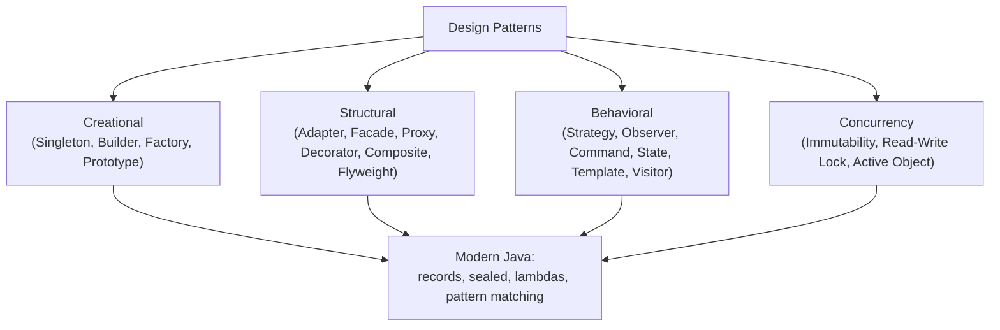

# Design Patterns

Design patterns are proven, reusable solutions to recurring design problems. They are language-agnostic concepts expressed in Java through classes, interfaces, composition, and (modern Java) lambdas, records, and sealed types. This module covers the classic Gang of Four (GoF) groups—creational, structural, behavioral—plus concurrency and modern-Java variants, with implementation trade-offs.

## Creational patterns

### Singleton
Ensure one instance, global access. Prefer an enum (Java's recommended singleton) or a lazy holder idiom; avoid double-checked locking unless you need lazy initialization and understand the JMM (see module 23).

```java
// Enum singleton — simplest, serialization-safe, reflection-resistant
public enum Elvis {
    INSTANCE;
    public void sing() { System.out.println("Elvis has left the building"); }
}

// Lazy holder idiom — lazy, thread-safe, no synchronization
public class LazySingleton {
    private LazySingleton() {}
    private static class Holder { static final LazySingleton INSTANCE = new LazySingleton(); }
    public static LazySingleton getInstance() { return Holder.INSTANCE; }
}
```

### Factory Method / Abstract Factory
Factory Method lets a class defer instantiation to subclasses. Abstract Factory creates families of related objects.

### Builder
Use for objects with many optional parameters (telescoping constructor antipattern). Modern Java: records + static factory, or a builder class.

```java
public record NutritionFacts(int servingSize, int servings, int calories,
                             Integer fat, Integer sodium, Integer carbohydrate) {
    public static class Builder {
        private final int servingSize;
        private final int servings;
        private int calories = 0;
        private Integer fat = 0;
        public Builder(int servingSize, int servings) {
            this.servingSize = servingSize; this.servings = servings;
        }
        public Builder calories(int v) { this.calories = v; return this; }
        public Builder fat(Integer v) { this.fat = v; return this; }
        public Builder sodium(Integer v) { this.sodium = v; return this; }
        public Builder carbohydrate(Integer v) { this.carbohydrate = v; return this; }
        public NutritionFacts build() { return new NutritionFacts(servingSize, servings, calories, fat, sodium, carbohydrate); }
    }
}
```

### Prototype
Clone an existing object (`Cloneable` is broken/weak; prefer copy factories or copy constructors).

### Structural patterns

### Adapter
Wrap an incompatible interface (`ArrayList` → `List`, legacy API → modern interface). Class adapter (inheritance) vs object adapter (composition — prefer composition).

### Facade
Simplify a subsystem behind a single coarse-grained interface.

### Proxy
Placeholder controlling access to another object. Variants: remote, virtual, protection, caching. Java `java.lang.reflect.Proxy` (dynamic proxies for interfaces) and records/sealed types for data proxies.

```java
import java.lang.reflect.*;

public class ProxyDemo {
    public interface Service { void doWork(); }
    public static class RealService implements Service {
        public void doWork() { System.out.println("real work"); }
    }
    public static void main(String[] args) {
        Service real = new RealService();
        Service proxy = (Service) Proxy.newProxyInstance(
            Service.class.getClassLoader(),
            new Class[]{Service.class},
            (proxyObj, method, args) -> {
                System.out.println("before: " + method.getName());
                Object result = method.invoke(real, args);
                System.out.println("after: " + method.getName());
                return result;
            });
        proxy.doWork();
    }
}
```

Output:

```
before: doWork
real work
after: doWork
```

### Decorator
Wrap an object adding responsibilities dynamically (e.g., `BufferedInputStream` wraps `InputStream`).

### Composite
Tree structures treating individual objects and compositions uniformly.

### Flyweight
Share fine-grained objects to save memory (intrinsic vs extrinsic state).

### Behavioral patterns

### Strategy
Encapsulate interchangeable algorithms behind an interface; modern Java: pass lambdas/`Function` instead of strategy classes.

### Observer
One-to-many dependency; `java.util.Observer`/`Observable` are deprecated. Prefer lambdas, `Flow.Publisher`/`Subscriber` (JDK 9 Reactive Streams), or event buses.

```java
import java.util.concurrent.Flow.*;

public class ObserverDemo {
    public static void main(String[] args) {
        Flow.Publisher<String> pub = sub -> sub.onSubscribe(new Subscription() {
            public void request(long n) {
                sub.onNext("event-1");
                sub.onNext("event-2");
                sub.onComplete();
            }
            public void cancel() {}
        });
        pub.subscribe(new Subscriber<String>() {
            public void onSubscribe(Subscription s) { s.request(Long.MAX_VALUE); }
            public void onNext(String item) { System.out.println("got: " + item); }
            public void onError(Throwable t) { t.printStackTrace(); }
            public void onComplete() { System.out.println("done"); }
        });
    }
}
```

### Command
Encapsulate a request as an object (undo/redo, task queues). Modern Java: `Runnable`/`Callable`/lambdas.

### State / Template Method
State: delegate behavior to a state object. Template Method: skeleton in a superclass, steps overridden by subclasses (uses inheritance — prefer Strategy/composition where possible).

### Iterator / Memento / Mediator / Chain of Responsibility / Visitor / Interpreter / Null Object
Brief coverage with when to use.

## Concurrency patterns

### Immutable objects / thread confinement
Prefer immutability (records) to avoid synchronization.

### Read-write lock
`ReentrantReadWriteLock` for read-mostly data (module 18).

### Thread-local / ScopedValue
Per-thread state (module 16).

### Active object / future
Decouple method execution from invocation (`CompletableFuture`, module 20).

## Modern-Java variants

- Records for value objects (replaces many data-holder classes).
- Sealed types for closed variant hierarchies (algebraic data types).
- Pattern matching for switch simplifies Visitor-like traversal.
- Lambdas/method references replace Strategy/Command/Comparator boilerplate.

### Mermaid: pattern categories



## Comparison table

| Pattern | Problem | Modern alternative |
|---------|---------|-------------------|
| Singleton | single instance | enum / lazy holder / dependency injection |
| Strategy | interchangeable algorithms | `Function`/lambda |
| Command | encapsulate request | `Runnable`/`Callable`/lambda |
| Observer | one-to-many notification | `Flow.Publisher`/event bus |
| Adapter | incompatible interface | adapter class or method reference |
| Proxy | controlled access | `java.lang.reflect.Proxy` |

## Common mistakes

- Singleton via double-checked locking without `volatile` (broken pre-Java 5 JMM).
- Overusing inheritance-based patterns (Template Method) when composition/Strategy suffices.
- Using deprecated `Observable`/`Observer`.
- Making everything a pattern; prefer simple code first.

# Interview Questions

## Beginner

**Q1. What is a design pattern?**

A proven, reusable solution to a recurring design problem; a template, not code to copy-paste.

**Q2. Name the three GoF pattern categories.**

Creational, structural, behavioral.

**Q3. What is the problem with `java.util.Observable`/`Observer`?**

Deprecated (Java 9); tightly coupled, not generic, no error handling. Prefer lambdas or Reactive Streams (`Flow.Publisher`/`Subscriber`).

**Q4. When is an enum the best singleton?**

Always — enums are serialization-safe, reflection-resistant, and simplest (Effective Java).

**Q5. What is the Builder pattern for?**

Objects with many optional parameters; avoids the telescoping-constructor antipattern.

## Intermediate

**Q6. Factory Method vs Abstract Factory?**

Factory Method: one method creates one product (subclass decides). Abstract Factory: families of related products.

**Q7. Adapter vs Proxy vs Decorator?**

Adapter: changes interface. Proxy: controls access (same interface). Decorator: adds behavior (same interface, wraps).

**Q8. Strategy vs Template Method?**

Strategy: composition, swap algorithms at runtime. Template Method: inheritance, fixed skeleton.

**Q9. Why prefer composition over inheritance?**

Fragile base class, tight coupling; composition (Strategy, Decorator) is more flexible.

**Q10. How do lambdas replace patterns?**

A lambda is an anonymous strategy/command/comparator—less boilerplate than a full class.

## Advanced

**Q11. Implement a thread-safe lazy singleton.**

Enum or lazy holder idiom (thread-safe, lazy, no sync).

**Q12. When is Proxy better than direct access?**

When you need lazy initialization, access control, caching, logging, or remote invocation around a target.

**Q13. Implement `equals`/`hashCode` for a value object.**

Component-based (records do this automatically).

**Q14. Visitor pattern and Java?**

Double dispatch for operations over object structures; modern Java: pattern matching for switch (sealed + records) often replaces Visitor.

**Q15. Null Object pattern?**

Return a neutral "do nothing" object instead of `null` to avoid NPEs.

## Expert

**Q16. Design a pluggable notification service (email/SMS/push).**

Strategy interface `Notifier` + implementations + factory/registry; sealed type for channel enum.

**Q17. Implement an undoable command.**

`Command` interface with `execute()`/`undo()`; history stack of commands.

**Q18. How does `java.lang.reflect.Proxy` work?**

Generates a class implementing the given interfaces; dispatches invocations to an `InvocationHandler`.

**Q19. When NOT to use a pattern?**

When simple code suffices; patterns add indirection and complexity.

**Q20. Pattern vs framework vs library?**

Pattern = design template; library = reusable code; framework = inversion of control skeleton.

## Scenario Based

**Q21. You need to support multiple payment gateways (Stripe, PayPal).**

Strategy interface `PaymentGateway` + implementations; factory to select; records for payment requests.

**Q22. You are wrapping a legacy third-party API with a different interface.**

Adapter pattern.

**Q23. You need to add logging/validation around service calls without changing the service.**

Proxy or Decorator (dynamic `Proxy` for interfaces).

**Q24. Your object tree (file system: files/folders) needs uniform operations.**

Composite pattern.

**Q25. You need undo/redo in a text editor.**

Command pattern with history stack.

## Output Prediction

**Q26. What does this print?**

```java
public enum Printer { INSTANCE; public void print(){ System.out.println("print"); } }
public class Q26 {
    public static void main(String[] args) {
        Printer p1 = Printer.INSTANCE;
        Printer p2 = Printer.INSTANCE;
        System.out.println(p1 == p2);
        p1.print();
    }
}
```

**Output:**
```
true
print
```

**Reason:** Enum singleton — `INSTANCE` is a single instance (`==` true).

**Q27. What does this print?**

```java
import java.lang.reflect.*;
public class Q27 {
    public interface Svc { void go(); }
    public static class Real implements Svc { public void go(){ System.out.println("real"); } }
    public static void main(String[] args) {
        Svc real = new Real();
        Svc proxy = (Svc) Proxy.newProxyInstance(
            Svc.class.getClassLoader(), new Class[]{Svc.class},
            (p, m, a) -> { System.out.println("around"); return m.invoke(real, a); });
        proxy.go();
    }
}
```

**Output:**
```
around
real
```

**Reason:** Dynamic proxy intercepts, then invokes real method.

**Q28. What does this print?**

```java
public class Q28 {
    public static void main(String[] args) {
        java.util.Observable o = new java.util.Observable();
        System.out.println(o.getClass().getSimpleName());
    }
}
```

**Output:**
```
Observable
```

**Reason:** Class exists but is deprecated (forRemoval=false); use Flow API instead.

**Q29. What does this print?**

```java
public record Pair(String a, String b) {}
public class Q29 {
    public static void main(String[] args) {
        Pair p1 = new Pair("x","y");
        Pair p2 = new Pair("x","y");
        System.out.println(p1.equals(p2) + " " + (p1.hashCode()==p2.hashCode()));
    }
}
```

**Output:**
```
true true
```

**Reason:** Records generate component-based equals/hashCode.

**Q30. What does this print?**

```java
public class Q30 {
    interface Greeter { void greet(); }
    public static void main(String[] args) {
        Greeter g = () -> System.out.println("hi");
        g.greet();
    }
}
```

**Output:**
```
hi
```

**Reason:** Lambda as functional interface (Strategy in one line).

## Internal Working

**Q31. How does `java.lang.reflect.Proxy` generate classes?**

It defines a synthetic class in the caller's class loader implementing the requested interfaces; method invocations route to `InvocationHandler.invoke`.

**Q32. Is the lazy holder idiom thread-safe without synchronization?**

Yes — class initialization is thread-safe (JLS 12.4.2); `Holder.INSTANCE` initializes once.

**Q33. Why is `Cloneable` considered broken?**

`Object.clone()` is protected, returns `Object`, doesn't invoke constructors, and does shallow copy. Prefer copy factories/constructors.

**Q34. Does the Strategy pattern require an interface?**

Not necessarily—a functional interface/lambda suffices for simple strategies.

**Q35. What is the "fragile base class" problem?**

Changing a base class can break subclasses that depend on internal behavior; favor composition.

## Tricky Questions

**Q36. Can an enum implement an interface?**

Yes.

**Q37. Can a singleton be serialized?**

Enums are serialization-safe; regular singletons need `readResolve`.

**Q38. Is `java.util.Observable` thread-safe?**

No, and it's deprecated.

**Q39. Can a Proxy implement classes (not just interfaces)?**

`java.lang.reflect.Proxy` supports interfaces only; for classes use libraries (CGLIB/ByteBuddy) or `java.lang.invoke` (module 43).

**Q40. Does a static nested class count as a pattern?**

Not by itself; it's a language feature sometimes used in Singleton (holder) or Builder.