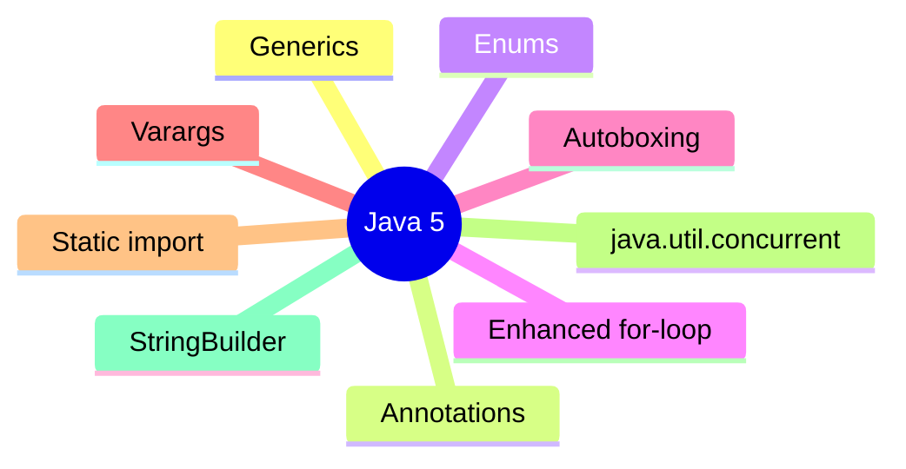

# Java 5 (J2SE 5.0, 2004)

Java 5 was the first major language overhaul since Java 1, introducing the features that define modern Java: generics, annotations, enums, enhanced for-loop, autoboxing, varargs, static imports, and `java.util.concurrent`. Released under the J2SE 5.0 branding (later "Java 5").

## Generics (JSR 14)

Parameterized types let you express element types at compile time, eliminating casts and `ClassCastException` in collections.

```java
// Pre-Java 5
List list = new ArrayList();
list.add("hello");
String s = (String) list.get(0);  // cast, can throw ClassCastException

// Java 5+
List<String> list = new ArrayList<String>();
list.add("hello");
String s = list.get(0);  // no cast, type-safe
```

**Type erasure**: generic type information is removed at compile time (erased to raw types/bounds); `List<String>` and `List<Integer>` are the same raw `List` at runtime. This is why you cannot do `new T[]`, `instanceof List<String>`, or `static T` fields.

## Enhanced for-loop (for-each)

```java
for (String s : list) { ... }   // sugar for Iterator-based traversal
```

Works on arrays and `Iterable`. Cannot remove elements during iteration (use `Iterator.remove()`); no index access.

## Autoboxing / Unboxing

Automatic conversion between primitives and wrappers (`Integer`, `Boolean`, etc.).

```java
List<Integer> list = new ArrayList<>();
list.add(5);        // autoboxing: Integer.valueOf(5)
int x = list.get(0); // unboxing: intValue()
```

**Pitfall**: `Integer.valueOf` caches `-128..127`; `==` on boxed integers outside that range is `false` (use `.equals()`).

## Enum types

```java
public enum Day { MONDAY, TUESDAY, WEDNESDAY, THURSDAY, FRIDAY, SATURDAY, SUNDAY }
```

Enums are full classes (can have fields, methods, constructors), implement `Comparable`/`Serializable`, provide `values()`/`valueOf()`, and are singletons (serialization-safe).

## Varargs

```java
public void printf(String format, Object... args) { ... }
printf("%d %s", 1, "a", 2, "b");   // varargs array created automatically
```

Only one varargs parameter per method, and it must be last. Mixing varargs with generics triggers unchecked warnings (use `@SafeVarargs`).

## Static imports

```java
import static java.lang.Math.*;
import static java.lang.System.out;
out.println(sqrt(2));
```

Use sparingly — overuse harms readability.

## Annotations

Metadata with `@interface`, retention (`SOURCE`/`CLASS`/`RUNTIME`), and targets. Built-ins: `@Override`, `@Deprecated`, `@SuppressWarnings`. Annotation processing (apt) ran at compile time.

```java
@Retention(RetentionPolicy.RUNTIME)
@Target(ElementType.METHOD)
public @interface Benchmark {}
```

## java.util.concurrent (JSR 166)

`ConcurrentHashMap`, `ExecutorService`, `Executors`, `Callable`/`Future`, `CountDownLatch`, `Semaphore`, `ReentrantLock`, `AtomicInteger`, `CopyOnWriteArrayList`. The foundation of modern concurrent Java (expanded in later releases).

## Other additions

- `StringBuilder` (unsynchronized replacement for `StringBuffer`, single-threaded string building).
- `Formatter`/`printf` (`System.out.printf`).
- `Scanner` (simple parsing).
- `java.util.prefs` (Preferences API).
- `EnumSet`/`EnumMap` (high-performance enum-based collections).

### Mermaid: Java 5 feature map



## Comparison table

| Feature | Pre-Java 5 | Java 5+ |
|---------|-----------|---------|
| Collections | raw `List`, casts | `List<E>`, type-safe |
| Looping | `Iterator`/`for(int i)` | enhanced `for (E e : list)` |
| Wrappers | manual `new Integer()` | autoboxing |
| Fixed constants | `public static final int` | `enum` |
| Varargs | arrays manually | `Object... args` |
| Concurrency | `synchronized`/wait-notify | `java.util.concurrent` |

## Common mistakes

- `==` on boxed primitives outside the cache range.
- Assuming generics are reified at runtime (they are erased).
- Modifying a collection during enhanced for-loop iteration (`ConcurrentModificationException`).
- Overusing static imports (hurts readability).
- Varargs + generics unchecked warnings.

# Interview Questions

## Beginner

**Q1. What major features did Java 5 introduce?**

Generics, annotations, enums, enhanced for-loop, autoboxing/unboxing, varargs, static imports, `java.util.concurrent`, `StringBuilder`.

**Q2. What is type erasure?**

Generic type parameters are removed at compile time; `List<String>` becomes raw `List` at runtime.

**Q3. What is the enhanced for-loop for?**

Iterating arrays and `Iterable` without explicit `Iterator` management (read-only traversal).

**Q4. What is autoboxing?**

Automatic conversion between primitives and their wrapper classes (`int`↔`Integer`).

**Q5. What is the `Integer` cache, and why does `==` sometimes fail on boxed ints?**

`Integer.valueOf` caches -128..127; `==` compares identity outside that range — use `.equals()`.

## Intermediate

**Q6. Can you use `instanceof List<String>`?**

No — generics are erased; `List<String>` and `List<Integer>` are the same at runtime.

**Q7. Can you create `new T[]` in a generic method?**

No — component type is erased; use `Array.newInstance` or pass a `T[]`/Class token.

**Q8. Are enums singletons?**

Yes — each enum constant is a single instance; serialization-safe by default.

**Q9. What is the restriction on varargs?**

One varargs parameter per method, must be the last parameter.

**Q10. When should you avoid static imports?**

When they reduce readability or cause ambiguity (multiple static imports with same name).

## Advanced

**Q11. How does `ConcurrentHashMap` (Java 5) differ from `Hashtable`?**

`ConcurrentHashMap` uses lock stripping (better concurrency) and allows concurrent reads; `Hashtable` synchronizes the whole table.

**Q12. What is `@SafeVarargs` for?**

Suppresses unchecked warnings on varargs methods that are provably type-safe (only on `static`/`final`/private methods or constructors).

**Q13. Can annotations have default values?**

Yes — element defaults must be compile-time constant expressions.

**Q14. What apt tool processed annotations in Java 5?**

`apt` (annotation processing tool), later superseded by `javax.annotation.processing` (JSR 269, Java 6).

**Q15. Is `StringBuilder` thread-safe?**

No — use `StringBuffer` if you need synchronization; `StringBuilder` is faster for single-threaded use.

## Expert

**Q16. Can generics be used with primitive type arguments?**

No — only reference types; use `Integer`, `Double`, etc. (primitive generics arrived via Valhalla much later, still preview).

**Q17. What is the difference between an enum and a class with constants?**

Enums are type-safe, singletons, implement `Comparable`/`Serializable`, and can have fields/methods/constructors.

**Q18. Does autoboxing happen in `ArrayList<Integer>`?**

Yes — `add(int)` boxes to `Integer`; `get(int)` unboxes. Use primitive collections (third-party) for hot paths.

**Q19. Is the enhanced for-loop always equivalent to an indexed loop?**

No — it works on `Iterable`/arrays, gives no index, and forbids structural modification during iteration.

**Q20. Can annotations be retained at runtime?**

Yes — with `@Retention(RetentionPolicy.RUNTIME)`, readable via reflection.

## Scenario Based

**Q21. You need a type-safe list of orders. Raw `List` or `List<Order>`?**

`List<Order>` — compile-time type safety, no casts, catches errors early.

**Q22. You are comparing two `Integer`s from a cache. Use `==` or `.equals()`?**

`.equals()` — `==` only works reliably within the -128..127 cache.

**Q23. You need to remove elements while iterating. Enhanced for-loop or `Iterator`?**

`Iterator.remove()` — enhanced for-loop forbids structural modification.

**Q24. You have many optional parameters. Varargs or overloaded methods?**

Varargs for homogeneous optional args; overloads for heterogeneous.

**Q25. You need a fixed set of constants with behavior. Enum or constants class?**

Enum — type-safe, singleton, can hold state and behavior.

## Output Prediction

**Q26. What does this print?**

```java
List<Integer> list = new ArrayList<>();
list.add(100);   // outside -128..127 cache
list.add(100);
System.out.println(list.get(0) == list.get(1));
```

**Output:**
```
false
```

**Reason:** Two distinct `Integer` objects for 100 (outside the cache); `==` compares identity.

**Q27. What does this print?**

```java
for (int i : new int[]{1,2,3}) System.out.print(i + " ");
```

**Output:**
```
1 2 3
```

**Reason:** Enhanced for-loop works on arrays.

**Q28. What does this print?**

```java
Integer a = 127;
Integer b = 127;
System.out.println(a == b);
```

**Output:**
```
true
```

**Reason:** 127 is within the cache (-128..127); `valueOf` returns the same instance.

**Q29. What does this print?**

```java
EnumSet<Day> s = EnumSet.of(Day.MONDAY, Day.WEDNESDAY);
System.out.println(s);
```

**Output:**
```
[MONDAY, WEDNESDAY]
```

**Reason:** `EnumSet` is a compact bit-vector set.

**Q30. Can you instantiate `new T[]` inside `<T> void m()`?**

**Output:** Compile error — component type `T` is erased; use `Array.newInstance(T.class, n)` or pass the array.

## Internal Working

**Q31. How does `javac` implement autoboxing?**

It inserts `Integer.valueOf(int)` calls at box points and `intValue()` at unbox points.

**Q32. Where is generic type information stored after erasure?**

Nowhere for most uses — erased; survives only in the `Signature` attribute (reflection `Type` API, module 07).

**Q33. How does the compiler transform an enhanced for-loop?**

Into `for (Iterator it = c.iterator(); it.hasNext();)` with a cast (pre-5 style) — but type-safe due to generics.

**Q34. Is `enum` a class?**

Yes — `java.lang.Enum` subclass, implicitly final, with `ordinal()`, `name()`, `values()`, `valueOf()`.

**Q35. Are varargs passed as arrays?**

Yes — the compiler creates an array and passes it as the last argument.

## Tricky Questions

**Q36. Can a generic class extend `Throwable`?**

No — `Throwable` subclasses cannot be generic.

**Q37. Can you declare `static T field` in a generic class?**

No — static members share state across all type arguments, but `T` is per-instance/erased.

**Q38. Does `List<String>.class` compile?**

No — `List<String>.class` is illegal; use `List.class` (raw).

**Q39. Can enums have constructors?**

Yes — private (or package) constructors; `public` enum constructors are illegal.

**Q40. Is `Arrays.asList` list fixed-size?**

Yes — it's a fixed-size view of the array; `add`/`remove` throw `UnsupportedOperationException`.