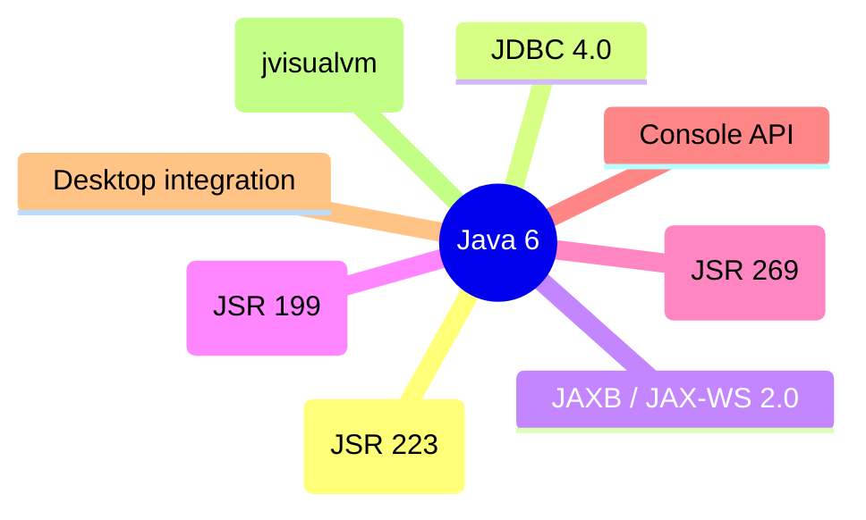

# Java 6 (J2SE 6, 2006)

Java 6 ("Mustang") focused on quality, monitoring, scripting, and web-services integration rather than big language changes. It introduced the scripting API (JSR 223), JDBC 4.0, JAXB/JAX-WS 2.0, the Compiler API, pluggable annotation processing, `Console`, desktop integration, and a faster-starting JVM.

## Scripting API (JSR 223)

`javax.script` lets Java host scripting languages (JavaScript via Rhino in Java 6) and call back and forth.

```java
import javax.script.*;

public class ScriptDemo {
    public static void main(String[] args) throws Exception {
        ScriptEngineManager mgr = new ScriptEngineManager();
        ScriptEngine js = mgr.getEngineByName("JavaScript"); // Rhino in Java 6
        js.put("name", "Ada");
        Object result = js.eval("var msg = 'Hello, ' + name; msg;");
        System.out.println(result); // Hello, Ada
        Invocable inv = (Invocable) js;
        Object r = inv.invokeFunction("add", 2, 3); // if add defined
    }
}
```

Rhino was removed in Java 15 (Nashorn in Java 8 removed in Java 15; GraalJS is the modern alternative).

## JDBC 4.0

- Automatic driver registration (no `Class.forName("com.mysql.Driver")` needed — `DriverManager` finds drivers via `META-INF/services/java.sql.Driver`).
- `RowId`, `XML` (`SQLXML`), enhanced `Blob`/`Clob`, `Connection.isValid(timeout)`.

```java
try (Connection c = DriverManager.getConnection(url, user, pass);
     Statement s = c.createStatement();
     ResultSet rs = s.executeQuery("SELECT id, name FROM users")) {
    while (rs.next()) {
        System.out.println(rs.getInt("id") + " " + rs.getString("name"));
    }
} // try-with-resources syntax shown for clarity; Java 6 itself used finally
```

Note: try-with-resources arrived in Java 7; in Java 6, close in `finally`.

## JAXB 2.0 & JAX-WS 2.0

- **JAXB** (JSR 222): XML↔Java binding with annotations (`@XmlRootElement`, `@XmlElement`), schema generation (`xjc`).
- **JAX-WS** (JSR 224): SOAP web services (`@WebService`, `@WebMethod`), endpoint publishing (`Endpoint.publish`).

## Compiler API & Pluggable Annotation Processing (JSR 199 / JSR 269)

- `javax.tools.JavaCompiler`: compile Java source in-process (`compiler.getTask(...).call()`).
- `javax.annotation.processing` (JSR 269): annotation processors run during compilation; `Processor`, `RoundEnvironment`, `Filer`, `Messager`, `Elements`, `Types`. Register via `META-INF/services/javax.annotation.processing.Processor`.

```java
// Conceptual processor skeleton (Java 6+)
public class MyProcessor extends AbstractProcessor {
    public boolean process(Set<? extends TypeElement> annotations, RoundEnvironment roundEnv) { ... }
    public SourceVersion getSupportedSourceVersion() { return SourceVersion.RELEASE_6; }
    public Set<String> getSupportedAnnotationTypes() { return ...; }
}
```

This enabled Lombok-like compile-time code generation and compile-time validation.

## `Console` API

`java.io.Console` (Java 6): secure password reading (`readPassword()`), no echo, `printf`, `format`. Returns `null` in non-interactive environments (IDE, CI).

```java
Console c = System.console();
if (c != null) {
    char[] pw = c.readPassword("Password: ");
    // use pw, then Arrays.fill(pw, ' ')
}
```

## Desktop API (JSR 296? actually java.awt.Desktop)

`java.awt.Desktop`: open browser (`browse`), mail (`mail`), edit/print files, open file associations — integrates with the host desktop.

## Other additions

- `StoreLoader`? No. 
- `JAXB`, `JAX-WS`, `StAX` (streaming XML).
- `javax.script`, JDBC 4, `Console`, `Compiler API`, annotation processing.
- JVM improvements: faster startup, `-XX:+UseCompressedClassSpace`? (that's 8), compressed oops default (64-bit, Java 6u23+), `-XX:+UseConcMarkSweepGC` refinements, `jvisualvm` (Java 6u7), `jmap`/`jhat` improvements.
- `CommonAnnotations`? (`javax.annotation.Resource`, `PostConstruct`, `PreDestroy` — JSR 250).
- RowSet 1.1 (`javax.sql.rowset`).

### Mermaid: Java 6 focus areas



## Comparison table

| Area | Java 5 | Java 6 |
|------|--------|--------|
| Generics | introduced | same |
| Scripting | none | `javax.script` (Rhino) |
| JDBC | manual `Class.forName` | auto driver registration |
| Web services | none | JAX-WS 2.0 (SOAP) |
| XML binding | none | JAXB 2.0 |
| In-process compilation | none | `javax.tools.JavaCompiler` |
| Annotation processing | `apt` (external tool) | pluggable API (JSR 269) |
| Console password | none | `Console.readPassword()` |
| Desktop integration | none | `java.awt.Desktop` |

## Common mistakes

- Assuming `Console` is non-null (it is `null` when stdin is not a console, e.g., IDE/CI).
- Relying on `Class.forName` for JDBC drivers (optional in Java 6+, but harmless).
- Calling `System.console()` in server environments where it returns null.
- Forgetting that `ScriptEngine` state persists across `eval` calls (bindings are shared).

# Interview Questions

## Beginner

**Q1. What was the focus of Java 6?**

Quality, monitoring, scripting, and web-services integration (JDBC 4, JAX-WS, JAXB) rather than major language changes.

**Q2. What is `javax.script` (JSR 223)?**

An API to host scripting languages (JavaScript via Rhino in Java 6) inside Java and call scripts back and forth.

**Q3. What changed in JDBC 4.0?**

Automatic JDBC driver registration via service providers — no `Class.forName` needed.

**Q4. What is `java.io.Console`?**

Secure console I/O: `readLine`/`readPassword` (no echo), `printf`; returns `null` when no console.

**Q5. What is `java.awt.Desktop`?**

Desktop integration: open URLs (`browse`), mail, edit/print files.

## Intermediate

**Q6. What is the Compiler API (JSR 199)?**

`javax.tools.JavaCompiler` — compile Java source in-process at runtime.

**Q7. What is pluggable annotation processing (JSR 269)?**

Annotation processors run during compilation (`javax.annotation.processing`), enabling compile-time code generation/validation (register via `META-INF/services`).

**Q8. Which scripting engine shipped with Java 6?**

Rhino (JavaScript) via `ScriptEngineManager.getEngineByName("JavaScript")` — removed in Java 15.

**Q9. What is `Console.readPassword()` for?**

Reading passwords without echoing them to the terminal (returns `char[]`).

**Q10. What SOAP web-service API was added?**

JAX-WS 2.0 (`@WebService`, `@WebMethod`, `Endpoint.publish`).

## Advanced

**Q11. Can `Console` be null?**

Yes — when there is no interactive console (IDE, CI, background jobs); always null-check.

**Q12. How does the Compiler API differ from `Runtime.exec("javac ...")`?**

In-process compilation via `JavaCompiler` — no external process, direct access to diagnostics/file objects.

**Q13. How do annotation processors get discovered?**

`META-INF/services/javax.annotation.processing.Processor` listing processor classes.

**Q14. Is `Console.readPassword` echoed?**

No — input is not echoed (suitable for passwords).

**Q15. What XML stack did Java 6 standardize?**

JAXB 2.0 (binding), JAX-WS 2.0 (SOAP services), StAX (streaming XML).

## Expert

**Q16. What is the service-provider loading mechanism for JDBC drivers?**

`DriverManager` scans `META-INF/services/java.sql.Driver` — no explicit driver class loading needed.

**Q17. Can annotation processors generate new source files?**

Yes — via `Filer.createSourceFile(...)`; generated files may trigger another processing round.

**Q18. Why was Rhino removed (Java 15)?**

Maintenance burden; GraalVM/GraalJS is the modern JavaScript option on the JVM.

**Q19. What is `javax.annotation.Resource`/`@PostConstruct`/`@PreDestroy`?**

JSR 250 common annotations (dependency injection lifecycle), used by Java EE/Containers.

**Q20. How do you compile Java from Java programmatically?**

`ToolProvider.getSystemJavaCompiler()` → `getTask(...)` → `call()`.

## Scenario Based

**Q21. You need to evaluate simple JavaScript expressions in a Java app (Java 6 era).**

`javax.script.ScriptEngineManager` → `getEngineByName("JavaScript")` → `eval(...)`.

**Q22. Your app reads passwords from a terminal. Which API?**

`System.console().readPassword()` (with null check for non-console environments).

**Q23. You want to compile user-submitted Java snippets at runtime.**

`javax.tools.JavaCompiler` in-process (sandbox carefully — user code runs in your JVM).

**Q24. You are writing a compile-time code generator (e.g., for DTOs).**

JSR 269 annotation processor + `Filer` to generate `.java` files during compilation.

**Q25. You need to integrate with the host desktop (open a URL).**

`java.awt.Desktop.getDesktop().browse(uri)`.

## Output Prediction

**Q26. What does this print?**

```java
Console c = System.console();
System.out.println(c == null ? "null console" : "has console");
```

**Output:** `null console` when run in an IDE/CI (no TTY); `has console` in a real terminal.

**Reason:** `System.console()` returns null when there is no console.

**Q27. What does this print?**

```java
ScriptEngine m = new ScriptEngineManager().getEngineByName("JavaScript");
m.put("x", 21);
m.put("y", 21);
Object r = m.eval("x * y");
System.out.println(r);
```

**Output:**
```
441
```

**Reason:** Bindings persist across evals; `x*y` = 441.

**Q28. What does `Console.readPassword()` return?**

`char[]` — not `String`, so you can zero it out after use.

**Q29. Is `Class.forName("com.mysql.jdbc.Driver")` still required in Java 6+?**

No — driver auto-registration via service providers makes it optional (but harmless).

**Q30. Can `JavaCompiler` compile in-memory sources?**

Yes — via `JavaFileObject`/`SimpleJavaFileObject` implementations without files on disk.

## Internal Working

**Q31. How does `ScriptEngineManager` find engines?**

`META-INF/services/javax.script.ScriptEngineFactory` listings on the classpath.

**Q32. How does JDBC auto-registration work?**

`DriverManager` initializes by loading providers listed in `META-INF/services/java.sql.Driver`.

**Q33. What does `Filer` do in annotation processing?**

Creates new source/class files and resources during a processing round.

**Q34. Is `Console` tied to `System.in`?**

Yes — it reads from the console device associated with the JVM's stdin.

**Q35. Are annotation processors part of the JVM?**

No — they run in `javac` at compile time, not at runtime.

## Tricky Questions

**Q36. Does `Console.readPassword` echo input?**

No — input is hidden (no echo).

**Q37. Can you use `Console` in a web application?**

No — web servers have no interactive console; `System.console()` returns null.

**Q38. Is `ScriptEngine` thread-safe?**

Generally no — share with care or synchronize.

**Q39. Does `Console.readLine` return null at EOF?**

Yes — returns null at end of stream.

**Q40. What is `javax.annotation.PostConstruct`?**

A lifecycle callback (JSR 250) invoked after dependency injection, before the bean is put into service (common in Java EE containers).