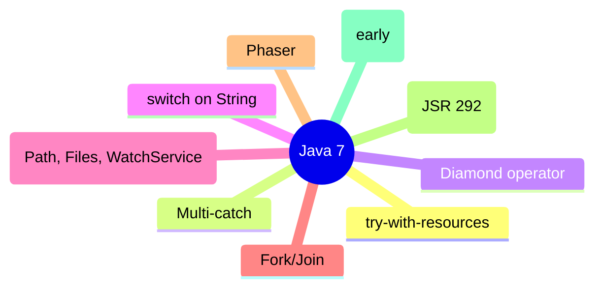

# Java 7 (JSR 334? actually Java 7 = Dolphin, 2011)

Java 7 ("Dolphin") focused on developer productivity: try-with-resources, multi-catch, diamond operator, switch-on-String, NIO.2 (`java.nio.file`), fork/join, `Phaser`, dynamic language support (`invokedynamic`, JSR 292), and the early G1 collector.

## try-with-resources

Automatic resource management (ARM) — `Closeable`/`AutoCloseable` resources are closed automatically, even on exceptions, in reverse order.

```java
try (BufferedReader r = new BufferedReader(new FileReader("file.txt"));
     PrintWriter w = new PrintWriter("out.txt")) {
    String line = r.readLine();
    w.println(line);
} catch (IOException e) { ... }
```

Equivalent to a `try/finally` with `close()` in a `finally`, but cleaner and with **suppressed exceptions**: if both the try block and `close()` throw, the close exception is added as suppressed (`Throwable.getSuppressed()`).

```java
try (Resource r = new Resource()) {
    throw new RuntimeException("main");
} // r.close() throws RuntimeException("close") → added as suppressed
```

**Note:** `AutoCloseable.close()` throws `Exception` (Java 7); narrowed to specific exceptions in Java 9 (effectively-final resources).

## Multi-catch

Catch multiple exception types in one catch (if they are unrelated — no subtype relationship):

```java
try { ... } catch (IOException | SQLException e) { ... }   // e is implicitly final
```

`e` is implicitly final; you cannot reassign it.

## Diamond operator

Type inference for generic constructors:

```java
// Java 5/6
Map<String, List<Integer>> map = new HashMap<String, List<Integer>>();
// Java 7+
Map<String, List<Integer>> map = new HashMap<>();   // "diamond"
```

Works when the compiler can infer the type arguments from context.

## switch on String

```java
switch (command) {
    case "start": start(); break;
    case "stop": stop(); break;
    default: throw new IllegalArgumentException();
}
```

Internally: `invokedynamic` + `String.hashCode()` + `equals()` checks + an `int` switch (module 44). Null selector throws `NullPointerException`.

## NIO.2 (`java.nio.file`, JSR 203)

A modern file-system API replacing much of `java.io.File`:
- `Path`/`Paths` — path operations (`resolve`, `relativize`, `normalize`, `toAbsolutePath`).
- `Files` — `readAllBytes`, `readAllLines`, `newBufferedReader`, `copy`/`move`/`delete`, `walk` (Java 8 stream), `exists`, `isReadable`, `size`, attributes (`PosixFileAttributes`, `DosFileAttributes`, `BasicFileAttributes`).
- `WatchService` — directory change notifications (`ENTRY_CREATE`/`MODIFY`/`DELETE`, `OVERFLOW`).
- `FileSystem`/`FileSystems` — pluggable file systems (ZIP, etc.).

```java
Path dir = Paths.get("logs");
try (WatchService ws = FileSystems.getDefault().newWatchService()) {
    dir.register(ws, StandardWatchEventKinds.ENTRY_CREATE);
    WatchKey key = ws.take();
    for (WatchEvent<?> ev : key.pollEvents()) {
        System.out.println("created: " + ev.context());
    }
    key.reset();
}
```

## Fork/Join (JSR 166y)

`ForkJoinPool`, `RecursiveTask`/`RecursiveAction`, work-stealing — divide-and-conquer parallelism (expanded in Java 8 parallel streams).

```java
ForkJoinPool pool = new ForkJoinPool();
Integer result = pool.invoke(new ForkJoinTask...);
```

## Other additions

- `Phaser` — reusable synchronization barrier (more flexible than `CyclicBarrier`).
- `TransferQueue`/`LinkedTransferQueue` — blocking queue with handoff (`transfer`).
- `ForkJoinTask.commonPool()`.
- `@SafeVarargs` — suppress unchecked warnings on safe varargs methods (`static`/`final`/private).
- `java.nio.file` WatchService, `FileStore`, `FileStore` attributes.
- Unicode 6.0, `java.nio.charset` improvements.
- `javac` `-proc` control, Xlint.
- JVM: G1 collector (early, `-XX:+UnlockExperimentalVMOptions -XX:+UseG1GC`), compressed Oops (default on 64-bit since 6u23/7), `javac` annotation processing improvements.
- `java.nio.channels.AsynchronousChannelGroup`? (that's Java 7 NIO.2 async channels — `AsynchronousFileChannel`, `AsynchronousServerSocketChannel`, `AsynchronousSocketChannel`).

### Mermaid: Java 7 focus areas



## Comparison table

| Feature | Java 6 | Java 7 |
|---------|--------|--------|
| Resource closing | manual `finally` | try-with-resources (`AutoCloseable`) |
| Multiple exception types | separate catch blocks | multi-catch `IOException | SQLException` |
| Generic constructors | explicit type args | diamond `<>` |
| switch | int/enum only | + `String` |
| File API | `java.io.File` | `java.nio.file.Path`/`Files`/`WatchService` |
| Parallel divide-and-conquer | none | `ForkJoinPool` |
| Dynamic languages | limited | `invokedynamic` (JSR 292) |
| Default GC | Parallel/CMS | G1 available (experimental) |

## Common mistakes

- `switch` on null `String` → `NullPointerException`.
- Multi-catch with related types (subtype relationship) → compile error.
- Diamond when type can't be inferred → unchecked warning/compile error.
- Forgetting `key.reset()` on `WatchKey` → no more events.
- `AutoCloseable.close()` throws checked `Exception` (Java 7) — handle or declare.

# Interview Questions

## Beginner

**Q1. What is try-with-resources?**

Automatic resource management: `AutoCloseable` resources declared in `try(...)` are closed automatically, even on exceptions.

**Q2. What is multi-catch?**

Catching multiple unrelated exception types in one `catch (A | B e)` block; `e` is implicitly final.

**Q3. What is the diamond operator?**

`new HashMap<>()` — lets the compiler infer generic type arguments from context.

**Q4. Can you switch on a String in Java 7?**

Yes — `switch (string)` is supported (internally via hashCode + equals).

**Q5. What does `WatchService` do?**

Notifies applications of file-system changes (create/modify/delete/overflow) in a directory.

## Intermediate

**Q6. How are suppressed exceptions related to try-with-resources?**

If both the try body and `close()` throw, the close exception is added to the main exception via `addSuppressed` (retrievable with `getSuppressed()`).

**Q7. What is `AutoCloseable` vs `Closeable`?**

`Closeable.close()` throws `IOException`; `AutoCloseable.close()` throws `Exception` (broader, Java 7). `AutoCloseable` is the try-with-resources contract.

**Q8. What is the diamond operator's limitation?**

Type inference must succeed from context; otherwise you get an unchecked warning or compile error.

**Q9. What does `ForkJoinPool` do?**

Executes divide-and-conquer tasks (`RecursiveTask`/`RecursiveAction`) using work-stealing.

**Q10. What NIO.2 class represents a file path?**

`java.nio.file.Path` (obtained via `Paths.get(...)`), replacing much of `java.io.File`.

## Advanced

**Q11. Can you catch `Exception | RuntimeException`?**

No — `RuntimeException` is a subtype of `Exception`; multi-catch disallows subtype relationships.

**Q12. How is switch-on-String implemented internally?**

`invokedynamic` → `String.hashCode()` bucket + `String.equals()` disambiguation, then an `int` tableswitch/lookupswitch.

**Q13. What is `Phaser`?**

A reusable synchronization barrier more flexible than `CyclicBarrier` (supports dynamic registration, phase advancement).

**Q14. What is `invokedynamic` (JSR 292)?**

Bytecode for dynamically linked call sites — enables dynamic languages (JRuby, Nashorn) and later lambdas/switch-on-String.

**Q15. What is `Files.walk`?**

(Java 8 stream over NIO.2) walks a file tree; in Java 7, use `Files.newDirectoryStream` or a `WatchService` for events.

## Expert

**Q16. Can try-with-resources have multiple resources?**

Yes — `try (A a = ...; B b = ...)`; they close in reverse order.

**Q17. Is the resource variable in try-with-resources implicitly final?**

Yes — it is effectively final; reassignment is a compile error.

**Q18. What is `ForkJoinPool.commonPool()`?**

The shared pool used by parallel streams (Java 8+) and `ForkJoinTask`; parallelism = `availableProcessors` by default.

**Q19. Can `switch` on String throw?**

Yes — `NullPointerException` if the selector is null.

**Q20. What is `@SafeVarargs`?**

Suppresses unchecked warnings on varargs methods proven type-safe (only `static`/`final`/private methods, constructors).

## Scenario Based

**Q21. You need to copy a large file efficiently. Java 7?**

`Files.copy(source, target, StandardCopyOption.REPLACE_EXISTING)` — uses OS-level efficient copy where possible.

**Q22. You want to watch a directory for new files.**

`WatchService` + `dir.register(ws, ENTRY_CREATE)` + `ws.take()` loop.

**Q23. You have parallel recursive work (e.g., sorting). Java 7?**

`ForkJoinPool` + `RecursiveTask`/`RecursiveAction`.

**Q24. You want to catch `IOException` and `SQLException` the same way.**

Multi-catch `catch (IOException | SQLException e)`.

**Q25. You want concise generic instantiation.**

Diamond operator `new HashMap<>()`.

## Output Prediction

**Q26. What does this print?**

```java
try (Resource r = new Resource()) {
    throw new RuntimeException("boom");
} catch (Exception e) {
    System.out.println(e.getSuppressed().length);
}
class Resource implements AutoCloseable {
    public void close() throws Exception { throw new RuntimeException("close"); }
}
```

**Output:**
```
1
```

**Reason:** `close()` throws inside try-with-resources; the close exception ("close") is added as suppressed to the main exception ("boom"); `getSuppressed().length` = 1.

**Q27. What does this print?**

```java
switch ((String) null) {
    case "a": System.out.println("a"); break;
    default: System.out.println("default");
}
```

**Output:**
```
Exception in thread "main" java.lang.NullPointerException
```

**Reason:** switch on null `String` throws NPE before matching any case.

**Q28. What does this print?**

```java
Map<String, List<Integer>> m = new HashMap<>();
```

**Output:** Compiles (diamond, Java 7+).

**Reason:** Type arguments inferred from the target type (`Map<String, List<Integer>>`).

**Q29. What does this print?**

```java
try { } catch (IOException | SQLException e) {
    e = null;   // compile error
}
```

**Output:** Compile error — multi-catch exception parameter `e` is implicitly final.

**Q30. What NIO.2 method reads all bytes of a file?**

`Files.readAllBytes(Path)`.

## Internal Working

**Q31. How does try-with-resources compile?**

Into `try { ... } finally { resource.close(); }` with `Throwable.addSuppressed` wiring for close exceptions.

**Q32. How does switch-on-String avoid `equals` on every case?**

It switches on `hashCode()` first, then uses `equals()` only within matching hash buckets.

**Q33. What is work-stealing in ForkJoinPool?**

Idle workers steal tasks from busy workers' deques (LIFO own, FIFO steal) to balance load.

**Q34. Is `WatchService` polling or event-driven?**

OS event-driven where available (inotify on Linux, etc.), with a fallback to polling.

**Q35. What is `Phaser` good for?**

Multi-phase synchronization where the number of parties can change over time (unlike `CyclicBarrier`).

## Tricky Questions

**Q36. Can `AutoCloseable.close()` throw a checked exception?**

Yes — `Exception` (Java 7); Java 9+ narrowed it.

**Q37. Can you use try-with-resources without a catch/finally?**

Yes — `try (R r = ...) { ... }` is valid (resources still close).

**Q38. Does multi-catch catch subtypes redundantly?**

Compile error if one caught type is a subtype of another in the same catch.

**Q39. Is diamond allowed with anonymous classes?**

`new HashMap<>() {}` — yes, diamond works with anonymous subclasses too.

**Q40. What is `Files.createDirectories` vs `createDirectory`?**

`createDirectories` creates all nonexistent parent directories (like `mkdir -p`); `createDirectory` creates only the last.