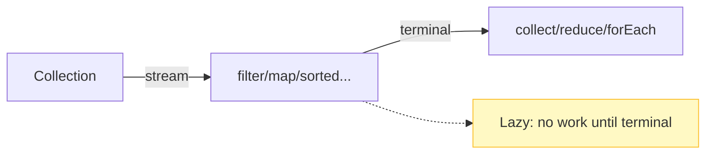

# Java 8 (2014)

Java 8 was the most significant release since Java 5: lambdas, streams, method references, `java.util.function`, default methods on interfaces, `Optional`, the `java.time` API, `CompletableFuture`, `StampedLock`, `Base64`, `Collectors`, `removeIf`/`replaceAll`/`computeIfAbsent` on collections, `parallelSort`, and the Nashorn JS engine.

## Lambda expressions

Anonymous function syntax implementing a functional interface (SAM — single abstract method).

```java
// Pre-Java 8
Collections.sort(list, new Comparator<String>() {
    public int compare(String a, String b) { return a.compareTo(b); }
});

// Java 8
Collections.sort(list, (a, b) -> a.compareTo(b));
// or
list.sort(String::compareTo);
```

Lambdas capture **effectively final** local variables; `this` refers to the enclosing instance (unlike anonymous classes). Compiled via `invokedynamic` + `LambdaMetafactory` (module 43).

## Functional interfaces & java.util.function

`@FunctionalInterface` marks a SAM interface. The JDK provides `java.util.function`:
- `Function<T,R>`, `BiFunction<T,U,R>`
- `Consumer<T>`, `BiConsumer<T,U>`
- `Supplier<T>`, `BooleanSupplier`, `IntSupplier`...
- `Predicate<T>`, `BiPredicate<T,U>`
- `UnaryOperator<T>`, `BinaryOperator<T>`
- Primitive specializations: `IntFunction`, `ToIntFunction`, `IntPredicate`, `IntUnaryOperator`, etc.

```java
Predicate<String> nonEmpty = s -> !s.isEmpty();
Function<String, Integer> length = String::length;
Supplier<Double> random = Math::random;
```

Composition: `andThen`, `compose`, `negate`, `and`, `or`, `Predicate.not` (Java 11).

## Method references

```java
ClassName::staticMethod       // static method ref
instance::instanceMethod      // bound instance method ref
ClassName::instanceMethod     // unbound instance method ref
ClassName::new                // constructor ref
```

## Default methods on interfaces

Interfaces can now have concrete `default` methods (and `static` methods), enabling interface evolution without breaking implementors. Conflict resolution: class wins over interface; explicit `InterfaceName.super.method()` to disambiguate diamonds.

```java
interface Drawable {
    default void draw() { System.out.println("drawing"); }
}
```

## Streams API

`java.util.stream.Stream` (and `IntStream`/`LongStream`/`DoubleStream`): source → intermediate ops → terminal op, lazy, single-use.

```java
int sum = list.stream()
    .filter(s -> s.startsWith("A"))
    .mapToInt(String::length)
    .sum();
```

Key ops: `map`, `flatMap`, `filter`, `distinct`, `sorted`, `peek`, `limit`, `skip`, `forEach`, `forEachOrdered`, `collect`, `reduce`, `count`, `anyMatch`/`allMatch`/`noneMatch`, `findFirst`/`findAny`, `min`/`max`, `toArray`.

Streams are lazy, single-use (`IllegalStateException` on reuse), and prefer stateless, non-interfering lambdas. Parallel streams use `ForkJoinPool.commonPool()`.

### Mermaid: stream pipeline



## Optional

`java.util.Optional<T>` — models an optional value, avoiding `null` returns.

```java
Optional<String> o = Optional.ofNullable(maybeNull);
String result = o.orElse("default");   // eager
String result2 = o.orElseGet(() -> computeDefault()); // lazy
o.ifPresent(System.out::println);
```

Avoid `Optional.get()` (throws `NoSuchElementException` if empty); avoid `Optional` as fields/parameters.

## java.time (JSR 310)

Immutable, thread-safe date/time: `Instant`, `LocalDate`, `LocalTime`, `LocalDateTime`, `ZonedDateTime`, `OffsetDateTime`, `Duration`, `Period`, `DateTimeFormatter`. Replaces `Date`/`Calendar` (module 30).

## CompletableFuture

Asynchronous composition: `supplyAsync`, `thenApply`, `thenCompose`, `thenCombine`, `allOf`, `anyOf`, `exceptionally`, `handle` (module 20).

## Collectors

`Collectors.toList`, `toSet`, `toMap`, `joining`, `groupingBy`, `partitioningBy`, `summingInt`, etc. (module 14).

## Collection improvements

- `Collection.removeIf(Predicate)`
- `List.replaceAll(UnaryOperator)`
- `List.sort(Comparator)`
- `Map.computeIfAbsent`, `computeIfPresent`, `compute`, `merge`, `putIfAbsent`, `getOrDefault`, `replaceAll`
- `Map.forEach`
- `ConcurrentHashMap` enhancements (search/reduce/forEach with parallelism threshold)

## Arrays.parallelSort

Parallel dual-pivot quicksort for primitives/object arrays (uses ForkJoinPool.commonPool when beneficial).

## Base64

`java.util.Base64` (encoder/decoder, MIME, URL-safe).

## Nashorn

JavaScript engine on the JVM (JSR 223 replacement for Rhino). Removed in Java 15.

## Comparisons

| Pre-Java 8 | Java 8+ |
|------------|---------|
| Anonymous classes for SAM | lambdas / method refs |
| External iteration (for loops) | internal iteration (streams) |
| `null` for absent values | `Optional` |
| `Date`/`Calendar` | `java.time` |
| `Future` (blocking get) | `CompletableFuture` (composition) |
| `Comparator` anonymous class | `Comparator.comparing`, method refs |

## Common mistakes

- `stream().filter(...)` without terminal op → nothing happens.
- Reusing a stream → `IllegalStateException`.
- Side effects in `map`/`filter` lambdas (breaks parallelism).
- `findAny()` in parallel streams is nondeterministic; use `findFirst()` for order.
- `Optional.get()` without checking → `NoSuchElementException`.
- Parallel streams for tiny datasets (overhead not worth it).
- Stateful lambdas in parallel streams (race conditions).

# Interview Questions

## Beginner

**Q1. What is a lambda in Java 8?**

A concise syntax for implementing a functional interface (SAM) — `() -> expr` or `(params) -> { body }`.

**Q2. What is a functional interface?**

An interface with exactly one abstract method (may have `default`/`static` methods); marked `@FunctionalInterface`.

**Q3. What is a stream?**

A lazy sequence of elements supporting aggregate operations (filter/map/collect); single-use, not a data structure.

**Q4. What is `Optional`?**

A container for a value that may be absent, avoiding `null` returns and `NullPointerException`.

**Q5. What is a default method?**

A concrete method in an interface, allowing interface evolution without breaking implementors.

## Intermediate

**Q6. What is the difference between `map` and `flatMap`?**

`map` transforms each element to one result (1:1); `flatMap` transforms each element to a stream and flattens (1:N).

**Q7. `findFirst` vs `findAny`?**

`findFirst` — first in encounter order; `findAny` — any element (faster in parallel, nondeterministic).

**Q8. What does `Collectors.groupingBy` do?**

Partitions elements into a `Map<K, List<T>>` by a classifier function.

**Q9. Are streams lazy?**

Yes — intermediate operations are lazy; work happens only on a terminal operation.

**Q10. Can a stream be reused?**

No — `IllegalStateException` if a terminal operation has already been performed.

## Advanced

**Q11. What is method reference `ClassName::methodName`?**

Unbound instance method reference — first argument becomes the receiver (`String::length` ≡ `s -> s.length()`).

**Q12. How do default methods resolve diamond conflicts?**

Class methods win over interface defaults; if two interfaces conflict, the class must override and can call `X.super.method()`.

**Q13. What is `CompletableFuture.supplyAsync`?**

Creates a `CompletableFuture` that runs a `Supplier` asynchronously (default: `ForkJoinPool.commonPool()`).

**Q14. What is `StampedLock`?**

Java 8 lock with optimistic reads (`tryOptimisticRead`/`validate`), read/write locks; non-reentrant (module 18).

**Q15. What is `Base64.getEncoder()`?**

Standard Base64 encoder (also `getMimeEncoder`, `getUrlEncoder`).

## Expert

**Q16. What is `Stream.takeWhile`/`dropWhile`?**

Java 9 — `takeWhile` takes while predicate true (ordered streams respect encounter order); `dropWhile` drops while true then takes the rest.

**Q17. What is `Optional.orElseGet` vs `orElse`?**

`orElseGet` evaluates the supplier only when absent (lazy); `orElse` evaluates its argument always (eager).

**Q18. What is a "stateless, non-interfering" lambda?**

Doesn't modify shared state / the stream source — required for correct parallel streams.

**Q19. What is `Spliterator`?**

Splits a source for parallel processing; exposes characteristics (`ORDERED`, `DISTINCT`, `SORTED`, `SIZED`, `NONNULL`, `IMMUTABLE`).

**Q20. What is `Arrays.parallelSort`?**

Parallel dual-pivot quicksort using the common pool; faster than `Arrays.sort` for large arrays.

## Scenario Based

**Q21. You need to transform a list of orders to total revenue per customer.**

`stream().groupingBy(Order::getCustomer, Collectors.summingDouble(Order::getAmount))`.

**Q22. You need to process a million records in parallel.**

`list.parallelStream()` — but only if the operation is stateless, non-interfering, and the dataset is large enough to offset overhead.

**Q23. You want to avoid null returns in your API.**

Return `Optional<T>` (as a return type only — not fields/parameters).

**Q24. You need to compose two asynchronous computations.**

`CompletableFuture.thenCompose` (dependent) or `thenCombine` (independent).

**Q25. You need to read a config file line by line.**

`Files.lines(path)` (stream of lines, closes automatically) or `Files.readAllLines`.

## Output Prediction

**Q26. What does this print?**

```java
List<String> list = Arrays.asList("a", "b", "c");
list.stream().filter(s -> true);
System.out.println(list.size());
```

**Output:**
```
3
```

**Reason:** `filter` without a terminal op does nothing.

**Q27. What does this print?**

```java
Optional<String> o = Optional.ofNullable(null);
System.out.println(o.orElse("default"));
```

**Output:**
```
default
```

**Reason:** `orElse` returns the default when empty.

**Q28. What does this print?**

```java
Stream<String> s = List.of("a","b").stream();
s.count();
s.count();
```

**Output:**
```
IllegalStateException (stream has already been operated upon or closed)
```

**Reason:** Streams are single-use.

**Q29. What does this print?**

```java
System.out.println(Optional.of(5).map(x -> x * 2).orElse(-1));
```

**Output:**
```
10
```

**Reason:** `map` transforms 5→10, present so `orElse` not used.

**Q30. What does this print?**

```java
List<Integer> nums = List.of(1,2,3,4,5);
System.out.println(nums.stream().filter(n -> n % 2 == 0).mapToInt(n -> n).sum());
```

**Output:**
```
6
```

**Reason:** 2 + 4 = 6.

## Internal Working

**Q31. How are lambdas compiled?**

`invokedynamic` bootstrap → `LambdaMetafactory` creates a `MethodHandle` to the lambda body; invoked via `invokedynamic` call site (module 43).

**Q32. What is `Stream` laziness?**

Intermediate ops return a new stream and record the operation; no element processing until a terminal op.

**Q33. What is `Spliterator.ORDERED`?**

Characteristic indicating the stream has a defined encounter order (affects `findFirst`, `limit`, `sorted`).

**Q34. How does `Collectors.toMap` handle duplicate keys?**

Throws `IllegalStateException` on duplicate keys unless a merge function is provided (`toMap(k, v, (a,b)->a)`).

**Q35. What is `Stream.iterate` vs `Stream.generate`?**

`iterate(seed, f)` — produces `seed, f(seed), f(f(seed)), ...`; `generate(supplier)` — calls supplier repeatedly.

## Tricky Questions

**Q36. Can `parallelStream()` be slower?**

Yes — for small datasets or stateful/blocking lambdas, overhead exceeds benefit.

**Q37. Is `Stream.forEach` ordered?**

`forEach` makes no order guarantee (especially parallel); `forEachOrdered` preserves encounter order.

**Q38. Can a lambda capture a non-final local variable?**

Only if it's effectively final (assigned once); reassignment is a compile error.

**Q39. Does `map` flatten?**

No — `map` is 1:1; use `flatMap` to flatten streams.

**Q40. Is `Optional` serializable?**

No — `Optional` is not `Serializable` (value-based class; do not rely on identity).