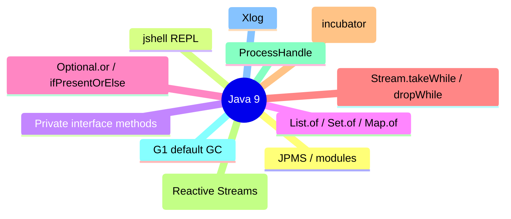

# Java 9 (2017)

Java 9 ("Jigsaw") headline feature was the **Java Platform Module System (JPMS)** — strong encapsulation and reliable configuration. It also added `jshell` (REPL), private interface methods, factory methods for collections (`List.of`), `Optional.or`/`ifPresentOrElse`, `Stream.iterate`/`takeWhile`/`dropWhile`, `HttpClient` (incubator), `Flow` (Reactive Streams), `VarHandle`, improved `Process` API, improved try-with-resources (effectively-final resources), G1 as the default GC, and unified logging (`-Xlog`).

## Java Platform Module System (JPMS, JSR 376)

`module-info.java` declares `requires`, `exports`, `opens`, `uses`, `provides`. Module path vs classpath; unnamed module; automatic modules; strong encapsulation of JDK internals (`--add-opens` opt-in); `jlink` for custom runtimes (module 31).

```java
module com.example.app {
    requires java.sql;
    exports com.example.app.api;
    opens com.example.app.internal to com.fasterxml.jackson.databind;
    uses com.example.spi.Service;
    provides com.example.spi.Service with com.example.app.impl.ServiceImpl;
}
```

## jshell (REPL)

`jshell` — evaluate Java snippets interactively (`/help`, `/list`, `/exit`, `/save`, `/open`). Tab-completion, snippets, and JShell API for embedding.

```bash
$ jshell
jshell> "Hello".length()
$1 ==> 5
jshell> /exit
```

## Private interface methods

Interfaces can have `private` (and `private static`) methods — reusable code behind `default` methods without exposing it in the API.

```java
interface Helper {
    default void run() { log("running"); helper(); }
    private void log(String m) { System.out.println(m); }
    private static void helper() { ... }
}
```

## Collection factory methods

Immutable collections: `List.of`, `Set.of`, `Map.of`, `Map.ofEntries`. Nulls not allowed; immutable (`UnsupportedOperationException` on mutation); `Map` disallows duplicate keys.

```java
List<String> list = List.of("a", "b", "c");   // immutable
Set<String> set = Set.of("a", "b");
Map<String, Integer> map = Map.of("k", 1, "v", 2);
Map<String, Integer> map2 = Map.ofEntries(Map.entry("k", 1));
```

## Optional improvements

`Optional.or(Supplier)` — alternative Optional; `ifPresentOrElse(Consumer, Runnable)` — act on present or empty.

```java
Optional<String> o = Optional.ofNullable(x);
o.or(() -> computeDefault()).ifPresent(System.out::println);
o.ifPresentOrElse(System.out::println, () -> System.out.println("empty"));
```

## Stream improvements

- `Stream.iterate(T seed, Predicate hasNext, UnaryOperator next)` — iterate with a condition.
- `Stream.takeWhile(Predicate)` / `dropWhile(Predicate)` — ordered streams respect encounter order; unordered may drop arbitrary elements.
- `Stream.ofNullable(T)` — stream of 0 or 1 elements.

## HttpClient (incubator, `jdk.incubator.http`)

HTTP/1.1/HTTP/2 client API in `jdk.incubator.http` (finalized as `java.net.http` in Java 11). Builder-based, async (`CompletableFuture<HttpResponse>`), `BodyPublishers`/`BodyHandlers`.

```java
// Java 9 incubator
HttpRequest req = HttpRequest.newBuilder()
    .uri(URI.create("https://example.com"))
    .GET().build();
CompletableFuture<HttpResponse<String>> fut = HttpClient.newHttpClient()
    .sendAsync(req, HttpResponse.BodyHandlers.ofString());
```

## Flow API (JSR 266, Reactive Streams)

`java.util.concurrent.Flow` — `Publisher`, `Subscriber`, `Subscription`, `Processor` — standard reactive-streams interfaces for backpressure-aware streaming.

## VarHandle

`java.lang.invoke.VarHandle` — finalized in `java.lang.invoke` in Java 9 — typed field/array access with memory-ordering access modes (module 43).

## Process API improvements

`ProcessHandle` — inspect/control OS processes (`pid()`, `info()`, `children()`, `destroy()`, `onExit()` returns `CompletableFuture<ProcessHandle>`).

```java
ProcessHandle ph = ProcessHandle.current();
System.out.println("pid=" + ph.pid());
ph.onExit().thenRun(() -> System.out.println("exited"));
```

## Improved try-with-resources

Effectively-final resources can be declared without a new variable:

```java
try (Resource r = getResource(); Another r2 = another) { ... }
// Java 9: also works with already-final/effectively-final variables:
try (r) { ... }   // r must be effectively final
```

## G1 as default GC

G1 (`-XX:+UseG1GC`) became the default server GC (replacing Parallel GC) in Java 9.

## Unified logging (`-Xlog`)

`-Xlog:gc:safepoint:file=gc.log:time,uptime` — unified logging framework replacing many `-XX:+Print*` flags.

## Other additions

- `CompactNumberFormat` (locale-sensitive compact numbers: "2.5K").
- `InputStream.readNBytes`, `transferTo` (Java 9), `InputStream.readAllBytes` (Java 9).
- `StackWalker` (Java 9) — efficient stack walking (`StackWalker.getInstance().walk(frames -> ...)`).
- `CompletableFuture.orTimeout`, `completeOnTimeout` (Java 9).
- `CompletableFuture.delayedExecutor`.

### Mermaid: Java 9 focus



## Comparison table

| Feature | Java 8 | Java 9 |
|---------|--------|--------|
| Modules | none | JPMS (`module-info`) |
| REPL | none | `jshell` |
| Interface methods | default | + private |
| Collections | mutable | `List.of`/`Set.of`/`Map.of` (immutable) |
| HTTP client | none | `HttpClient` (incubator) |
| Reactive streams | none | `java.util.concurrent.Flow` |
| Process API | `Process` | `ProcessHandle` |
| Default GC | Parallel | G1 |
| Logging | `-XX:+Print*` | `-Xlog` unified |

## Common mistakes

- `List.of` with `null` → `NullPointerException`; `Map.of` with duplicate keys → `IllegalArgumentException`.
- `Optional.or` returns an `Optional`, not a value — chain further ops.
- `Stream.takeWhile` on unordered streams may drop arbitrary elements.
- `HttpClient` incubator package (`jdk.incubator.http`) changed in Java 11 (`java.net.http`) — code not source-compatible.
- Forgetting module path / `--add-opens` for reflective access to JDK internals.

# Interview Questions

## Beginner

**Q1. What was Java 9's biggest feature?**

The Java Platform Module System (JPMS) — modules with `requires`/`exports` and strong encapsulation.

**Q2. What is `jshell`?**

Java's read-eval-print loop (REPL) for trying snippets interactively.

**Q3. What are collection factory methods?**

`List.of`, `Set.of`, `Map.of` — create immutable collections (no nulls, no duplicates for Map keys).

**Q4. What can interfaces have in Java 9?**

`default`, `static`, and `private` (including `private static`) methods.

**Q5. What is `Optional.or(Supplier)`?**

Returns an alternative `Optional` if the current one is empty (for chaining).

## Intermediate

**Q6. `Stream.iterate` Java 8 vs Java 9?**

Java 8: infinite iteration (`iterate(seed, f)`). Java 9: conditional (`iterate(seed, hasNext, next)`).

**Q7. `takeWhile` vs `dropWhile`?**

`takeWhile` takes elements while predicate true; `dropWhile` drops while true then takes the rest (order matters for ordered streams).

**Q8. What is `ProcessHandle`?**

OS process inspection/control (pid, info, children, destroy, `onExit()` → `CompletableFuture`).

**Q9. What is `Flow` (JSR 266)?**

Reactive Streams interfaces: `Publisher`, `Subscriber`, `Subscription`, `Processor` (backpressure-aware).

**Q10. What changed with the default GC in Java 9?**

G1 became the default server garbage collector (replacing Parallel GC).

## Advanced

**Q11. What is unified logging (`-Xlog`)?**

Replaces many `-XX:+Print*` flags with a single `-Xlog:tag:options` framework.

**Q12. How does `HttpClient` (Java 9 incubator) differ from Java 11's?**

Package changed from `jdk.incubator.http` to `java.net.http`; API evolved; Java 9 code is not source-compatible with Java 11.

**Q13. What is `StackWalker`?**

Efficient stack walking (`StackWalker.getInstance().walk(...)`), lazily fetching stack frames.

**Q14. What is `Optional.ifPresentOrElse`?**

Runs one action if present, another if empty — replaces `if (o.isPresent()) ... else ...`.

**Q15. What is `VarHandle`?**

`java.lang.invoke.VarHandle` — typed field/array access with memory-ordering modes (module 43).

## Expert

**Q16. Can `Map.of` have null keys/values?**

No — `NullPointerException`; immutable and disallows nulls.

**Q17. Can `Map.of("a", 1, "a", 2)` compile?**

Compile error — duplicate keys (varargs-based `Map.of` can't check at compile time generically; throws `IllegalArgumentException` at runtime).

**Q18. What is `--add-opens`?**

Opens a JDK package to reflective access (strong encapsulation opt-in) — module 31.

**Q19. Is `jshell` suitable for production?**

No — it's a development/learning tool (embedding API exists but it's not a production runtime).

**Q20. What is `CompletableFuture.orTimeout` (Java 9)?**

Fails the future with `TimeoutException` if not completed within the given duration.

## Scenario Based

**Q21. You want to try a Java expression quickly without compiling.**

`jshell` — paste the snippet, see the result (`$1`, `$2`, ...).

**Q22. You need an immutable list of constants.**

`List.of("a", "b", "c")` — concise, immutable, null-rejecting.

**Q23. You need to call an HTTP service asynchronously.**

`HttpClient` — Java 9 incubator (`jdk.incubator.http`) or Java 11+`java.net.http`.

**Q24. You need to react to stream events with backpressure.**

`java.util.concurrent.Flow` (`Publisher`/`Subscriber`) — or a mature reactive library (Reactor/RxJava).

**Q25. You want to know the current process PID.**

`ProcessHandle.current().pid()`.

## Output Prediction

**Q26. What does this print?**

```java
List<String> l = List.of("a", null, "c");
```

**Output:**
```
NullPointerException
```

**Reason:** `List.of` disallows null elements.

**Q27. What does this print?**

```java
Map<String, Integer> m = Map.of("a", 1, "a", 2);
```

**Output:**
```
IllegalArgumentException (duplicate key "a")
```

**Reason:** `Map.of` rejects duplicate keys.

**Q28. What does this print?**

```java
Optional<String> o = Optional.empty();
System.out.println(o.or(() -> Optional.of("fallback")).get());
```

**Output:**
```
fallback
```

**Reason:** `or` supplies the fallback Optional when empty; `.get()` → "fallback".

**Q29. What does this print?**

```java
Stream.iterate(0, i -> i + 1).takeWhile(i -> i < 3).forEach(System.out::print);
```

**Output:**
```
012
```

**Reason:** `takeWhile` on an ordered stream takes 0,1,2 then stops at 3.

**Q30. What does this print?**

```java
System.out.println(ProcessHandle.current().pid());
```

**Output:**
```
<current process id>
```

**Reason:** PID of the running JVM process.

## Internal Working

**Q31. How does `jshell` work?**

It compiles/evaluates snippets via the Compiler API (`javax.tools`) and maintains a state of snippets (`JShell` API).

**Q32. How are `List.of` instances implemented?**

Small, immutable, dedicated internal classes (e.g., `ImmutableList`, `ImmutableMap`) — not `ArrayList`/`HashMap` subclasses.

**Q33. How does `Stream.dropWhile` behave on unordered streams?**

For unordered streams, behavior is nondeterministic — any subset satisfying the drop condition may be dropped.

**Q34. What does `ProcessHandle.onExit()` return?**

`CompletableFuture<ProcessHandle>` — completes when the process terminates.

**Q35. Is `G1` fully concurrent?**

Mostly concurrent marking + evacuation; some stop-the-world pauses remain (young/mixed GC), but generally predictable.

## Tricky Questions

**Q36. Can `List.of` contain duplicates?**

Yes — `List` allows duplicates; only `Set.of`/`Map.of` reject duplicates.

**Q37. Is `Stream.takeWhile` short-circuiting?**

Yes — it's a short-circuiting intermediate operation on ordered streams.

**Q38. Can you mutate a `List.of` list?**

No — `UnsupportedOperationException` on `add`/`remove`/`set`.

**Q39. Does `Optional.ifPresentOrElse` run both branches?**

No — exactly one (present → consumer; empty → runnable).

**Q40. Is `jshell` thread-safe?**

No — designed for single-user interactive use.