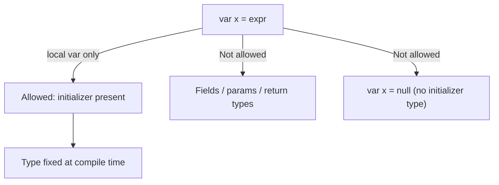

# Java 10 (2018)

Java 10 was a six-month release (the new cadence starting with Java 9) focused on local variable type inference, GC improvements, and application class-data sharing. No major language features beyond `var`, but several JVM and tooling improvements.

## Local variable type inference (`var`)

`var` declares a local variable with an inferred type (it is **not** a keyword, but a restricted type name — existing code using `var` as a type/method/package name mostly still works).

```java
var list = new ArrayList<String>();   // ArrayList<String>
var stream = list.stream();            // Stream<String>
var iter = list.iterator();            // Iterator<String>
```

Rules:
- Local variables only (with initializer). Not for fields, method parameters, or return types.
- `var x = null;` is illegal (cannot infer).
- Cannot be used in a lambda parameter (`(var x) -> ...` illegal until Java 11).
- `var` is not dynamic typing — the type is fixed at compile time; `x = 5; x = "hello";` is illegal.
- `var` works with diamond (`var map = new HashMap<>();`), anonymous classes, try-with-resources.

```java
var map = new HashMap<String, Integer>();
map.put("a", 1);
var entries = map.entrySet();   // Set<Map.Entry<String,Integer>>
```

`var` improves readability when the type is obvious (e.g., from a constructor call) but can hurt readability when it hides the type. Use judiciously.

## Garbage collection

- **Parallel full G1 GC**: G1 full GC became parallel (was single-threaded), reducing worst-case full-GC pauses.
- **Application class-data sharing**: extends CDS to application classes (not just bootstrap), reducing startup and footprint (`-Xshare:dump`, `-Xshare:on`).

## Other additions

- `ThreadLocal.handshake()` — stop-the-world-like callback without a global safepoint (used internally, e.g., by revocable biasing).
- Root certificates in `cacerts` (OpenJDK now includes a default set of root CA certs, making TLS work out of the box).
- `javac` can infer `var` in lambda? No — that's Java 11.
- `Optional.orElseNullable`? Not a thing.
- Deprecation: none major.

### Mermaid: `var` scope



## Comparison table

| | Java 8 | Java 10 |
|---|--------|---------|
| Local var type | explicit type | `var` (inferred) |
| Full G1 GC | single-threaded | parallel |
| App CDS | no | yes |
| Root CA certs | limited | bundled (OpenJDK) |

## Common mistakes

- `var x = null;` → compile error (inferred type cannot be `null`).
- Using `var` for a field or method parameter → compile error.
- Expecting `var` to be dynamic typing — it is static, inferred at compile time.
- Overusing `var` when the type is not obvious (hurts readability).

# Interview Questions

## Beginner

**Q1. What is `var` in Java 10?**

Local variable type inference — the compiler infers the type from the initializer. It is **not** dynamic typing.

**Q2. Where can `var` be used?**

Local variables with initializers only — not fields, method parameters, return types, or catch parameters.

**Q3. Is `var` a keyword?**

No — it is a restricted type name. Code using `var` as a type/method/package name mostly still compiles.

**Q4. Can you write `var x = null;`?**

No — the compiler cannot infer a type from `null`.

**Q5. Can `var` be reassigned to a different type?**

No — the inferred type is fixed; reassignment must be assignment-compatible.

## Intermediate

**Q6. Does `var` hurt performance?**

No — type inference happens at compile time; bytecode is identical to an explicit type.

**Q7. What is `var x = new HashMap<>();`?**

Diamond inference — the type is `HashMap<String, Integer>` (inferred from the declared variable type? No — `var` infers `HashMap` from the RHS; with diamond the type args come from context/LHS target type... actually `var map = new HashMap<>();` infers `HashMap<Object,Object>` because there's no target type. Correct answer: `var map = new HashMap<>();` infers `HashMap<Object,Object>`).

**Q8. What is parallel full G1 GC?**

Full GC collections done in parallel (G1), reducing full-GC pause times.

**Q9. What is application class-data sharing?**

CDS extended to archive application classes (not just bootstrap), speeding up startup.

**Q10. Why were root certificates added to OpenJDK?**

So TLS/HTTPS works out of the box in OpenJDK builds without installing a CA bundle.

## Advanced

**Q11. Can `var` be used with `try-with-resources`?**

Yes — `var reader = new BufferedReader(...)` in the resource list.

**Q12. Can `var` be used in an enhanced for-loop?**

Yes — `for (var item : list)` works if `item`'s type can be inferred.

**Q13. Can `var` be used in a lambda parameter?**

Not in Java 10 — that arrived in Java 11.

**Q14. What is `ThreadLocal.handshake()`?**

A VM operation that runs a callback on each thread without a full safepoint (used internally).

**Q15. Is `var` part of the Java language spec?**

Yes — JEP 286 (Local-Variable Type Inference).

## Expert

**Q16. What is the difference between `var` and `Object`?**

`var x = ...` gives `x` the inferred specific type (with full methods); `Object x = ...` widens to `Object` (loses specific methods without cast).

**Q17. Can `var` be used in an anonymous class?**

Yes — `var r = new Runnable() { public void run() {} };`.

**Q18. What happens with `var` and generics inference?**

`var list = new ArrayList<>();` → `ArrayList<Object,Object>` (no target type); `var map = new HashMap<String,Integer>();` → `HashMap<String,Integer>`.

**Q19. Does `var` work with `foreach`?**

Yes — `for (var s : list)`.

**Q20. Is `var` recommended everywhere?**

No — use when the type is obvious; prefer explicit types when they add clarity.

## Scenario Based

**Q21. You have a long generic type on the left and a constructor on the right. Use `var`?**

Yes — `var stream = someMap.entrySet().stream();` reduces repetition.

**Q22. A teammate writes `var x = getData();` and you can't tell the type.**

Ask them to use an explicit type if the return type isn't obvious from context — readability over brevity.

**Q23. You want to use `var` for a method parameter.**

Not possible in Java 10 (Java 11 allows `var` in lambda params only, still not method params).

**Q24. Your full GC pauses are high on Java 10.**

Enable/verify parallel full G1 GC (default), tune `-XX:MaxGCPauseMillis`, consider ZGC/Shenandoah on later releases.

**Q25. You are building OpenJDK and TLS fails with no root certs.**

Not an issue in Java 10+ OpenJDK — root CA certs are included by default.

## Output Prediction

**Q26. What does this print?**

```java
var list = new ArrayList<String>();
list.add("a");
System.out.println(list.get(0).getClass().getSimpleName());
```

**Output:**
```
String
```

**Reason:** `list` is `ArrayList<String>`; `get(0)` returns `String`.

**Q27. What does this print?**

```java
var x = 10;
x = 20;
System.out.println(x);
```

**Output:**
```
20
```

**Reason:** `x` is `int`, reassigned to 20.

**Q28. What does this compile to?**

```java
var y = null;
```

**Output:** Compile error — cannot infer type from `null`.

**Q29. What does this compile to?**

```java
public class Q29 {
    var field = 5;   // field, not local
    public static void main(String[] args) {}
}
```

**Output:** Compile error — `var` not allowed for fields.

**Q30. What does this print?**

```java
var s = "hello";
System.out.println(s instanceof String);
```

**Output:**
```
true
```

**Reason:** `s` is inferred as `String`.

## Internal Working

**Q31. Does `var` create a new bytecode instruction?**

No — the type is inferred at compile time; the bytecode uses the actual type.

**Q32. Is `var` resolved at runtime?**

No — purely compile-time (JLS 286).

**Q33. Can `var` hide the type making code harder to read?**

Yes — that's the main criticism; use judiciously.

**Q34. Does `var` work with `instanceof` pattern matching?**

Pattern matching arrived in Java 16 (preview) / 21; unrelated to `var`.

**Q35. What JEP is `var`?**

JEP 286.

## Tricky Questions

**Q36. Can `var` be used in a `for` loop index?**

`for (var i = 0; i < n; i++)` — yes, local variable in the for-init.

**Q37. Can `var` be used in a catch parameter?**

No — `catch (var e)` is illegal.

**Q38. Does `var` support arrays?**

Yes — `var arr = new int[5];` → `int[]`.

**Q39. Can `var` be combined with `final`?**

Yes — `final var x = ...;` (effectively final local variable).

**Q40. What is the inferred type of `var x = "hello".length();`?**

`int`.