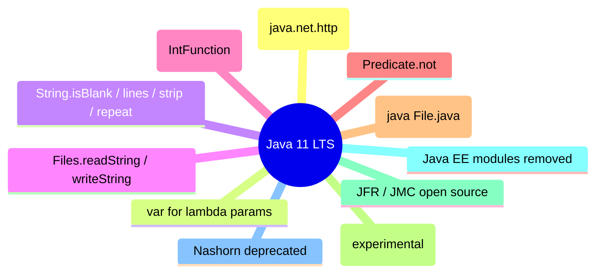

# Java 11 (2018, LTS)

Java 11 was the first LTS release after Java 8, making it a major migration target. Key additions: the standard HTTP Client (`java.net.http`), `var` for lambda parameters, new `String` methods (`isBlank`, `lines`, `strip`, `repeat`), `Files.readString`/`writeString`, `Collection.toArray(IntFunction)`, `Predicate.not`, running single-file source code (`java Hello.java`), Epsilon/ZGC (experimental), open-sourced Flight Recorder & Mission Control, Nashorn deprecated, and the removal of Java EE modules (`java.xml.ws`, etc.) from the JDK.

## HTTP Client (`java.net.http`)

Standard HTTP/1.1 and HTTP/2 client, replacing `HttpURLConnection` and the incubating `jdk.incubator.http` from Java 9.

```java
import java.net.URI;
import java.net.http.*;
import java.net.http.HttpResponse.BodyHandlers;
import java.util.concurrent.CompletableFuture;

public class HttpDemo {
    public static void main(String[] args) throws Exception {
        HttpClient client = HttpClient.newBuilder()
            .version(HttpClient.Version.HTTP_2)
            .build();
        HttpRequest request = HttpRequest.newBuilder()
            .uri(URI.create("https://example.com"))
            .GET()
            .build();
        // sync
        HttpResponse<String> response = client.send(request, BodyHandlers.ofString());
        System.out.println(response.statusCode());
        System.out.println(response.body());
        // async
        CompletableFuture<HttpResponse<String>> fut =
            client.sendAsync(request, BodyHandlers.ofString());
        fut.thenAccept(r -> System.out.println("async status: " + r.statusCode()));
    }
}
```

`BodyPublishers`/`BodyHandlers` handle common content types; `HttpTimeoutException`, `WebSocket` (Java 11+ via `HttpClient.newWebSocketBuilder`).

## `var` for lambda parameters

Java 10's `var` extended to lambda parameters (improves readability with explicit annotations like `@NonNull`).

```java
BiFunction<@NonNull var a, @NonNull var b, Integer> f =
    (var x, var y) -> x.length() + y.length();
```

## String methods

- `isBlank()` — true if empty or whitespace-only (unlike `isEmpty()`).
- `lines()` — `Stream<String>` split by line terminators.
- `strip()` / `stripLeading()` / `stripTrailing()` — Unicode-aware trimming (unlike `trim()`, which is Latin-1 based).
- `repeat(int n)` — repeat the string n times.

```java
"  hello  ".strip();        // "hello"
"a\nb\nc".lines().count();  // 3
"ab".repeat(3);             // "ababab"
"   ".isBlank();            // true; "   ".isEmpty() → false
```

## Files.readString / writeString

```java
String content = Files.readString(Path.of("file.txt"));
Files.writeString(Path.of("out.txt"), content);
```

## Collection.toArray(IntFunction)

```java
String[] arr = list.toArray(String[]::new);   // no cast, type-safe
```

## Predicate.not / Predicate.isEqual

```java
Predicate<String> notEmpty = Predicate.not(String::isEmpty);
Predicate<String> isHello = Predicate.isEqual("hello");
```

## Run single-file source

```bash
java Hello.java     # compiles & runs a single source file (no .class needed)
```

Launches single-file source-code programs (launcher compiles in memory).

## Epsilon & ZGC (experimental)

- **Epsilon GC** (`-XX:+UseEpsilonGC`): no-op allocator, no reclamation — for perf baseline testing / ultra-short-lived jobs.
- **ZGC** (`-XX:+UseZGC`): experimental low-latency collector (production in later releases).

## Flight Recorder & Mission Control (open source)

JFR and JMC, previously commercial features, open-sourced in OpenJDK 11.

## Removed / deprecated

- Java EE modules removed (`java.xml.ws`/`JAX-WS`, `java.xml.bind`/`JAXB`, `java.activation`, `java.corba`, `java.transaction`) — use standalone libraries (e.g., Eclipse GlassFish Metro, Eclipse Link).
- `javax.xml.bind` no longer in JDK.
- Nashorn deprecated (`jdk.nashorn.api.scripting`), removed in Java 15.
- `Runnable`/`Callable` no changes.

### Mermaid: Java 11 focus



## Comparison table

| Feature | Java 8 | Java 11 |
|---------|--------|---------|
| HTTP client | `HttpURLConnection` | `java.net.http.HttpClient` |
| `var` in lambda params | no | yes |
| String helpers | limited | `isBlank`, `lines`, `strip`, `repeat` |
| Read file to String | `Files.readAllBytes` + charset | `Files.readString` |
| Single-file launch | `javac` then `java` | `java File.java` |
| LTS | yes | yes |
| Java EE modules | in JDK | removed |

## Common mistakes

- `HttpClient.send` blocks; use `sendAsync` for non-blocking.
- `strip()` is Unicode-aware; `trim()` only handles chars ≤ U+0020 — results differ for full-width spaces.
- `lines()` drops the terminating line terminator.
- Single-file launch (`java File.java`) only works for a single source file (no external dependencies unless on `--class-path`).
- Removed Java EE modules → `NoClassDefFoundError` if you depend on JAXB/JAX-WS without adding the standalone dependency.

# Interview Questions

## Beginner

**Q1. What is significant about Java 11?**

First LTS release after Java 8 — a major migration target for production systems.

**Q2. What is the standard HTTP Client in Java 11?**

`java.net.http.HttpClient` — HTTP/1.1 and HTTP/2, sync and async (`send`/`sendAsync`).

**Q3. What new `String` methods were added?**

`isBlank`, `lines`, `strip`, `stripLeading`, `stripTrailing`, `repeat`.

**Q4. How do you read a file into a String in Java 11?**

`Files.readString(Path)`.

**Q5. How do you run a single Java source file?**

`java Hello.java` — launcher compiles and runs in one step.

## Intermediate

**Q6. `trim()` vs `strip()`?**

`trim()` removes chars ≤ U+0020 (Latin-1); `strip()` is Unicode-aware (handles full-width spaces, etc.).

**Q7. What is `var` for lambda parameters?**

Allows explicit type annotations on lambda parameters (`(@NonNull var x) -> ...`); type still inferred.

**Q8. What does `Collection.toArray(String[]::new)` do?**

Returns a `String[]` containing the collection's elements, type-safely (no cast).

**Q9. What is `Predicate.not`?**

Negates a predicate (`Predicate.not(String::isEmpty)` → non-empty check).

**Q10. What GCs are experimental in Java 11?**

Epsilon (no-op) and ZGC (low-latency).

## Advanced

**Q11. What is `HttpClient.BodyHandlers.ofString()`?**

Returns a response body handler that decodes the body as a `String`.

**Q12. Can `WebSocket` be used in Java 11?**

Yes — via `HttpClient.newWebSocketBuilder()` (WebSocket API).

**Q13. What is Epsilon GC?**

No-op allocator; memory is never reclaimed (for performance testing / ultra-short-lived jobs).

**Q14. What happened to Java EE modules in Java 11?**

Removed from the JDK (`JAX-WS`, `JAXB`, etc.) — use standalone libraries.

**Q15. What is `Predicate.isEqual`?**

Returns a predicate testing equality with a target (`Predicate.isEqual("hello")` ≡ `s -> "hello".equals(s)`).

## Expert

**Q16. Can `HttpClient` send HTTP/2?**

Yes — `HttpClient.newBuilder().version(HttpClient.Version.HTTP_2)`.

**Q17. What is `Files.writeString`?**

Writes a `String` to a file (creates/overwrites), UTF-8 by default (or specified charset).

**Q18. Why run single-file source with `java File.java`?**

Quick scripting/testing without a separate `javac` step; good for small tools and snippets.

**Q19. Is Nashorn still available in Java 11?**

Deprecated (removed in Java 15). Use GraalJS instead.

**Q20. Is Java 11 free for production?**

OpenJDK 11 is free (GPLv2+CE); Oracle JDK 11 requires a subscription for production after Jan 2019 (Oracle's license).

## Scenario Based

**Q21. You need to fetch JSON from a REST API in Java 11.**

`HttpClient.sendAsync(request, BodyHandlers.ofString())` then parse with a JSON library (Jackson/Gson — not in JDK).

**Q22. You need to process a file line by line without loading it all.**

`Files.lines(path)` (Java 8) or `Files.readString` then `lines()` (Java 11).

**Q23. Your app uses `javax.xml.bind` (JAXB) and broke on Java 11.**

Add a standalone JAXB implementation (e.g., `org.glassfish.jaxb`) as a dependency.

**Q24. You want to choose between `isBlank` and `isEmpty`.**

Use `isBlank` to also reject whitespace-only strings; `isEmpty` only checks length 0.

**Q25. You need the collection as a typed array.**

`list.toArray(String[]::new)`.

## Output Prediction

**Q26. What does this print?**

```java
System.out.println("   ".isBlank());
System.out.println("   ".trim().isEmpty());
```

**Output:**
```
true
true
```

**Reason:** `"   "` is blank (whitespace only); `"   ".trim()` is `""` which is empty.

**Q27. What does this print?**

```java
System.out.println("ab".repeat(3));
```

**Output:**
```
ababab
```

**Reason:** `repeat` concatenates the string 3 times.

**Q28. What does this print?**

```java
List<String> list = List.of("a", "b", "c");
String[] arr = list.toArray(String[]::new);
System.out.println(arr.length);
```

**Output:**
```
3
```

**Reason:** `toArray` with `IntFunction` produces a typed array.

**Q29. What does this print?**

```java
Predicate<String> p = Predicate.not(String::isEmpty);
System.out.println(p.test(""));
```

**Output:**
```
false
```

**Reason:** `not` negates `isEmpty` → `""` is empty → negated → `false`.

**Q30. What does `java Hello.java` do if `Hello.java` imports an external library?**

It fails unless the library is on `--class-path`; single-file launch supports only the source file itself (plus JDK classes).

## Internal Working

**Q31. How does `java File.java` work?**

The launcher compiles the source in memory and runs the `main` class (JEP 330).

**Q32. Is `String.strip()` locale-sensitive?**

No — it is Unicode-aware but not locale-sensitive.

**Q33. How does `HttpClient` handle HTTP/2?**

Negotiates via ALPN; supports server push, prior knowledge, and cleartext HTTP/2 (h2c) optionally.

**Q34. Is `Files.readString` efficient for large files?**

No — it reads the entire file into memory; use `Files.lines` or `InputStream` for large files.

**Q35. What is `Predicate.isEqual("hello")` equivalent to?**

`s -> "hello".equals(s)` (null-safe on the target side).

## Tricky Questions

**Q36. Is `var` for lambda parameters a keyword change?**

No — `var` remains a restricted type name; allowed in lambda params (Java 11).

**Q37. Can `java File.java` use packages?**

No — single-file source must be in the default package (no `package` declaration).

**Q38. Does `String.lines()` include the line terminators?**

No — terminators are stripped from each line.

**Q39. Is `HttpClient.send` asynchronous?**

No — it is synchronous (blocking); use `sendAsync` for async.

**Q40. Can `Files.readString` read very large files?**

It reads the whole file into a `String` — not suitable for very large files.