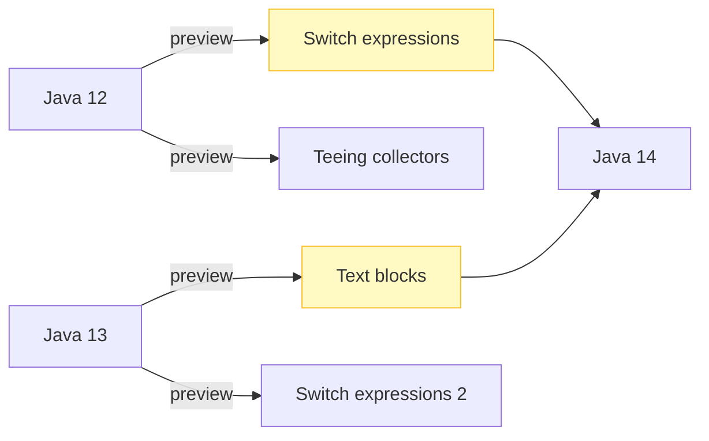
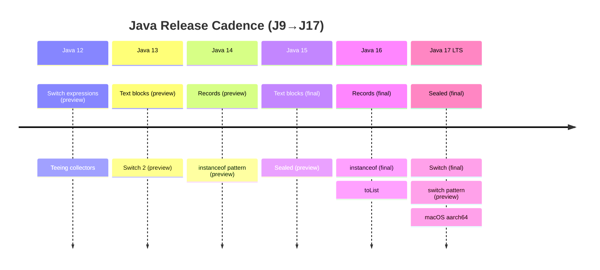

# Java 12–17 (2019–2021)

This module covers Java 12, 13, 14, 15, 16, and 17 — the rapid six-month cadence releases leading up to the Java 17 LTS. Key themes: preview features (switch expressions, records, sealed classes, pattern matching, text blocks), the Java 17 LTS (sealed classes, switch expressions, pattern matching for switch preview, macOS aarch64, deprecation of `finalize` for removal), and the strong encapsulation of JDK internals.

## Java 12 (2019)

### Switch expressions (preview, JEP 325)
Arrow syntax `case L ->` with no fall-through; `yield` to produce a value. Preview — required `--enable-preview`.

```java
// Java 12 preview
boolean bool = switch (day) {
    case MONDAY, FRIDAY, SUNDAY -> true;
    default -> false;
};
```

### `String.indent(int)` / `String.transform(Function)`
`indent` adjusts leading whitespace (positive adds, negative removes); `transform` applies a function to the string.

```java
String s = "  hello  ".indent(2);    // "    hello  "
String t = "hello".transform(String::toUpperCase); // "HELLO"
```

### `Collectors.teeing` (JEP 349? actually teeing JEP 349 is Java 12)
Combines two collectors into one result via a merge function.

```java
Collector<Double, ?, Double> avg = Collectors.teeing(
    Collectors.summingDouble(d -> d),
    Collectors.counting(),
    (sum, count) -> sum / count);
```

### JVM Constants API (JSR 334, `java.lang.constant`)
`ConstantDesc`, `Constable`, `DirectDescendant` — symbolic representation of loadable constants (`String`, `Integer`, `Long`, `Double`, `Class`, `MethodType`, `MethodHandle`, `DynamicConstantDesc`).

### Other
- `NumberFormat` compact number style (`NumberFormat.getCompactNumberInstance`).
- `javax.net.ssl.SSLSocket` supported ciphers extensions.
- `java.lang.constant` package.
- G1 improvements (abortable mixed collections, prompt returns of unused memory).

### Mermaid: Java 12–13 preview feature path



## Java 13 (2019)

### Text blocks (preview, JEP 355)
Multi-line string literals `""" ... """` (finalized Java 15). Preview in Java 13/14 — required `--enable-preview`.

```java
// Java 13+ preview
String html = """
    <html>
        <body>%s</body>
    </html>
    """.formatted(content);
```

### Switch expressions (preview 2)
Refinements to the Java 12 preview (`yield` semantics polished).

### Other
- Reimplementation of the legacy `Socket` API (`java.net.Socket`/`ServerSocket` underlying impl moved to NIO) — `java.net.SocketImpl` deprecation path.
- `ZGC` uncommit (`-XX:ZGC...` options) — return unused memory to the OS.
- Dynamic CDS archives (`-XX:ArchiveClassesAtExit`) — record classes loaded during a run for faster subsequent startups.
- `Unicode` 12.1 support.

## Java 14 (2020)

### Records (preview, JEP 359)
Compact immutable data carriers (finalized Java 16). Preview — `--enable-preview`.

```java
public record Point(int x, int y) {}
```

### Pattern matching for `instanceof` (preview, JEP 305)
Type pattern with binding — no cast needed.

```java
// Java 14+ preview
if (obj instanceof String s) {
    System.out.println(s.length()); // s is String, in scope
}
```

### Helpful NullPointerExceptions (JEP 358)
NullPointerException messages now pinpoint the exact null variable/method (e.g., "Cannot invoke \"String.length()\" because \"s\" is null") — enabled by default (`-XX:+ShowCodeDetailsInExceptionMessages`).

### JFR event streaming (JEP 349)
Consume Flight Recorder events continuously in-process (`jdk.jflightrecorder.event` / `jdk.jfr.EventStream`) — no disk file needed.

### `jpackage` (incubator, JEP 343)
Package self-contained application installers (MSI, DMG, deb, rpm). Finalized Java 16.

### Foreign-Memory Access API (incubator, `jdk.incubator.foreign`)
`MemorySegment`, `MemoryAddress`, `MemoryLayout` — safe off-heap memory access (precursor to Panama FFM).

### Other
- Remove CMS (`-XX:+UseCMS` / `-XX:+UseConcMarkSweepGC` removed).
- `JEP 365` ZGC on macOS/Windows.
- `JEP 352` Non-volatile Mapped Byte Buffers (`FileChannel.map` with `FileChannel.MapMode` plus `force`?) — actually JEP 352 is Non-Volatile Mapped Byte Buffers.

## Java 15 (2020)

### Text blocks (final, JEP 378)
`""" ... """` finalized — no `--enable-preview` needed.

```java
String sql = """
    SELECT id, name
    FROM users
    WHERE active = 1
    """;
```

### Sealed classes (preview, JEP 360)
Restrict which classes may extend/implement (finalized Java 17). Preview.

```java
public sealed interface Shape permits Circle, Rectangle {}
```

### Hidden classes (`jdk.internal.lang.reflect.HiddenClass`)
Classes that cannot be discovered by normal lookup; used by frameworks/l languages generating classes at runtime (JEP 371).

### EdDSA (`Ed25519`, `Ed448`)
Edwards-curve Digital Signature Algorithm signatures (`Signature.getInstance("Ed25519")`).

### ZGC & Shenandoah
ZGC promoted from experimental (Windows/macOS support); Shenandoah production (JEP 379).

### Foreign-Memory Access (second incubator)
`jdk.incubator.foreign` refinements.

### Other
- `String` methods? (no new major), `java.util.random`? (no, that's 17).
- `HiddenClass` + `Class.isHidden()`.

## Java 16 (2021)

### Records (final, JEP 395)
`record Point(int x, int y) {}` — no preview flag needed. Components, canonical constructor, accessors, `equals`/`hashCode`/`toString`, `java.lang.Record`, reflection (`isRecord`, `getRecordComponents`).

### Pattern matching for `instanceof` (final, JEP 394)
`if (obj instanceof String s)` finalized.

### `Stream.toList()` (JEP 381? actually toList JEP? `Stream.toList` added Java 16)
Unmodifiable list (distinct from `Collectors.toList` which may return mutable).

```java
List<String> list = stream.collect(Collectors.toUnmodifiableList()); // Java 10+
// Java 16:
List<String> list2 = stream.toList(); // always unmodifiable
```

### `jpackage` (final, JEP 392)
Application packaging tool finalized.

### Vector API (first incubator, `jdk.incubator.vector`)
`Vector` operations for SIMD (VectorSpecies, etc.) — performance for numeric workloads.

### Strongly encapsulate JDK internals
All JDK internal elements (`sun.*`, `jdk.internal.*`) strongly encapsulated by default; `--add-opens` required for reflection (JEP 396).

### Unix-domain sockets
`java.nio.channels.UnixDomainSocketChannel` (Unix domain sockets) — preview? Actually `UnixDomainSocketAddress`/`UnixDomainSocketChannel` added Java 16+ (JEP 380? no that's Unix-Domain Socket Channels JEP 380 in Java 16 — yes, Unix-domain socket channels).

### Other
- `jextract`? (no, later).
- `Elastic` metadata spaces removed? 
- `Wrapper`? 

## Java 17 (2021, LTS)

First LTS since Java 11 — major migration target.

### Sealed classes (final, JEP 409)
`sealed`/`permits`, `non-sealed`, `final` subclasses (module 33).

### Switch expressions (final, JEP 361)
`case L ->` no fall-through; `yield`; exhaustive switch expressions — no preview flag.

### Pattern matching for `switch` (preview, JEP 406? actually preview in 17)
`switch` with type patterns, guards, `case null ->`. Preview in Java 17 (finalized Java 21).

### Foreign Function & Memory API (preview, JEP 442 preview)
`MemorySegment`, `MemorySession`, `Linker`, `FunctionDescriptor` — Panama FFM replacing JNI (finalized Java 22).

### macOS aarch64 port (JEP 391)
Java 17 runs on Apple Silicon (M1/M2) natively.

### Deprecate `finalize` for removal (JEP 421)
`Object.finalize()` deprecated for removal (still works, prints warning).

### `RandomGenerator` interface (`java.util.random`)
New RNG interface with implementations (`RandomGeneratorFactory`, `L32X64MixRandom`, etc.) — better than `Random`/`SecureRandom` for many uses.

### `Context-specific deserialization filters` (JEP 415)? 
Actually JEP 415 targeted later; Java 17 includes per-`ObjectInputFilter` configuration (JEP 290 was Java 9). Filter via `ObjectInputFilter.Config`.

### Other
- `Sealed` classes, `Pattern matching switch` preview, `FFM` preview.
- `jshell` improvements (`--execution-provider`?), `Instance main`? (no, that's 21).
- Removal of `Applet` API (deprecated), `RMI Activation`? (deprecated).

### Mermaid: Java 12→17 LTS timeline



## Comparison table (Java 12–17)

| Feature | Java 12 | Java 13 | Java 14 | Java 15 | Java 16 | Java 17 LTS |
|---------|---------|---------|---------|---------|---------|-------------|
| Switch expressions | preview | preview 2 | — | — | — | final |
| Text blocks | — | preview | preview | final | — | — |
| Records | — | — | preview | — | final | — |
| `instanceof` pattern | — | — | preview | — | final | — |
| Sealed classes | — | — | — | preview | — | final |
| `Stream.toList` | — | — | — | — | yes | — |
| `jpackage` | — | — | incubator | — | final | — |
| macOS aarch64 | — | — | — | — | — | yes |
| `finalize` deprecation | — | — | — | — | — | for removal |

## Common mistakes across 12–17

- Preview features require `--enable-preview` (compile and runtime) — and preview code is not stable across releases.
- Text blocks in Java 13/14 are preview; do not ship preview code in production (it may change).
- Records (Java 14 preview) differ slightly from final (Java 16) — e.g., serialization details.
- `finalize()` deprecation warning in Java 17 — migrate to `try-with-resources`/`Cleaner`.
- Strong encapsulation (Java 16+) breaks reflection on JDK internals unless `--add-opens`.

# Interview Questions

## Beginner

**Q1. What is the release cadence since Java 9?**

New feature release every 6 months (March and September); LTS every 3 years (Java 11, 17, 21, 25).

**Q2. What is a preview feature?**

A feature available under `--enable-preview` that may change before finalization.

**Q3. What changed in Java 12 switch expressions?**

Arrow syntax `case L ->`, `yield`, no fall-through (preview).

**Q4. What are text blocks?**

Multi-line string literals `""" ... """` (preview Java 13/14, final Java 15).

**Q5. What is a record (Java 16 final)?**

Immutable data carrier with auto-generated constructor, accessors, `equals`/`hashCode`/`toString`.

## Intermediate

**Q6. What is `Collectors.teeing`?**

Combines two collectors and merges their results (Java 12).

**Q7. What is `String.indent`/`transform`?**

`indent` adjusts leading whitespace; `transform` applies a function (Java 12).

**Q8. What is `Stream.toList()` (Java 16)?**

Returns an unmodifiable list (distinct from `Collectors.toUnmodifiableList` which may return mutable in older versions).

**Q9. What are hidden classes?**

Classes not discoverable by normal lookup; for runtime-generated classes (Java 15).

**Q10. What is `jpackage`?**

Application packaging tool (installers: MSI, DMG, deb, rpm) — incubator Java 14/15, final Java 16.

## Advanced

**Q11. What is the Vector API (Java 16 incubator)?**

SIMD vector operations (`Vector`, `VectorSpecies`) for numeric workloads (incubator, `jdk.incubator.vector`).

**Q12. What is the Foreign-Memory Access API (Java 14 incubator)?**

`MemorySegment`/`MemoryAddress` for safe off-heap access; precursor to Panama FFM.

**Q13. What is `HiddenClass`?**

`jdk.internal.lang.reflect.HiddenClass` — classes not found by class loader lookup (Java 15).

**Q14. What changed with `finalize()` in Java 17?**

Deprecated for removal; avoid using it.

**Q15. What is `RandomGenerator` (`java.util.random`, Java 17)?**

New RNG interface with better implementations than `java.util.Random`.

## Expert

**Q16. How do preview features affect compatibility?**

Code using preview features may not compile/run on the next release without changes; avoid in production libraries.

**Q17. What is dynamic CDS (Java 13)?**

`-XX:ArchiveClassesAtExit` records classes loaded during a run for faster subsequent startups.

**Q18. What is ZGC uncommit (Java 13)?**

Returns unused heap memory to the OS (`-XX:ZGC...` options).

**Q19. What is the Foreign Function & Memory API preview (Java 17)?**

Panama FFM — `MemorySegment`/`Linker` for native interop, replacing JNI (finalized Java 22).

**Q20. Is Java 17 an LTS?**

Yes — long-term support, widely adopted in production.

## Scenario Based

**Q21. You are upgrading from Java 8 to Java 17. What preview features should you avoid in production code?**

All preview features (switch expressions pre-17, records pre-16, sealed pre-17, pattern matching switch, FFM, text blocks pre-15) — they may change.

**Q22. You want compact number formatting ("2.5K").**

`NumberFormat.getCompactNumberInstance(locale, Style.SHORT)` (Java 12).

**Q23. You need to generate application installers (MSI/DMG).**

`jpackage` (finalized Java 16).

**Q24. You need off-heap memory safely in Java 14/15.**

Foreign-Memory Access API (incubator) — or wait for Panama FFM (Java 17 preview / 22 final).

**Q25. Your app uses `finalize()`. Java 17 deprecates it.**

Migrate to `try-with-resources`, `Cleaner`, or `PhantomReference`+`ReferenceQueue`.

## Output Prediction

**Q26. What does this print?**

```java
// Java 15+ text block
String s = """
    line1
    line2
    """;
System.out.println(s.length());
```

**Output:**
```
12   (or similar: "line1\nline2\n" = 12 chars)
```

**Reason:** Text block strips common indent; content is `line1\nline2\n` = 12 characters.

**Q27. What does this print?**

```java
public record Point(int x, int y) {}
Point p = new Point(1, 2);
System.out.println(p.x() + "," + p.y());
```

**Output:**
```
1,2
```

**Reason:** Record accessors `x()`/`y()`.

**Q28. What does this compile to?**

```java
// Java 14+ preview
if (obj instanceof String s) { System.out.println(s.length()); }
```

**Output:** Compiles with `--enable-preview` (Java 14/15/16); `s` is `String` in scope.

**Q29. What does this print?**

```java
List<String> l = List.of("a", "b", "c");
System.out.println(l.stream().toList().getClass().getName());
```

**Output:**
```
java.util.ImmutableCollections$...   (unmodifiable list)
```

**Reason:** `Stream.toList()` (Java 16) returns an unmodifiable list.

**Q30. What does `jpackage` produce?**

An application installer (MSI on Windows, DMG on macOS, deb/rpm on Linux) bundling the app + runtime.

## Internal Working

**Q31. How are text blocks compiled?**

To a constant-pool `String` at compile time; incidental whitespace stripped by `javac`.

**Q32. How does `switch` expression `yield` work?**

`yield v` ends an arrow branch and produces `v` as the branch's result.

**Q33. What is the `Record` class-file attribute?**

Lists record components — enables `isRecord()`/`getRecordComponents()`.

**Q34. How does pattern matching `instanceof` avoid the cast?**

The pattern variable is bound and cast automatically by the compiler on success.

**Q35. What is a hidden class used for?**

Frameworks generating classes at runtime that should not be discoverable via class loaders.

## Tricky Questions

**Q36. Can you mix preview and non-preview code in one compilation?**

No — all preview features require `--enable-preview` consistently (javac + runtime).

**Q37. Are text blocks the same as raw strings?**

No — escapes (`\n`, `\"`) are still processed; no true raw-string mode.

**Q38. Is a Java 14 preview record binary-compatible with Java 16 final records?**

No — preview features are not stable; recompile for the target release.

**Q39. Does `jpackage` bundle a JRE?**

Yes — it can bundle a JDK runtime so the user doesn't need to install Java.

**Q40. What is the `Flow` API (Java 9) status in Java 12–17?**

`java.util.concurrent.Flow` (Reactive Streams interfaces) is stable since Java 9.