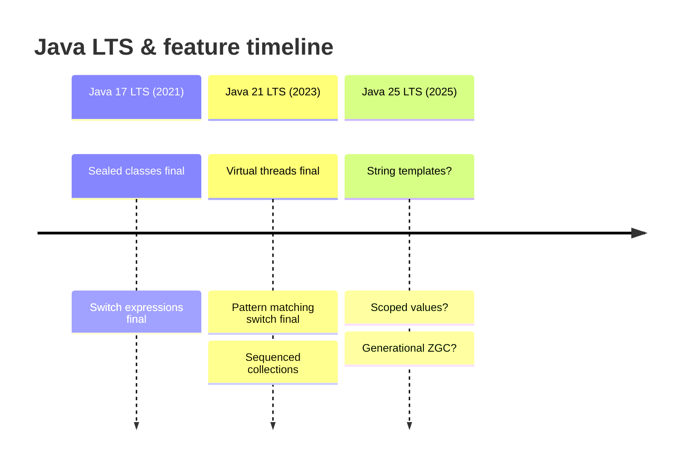

# Java 18 → Latest (2022–2026+)

This module covers Java 18, 19, 20, 21 (LTS), and recent releases (Java 22+). Java 21 is the current LTS and the recommended production baseline for new development; Java 11 LTS is end-of-life. Recent releases (22+) introduce preview features that may be finalized in later LTS releases — check the current release notes before adopting them in production.

## Java 18 (2022)

### UTF-8 by default (JEP 400)
The standard charset defaults to UTF-8 (`StandardCharsets.UTF_8`) instead of the platform default, making behavior consistent across operating systems (especially Windows, which previously defaulted to CP1252).

```java
Files.readString(Path.of("file.txt"));   // UTF-8 on all platforms
```

### Simple web server (`jwebserver`, JEP 408)
A minimal HTTP server for serving static files — useful for testing and prototyping, not production.

```bash
jwebserver -p 8000 -d ./public
```

### Code snippets in API documentation (`@snippet`, JEP 413)
The `@snippet` tag in Javadoc includes example code (with validation) directly from Java source.

```java
/**
 * {@snippet :
 *   var list = List.of("a", "b");
 *   System.out.println(list.size());
 * }
 */
```

### Other
- `Foreign-Memory Access API` third incubator? (FFM superseded).
- `Vector API` third incubator (`jdk.incubator.vector`).
- `Simple` web server for prototyping.
- `UTF-8` default charset simplifies cross-platform file I/O.

## Java 19 (2022)

### Virtual threads (preview, JEP 444)
Lightweight threads (M:Many onto carrier threads) for high-concurrency IO — finalized Java 21. Preview in 19/20.

```java
// Java 19+ preview
Thread.startVirtualThread(() -> {
    // IO-bound task
});
try (var executor = Executors.newVirtualThreadPerTaskExecutor()) {
    executor.submit(() -> { ... });
}
```

### Structured concurrency (preview, JEP 448)
`StructuredTaskScope` groups related tasks so they are handled as a unit (cancel together, error propagation).

```java
// Java 19+ preview
try (var scope = new StructuredTaskScope.ShutdownOnFailure()) {
    var future1 = scope.fork(() -> fetchUser(id));
    var future2 = scope.fork(() -> fetchOrder(id));
    scope.join();          // wait for both
    scope.throwIfFailed(); // propagate errors
    var user = future1.result().now();
}
```

### Pattern matching for `switch` (preview 3, JEP 427)
`case String s ->`, guards (`when`), `case null ->` — preview (finalized Java 21).

### Foreign Function & Memory API (preview 2, JEP 442 preview)
`MemorySegment`, `MemorySession`, `Linker`, `FunctionDescriptor` — Panama FFM (finalized Java 22).

## Java 20 (2023)

### Virtual threads (preview 2), structured concurrency (preview 2), FFM (preview 3)
Refinements of the Java 19 previews.

### Scoped values (preview, JEP 446)
`ScopedValue` — immutable, efficiently-shared values for threads (better than `ThreadLocal` for large numbers of virtual threads).

```java
// Java 20+ preview
static final ScopedValue<String> USER = ScopedValue.newInstance();
ScopedValue.where(USER, "ada").run(() -> {
    // USER accessible in this thread and forked virtual threads
});
```

### Other
- `Vector API` incubators continued.
- Pattern matching for `switch` refinements.

## Java 21 (2023, LTS)

Current LTS — recommended production baseline. Major finalized features:

### Virtual threads (final, JEP 444)
`Thread.ofVirtual()`, `Thread.startVirtualThread`, `Executors.newVirtualThreadPerTaskExecutor()` — high-concurrency IO without pooling virtual threads (module 22).

### Pattern matching for `switch` (final, JEP 441)
`switch (obj) { case String s -> ...; case Integer i -> ...; case null -> ...; default -> ... }` with guards (`when`) — exhaustive for sealed types/enums.

### Sequenced collections (`java.util.SequencedCollection`, `SequencedSet`, `SequencedMap`, JEP 431)
`getFirst()`/`getLast()`, `addFirst()`/`addLast()`, reversed views — for collections with a defined encounter order.

```java
var first = list.getFirst();
var last = list.getLast();
var reversed = list.reversed();
```

### Unnamed patterns & variables (preview, JEP 443)
`_` for unused pattern variables and local variables.

```java
if (obj instanceof Point(_, int y)) { ... }   // unnamed x
var _ = compute();                            // unused local
```

### String templates (preview, JEP 430)
`STR."..."` / `FMT."..."` — embedded expressions with validation.

```java
// Java 21+ preview
String name = "Ada";
var s = STR."Hello, \{name}!";   // "Hello, Ada!"
```

### FFM preview, vector API incubators continued
Panama FFM preview (finalized Java 22); Vector API incubator.

### `RandomGenerator` (`java.util.random`, Java 17) — continued use
`RandomGeneratorFactory` for modern RNGs.

### macOS aarch64
Native Apple Silicon support (from Java 17).

## Java 22 (2024)

### Unnamed variables & patterns (final, JEP 443/452)
`_` for unused variables and patterns finalized.

### String templates (second preview)
`STR."..."` refinements.

### FFM (final, JEP 454)
Panama Foreign Function & Memory API finalized — replacement for JNI.

### Stream Gatherers (preview, JEP 461)
`Gatherer` — custom stream operations beyond `map`/`filter` (fold, window, etc.).

### Class-File API (preview)
`ClassFile` API for reading/generating class files (bytecode manipulation without ASM/ByteBuddy).

### Implicitly declared classes & instance main methods (preview)
Reduce boilerplate for small programs (no `public class`, no `String[] args` required).

## Java 22+ trajectory (recent / preview)

Releases after Java 21 (Java 22, 23, 24, 25 LTS, 26, 27 ...) continue the six-month cadence with LTS every 3 years (Java 25 is the current LTS after Java 21). Recent/preview themes (verify against current release notes, as these evolve quickly):

- **String templates** — progressing through previews toward finalization.
- **Stream Gatherers** — custom intermediate stream operations.
- **Class-File API** — programmatic class-file generation/transformation.
- **Markdown doc comments** — Javadoc in Markdown.
- **Generational ZGC** — ZGC with generational zones (lower young-GC overhead).
- **Scoped values** — progressing toward finalization (efficient sharing with millions of virtual threads).
- **Implicitly declared classes / instance main** — beginner-friendly, reduced boilerplate.

### Mermaid: recent LTS timeline



*(Feature finalization dates for Java 22+ should be verified against the current OpenJDK release schedule.)*

## Comparison table (Java 18 → 21 LTS)

| Feature | Java 18 | Java 19 | Java 20 | Java 21 LTS |
|---------|---------|---------|---------|-------------|
| UTF-8 default | yes | — | — | — |
| `jwebserver` | yes | — | — | — |
| Virtual threads | — | preview | preview 2 | final |
| Structured concurrency | — | preview | preview 2 | preview? |
| Pattern matching switch | — | preview 3 | — | final |
| String templates | — | — | — | preview |
| FFM | — | preview 2 | preview 3 | preview |
| Sequenced collections | — | — | — | yes |
| Scoped values | — | — | preview | — |

## Common mistakes

- Using preview features (virtual threads pre-21, string templates, FFM pre-22) in production libraries — they may change.
- `jwebserver` is for prototyping/testing, not production serving.
- `@snippet` code is validated by Javadoc — invalid code fails the build.
- Virtual threads are for IO-bound workloads; CPU-bound work sees no benefit.
- `ScopedValue` is immutable and rebind-only via `where` — not a general `ThreadLocal` replacement.

# Interview Questions

## Beginner

**Q1. What is Java 21?**

The current LTS release (Sep 2023) — the recommended production baseline after Java 11.

**Q2. What is `jwebserver`?**

A minimal HTTP server for static files (Java 18) — testing/prototyping only.

**Q3. What is the default charset in Java 18+?**

UTF-8 (`StandardCharsets.UTF_8`), consistent across all platforms.

**Q4. What are virtual threads (Java 21)?**

Lightweight threads (M:Many onto carrier threads) for high-concurrency IO.

**Q5. What are sequenced collections (Java 21)?**

`getFirst()`/`getLast()`, `addFirst()`/`addLast()`, `reversed()` — collections with defined encounter order.

## Intermediate

**Q6. What are virtual threads good for?**

IO-bound, high-concurrency workloads (web servers, batch jobs); not CPU-bound.

**Q7. What is a string template (Java 21 preview)?**

`STR."Hello, \{name}!"` — embedded expressions with compile-time validation.

**Q8. What is `ScopedValue` (Java 20 preview)?**

Immutable, efficiently shared values — better than `ThreadLocal` with millions of virtual threads.

**Q9. What is the FFM API (Java 22 final)?**

Panama Foreign Function & Memory — native interop replacing JNI (`MemorySegment`, `Linker`).

**Q10. Is Java 21 free for production?**

OpenJDK 21 is free (GPLv2+CE); Oracle JDK has a subscription model.

## Advanced

**Q11. How do virtual threads differ from platform threads?**

Virtual threads are JVM-scheduled (M:Many onto a small pool of carrier/platform threads); platform threads are 1:1 OS threads.

**Q12. What is `StructuredTaskScope` (Java 19+ preview)?**

Groups related asynchronous tasks as a unit (cancel together, error propagation).

**Q13. What is `MemorySegment` (FFM)?**

A region of memory (heap, off-heap, or native) with a lifetime (`MemorySession`) — safe native access.

**Q14. What are Stream Gatherers (Java 22+ preview)?**

`Gatherer` — custom stream operations (fold, window, etc.) beyond `map`/`filter`.

**Q15. What is the Class-File API (Java 22+ preview)?**

Programmatic class-file reading/generation — alternative to ASM/ByteBuddy.

## Expert

**Q16. Should you pool virtual threads?**

No — virtual threads are cheap; pool *resources* (connections) via semaphores, not threads.

**Q17. How does FFM compare to JNI?**

Safer (MemorySegment, no manual `GetStringUTFChars`/`Release`), easier (`Linker`), and typically faster; the supported successor to JNI.

**Q18. What is generational ZGC?**

ZGC with separate young/old generations (reduces young-generation GC overhead) — recent/preview feature.

**Q19. What are implicitly declared classes (Java 22+ preview)?**

Small programs without `public class`/`String[] args` boilerplate — beginner-friendly.

**Q20. Is Java 21 LTS free?**

OpenJDK 21 is free (GPLv2+CE); check your vendor's terms for Oracle JDK.

## Scenario Based

**Q21. You are starting a new Java service in 2024+. Which LTS?**

Java 21 LTS — current LTS, virtual threads, sealed classes, pattern matching switch, long support window.

**Q22. You need to serve static files during development.**

`jwebserver -p 8000 -d ./public` (Java 18) — not for production.

**Q23. You have an IO-heavy service with thousands of concurrent connections.**

Use virtual threads (`Executors.newVirtualThreadPerTaskExecutor()`) — do not pool them.

**Q24. You need to call a native C library.**

Use FFM (Java 22+) — safer and easier than JNI.

**Q25. You are processing strings with embedded expressions.**

Use string templates (`STR."..."`) if on a preview-enabled release; otherwise `String.format`/`MessageFormat`.

## Output Prediction

**Q26. What does this print?**

```java
var list = List.of("a", "b", "c");
System.out.println(list.getFirst() + "|" + list.getLast());
```

**Output:**
```
a|c
```

**Reason:** Sequenced collections `getFirst()`/`getLast()` (Java 21).

**Q27. What does this print?**

```java
Thread t = Thread.ofVirtual().start(() -> System.out.println("virtual"));
t.join();
System.out.println("done");
```

**Output:**
```
virtual
done
```

**Reason:** Virtual thread runs and completes; main thread joins it.

**Q28. What does this print?**

```java
// Java 21+ preview
String name = "Ada";
System.out.println(STR."Hello, \{name}!");
```

**Output:**
```
Hello, Ada!
```

**Reason:** String template interpolates `{name}`.

**Q29. What does this print?**

```java
var scope = new StructuredTaskScope.ShutdownOnFailure();
// (Java 19+ preview)
```

**Output:** Compiles with `--enable-preview`; groups forked tasks as a unit.

**Q30. What does `jwebserver` do?**

Serves static files over HTTP — testing/prototyping, not production.

## Internal Working

**Q31. How are virtual threads scheduled?**

M:Many — many virtual threads are mounted onto a small pool of carrier (platform) threads; blocking IO unmounts the virtual thread (continuation).

**Q32. How does `StructuredTaskScope` handle failures?**

`ShutdownOnFailure` shuts down the scope (interrupts forks) when one task fails; `throwIfFailed()` propagates.

**Q33. What is a `MemorySession` (FFM)?**

Bounds the lifetime of a `MemorySegment` — memory is freed when the session closes.

**Q34. How do string templates avoid injection issues?**

`STR.` performs interpolation; `FMT.` performs interpretation with format specifiers; both validated at compile time (preview).

**Q35. Is `var` for lambda parameters (Java 11) still supported in Java 21?**

Yes — `var` remains supported as a restricted type name.

## Tricky Questions

**Q36. Are virtual threads a replacement for `CompletableFuture`?**

No — they are complementary; virtual threads make blocking code cheap, `CompletableFuture` is for composition.

**Q37. Can `ScopedValue` be rebound after binding?**

No — `ScopedValue.where(...).run(...)` binds immutably for the duration of the `run`.

**Q38. Is `jwebserver` secure for production?**

No — minimal server, no authentication/TLS/advanced features; testing only.

**Q39. Can you use string templates without `--enable-preview`?**

No — previews require `--enable-preview` at compile and runtime.

**Q40. What LTS should you target in 2024+?**

Java 21 LTS (current LTS; Java 25 is the next LTS) — verify against the current OpenJDK release schedule.